# 《Java程序设计》第1章 Java入门（课件）

原件的每一页，下面附识别出的文字。

### Java 程序设计Java Programming

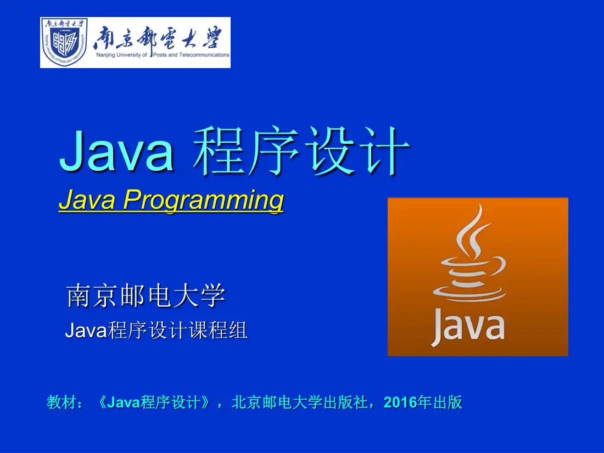

原文：

Java 程序设计Java Programming

南京邮电大学Java程序设计课程组心川

教材：《Java程序设计》，北京邮电大学出版社，2016年出版

南京鐵電大學 南京郵電大学 Nanjing University of Posts and Telecommunications

### 第1章 Java入门

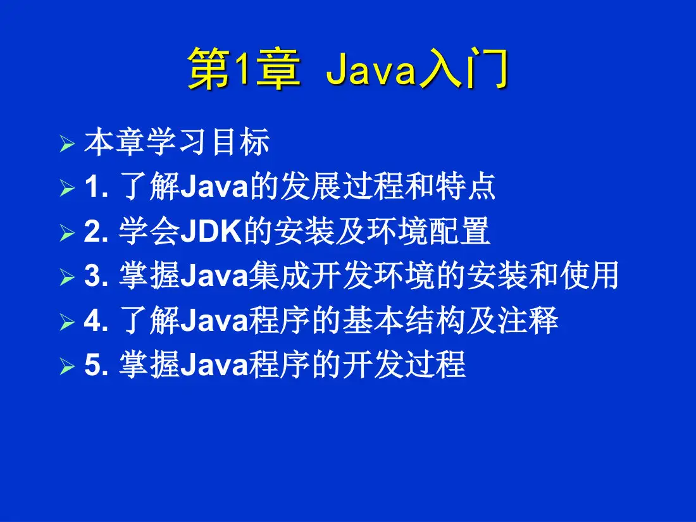

原文：

第1章 Java入门

本章学习目标

➢ 1. 了解Java的发展过程和特点

➢ 2. 学会JDK的安装及环境配置

➢3. 掌握Java集成开发环境的安装和使用

➢ 4. 了解Java程序的基本结构及注释

5. 掌握Java程序的开发过程

### 第1章 Java入门

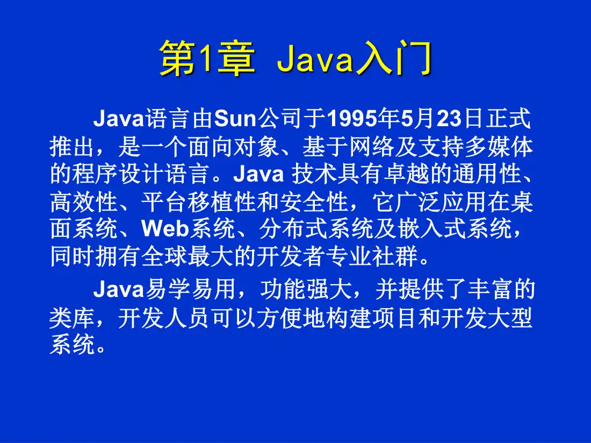

原文：

第1章 Java入门

Java语言由Sun公司于1995年5月23日正式推出，是一个面向对象、基于网络及支持多媒体的程序设计语言。Java 技术具有卓越的通用性、高效性、平台移植性和安全性，它广泛应用在桌面系统、Web系统、分布式系统及嵌入式系统，同时拥有全球最大的开发者专业社群。

Java易学易用，功能强大，并提供了丰富的类库，开发人员可以方便地构建项目和开发大型系统。

### 1.1 Java语言概述

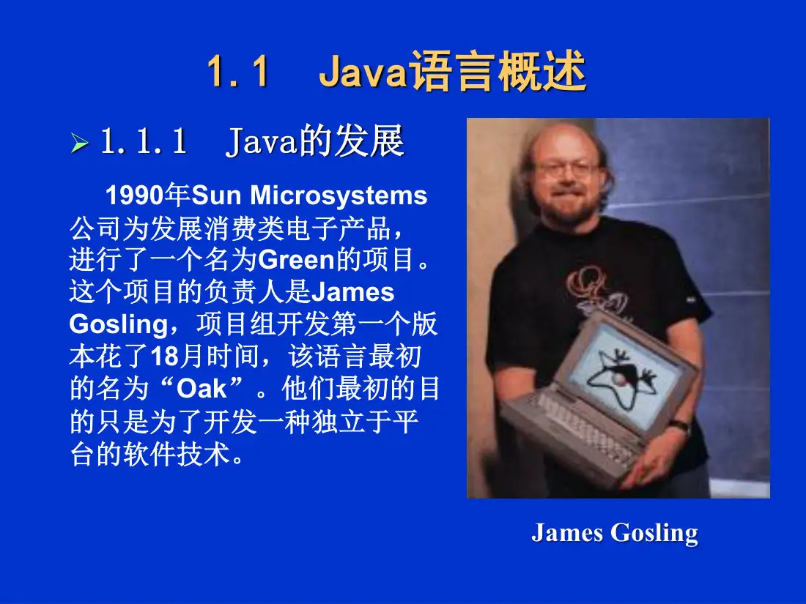

原文：

1.1 Java语言概述

➢ 1.1.1 Java的发展

1990年Sun Microsystems公司为发展消费类电子产品，进行了一个名为Green的项目。这个项目的负责人是JamesGosling，项目组开发第一个版本花了18月时间，该语言最初的名为“Oak”。他们最初的目的只是为了开发一种独立于平台的软件技术。

James Gosling

### 1.1 Java语言概述

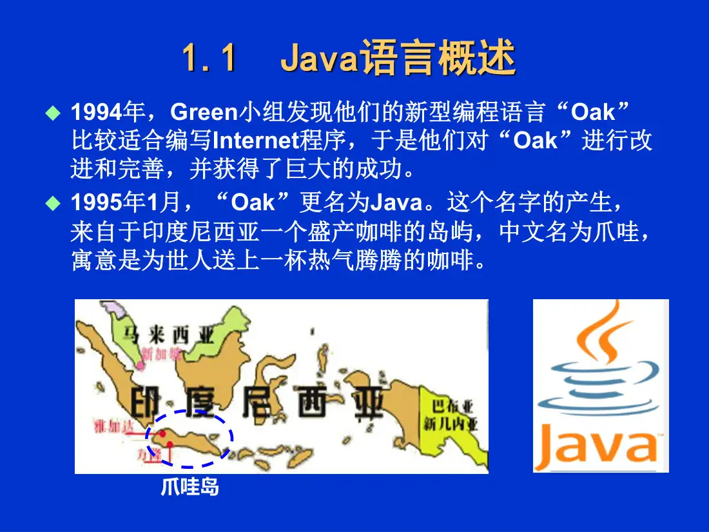

原文：

1.1 Java语言概述

1994年，Green小组发现他们的新型编程语言 $\mathfrak { C } \mathfrak { C } \mathfrak { C } \mathfrak { C }$ 比较适合编写Internet程序，于是他们对 $\mathtt { G m } \mathtt { G m }$ 进行改进和完善，并获得了巨大的成功。

1995年1月， $\mathfrak { G } \mathfrak { c } \mathfrak { s }$ 更名为Java。这个名字的产生，来自于印度尼西亚一个盛产咖啡的岛屿，中文名为爪哇，寓意是为世人送上一杯热气腾腾的咖啡。

爪哇岛

### 1.1 Java语言概述

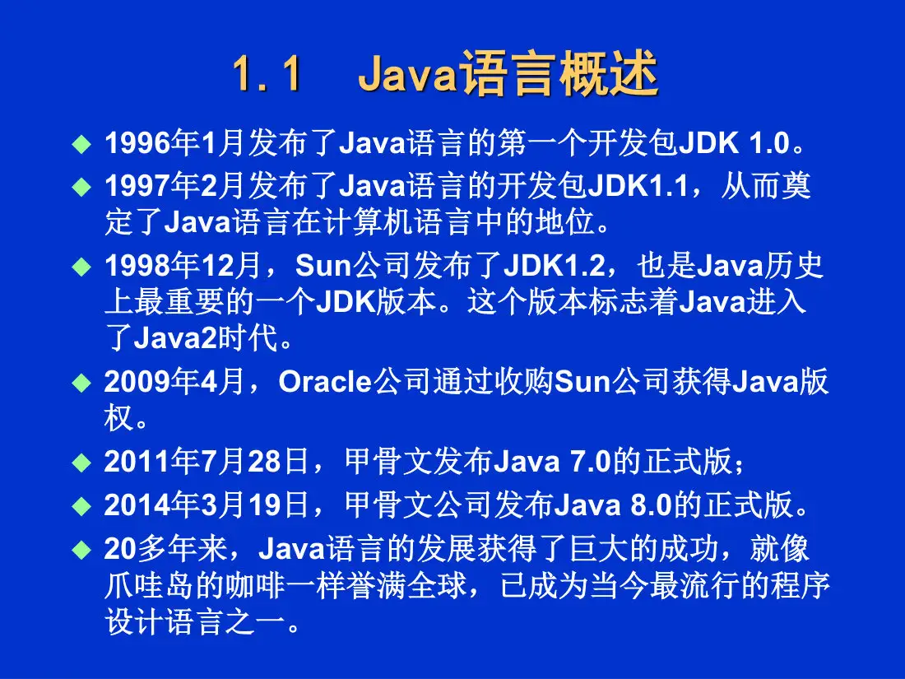

原文：

1.1 Java语言概述

◆ 1996年1月发布了Java语言的第一个开发包JDK 1.0。

1997年2月发布了Java语言的开发包JDK1.1，从而奠定了Java语言在计算机语言中的地位。

1998年12月，Sun公司发布了JDK1.2，也是Java历史上最重要的一个JDK版本。这个版本标志着Java进入了Java2时代。

2009年4月，Oracle公司通过收购Sun公司获得Java版权。

◆ 2011年7月28日，甲骨文发布Java 7.0的正式版；

◆ 2014年3月19日，甲骨文公司发布Java 8.0的正式版。

20多年来，Java语言的发展获得了巨大的成功，就像爪哇岛的咖啡一样誉满全球，已成为当今最流行的程序设计语言之一。

### 1.1 Java语言概述

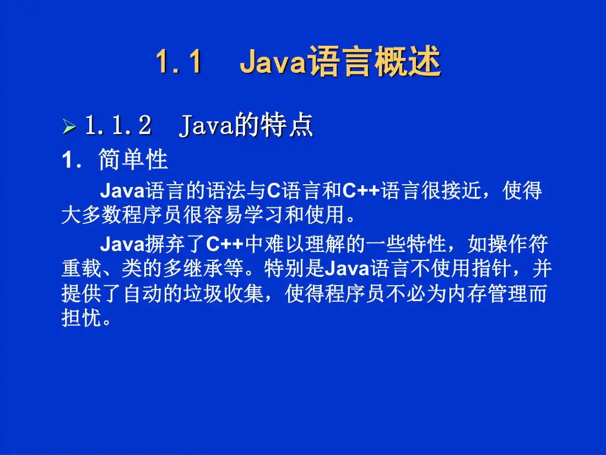

原文：

1.1 Java语言概述

➢ 1.1.2 Java的特点

1．简单性

Java语言的语法与C语言和C++语言很接近，使得大多数程序员很容易学习和使用。

Java摒弃了C++中难以理解的一些特性，如操作符重载、类的多继承等。特别是Java语言不使用指针，并提供了自动的垃圾收集，使得程序员不必为内存管理而担忧。

### 1.1 Java语言概述

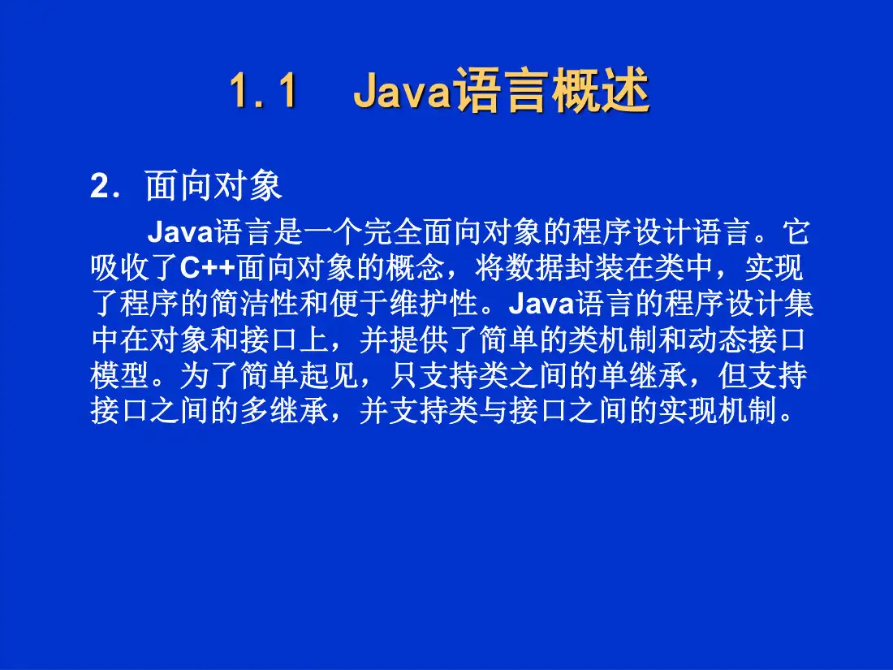

原文：

1.1 Java语言概述

2．面向对象

Java语言是一个完全面向对象的程序设计语言。它吸收了C++面向对象的概念，将数据封装在类中，实现了程序的简洁性和便于维护性。Java语言的程序设计集中在对象和接口上，并提供了简单的类机制和动态接口模型。为了简单起见，只支持类之间的单继承，但支持接口之间的多继承，并支持类与接口之间的实现机制。

### 1.1 Java语言概述

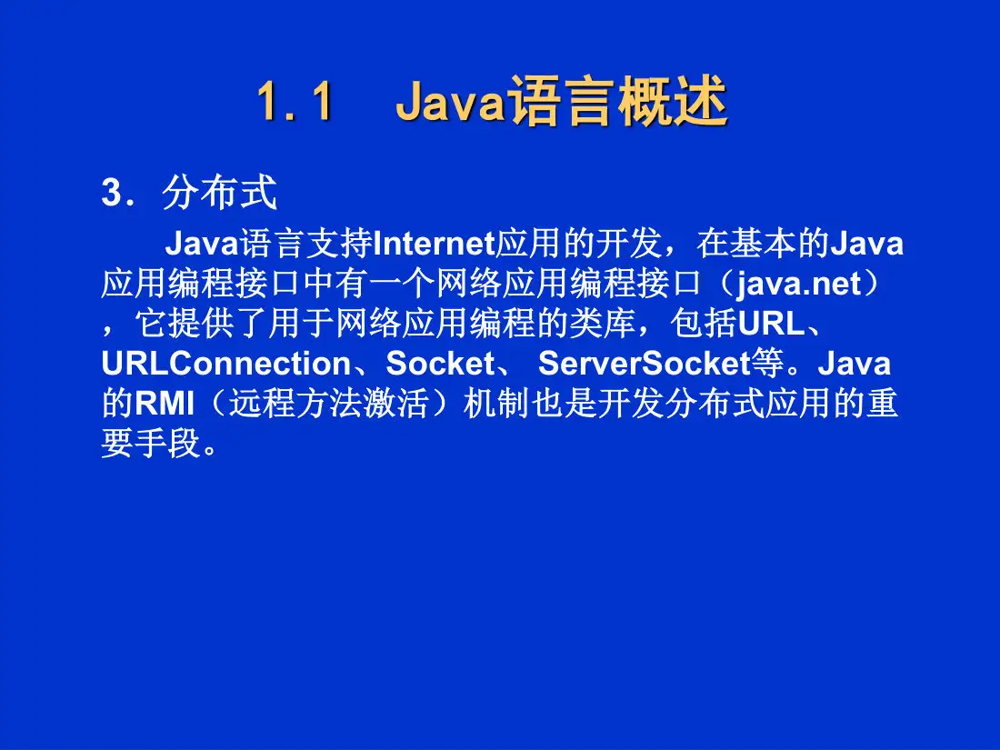

原文：

1.1 Java语言概述

3．分布式

Java语言支持Internet应用的开发，在基本的Java应用编程接口中有一个网络应用编程接口（java.net）它提供了用于网络应用编程的类库，包括URL、URLConnection、Socket、 ServerSocket等。Java的RMI（远程方法激活）机制也是开发分布式应用的重要手段。

### 1.1 Java语言概述

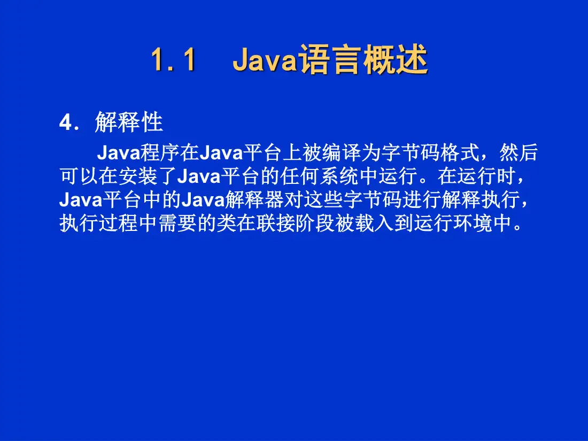

原文：

1.1 Java语言概述

4．解释性

Java程序在Java平台上被编译为字节码格式，然后可以在安装了Java平台的任何系统中运行。在运行时，Java平台中的Java解释器对这些字节码进行解释执行，执行过程中需要的类在联接阶段被载入到运行环境中。

### 1.1 Java语言概述

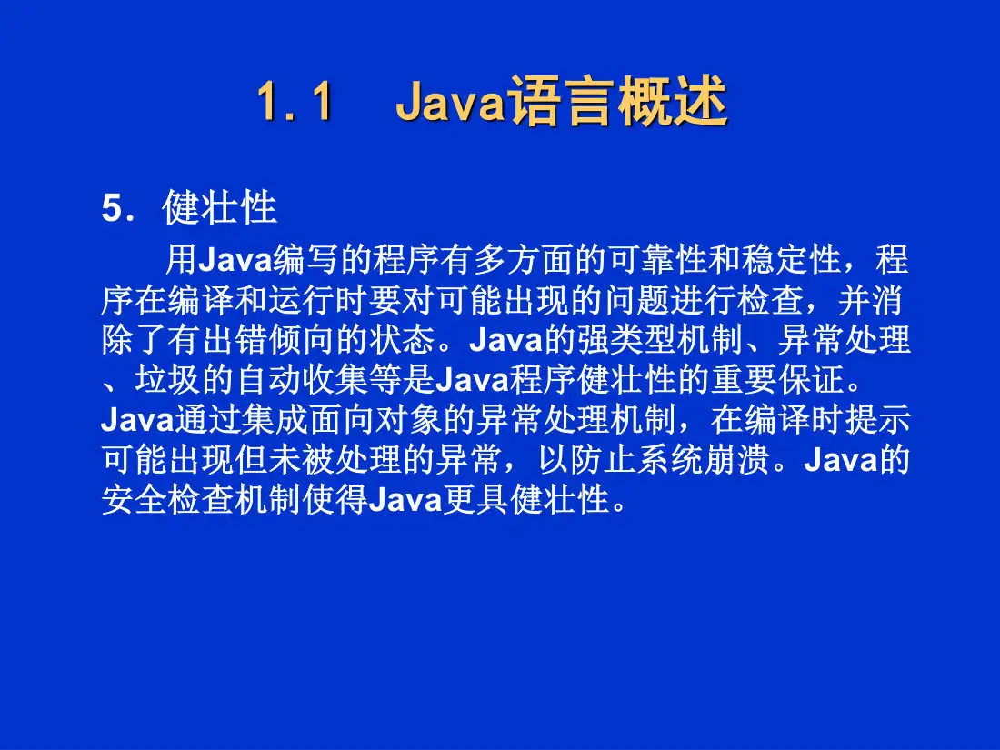

原文：

1.1 Java语言概述

5．健壮性

用Java编写的程序有多方面的可靠性和稳定性，程序在编译和运行时要对可能出现的问题进行检查，并消除了有出错倾向的状态。Java的强类型机制、异常处理垃圾的自动收集等是Java程序健壮性的重要保证。Java通过集成面向对象的异常处理机制，在编译时提示可能出现但未被处理的异常，以防止系统崩溃。Java的安全检查机制使得Java更具健壮性。

### 1.1 Java语言概述

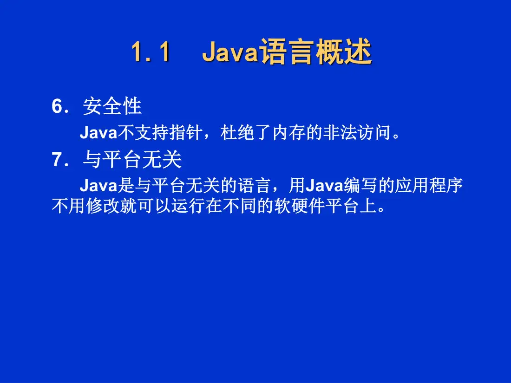

原文：

1.1 Java语言概述

6．安全性

Java不支持指针，杜绝了内存的非法访问。

7．与平台无关

Java是与平台无关的语言，用Java编写的应用程序不用修改就可以运行在不同的软硬件平台上。

### 1.1 Java语言概述

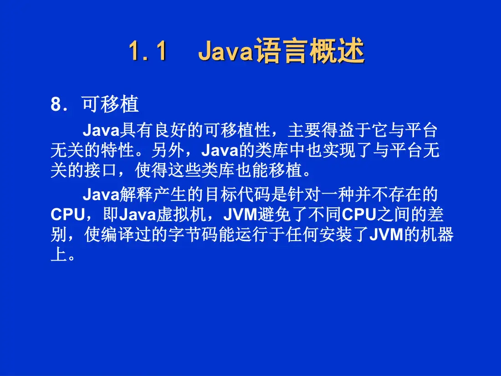

原文：

1.1 Java语言概述

8．可移植

Java具有良好的可移植性，主要得益于它与平台无关的特性。另外，Java的类库中也实现了与平台无关的接口，使得这些类库也能移植。

Java解释产生的目标代码是针对一种并不存在的CPU，即Java虚拟机，JVM避免了不同CPU之间的差别，使编译过的字节码能运行于任何安装了JVM的机器上。

### 1.1 Java语言概述

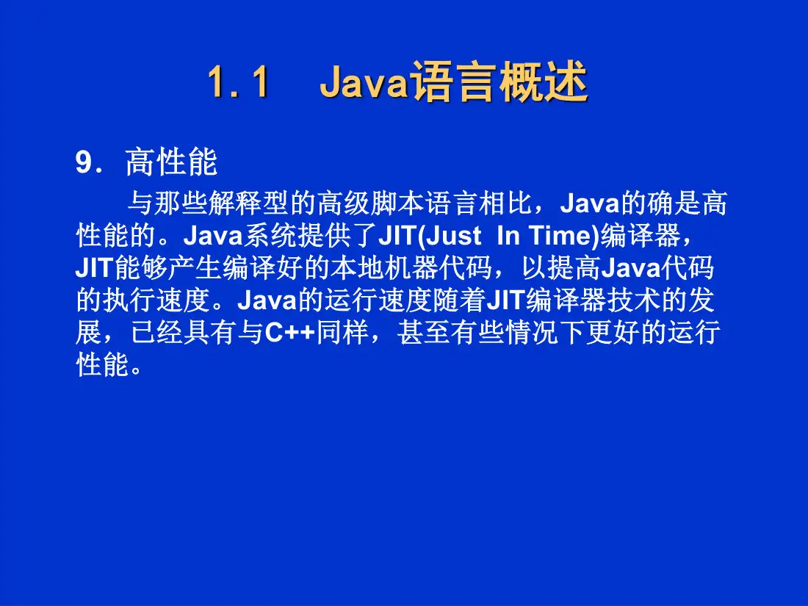

原文：

1.1 Java语言概述

9．高性能

与那些解释型的高级脚本语言相比，Java的确是高性能的。Java系统提供了JIT(Just In Time)编译器，JIT能够产生编译好的本地机器代码，以提高Java代码的执行速度。Java的运行速度随着JIT编译器技术的发展，已经具有与C++同样，甚至有些情况下更好的运行性能。

### 1.1 Java语言概述

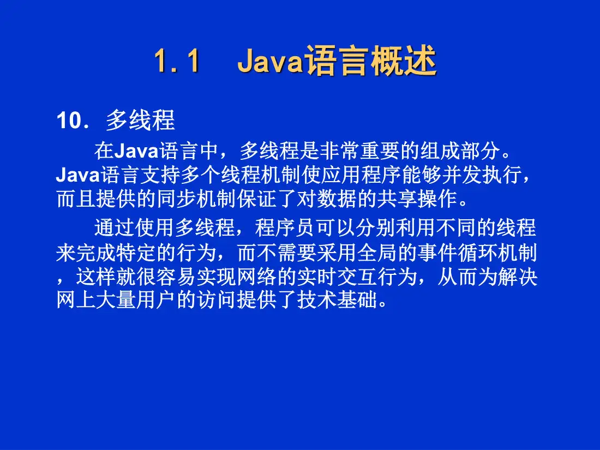

原文：

1.1 Java语言概述

10．多线程

在Java语言中，多线程是非常重要的组成部分。Java语言支持多个线程机制使应用程序能够并发执行，而且提供的同步机制保证了对数据的共享操作。

通过使用多线程，程序员可以分别利用不同的线程来完成特定的行为，而不需要采用全局的事件循环机制这样就很容易实现网络的实时交互行为，从而为解决网上大量用户的访问提供了技术基础。

### 1.1 Java语言概述

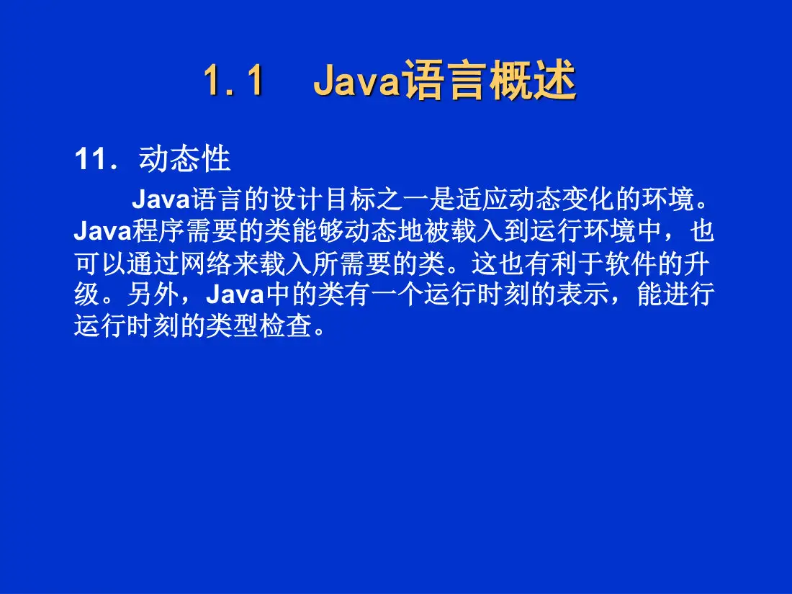

原文：

1.1 Java语言概述

11．动态性

Java语言的设计目标之一是适应动态变化的环境。Java程序需要的类能够动态地被载入到运行环境中，也可以通过网络来载入所需要的类。这也有利于软件的升级。另外，Java中的类有一个运行时刻的表示，能进行运行时刻的类型检查。

### 1.2 Java平台工作原理

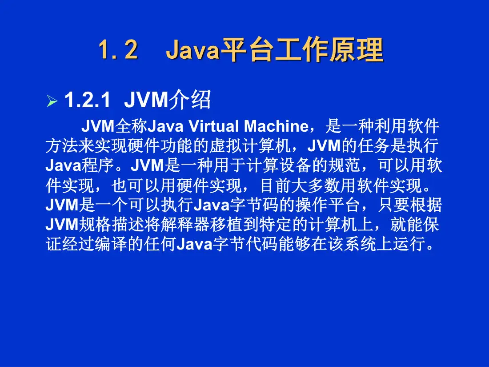

原文：

1.2 Java平台工作原理

➢ 1.2.1 JVM介绍

JVM全称Java Virtual Machine，是一种利用软件方法来实现硬件功能的虚拟计算机，JVM的任务是执行Java程序。JVM是一种用于计算设备的规范，可以用软件实现，也可以用硬件实现，目前大多数用软件实现。JVM是一个可以执行Java字节码的操作平台，只要根据JVM规格描述将解释器移植到特定的计算机上，就能保证经过编译的任何Java字节代码能够在该系统上运行。

### 1.2 Java平台工作原理

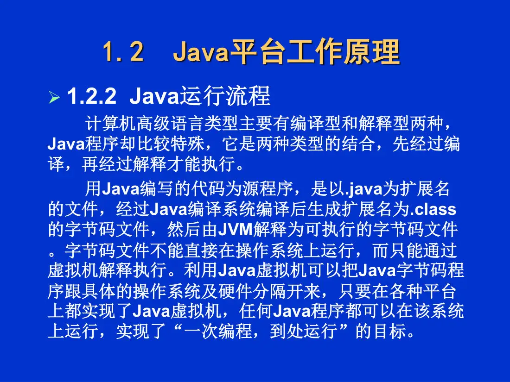

原文：

1.2 Java平台工作原理

1.2.2 Java运行流程

计算机高级语言类型主要有编译型和解释型两种，Java程序却比较特殊，它是两种类型的结合，先经过编译，再经过解释才能执行。

用Java编写的代码为源程序，是以.java为扩展名的文件，经过Java编译系统编译后生成扩展名为.class的字节码文件，然后由JVM解释为可执行的字节码文件。字节码文件不能直接在操作系统上运行，而只能通过虚拟机解释执行。利用Java虚拟机可以把Java字节码程序跟具体的操作系统及硬件分隔开来，只要在各种平台上都实现了Java虚拟机，任何Java程序都可以在该系统上运行，实现了“一次编程，到处运行”的目标。

### 1.2 Java平台工作原理

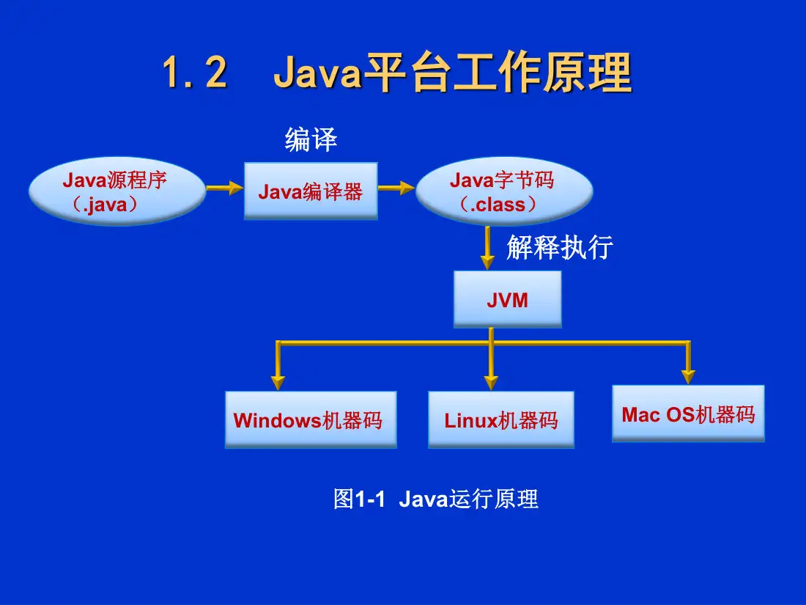

原文：

1.2 Java平台工作原理

### 1.3 Java开发环境

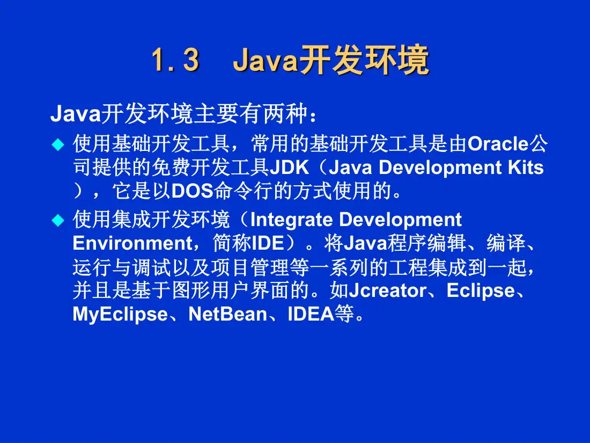

原文：

1.3 Java开发环境

Java开发环境主要有两种：

使用基础开发工具，常用的基础开发工具是由Oracle公司提供的免费开发工具JDK（Java Development Kits），它是以DOS命令行的方式使用的。

使用集成开发环境（Integrate DevelopmentEnvironment，简称IDE）。将Java程序编辑、编译、运行与调试以及项目管理等一系列的工程集成到一起，并且是基于图形用户界面的。如Jcreator、Eclipse、MyEclipse、NetBean、IDEA等。

### 1.3 Java开发环境

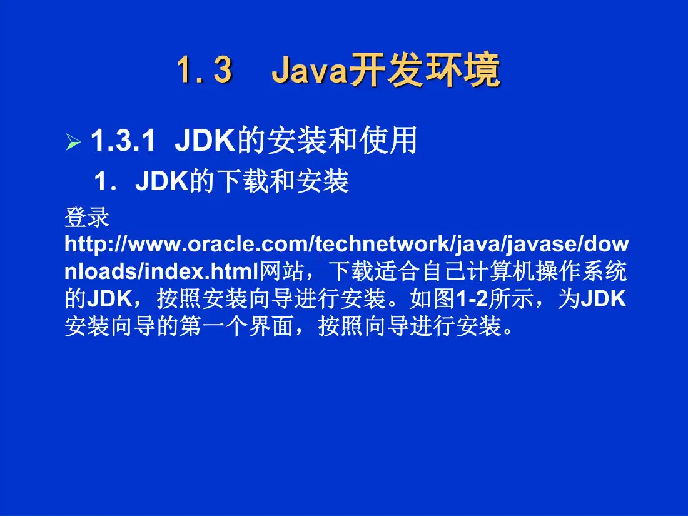

原文：

1.3 Java开发环境

1.3.1 JDK的安装和使用

1．JDK的下载和安装

登录

http://www.oracle.com/technetwork/java/javase/downloads/index.html网站，下载适合自己计算机操作系统的JDK，按照安装向导进行安装。如图1-2所示，为JDK安装向导的第一个界面，按照向导进行安装。

### 1.3 Java开发环境

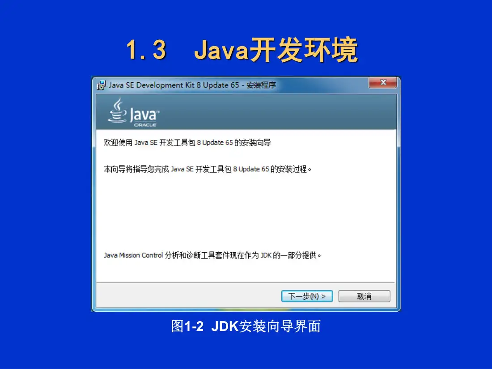

原文：

1.3 Java开发环境

Java SE Development Kit 8 Update 65 - 安装程序

欢迎使用 Java SE开发工具包8 Update 65的安装向导

本向导将指导您完成Java SE开发工具包8 Update 65的安装过程。

Java Mission Control 分析和诊断工具套件现在作为JDK的一部分提供。

下一步(N) >

取消

图1-2 JDK安装向导界面

### 1.3 Java开发环境

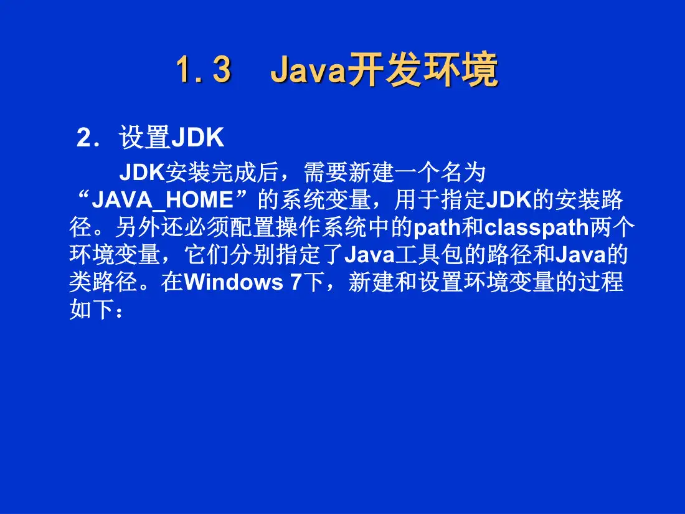

原文：

1.3 Java开发环境

2．设置JDK

JDK安装完成后，需要新建一个名为“JAVA\_HOME”的系统变量，用于指定JDK的安装路径。另外还必须配置操作系统中的path和classpath两个环境变量，它们分别指定了Java工具包的路径和Java的类路径。在Windows 7下，新建和设置环境变量的过程如下：

### 1.3 Java开发环境

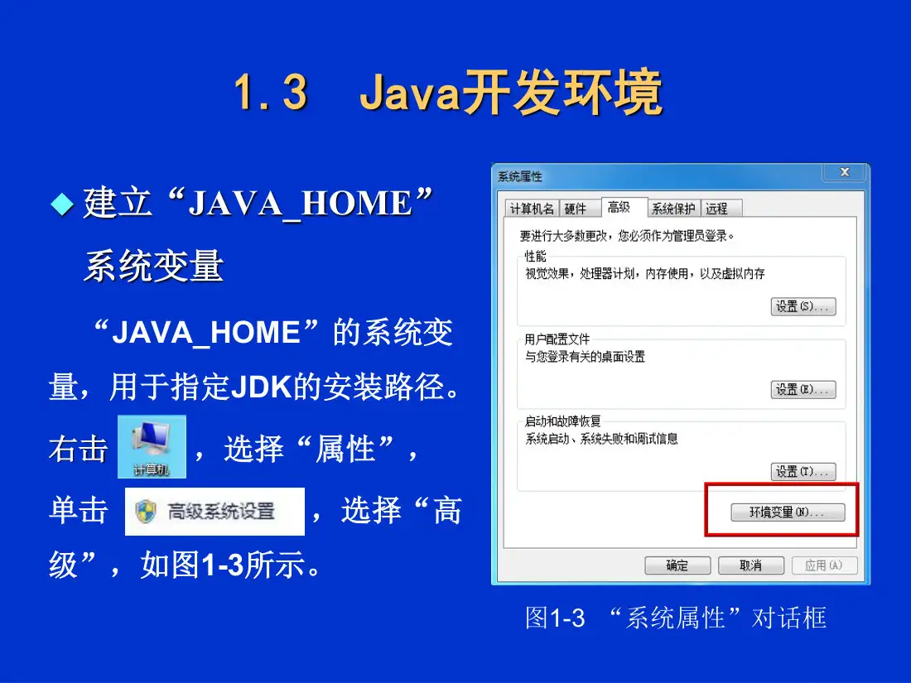

原文：

1.3 Java开发环境

建立“JAVA\_HOME”系统变量

“JAVA\_HOME” 的系统变量，用于指定JDK的安装路径。右击 ，选择“属性”，计算机单击 高级系统设置 选择“高级”，如图1-3所示。

### 1.3 Java开发环境

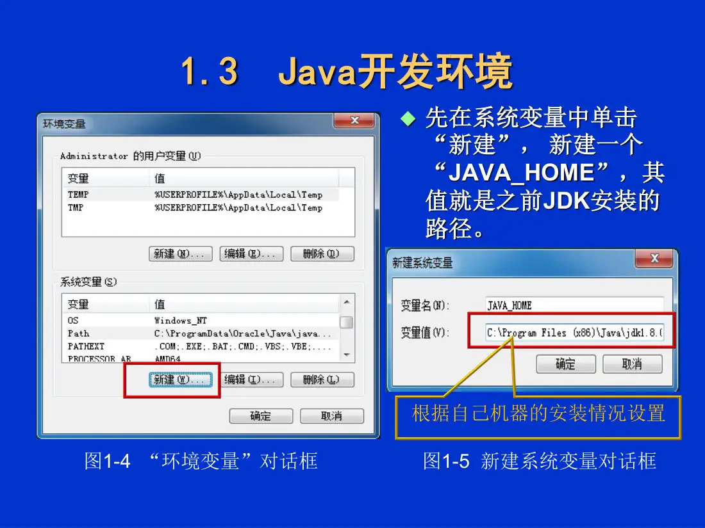

原文：

<table><tr><td>变量</td><td>值</td></tr><tr><td>TEMP</td><td>%USERPROFILE%\AppData\Local\Temp</td></tr><tr><td>TMP</td><td>%USERPROFILE%\AppData\Local\Temp</td></tr></table>

<table><tr><td>变量</td><td>值</td></tr><tr><td>OS</td><td>Windows_NT</td></tr><tr><td>Path</td><td>C:\ProgramData\Oracle\Java\java...</td></tr><tr><td>PATHEXT</td><td>.COM;.EXE;.BAT;.CMD;.VBS;.VBE;....</td></tr><tr><td>PROCESSOR AR</td><td>AMD64</td></tr></table>

1.3 Java开发环境

环境变量

Administrator的用户变量(U)

先在系统变量中单击“新建”， 新建一个“JAVA\_HOME”，其值就是之前JDK安装的路径。

新建()...

编辑(E)...

删除(@)

系统变量(S)

新建()

编辑(I）.

删除(L)

确定

取消

图1-4 “环境变量”对话框

新建系统变量

变量名(N):

JAVA\_HOME

变量值(V):

C:\Program Files (x86)\Java\jdk1.8.(

确定

取消

根据自己机器的安装情况设置

图1-5 新建系统变量对话框

### 1.3 Java开发环境

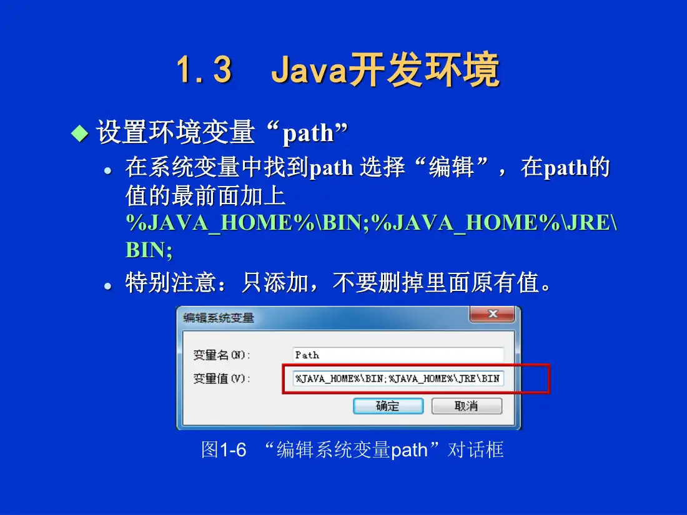

原文：

1.3 Java开发环境

设置环境变量 $| \mathfrak { g } _ { 2 } | | \mathfrak { g } _ { 2 } | | \mathfrak { g } _ { 1 } | |$

⚫ 在系统变量中找到path 选择“编辑”，在path的值的最前面加上%JAVA\_HOME%\BIN;%JAVA\_HOME%\JRE\BIN;

⚫ 特别注意：只添加，不要删掉里面原有值。

变量名(N):

变量值(V):

Path

XJAVA\_HOME%\BIN;%JAVA\_HOME%\JRE\BIN

确定

取消

图1-6 “编辑系统变量path”对话框

### 1.3 Java开发环境

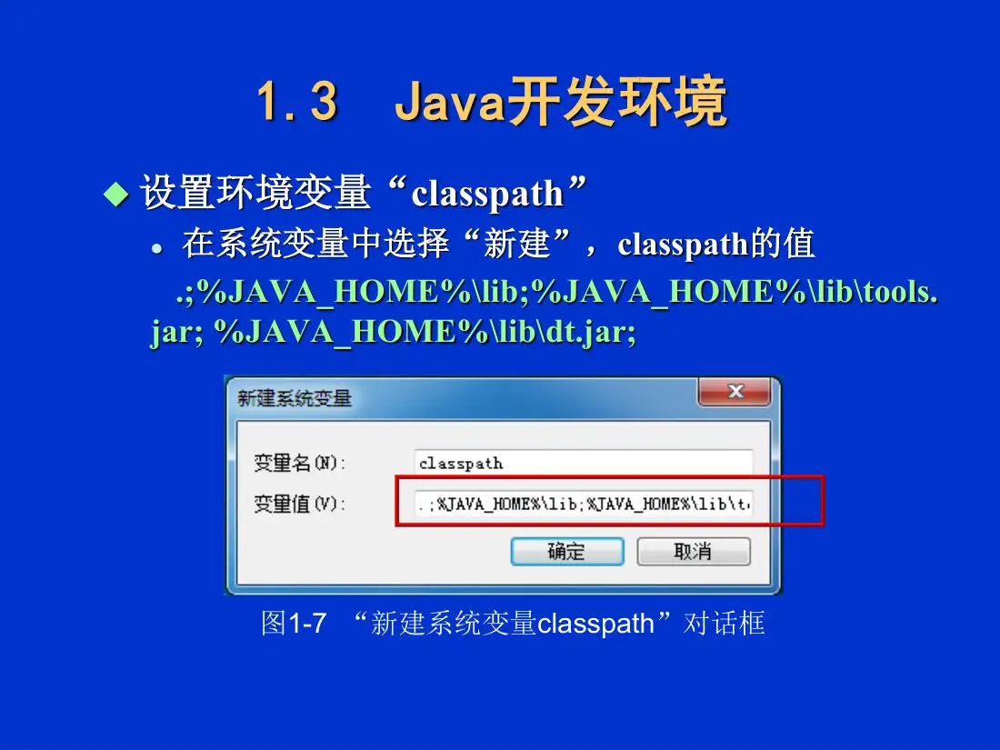

原文：

1.3 Java开发环境

设置环境变量“classpath”⚫ 在系统变量中选择“新建”，classpath的值.;%JAVA\_HOME%\lib;%JAVA\_HOME%\lib\tools.jar; %JAVA\_HOME%\lib\dt.jar;

新建系统变量

变量名 (0):

classpath

变量值 (V):

. :%JAVA\_HOME%\lib;%JAVA\_HOME%\lib\t.

确定

取消

图1-7 “新建系统变量classpath”对话框

### 1.3 Java开发环境

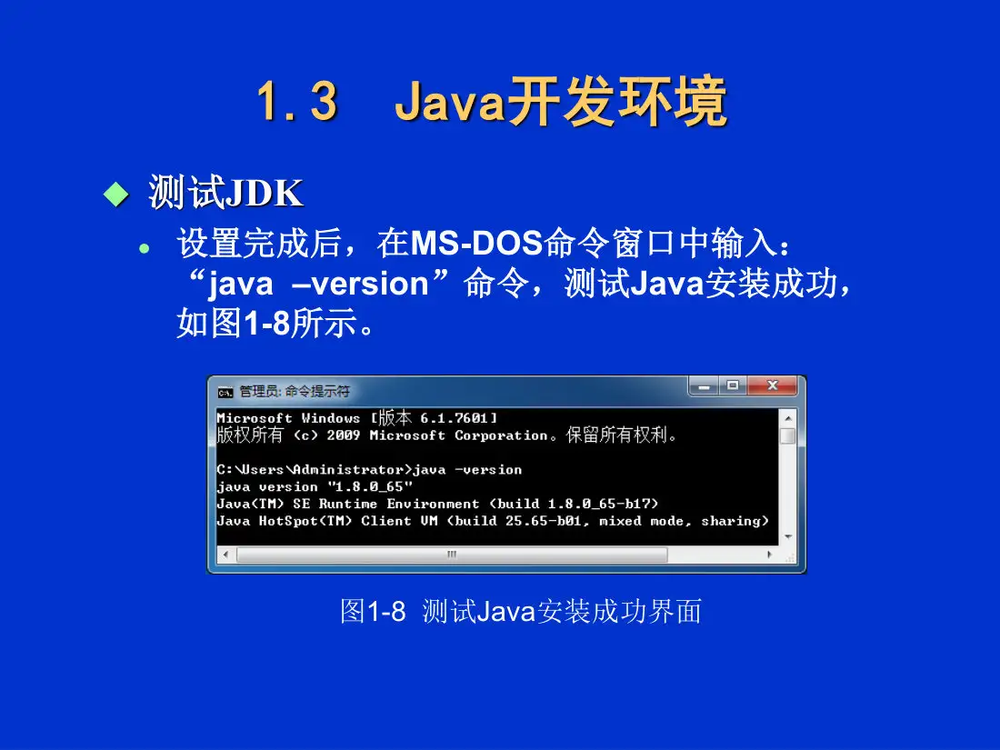

原文：

1.3 Java开发环境

◆ 测试JDK

⚫ 设置完成后，在MS-DOS命令窗口中输入：“java –version”命令，测试Java安装成功，如图1-8所示。

管理员：命令提示符

图1-8 测试Java安装成功界面

### 1.3 Java开发环境

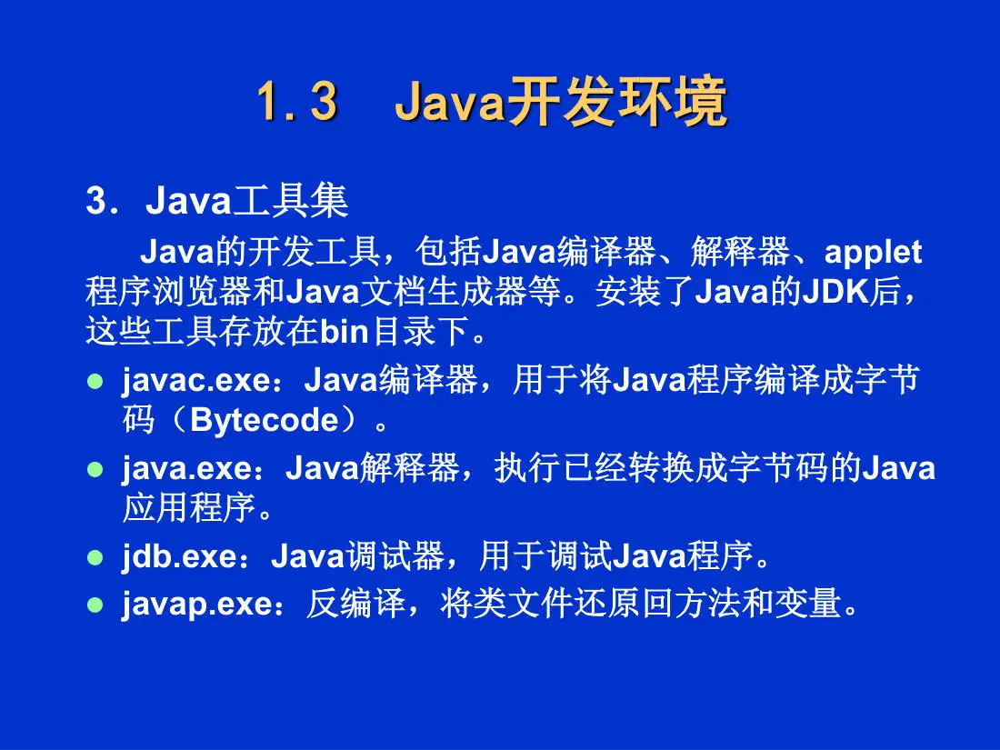

原文：

1.3 Java开发环境

3．Java工具集

Java的开发工具，包括Java编译器、解释器、applet程序浏览器和Java文档生成器等。安装了Java的JDK后，这些工具存放在bin目录下。

javac.exe：Java编译器，用于将Java程序编译成字节码（Bytecode）。

java.exe：Java解释器，执行已经转换成字节码的Java应用程序。

⚫ jdb.exe：Java调试器，用于调试Java程序。

⚫ javap.exe：反编译，将类文件还原回方法和变量。

### 1.3 Java开发环境

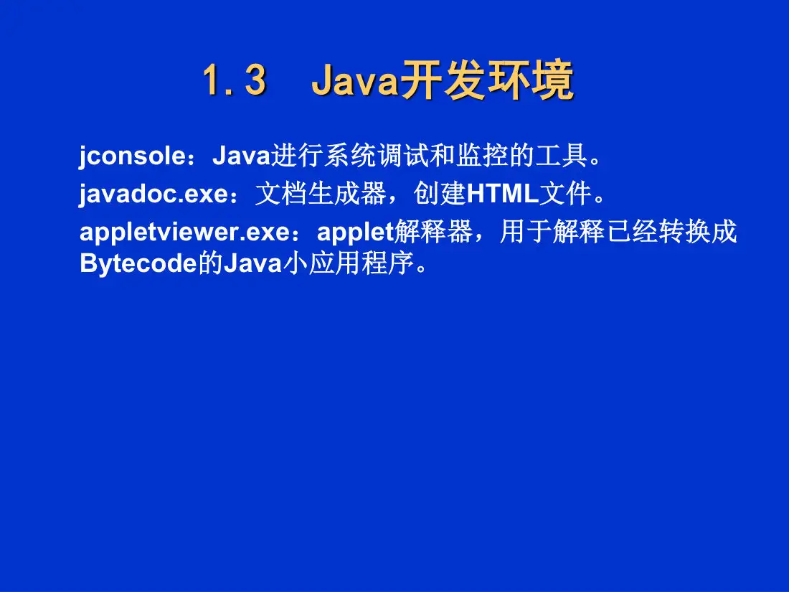

原文：

1.3 Java开发环境

jconsole：Java进行系统调试和监控的工具。javadoc.exe：文档生成器，创建HTML文件。appletviewer.exe：applet解释器，用于解释已经转换成Bytecode的Java小应用程序。

### 1.3 Java开发环境

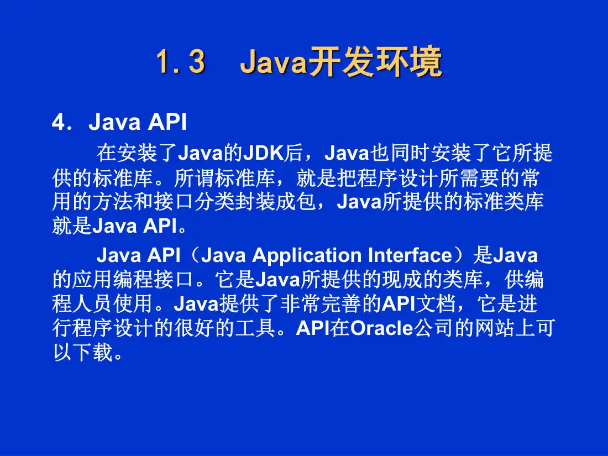

原文：

1.3 Java开发环境

4．Java API

在安装了Java的JDK后，Java也同时安装了它所提供的标准库。所谓标准库，就是把程序设计所需要的常用的方法和接口分类封装成包，Java所提供的标准类库就是Java API。

Java API（Java Application Interface）是Java的应用编程接口。它是Java所提供的现成的类库，供编程人员使用。Java提供了非常完善的API文档，它是进行程序设计的很好的工具。API在Oracle公司的网站上可以下载。

### 1.3 Java开发环境

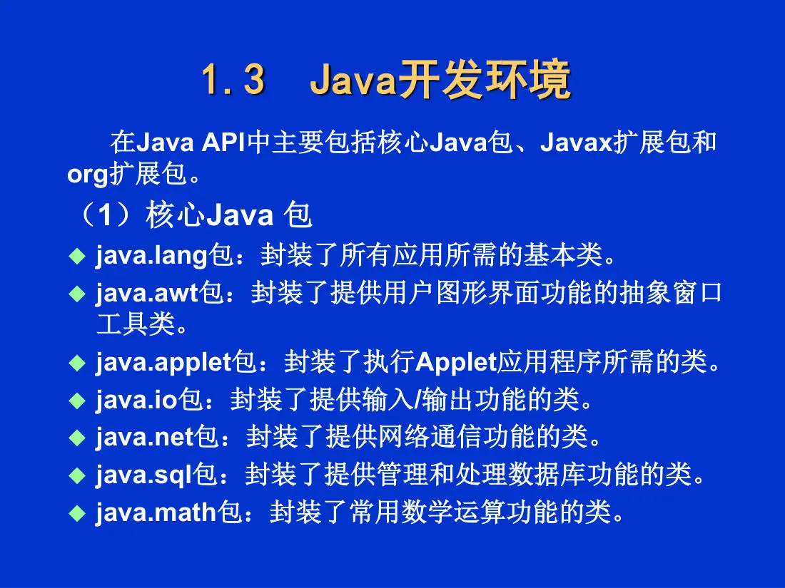

原文：

1.3 Java开发环境

在Java API中主要包括核心Java包、Javax扩展包和org扩展包。

（1）核心Java 包

◆ java.lang包：封装了所有应用所需的基本类。

java.awt包：封装了提供用户图形界面功能的抽象窗口工具类。

◆ java.applet包：封装了执行Applet应用程序所需的类。

◆ java.io包：封装了提供输入/输出功能的类。

◆ java.net包：封装了提供网络通信功能的类。

◆ java.sql包：封装了提供管理和处理数据库功能的类。

◆ java.math包：封装了常用数学运算功能的类。

### 1.3 Java开发环境

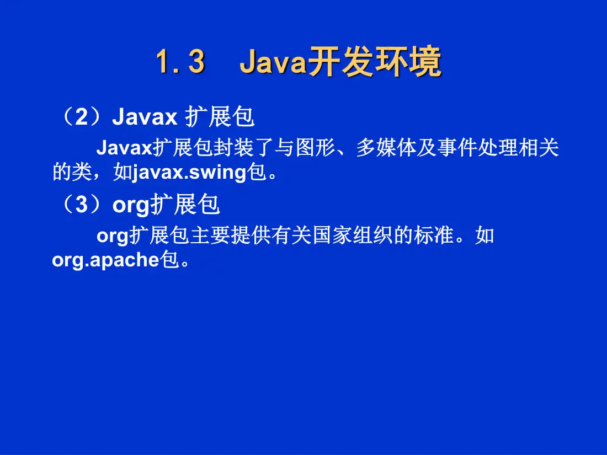

原文：

1.3 Java开发环境

（2）Javax 扩展包

Javax扩展包封装了与图形、多媒体及事件处理相关的类，如javax.swing包。

（3）org扩展包

org扩展包主要提供有关国家组织的标准。如org.apache包。

### 1.3 Java开发环境

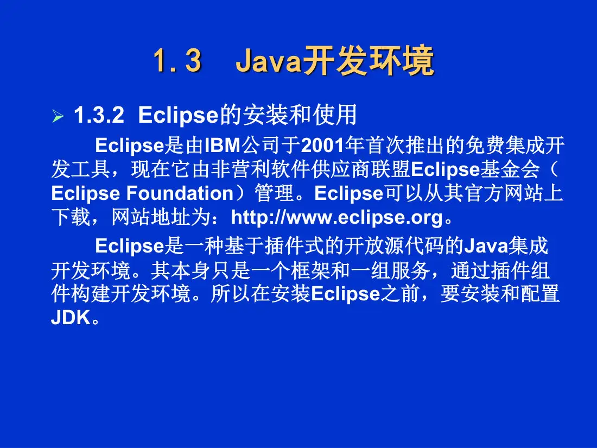

原文：

1.3 Java开发环境

1.3.2 Eclipse的安装和使用

Eclipse是由IBM公司于2001年首次推出的免费集成开发工具，现在它由非营利软件供应商联盟Eclipse基金会Eclipse Foundation）管理。Eclipse可以从其官方网站上下载，网站地址为：http://www.eclipse.org。

Eclipse是一种基于插件式的开放源代码的Java集成开发环境。其本身只是一个框架和一组服务，通过插件组件构建开发环境。所以在安装Eclipse之前，要安装和配置JDK。

### 1.3 Java开发环境

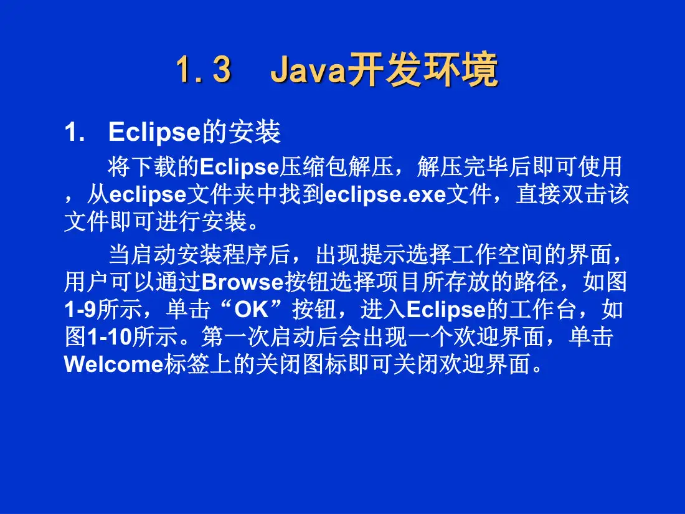

原文：

1.3 Java开发环境

1. Eclipse的安装

将下载的Eclipse压缩包解压，解压完毕后即可使用，从eclipse文件夹中找到eclipse.exe文件，直接双击该文件即可进行安装。

当启动安装程序后，出现提示选择工作空间的界面，用户可以通过Browse按钮选择项目所存放的路径，如图1-9所示，单击“OK”按钮，进入Eclipse的工作台，如图1-10所示。第一次启动后会出现一个欢迎界面，单击Welcome标签上的关闭图标即可关闭欢迎界面。

### 1.3 Java开发环境

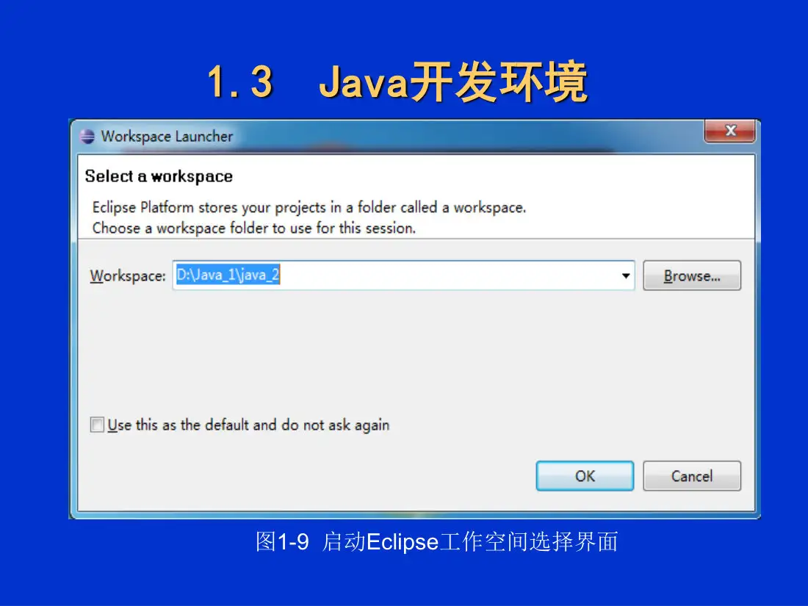

原文：

1.3 Java开发环境

Workspace Launcher

Select a workspace

Eclipse Platform stores your projects in a folder called a workspace. Choose a workspace folder to use for this session.

Workspace: D:Java\_1\java\_2

Browse...

Use this as the default and do not ask again

OK

Cancel

图1-9 启动Eclipse工作空间选择界面

### 1.3 Java开发环境

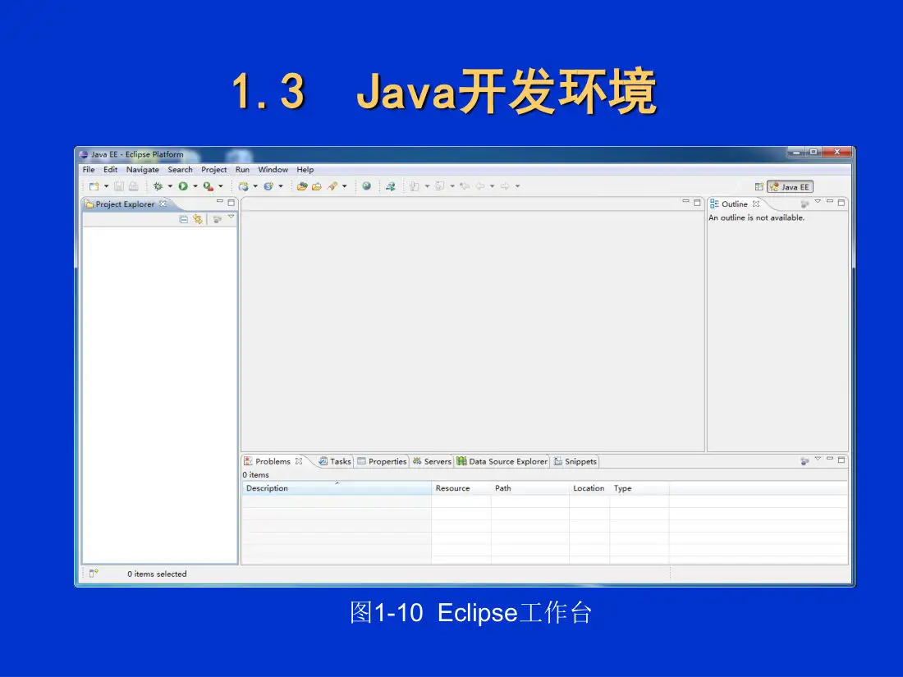

原文：

1.3 Java开发环境

### 1.3 Java开发环境

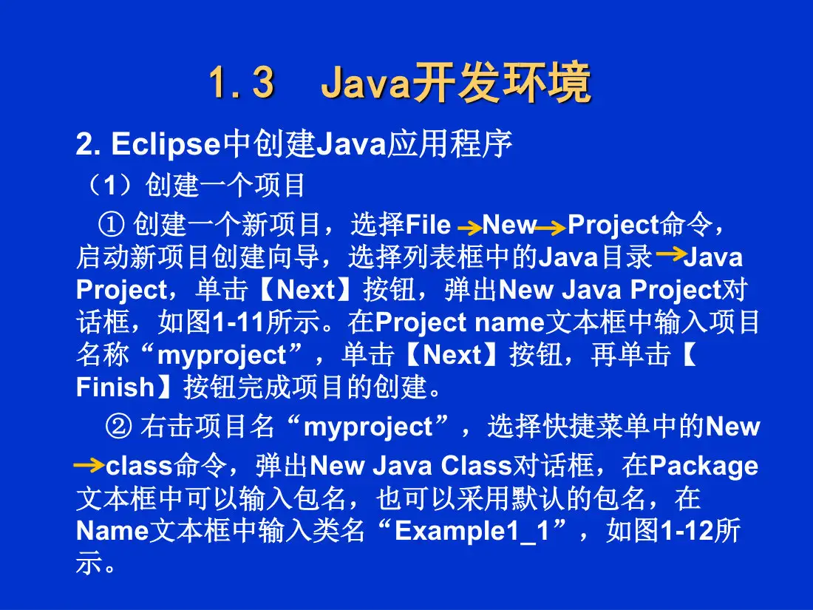

原文：

1.3 Java开发环境

2. Eclipse中创建Java应用程序

（1）创建一个项目

① 创建一个新项目，选择File New Project命令，启动新项目创建向导，选择列表框中的Java目录 JavaProject，单击【Next】按钮，弹出New Java Project对话框，如图1-11所示。在Project name文本框中输入项目名称“myproject”，单击【Next】按钮，再单击【Finish】按钮完成项目的创建。

② 右击项目名“myproject”，选择快捷菜单中的Newclass命令，弹出New Java Class对话框，在Package文本框中可以输入包名，也可以采用默认的包名，在Name文本框中输入类名“Example1\_1”，如图1-12所示。

### 1.3 Java开发环境

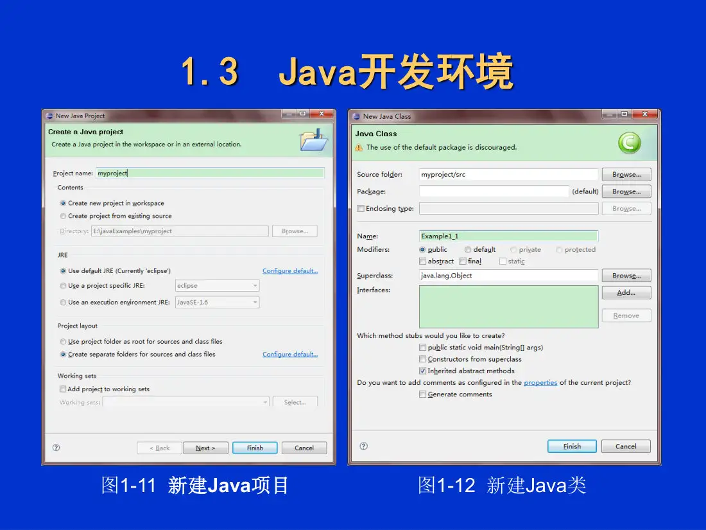

原文：

1.3 Java开发环境

### 1.3 Java开发环境

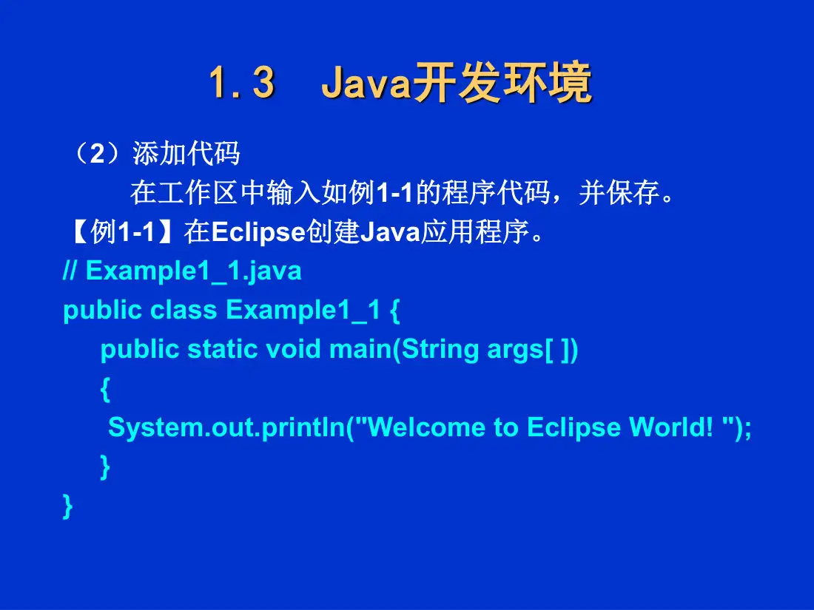

原文：

1.3 Java开发环境

（2）添加代码在工作区中输入如例1-1的程序代码，并保存。

System.out.println("Welcome to Eclipse World! ");

### 1.3 Java开发环境

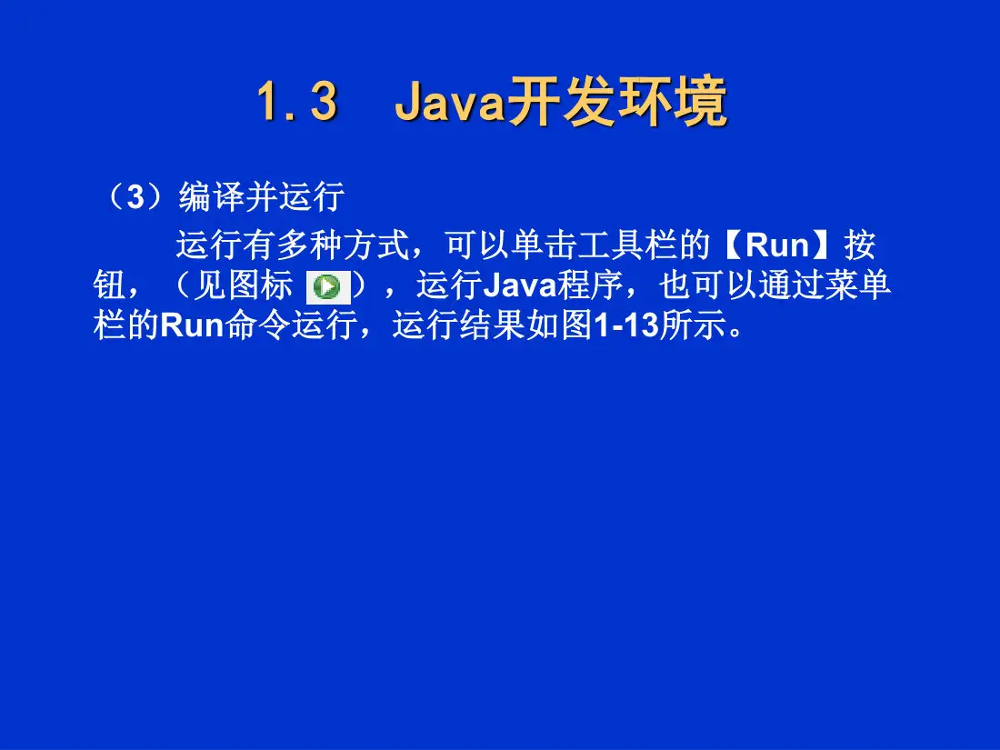

原文：

1.3 Java开发环境

（3）编译并运行

运行有多种方式，可以单击工具栏的【Run】按钮，（见图标 ），运行Java程序，也可以通过菜单栏的Run命令运行，运行结果如图1-13所示。

### 1.3 Java开发环境

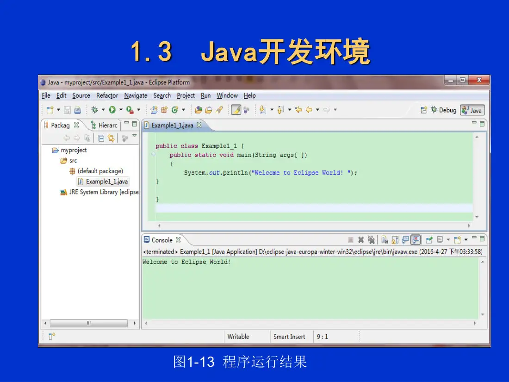

原文：

1.3 Java开发环境

### 1.4 实现第一个Java程序

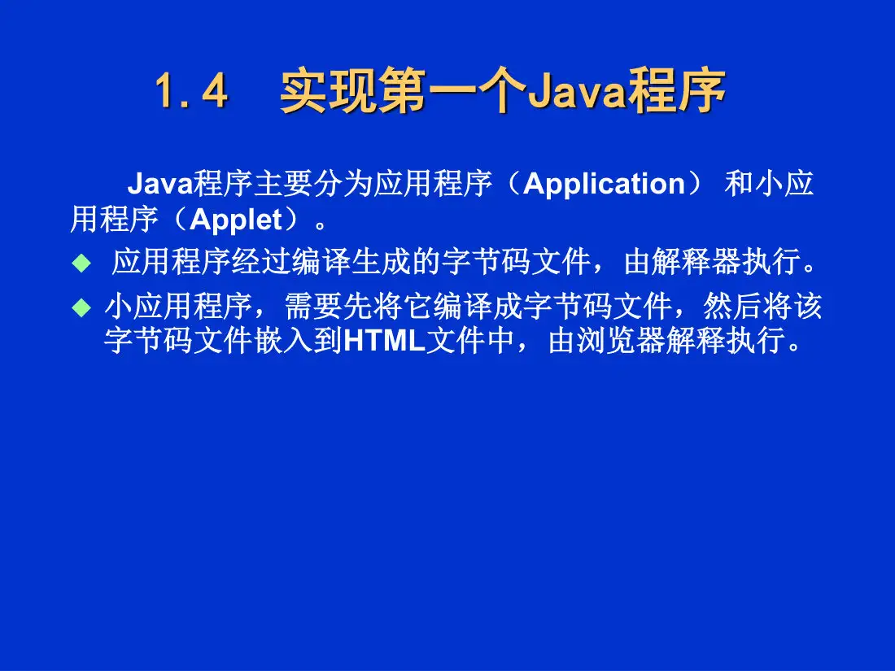

原文：

1.4 实现第一个Java程序

Java程序主要分为应用程序（Application） 和小应用程序（Applet）。

应用程序经过编译生成的字节码文件，由解释器执行。

◆ 小应用程序，需要先将它编译成字节码文件，然后将该字节码文件嵌入到HTML文件中，由浏览器解释执行。

### 1.4 实现第一个Java程序

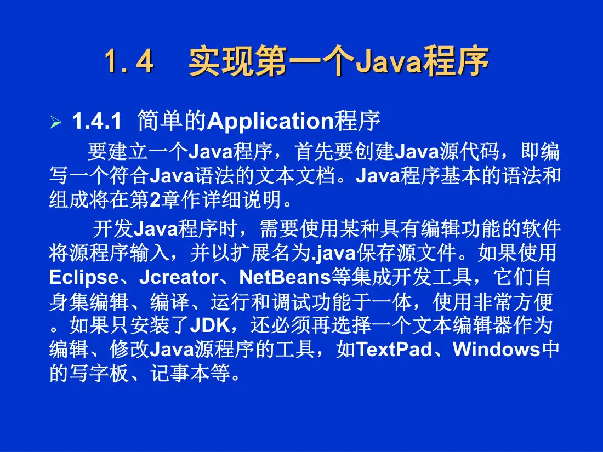

原文：

1.4 实现第一个Java程序

1.4.1 简单的Application程序

要建立一个Java程序，首先要创建Java源代码，即编写一个符合Java语法的文本文档。Java程序基本的语法和组成将在第2章作详细说明。

开发Java程序时，需要使用某种具有编辑功能的软件将源程序输入，并以扩展名为.java保存源文件。如果使用Eclipse、Jcreator、NetBeans等集成开发工具，它们自身集编辑、编译、运行和调试功能于一体，使用非常方便。如果只安装了JDK，还必须再选择一个文本编辑器作为编辑、修改Java源程序的工具，如TextPad、Windows中的写字板、记事本等。

### 1.4 实现第一个Java程序

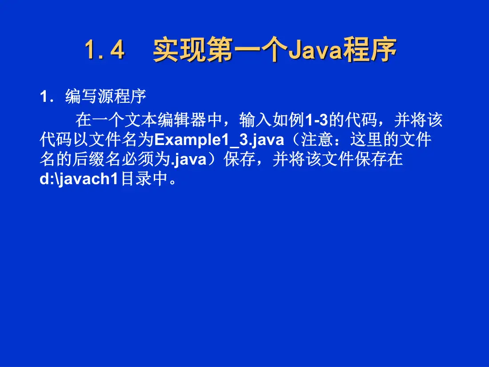

原文：

1.4 实现第一个Java程序

1．编写源程序

在一个文本编辑器中，输入如例1-3的代码，并将该代码以文件名为Example1\_3.java（注意：这里的文件名的后缀名必须为.java）保存，并将该文件保存在d:\javach1目录中。

### 1.4 实现第一个Java程序

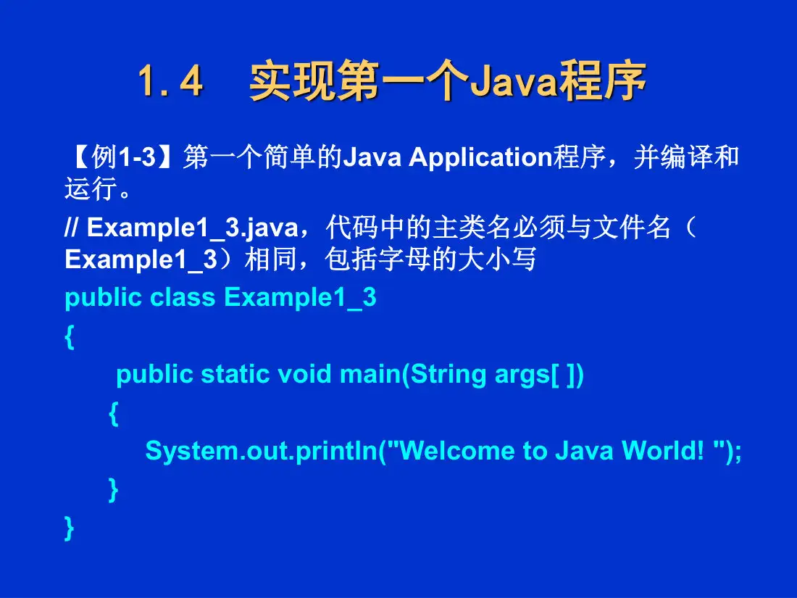

原文：

1.4 实现第一个Java程序

【例1-3】第一个简单的Java Application程序，并编译和运行。

// Example1\_3.java，代码中的主类名必须与文件名Example1\_3）相同，包括字母的大小写public class Example1\_3

public static void main(String args[ ])

System.out.println("Welcome to Java World! ");

### 1.4 实现第一个Java程序

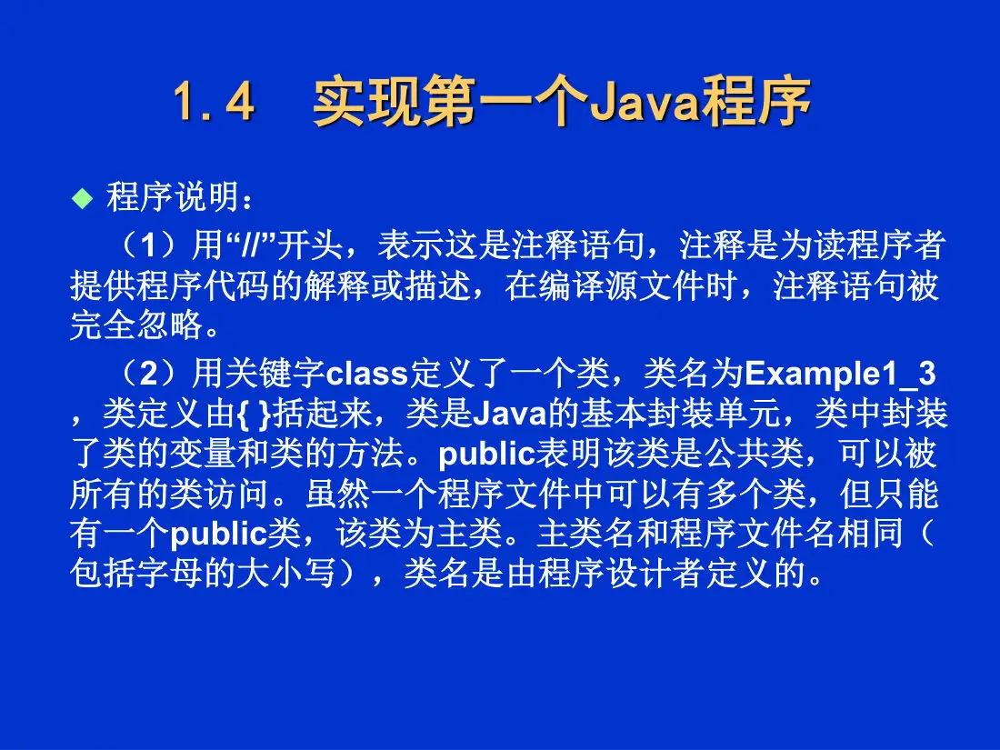

原文：

1.4 实现第一个Java程序

程序说明：

（1）用“//”开头，表示这是注释语句，注释是为读程序者提供程序代码的解释或描述，在编译源文件时，注释语句被完全忽略。

（2）用关键字class定义了一个类，类名为Example1\_3，类定义由{ }括起来，类是Java的基本封装单元，类中封装了类的变量和类的方法。public表明该类是公共类，可以被所有的类访问。虽然一个程序文件中可以有多个类，但只能有一个public类，该类为主类。主类名和程序文件名相同（包括字母的大小写），类名是由程序设计者定义的。

### 1.4 实现第一个Java程序

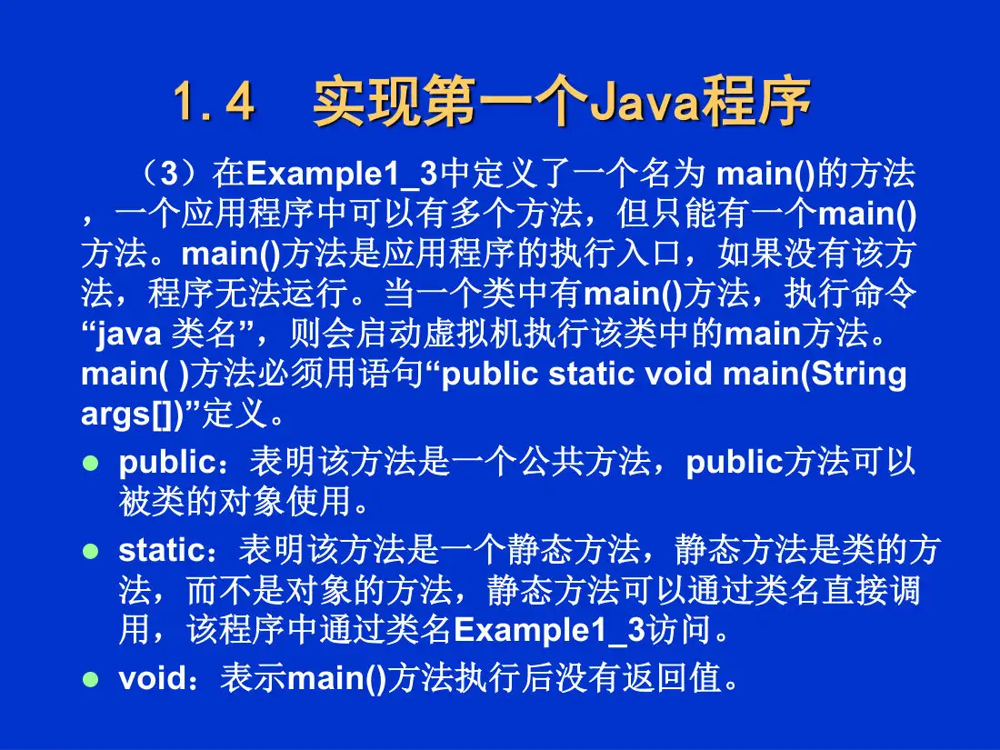

原文：

1.4 实现第一个Java程序

（3）在Example1\_3中定义了一个名为 main()的方法一个应用程序中可以有多个方法，但只能有一个main()方法。main()方法是应用程序的执行入口，如果没有该方法，程序无法运行。当一个类中有main()方法，执行命令“java 类名”，则会启动虚拟机执行该类中的main方法。main( )方法必须用语句“public static void main(Stringargs[])”定义。

public：表明该方法是一个公共方法，public方法可以被类的对象使用。

static：表明该方法是一个静态方法，静态方法是类的方法，而不是对象的方法，静态方法可以通过类名直接调用，该程序中通过类名Example1\_3访问。

⚫ void：表示main()方法执行后没有返回值。

### 1.4 实现第一个Java程序

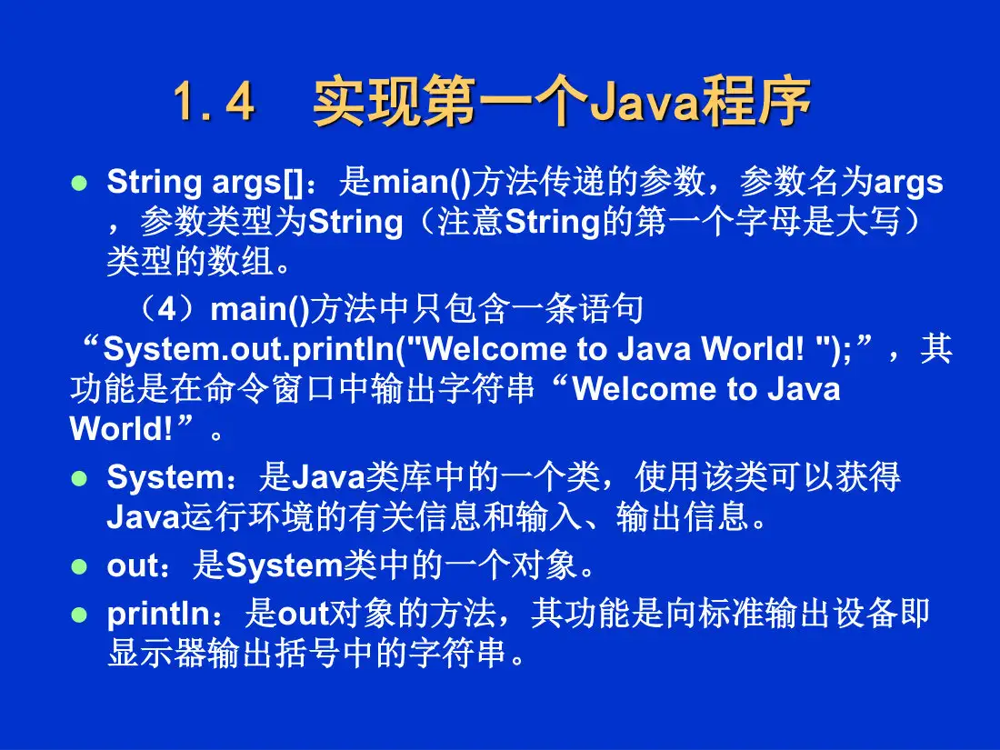

原文：

1.4 实现第一个Java程序

String args[]：是mian()方法传递的参数，参数名为args，参数类型为String（注意String的第一个字母是大写）类型的数组。

（4）main()方法中只包含一条语句“System.out.println("Welcome to Java World! ");”，其功能是在命令窗口中输出字符串“Welcome to JavaWorld!”。

System：是Java类库中的一个类，使用该类可以获得Java运行环境的有关信息和输入、输出信息。

⚫ out：是System类中的一个对象。

println：是out对象的方法，其功能是向标准输出设备即显示器输出括号中的字符串。

### 1.4 实现第一个Java程序

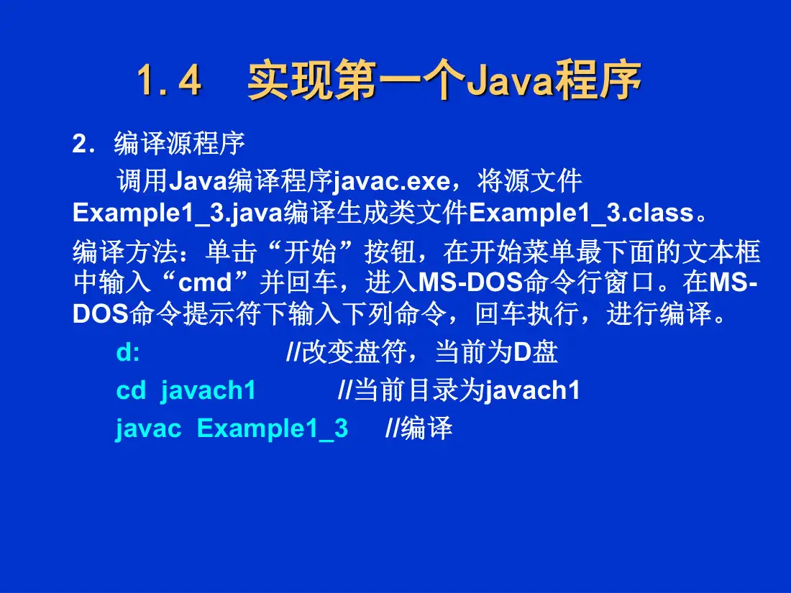

原文：

1.4 实现第一个Java程序

2．编译源程序

调用Java编译程序javac.exe，将源文件Example1\_3.java编译生成类文件Example1\_3.class。

编译方法：单击“开始”按钮，在开始菜单最下面的文本框中输入“cmd”并回车，进入MS-DOS命令行窗口。在MS-DOS命令提示符下输入下列命令，回车执行，进行编译。

d: //改变盘符，当前为D盘

cd javach1 //当前目录为javach1

javac Example1\_3 //编译

### 1.4 实现第一个Java程序

原文：

1.4 实现第一个Java程序

3．运行类文件

调用Java解释程序java.exe，对类文件Example1\_3.class解释运行，并输出结果。在MS-DOS命令提示符下输入下列命令，并回车执行。

java Example1\_3

Example1\_3.class文件的运行结果，如图1-14所示。

C:Users>imbbty>d:

D:>cd javach1

D:javach1>javac Example1\_3.java

D:Zjavachi>java Example1\_3

Welcome to Java Worldt

图1-14 应用程序编译、运行界面

### 1.4 实现第一个Java程序

原文：

1.4 实现第一个Java程序

➢ 1.4.2 简单的Applet小应用程序

Java小应用程序（Applet）是一种可嵌入到Web文件中的小型程序，applet程序不需要main()方法，它不能独立运行，必须嵌在超文本文件中，在支持Java虚拟机的Web浏览器中运行。

1．编写源文件

在一个文本编辑器中，输入如例1-4的代码，并将该代码以文件名为Example1\_4.java保存在d:\javach1目录中。

### 1.4 实现第一个Java程序

原文：

1.4 实现第一个Java程序

【例1-4】第一个简单的Java Applet，绘制字符串。

// Example1\_4.java，简单的A pplet程序

import java.awt.Graphics; //导入Java包中的类

import javax.swing.JApplet;

public class Example1\_4 extends JApplet

public void paint(Graphics g)

g.drawString("Welcome to Java World! ",30,30);

### 1.4 实现第一个Java程序

原文：

1.4 实现第一个Java程序

程序说明：

（1）语句import java.awt.Graphics，表示导入java.awt包中的Graphics类，用Graphics类可以绘制各种图形和字符串。

（2）语句import javax.swing.JApplet，表示导入javax.swing包中的JApplet类，创建一个JApplet类必须从JApplet类继承。

（3）语句public class Example1\_4 extends JApplet，是类的声明，定义了一个类名为Example1\_4的Applet类，关键字extends表示继承。

（4）语句public void paint(Graphics g)，是声明了一个paint()方法，paint()方法由Applet容器调用执行。

### 1.4 实现第一个Java程序

原文：

1.4 实现第一个Java程序

（5）语句g.drawString("Welcome to Java World!",30,30)，通过引用变量调用Graphics对象的drawString()方法，在Applet上指定的像素位置绘制字符串。

由于Applet没有main()方法作为Java解释器的入口，必须编写HTML文件，并把Example1\_4.java编译生成的Example1\_4.class文件嵌入到该HTML文件中。

使用文本编辑器，建立HTML文档文件

Example1\_4.html，代码如下：

<html>

<applet code = "Example1\_4.class" width = "300" height = "40">

</applet>

</html>

### 1.4 实现第一个Java程序

原文：

1.4 实现第一个Java程序

2．运行Java小应用程序

运行Java小应用程序有两种方法，一种方法是在支持Java的浏览器（如微软的IE）上运行。另一种方法是在MSDOS方式下，输入命令并执行：

d:

cd javach1

AppletViewer Example1\_4.html

屏幕将弹出一个窗口，如图1-15所示。

### 1.4 实现第一个Java程序

原文：

1.4 实现第一个Java程序

Welcome to Java World!已启动小应用程序。

图1-15 小应用程序运行结果

### 1.4 实现第一个Java程序

原文：

1.4 实现第一个Java程序

1.4.3 Java的注释Java中注释的方式有以下三种。

1．“//”注释1行

“//”是注释的开始，行尾表示注释结束，一般用于说明变量和语句的功能等。如下所示：

sum=sum+score; //sum是累加器，用于累计学生成绩

2．/\*…… \*/一行或多行注释

/\*……\*/ 注释若干行，通常用于提供文件、方法、数据结构等的意义与用途的说明，或者算法的描述。一般位于一个文件或者一个方法的前面，起到引导的作用，也可以根据需要放在合适的位置。

### 1.4 实现第一个Java程序

原文：

1.4 实现第一个Java程序

本方法用于判断是否为素数

开发者：大友

3．/\*\*…… \*\*/文档注释

文档注释一般放在一个变量或函数定义说明之前，表示该段注释应包含在自动生成的任何文档中（即由javadoc生成的html文件）。这种注释都是对声明条目的描述。
