# 《Java程序设计》第3章 类与对象（课件）

原件的每一页，下面附识别出的文字。

### Java 程序设计Java Programming

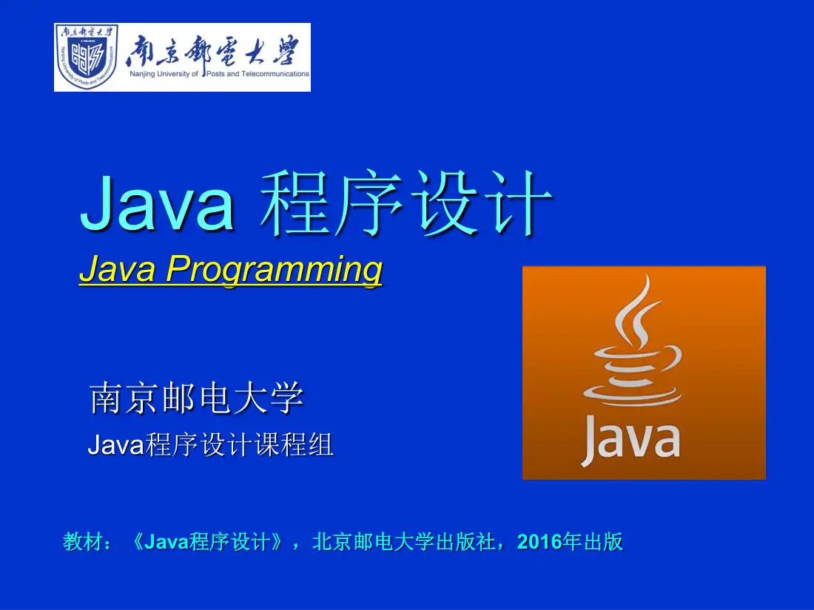

原文：

Java 程序设计Java Programming

南京邮电大学Java程序设计课程组心川

教材：《Java程序设计》，北京邮电大学出版社，2016年出版

南京鐵電大學 南京郵電大学 Nanjing University of Posts and Telecommunications

### 第3章 类与对象

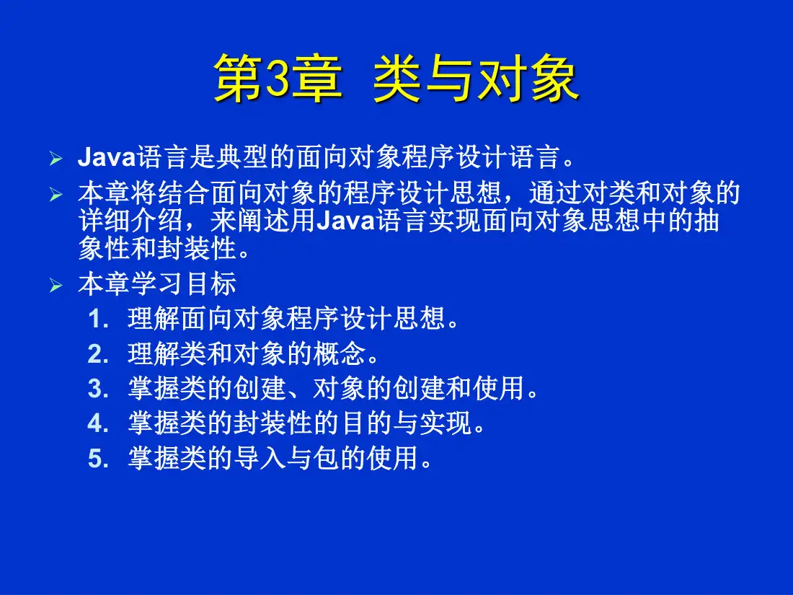

原文：

第3章 类与对象

➢ Java语言是典型的面向对象程序设计语言。

本章将结合面向对象的程序设计思想，通过对类和对象的详细介绍，来阐述用Java语言实现面向对象思想中的抽象性和封装性。

本章学习目标

1. 理解面向对象程序设计思想。

2. 理解类和对象的概念。

3. 掌握类的创建、对象的创建和使用。

4. 掌握类的封装性的目的与实现。

5. 掌握类的导入与包的使用。

### 3.1 面向对象程序设计概述

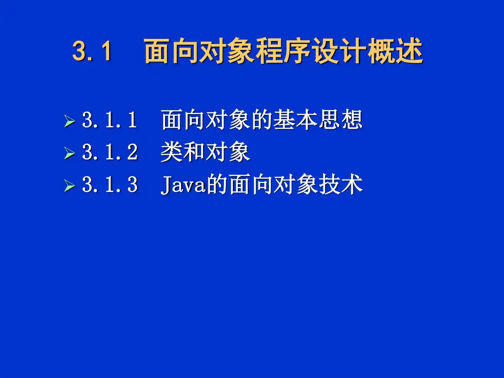

原文：

3.1 面向对象程序设计概述

➢ 3.1.1 面向对象的基本思想

➢ 3.1.2 类和对象

➢ 3.1.3 Java的面向对象技术

### 3.1.1 面向对象的基本思想

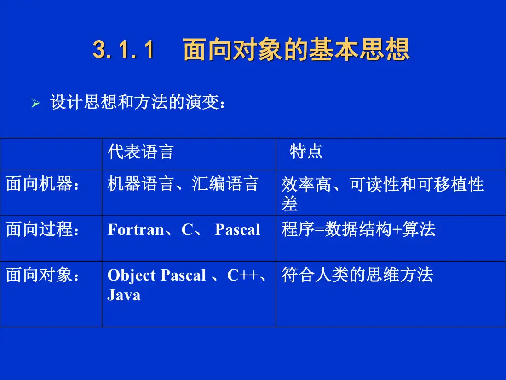

原文：

3.1.1 面向对象的基本思想

设计思想和方法的演变：

<table><tr><td></td><td>代表语言</td><td>特点</td></tr><tr><td>面向机器:</td><td>机器语言、汇编语言</td><td>效率高、可读性和可移植性差</td></tr><tr><td>面向过程:</td><td>Fortran、C、Pascal</td><td>程序=数据结构+算法</td></tr><tr><td>面向对象:</td><td>Object Pascal、C++、Java</td><td>符合人类的思维方法</td></tr></table>

### 面向对象的基本思想：以自然的思维方式来处理问题

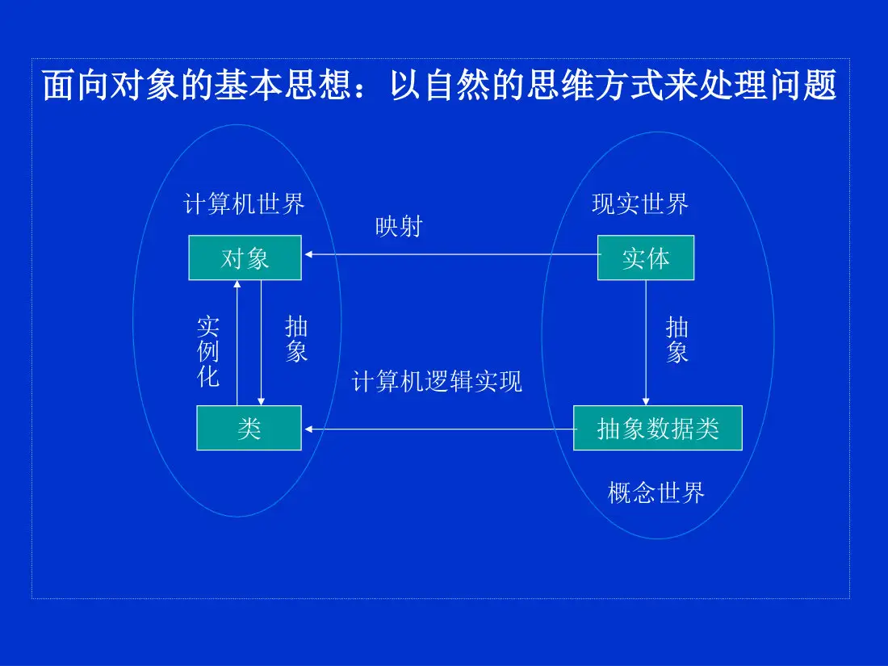

原文：

面向对象的基本思想：以自然的思维方式来处理问题

计算机世界

映射

现实世界

对象

实体

实例化

抽象

抽象

计算机逻辑实现

类

抽象数据类

概念世界

### 3.1.1 面向对象的基本思想

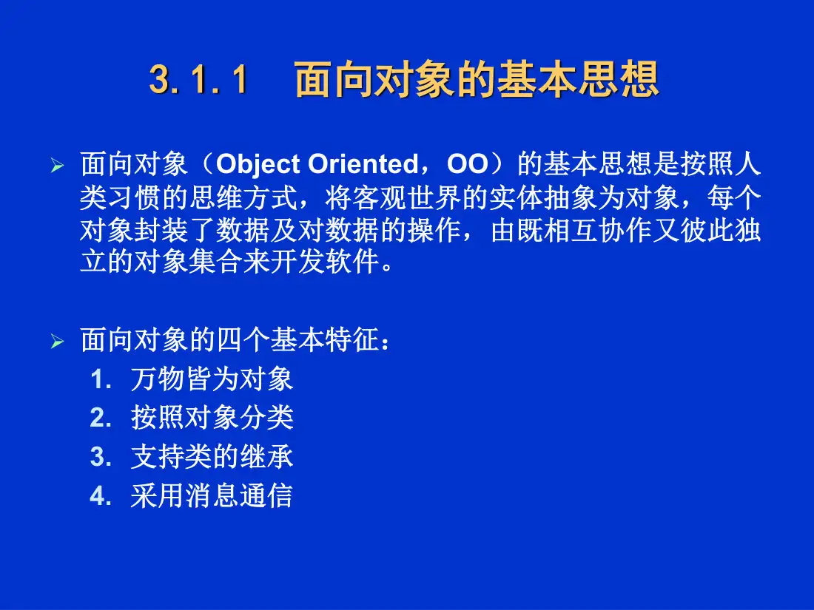

原文：

3.1.1 面向对象的基本思想

面向对象（Object Oriented，OO）的基本思想是按照人类习惯的思维方式，将客观世界的实体抽象为对象，每个对象封装了数据及对数据的操作，由既相互协作又彼此独立的对象集合来开发软件。

面向对象的四个基本特征：

1. 万物皆为对象

2. 按照对象分类

3. 支持类的继承

4. 采用消息通信

### 万物皆对象

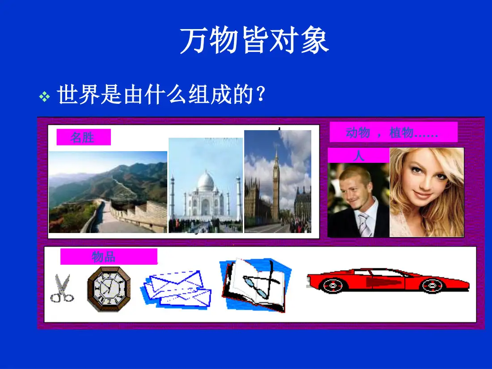

原文：

万物皆对象

❖世界是由什么组成的？

名胜

动物 ，植物……

物品

### 复杂对象

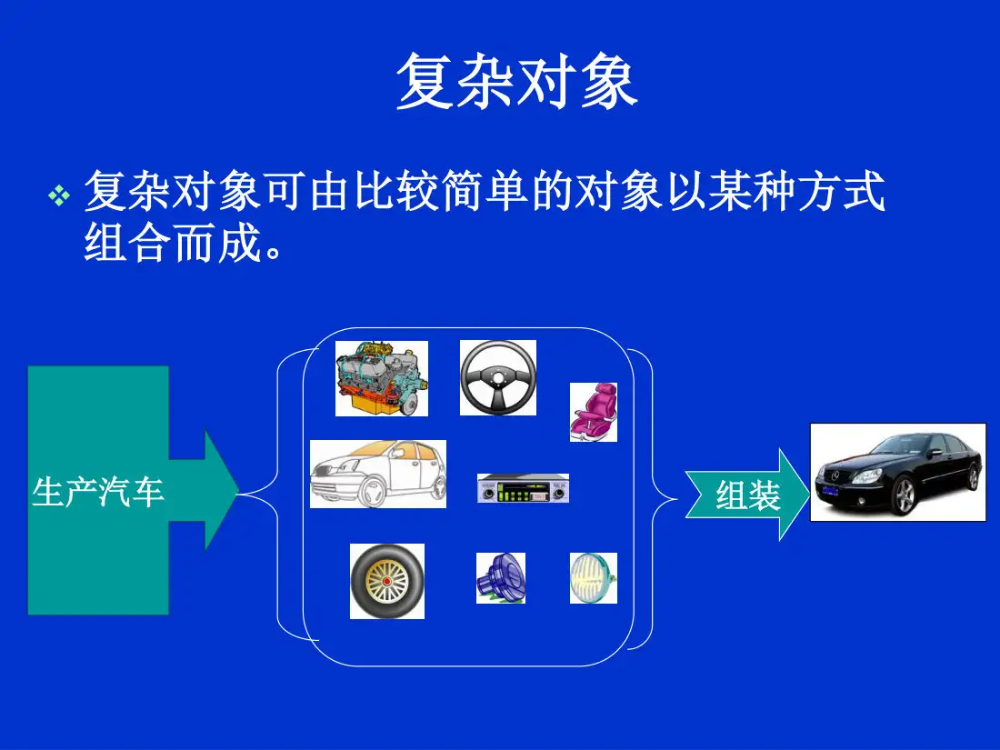

原文：

复杂对象

❖ 复杂对象可由比较简单的对象以某种方式组合而成。

生产汽车

组装

### ❖将所有对象划分成各种类

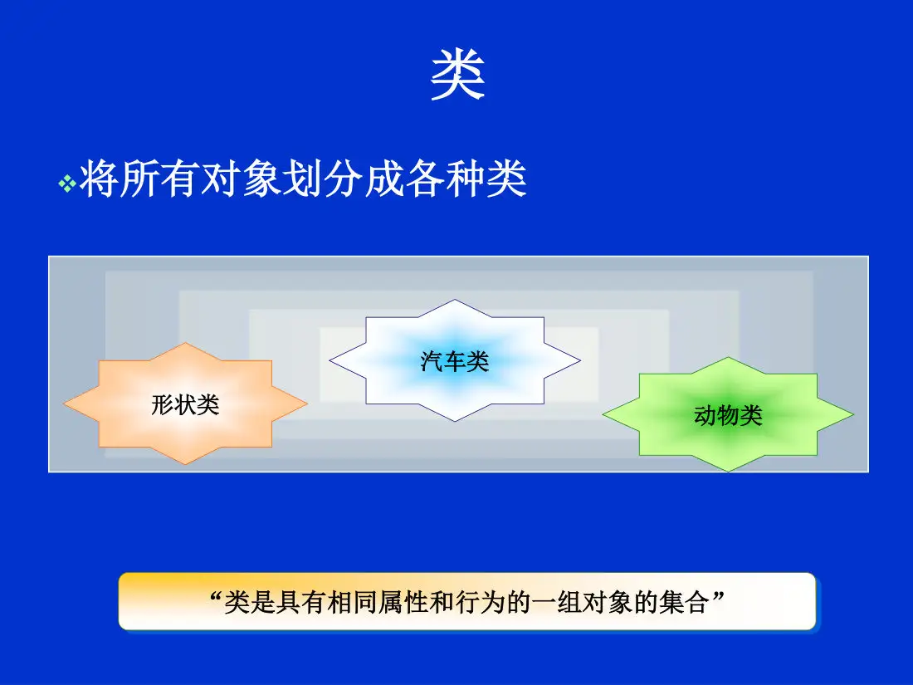

原文：

类

❖将所有对象划分成各种类

汽车类

形状类

动物类

“类是具有相同属性和行为的一组对象的集合”

### 3.1.1 面向对象的基本思想

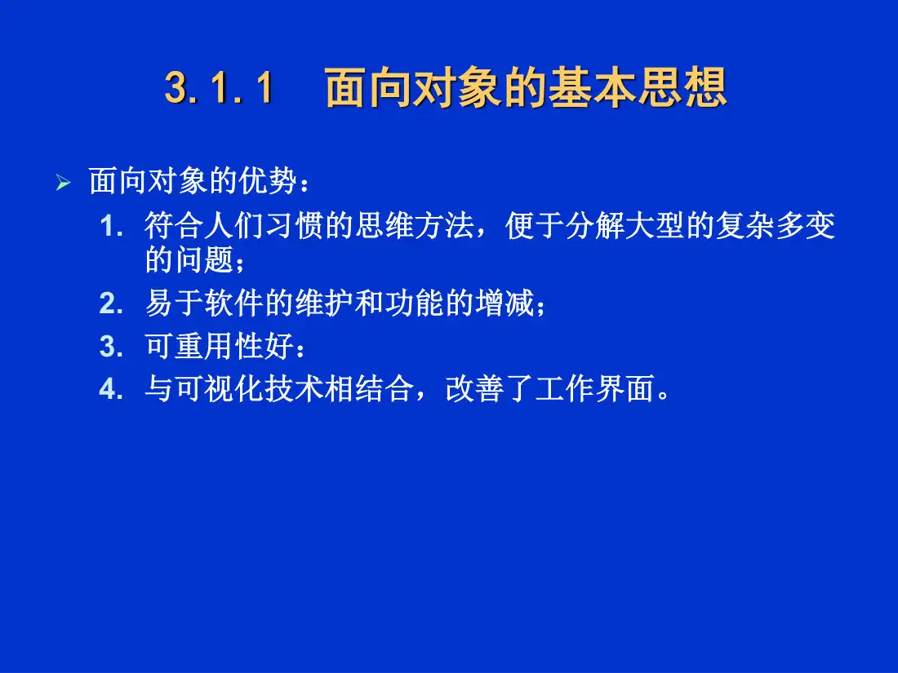

原文：

3.1.1 面向对象的基本思想

面向对象的优势：

1. 符合人们习惯的思维方法，便于分解大型的复杂多变的问题；

2. 易于软件的维护和功能的增减；

3. 可重用性好：

4. 与可视化技术相结合，改善了工作界面。

### 3.1.2 类和对象

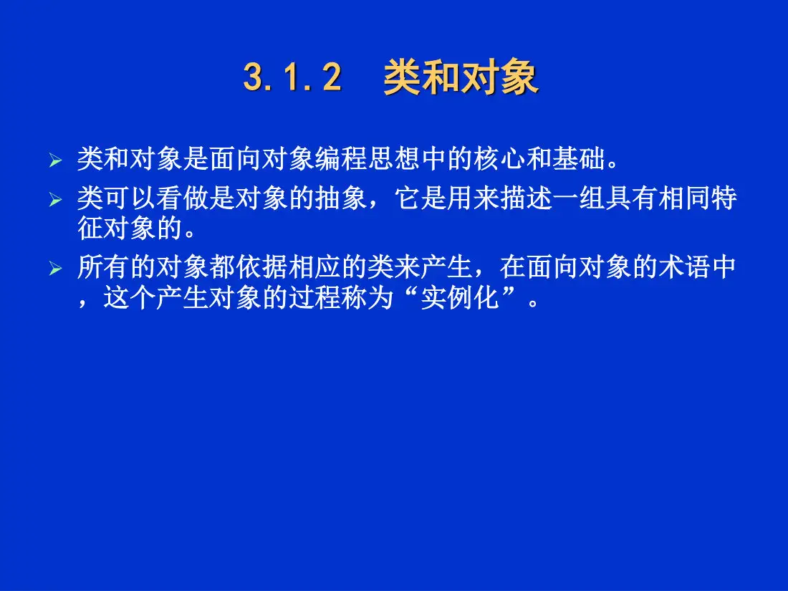

原文：

3.1.2 类和对象

➢ 类和对象是面向对象编程思想中的核心和基础。

类可以看做是对象的抽象，它是用来描述一组具有相同特征对象的。

所有的对象都依据相应的类来产生，在面向对象的术语中，这个产生对象的过程称为“实例化”。

### 3.1.2 类和对象

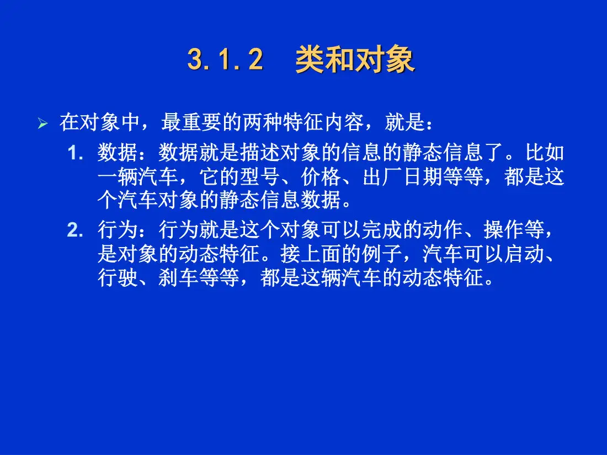

原文：

3.1.2 类和对象

在对象中，最重要的两种特征内容，就是：

1. 数据：数据就是描述对象的信息的静态信息了。比如一辆汽车，它的型号、价格、出厂日期等等，都是这个汽车对象的静态信息数据。

2. 行为：行为就是这个对象可以完成的动作、操作等，是对象的动态特征。接上面的例子，汽车可以启动、行驶、刹车等等，都是这辆汽车的动态特征。

### 3.1.2 类和对象

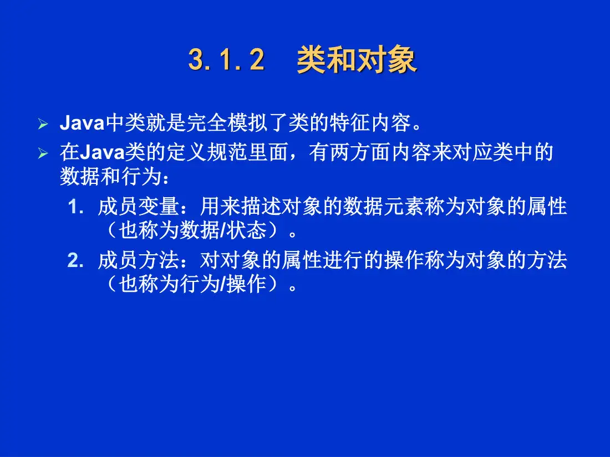

原文：

3.1.2 类和对象

Java中类就是完全模拟了类的特征内容。

在Java类的定义规范里面，有两方面内容来对应类中的数据和行为：

1. 成员变量：用来描述对象的数据元素称为对象的属性（也称为数据/状态）。

2. 成员方法：对对象的属性进行的操作称为对象的方法（也称为行为/操作）。

### 3.1.3 Java的面向对象技术

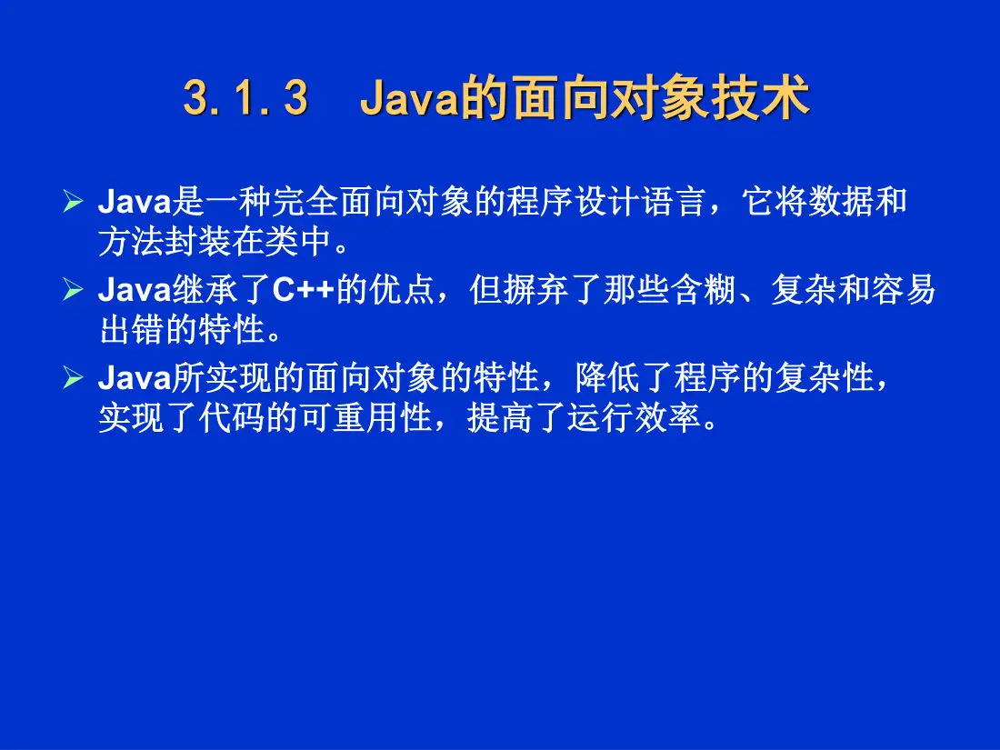

原文：

3.1.3 Java的面向对象技术

➢ Java是一种完全面向对象的程序设计语言，它将数据和方法封装在类中。

Java继承了C++的优点，但摒弃了那些含糊、复杂和容易出错的特性。

Java所实现的面向对象的特性，降低了程序的复杂性， 实现了代码的可重用性，提高了运行效率。

### 3.2 类的创建

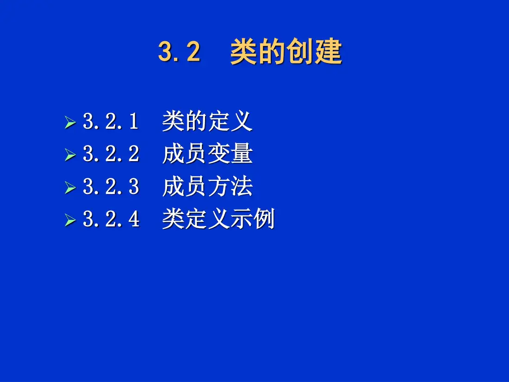

原文：

3.2 类的创建

➢ 3.2.1 类的定义

➢ 3.2.2 成员变量

➢ 3.2.3 成员方法

3.2.4 类定义示例

### 3.2.1 类的定义

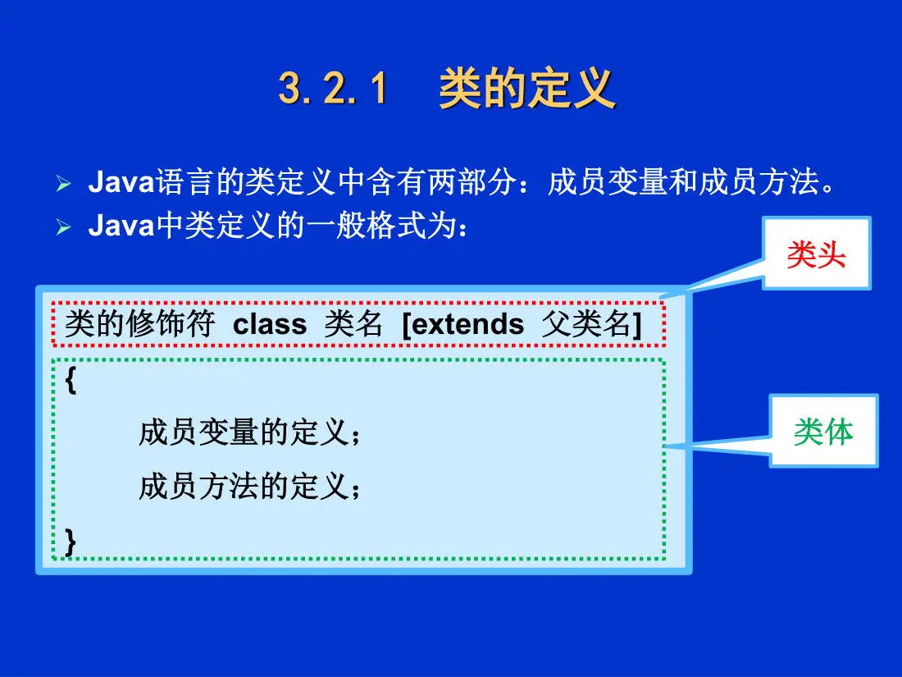

原文：

3.2.1 类的定义

➢ Java语言的类定义中含有两部分：成员变量和成员方法。

Java中类定义的一般格式为：

类头

类的修饰符 class 类名 [extends 父类名]

成员变量的定义；成员方法的定义；

类体

### 3.2.1 类的定义

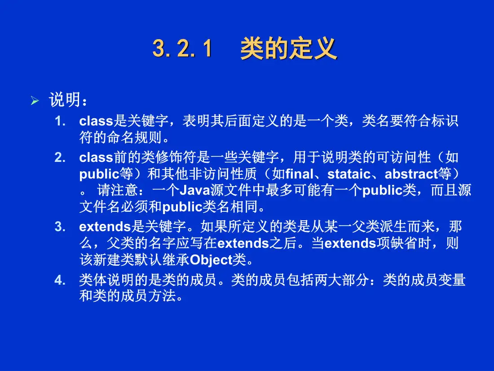

原文：

3.2.1 类的定义

➢ 说明：

1. class是关键字，表明其后面定义的是一个类，类名要符合标识符的命名规则。

2. class前的类修饰符是一些关键字，用于说明类的可访问性（如public等）和其他非访问性质（如final、stataic、abstract等）。 请注意：一个Java源文件中最多可能有一个public类，而且源文件名必须和public类名相同。

3. extends是关键字。如果所定义的类是从某一父类派生而来，那么，父类的名字应写在extends之后。当extends项缺省时，则该新建类默认继承Object类。

4. 类体说明的是类的成员。类的成员包括两大部分：类的成员变量和类的成员方法。

### 3.2.1 类的定义

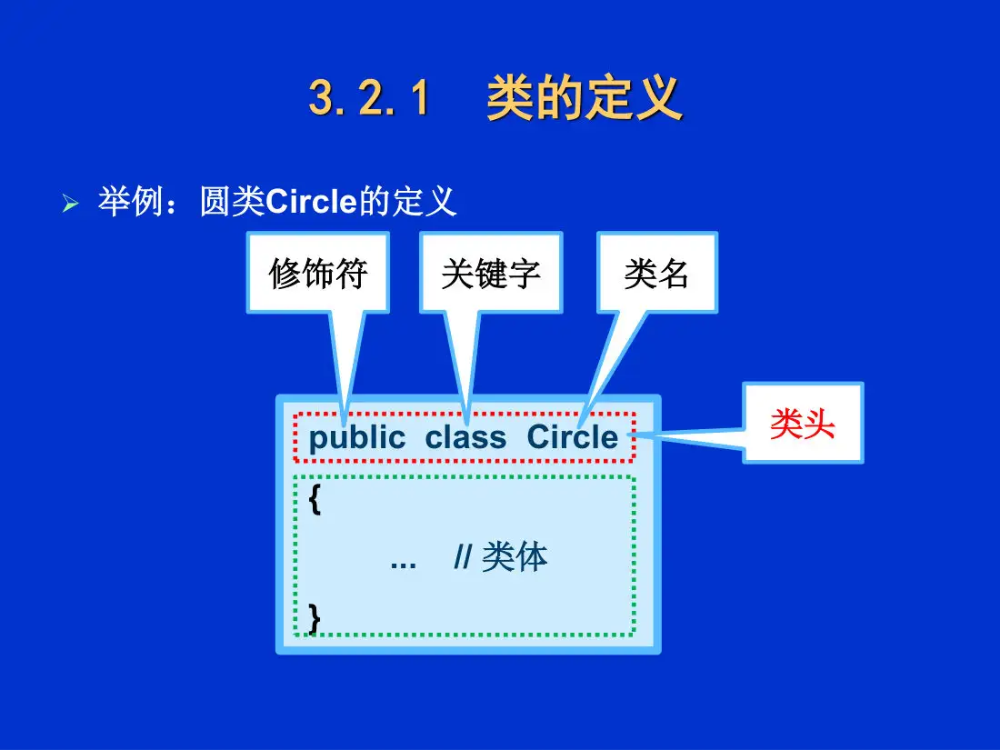

原文：

3.2.1 类的定义

举例：圆类Circle的定义

### 3.2.2 成员变量

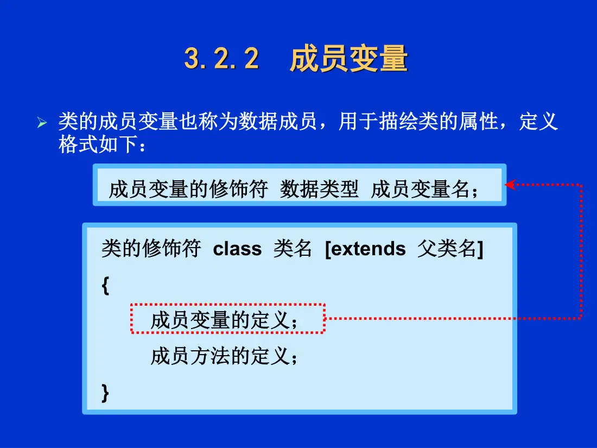

原文：

3.2.2 成员变量

类的成员变量也称为数据成员，用于描绘类的属性，定义格式如下：

成员变量的修饰符 数据类型 成员变量名；

类的修饰符 class 类名 [extends 父类名]

成员变量的定义；

成员方法的定义；

### 3.2.2 成员变量

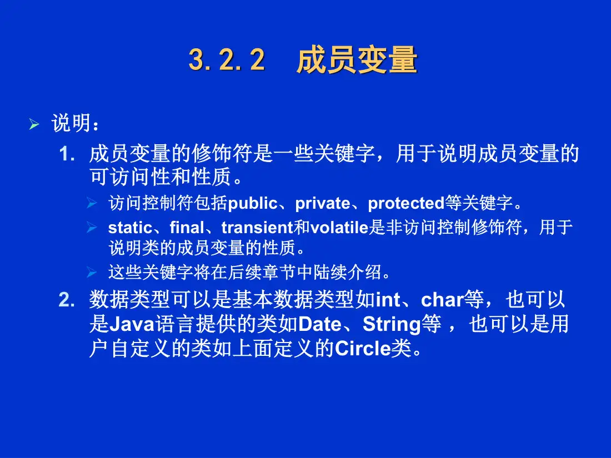

原文：

3.2.2 成员变量

➢ 说明：

1. 成员变量的修饰符是一些关键字，用于说明成员变量的可访问性和性质。

访问控制符包括public、private、protected等关键字。

static、final、transient和volatile是非访问控制修饰符，用于说明类的成员变量的性质。

这些关键字将在后续章节中陆续介绍。

2. 数据类型可以是基本数据类型如int、char等，也可以是Java语言提供的类如Date、String等 ，也可以是用户自定义的类如上面定义的Circle类。

### 3.2.2 成员变量

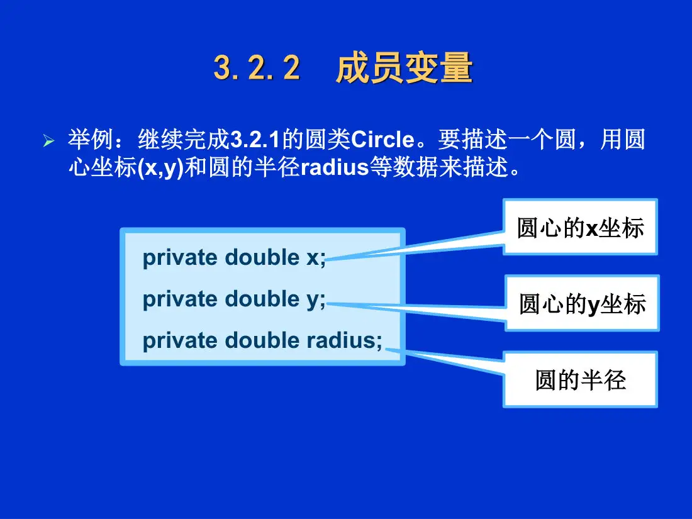

原文：

3.2.2 成员变量

➢ 举例：继续完成3.2.1的圆类Circle。要描述一个圆，用圆心坐标(x,y)和圆的半径radius等数据来描述。

private double x;

private double y;

private double radius;

圆心的x坐标

圆心的y坐标

圆的半径

### 3.2.3 成员方法

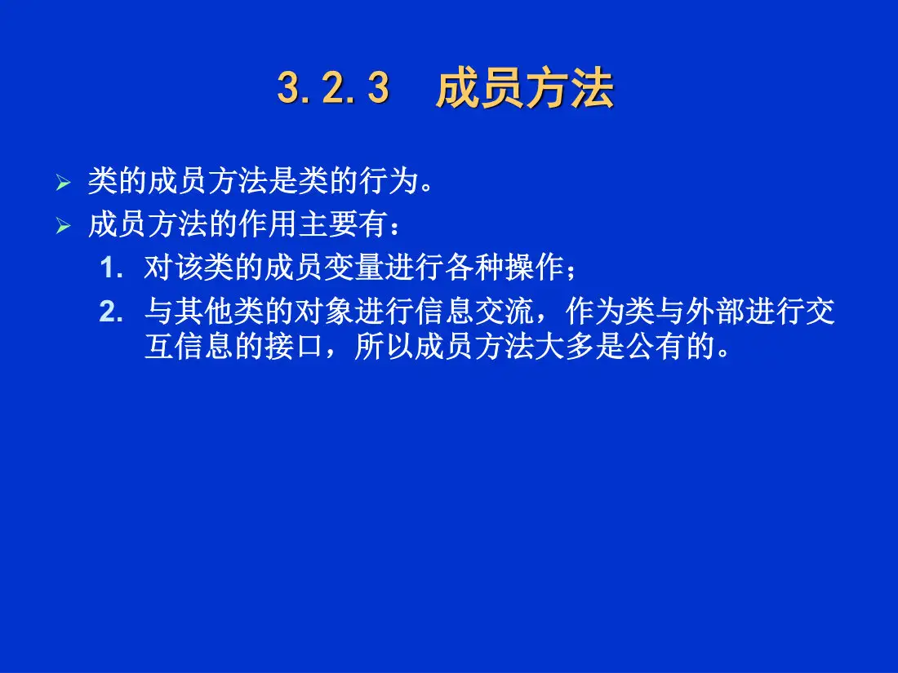

原文：

3.2.3 成员方法

类的成员方法是类的行为。

➢ 成员方法的作用主要有：

1. 对该类的成员变量进行各种操作；

2. 与其他类的对象进行信息交流，作为类与外部进行交互信息的接口，所以成员方法大多是公有的。

### 3.2.3 成员方法

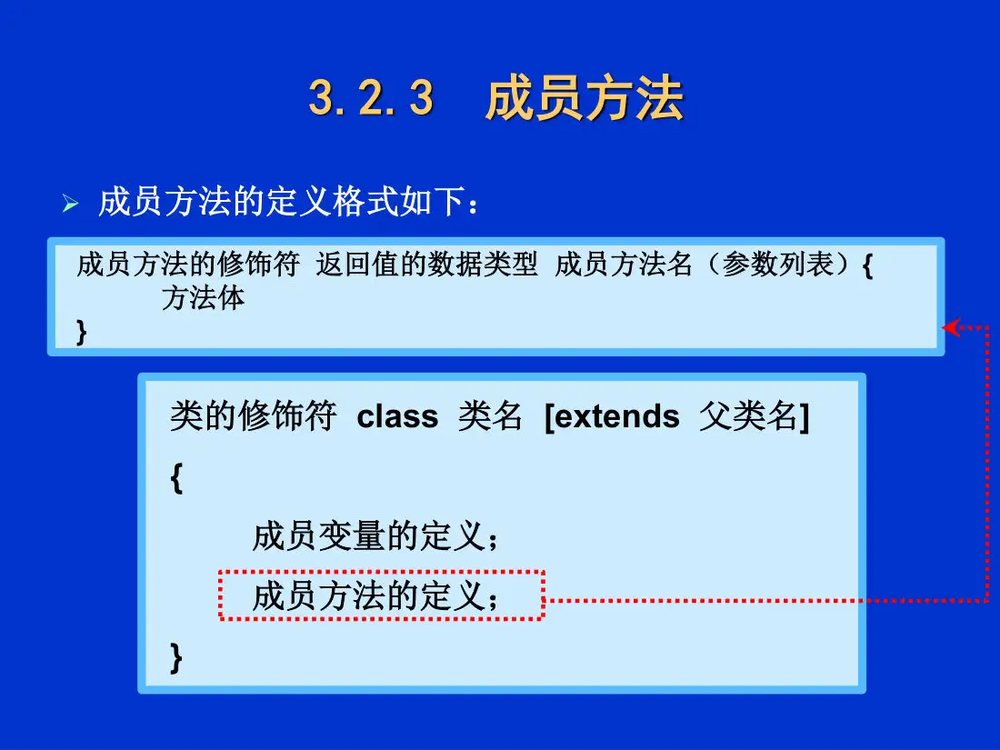

原文：

3.2.3 成员方法

成员方法的定义格式如下：

成员方法的修饰符 返回值的数据类型 成员方法名（参数列表）{方法体

类的修饰符 class 类名 [extends 父类名]

成员变量的定义；

成员方法的定义；

### 3.2.3 成员方法

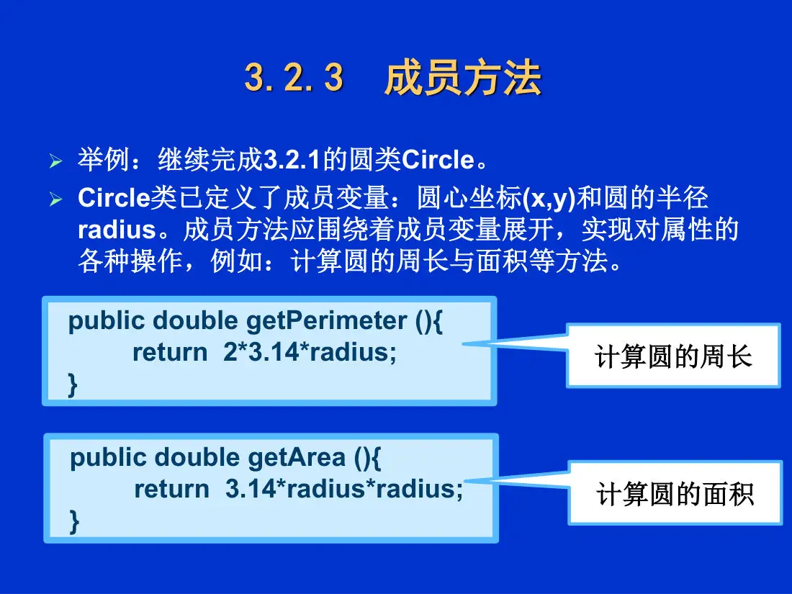

原文：

3.2.3 成员方法

➢ 举例：继续完成3.2.1的圆类Circle。

Circle类已定义了成员变量：圆心坐标(x,y)和圆的半径radius。成员方法应围绕着成员变量展开，实现对属性的各种操作，例如：计算圆的周长与面积等方法。

public double getPerimeter (){ return 2\*3.14\*radius;

计算圆的周长

public double getArea (){ return 3.14\*radius\*radius;

计算圆的面积

### 3.2.4 类定义示例

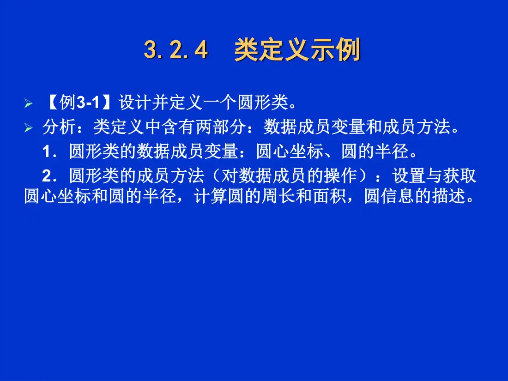

原文：

3.2.4 类定义示例

【例3-1】设计并定义一个圆形类。

➢ 分析：类定义中含有两部分：数据成员变量和成员方法。

1．圆形类的数据成员变量：圆心坐标、圆的半径。

2．圆形类的成员方法（对数据成员的操作）：设置与获取圆心坐标和圆的半径，计算圆的周长和面积，圆信息的描述。

### //未完，接下页

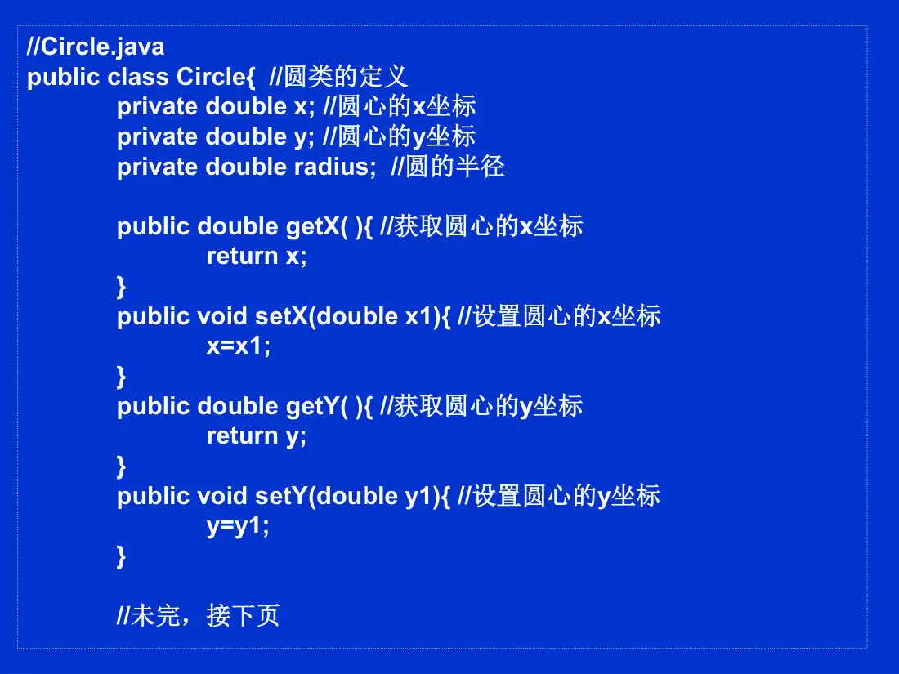

原文：

//Circle.java public class Circle{ //圆类的定义 private double x; //圆心的x坐标 private double y; //圆心的y坐标 private double radius; //圆的半径

public double getX( ){ //获取圆心的x坐标 return x;

public void setX(double x1){ //设置圆心的x坐标 x=x1;

public double getY( ){ //获取圆心的y坐标 return y;

public void setY(double y1){ //设置圆心的y坐标 y=y1;

//未完，接下页

### else

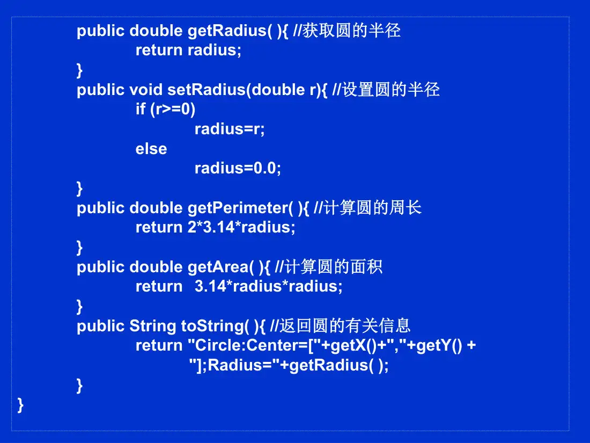

原文：

public double getRadius( ){ //获取圆的半径 return radius;

public void setRadius(double r){ //设置圆的半径 if (r>=0) radius=r;

else

radius=0.0;

public double getPerimeter( ){ //计算圆的周长 return 2\*3.14\*radius;

public double getArea( ){ //计算圆的面积 return 3.14\*radius\*radius;

public String toString( ){ //返回圆的有关信息 return "Circle:Center=["+getX()+","+getY() + "];Radius="+getRadius( );

### 3.3 对象的创建和使用

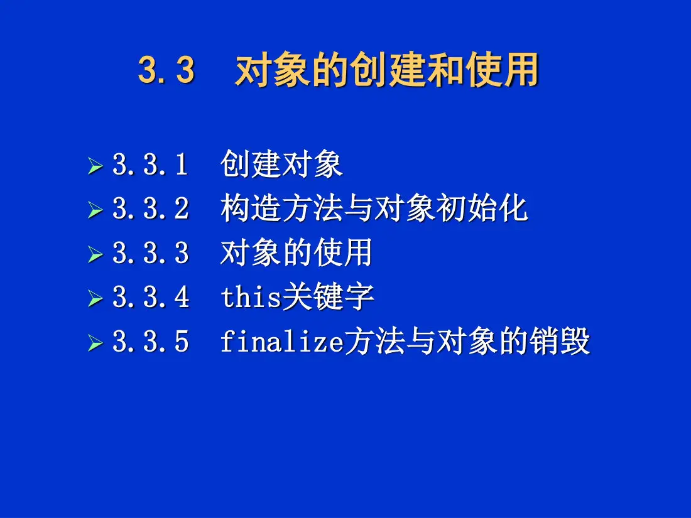

原文：

3.3 对象的创建和使用

➢ 3.3.1 创建对象

➢3.3.2 构造方法与对象初始化

➢ 3.3.3 对象的使用

➢ 3.3.4 this关键字

➢ 3.3.5 finalize方法与对象的销毁

### 3.3.1 创建对象

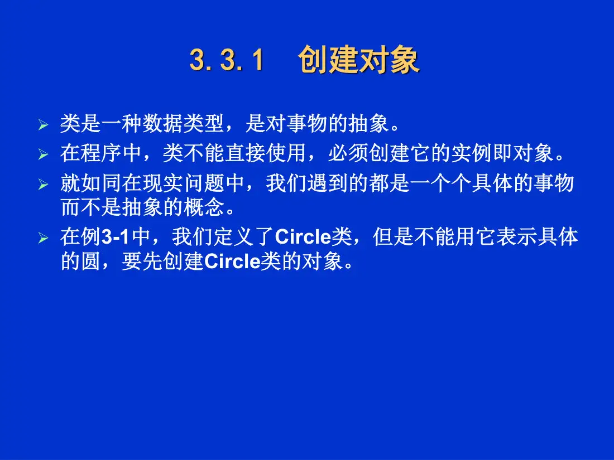

原文：

3.3.1 创建对象

类是一种数据类型，是对事物的抽象。

➢ 在程序中，类不能直接使用，必须创建它的实例即对象。

就如同在现实问题中，我们遇到的都是一个个具体的事物而不是抽象的概念。

在例3-1中，我们定义了Circle类，但是不能用它表示具体的圆，要先创建Circle类的对象。

### 3.3.1 创建对象

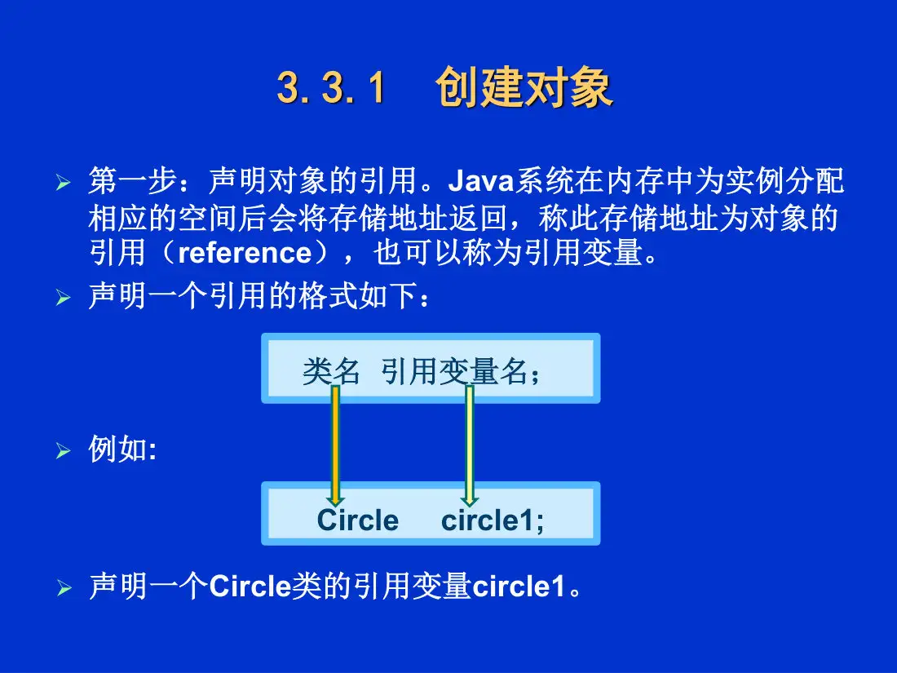

原文：

3.3.1 创建对象

➢ 第一步：声明对象的引用。Java系统在内存中为实例分配相应的空间后会将存储地址返回，称此存储地址为对象的引用（reference），也可以称为引用变量。

声明一个引用的格式如下：

例如:

➢ 声明一个Circle类的引用变量circle1。

### 3.3.1 创建对象

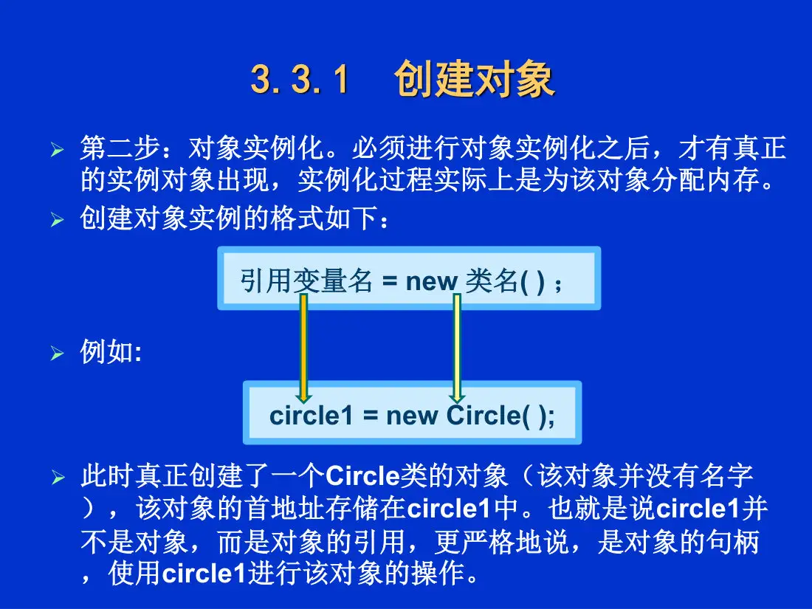

原文：

3.3.1 创建对象

第二步：对象实例化。必须进行对象实例化之后，才有真正的实例对象出现，实例化过程实际上是为该对象分配内存。

创建对象实例的格式如下：

引用变量名 = new 类名( ) ；

例如:

此时真正创建了一个Circle类的对象（该对象并没有名字），该对象的首地址存储在circle1中。也就是说circle1并不是对象，而是对象的引用，更严格地说，是对象的句柄，使用circle1进行该对象的操作。

### 3.3.1 创建对象

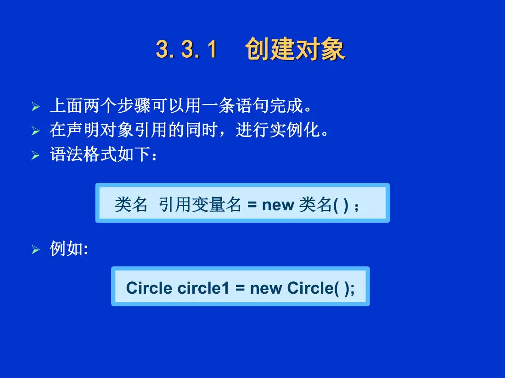

原文：

3.3.1 创建对象

➢ 上面两个步骤可以用一条语句完成。

➢ 在声明对象引用的同时，进行实例化。

语法格式如下：

类名 引用变量名 = new 类名( ) ；

➢ 例如:

Circle circle1 = new Circle( );

### 3.3.2 构造方法与对象初始化

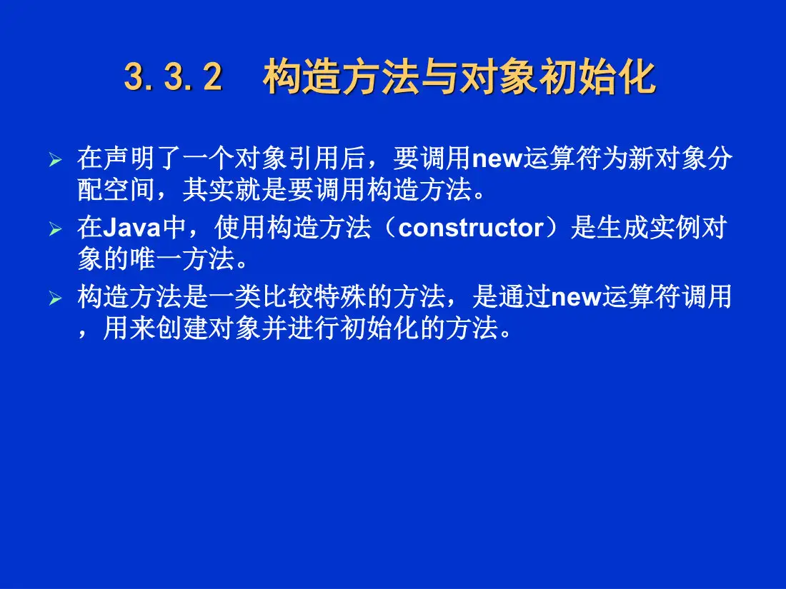

原文：

3.3.2 构造方法与对象初始化

➢ 在声明了一个对象引用后，要调用new运算符为新对象分配空间，其实就是要调用构造方法。

➢ 在Java中，使用构造方法（constructor）是生成实例对象的唯一方法。

➢ 构造方法是一类比较特殊的方法，是通过new运算符调用，用来创建对象并进行初始化的方法。

### 3.3.2 构造方法与对象初始化

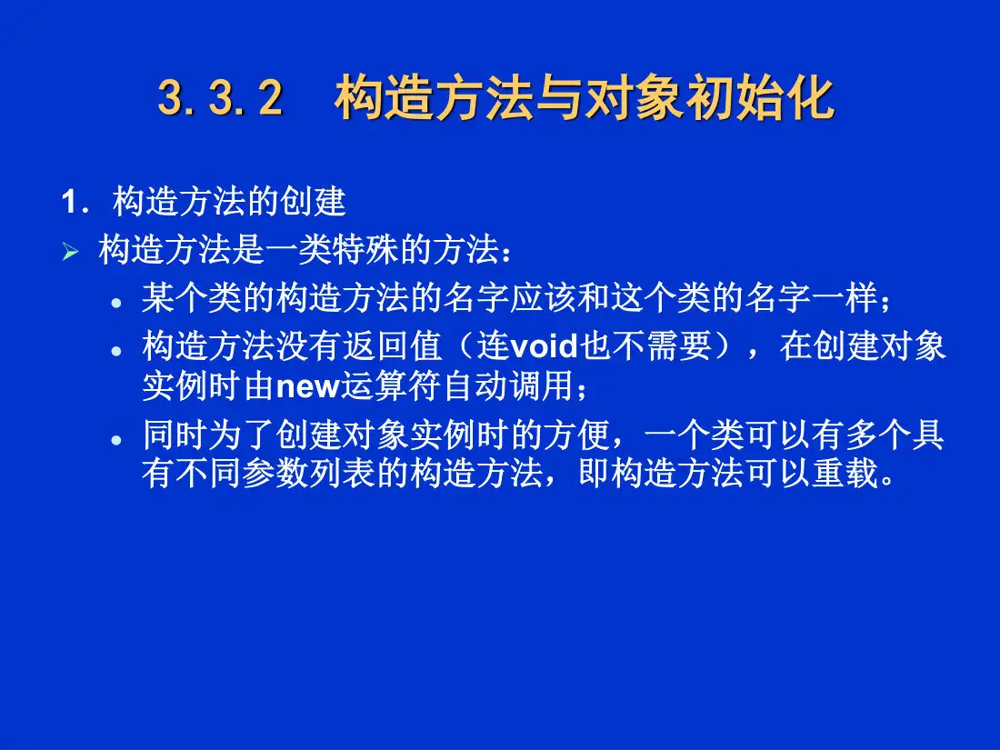

原文：

3.3.2 构造方法与对象初始化

1．构造方法的创建

构造方法是一类特殊的方法：

⚫ 某个类的构造方法的名字应该和这个类的名字一样；

⚫ 构造方法没有返回值（连void也不需要），在创建对象实例时由new运算符自动调用；

⚫ 同时为了创建对象实例时的方便，一个类可以有多个具有不同参数列表的构造方法，即构造方法可以重载。

### 3.3.2 构造方法与对象初始化

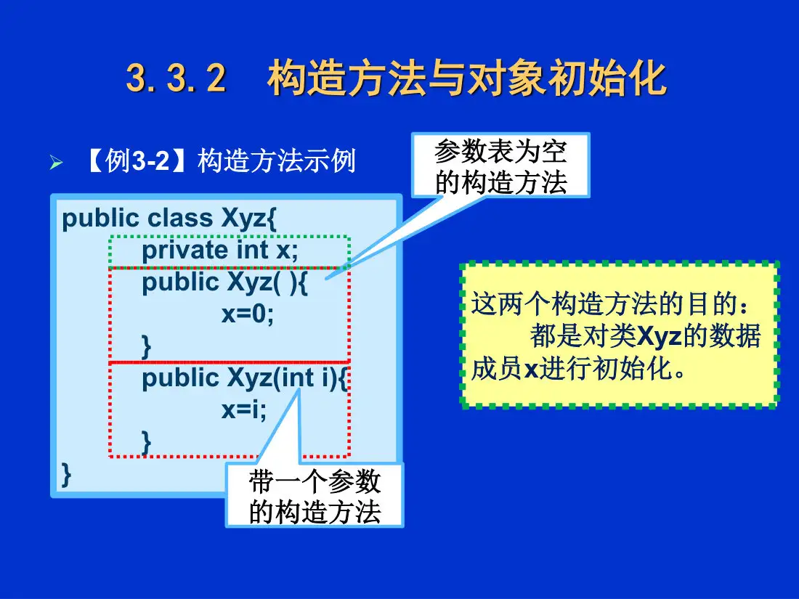

原文：

3.3.2 构造方法与对象初始化

【例3-2】构造方法示例

带一个参数的构造方法参数表为空的构造方法

这两个构造方法的目的：都是对类Xyz的数据成员x进行初始化。

### 3.3.2 构造方法与对象初始化

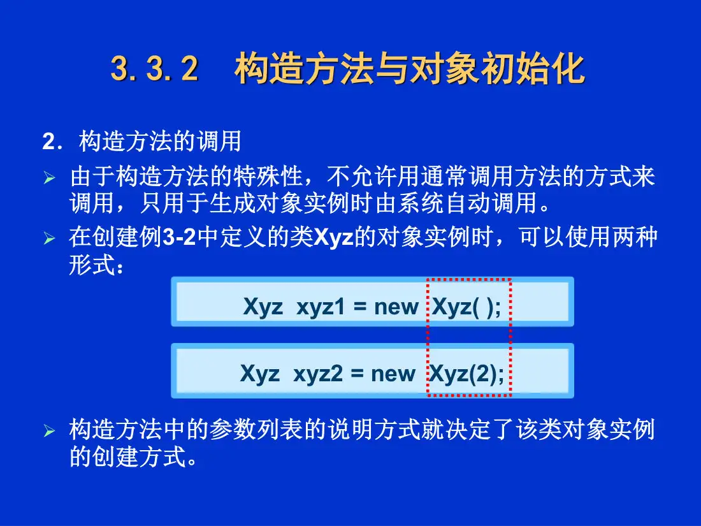

原文：

3.3.2 构造方法与对象初始化

2．构造方法的调用

➢ 由于构造方法的特殊性，不允许用通常调用方法的方式来调用，只用于生成对象实例时由系统自动调用。

在创建例3-2中定义的类Xyz的对象实例时，可以使用两种形式：

$$
\text {   Xyz   xyz1   } = \text {   new   }: \text {   Xyz(  );   }
$$

$$
\text { Xyz   xyz2 } = \text { new } \quad \text { Xyz(2) };
$$

➢ 构造方法中的参数列表的说明方式就决定了该类对象实例的创建方式。

### 3.3.2 构造方法与对象初始化

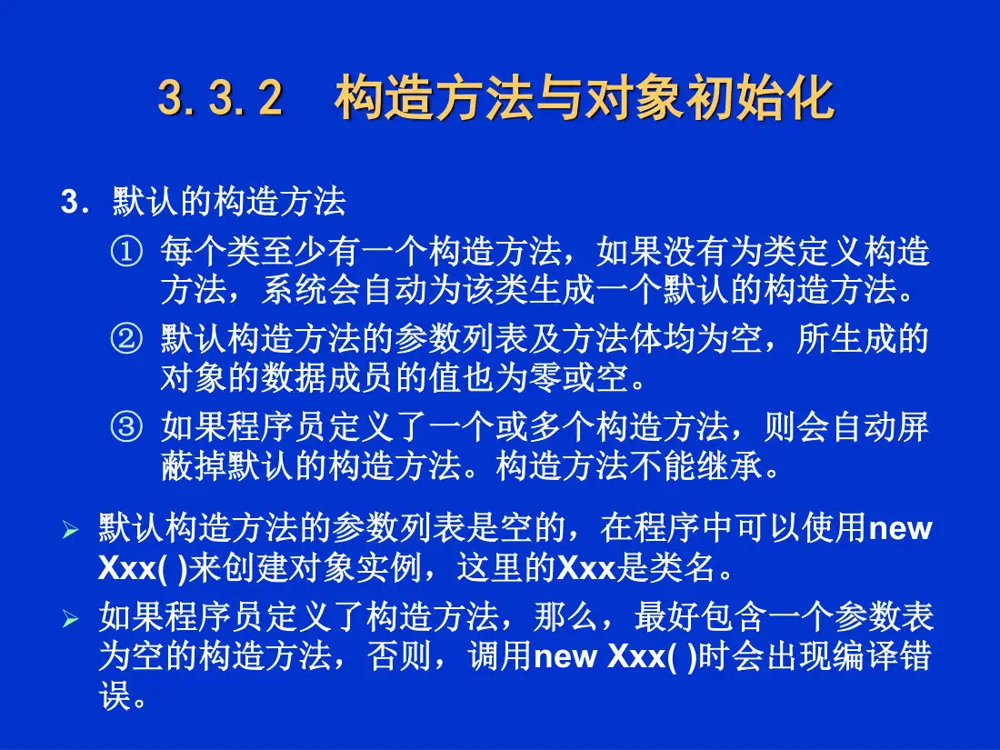

原文：

3.3.2 构造方法与对象初始化

3．默认的构造方法

① 每个类至少有一个构造方法，如果没有为类定义构造方法，系统会自动为该类生成一个默认的构造方法。

默认构造方法的参数列表及方法体均为空，所生成的对象的数据成员的值也为零或空。

如果程序员定义了一个或多个构造方法，则会自动屏蔽掉默认的构造方法。构造方法不能继承。

➢ 默认构造方法的参数列表是空的，在程序中可以使用newXxx( )来创建对象实例，这里的Xxx是类名。

➢ 如果程序员定义了构造方法，那么，最好包含一个参数表为空的构造方法，否则，调用new Xxx( )时会出现编译错误。

### 3.3.2 构造方法与对象初始化

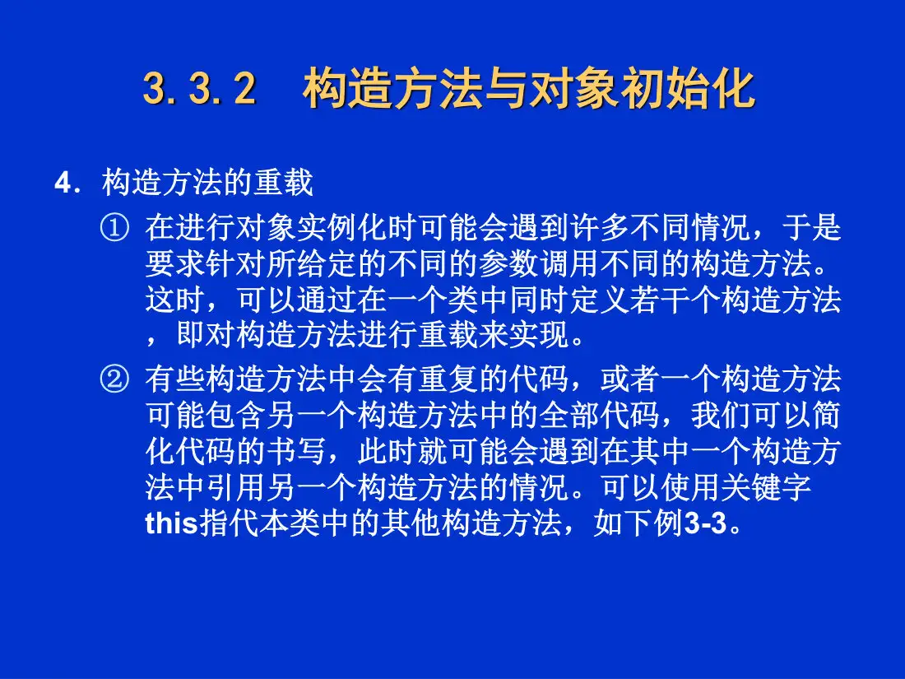

原文：

3.3.2 构造方法与对象初始化

4．构造方法的重载

① 在进行对象实例化时可能会遇到许多不同情况，于是要求针对所给定的不同的参数调用不同的构造方法。这时，可以通过在一个类中同时定义若干个构造方法，即对构造方法进行重载来实现。

有些构造方法中会有重复的代码，或者一个构造方法可能包含另一个构造方法中的全部代码，我们可以简化代码的书写，此时就可能会遇到在其中一个构造方法中引用另一个构造方法的情况。可以使用关键字this指代本类中的其他构造方法，如下例3-3。

### 3.3.2 构造方法与对象初始化

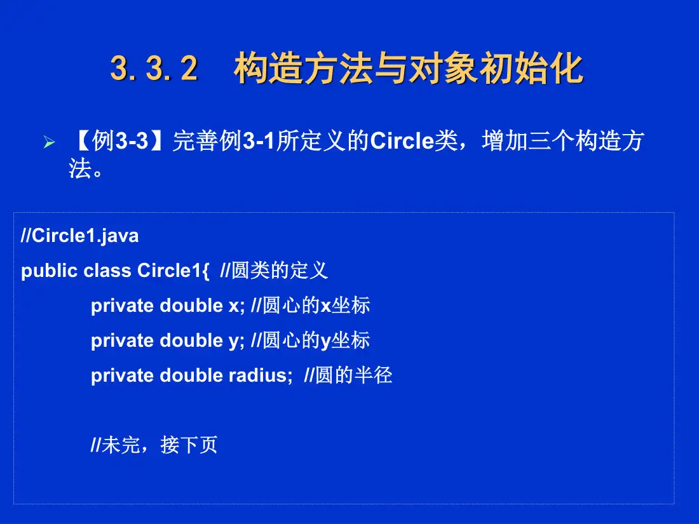

原文：

3.3.2 构造方法与对象初始化

【例3-3】完善例3-1所定义的Circle类，增加三个构造方法。

//Circle1.java

public class Circle1{ //圆类的定义

private double x; //圆心的x坐标

private double y; //圆心的y坐标

private double radius; //圆的半径

//未完，接下页

### x=x1;

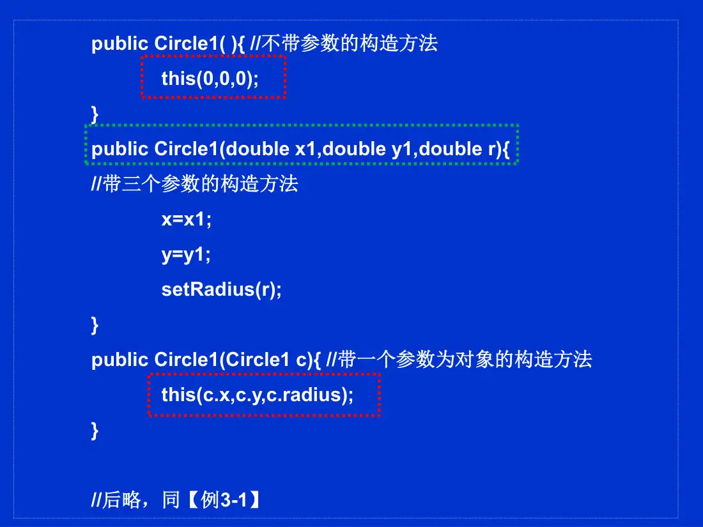

原文：

public Circle1( ){ //不带参数的构造方法 this(0,0,0);

public Circle1(double x1,double y1,double r){//带三个参数的构造方法

x=x1;

y=y1;

setRadius(r);

public Circle1(Circle1 c){ //带一个参数为对象的构造方法this(c.x,c.y,c.radius);

//后略，同【例3-1】

### 3.3.2 构造方法与对象初始化

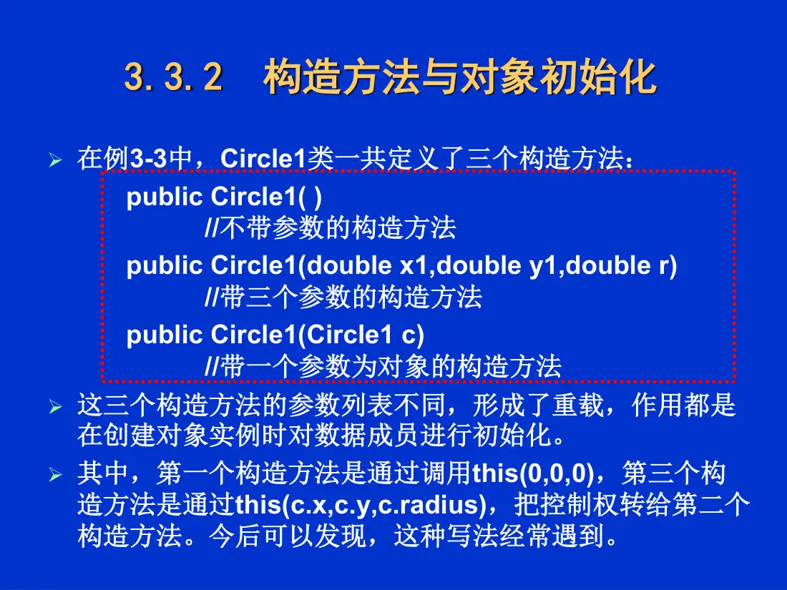

原文：

3.3.2 构造方法与对象初始化

➢ 在例3-3中，Circle1类一共定义了三个构造方法：

public Circle1( )//不带参数的构造方法

public Circle1(double x1,double y1,double r)//带三个参数的构造方法

public Circle1(Circle1 c)//带一个参数为对象的构造方法

这三个构造方法的参数列表不同，形成了重载，作用都是在创建对象实例时对数据成员进行初始化。

其中，第一个构造方法是通过调用this(0,0,0)，第三个构造方法是通过this(c.x,c.y,c.radius)，把控制权转给第二个构造方法。今后可以发现，这种写法经常遇到。

### 3.3.2 构造方法与对象初始化

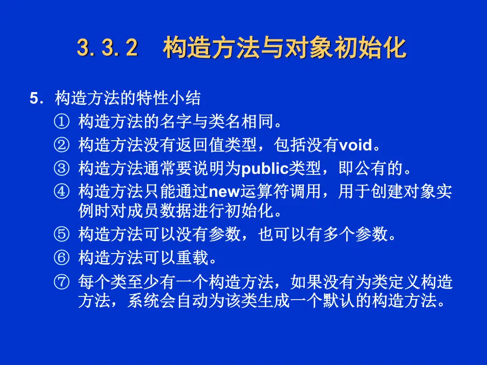

原文：

3.3.2 构造方法与对象初始化

5．构造方法的特性小结

① 构造方法的名字与类名相同。

② 构造方法没有返回值类型，包括没有void。

③ 构造方法通常要说明为public类型，即公有的。

④ 构造方法只能通过new运算符调用，用于创建对象实例时对成员数据进行初始化。

⑤ 构造方法可以没有参数，也可以有多个参数。

⑥ 构造方法可以重载。

⑦ 每个类至少有一个构造方法，如果没有为类定义构造方法，系统会自动为该类生成一个默认的构造方法。

### 3.3.3 对象的使用

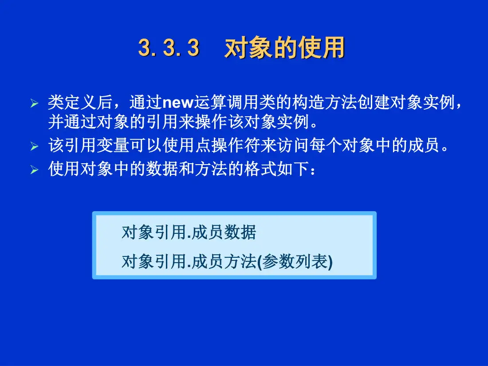

原文：

3.3.3 对象的使用

类定义后，通过new运算调用类的构造方法创建对象实例，并通过对象的引用来操作该对象实例。

➢ 该引用变量可以使用点操作符来访问每个对象中的成员。

➢ 使用对象中的数据和方法的格式如下：

对象引用.成员数据

对象引用.成员方法(参数列表)

### 3.3.3 对象的使用

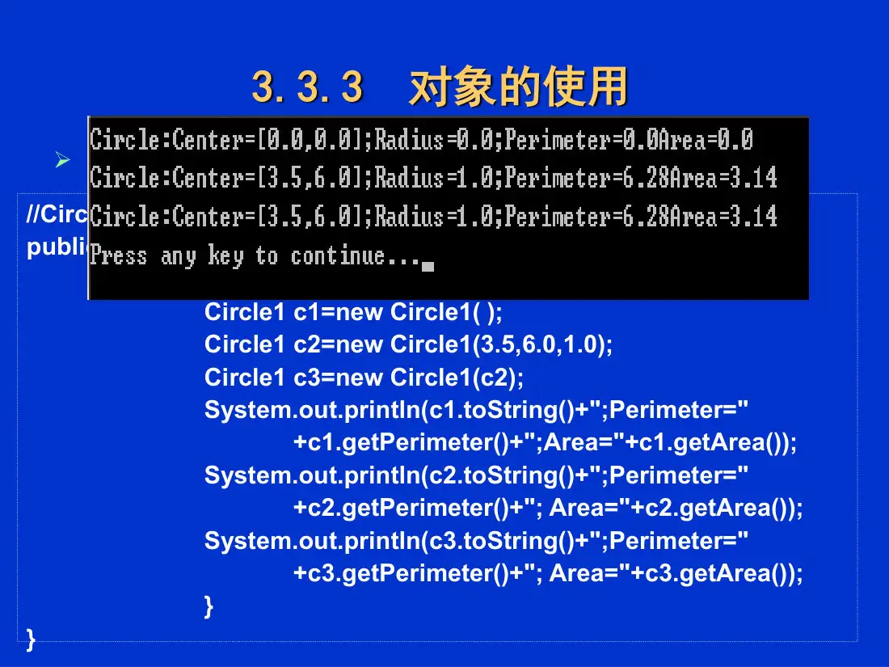

原文：

3.3.3 对象的使用

Circle:Center=[0.0,0.0];Radius=0.0;Perimeter=0.0Area=0.0 Circle:Center=[3.5,6.0];Radius=1.0;Perimeter=6.28Area=3.14 //Circle1Test.java public class Circle1Test{

Circle1 c1=new Circle1( ); Circle1 c2=new Circle1(3.5,6.0,1.0); Circle1 c3=new Circle1(c2); System.out.println(c1.toString()+";Perimeter=" +c1.getPerimeter()+";Area="+c1.getArea()); System.out.println(c2.toString()+";Perimeter=" +c2.getPerimeter()+"; Area="+c2.getArea()); System.out.println(c3.toString()+";Perimeter=" +c3.getPerimeter()+"; Area="+c3.getArea());

### 3.3.4 this关键字

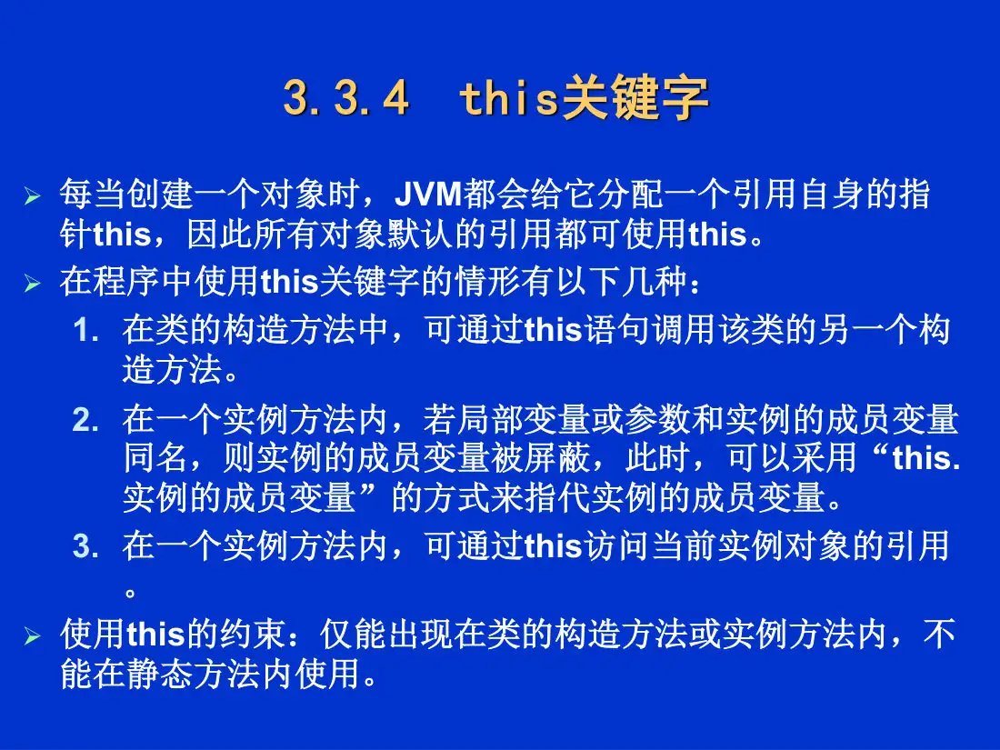

原文：

3.3.4 this关键字

每当创建一个对象时，JVM都会给它分配一个引用自身的指针this，因此所有对象默认的引用都可使用this。

在程序中使用this关键字的情形有以下几种：

1. 在类的构造方法中，可通过this语句调用该类的另一个构造方法。

2. 在一个实例方法内，若局部变量或参数和实例的成员变量同名，则实例的成员变量被屏蔽，此时，可以采用“this.实例的成员变量”的方式来指代实例的成员变量。

3. 在一个实例方法内，可通过this访问当前实例对象的引用

使用this的约束：仅能出现在类的构造方法或实例方法内，不能在静态方法内使用。

### 3.3.4 this关键字

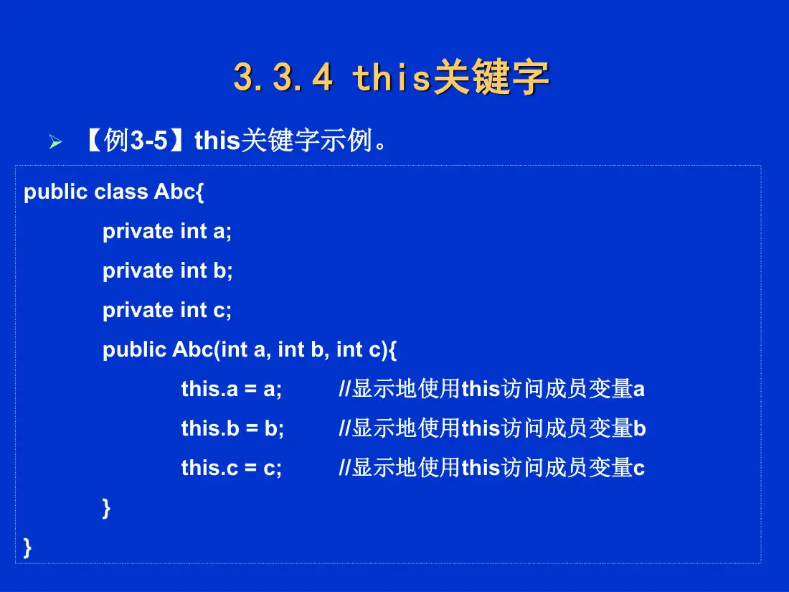

原文：

3.3.4 this关键字

【例3-5】this关键字示例。

public class Abc{

private int a;

private int b;

private int c;

public Abc(int a, int b, int c){

$$
\mathrm{this.a=a;}
$$

$$
\mathrm{this.b=b;}
$$

$$
\text { this.c } = \text { c };
$$

//显示地使用this访问成员变量a

//显示地使用this访问成员变量b

//显示地使用this访问成员变量c

}

### 3.3.5 finalize方法与对象的销毁

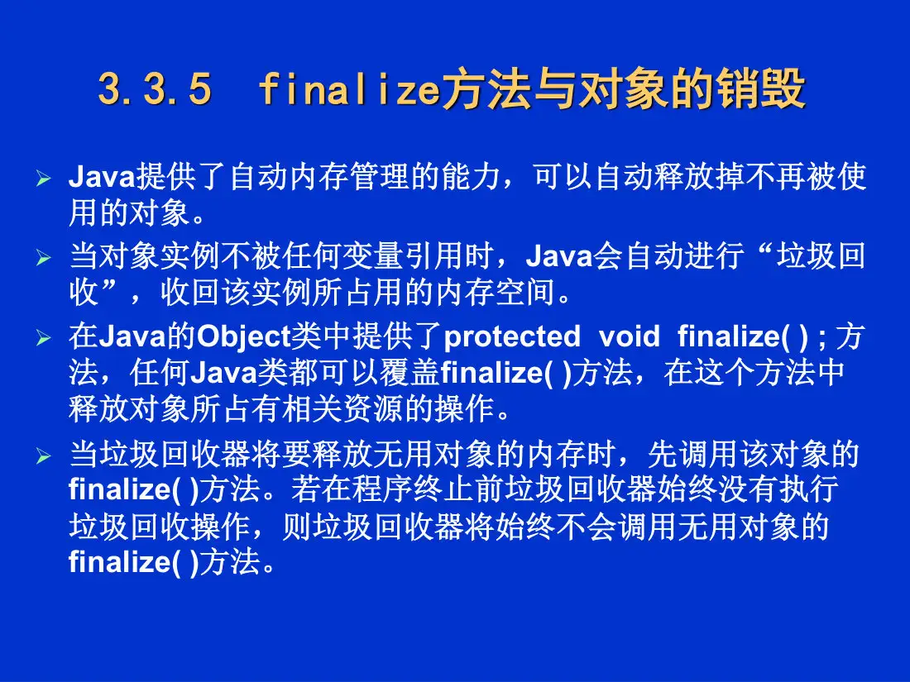

原文：

3.3.5 finalize方法与对象的销毁

Java提供了自动内存管理的能力，可以自动释放掉不再被使用的对象。

当对象实例不被任何变量引用时，Java会自动进行“垃圾回收”，收回该实例所占用的内存空间。

在Java的Object类中提供了protected void finalize( ) ; 方法，任何Java类都可以覆盖finalize( )方法，在这个方法中释放对象所占有相关资源的操作。

当垃圾回收器将要释放无用对象的内存时，先调用该对象的finalize( )方法。若在程序终止前垃圾回收器始终没有执行垃圾回收操作，则垃圾回收器将始终不会调用无用对象的finalize( )方法。

### 3.3.5 finalize方法与对象的销毁

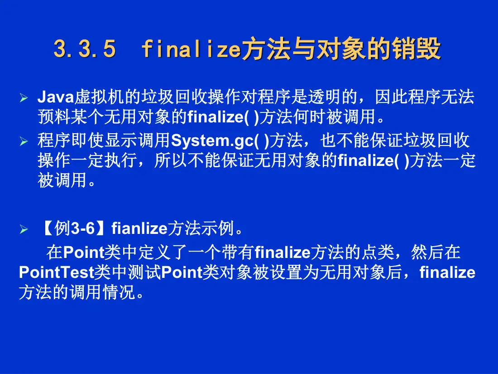

原文：

3.3.5 finalize方法与对象的销毁

Java虚拟机的垃圾回收操作对程序是透明的，因此程序无法预料某个无用对象的finalize( )方法何时被调用。

程序即使显示调用System.gc( )方法，也不能保证垃圾回收操作一定执行，所以不能保证无用对象的finalize( )方法一定被调用。

【例3-6】fianlize方法示例。

在Point类中定义了一个带有finalize方法的点类，然后在PointTest类中测试Point类对象被设置为无用对象后，finalize方法的调用情况。

### 第 49 页

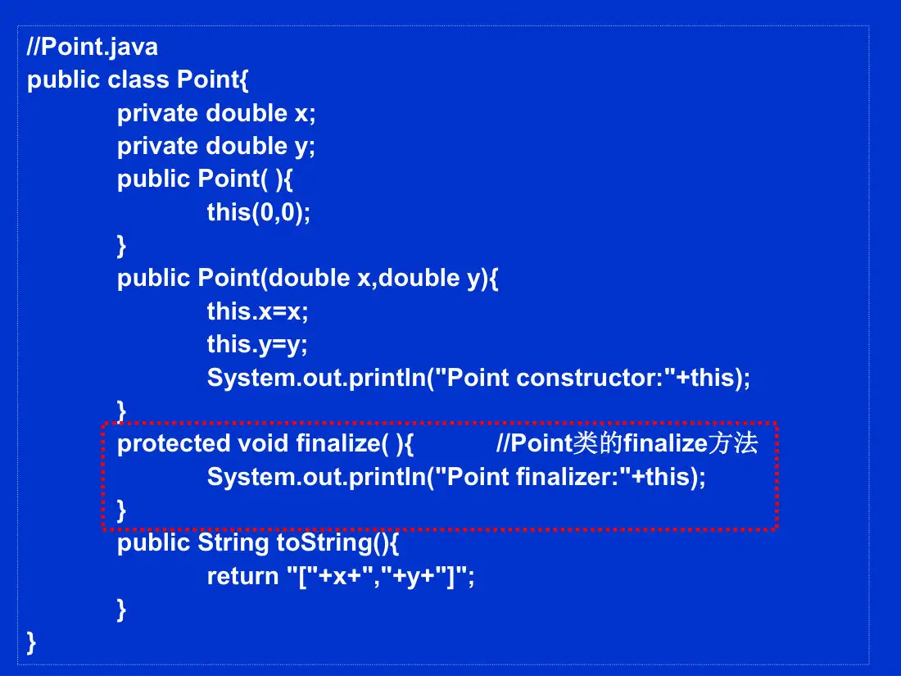

原文：

//Point.java public class Point{ private double x; private double y; public Point( ){ this(0,0);

public Point(double x,double y){ this.x=x; this.y=y; System.out.println("Point constructor:"+this);

protected void finalize( ){ //Point类的finalize方法 System.out.println("Point finalizer:"+this);

public String toString(){ return "["+x+","+y+"]"

### //将引用变量p1、p2设置为null,使p1、

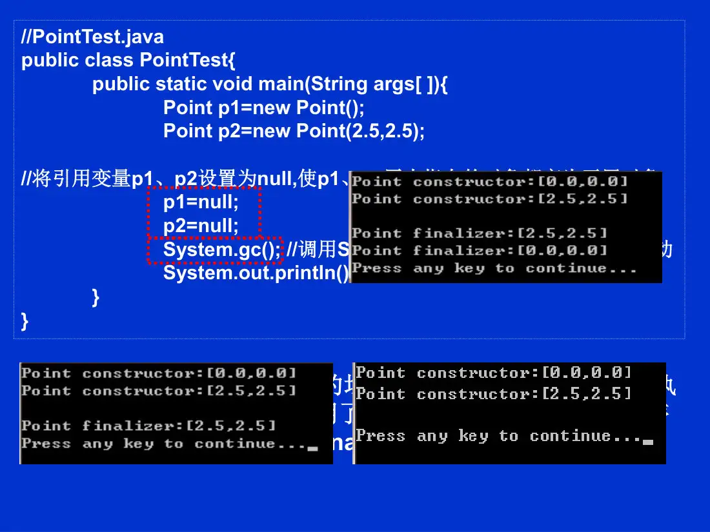

原文：

//PointTest.java public class PointTest{ public static void main(String args[ ]){ Point p1=new Point(); Point p2=new Point(2.5,2.5);

//将引用变量p1、p2设置为null,使p1、

p1=null;

p2=null;

System.gc(); //调用S

System.out.println()

Point constructor:[0.0,0.0] Point constructor:[2.5,2.5]

Point finalizer:[2.5,2.5]

无法预料某个无用对象的f p2原本指向的对象都变为无用 Point constructor:[2.5.2.5]

Point finalizer:[2.5.2.5]

ystem.gc( )，查看垃圾回收是

Press any key to continue...

Point constructor:[0.0,0.0] Point constructor:[2.5,2.5]

方法是否被调用。

### 3.4 类的封装

原文：

3.4 类的封装

➢ 3.4.1 封装的目的

➢ 3.4.2 类的访问控制

➢ 3.4.3 成员的访问控制

➢ 3.4.4 类成员（静态成员）

### 3.4.1 封装的目的

原文：

3.4.1 封装的目的

类是封装的基本单元。类把数据成员和方法封装起来，使外界对类的认识和使用不用考虑类中的具体细节。

//Circle.java public class Circle{ //圆类的定义

private double radius; //用private修饰的成员变量

public void setRadius(double r){ //设置圆的半径 if (r>=0) radius=r;

else

radius=0.0;

### 3.4.1 封装的目的

原文：

3.4.1 封装的目的

成员变量和成员方法定义时，出现了private、public这样的关键字，这是成员的访问权限。

对于数据成员变量，大多数情况下使用private限制，限制数据成员变量仅可以在类的内部使用，外部不可访问。

但是封装并不是不允许对类的成员变量的访问，而是创建些允许外部访问的public方法，通过方法有规则地访问类的成员变量。这样的方法称为公共接口。

### 3.4.1 封装的目的

原文：

3.4.1 封装的目的

封装是面向对象方法的一个重要原则。它有两个基本含义：⚫ 将对象的全部属性数据和对数据的全部操作结合在一起，形成一个统一体（也就是对象）。

⚫ 尽可能地隐藏对象的内部细节，只保留有限的外部接口，对数据的操作由这些接口实现。

### 3.4.2 类的访问控制

原文：

3.4.2 类的访问控制

在Java中，根据类的作用和相关性，将大量的类进行了分组，每组起一个名字，称为包名（包的使用在3.5节详细介绍）。同一个包里的类是可以互相访问的，而不同包里的类能否互相访问就要由类的访问控制符决定了。

类的访问控制符决定了类的访问范围，有publlic和默认（无修饰符）两种，其可访问性如下表所示。

<table><tr><td>访问域\类的访问控制符</td><td>public(公有类)</td><td>无修饰符(默认)</td></tr><tr><td>同一包</td><td>可见</td><td>可见</td></tr><tr><td>不同包</td><td>可见</td><td>不可见</td></tr></table>

### 3.4.2 类的访问控制

原文：

3.4.2 类的访问控制

类的访问控制符有两种：

⚫ public（公共作用域）：一个具有公共作用域的类在封装它的包外面是可见的。

默认值（包作用域）：一个具有包作用域的类只是在封装它的包中是可见的，如果一个类声明的前面没有public关键字，则此类默认为包作用域。

➢ 因此，在声明一个类时，其访问控制符要么是public（公共作用域），要么没有（包作用域）。

### 【例3-7】类的访问控制示例。

原文：

【例3-7】类的访问控制示例。

//A.java

package p1;

//A类为public类，属于p1包，可被跨包访问

public class A{

private int a;

public int getA( ){

return a;

public void setA(int a){

this.a = a;

### package p1;

原文：

package p1;

//B类为默认类，属于p1包，只能在p1包中被访问，不可以跨包访问

class B{

private int b;

public int getB( ){

return b;

public void setB(int b){

this.b = b;

### //C.java

原文：

//C.java
package p2;
//C类为默认类，属于p2包，不可被跨包访问
class C{
    private int c;
    public int getC( ) {
    return c;
    }
    public void setC(int c) {
    this.c = c;
    }
}

### //ABCTest.java

原文：

//ABCTest.java

objA: a= 100

package p2;

objC: c= 50

import p1.\*;

public class ABCTest{

Press any key to continue...

public static void main(String args[ ]){

A objA = new A( );

//A类为public类，属于p1包，能被跨包引用

//B objB=new B( );

//B类为默认类，属于p1包，不能被跨包引用

C objC = new C( );

//C类为默认类，属于p2包，不能被跨包引用

objA.setA(100);

objC.setC(50);

System.out.println("objA: a= "+objA.getA( ));

System.out.println("objC: c= "+objC.getC( ));

}

### 3.4.2 类的访问控制

原文：

3.4.2 类的访问控制

➢ 本例一共有四个类：A类和B类属于p1包，C类和ABCTest类属于p2包。在ABCTest类中访问A类、B类、C类的情况如下图所示。

### 3.4.3 成员的访问控制

原文：

3.4.3 成员的访问控制

类成员的访问控制符有public、protected、private和默认（无修饰符）四种，其可访问性如下表所示。

<table><tr><td colspan="2">访问域\成员的访问控制符</td><td>public</td><td>protected</td><td>无修饰符(默认)</td><td>private</td></tr><tr><td rowspan="3">同一包</td><td>同一个类</td><td>可见</td><td>可见</td><td>可见</td><td>可见</td></tr><tr><td>同一包中的子类</td><td>可见</td><td>可见</td><td>可见</td><td>不可见</td></tr><tr><td>同一包中的非子类</td><td>可见</td><td>可见</td><td>可见</td><td>不可见</td></tr><tr><td rowspan="2">不同包</td><td>不同包中的子类</td><td>可见</td><td>可见</td><td>不可见</td><td>不可见</td></tr><tr><td>不同包中的非子类</td><td>可见</td><td>不可见</td><td>不可见</td><td>不可见</td></tr></table>

### 3.4.3 成员的访问控制

原文：

3.4.3 成员的访问控制

成员的访问控制符有四种：

⚫ public：用public修饰的成员表示是公有的，可以被任何对象访问。

private：和它的名字“私有”一样，类中限定为private的成员只能被这个类本身访问，在类外不可见。

⚫ 无修饰符（默认）：不带任何访问控制修饰符的成员是包作用域成员，该成员可以在同一包中被访问。

protected：用protected修饰的成员是受保护的，表示可以被同一包以及其子类中被访问。

### 3.4.3 成员的访问控制

原文：

3.4.3 成员的访问控制

【例3-8】成员的访问控制示例。

⚫ 定义了在同一包（缺省包）中的两个类：accessModifier和accessModifierTest。

在accessModifier类中定义了四个数据成员a、b、c、d，它们的访问控制符分别是private、无修饰符、protected、public。

在accessModifierTest类中，创建accessModifier类的对象obj，观察obj对四个不同类型访问控制符修饰的数据成员a、b、c、d的访问情况。

### //accessModifier.java

原文：

//accessModifier.java
public class accessModifier{
    private int a;
    int b;
    protected int c;
    public int d;
    public void setA(int a){
    this.a=a;
    }
    public int getA( ){
    return a;
    }
}

### $$

原文：

$$
/ / \mathrm{obj.a} = 1;
$$

//数据成员a是私有成员，不可以在accessModifier类外访问obj.setA(1); //通过公有方法实现对私有数据成员a的操作

$$
\mathbf {o b j . b} = 2;
$$

$$
\text { obj:a } = 1
$$

$$
\mathrm{obj:b=2}
$$

$$
\mathbf {o b j . c} = 3;
$$

$$
\text { obj:c } = 3
$$

$$
\text { obj:d } = 4
$$

$$
\mathbf {o b j . d} = 4;
$$

$$
\text { Press   any   key   to   continue... }
$$

System.out.println("obj:a = "+ obj.getA( )); System.out.println("obj:b = "+ obj.b); System.out.println("obj:c = "+ obj.c); System.out.println("obj:d = "+ obj.d);

}

### 3.4.4 类成员（静态成员）

原文：

3.4.4 类成员（静态成员）

在类的定义中还可以定义一种特殊的成员，一般称为类成员，它包括类变量和类方法，它们不依赖与特定对象的内容。

在Java中生成每个类的实例对象时，是为每个对象的实例变量分配内存，不同对象的内存空间相互独立。但是如果类中包含类成员，则系统只在类定义的时候，为类成员分配内存，不同对象的类成员将共享同一内存空间。类成员用static修饰，又称为静态成员。

类变量类方法成员变量成员方法

### 3.4.4 类成员（静态成员）

原文：

3.4.4 类成员（静态成员）

1、类变量

Java语言中没有全局变量的概念，类变量从某种意义上来说相当于其他程序设计语言中的全局变量，类变量的作用主要有以下两点：

（1）类变量能被该类的所有实例对象共享，实现了实例对象之间数据共享与通信。

（2）如果类的所有实例对象都包含一个相同的常量属性，则可以把这个属性定义为静态常量类型，从而节省内存空间。

### 3.4.4 类成员（静态成员）

原文：

3.4.4 类成员（静态成员）

将一个成员变量定义为类变量，只要将static关键字加在变量声明的前面。例如：

private static int count = 0;

类变量在内存中只存储一份，被该类的所有对象共享，任何对象都可以访问它。类变量一旦被修改，将保持被修改后的内容直到下次被修改。

类变量的访问方法，既可以通过类名访问，也可以通过对象引用名访问，其访问格式如下：

类名 . 类变量名

对象引用名 . 类变量名

### 3.4.4 类成员（静态成员）

原文：

3.4.4 类成员（静态成员）

2、类方法

与类变量类似，类方法是指由static修饰的成员方法，又称为静态方法。

类访问的访问方法，也是既可以通过类名访问，也可以通过对象引用名访问，其访问格式如下：

类名 . 类方法名(参数列表)

对象引用名 . 类方法名(参数列表)

### 3.4.4 类成员（静态成员）

原文：

3.4.4 类成员（静态成员）

➢ 使用类方法时，有几个特别的限制需要注意：

（1）由于静态方法可以在没有定义它所从属的类的对象的情况下加以调用，所以不存在this值。

（2）当在类的静态方法中出现成员变量时，要求成员变量必须是静态的，如果企图使用非静态变量将引起编译错误。

（3）静态方法不能被子类重写。

### public String getName( ){ return name;

原文：

【例3-9】静态成员的使用示例。 //Student.java public class Student{ private String name; private static int count = 0; // 静态变量count记录内存中生成的Student对象的数目

public Student(String name){ this.name = name; count++; //每创建一个Student对象，count加1

public String getName( ){ return name;

public static int getCount( ){ //静态方法getCount，只能访问静态成员count return count;

### staticTest

原文：

public static void main(String args[ ]){ String output = "Student before instantiation:"+ Student.getCount( );

staticTest

tudent("Tom");

output += "\n\nSt

Student after instantiation:

Student 1: Tom

Student 2: Kitty

stu1.getCount( ): 2

stu2.getCount(): 2

OptionPane.show

确定

tudent("Kitty");

t after instantiation:"+

"+stu1.getName( )+

"+stu2.getName( )+

unt( ): "+stu1.getCount( )+

unt( ): "+stu2.getCount( )+

etCount( ): "+Student.getCount( );

ialog (null, output,

ane.INFORMATION\_MESSAGE);

}

### 3.5 类的导入与包

原文：

3.5 类的导入与包

3.5.1 包的概念

➢ 3.5.2 package语句

➢ 3.5.3 import语句

### 3.5.1 包的概念

原文：

3.5.1 包的概念

包（package）是类和接口的集合，Java提供的用于程序开发的类就放在各种包中，也可以自己创建包。

Java常用的包有：

⚫ java.lang：基本语言类，程序运行时自动导入；

java.io：所有的输入输出类；

⚫ java.util：实用的数据类型类；

⚫ java.awt：构建图形用户界面（GUI）的类

⚫ java.awt.image：处理和操纵网上图片的工具类；

⚫ java.awt.peer：实现与平台无关的GUI的类；

⚫ java.applet：实现Java Applet的工具类；

java.net：实现网络功能的类。

### 3.5.1 包的概念

原文：

3.5.1 包的概念

➢ 包具有以下几方面作用：

1. 划分类名空间：包是一种名字空间机制，同一包中的类（包括接口）名不能重名，不同包中的类名可以重名。解决了类和接口命名冲突问题。

2. 控制类之间的访问：包是一个访问域，对包中的类有保护作用。例如，一个类的访问控制符是public，则该类不仅可供同一包中的类访问，而且也可以被其他包中的类访问。如果类声明无修饰符，则该类仅供同一包中的类访问。

3. 有助于划分和组织Java应用中的各个类。

### 3.5.2 package语句

原文：

3.5.2 package语句

➢ 建立一个包时，使用package语句。包语句的格式为：

package pkg1[.pkg2[.pkg3…]];

其功能是创建一个具有指定名字的包，该java文件中的所有类和接口都被放在这个包中。

➢ 例如，下面的语句是合法的创建包的语句：

package dbconnect;

package cn.edu.njupt.ch03;

包的命名使用小写字母，采用点分方法，用“.”来指明目录的层级，逻辑上包名与物理上的目录结构对应一致，如包名“cn.edu.njupt.ch03”与目录树“cn\edu\njupt\ch03”相对应

o

### 3.5.2 package语句

原文：

3.5.2 package语句

➢ 注意点：

1. 程序中如果有package语句，该语句一定是源文件中的第一条可执行语句，它的前面只能有注释和空行。

2. 一个文件中最多只能有一条package语句。

3. 当一个类所在的源文件没有package语句时，系统会给源文件创建一个无名包（缺省包），该文件中定义的所有类都属于这个无名包。

### 3.5.3 import语句

原文：

3.5.3 import语句

假设已定义如下的类：

如果其他包中的类想使用MyClass，则需要使用全名，如下所示：

cn.edu.njupt.ch03.MyClass my = new cn.edu.njupt.ch03.MyClass( );

### 3.5.3 import语句

原文：

3.5.3 import语句

为了简化程序的书写，Java提供了导入（import）语句。当要使用其他包中所提供的类时，先使用import语句导入所需要的类，程序中无需再使用全名，可以简单写作下面的形式

import cn.edu.njupt.ch03.MyClass; MyClass my = new MyClass( );

➢ 也可以使用下面这样的形式，表示导入cn.edu.njupt.ch03包中的所有类，但不包括cn.edu.njupt.ch03子包里的类。

import cn.edu.njupt.ch03.\*;

### 3.6 综合示例

原文：

3.6 综合示例

【问题描述】设计一个资费管理系统，初步实现对资费的录入、修改、删除、查询等功能

【系统流程】

### 3.6 综合示例

原文：

3.6 综合示例

➢ 类图

### 3.6 综合示例

原文：

3.6 综合示例

➢ 【例3-10】类与对象的综合示例：控制台版资费管理系统。

本例一共有三个源文件：

1. Fee.java：该文件中定义了资费类（Fee）。

2. MenuUtil.java：该文件设计了在系统运行时显示的各种信息，包括：打印控制台资费管理主菜单、 打印欢迎信息、打印退出信息。

3. FeeManagementMain.java：该文件中定义了资费管理类，以控制台的方式提供了对资费的增删修查操作。

### 小结

原文：

小结

通过本章初步学习与体会面向对象程序设计的思想。

➢ OOP技术把问题看成是相互作用的事物的集合，用属性来描述事物，而把对它的操作定义为方法。

在OOP中，把事物称为对象，把属性称为数据，这样对象就是数据加方法。

对象在程序中是通过一种抽象数据类型来描述，这种抽象数据类型就称为类(Class)。

本章的重点就是学习如何定义类，如何实例化对象，以及对象如何使用。

➢ OOP中采用的三大技术：封装、继承和多态。将数据及对数据的操作捆绑在一起构成类，体现了封装技术。继承和多态在后面的章节中我们将进一步学习。
