# 《Java程序设计》第4章 类的继承和派生（课件）

原件的每一页，下面附识别出的文字。

### Java 程序设计Java Programming

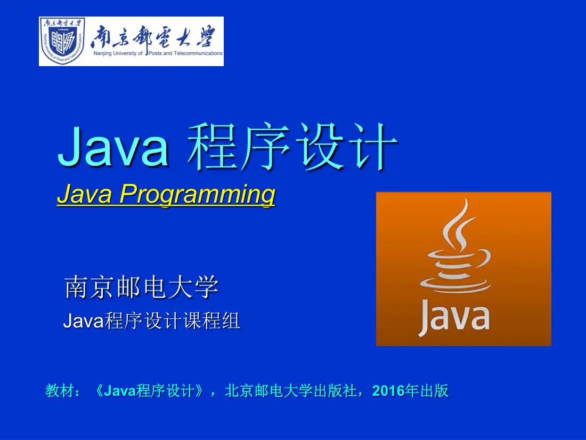

原文：

Java 程序设计Java Programming

南京邮电大学Java程序设计课程组心川

教材：《Java程序设计》，北京邮电大学出版社，2016年出版

南京鐵電大學 南京郵電大学 Nanjing University of Posts and Telecommunications

### 第四章类的继承和派生

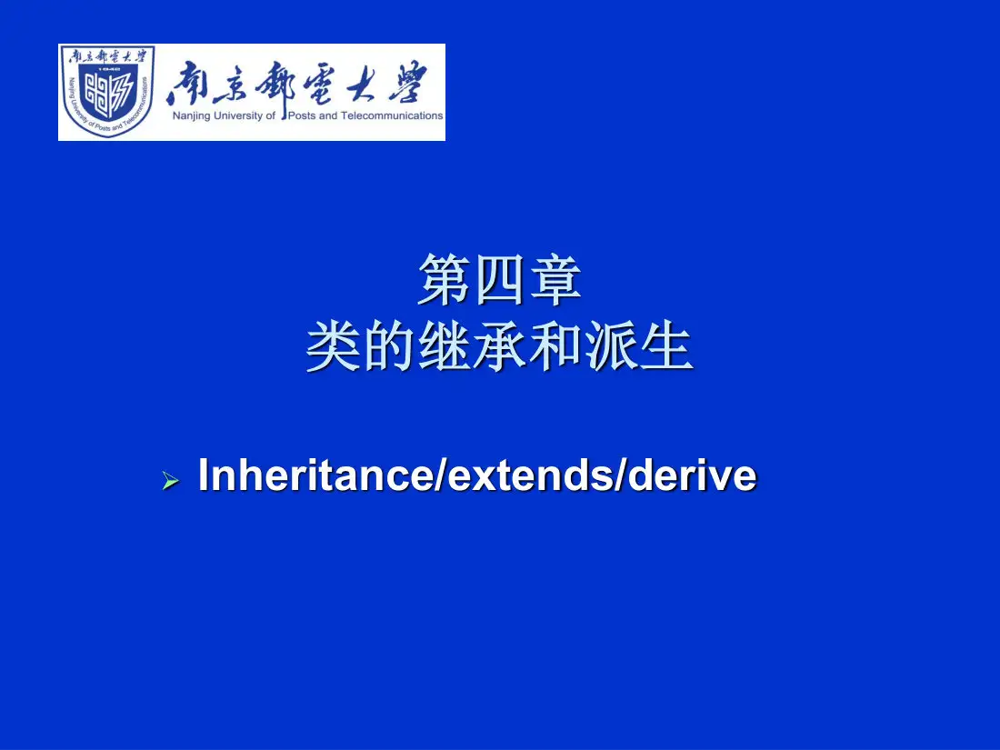

原文：

第四章类的继承和派生

➢ Inheritance/extends/derive

南京郵電大學 muncions 南京郵電大学 Nanjing University ofPosts and Telecommunications

### 教学目标

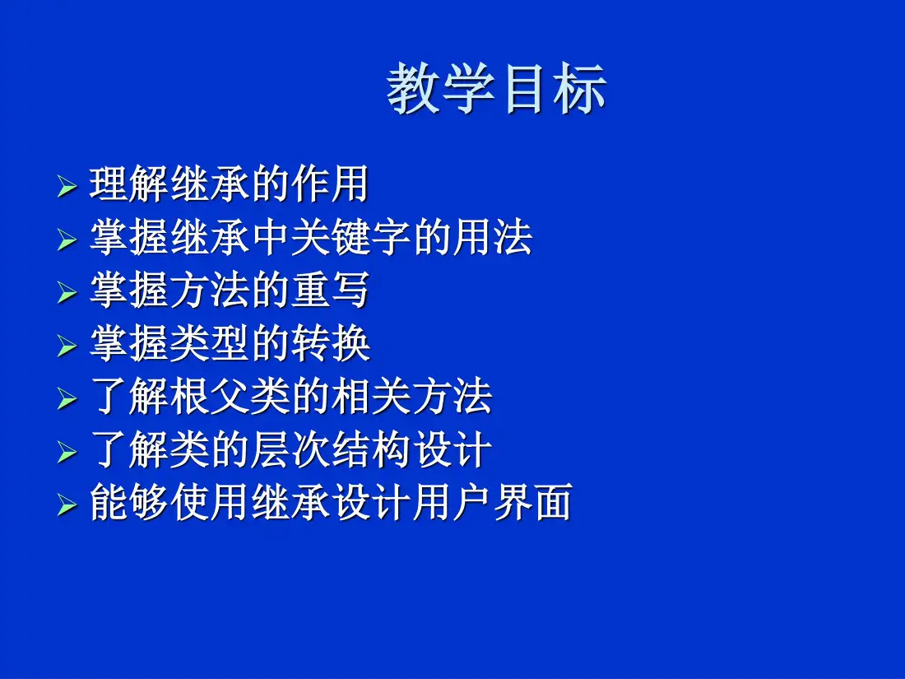

原文：

教学目标

理解继承的作用

掌握继承中关键字的用法

掌握方法的重写

掌握类型的转换

➢了解根父类的相关方法

➢ 了解类的层次结构设计

➢能够使用继承设计用户界面

### 4.1 类的抽象和扩展

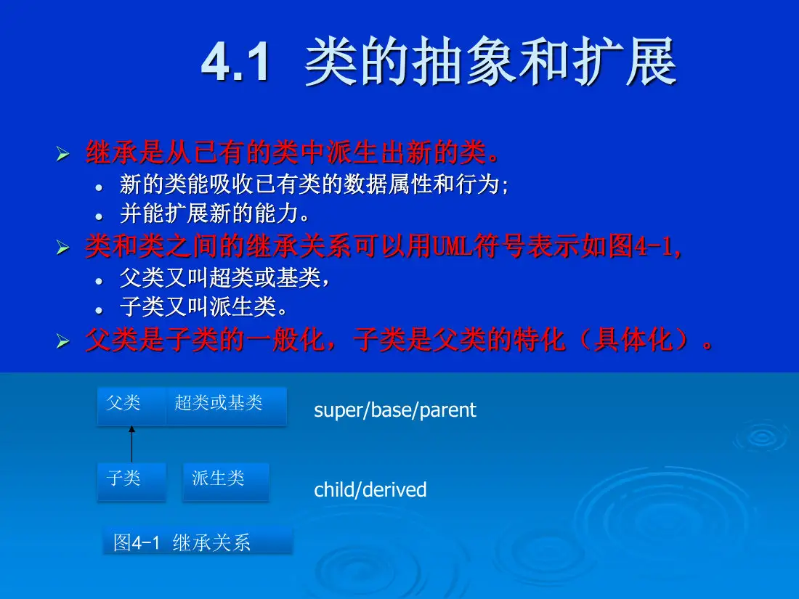

原文：

4.1 类的抽象和扩展

继承是从已有的类中派生出新的类。

⚫ 新的类能吸收已有类的数据属性和行为;

⚫ 并能扩展新的能力。

类和类之间的继承关系可以用UML符号表示如图4-1,父类又叫超类或基类，

⚫ 子类又叫派生类。

➢ 父类是子类的一般化，子类是父类的特化（具体化）。

父类 超类或基类

super/base/parent

子类

派生类

child/derived

图4-1 继承关系

### 4.1 类的抽象和扩展

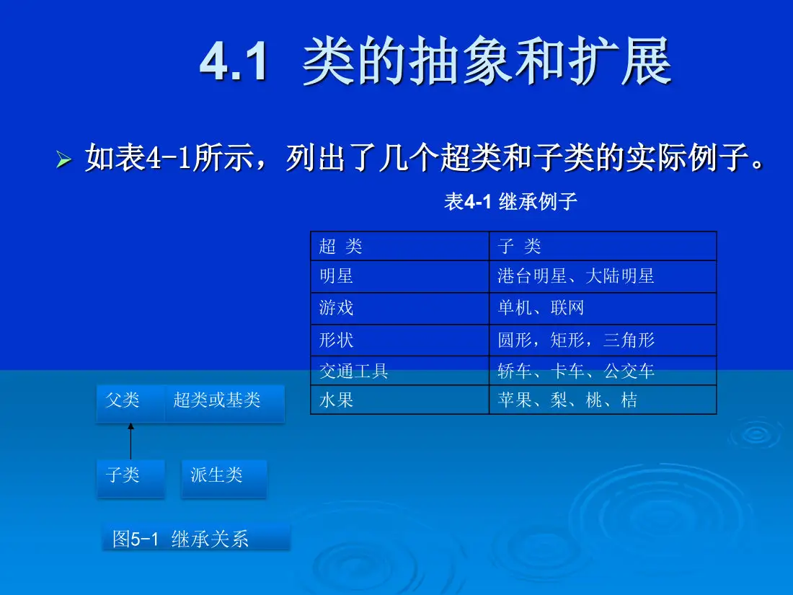

原文：

4.1 类的抽象和扩展

➢ 如表4-1所示，列出了几个超类和子类的实际例子。

表4-1 继承例子

港台明星、大陆明星

单机、联网

圆形，矩形，三角形

交通工具

轿车、卡车、公交车

父类 超类或基类

苹果、梨、桃、桔

子类 派生类

图5-1 继承关系

### 4.1 类的抽象和扩展（续）

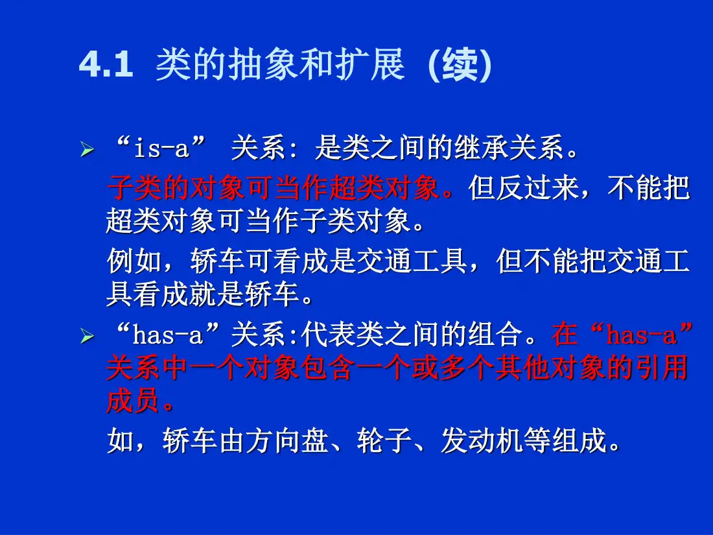

原文：

4.1 类的抽象和扩展（续）

$( 1 3 , 1 5 ) = ( 2 1 )$ 关系: 是类之间的继承关系。

子类的对象可当作超类对象。但反过来，不能把超类对象可当作子类对象。

例如，轿车可看成是交通工具，但不能把交通工具看成就是轿车。

$( 1 ) [ 0 , 1 ] = ( 0 , 1 )$ 关系:代表类之间的组合。在“has-a”关系中一个对象包含一个或多个其他对象的引用成员。

如，轿车由方向盘、轮子、发动机等组成。

### 4.1 类的抽象和扩展（续）

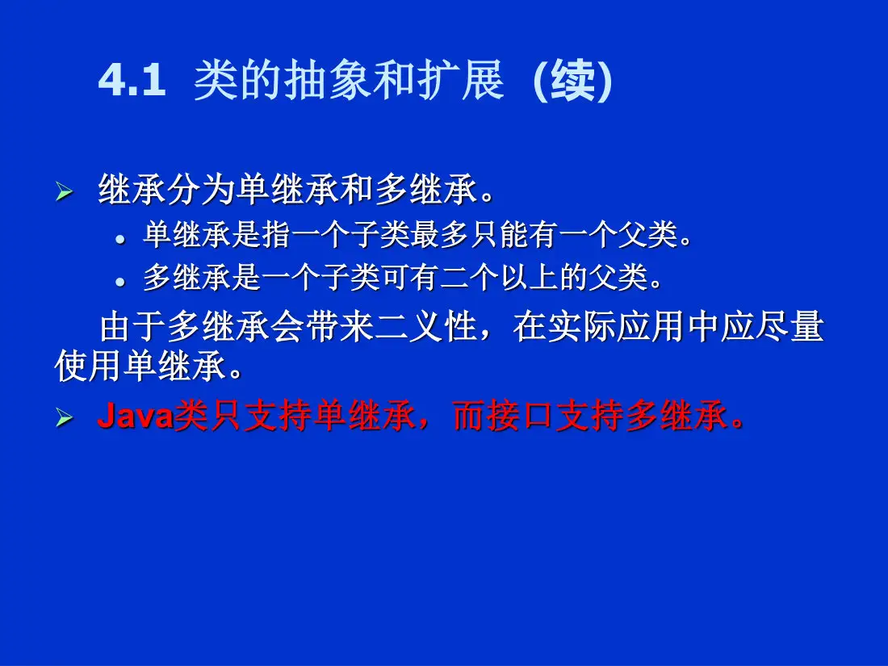

原文：

4.1 类的抽象和扩展（续）

➢ 继承分为单继承和多继承。

⚫ 单继承是指一个子类最多只能有一个父类。

⚫ 多继承是一个子类可有二个以上的父类。

由于多继承会带来二义性，在实际应用中应尽量使用单继承。

➢ Java类只支持单继承，而接口支持多继承。

### 单继承与多继承例子

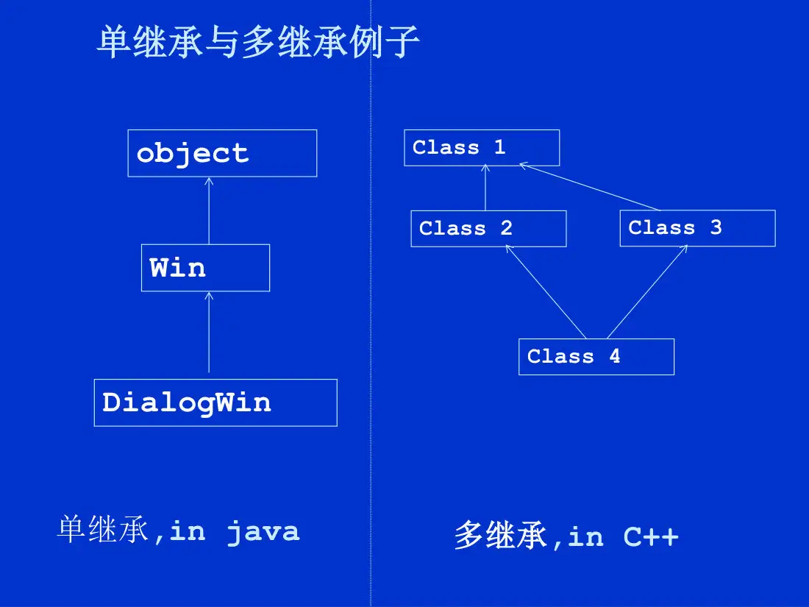

原文：

单继承与多继承例子

单继承,in java

多继承,in C++

### 4.1 类的抽象和扩展（续）

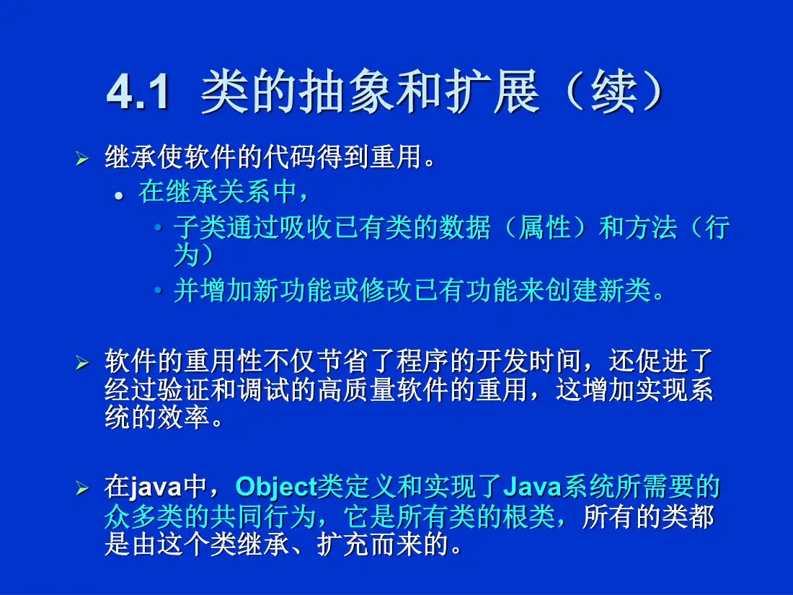

原文：

4.1 类的抽象和扩展（续）

继承使软件的代码得到重用。

⚫ 在继承关系中，

子类通过吸收已有类的数据（属性）和方法（行为）

并增加新功能或修改已有功能来创建新类。

软件的重用性不仅节省了程序的开发时间，还促进了经过验证和调试的高质量软件的重用，这增加实现系统的效率。

在java中，Object类定义和实现了Java系统所需要的众多类的共同行为，它是所有类的根类，所有的类都是由这个类继承、扩充而来的。

### 4.2 继承的定义

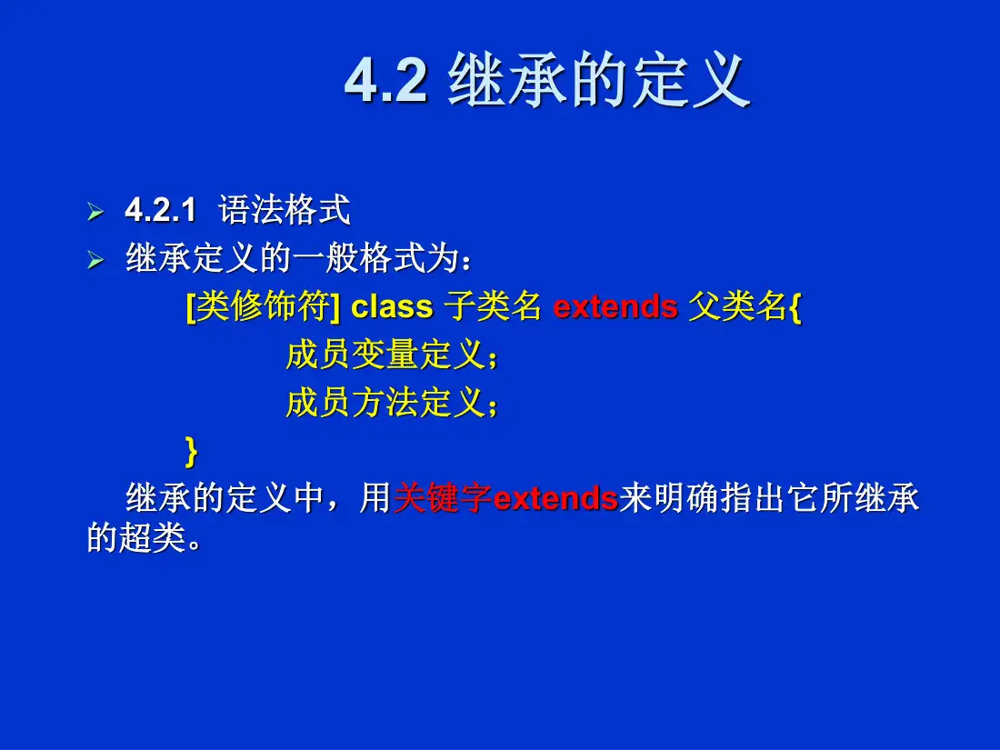

原文：

4.2 继承的定义

➢ 4.2.1 语法格式

继承定义的一般格式为：

[类修饰符] class 子类名 extends 父类名{

成员变量定义；

成员方法定义；

继承的定义中，用关键字extends来明确指出它所继承的超类。

### 4.2 继承的定义

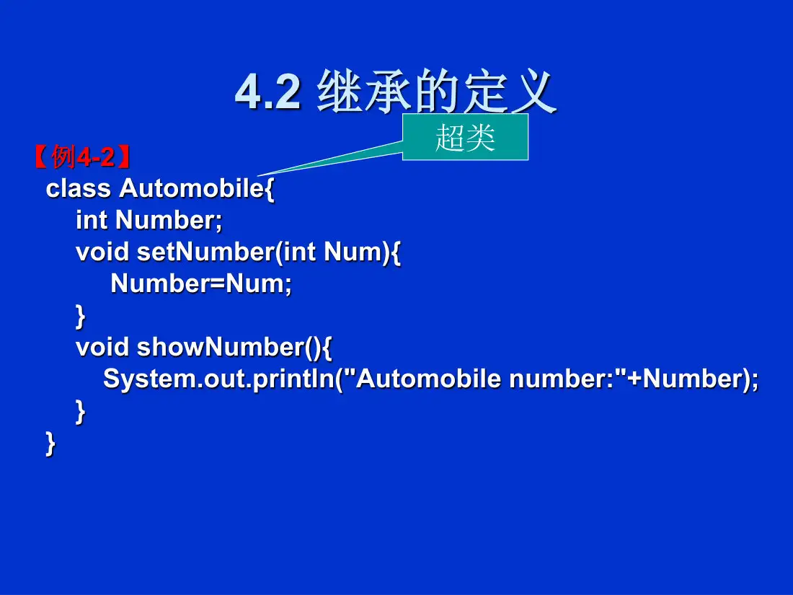

原文：

4.2 继承的定义

【例4-2】

超类

class Automobile{ int Number; void setNumber(int Num){ Number=Num;

void showNumber(){ System.out.println("Automobile number:"+Number);

### 4.2 继承的定义

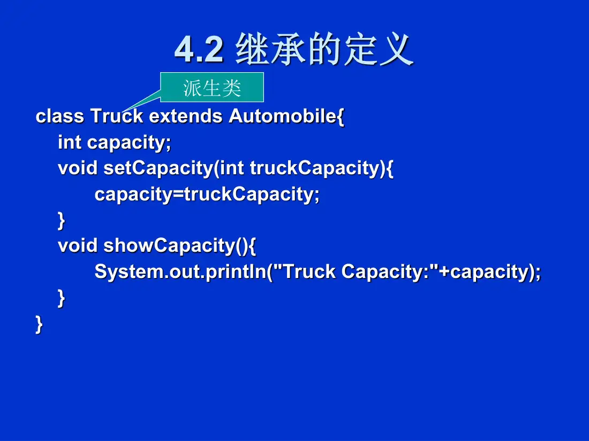

原文：

4.2 继承的定义

派生类

class Truck extends Automobile{

int capacity;

void setCapacity(int truckCapacity){

capacity=truckCapacity;

void showCapacity(){

System.out.println("Truck Capacity:"+capacity);

### 4.2 继承的定义

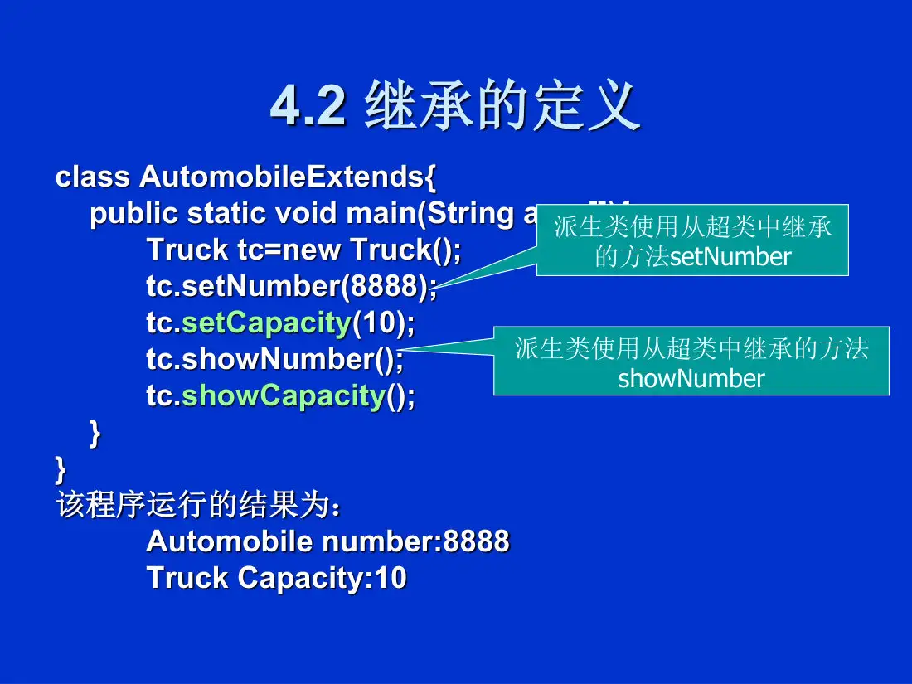

原文：

4.2 继承的定义

class AutomobileExtends{

public static void main(String

Truck tc=new Truck();

tc.setNumber(8888);

tc.setCapacity(10);

tc.showNumber();

tc.showCapacity();

该程序运行的结果为：

Automobile number:8888

Truck Capacity:10

派生类使用从超类中继承

的方法setNumber

派生类使用从超类中继承的方法

showNumber

### 作用域和继承

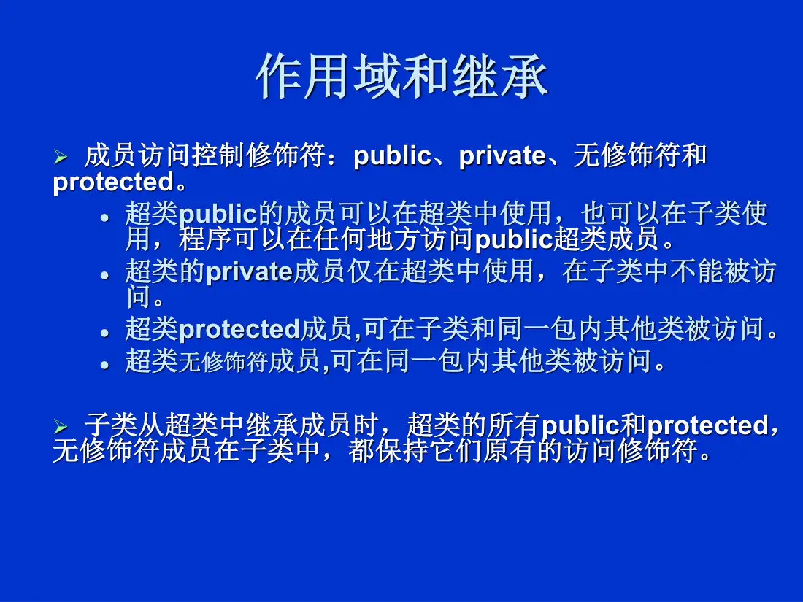

原文：

作用域和继承

➢ 成员访问控制修饰符：public、private、无修饰符和protected。

⚫ 超类public的成员可以在超类中使用，也可以在子类使用，程序可以在任何地方访问public超类成员。

⚫ 超类的private成员仅在超类中使用，在子类中不能被访问。

⚫ 超类protected成员,可在子类和同一包内其他类被访问。

⚫ 超类无修饰符成员,可在同一包内其他类被访问。

➢ 子类从超类中继承成员时，超类的所有public和protected，无修饰符成员在子类中，都保持它们原有的访问修饰符。

### 方法的重写(overriding)

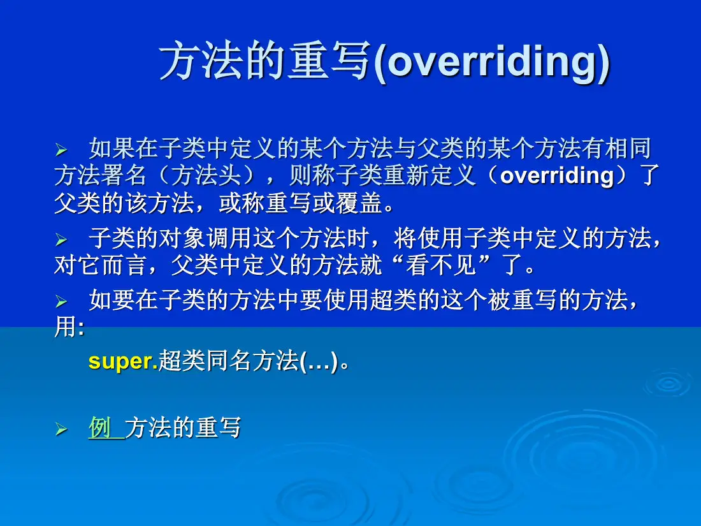

原文：

方法的重写(overriding)

➢ 如果在子类中定义的某个方法与父类的某个方法有相同方法署名（方法头），则称子类重新定义（overriding）了父类的该方法，或称重写或覆盖。

子类的对象调用这个方法时，将使用子类中定义的方法，对它而言，父类中定义的方法就“看不见”了。

➢ 如要在子类的方法中要使用超类的这个被重写的方法，用:

super.超类同名方法(…)。

例 方法的重写

### Point类的设计：

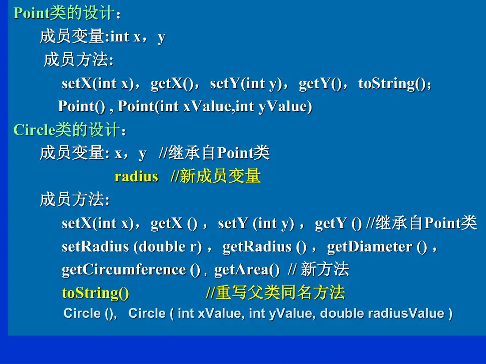

原文：

Point类的设计：

成员变量:int x，y

成员方法:

setX(int x)，getX()，setY(int y)，getY()，toString()；

Point() , Point(int xValue,int yValue)

Circle类的设计：

成员变量: x，y //继承自Point类

radius //新成员变量

成员方法:

setX(int x)，getX () ，setY (int y) ，getY () //继承自Point类

setRadius (double r) ，getRadius () ，getDiameter () ，

getCircumference () , getArea() // 新方法

toString() //重写父类同名方法

Circle (), Circle ( int xValue, int yValue, double radiusValue )

### 方法的重写(overriding)（续）

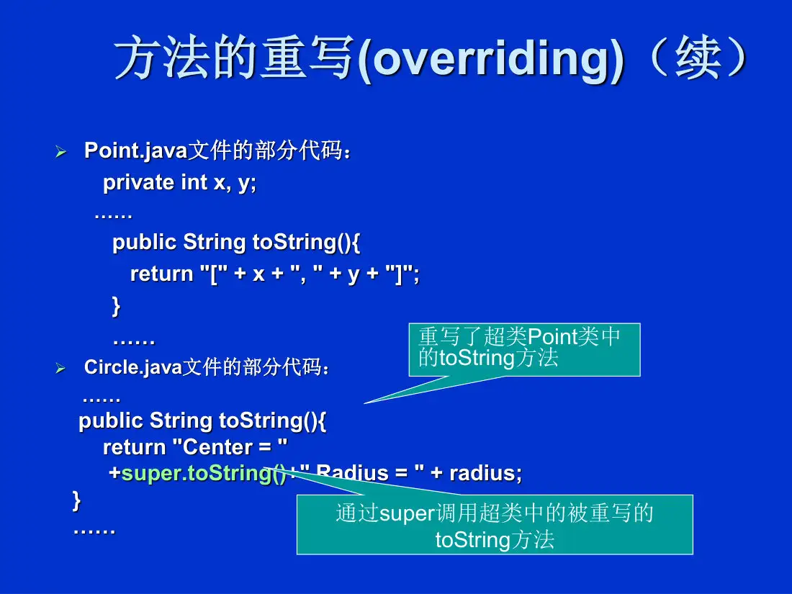

原文：

方法的重写(overriding)（续）

Point.java文件的部分代码：private int x, y;

public String toString(){ return "[" + x + ", " + y + "]";

➢ Circle.java文件的部分代码：

重写了超类Point类中的toString方法

public String toString(){ return "Center = " +super.toString()+" Radius = " + radius;

通过super调用超类中的被重写的

toString方法

### 继承下的构造函数和finalize方法

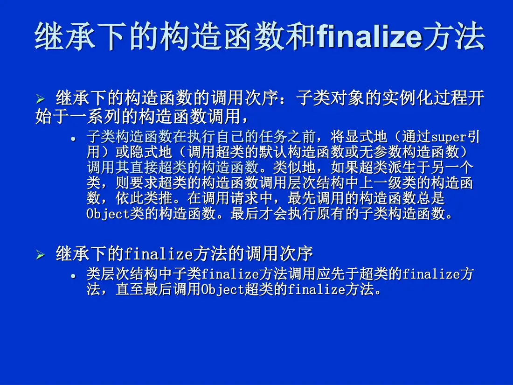

原文：

继承下的构造函数和finalize方法

继承下的构造函数的调用次序：子类对象的实例化过程开始于一系列的构造函数调用，

子类构造函数在执行自己的任务之前，将显式地（通过super引用）或隐式地（调用超类的默认构造函数或无参数构造函数）调用其直接超类的构造函数。类似地，如果超类派生于另一个类，则要求超类的构造函数调用层次结构中上一级类的构造函数，依此类推。在调用请求中，最先调用的构造函数总是Object类的构造函数。最后才会执行原有的子类构造函数。

继承下的finalize方法的调用次序类层次结构中子类finalize方法调用应先于超类的finalize方法，直至最后调用Object超类的finalize方法。

### 例4-3:继承下的构造函数和finalize方法

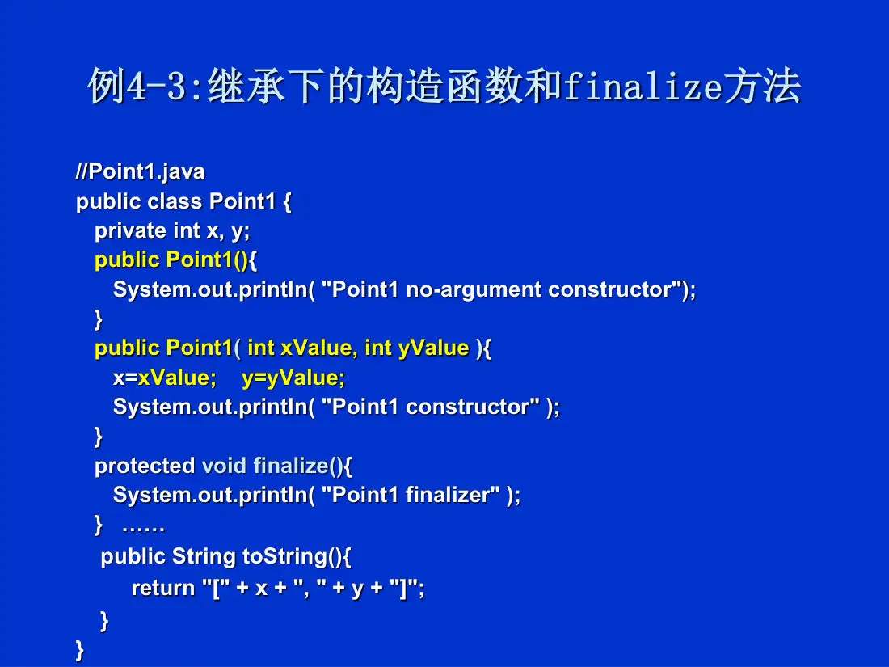

原文：

例4-3:继承下的构造函数和finalize方法

//Point1.java public class Point1 { private int x, y; public Point1(){ System.out.println( "Point1 no-argument constructor");

public Point1( int xValue, int yValue ){ x=xValue; y=yValue; System.out.println( "Point1 constructor" );

protected void finalize(){ System.out.println( "Point1 finalizer" );

### 间接地调用父类无参构造方法Point1()

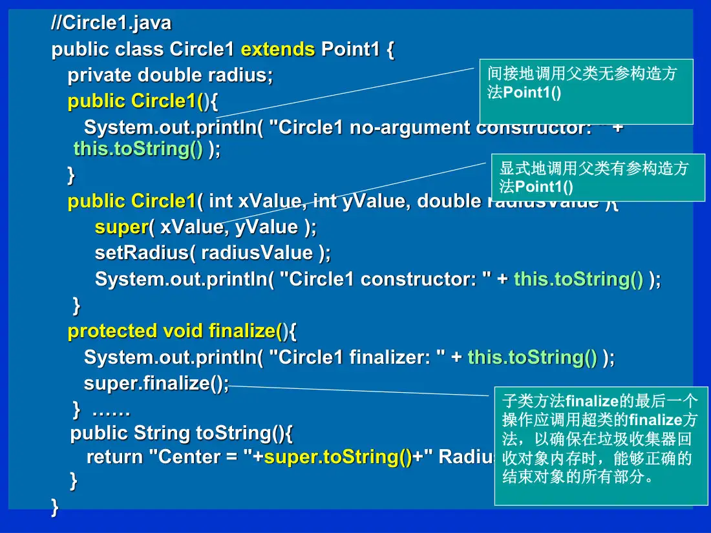

原文：

间接地调用父类无参构造方法Point1()

显式地调用父类有参构造方法Point1()

public Circle1( int xValue, int yValue, double radiusValue ){ super( xValue, yValue ); setRadius( radiusValue ); System.out.println( "Circle1 constructor: " + this.toString() );

protected void finalize(){ System.out.println( "Circle1 finalizer: " + this.toString() ); super.finalize();

public String toString(){ return "Center = "+super.toString()+" Radiu }

子类方法finalize的最后一个操作应调用超类的finalize方法，以确保在垃圾收集器回= " + radius;收对象内存时，能够正确的结束对象的所有部分。

### 第 21 页

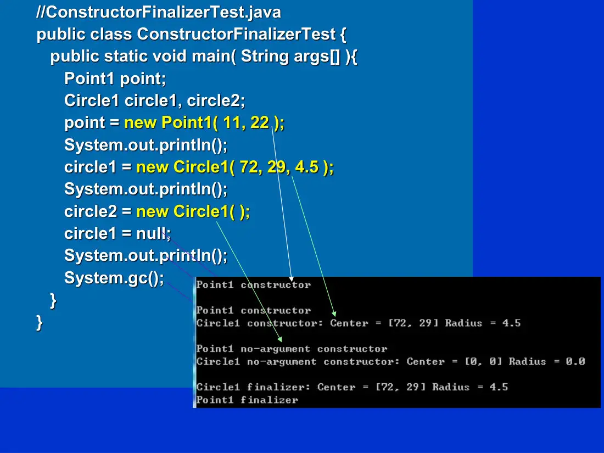

原文：

//ConstructorFinalizerTest.java public class ConstructorFinalizerTest { public static void main( String args[] ){ Point1 point; Circle1 circle1, circle2; point = new Point1( 11, 22 ); System.out.println(); circle1 = new Circle1( 72, 29, 4.5 ); System.out.println(); circle2 = new Circle1( ); circle1 = null; System.out.println(); System.gc(); Point1 constructor

Point1 constructor Circle1 constructor: Center = [72, 29] Radius = 4.5

Point1 no-argument constructor Circle1 no-argument constructor: Center = [0, 0] Radius = 0.0

Circle1 finalizer: Center = [72, 29] Radius = 4.5 Point1 finalizer

### 超类和子类的关系（一）

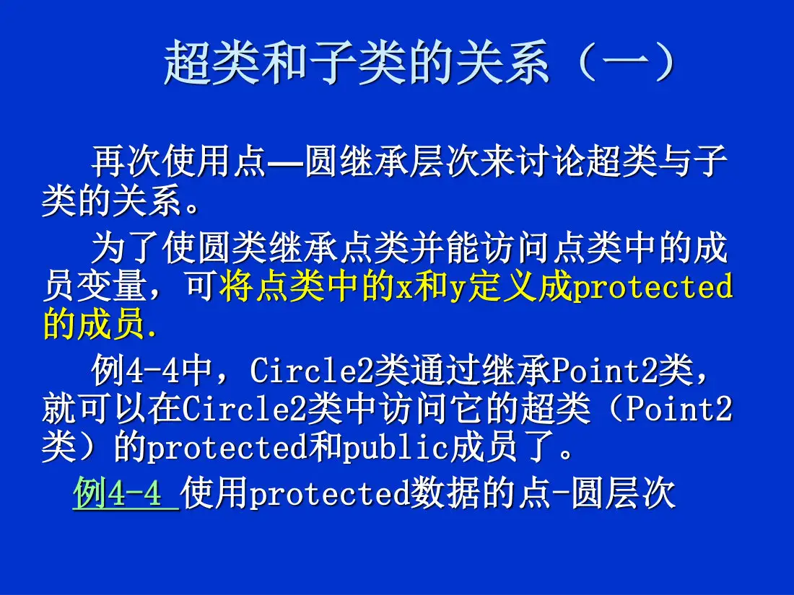

原文：

超类和子类的关系（一）

再次使用点—圆继承层次来讨论超类与子类的关系。

为了使圆类继承点类并能访问点类中的成员变量，可将点类中的x和y定义成protected的成员.

例4-4中，Circle2类通过继承Point2类，就可以在Circle2类中访问它的超类（Point2类）的protected和public成员了。

例4-4 使用protected数据的点-圆层次

### //Point2.java

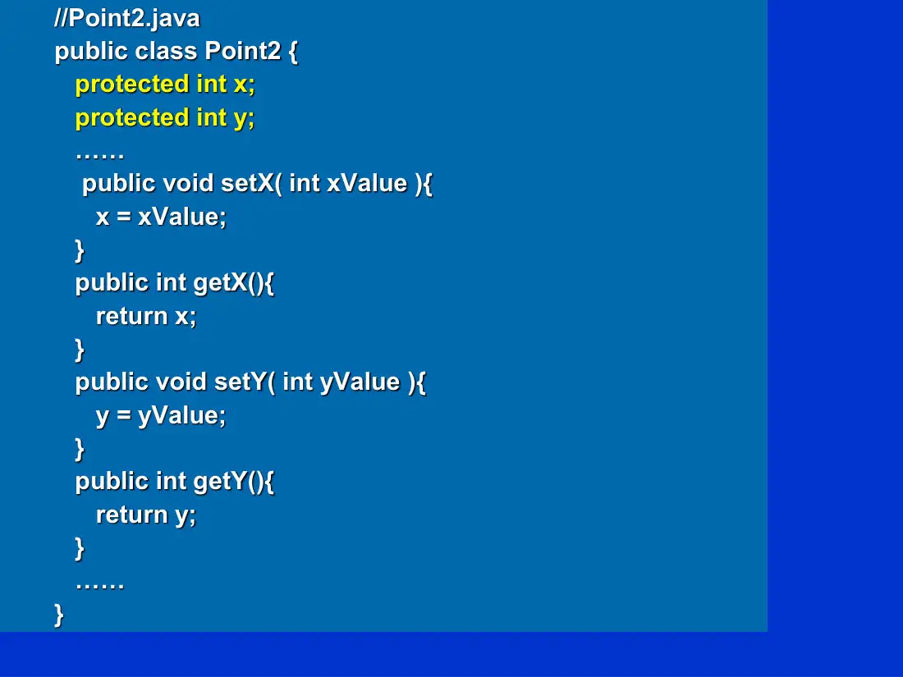

原文：

//Point2.java
public class Point2 {
    protected int x;
    protected int y;

    .....
    public void setX( int xValue ){
    x = xValue;
    }
    public int getX(){
    return x;
    }
    public void setY( int yValue ){
    y = yValue;
    }
    public int getY(){
    return y;
    }
    .....
} //Circle2.java public class Circle2 extends Point2 { private double radius; public Circle2() {

### 第 24 页

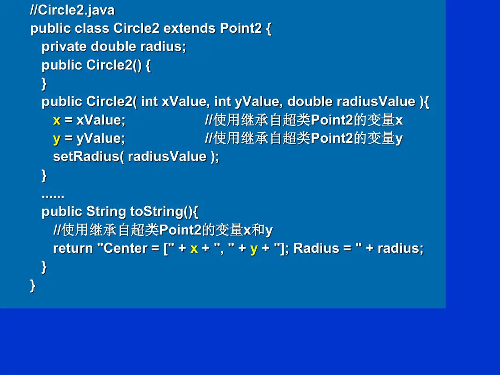

### 超类和子类的关系（二）

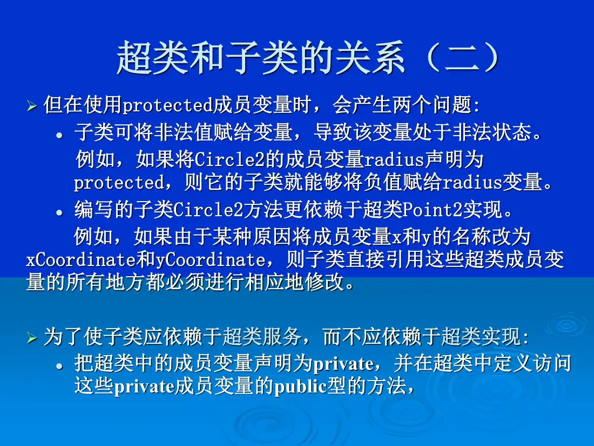

原文：

超类和子类的关系（二）

➢ 但在使用protected成员变量时，会产生两个问题:

子类可将非法值赋给变量，导致该变量处于非法状态。例如，如果将Circle2的成员变量radius声明为protected，则它的子类就能够将负值赋给radius变量。

⚫ 编写的子类Circle2方法更依赖于超类Point2实现。

例如，如果由于某种原因将成员变量x和y的名称改为xCoordinate和yCoordinate，则子类直接引用这些超类成员变量的所有地方都必须进行相应地修改。

为了使子类应依赖于超类服务，而不应依赖于超类实现:⚫ 把超类中的成员变量声明为private，并在超类中定义访问这些private成员变量的public型的方法，

### 例4-5

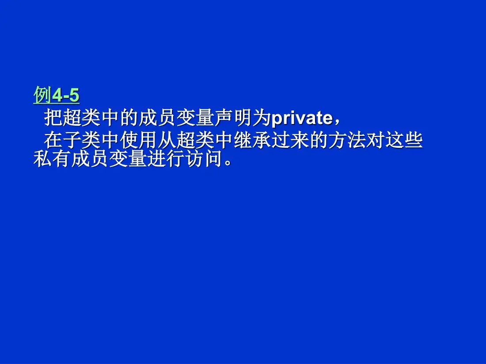

原文：

例4-5

把超类中的成员变量声明为private，在子类中使用从超类中继承过来的方法对这些私有成员变量进行访问。

### //Point3.java

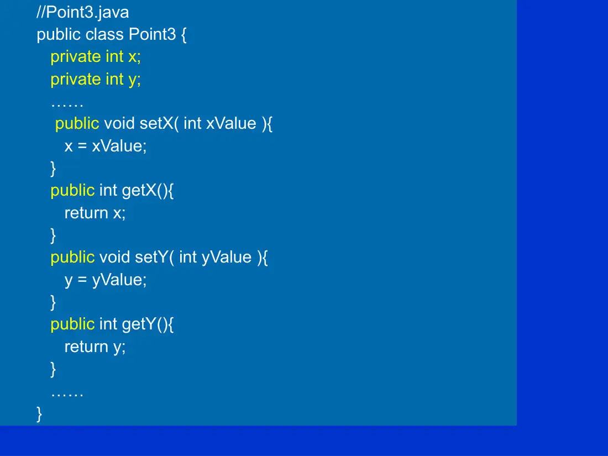

原文：

//Point3.java
public class Point3 {
    private int x;
    private int y;

    .....
    public void setX( int xValue ){
    x = xValue;
    }
    public int getX(){
    return x;
    }
    public void setY( int yValue ){
    y = yValue;
    }
    public int getY(){
    return y;
    }
    .....
} //Circle3.java public class Circle3 extends Point3 { private double radius; public Circle3(){ //隐 式调用超类的无参构造方法

### 第 28 页

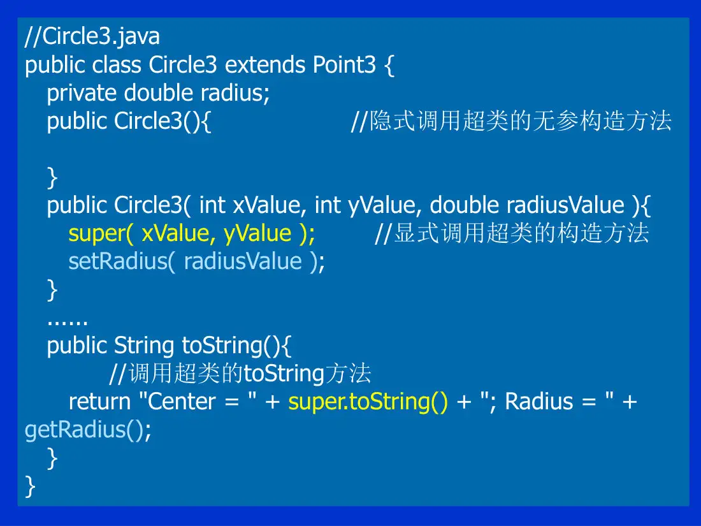

原文：

public Circle3( int xValue, int yValue, double radiusValue ){ super( xValue, yValue ); //显式调用超类的构造方法 setRadius( radiusValue );

public String toString(){ //调用超类的toString方法 return "Center = " + super.toString() + "; Radius = " + getRadius();

### 多态性概念和实例

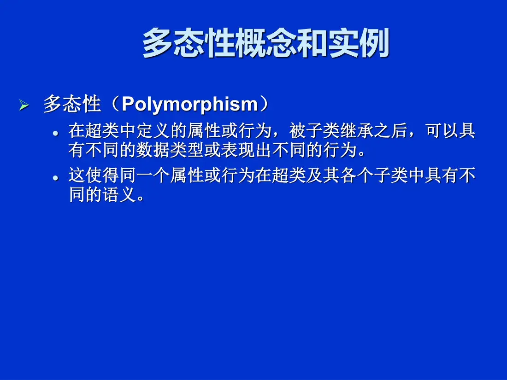

原文：

多态性概念和实例

多态性（Polymorphism）

⚫ 在超类中定义的属性或行为，被子类继承之后，可以具有不同的数据类型或表现出不同的行为。

⚫ 这使得同一个属性或行为在超类及其各个子类中具有不同的语义。

### 多态性概念和实例

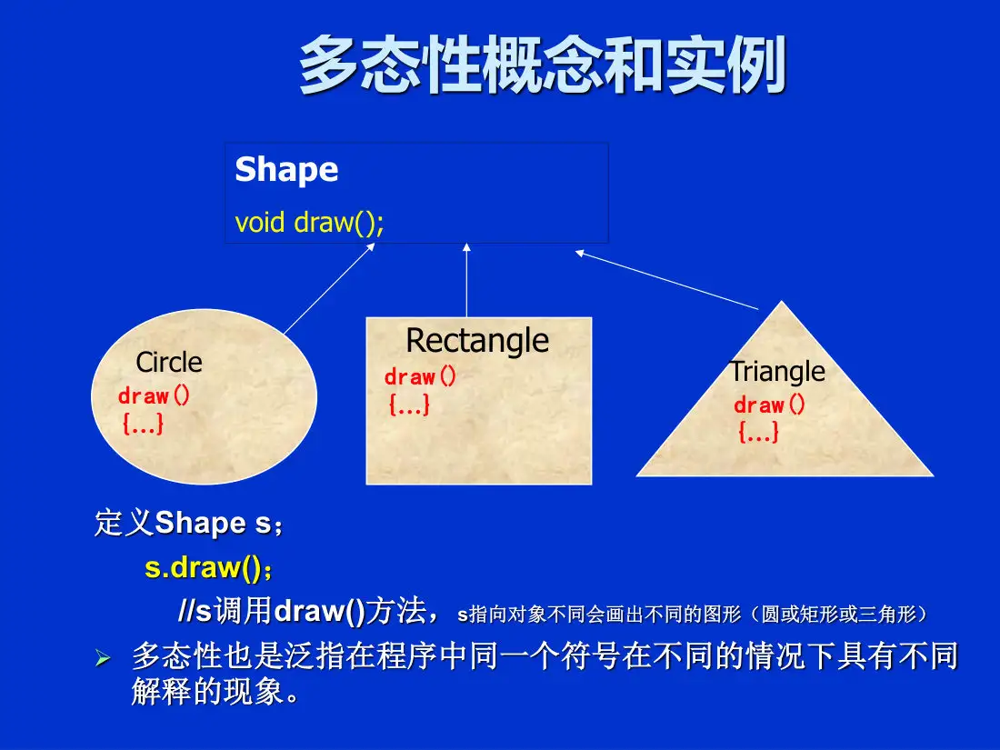

原文：

多态性概念和实例

Shape void draw();

Circle draw() {…}

Rectangle draw() {…}

Triangle draw() {…}

定义Shape s；

s.draw()；

//s调用draw()方法，s指向对象不同会画出不同的图形（圆或矩形或三角形）

多态性也是泛指在程序中同一个符号在不同的情况下具有不同解释的现象。

### 多态性概念和实例（续）

原文：

多态性概念和实例（续）

实现多态性的条件:

⚫ 继承

class Shape public void draw () { ….. } public void getArea() {……}

Shape s; Circle c1=new Circle(); Rectangle r1=new Rectangle(); s=c1;

s.draw(); // //画矩型

s.draw() ; //画圆

s=r1;

class Circle extends Shape public void draw { ….//画圆 } class Rectangle extends Shape public void draw { ….//画矩型 }

### 多态性概念和实例（续）

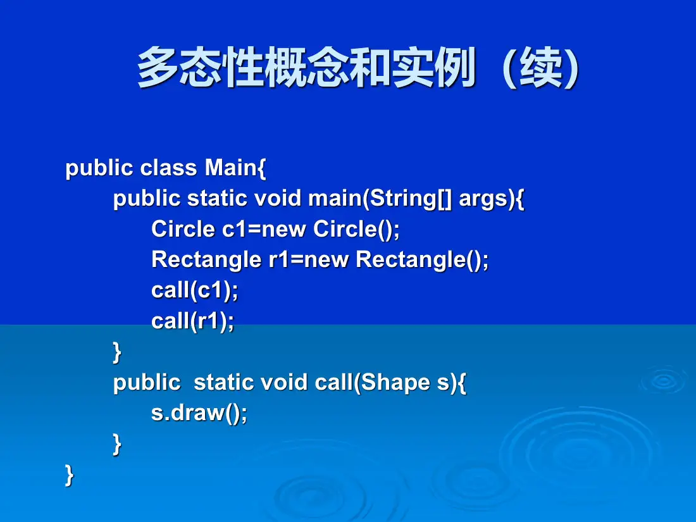

原文：

多态性概念和实例（续）

public class Main{ public static void main(String[] args){ Circle c1=new Circle(); Rectangle r1=new Rectangle(); call(c1); call(r1);

public static void call(Shape s){ s.draw();

### 继承层次结构中对象间的关系

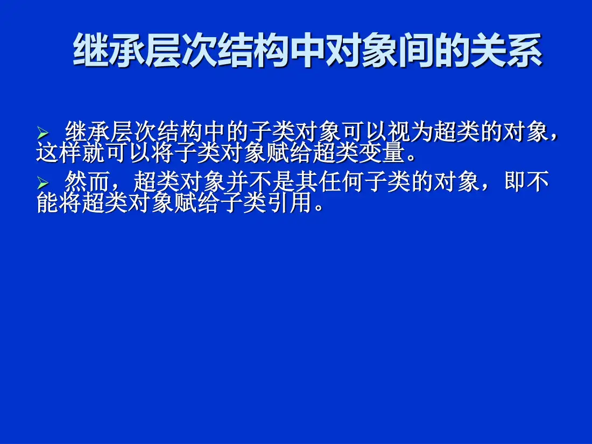

原文：

继承层次结构中对象间的关系

继承层次结构中的子类对象可以视为超类的对象，这样就可以将子类对象赋给超类变量。

然而，超类对象并不是其任何子类的对象，即不能将超类对象赋给子类引用。

### 继承层次结构中对象间的关系（续）

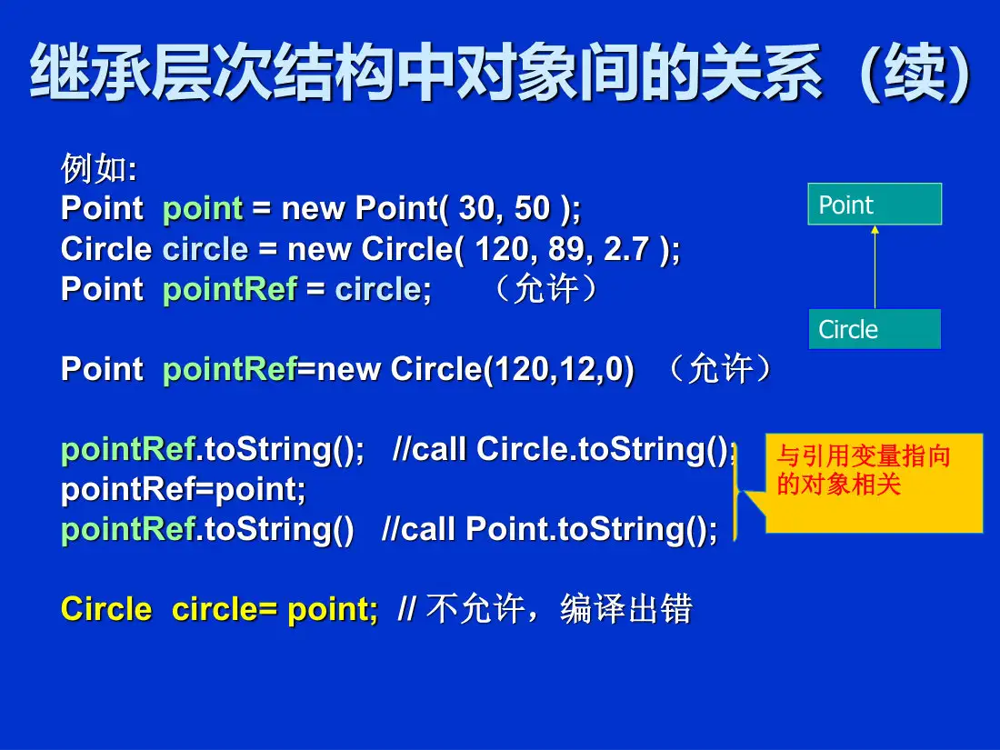

原文：

继承层次结构中对象间的关系（续）

例如:Point point = new Point( 30, 50 );Circle circle = new Circle( 120, 89, 2.7 );Point pointRef = circle; （允许）

Point pointRef=new Circle(120,12,0) （允许）

pointRef.toString(); //call Circle.toString(); pointRef=point; pointRef.toString() //call Point.toString();

Circle circle= point; // 不允许，编译出错

与引用变量指向的对象相关

### 继承层次结构中对象间的关系（续）

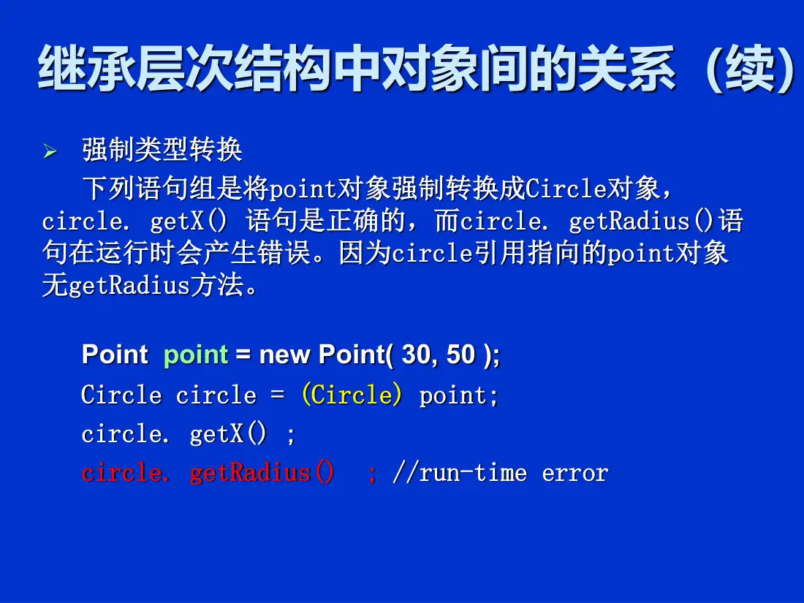

原文：

继承层次结构中对象间的关系（续）

强制类型转换

下列语句组是将point对象强制转换成Circle对象，circle. getX() 语句是正确的，而circle. getRadius()语句在运行时会产生错误。因为circle引用指向的point对象无getRadius方法。

Point point = new Point( 30, 50 );

Circle circle = (Circle) point;

circle. getX() ;

circle. getRadius() ; //run-time error

### 阅读以下程序，请写出程序的运行结果

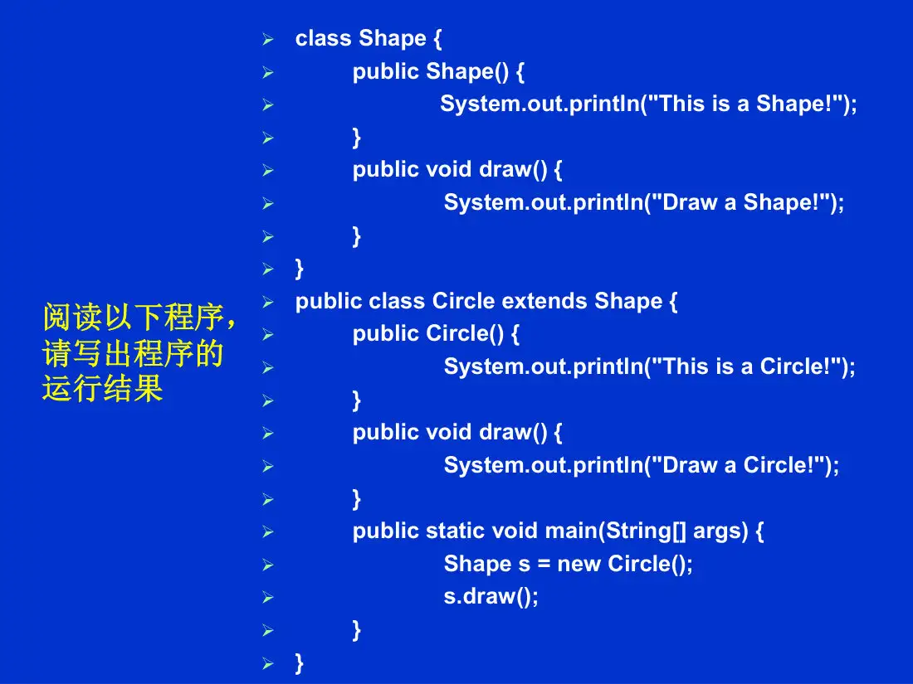

原文：

阅读以下程序，请写出程序的运行结果

class Shape {

public Shape() {

System.out.println("This is a Shape!");

public void draw() { System.out.println("Draw a Shape!");

public class Circle extends Shape {

public Circle() { System.out.println("This is a Circle!");

public void draw() { System.out.println("Draw a Circle!");

public static void main(String[] args) {

Shape s = new Circle();

s.draw();

### 运行结果:

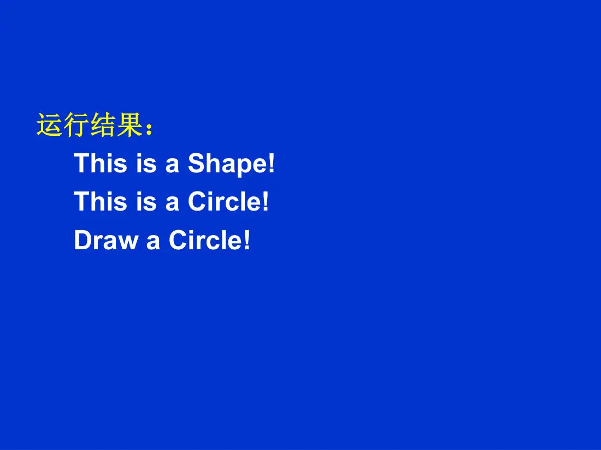

原文：

运行结果:
This is a Shape!
This is a Circle!
Draw a Circle!

### 4.5 根父类：Object类

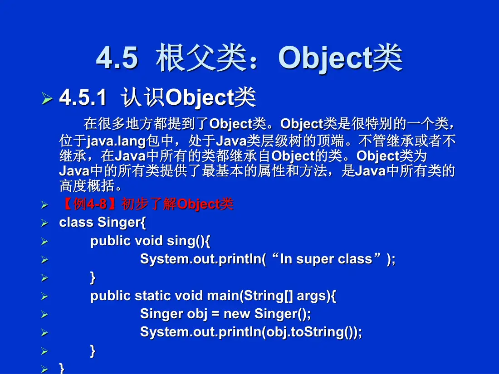

原文：

4.5 根父类：Object类

➢ 4.5.1 认识Object类

在很多地方都提到了Object类。Object类是很特别的一个类，位于java.lang包中，处于Java类层级树的顶端。不管继承或者不继承，在Java中所有的类都继承自Object的类。Object类为Java中的所有类提供了最基本的属性和方法，是Java中所有类的高度概括。

➢ 【例4-8】初步了解Object类

➢ class Singer{

public void sing(){ System.out.println(“In super class”);

public static void main(String[] args){ Singer obj = new Singer(); System.out.println(obj.toString());

### 4.5 根父类：Object类

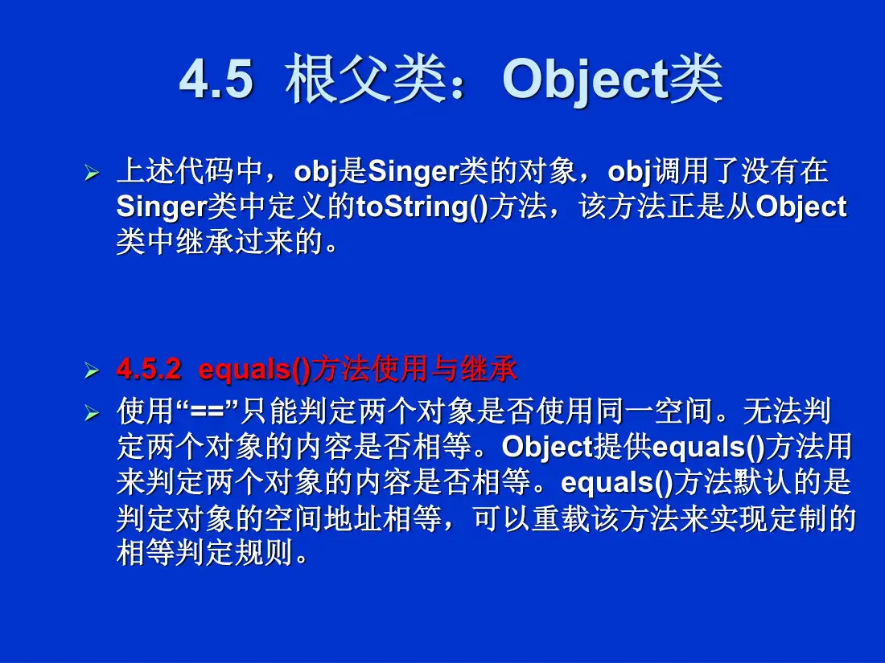

原文：

4.5 根父类：Object类

上述代码中，obj是Singer类的对象，obj调用了没有在Singer类中定义的toString()方法，该方法正是从Object类中继承过来的。

4.5.2 equals()方法使用与继承

使用“==”只能判定两个对象是否使用同一空间。无法判定两个对象的内容是否相等。Object提供equals()方法用来判定两个对象的内容是否相等。equals()方法默认的是判定对象的空间地址相等，可以重载该方法来实现定制的相等判定规则。

### 4.5 根父类：Object类

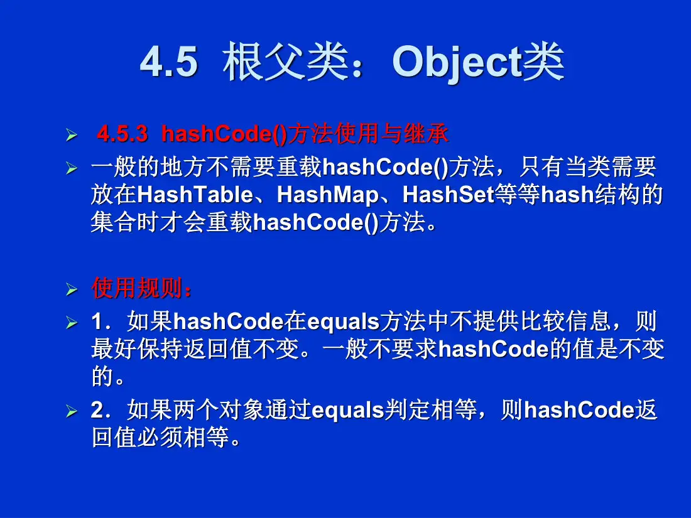

原文：

4.5 根父类：Object类

➢ 4.5.3 hashCode()方法使用与继承

一般的地方不需要重载hashCode()方法，只有当类需要放在HashTable、HashMap、HashSet等等hash结构的集合时才会重载hashCode()方法。

➢ 使用规则：

1．如果hashCode在equals方法中不提供比较信息，则最好保持返回值不变。一般不要求hashCode的值是不变的。

➢ 2．如果两个对象通过equals判定相等，则hashCode返回值必须相等。

### 4.5 根父类：Object类

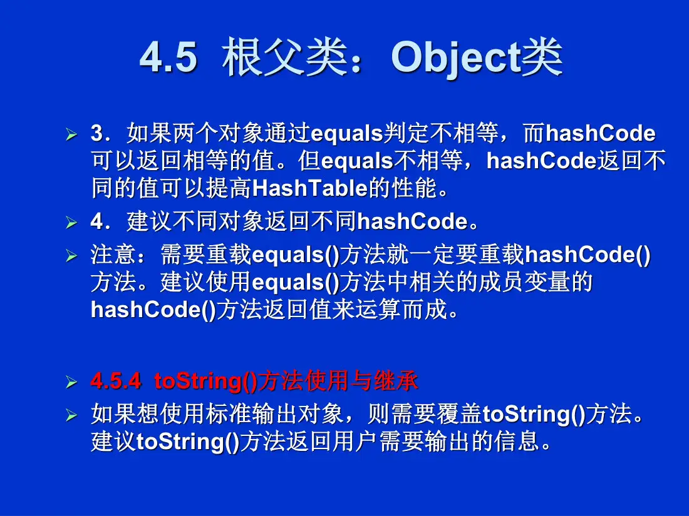

原文：

4.5 根父类：Object类

➢ 3．如果两个对象通过equals判定不相等，而hashCode可以返回相等的值。但equals不相等，hashCode返回不同的值可以提高HashTable的性能。

➢ 4．建议不同对象返回不同hashCode。

注意：需要重载equals()方法就一定要重载hashCode()方法。建议使用equals()方法中相关的成员变量的hashCode()方法返回值来运算而成。

➢ 4.5.4 toString()方法使用与继承

如果想使用标准输出对象，则需要覆盖toString()方法。建议toString()方法返回用户需要输出的信息。

### 5.1 抽象类和抽象方法

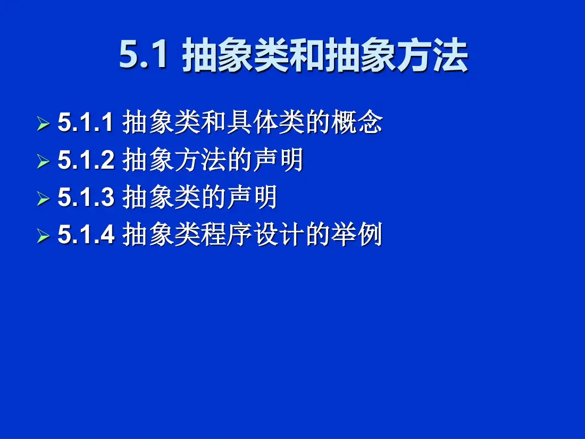

原文：

5.1 抽象类和抽象方法

➢5.1.1 抽象类和具体类的概念

➢ 5.1.2 抽象方法的声明

5.1.3 抽象类的声明

5.1.4 抽象类程序设计的举例

### 5.1.1 抽象类和具体类的概念

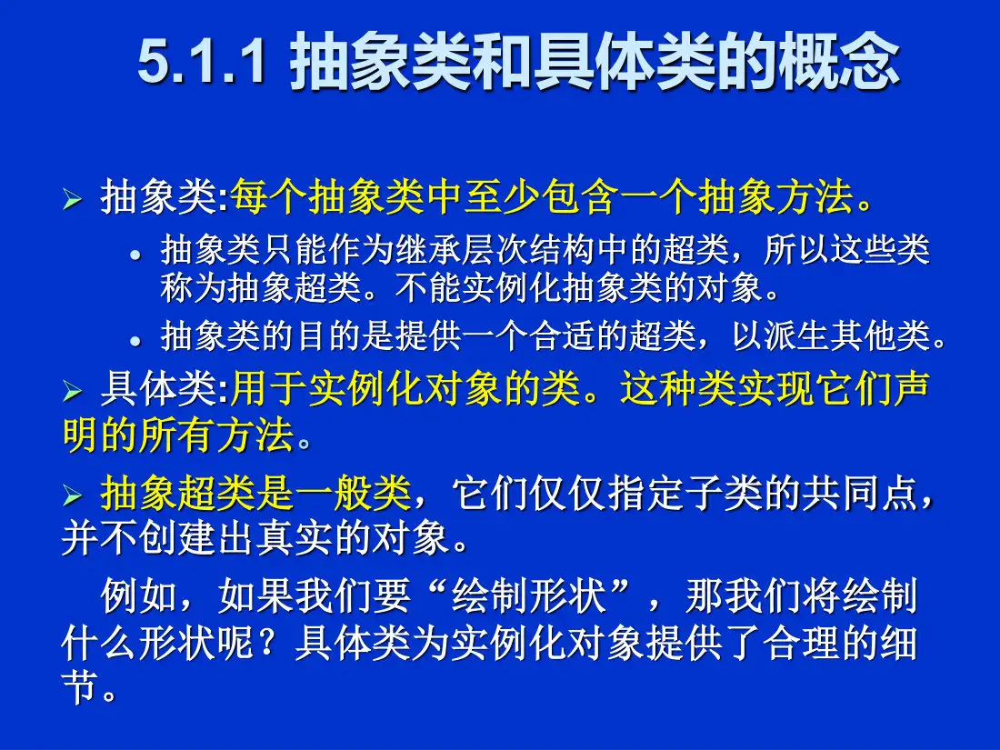

原文：

5.1.1 抽象类和具体类的概念

➢ 抽象类:每个抽象类中至少包含一个抽象方法。

抽象类只能作为继承层次结构中的超类，所以这些类称为抽象超类。不能实例化抽象类的对象。

⚫ 抽象类的目的是提供一个合适的超类，以派生其他类。

具体类:用于实例化对象的类。这种类实现它们声明的所有方法。

抽象超类是一般类，它们仅仅指定子类的共同点，并不创建出真实的对象。

例如，如果我们要“绘制形状”，那我们将绘制什么形状呢？具体类为实例化对象提供了合理的细节。

### 5.1.2 抽象方法的声明

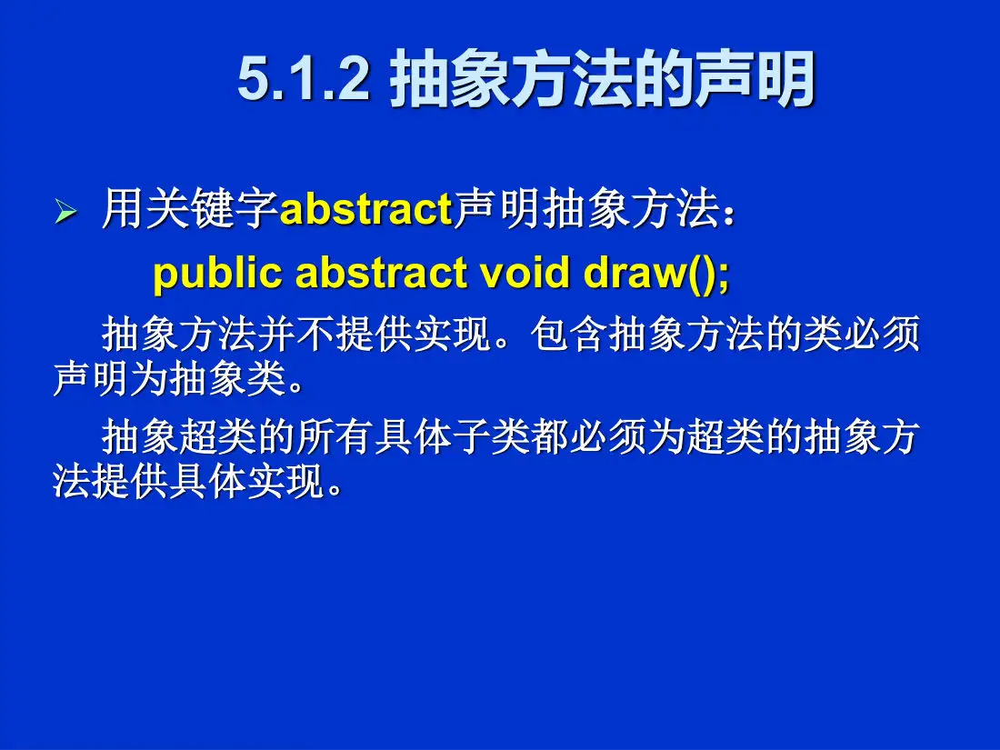

原文：

5.1.2 抽象方法的声明

➢ 用关键字abstract声明抽象方法：

public abstract void draw();

抽象方法并不提供实现。包含抽象方法的类必须声明为抽象类。

抽象超类的所有具体子类都必须为超类的抽象方法提供具体实现。

### 5.1.3 抽象类的声明

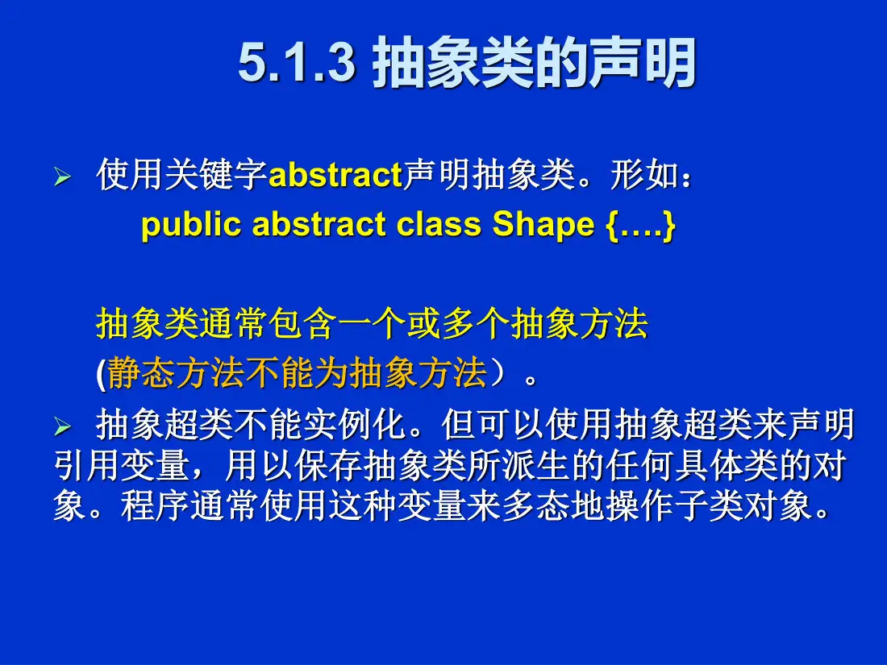

原文：

5.1.3 抽象类的声明

使用关键字abstract声明抽象类。形如：public abstract class Shape {….}

抽象类通常包含一个或多个抽象方法(静态方法不能为抽象方法）。

抽象超类不能实例化。但可以使用抽象超类来声明引用变量，用以保存抽象类所派生的任何具体类的对象。程序通常使用这种变量来多态地操作子类对象。

### 多态性概念和实例（续）

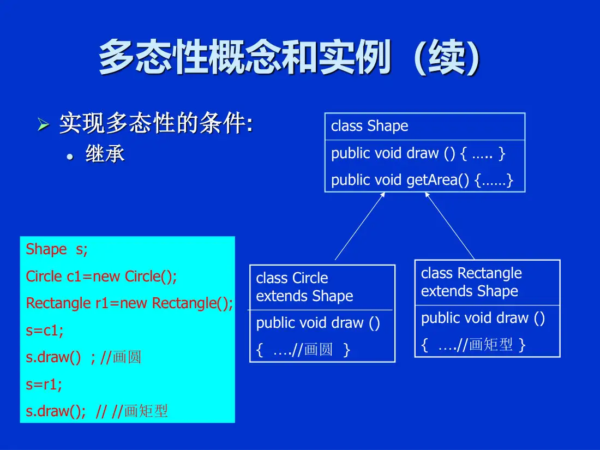

原文：

多态性概念和实例（续）

实现多态性的条件:

⚫ 继承

class Shape public void draw () { ….. } public void getArea() {……}

Shape s; Circle c1=new Circle(); Rectangle r1=new Rectangle(); s=c1;

s.draw(); // //画矩型

s.draw() ; //画圆

s=r1;

class Circle extends Shape public void draw { ….//画圆 } class Rectangle extends Shape public void draw { ….//画矩型 }

### 多态性概念和实例（续）

原文：

多态性概念和实例（续）

public class Main{ public static void main(String[] args){ Circle c1=new Circle(); Rectangle r1=new Rectangle(); call(c1); call(r1);

public static void call(Shape s){ s.draw();

### 多态性概念和实例（续）

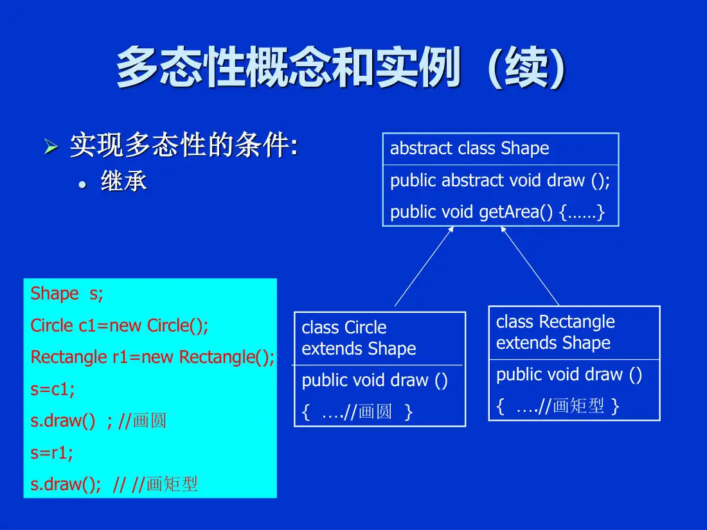

原文：

多态性概念和实例（续）

实现多态性的条件:

⚫ 继承

abstract class Shape public abstract void draw (); public void getArea() {……}

Shape s; Circle c1=new Circle(); Rectangle r1=new Rectangle(); s=c1;

s.draw() ; //画圆

s=r1;

s.draw(); // //画矩型 class Circle extends Shape public void draw { ….//画圆 } class Rectangle extends Shape public void draw { ….//画矩型 }

### 5.2 接口的声明和实现

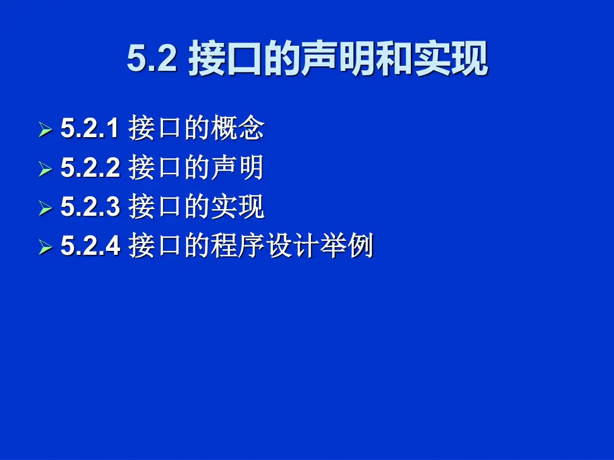

原文：

5.2 接口的声明和实现

➢ 5.2.1 接口的概念

5.2.2 接口的声明

5.2.3 接口的实现

5.2.4 接口的程序设计举例

### 5.2.1 接口的概念

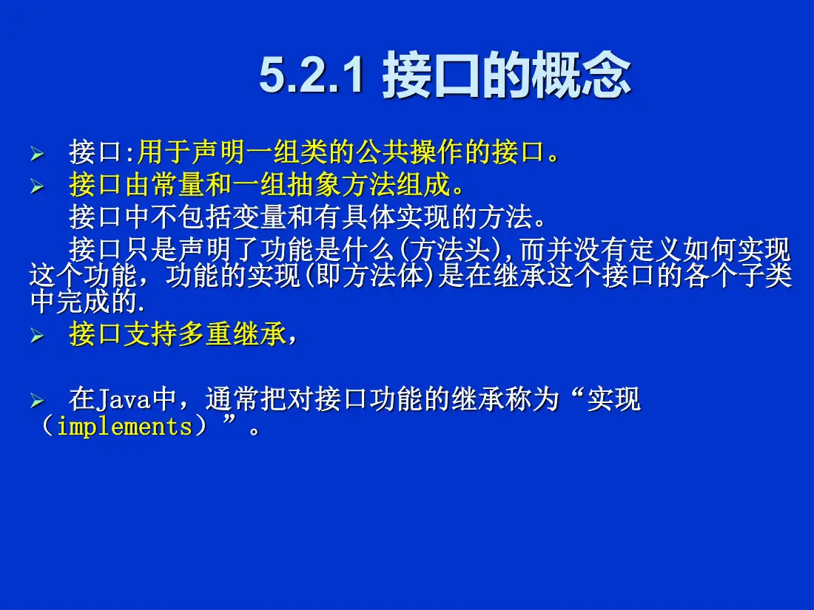

原文：

5.2.1 接口的概念

➢ 接口:用于声明一组类的公共操作的接口。

接口由常量和一组抽象方法组成。

接口中不包括变量和有具体实现的方法。

接口只是声明了功能是什么(方法头),而并没有定义如何实现这个功能，功能的实现(即方法体)是在继承这个接口的各个子类中完成的.

接口支持多重继承，

在Java中，通常把对接口功能的继承称为“实现（implements）

### 5.2.1 接口的概念（续）

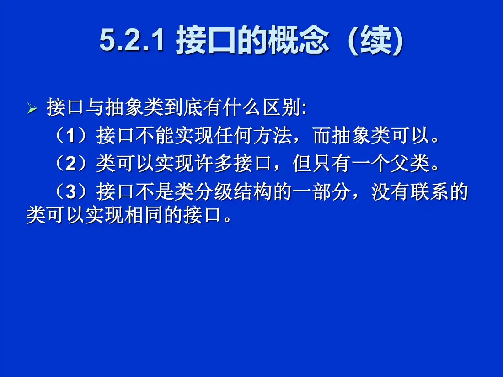

原文：

5.2.1 接口的概念（续）

接口与抽象类到底有什么区别:

（1）接口不能实现任何方法，而抽象类可以。

（2）类可以实现许多接口，但只有一个父类。

（3）接口不是类分级结构的一部分，没有联系的类可以实现相同的接口。

### 5.2.2 接口的声明

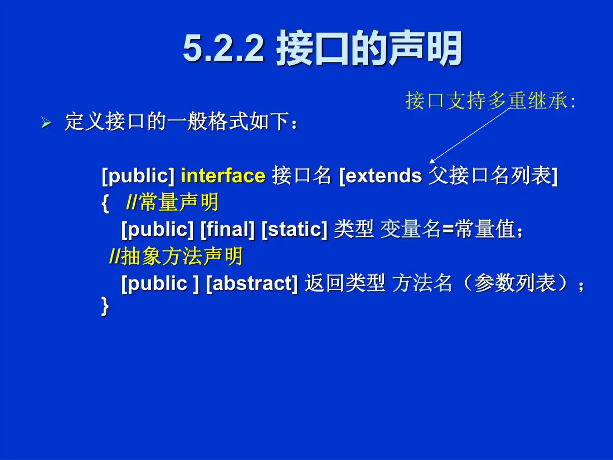

原文：

5.2.2 接口的声明

接口支持多重继承:

➢ 定义接口的一般格式如下：

[public] interface 接口名 [extends 父接口名列表]

{ //常量声明

[public] [final] [static] 类型 变量名=常量值；

//抽象方法声明

[public ] [abstract] 返回类型 方法名（参数列表）；

### 5.2.2 接口的声明( 续)

原文：

5.2.2 接口的声明( 续)

public interface Shape{

public final static double PI=3.1416;

public abstract void draw( );

public abstract void getArea( );

### 5.2.3 接口的实现

原文：

5.2.3 接口的实现

为了声明一个类来实现一个接口，在类的声明中要包括条implements语句。

class ClassName extends ParentClass implements interface1,interface2 {

//接口中方法的实现

### 多态性概念和实例（续）

原文：

多态性概念和实例（续）

实现多态性的条件:

⚫ 继承

Shape s;

Circle c1=new Circle();

Rectangle r1=new Rectangle();

s=c1;

s.draw() ; //画圆

s.getArea(); //求圆面积

s=r1;

s.draw(); //画矩型

s.getArea(); //求矩形面积 interface Shape public abstract void draw ( public abstract void getArea();

class Circle implements Shape public void draw { ….//画圆 } public void getArea() { …//计算圆面积}

class Rectangleimplements Shapepublic void draw{ ….//画矩形 }public void getArea(){ …//计算矩形面积}

### 5.3 final方法和final类

原文：

5.3 final方法和final类

常量:变量声明为final，说明该变量是常量，不能在声明后进行修改，并且在声明时必须对它进行初始化。

final方法:方法的声明中有final。

⚫ 子类不能重写超类中声明为final的方法。

因为子类不可能重写private方法，所以声明为private的方法隐式地为final方法。

⚫ 声明为static的方法也隐式地为final方法，因为只能重写非静态方法。

final类:类的声明中包含final。 final类不能为超类。⚫ final类中所有方法都隐式地为final方法。

String类是final类的一个例子。不能扩展该类，使用字符串的程序可以调用String对象在Java API中指定的函数。将类声明为final还可以防止程序员创建绕过安全限制的子类。

### 小 结

原文：

小 结

本章介绍了面向对象设计的一个重要性质——继承。通过继承在原有类的基础上派生出高效的子类。在子类中可以增加新的成员，使用父类中被声明为protected和public的成员，也可以在子类中重写父类中的方法，使该方法的执行更符合子类的情况。

继承层次结构下的构造方法的调用次序：在创建子类对象时，必须先调用直接父类的构造方法，然后才调用子类本身的构造方法。继承层次结构下的finalize方法的调用次序恰恰与此相反。
