# 《Java程序设计》第5章 抽象、接口与标注（课件）

原件的每一页，下面附识别出的文字。

### Java 程序设计Java Programming

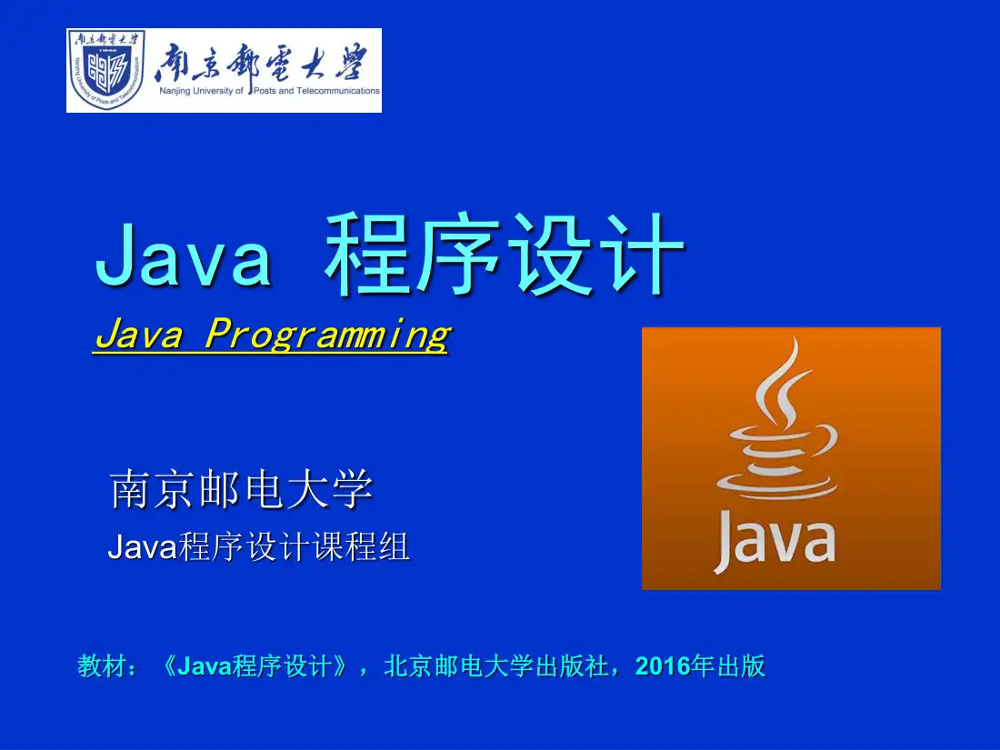

原文：

Java 程序设计Java Programming

南京邮电大学Java程序设计课程组川益

教材：《Java程序设计》，北京邮电大学出版社，2016年出版

南京郵電大學南京郵電大学

### 第5章 抽象、接口与标注

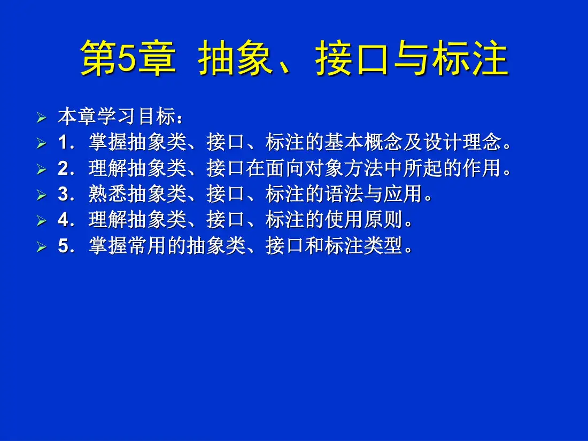

原文：

第5章 抽象、接口与标注

本章学习目标：

➢ 1．掌握抽象类、接口、标注的基本概念及设计理念。

➢ 2．理解抽象类、接口在面向对象方法中所起的作用。

➢ 3．熟悉抽象类、接口、标注的语法与应用。

➢ 4．理解抽象类、接口、标注的使用原则。

➢ 5．掌握常用的抽象类、接口和标注类型。

### 5.1 抽象类

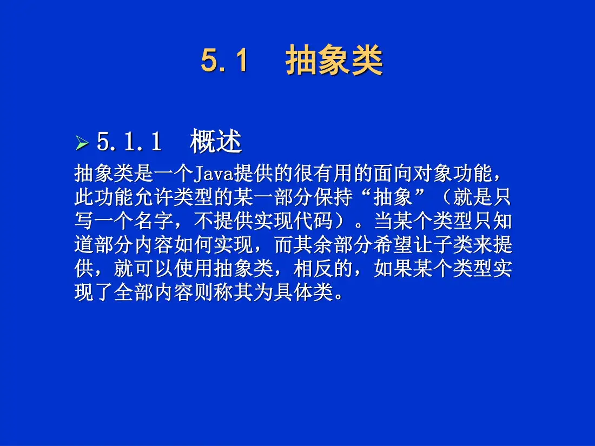

原文：

5.1 抽象类

➢ 5.1.1 概述

抽象类是一个Java提供的很有用的面向对象功能，此功能允许类型的某一部分保持“抽象”（就是只写一个名字，不提供实现代码）。当某个类型只知道部分内容如何实现，而其余部分希望让子类来提供，就可以使用抽象类，相反的，如果某个类型实现了全部内容则称其为具体类。

### 5.1.2 抽象类的语法

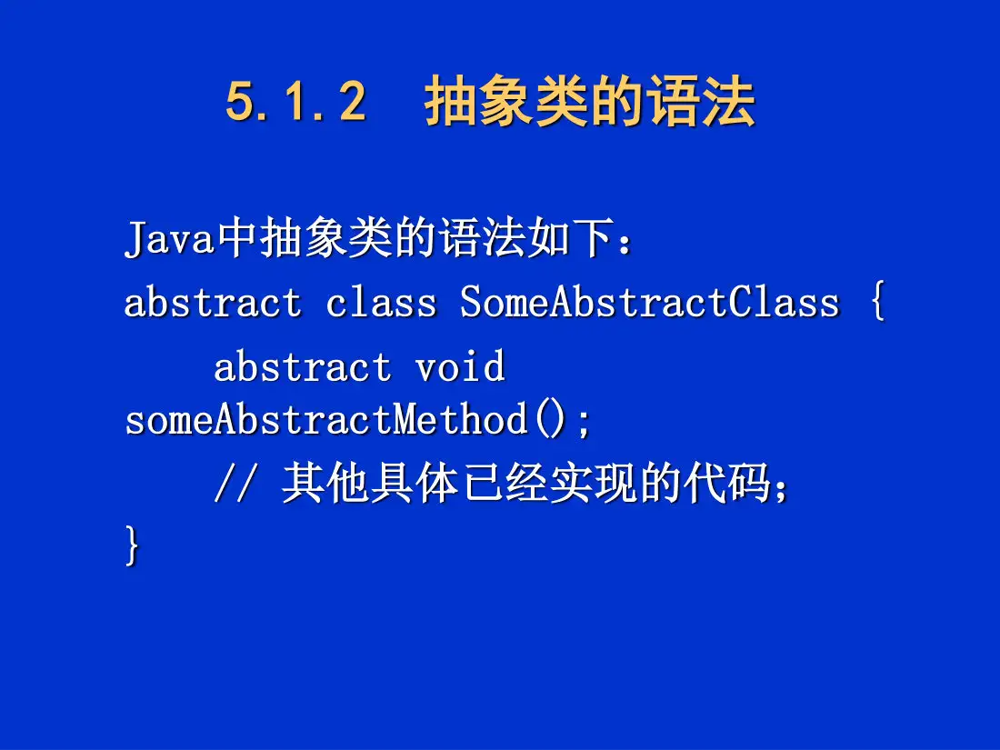

原文：

5.1.2 抽象类的语法

Java中抽象类的语法如下：abstract class SomeAbstractClass {abstract voidsomeAbstractMethod();// 其他具体已经实现的代码；

### 5.2 接口

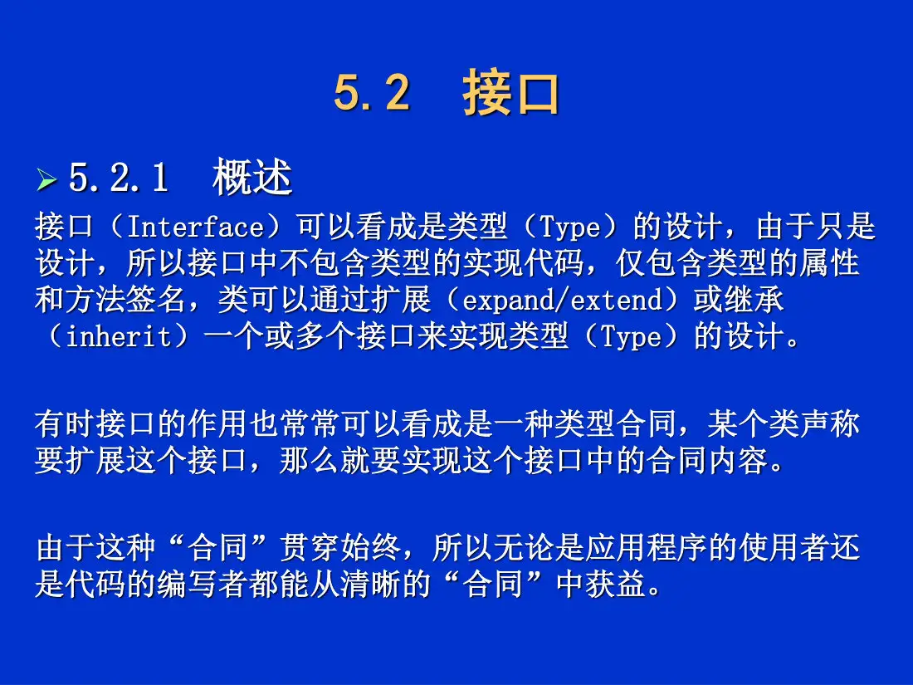

原文：

5.2 接口

➢ 5.2.1 概述

接口（Interface）可以看成是类型（Type）的设计，由于只是设计，所以接口中不包含类型的实现代码，仅包含类型的属性和方法签名，类可以通过扩展（expand/extend）或继承（inherit）一个或多个接口来实现类型（Type）的设计。

有时接口的作用也常常可以看成是一种类型合同，某个类声称要扩展这个接口，那么就要实现这个接口中的合同内容。

由于这种“合同”贯穿始终，所以无论是应用程序的使用者还是代码的编写者都能从清晰的“合同”中获益。

### 5.2.2 接口语法

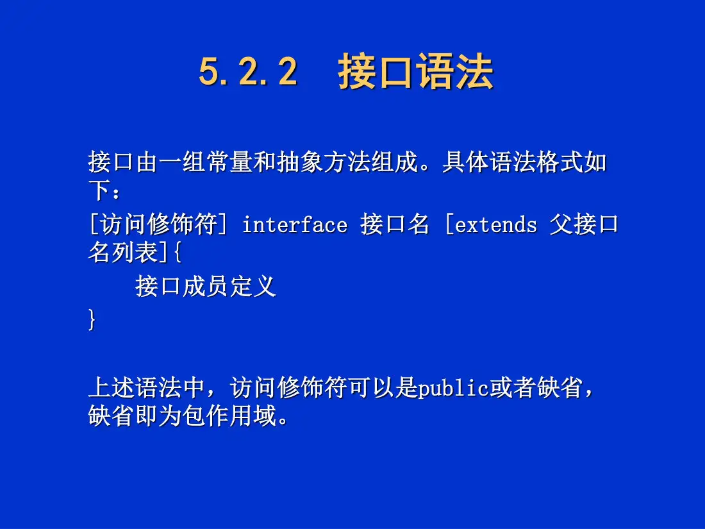

原文：

5.2.2 接口语法

接口由一组常量和抽象方法组成。具体语法格式如下：

[访问修饰符] interface 接口名 [extends 父接口 名列表]{

接口成员定义

上述语法中，访问修饰符可以是public或者缺省，缺省即为包作用域。

### 5.2.2 接口语法

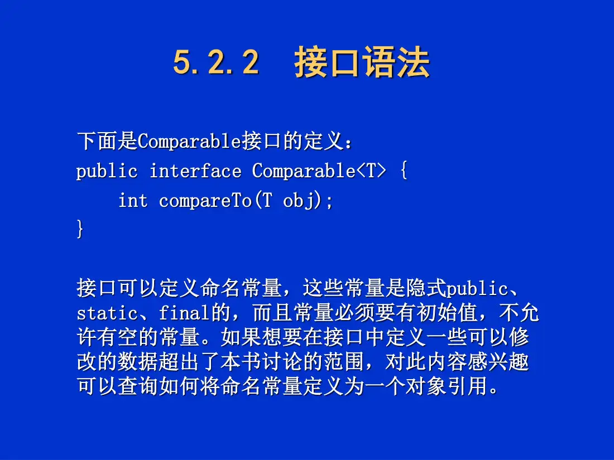

原文：

5.2.2 接口语法

下面是Comparable接口的定义： public interface Comparable<T> int compareTo(T obj);

接口可以定义命名常量，这些常量是隐式public、static、final的，而且常量必须要有初始值，不允许有空的常量。如果想要在接口中定义一些可以修改的数据超出了本书讨论的范围，对此内容感兴趣可以查询如何将命名常量定义为一个对象引用。

### 5.2.2 接口语法

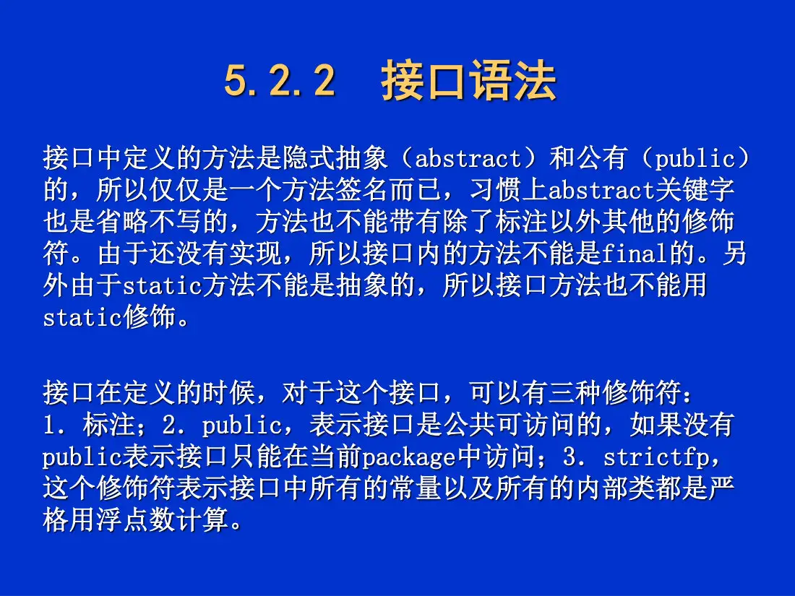

原文：

5.2.2 接口语法

接口中定义的方法是隐式抽象（abstract）和公有（public）的，所以仅仅是一个方法签名而已，习惯上abstract关键字也是省略不写的，方法也不能带有除了标注以外其他的修饰符。由于还没有实现，所以接口内的方法不能是final的。另外由于static方法不能是抽象的，所以接口方法也不能用static修饰。

接口在定义的时候，对于这个接口，可以有三种修饰符：1．标注；2．public，表示接口是公共可访问的，如果没有public表示接口只能在当前package中访问；3．strictfp，这个修饰符表示接口中所有的常量以及所有的内部类都是严格用浮点数计算。

### 5.2.3 接口的扩展

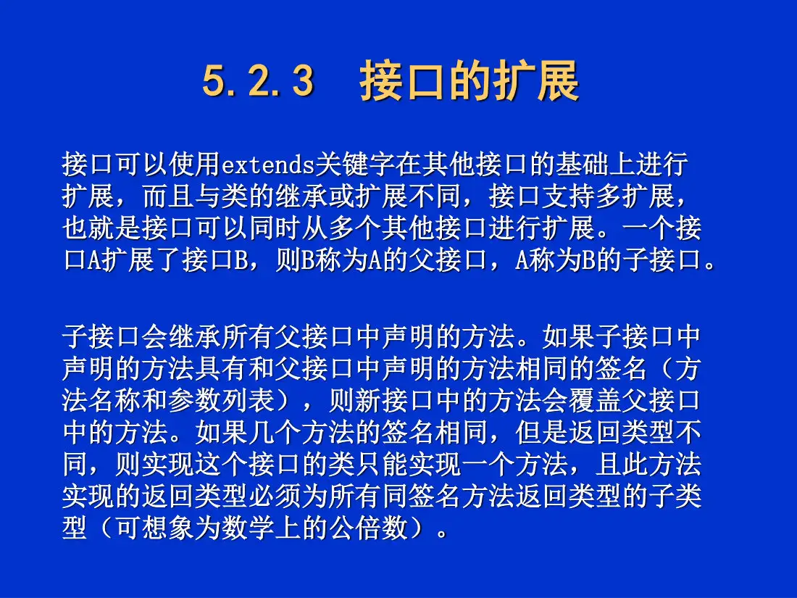

原文：

5.2.3 接口的扩展

接口可以使用extends关键字在其他接口的基础上进行扩展，而且与类的继承或扩展不同，接口支持多扩展，也就是接口可以同时从多个其他接口进行扩展。一个接口A扩展了接口B，则B称为A的父接口，A称为B的子接口。

子接口会继承所有父接口中声明的方法。如果子接口中声明的方法具有和父接口中声明的方法相同的签名（方法名称和参数列表），则新接口中的方法会覆盖父接口中的方法。如果几个方法的签名相同，但是返回类型不同，则实现这个接口的类只能实现一个方法，且此方法实现的返回类型必须为所有同签名方法返回类型的子类型（可想象为数学上的公倍数）。

### 5.2.4 起标签作用的接口

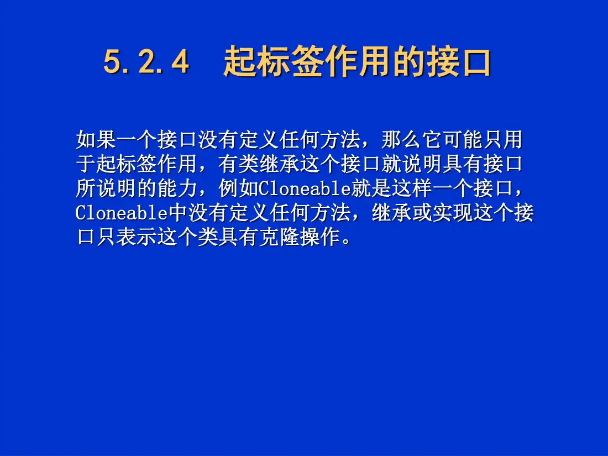

原文：

5.2.4 起标签作用的接口

如果一个接口没有定义任何方法，那么它可能只用于起标签作用，有类继承这个接口就说明具有接口所说明的能力，例如Cloneable就是这样一个接口，Cloneable中没有定义任何方法，继承或实现这个接口只表示这个类具有克隆操作。

### 5.2.5 如何使用接口

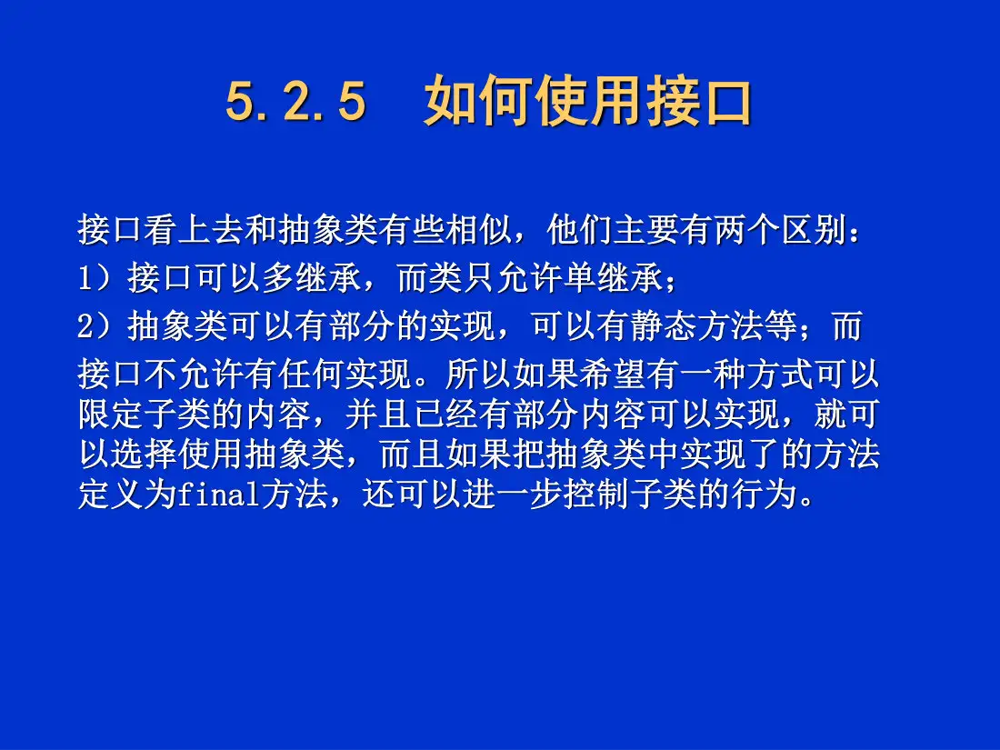

原文：

5.2.5 如何使用接口

接口看上去和抽象类有些相似，他们主要有两个区别：1）接口可以多继承，而类只允许单继承；

2）抽象类可以有部分的实现，可以有静态方法等；而接口不允许有任何实现。所以如果希望有一种方式可以限定子类的内容，并且已经有部分内容可以实现，就可以选择使用抽象类，而且如果把抽象类中实现了的方法定义为final方法，还可以进一步控制子类的行为。

### 5.3 标注

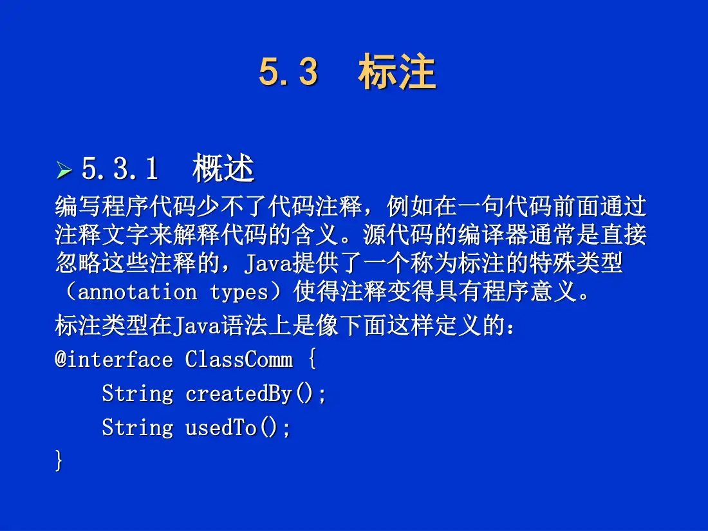

原文：

5.3 标注

➢ 5.3.1 概述

编写程序代码少不了代码注释，例如在一句代码前面通过注释文字来解释代码的含义。源代码的编译器通常是直接忽略这些注释的，Java提供了一个称为标注的特殊类型（annotation types）使得注释变得具有程序意义。

标注类型在Java语法上是像下面这样定义的：

@interface ClassComm {

String createdBy();

String usedTo();

### 5.3 标注

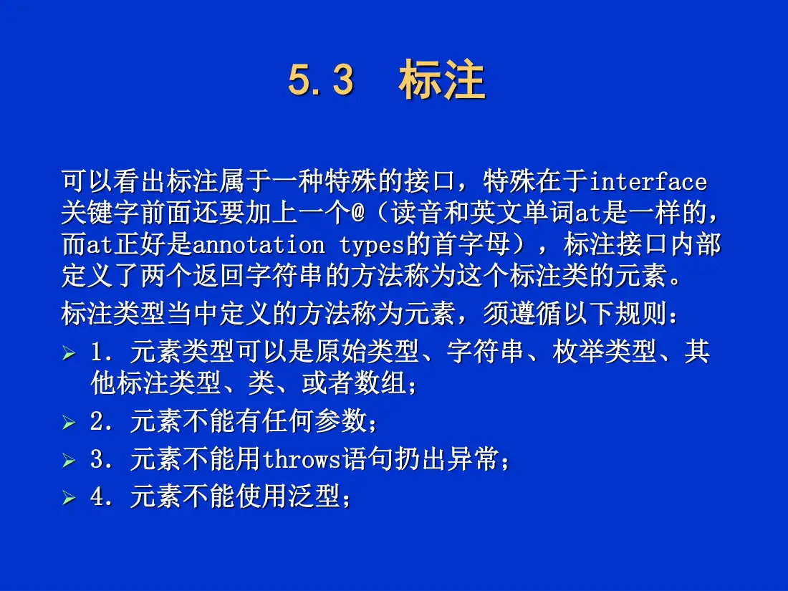

原文：

5.3 标注

可以看出标注属于一种特殊的接口，特殊在于interface关键字前面还要加上一个@（读音和英文单词at是一样的，而at正好是annotation types的首字母），标注接口内部定义了两个返回字符串的方法称为这个标注类的元素。标注类型当中定义的方法称为元素，须遵循以下规则：

1．元素类型可以是原始类型、字符串、枚举类型、其他标注类型、类、或者数组；

➢ 2．元素不能有任何参数；

➢ 3．元素不能用throws语句扔出异常；

➢ 4．元素不能使用泛型；

### 5.3 标注

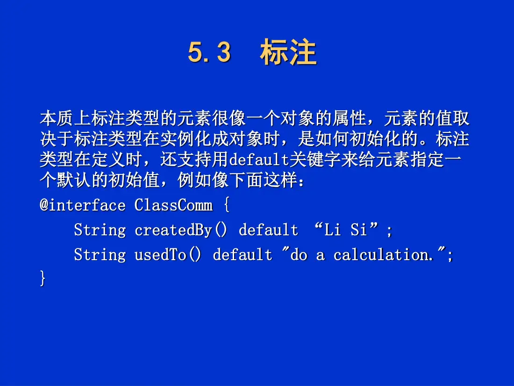

原文：

5.3 标注

本质上标注类型的元素很像一个对象的属性，元素的值取决于标注类型在实例化成对象时，是如何初始化的。标注类型在定义时，还支持用default关键字来给元素指定一个默认的初始值，例如像下面这样：

@interface ClassComm {

String createdBy() default “Li Si”;

String usedTo() default "do a calculation.";

### 5.3.2 标注类型中用到其他标注类型

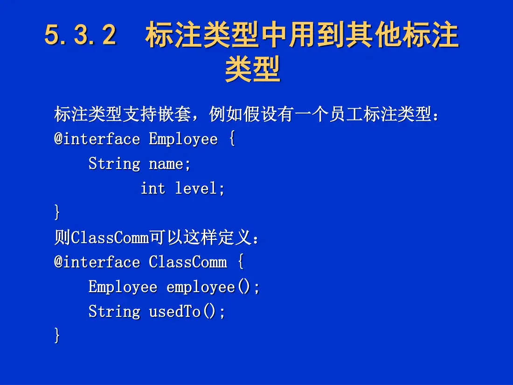

原文：

5.3.2 标注类型中用到其他标注类型

标注类型支持嵌套，例如假设有一个员工标注类型：

@interface Employee

String name;

int level;

则ClassComm可以这样定义：

@interface ClassComm {

Employee employee();

String usedTo();

### 5.3.2 标注类型中用到其他标注类型

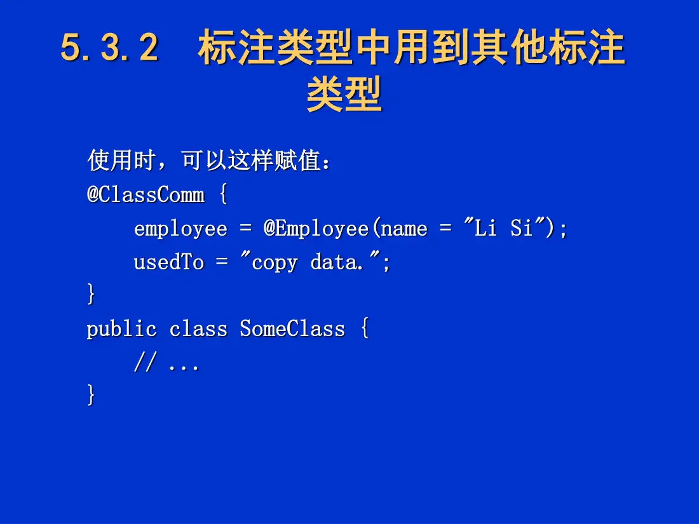

原文：

5.3.2 标注类型中用到其他标注类型

使用时，可以这样赋值：

@ClassComm {

$$
\text { employee } = @ \text { Employee(name } = " L i S i");
$$

usedTo = "copy data.";

public class SomeClass

### 5.3.3 没有元素的标注类型

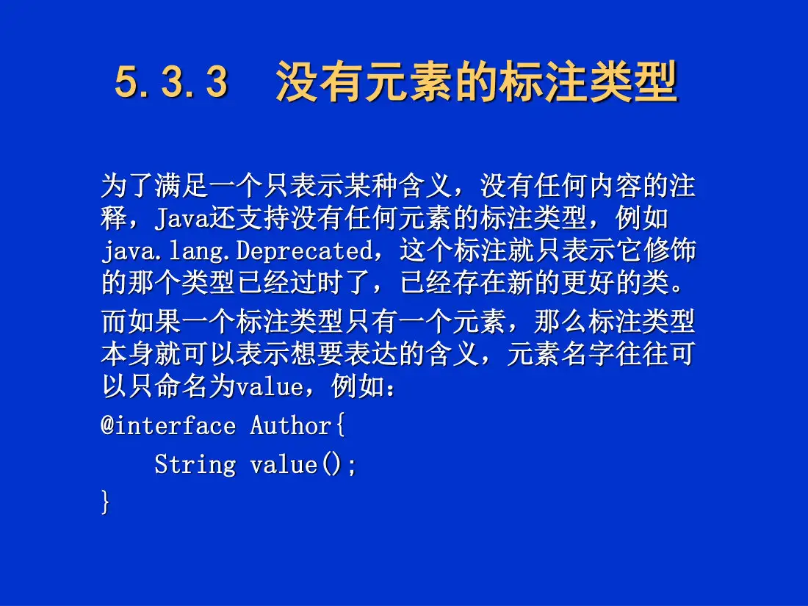

原文：

5.3.3 没有元素的标注类型

为了满足一个只表示某种含义，没有任何内容的注释，Java还支持没有任何元素的标注类型，例如java.lang.Deprecated，这个标注就只表示它修饰的那个类型已经过时了，已经存在新的更好的类。

而如果一个标注类型只有一个元素，那么标注类型本身就可以表示想要表达的含义，元素名字往往可以只命名为value，例如：

@interface Author{

String value();

### 5.3.3 没有元素的标注类型

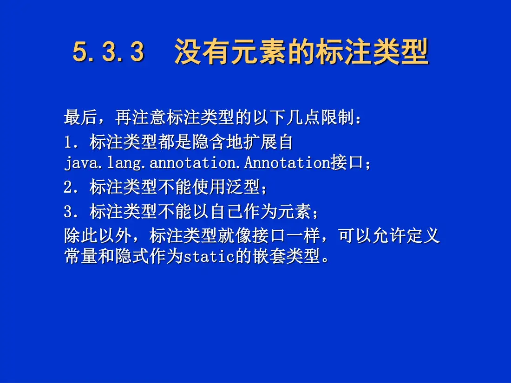

原文：

5.3.3 没有元素的标注类型

最后，再注意标注类型的以下几点限制：

1．标注类型都是隐含地扩展自java.lang.annotation.Annotation接口；

2．标注类型不能使用泛型；

3．标注类型不能以自己作为元素；

除此以外，标注类型就像接口一样，可以允许定义

常量和隐式作为static的嵌套类型。

### 5.3.4 标注元素的初始化

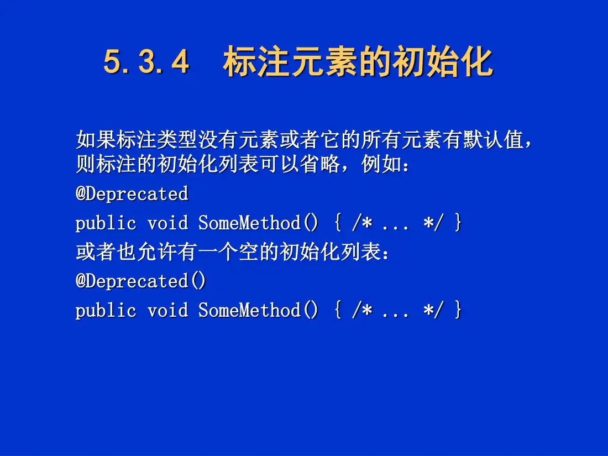

原文：

5.3.4 标注元素的初始化

如果标注类型没有元素或者它的所有元素有默认值，则标注的初始化列表可以省略，例如：

@Deprecated

public void SomeMethod() { /\* ... \*/ }

或者也允许有一个空的初始化列表：

@Deprecated()

public void SomeMethod() { /\* ... \*/ }

### 5.3.5 限制标注的使用

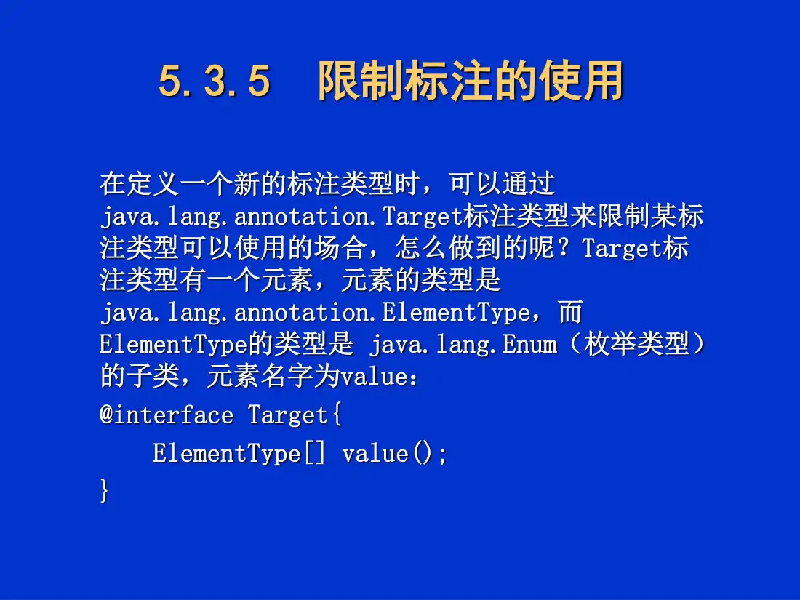

原文：

5.3.5 限制标注的使用

在定义一个新的标注类型时，可以通过java.lang.annotation.Target标注类型来限制某标注类型可以使用的场合，怎么做到的呢？Target标注类型有一个元素，元素的类型是

java.lang.annotation.ElementType，而ElementType的类型是 java.lang.Enum（枚举类型）的子类，元素名字为value：

@interface Target{

ElementType[] value();

### 5.3.5 限制标注的使用

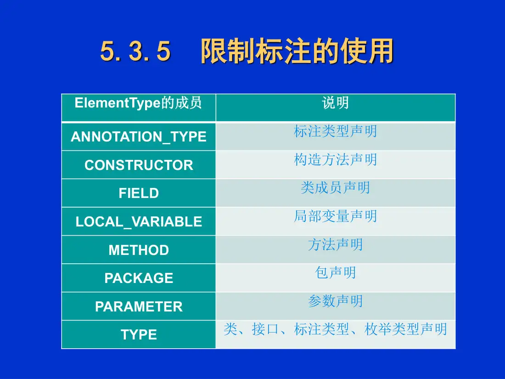

原文：

5.3.5 限制标注的使用

<table><tr><td>ElementType的成员</td><td>说明</td></tr><tr><td>ANNOTATION_TYPE</td><td>标注类型声明</td></tr><tr><td>CONSTRUCTOR</td><td>构造方法声明</td></tr><tr><td>FIELD</td><td>类成员声明</td></tr><tr><td>LOCAL_VARIABLE</td><td>局部变量声明</td></tr><tr><td>METHOD</td><td>方法声明</td></tr><tr><td>PACKAGE</td><td>包声明</td></tr><tr><td>PARAMETER</td><td>参数声明</td></tr><tr><td>TYPE</td><td>类、接口、标注类型、枚举类型声明</td></tr></table>

### 5.3.6 标注类型的使用限定

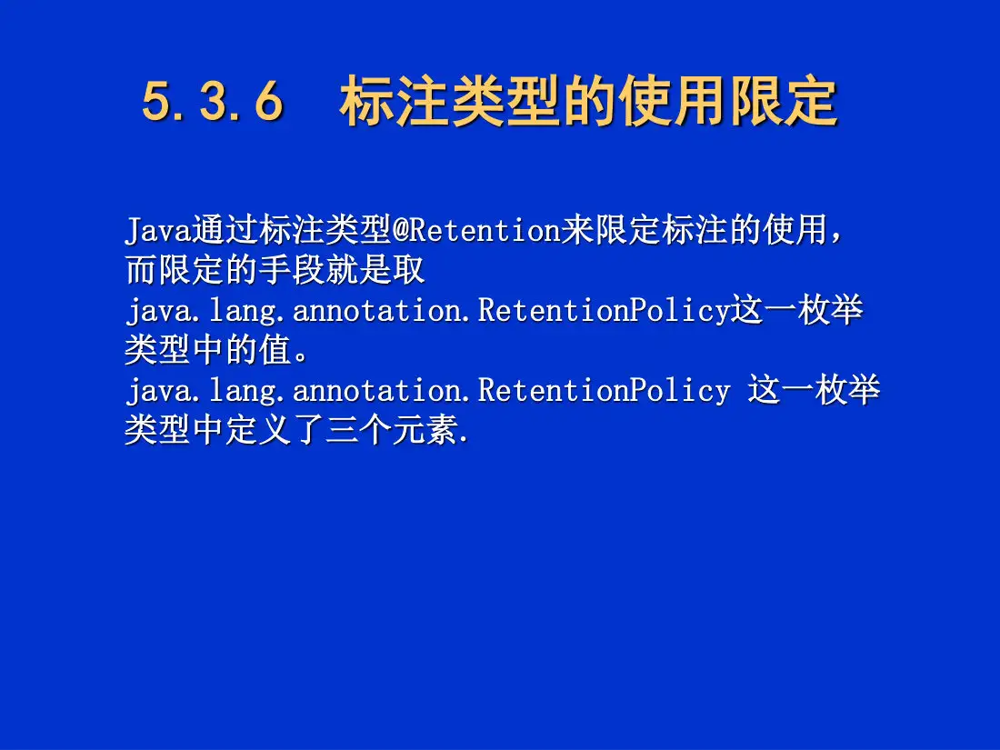

原文：

5.3.6 标注类型的使用限定

Java通过标注类型@Retention来限定标注的使用，而限定的手段就是取

java.lang.annotation.RetentionPolicy这一枚举类型中的值。

java.lang.annotation.RetentionPolicy 这一枚举类型中定义了三个元素.

### 5.3.6 标注类型的使用限定

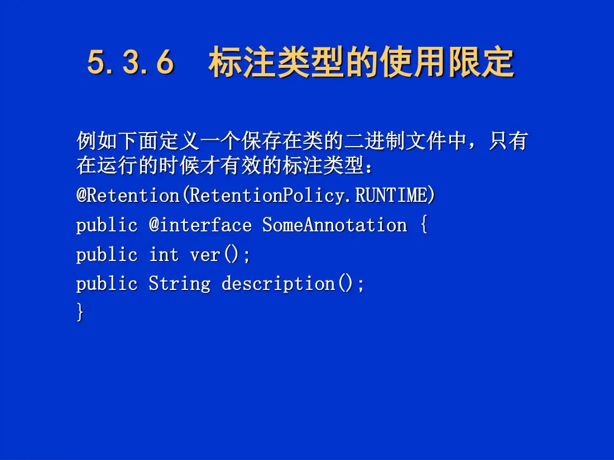

原文：

5.3.6 标注类型的使用限定

例如下面定义一个保存在类的二进制文件中，只有在运行的时候才有效的标注类型：

@Retention(RetentionPolicy.RUNTIME)

public @interface SomeAnnotation {

public int ver();

public String description();

### 5.3.7 标注类型的使用原则

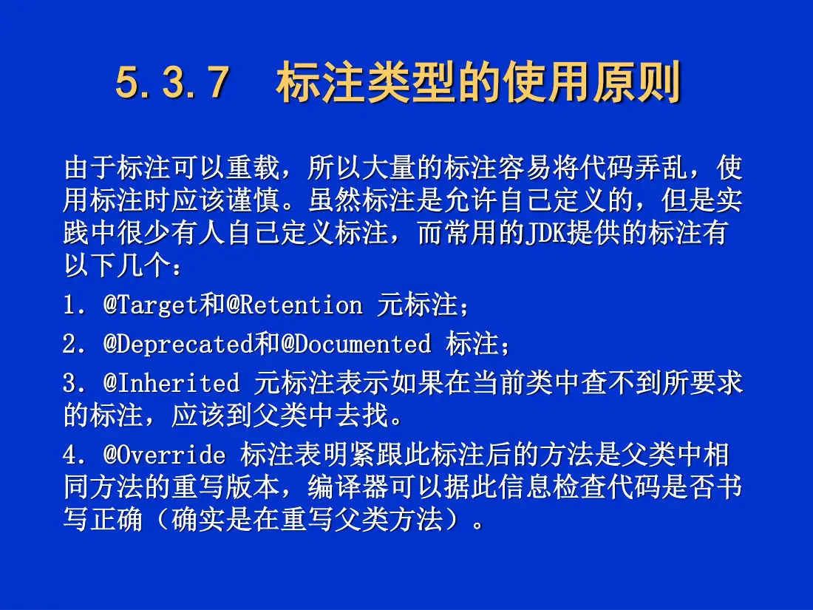

原文：

5.3.7 标注类型的使用原则

由于标注可以重载，所以大量的标注容易将代码弄乱，使用标注时应该谨慎。虽然标注是允许自己定义的，但是实践中很少有人自己定义标注，而常用的JDK提供的标注有以下几个：

1．@Target和@Retention 元标注；

2．@Deprecated和@Documented 标注；

3．@Inherited 元标注表示如果在当前类中查不到所要求的标注，应该到父类中去找。

4．@Override 标注表明紧跟此标注后的方法是父类中相同方法的重写版本，编译器可以据此信息检查代码是否书写正确（确实是在重写父类方法）。

### 5.3.7 标注类型的使用原则

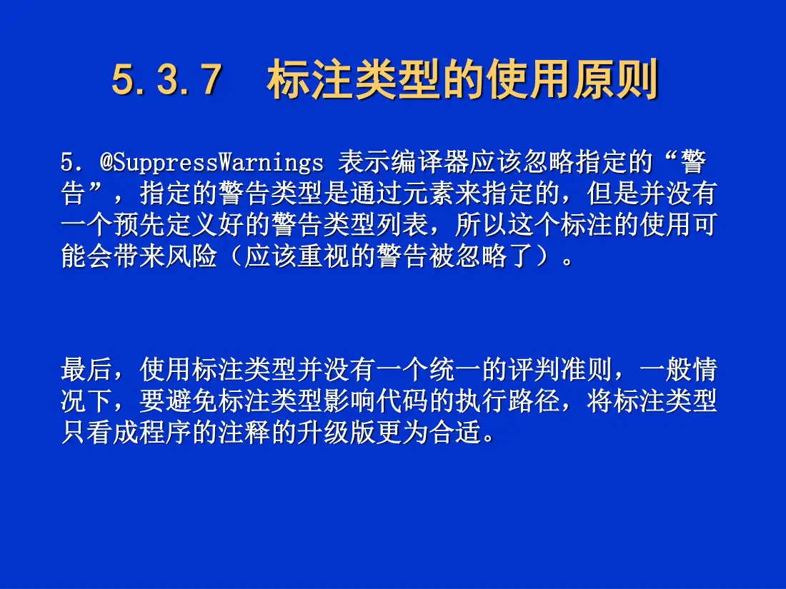

原文：

5.3.7 标注类型的使用原则

5．@SuppressWarnings 表示编译器应该忽略指定的“警告”，指定的警告类型是通过元素来指定的，但是并没有一个预先定义好的警告类型列表，所以这个标注的使用可能会带来风险（应该重视的警告被忽略了）。

最后，使用标注类型并没有一个统一的评判准则，一般情况下，要避免标注类型影响代码的执行路径，将标注类型只看成程序的注释的升级版更为合适。

### 小结

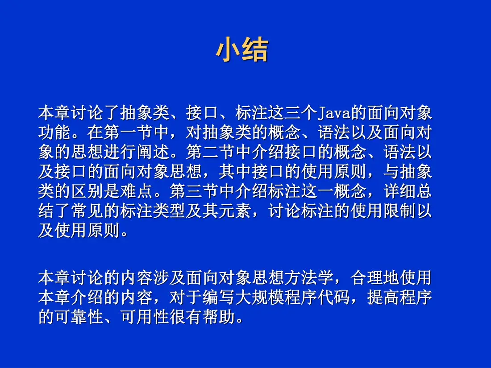

原文：

小结

本章讨论了抽象类、接口、标注这三个Java的面向对象功能。在第一节中，对抽象类的概念、语法以及面向对象的思想进行阐述。第二节中介绍接口的概念、语法以及接口的面向对象思想，其中接口的使用原则，与抽象类的区别是难点。第三节中介绍标注这一概念，详细总结了常见的标注类型及其元素，讨论标注的使用限制以及使用原则。

本章讨论的内容涉及面向对象思想方法学，合理地使用本章介绍的内容，对于编写大规模程序代码，提高程序的可靠性、可用性很有帮助。
