# 《Java程序设计》第6章 异常与断言（课件）

原件的每一页，下面附识别出的文字。

### Java 程序设计Java Programming

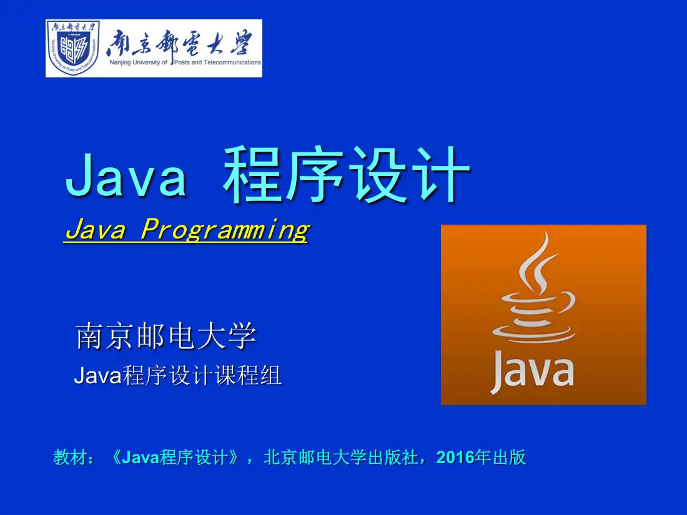

原文：

Java 程序设计Java Programming

南京邮电大学Java程序设计课程组川益

教材：《Java程序设计》，北京邮电大学出版社，2016年出版

南京郵電大學南京郵電大学

### 第6章 异常与断言

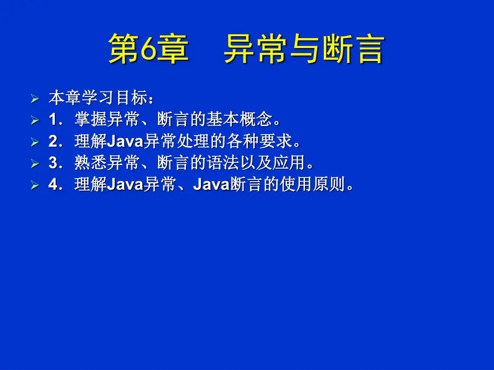

原文：

第6章 异常与断言

本章学习目标：

➢ 1．掌握异常、断言的基本概念。

2．理解Java异常处理的各种要求。

➢ 3．熟悉异常、断言的语法以及应用。

4．理解Java异常、Java断言的使用原则。

### 6.1 异常

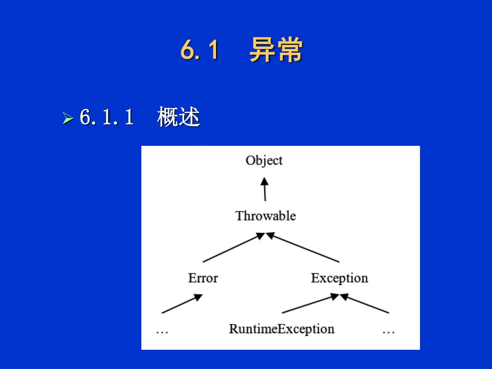

原文：

6.1 异常

➢ 6.1.1 概述

### 6.1.2 异常语法

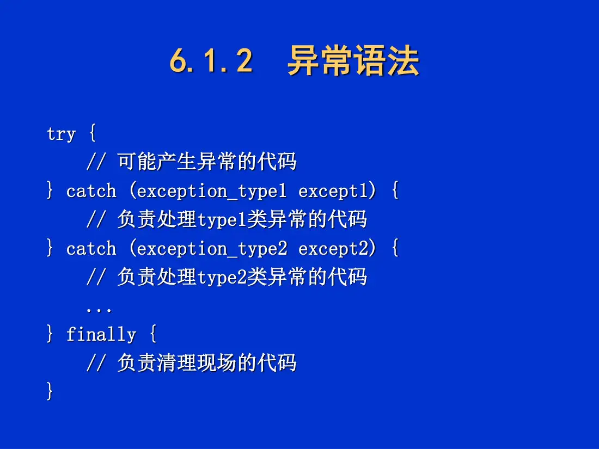

原文：

6.1.2 异常语法

try {

// 可能产生异常的代码

} catch (exception\_type1 except1) {

// 负责处理type1类异常的代码

} catch (exception\_type2 except2) {

负责处理type2类异常的代码

} finally {

// 负责清理现场的代码

### 6.1.3 finally块

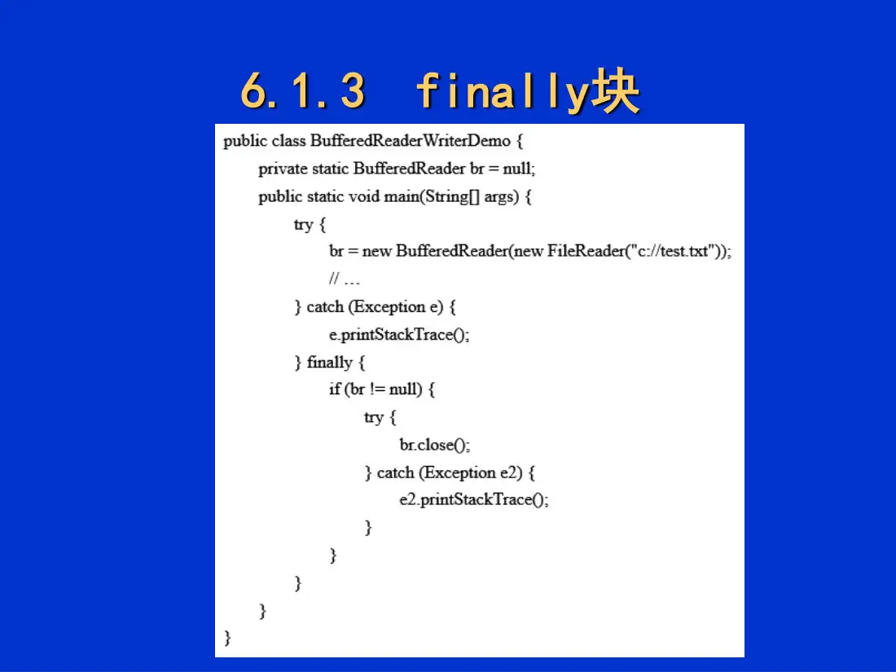

原文：

6.1.3 finally块

### 6.1.4 throw语句

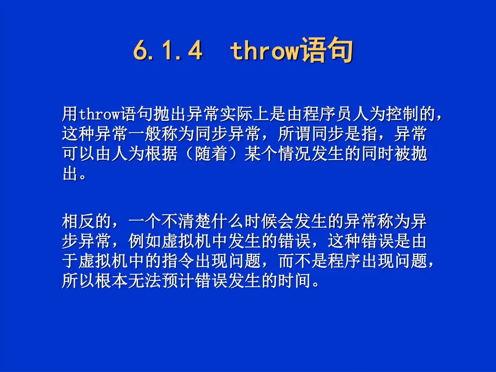

原文：

6.1.4 throw语句

用throw语句抛出异常实际上是由程序员人为控制的，这种异常一般称为同步异常，所谓同步是指，异常可以由人为根据（随着）某个情况发生的同时被抛出。

相反的，一个不清楚什么时候会发生的异常称为异步异常，例如虚拟机中发生的错误，这种错误是由于虚拟机中的指令出现问题，而不是程序出现问题，所以根本无法预计错误发生的时间。

### 6.1.5 throws语句

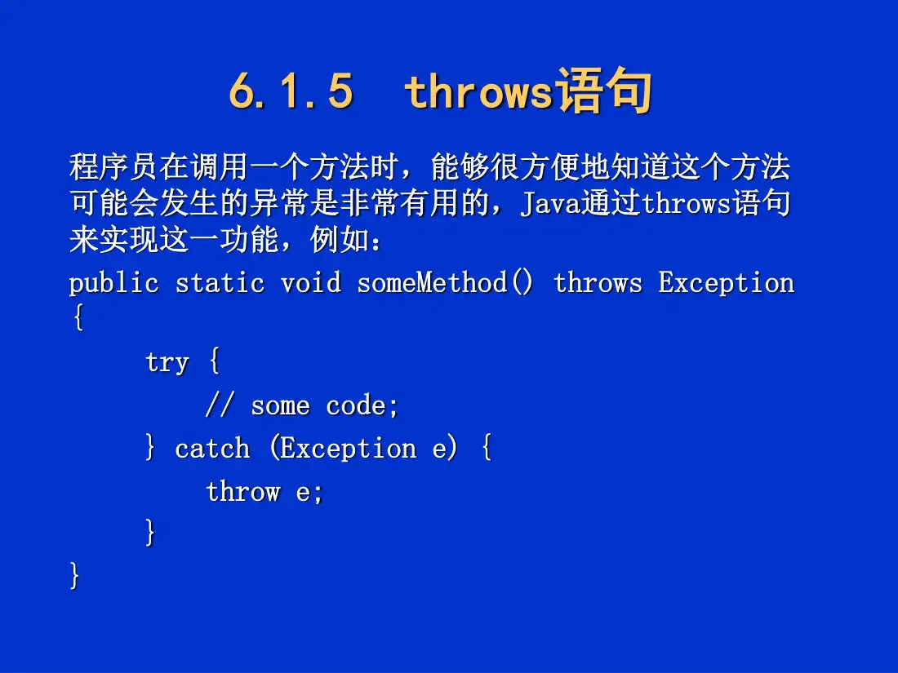

原文：

6.1.5 throws语句

程序员在调用一个方法时，能够很方便地知道这个方法可能会发生的异常是非常有用的，Java通过throws语句来实现这一功能，例如：

public static void someMethod() throws Exception

try {

some code;

} catch (Exception e) {

throw e;

### 6.1.6 throws语句和方法重写（Override）

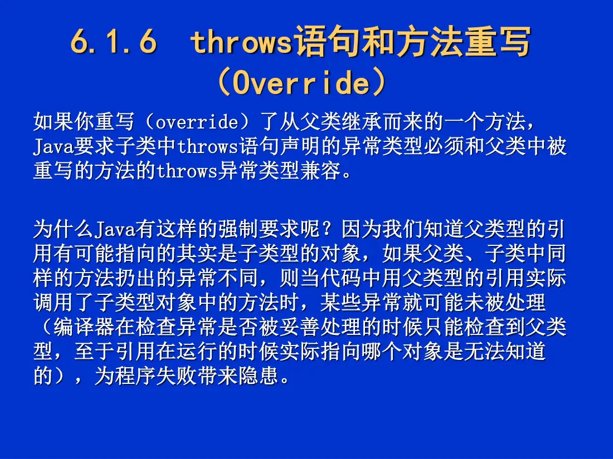

原文：

6.1.6 throws语句和方法重写（Override）

如果你重写（override）了从父类继承而来的一个方法，Java要求子类中throws语句声明的异常类型必须和父类中被重写的方法的throws异常类型兼容。

为什么Java有这样的强制要求呢？因为我们知道父类型的引用有可能指向的其实是子类型的对象，如果父类、子类中同样的方法扔出的异常不同，则当代码中用父类型的引用实际调用了子类型对象中的方法时，某些异常就可能未被处理（编译器在检查异常是否被妥善处理的时候只能检查到父类型，至于引用在运行的时候实际指向哪个对象是无法知道的），为程序失败带来隐患。

### 6.1.7 异常链

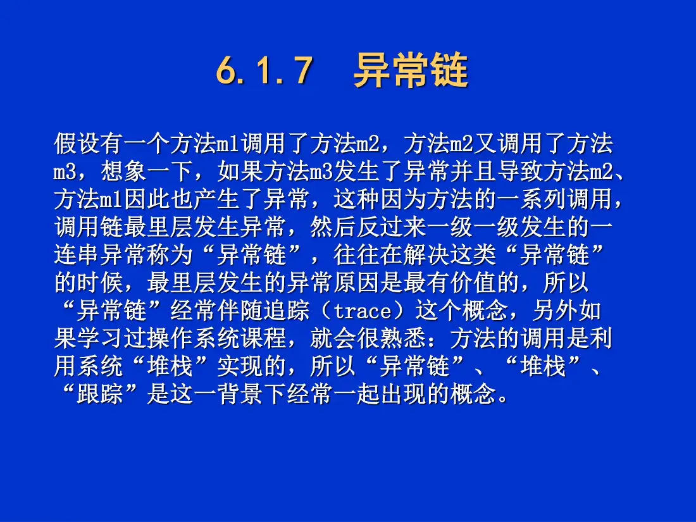

原文：

6.1.7 异常链

假设有一个方法m1调用了方法m2，方法m2又调用了方法m3，想象一下，如果方法m3发生了异常并且导致方法m2、方法m1因此也产生了异常，这种因为方法的一系列调用，调用链最里层发生异常，然后反过来一级一级发生的一连串异常称为“异常链”，往往在解决这类“异常链”的时候，最里层发生的异常原因是最有价值的，所以“异常链”经常伴随追踪（trace）这个概念，另外如果学习过操作系统课程，就会很熟悉：方法的调用是利用系统“堆栈”实现的，所以“异常链”、“堆栈”、“跟踪”是这一背景下经常一起出现的概念。

### 6.1.8 异常使用原则

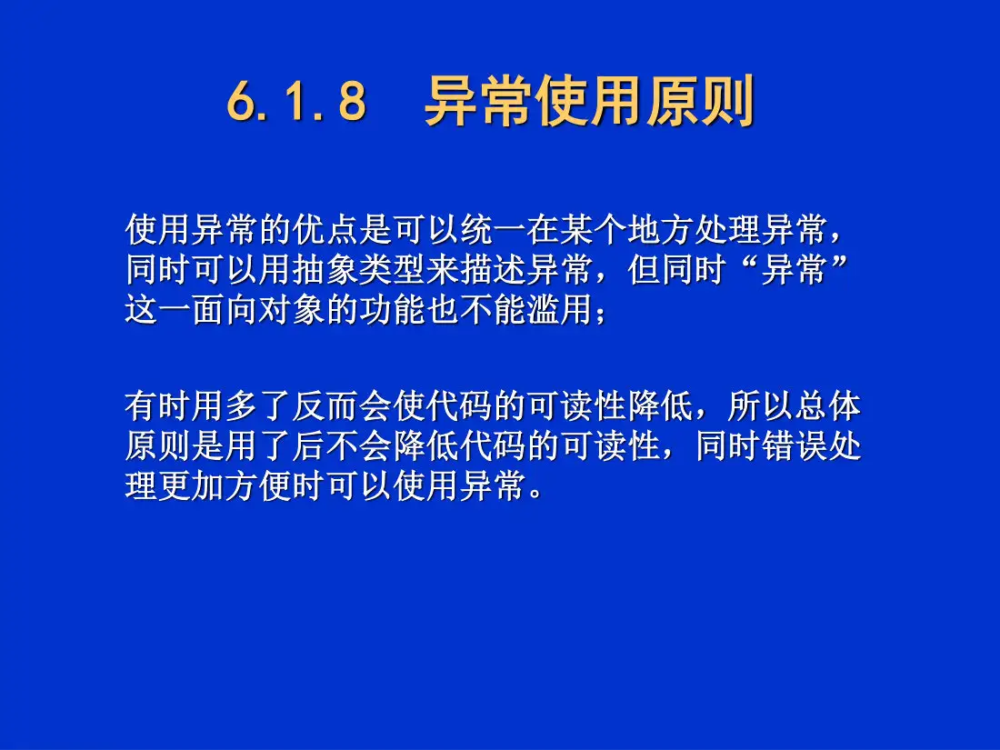

原文：

6.1.8 异常使用原则

使用异常的优点是可以统一在某个地方处理异常，同时可以用抽象类型来描述异常，但同时“异常这一面向对象的功能也不能滥用；

有时用多了反而会使代码的可读性降低，所以总体原则是用了后不会降低代码的可读性，同时错误处理更加方便时可以使用异常。

### 6.2 断言（Assertion）

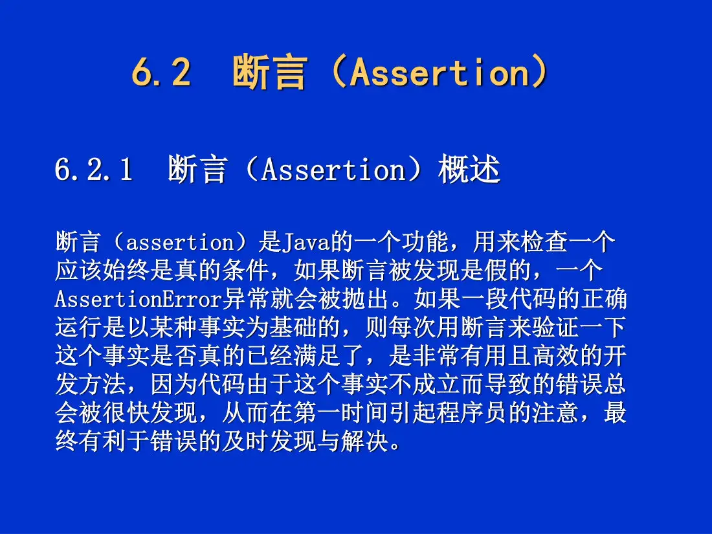

原文：

6.2 断言（Assertion）

6.2.1 断言（Assertion）概述

断言（assertion）是Java的一个功能，用来检查一个应该始终是真的条件，如果断言被发现是假的，一个AssertionError异常就会被抛出。如果一段代码的正确运行是以某种事实为基础的，则每次用断言来验证一下这个事实是否真的已经满足了，是非常有用且高效的开发方法，因为代码由于这个事实不成立而导致的错误总会被很快发现，从而在第一时间引起程序员的注意，最终有利于错误的及时发现与解决。

### 6.2.2 断言语法

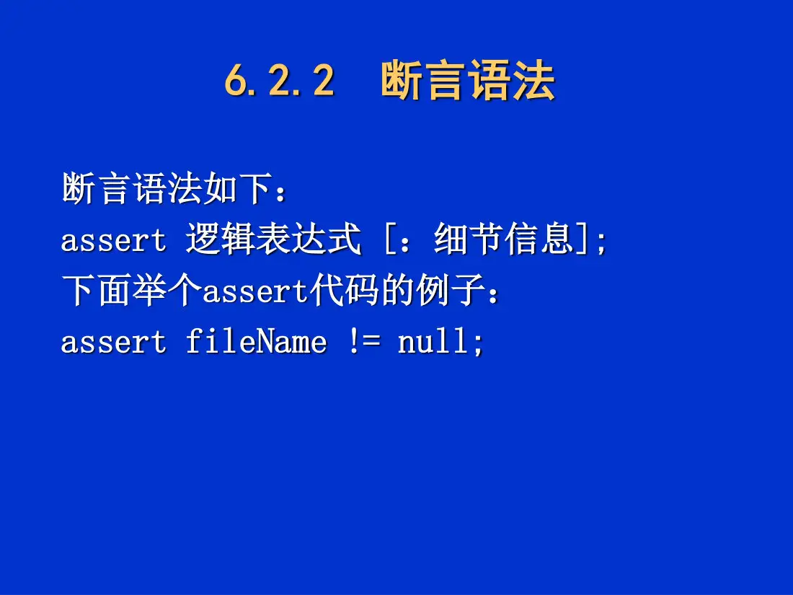

原文：

6.2.2 断言语法

断言语法如下：

assert 逻辑表达式 [：细节信息];

下面举个assert代码的例子：

assert fileName $\mathbb { I } \equiv \mathbb { I } \mathbb { I } \mathbb { I } \mathbb { I } \mathbb { I }$ ;

### 6.2.3 断言使用原则

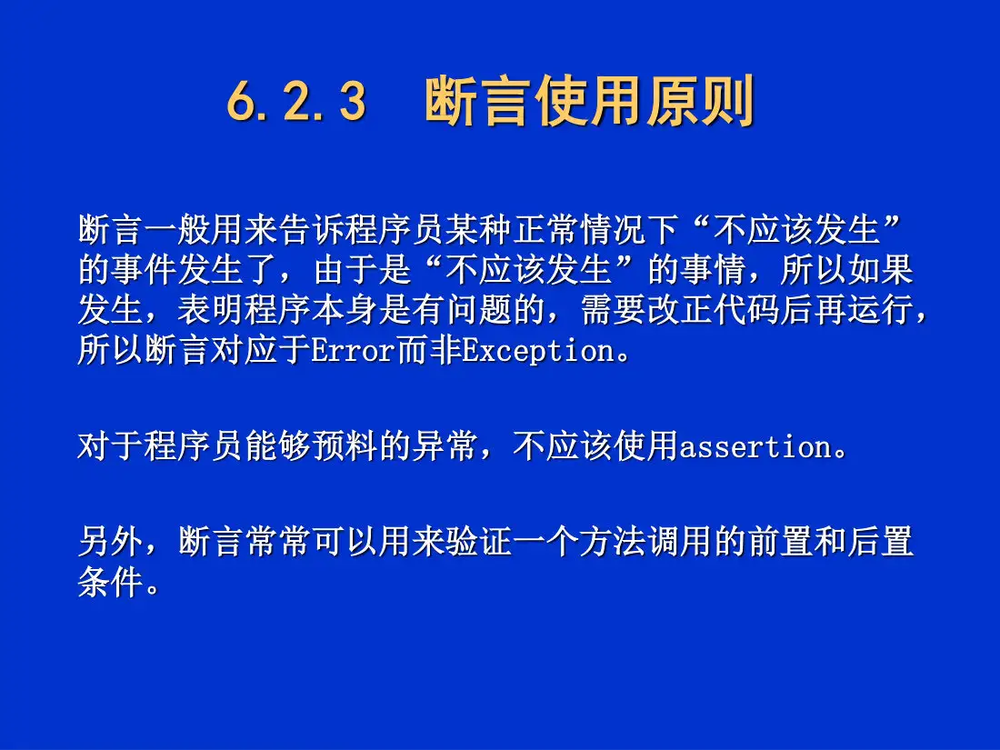

原文：

6.2.3 断言使用原则

断言一般用来告诉程序员某种正常情况下“不应该发生”的事件发生了，由于是“不应该发生”的事情，所以如果发生，表明程序本身是有问题的，需要改正代码后再运行所以断言对应于Error而非Exception。

对于程序员能够预料的异常，不应该使用assertion。

另外，断言常常可以用来验证一个方法调用的前置和后置条件。

### 小结

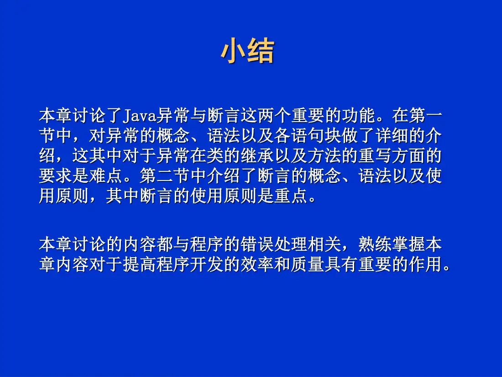

原文：

小结

本章讨论了Java异常与断言这两个重要的功能。在第一节中，对异常的概念、语法以及各语句块做了详细的介绍，这其中对于异常在类的继承以及方法的重写方面的要求是难点。第二节中介绍了断言的概念、语法以及使用原则，其中断言的使用原则是重点。

本章讨论的内容都与程序的错误处理相关，熟练掌握本章内容对于提高程序开发的效率和质量具有重要的作用。
