# 《Java程序设计》第7章 文件管理与输入/输出（课件）

原件的每一页，下面附识别出的文字。

### Java 程序设计Java Programming

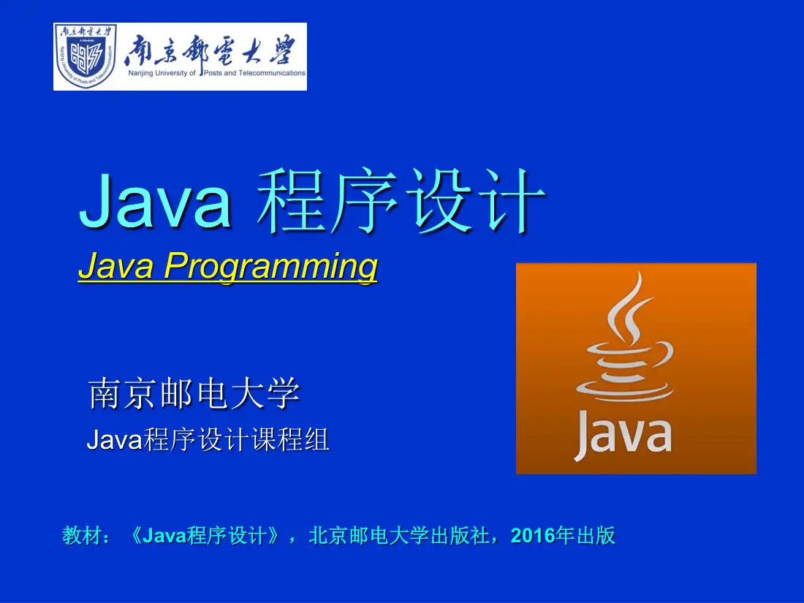

原文：

Java 程序设计Java Programming

南京邮电大学Java程序设计课程组心川

教材：《Java程序设计》，北京邮电大学出版社，2016年出版

南京鐵電大學 南京郵電大学 Nanjing University of Posts and Telecommunications

### 第7章 文件管理与输入/输出

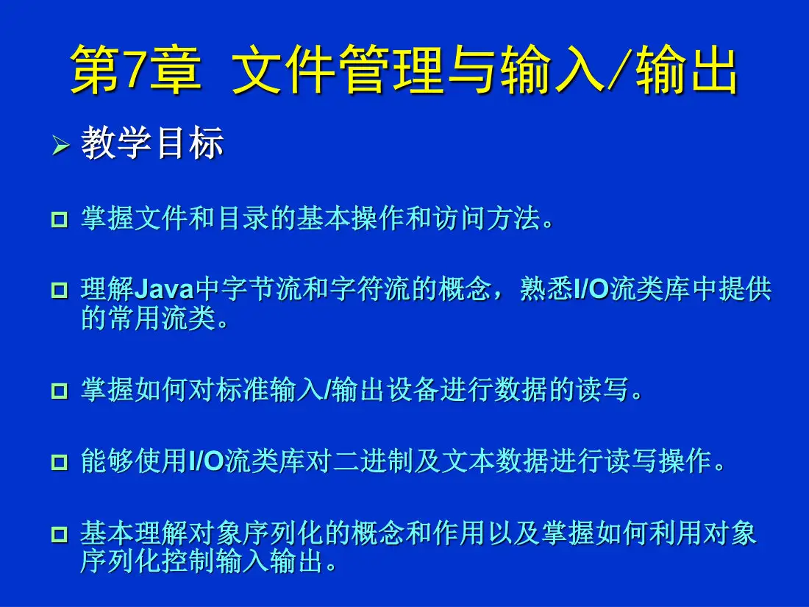

原文：

第7章 文件管理与输入/输出

➢ 教学目标

 掌握文件和目录的基本操作和访问方法。

 理解Java中字节流和字符流的概念，熟悉I/O流类库中提供 的常用流类。

 掌握如何对标准输入/输出设备进行数据的读写。

 能够使用I/O流类库对二进制及文本数据进行读写操作。

 基本理解对象序列化的概念和作用以及掌握如何利用对象序列化控制输入输出。

### 7.1 File类

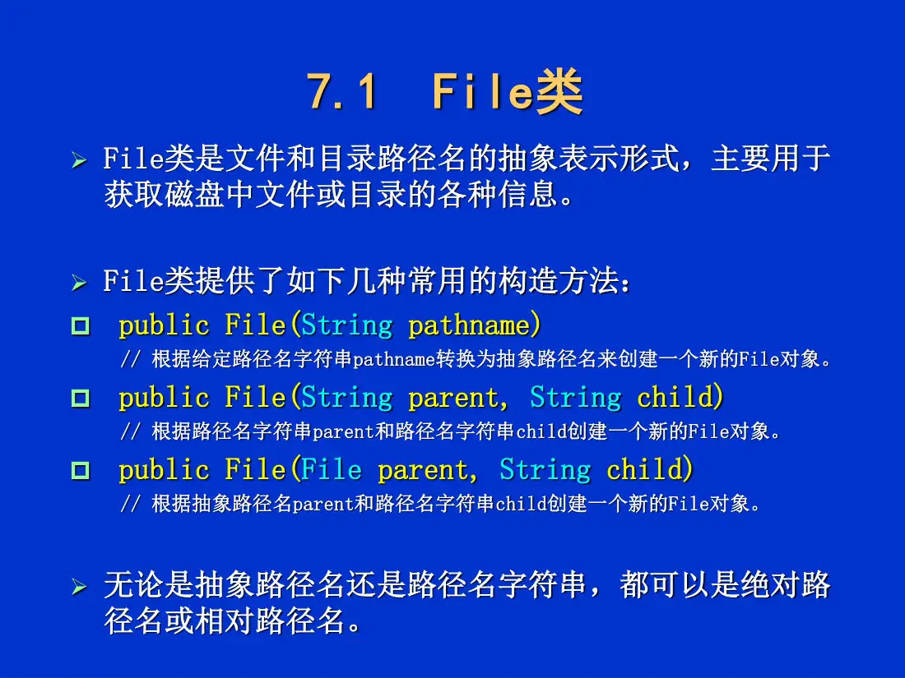

原文：

7.1 File类

➢ File类是文件和目录路径名的抽象表示形式，主要用于获取磁盘中文件或目录的各种信息。

File类提供了如下几种常用的构造方法：

 public File(String pathname)// 根据给定路径名字符串pathname转换为抽象路径名来创建一个新的File对象。

 public File(String parent, String child)// 根据路径名字符串parent和路径名字符串child创建一个新的File对象。

 public File(File parent, String child)// 根据抽象路径名parent和路径名字符串child创建一个新的File对象。

无论是抽象路径名还是路径名字符串，都可以是绝对路径名或相对路径名。

### 7.1 File类

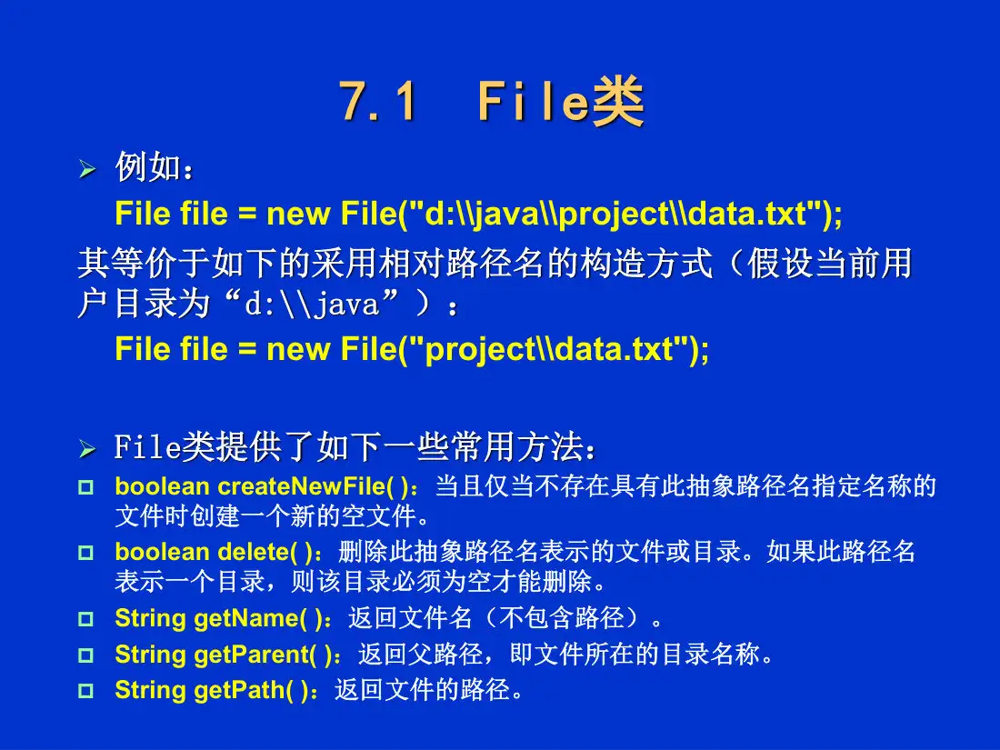

原文：

7.1 File类

例如：File file = new File("d:\\java\\project\\data.txt");其等价于如下的采用相对路径名的构造方式（假设当前用户目录为“d:\\java”）：File file = new File("project\\data.txt");

File类提供了如下一些常用方法：

 boolean createNewFile( )：当且仅当不存在具有此抽象路径名指定名称的文件时创建一个新的空文件。

 boolean delete( )：删除此抽象路径名表示的文件或目录。如果此路径名表示一个目录，则该目录必须为空才能删除。

 String getName( )：返回文件名（不包含路径）。

 String getParent( )：返回父路径，即文件所在的目录名称。

 String getPath( )：返回文件的路径。

### 7.1 File类

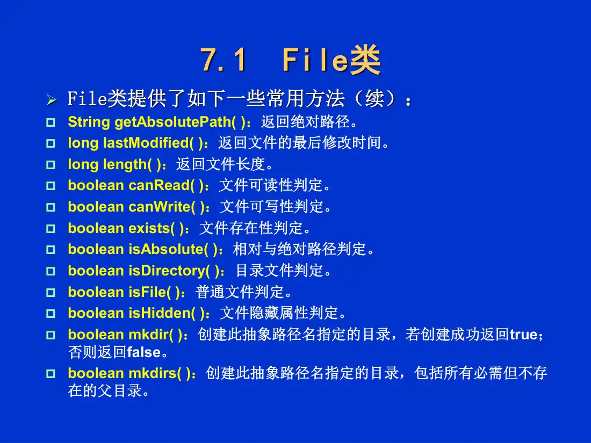

原文：

7.1 File类

File类提供了如下一些常用方法（续）：

 String getAbsolutePath( )：返回绝对路径。

 long lastModified( )：返回文件的最后修改时间。

 long length( )：返回文件长度。

 boolean canRead( )：文件可读性判定。

 boolean canWrite( )：文件可写性判定。

 boolean exists( )：文件存在性判定。

 boolean isAbsolute( )：相对与绝对路径判定。

 boolean isDirectory( )：目录文件判定。

 boolean isFile( )：普通文件判定。

 boolean isHidden( )：文件隐藏属性判定。

 boolean mkdir( )：创建此抽象路径名指定的目录，若创建成功返回true；否则返回false。

 boolean mkdirs( )：创建此抽象路径名指定的目录，包括所有必需但不存在的父目录。

### 7.1 File类

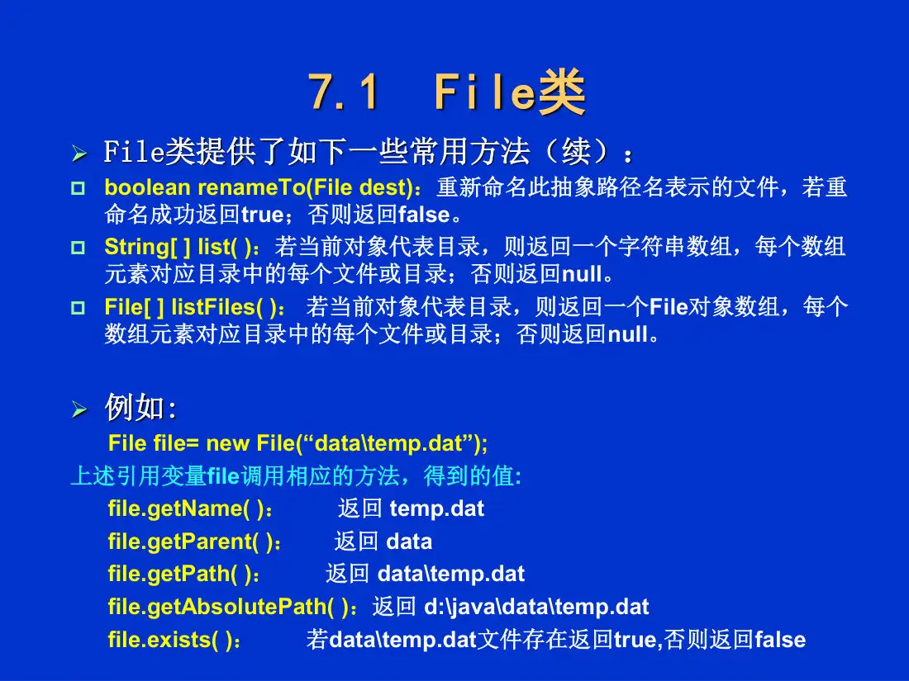

原文：

7.1 File类

➢ File类提供了如下一些常用方法（续）：

 boolean renameTo(File dest)：重新命名此抽象路径名表示的文件，若重命名成功返回true；否则返回false。

 String[ ] list( )：若当前对象代表目录，则返回一个字符串数组，每个数组元素对应目录中的每个文件或目录；否则返回null。

 File[ ] listFiles( )： 若当前对象代表目录，则返回一个File对象数组，每个数组元素对应目录中的每个文件或目录；否则返回null。

➢ 例如:

File file= new File(“data\temp.dat”);

上述引用变量file调用相应的方法，得到的值:

file.getName( )： 返回 temp.dat

file.getParent( )： 返回 data

file.getPath( )： 返回 data\temp.dat

file.getAbsolutePath( )：返回 d:\java\data\temp.dat

file.exists( )： 若data\temp.dat文件存在返回true,否则返回false

### 7.2 流

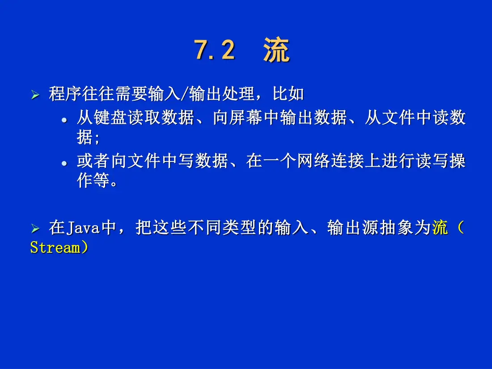

原文：

7.2 流

➢ 程序往往需要输入/输出处理，比如

⚫ 从键盘读取数据、向屏幕中输出数据、从文件中读数据;

⚫ 或者向文件中写数据、在一个网络连接上进行读写操作等。

➢ 在Java中，把这些不同类型的输入、输出源抽象为流Stream）

### 7.2 流

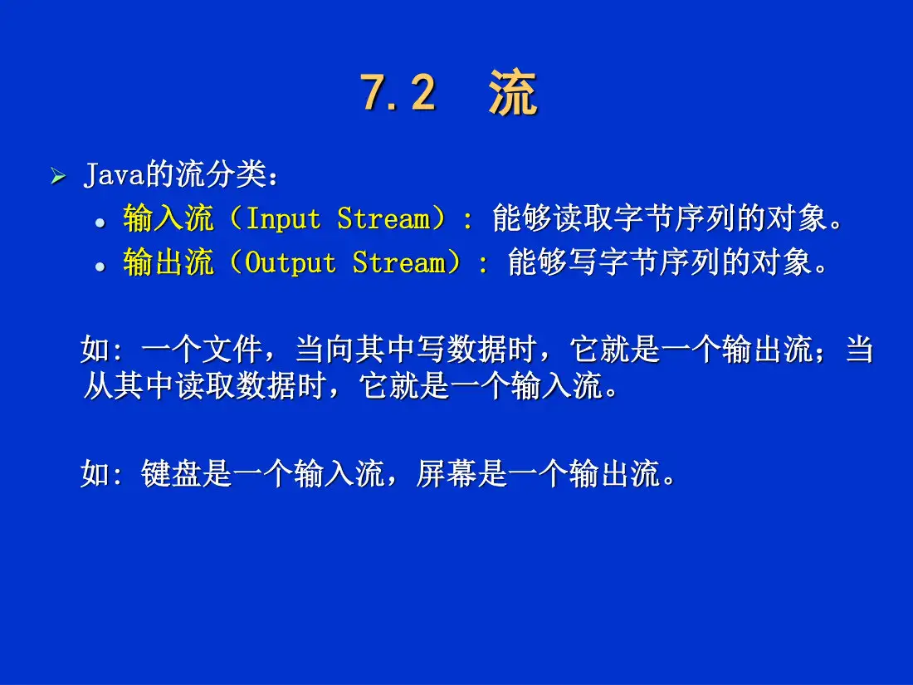

原文：

7.2 流

Java的流分类：

⚫ 输入流（Input Stream）: 能够读取字节序列的对象。

⚫ 输出流（Output Stream）: 能够写字节序列的对象。

如: 一个文件，当向其中写数据时，它就是一个输出流；当从其中读取数据时，它就是一个输入流。

如: 键盘是一个输入流，屏幕是一个输出流。

### 7.2 流

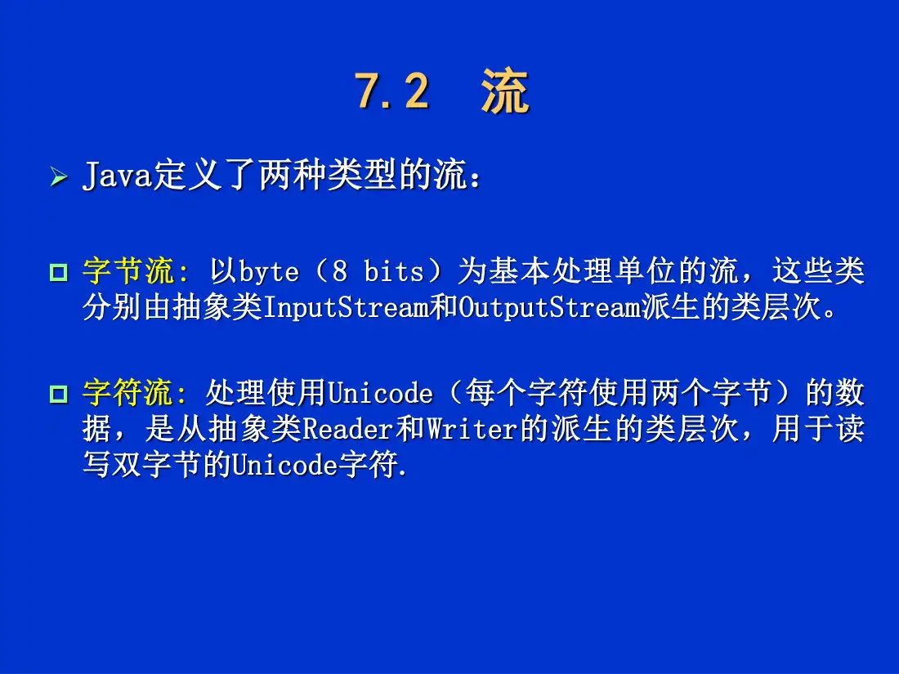

原文：

7.2 流

Java定义了两种类型的流：

 字节流: 以byte（8 bits）为基本处理单位的流，这些类分别由抽象类InputStream和OutputStream派生的类层次。

 字符流: 处理使用Unicode（每个字符使用两个字节）的数据，是从抽象类Reader和Writer的派生的类层次，用于读写双字节的Unicode字符.

### 第 10 页

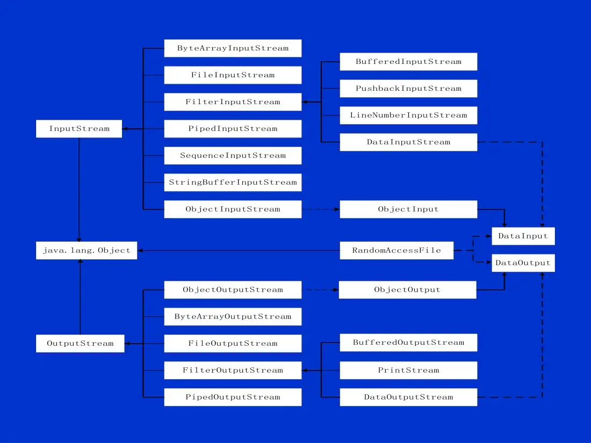

### 第 11 页

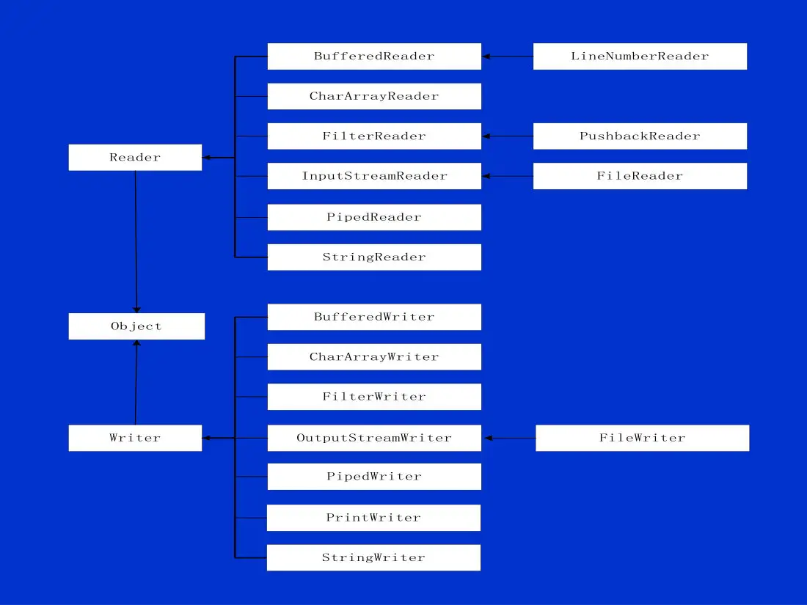

### 7.2 流

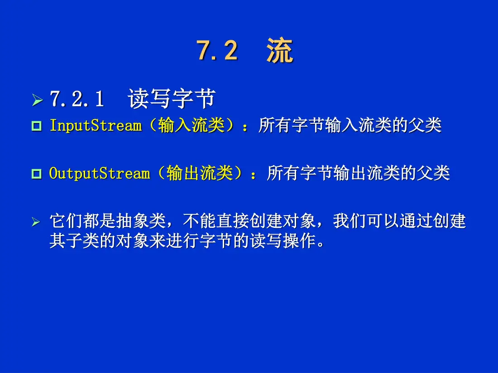

原文：

7.2 流

➢ 7.2.1 读写字节

 InputStream（输入流类）：所有字节输入流类的父类

 OutputStream（输出流类）：所有字节输出流类的父类

它们都是抽象类，不能直接创建对象，我们可以通过创建其子类的对象来进行字节的读写操作。

### 7.2 流

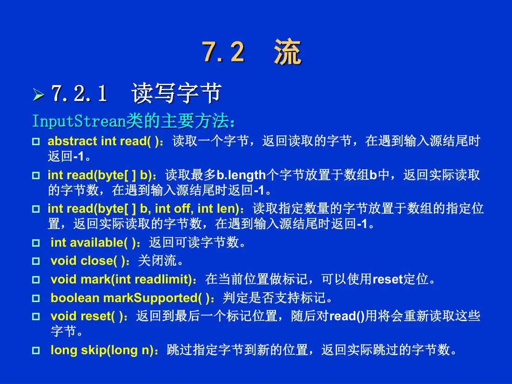

原文：

7.2 流

7.2.1 读写字节

InputStrean类的主要方法：

 abstract int read( )：读取一个字节，返回读取的字节，在遇到输入源结尾时返回-1。

 int read(byte[ ] b)：读取最多b.length个字节放置于数组b中，返回实际读取的字节数，在遇到输入源结尾时返回-1。

 int read(byte[ ] b, int off, int len)：读取指定数量的字节放置于数组的指定位置，返回实际读取的字节数，在遇到输入源结尾时返回-1。

 int available( )：返回可读字节数。

 void close( )：关闭流。

 void mark(int readlimit)：在当前位置做标记，可以使用reset定位。

 boolean markSupported( )：判定是否支持标记。

 void reset( )：返回到最后一个标记位置，随后对read()用将会重新读取这些字节。

 long skip(long n)：跳过指定字节到新的位置，返回实际跳过的字节数。

### 7.2 流

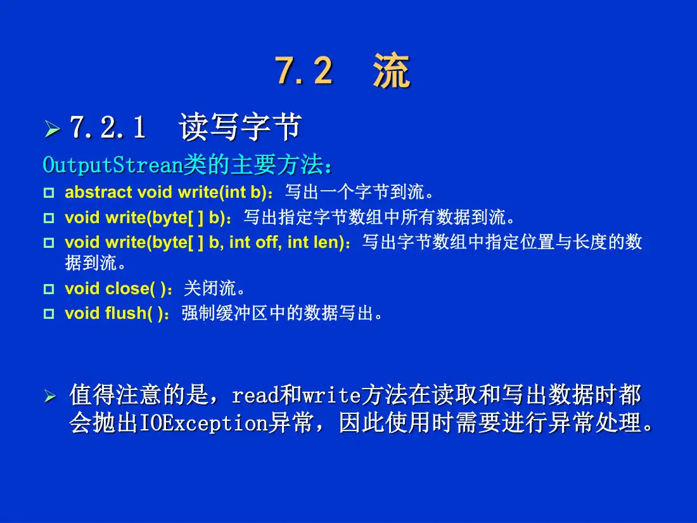

原文：

7.2 流

7.2.1 读写字节

OutputStrean类的主要方法：

 abstract void write(int b)：写出一个字节到流。

 void write(byte[ ] b)：写出指定字节数组中所有数据到流。

 void write(byte[ ] b, int off, int len)：写出字节数组中指定位置与长度的数据到流。

 void close( )：关闭流。

 void flush( )：强制缓冲区中的数据写出。

值得注意的是，read和write方法在读取和写出数据时都会抛出IOException异常，因此使用时需要进行异常处理。

### 7.2 流

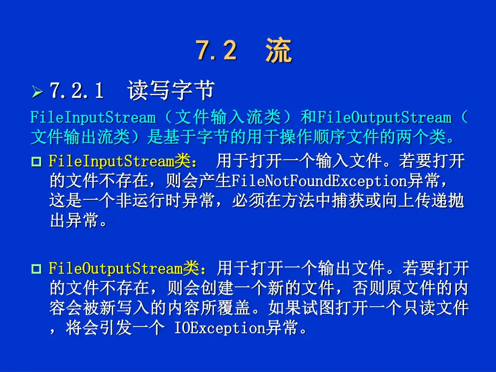

原文：

7.2 流

➢ 7.2.1 读写字节

FileInputStream（文件输入流类）和FileOutputStream文件输出流类）是基于字节的用于操作顺序文件的两个类。

 FileInputStream类： 用于打开一个输入文件。若要打开的文件不存在，则会产生FileNotFoundException异常，这是一个非运行时异常，必须在方法中捕获或向上传递抛出异常。

 FileOutputStream类：用于打开一个输出文件。若要打开的文件不存在，则会创建一个新的文件，否则原文件的内容会被新写入的内容所覆盖。如果试图打开一个只读文件，将会引发一个 IOException异常。

### 7.2 流

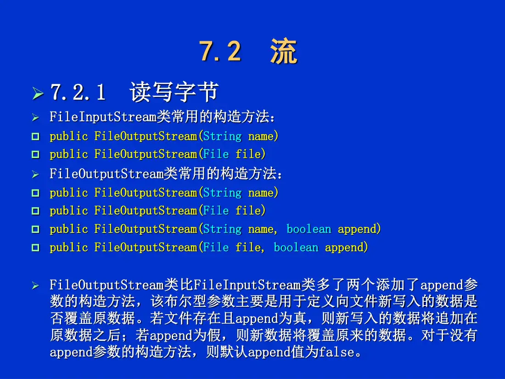

原文：

7.2 流

➢ 7.2.1 读写字节

FileInputStream类常用的构造方法：

 public FileOutputStream(String name)

 public FileOutputStream(File file)

FileOutputStream类常用的构造方法：

 public FileOutputStream(String name)

 public FileOutputStream(File file)

 public FileOutputStream(String name, boolean append)

 public FileOutputStream(File file, boolean append)

FileOutputStream类比FileInputStream类多了两个添加了append参数的构造方法，该布尔型参数主要是用于定义向文件新写入的数据是否覆盖原数据。若文件存在且append为真，则新写入的数据将追加在原数据之后；若append为假，则新数据将覆盖原来的数据。对于没有append参数的构造方法，则默认append值为false。

### 7.2 流

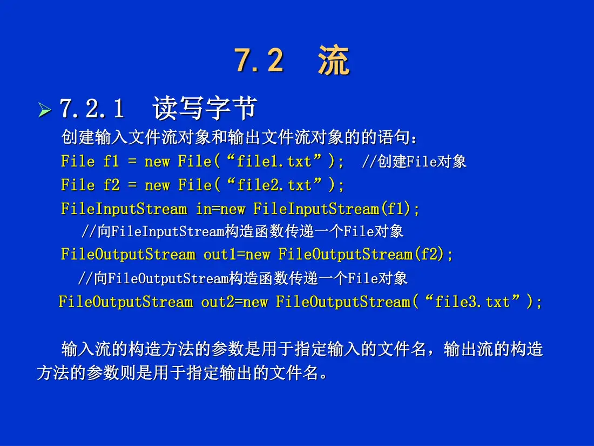

原文：

7.2 流

➢ 7.2.1 读写字节

File f1 = new File(“file1.txt”); //创建File对象

//向FileInputStream构造函数传递一个File对象 FileOutputStream out1=new FileOutputStream(f2);

//向FileOutputStream构造函数传递一个File对象 FileOutputStream out2=new FileOutputStream(“file3.txt”);

输入流的构造方法的参数是用于指定输入的文件名，输出流的构造方法的参数则是用于指定输出的文件名。

### 7.2 流

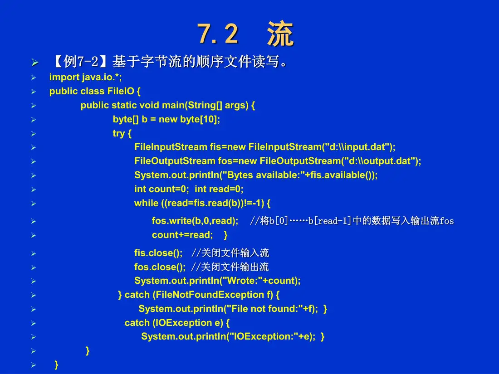

原文：

7.2 流

【例7-2】基于字节流的顺序文件读写。

➢ import java.io.\*;

➢ public class FileIO {

public static void main(String[] args) {

byte[] b = new byte[10];

try {

FileInputStream fis=new FileInputStream("d:\\input.dat");

FileOutputStream fos=new FileOutputStream("d:\\output.dat");

System.out.println("Bytes available:"+fis.available());

int count=0; int read=0;

while ((read=fis.read(b))!=-1) {

fos.write(b,0,read); //将b[0]……b[read-1]中的数据写入输出流fos

count+=read; }

fis.close(); //关闭文件输入流

fos.close(); //关闭文件输出流

System.out.println("Wrote:"+count);

} catch (FileNotFoundException f) {

System.out.println("File not found:"+f); }

catch (IOException e) {

System.out.println("IOException:"+e); }

### 7.2 流

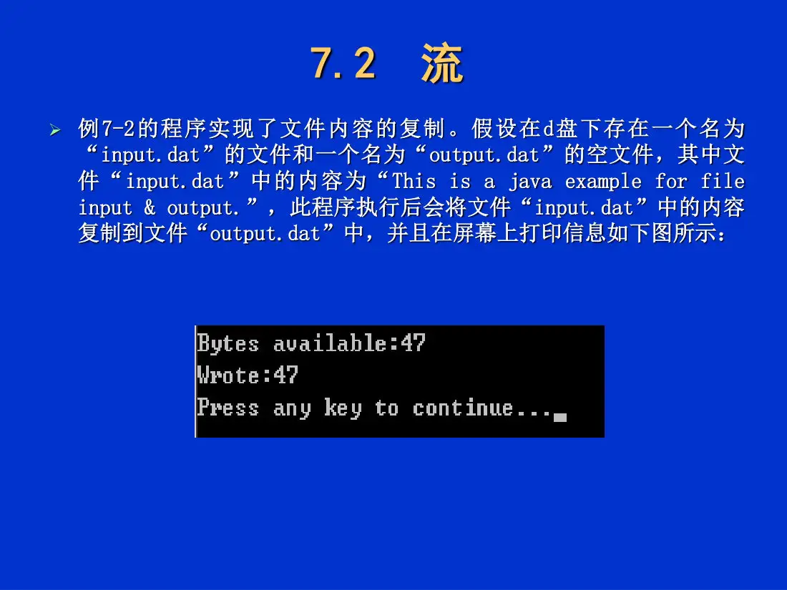

原文：

7.2 流

例7-2的程序实现了文件内容的复制。假设在d盘下存在一个名为“input.dat”的文件和一个名为“output.dat”的空文件，其中文件“input.dat”中的内容为“This is a java example for fileinput & output.”，此程序执行后会将文件“input.dat”中的内容复制到文件“output.dat”中，并且在屏幕上打印信息如下图所示：

Bytes available:47

Wrote:47

Press any key to continue...

### 7.2 流

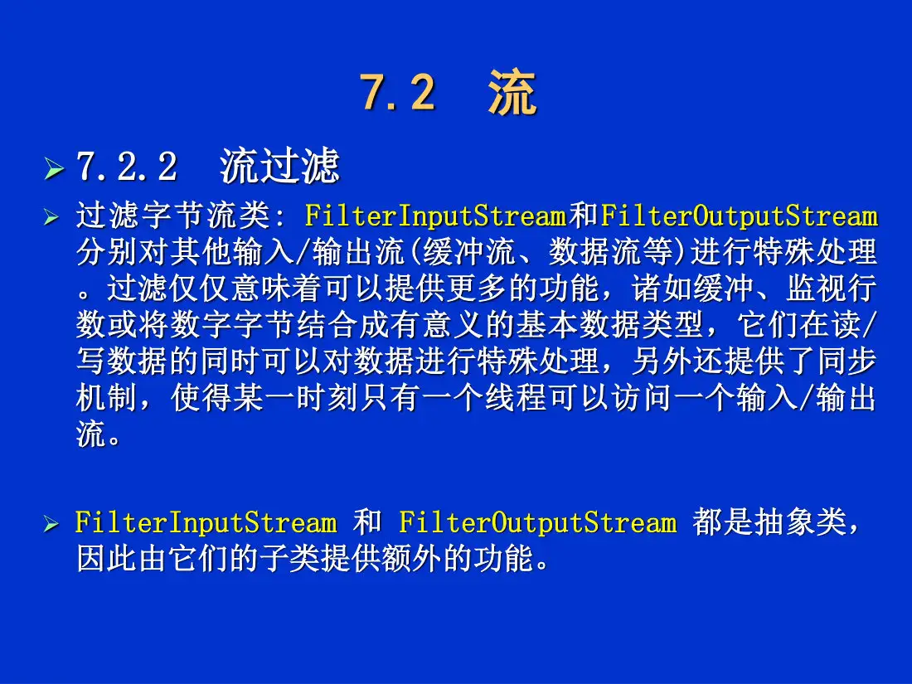

原文：

7.2 流

➢ 7.2.2 流过滤

过滤字节流类: FilterInputStream和FilterOutputStream分别对其他输入/输出流(缓冲流、数据流等)进行特殊处理。过滤仅仅意味着可以提供更多的功能，诸如缓冲、监视行数或将数字字节结合成有意义的基本数据类型，它们在读写数据的同时可以对数据进行特殊处理，另外还提供了同步机制，使得某一时刻只有一个线程可以访问一个输入/输出流。

FilterInputStream 和 FilterOutputStream 都是抽象类，因此由它们的子类提供额外的功能。

### 7.2 流

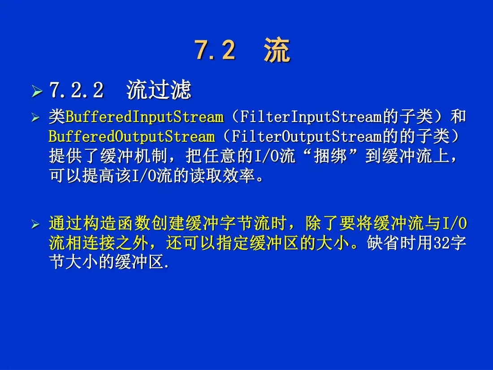

原文：

7.2 流

➢ 7.2.2 流过滤

类BufferedInputStream（FilterInputStream的子类）和 BufferedOutputStream（FilterOutputStream的的子类） 提供了缓冲机制，把任意的I/O流“捆绑”到缓冲流上， 可以提高该I/O流的读取效率。

通过构造函数创建缓冲字节流时，除了要将缓冲流与I/O流相连接之外，还可以指定缓冲区的大小。缺省时用32字节大小的缓冲区.

### 7.2 流

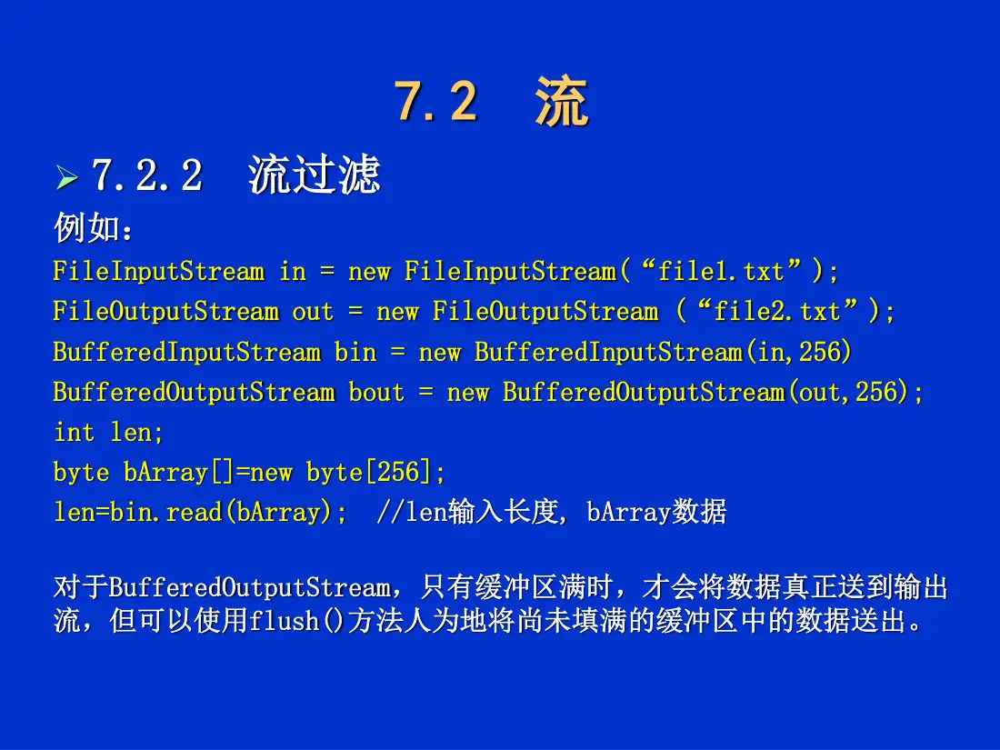

原文：

7.2 流

➢ 7.2.2 流过滤

例如：

FileInputStream in = new FileInputStream(“file1.txt”);

FileOutputStream out = new FileOutputStream (“file2.txt”);

BufferedInputStream bin = new BufferedInputStream(in,256)

BufferedOutputStream bout = new BufferedOutputStream(out,256);

byte bArray[]=new byte[256];

len=bin.read(bArray); //len输入长度, bArray数据

对于BufferedOutputStream，只有缓冲区满时，才会将数据真正送到输出流，但可以使用flush()方法人为地将尚未填满的缓冲区中的数据送出。

### 7.2 流

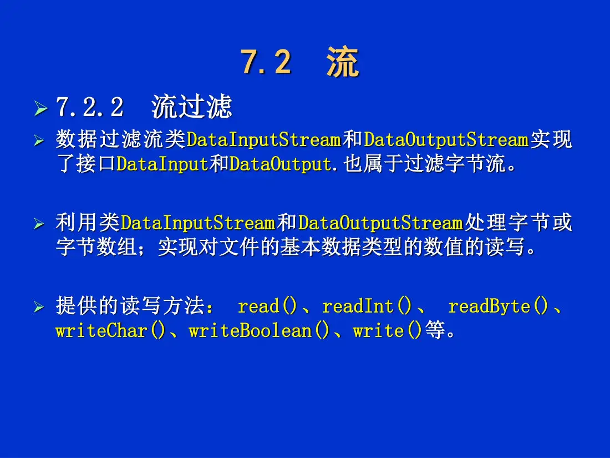

原文：

7.2 流

➢ 7.2.2 流过滤

数据过滤流类DataInputStream和DataOutputStream实现了接口DataInput和DataOutput.也属于过滤字节流。

利用类DataInputStream和DataOutputStream处理字节或字节数组；实现对文件的基本数据类型的数值的读写。

提供的读写方法： read()、readInt()、 readByte()、writeChar()、writeBoolean()、write()等。

### 7.2 流

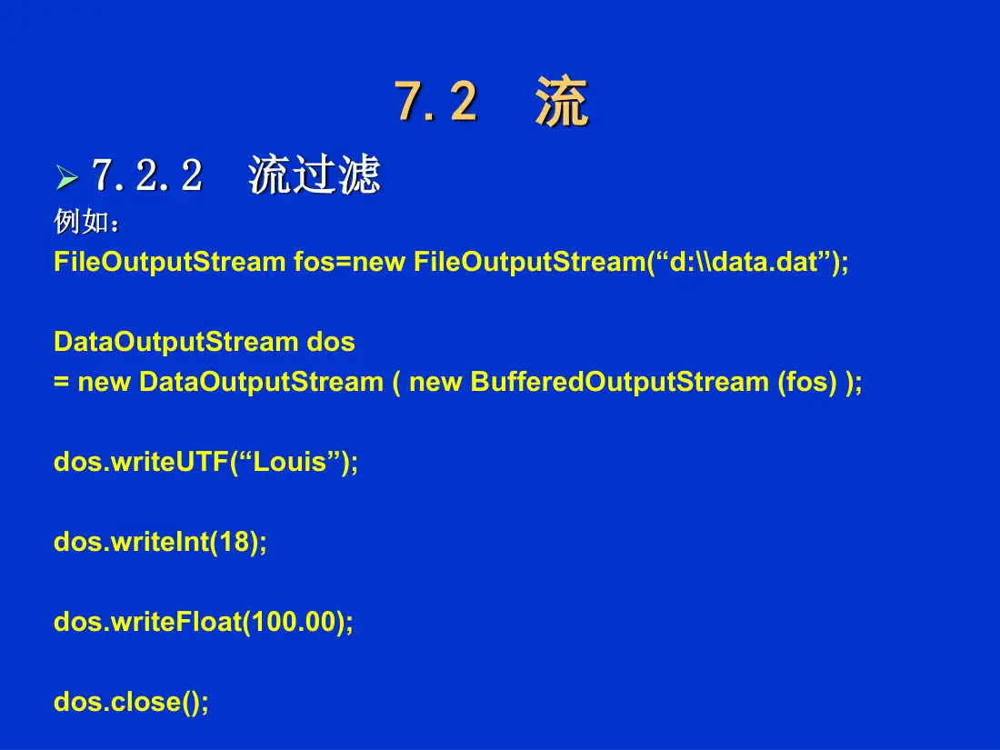

原文：

7.2 流

➢ 7.2.2 流过滤

例如：FileOutputStream fos=new FileOutputStream(“d:\\data.dat”);

DataOutputStream dos = new DataOutputStream ( new BufferedOutputStream (fos) );

dos.writeUTF(“Louis”);

dos.writeInt(18);

dos.writeFloat(100.00);

dos.close();

### 7.2 流

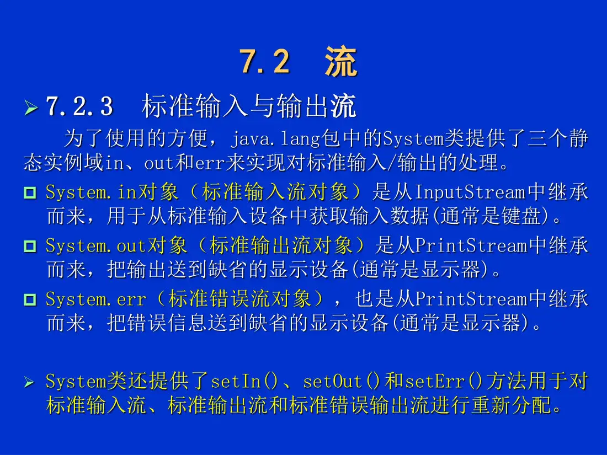

原文：

7.2 流

➢ 7.2.3 标准输入与输出流

为了使用的方便，java.lang包中的System类提供了三个静态实例域in、out和err来实现对标准输入/输出的处理。

 System.in对象（标准输入流对象）是从InputStream中继承而来，用于从标准输入设备中获取输入数据(通常是键盘)。

 System.out对象（标准输出流对象）是从PrintStream中继承而来，把输出送到缺省的显示设备(通常是显示器)。

 System.err（标准错误流对象），也是从PrintStream中继承而来，把错误信息送到缺省的显示设备(通常是显示器)。

System类还提供了setIn()、setOut()和setErr()方法用于对标准输入流、标准输出流和标准错误输出流进行重新分配。

### 7.2 流

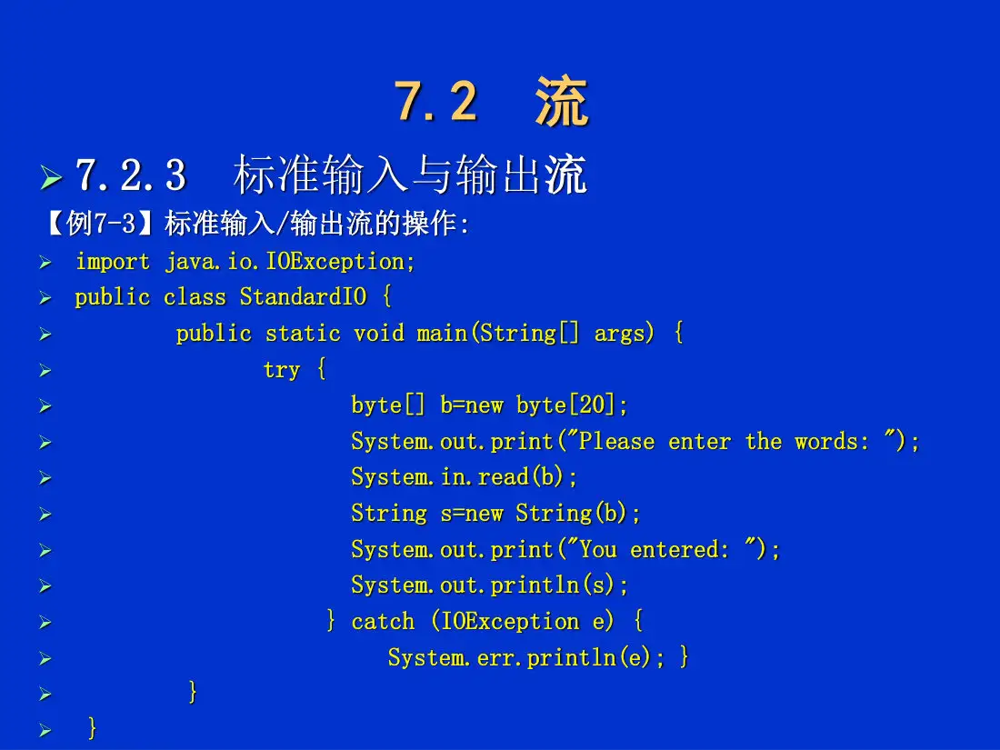

原文：

7.2 流

➢ 7.2.3 标准输入与输出流

【例7-3】标准输入/输出流的操作:

import java.io.IOException;

➢ public class StandardIO {

public static void main(String[] args) {

try {

byte[] b=new byte[20];

System.out.print("Please enter the words: ");

System.in.read(b);

String s=new String(b);

System.out.print("You entered: ");

System.out.println(s);

} catch (IOException e) {

System.err.println(e); }

### 7.3 二进制数据读写

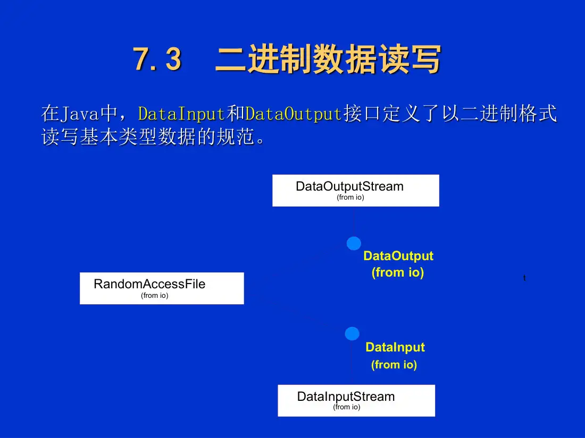

原文：

7.3 二进制数据读写

在Java中，DataInput和DataOutput接口定义了以二进制格式读写基本类型数据的规范。

### 7.3 二进制数据读写

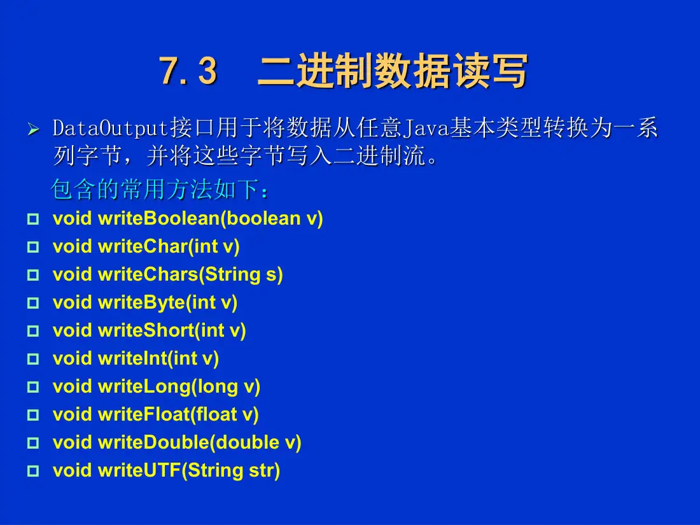

原文：

7.3 二进制数据读写

➢ DataOutput接口用于将数据从任意Java基本类型转换为一系列字节，并将这些字节写入二进制流。

包含的常用方法如下：

 void writeBoolean(boolean v)

 void writeChar(int v)

 void writeChars(String s)

 void writeByte(int v)

 void writeShort(int v)

 void writeInt(int v)

 void writeLong(long v)

 void writeFloat(float v)

 void writeDouble(double v)

 void writeUTF(String str)

### 7.3 二进制数据读写

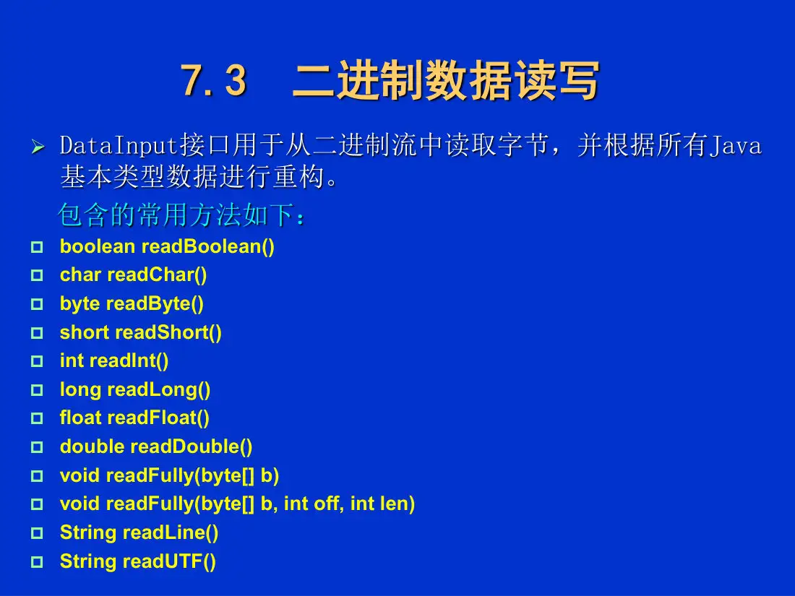

原文：

7.3 二进制数据读写

DataInput接口用于从二进制流中读取字节，并根据所有Java基本类型数据进行重构。

包含的常用方法如下：

 boolean readBoolean()

 char readChar()

 byte readByte()

 short readShort()

 int readInt()

 long readLong()

 float readFloat()

 double readDouble()

 void readFully(byte[] b)

 void readFully(byte[] b, int off, int len)

 String readLine()

 String readUTF()

### 7.3 二进制数据读写

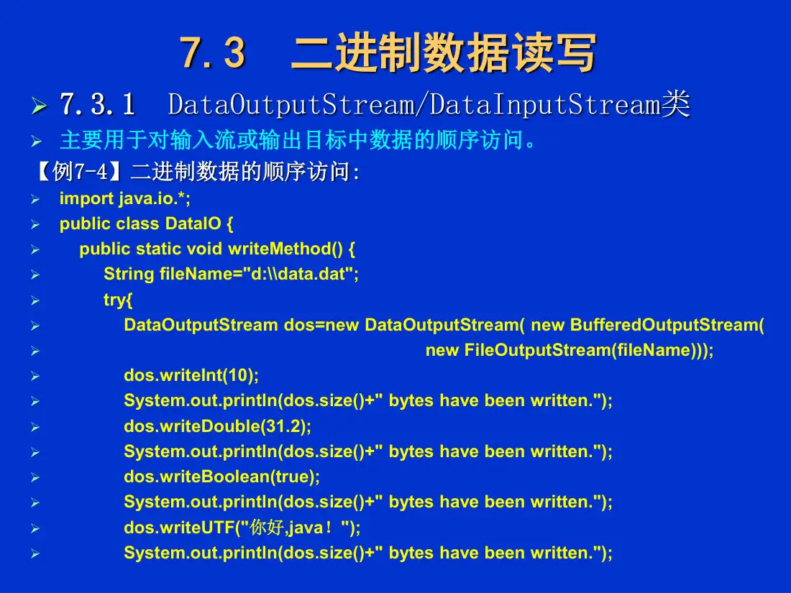

原文：

7.3 二进制数据读写

➢ 7.3.1 DataOutputStream/DataInputStream类

主要用于对输入流或输出目标中数据的顺序访问。【例7-4】二进制数据的顺序访问:

➢ import java.io.\*;

public class DataIO {

public static void writeMethod() {

String fileName="d:\\data.dat";

try{

DataOutputStream dos=new DataOutputStream( new BufferedOutputStream( new FileOutputStream(fileName)));

dos.writeInt(10);

System.out.println(dos.size()+" bytes have been written.");

dos.writeDouble(31.2);

System.out.println(dos.size()+" bytes have been written.");

dos.writeBoolean(true);

System.out.println(dos.size()+" bytes have been written.");

dos.writeUTF("你好,java！");

System.out.println(dos.size()+" bytes have been written.");

### 7.3 二进制数据读写

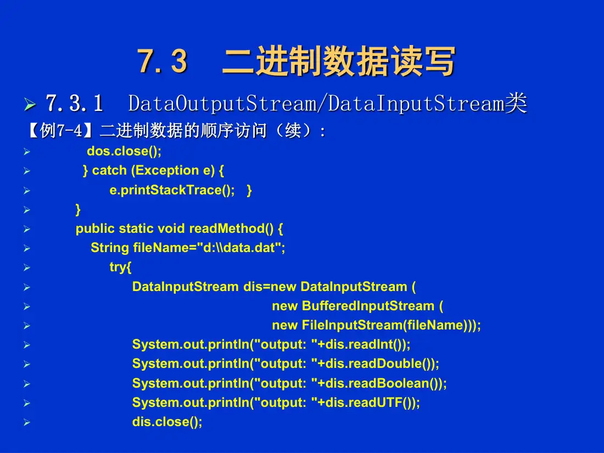

原文：

7.3 二进制数据读写

【例7-4】二进制数据的顺序访问（续）:

dos.close();

} catch (Exception e) { e.printStackTrace(); }

public static void readMethod() {

String fileName="d:\\data.dat";

try{

DataInputStream dis=new DataInputStream

new BufferedInputStream (

new FileInputStream(fileName)));

System.out.println("output: "+dis.readInt());

System.out.println("output: "+dis.readDouble());

System.out.println("output: "+dis.readBoolean());

System.out.println("output: "+dis.readUTF());

dis.close();

### 7.3 二进制数据读写

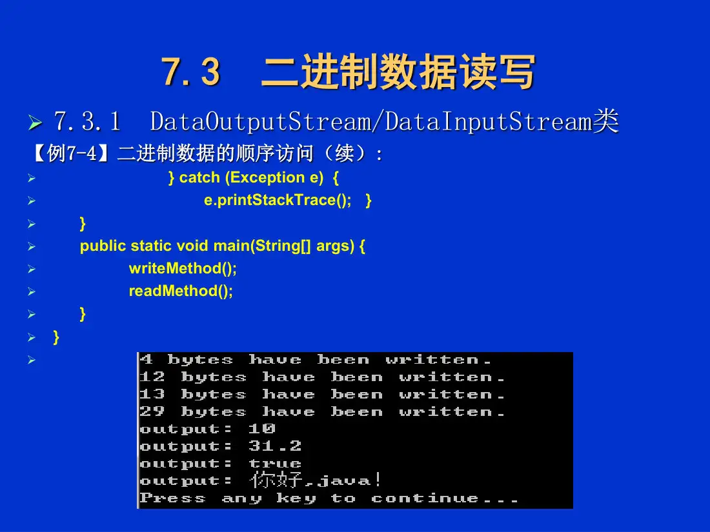

原文：

7.3 二进制数据读写

➢ 7.3.1 DataOutputStream/DataInputStream类

【例7-4】二进制数据的顺序访问（续）:

} catch (Exception e) {

e.printStackTrace(); }

public static void main(String[] args) {

writeMethod();

readMethod();

4 bytes have been written.

12 bytes have been written.

13 bytes have been written.

29 bytes have been written.

output: 10

output: 31.2

output: true

output:你尔女子.java!

Press any key to continue...

### 7.3 二进制数据读写

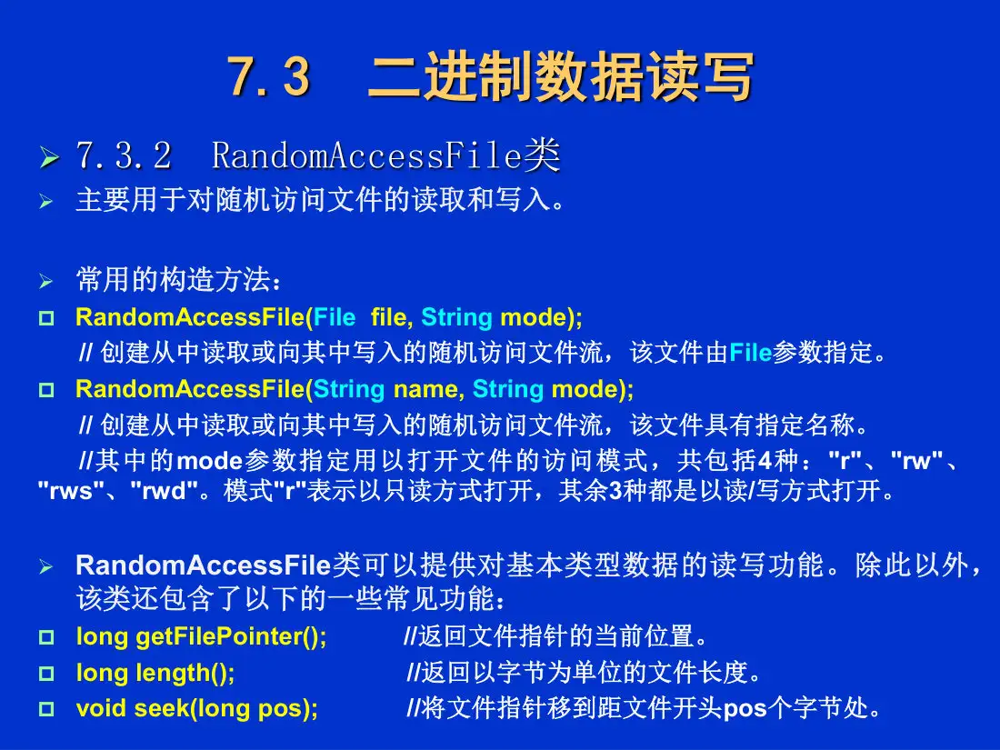

原文：

7.3 二进制数据读写

7.3.2 RandomAccessFile类主要用于对随机访问文件的读取和写入。

常用的构造方法：

 RandomAccessFile(File file, String mode);// 创建从中读取或向其中写入的随机访问文件流，该文件由File参数指定。

 RandomAccessFile(String name, String mode);

// 创建从中读取或向其中写入的随机访问文件流，该文件具有指定名称。

//其中的mode参数指定用以打开文件的访问模式，共包括4种："r"、"rw"、"rws"、"rwd"。模式"r"表示以只读方式打开，其余3种都是以读/写方式打开。

RandomAccessFile类可以提供对基本类型数据的读写功能。除此以外，该类还包含了以下的一些常见功能：

 long getFilePointer(); //返回文件指针的当前位置。

 long length();

//返回以字节为单位的文件长度。

 void seek(long pos);

//将文件指针移到距文件开头pos个字节处。

### 7.3 二进制数据读写

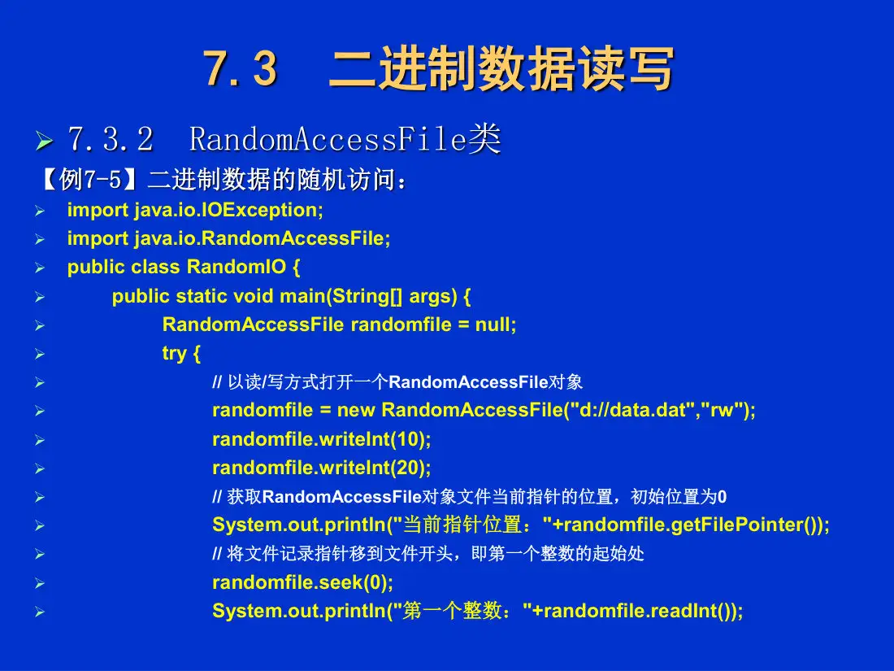

原文：

7.3 二进制数据读写

➢ 7.3.2 RandomAccessFile类

【例7-5】二进制数据的随机访问：

import java.io.IOException;

import java.io.RandomAccessFile;

public class RandomIO {

public static void main(String[] args) {

RandomAccessFile randomfile = null;

try {

// 以读/写方式打开一个RandomAccessFile对象

randomfile = new RandomAccessFile("d://data.dat","rw");

randomfile.writeInt(10);

randomfile.writeInt(20);

// 获取RandomAccessFile对象文件当前指针的位置，初始位置为0

System.out.println("当前指针位置："+randomfile.getFilePointer());

// 将文件记录指针移到文件开头，即第一个整数的起始处

randomfile.seek(0);

System.out.println("第一个整数："+randomfile.readInt());

### 7.3 二进制数据读写

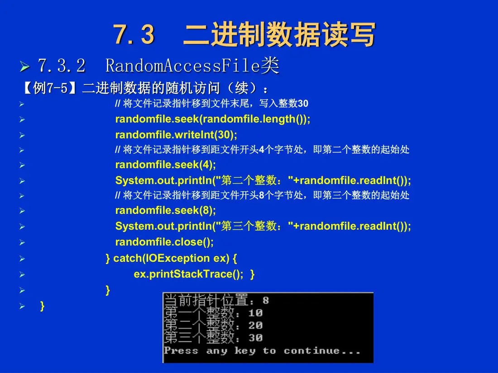

原文：

7.3 二进制数据读写

➢ 7.3.2 RandomAccessFile类

【例7-5】二进制数据的随机访问（续）：

// 将文件记录指针移到文件末尾，写入整数30

randomfile.seek(randomfile.length());

randomfile.writeInt(30);

// 将文件记录指针移到距文件开头4个字节处，即第二个整数的起始处randomfile.seek(4);

System.out.println("第二个整数："+randomfile.readInt());

// 将文件记录指针移到距文件开头8个字节处，即第三个整数的起始处randomfile.seek(8);

System.out.println("第三个整数："+randomfile.readInt());

randomfile.close();

} catch(IOException ex) {

ex.printStackTrace(); }

当前指针位置：8

第一个整教：10

第二个整数：20

第三个整数：30

Press any key to continue...

### 7.4 文本数据读写

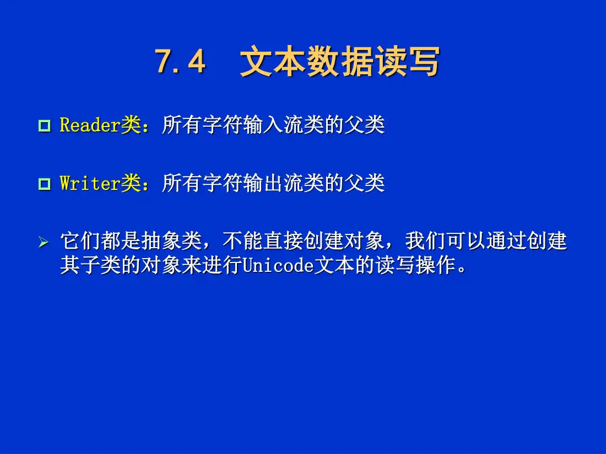

原文：

7.4 文本数据读写

 Reader类：所有字符输入流类的父类

 Writer类：所有字符输出流类的父类

它们都是抽象类，不能直接创建对象，我们可以通过创建其子类的对象来进行Unicode文本的读写操作。

### 7.4 文本数据读写

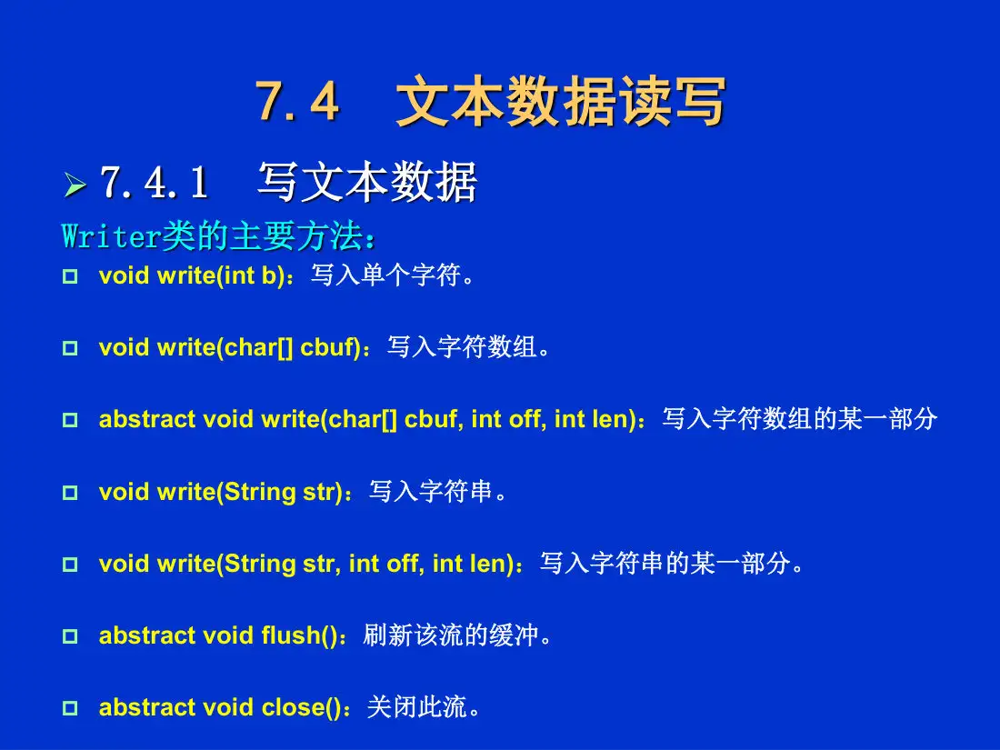

原文：

7.4 文本数据读写

7.4.1 写文本数据

Writer类的主要方法：

 void write(int b)：写入单个字符。

 void write(char[] cbuf)：写入字符数组。

 abstract void write(char[] cbuf, int off, int len)：写入字符数组的某一部分

 void write(String str)：写入字符串。

 void write(String str, int off, int len)：写入字符串的某一部分。

 abstract void flush()：刷新该流的缓冲。

 abstract void close()：关闭此流。

### 7.4 文本数据读写

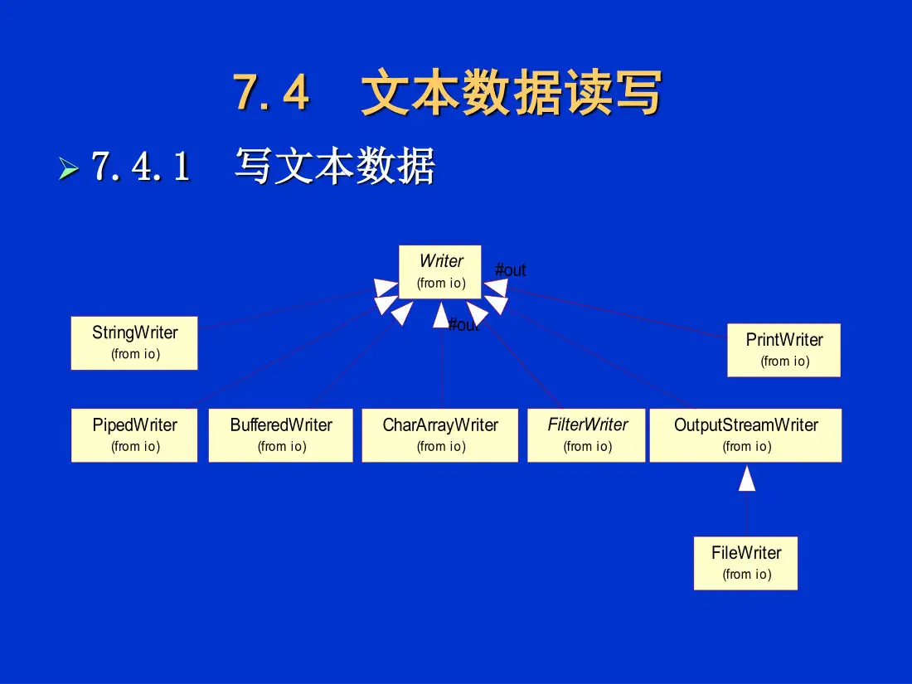

原文：

7.4 文本数据读写

7.4.1 写文本数据

### 7.4 文本数据读写

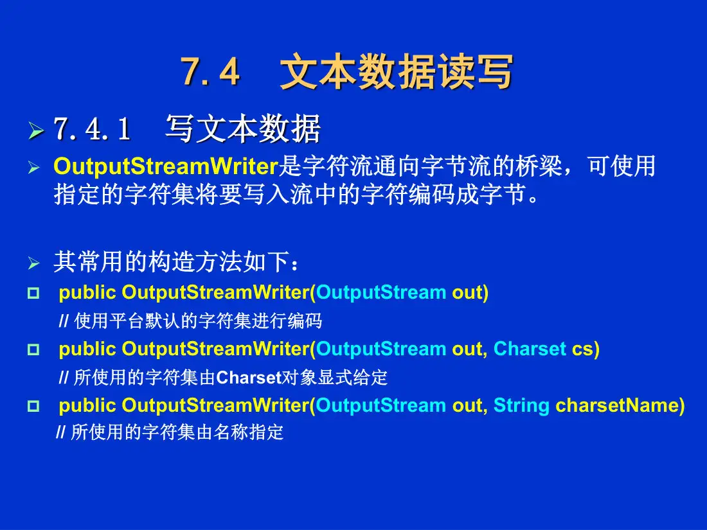

原文：

7.4 文本数据读写

➢ 7.4.1 写文本数据

➢ OutputStreamWriter是字符流通向字节流的桥梁，可使用指定的字符集将要写入流中的字符编码成字节。

其常用的构造方法如下：

 public OutputStreamWriter(OutputStream out)// 使用平台默认的字符集进行编码

 public OutputStreamWriter(OutputStream out, Charset cs)// 所使用的字符集由Charset对象显式给定

 public OutputStreamWriter(OutputStream out, String charsetName)// 所使用的字符集由名称指定

### 7.4 文本数据读写

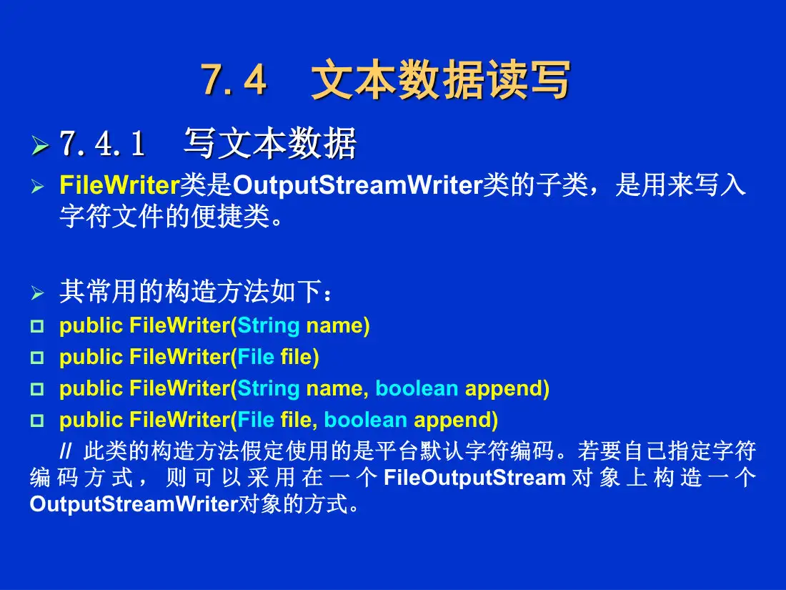

原文：

7.4 文本数据读写

7.4.1 写文本数据

➢ FileWriter类是OutputStreamWriter类的子类，是用来写入字符文件的便捷类。

其常用的构造方法如下：

 public FileWriter(String name)

 public FileWriter(File file)

 public FileWriter(String name, boolean append)

 public FileWriter(File file, boolean append)

// 此类的构造方法假定使用的是平台默认字符编码。若要自己指定字符编码方式，则可以采用在一个 FileOutputStream对象上构造一个OutputStreamWriter对象的方式。

### 7.4 文本数据读写

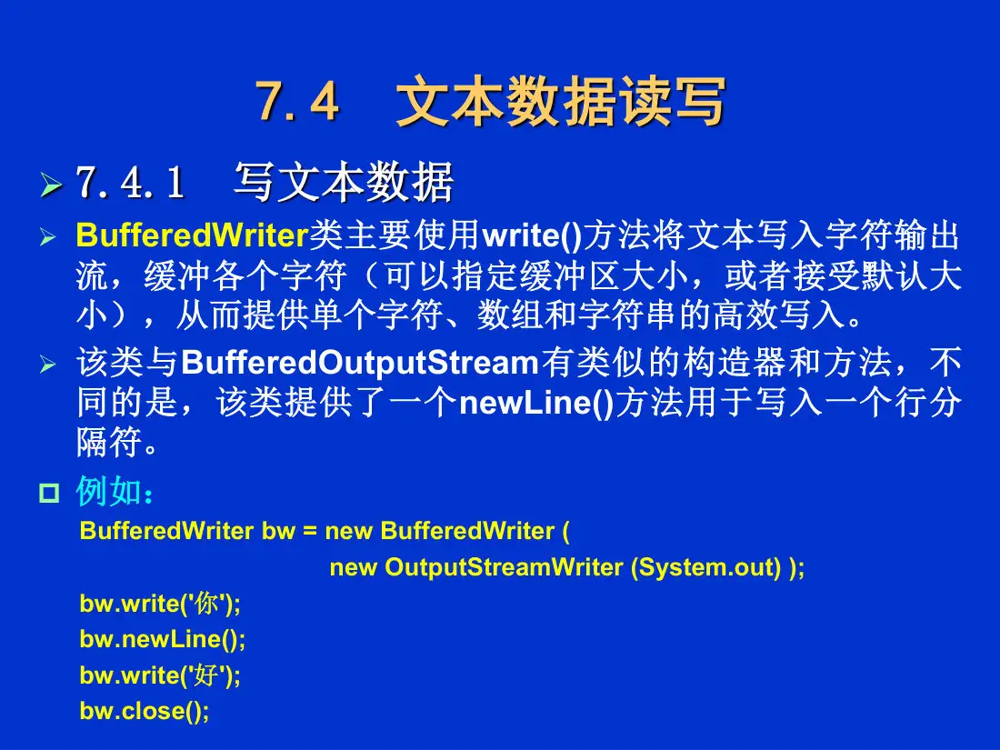

原文：

7.4 文本数据读写

➢ 7.4.1 写文本数据

BufferedWriter类主要使用write()方法将文本写入字符输出流，缓冲各个字符（可以指定缓冲区大小，或者接受默认大小），从而提供单个字符、数组和字符串的高效写入。

➢ 该类与BufferedOutputStream有类似的构造器和方法，不同的是，该类提供了一个newLine()方法用于写入一个行分隔符。

 例如： BufferedWriter bw = new BufferedWriter ( new OutputStreamWriter (System.out) );

bw.write('你');

bw.newLine();

bw.write('好');

bw.close();

### 7.4 文本数据读写

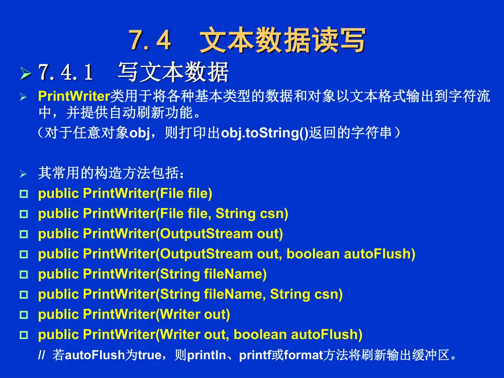

原文：

7.4 文本数据读写

7.4.1 写文本数据

PrintWriter类用于将各种基本类型的数据和对象以文本格式输出到字符流中，并提供自动刷新功能。（对于任意对象obj，则打印出obj.toString()返回的字符串）

其常用的构造方法包括：

 public PrintWriter(File file)

 public PrintWriter(File file, String csn)

 public PrintWriter(OutputStream out)

 public PrintWriter(OutputStream out, boolean autoFlush)

 public PrintWriter(String fileName)

 public PrintWriter(String fileName, String csn)

 public PrintWriter(Writer out)

 public PrintWriter(Writer out, boolean autoFlush)

// 若autoFlush为true，则println、printf或format方法将刷新输出缓冲区。

### 7.4 文本数据读写

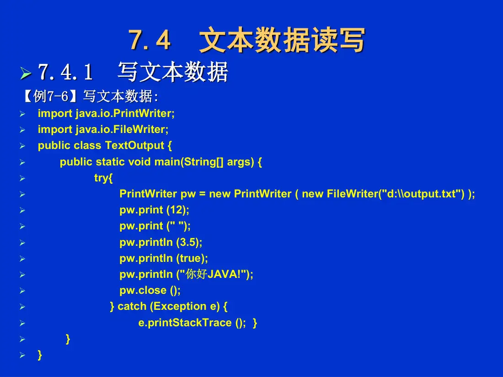

原文：

7.4 文本数据读写

➢ 7.4.1 写文本数据

【例7-6】写文本数据:

import java.io.PrintWriter;

import java.io.FileWriter;

public class TextOutput {

public static void main(String[] args) {

try{

PrintWriter pw = new PrintWriter ( new FileWriter("d:\\output.txt") );

pw.print (12);

pw.print (" ");

pw.println (3.5);

pw.println (true);

pw.println ("你好JAVA!");

pw.close ();

} catch (Exception e) {

e.printStackTrace (); }

### 7.4 文本数据读写

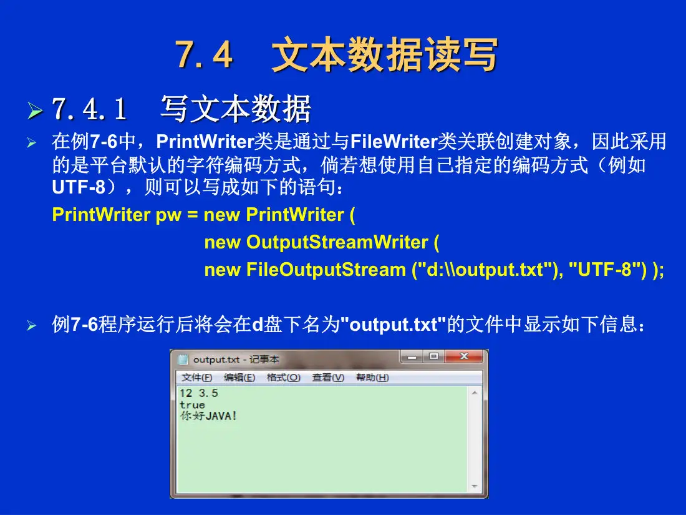

原文：

7.4 文本数据读写

➢ 7.4.1 写文本数据

在例7-6中，PrintWriter类是通过与FileWriter类关联创建对象，因此采用的是平台默认的字符编码方式，倘若想使用自己指定的编码方式（例如UTF-8），则可以写成如下的语句：

PrintWriter pw = new PrintWriter

new OutputStreamWriter (

new FileOutputStream ("d:\\output.txt"), "UTF-8") );

➢ 例7-6程序运行后将会在d盘下名为"output.txt"的文件中显示如下信息：

### 7.4 文本数据读写

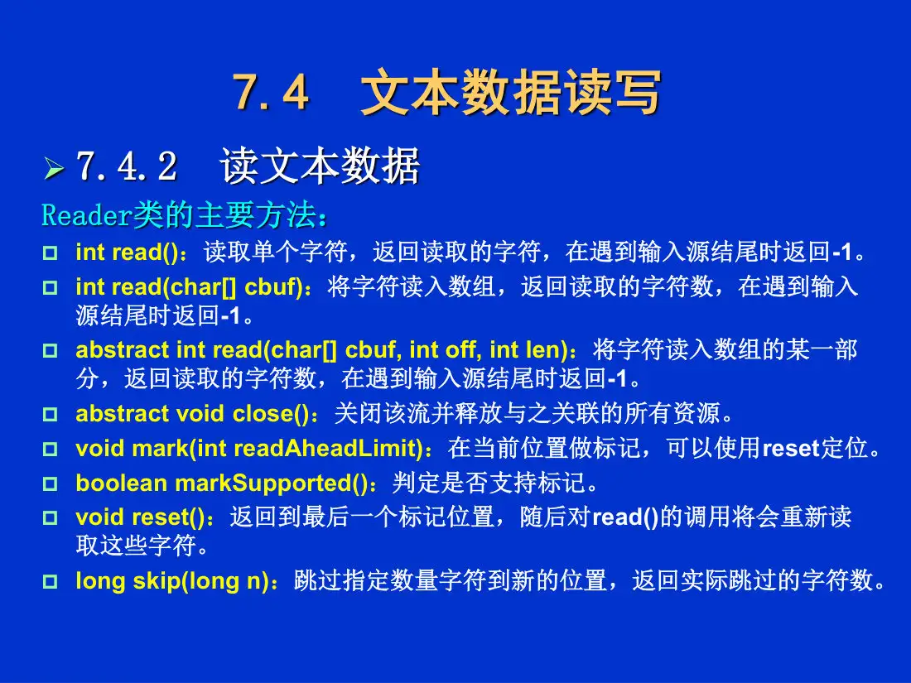

原文：

7.4 文本数据读写

7.4.2 读文本数据

Reader类的主要方法：

 int read()：读取单个字符，返回读取的字符，在遇到输入源结尾时返回-1。

 int read(char[] cbuf)：将字符读入数组，返回读取的字符数，在遇到输入源结尾时返回-1。

 abstract int read(char[] cbuf, int off, int len)：将字符读入数组的某一部分，返回读取的字符数，在遇到输入源结尾时返回-1。

 abstract void close()：关闭该流并释放与之关联的所有资源。

 void mark(int readAheadLimit)：在当前位置做标记，可以使用reset定位。

 boolean markSupported()：判定是否支持标记。

 void reset()：返回到最后一个标记位置，随后对read()的调用将会重新读取这些字符。

 long skip(long n)：跳过指定数量字符到新的位置，返回实际跳过的字符数。

### 7.4 文本数据读写

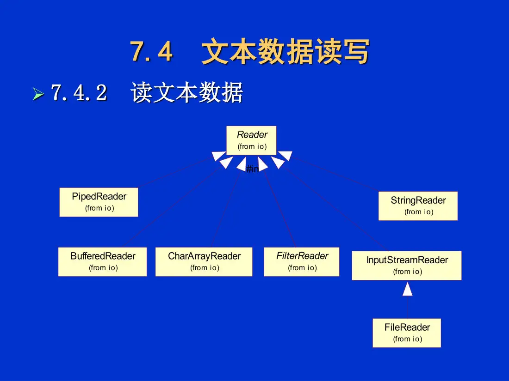

原文：

7.4 文本数据读写

7.4.2 读文本数据

### 7.4 文本数据读写

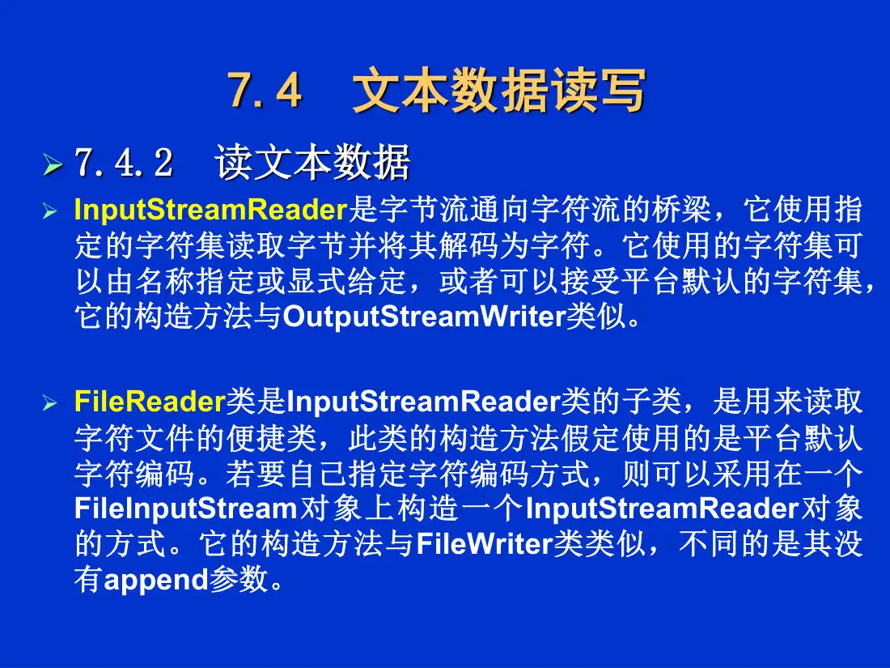

原文：

7.4 文本数据读写

➢ 7.4.2 读文本数据

InputStreamReader是字节流通向字符流的桥梁，它使用指定的字符集读取字节并将其解码为字符。它使用的字符集可以由名称指定或显式给定，或者可以接受平台默认的字符集它的构造方法与OutputStreamWriter类似。

FileReader类是InputStreamReader类的子类，是用来读取字符文件的便捷类，此类的构造方法假定使用的是平台默认字符编码。若要自己指定字符编码方式，则可以采用在一个FileInputStream对象上构造一个InputStreamReader对象的方式。它的构造方法与FileWriter类类似，不同的是其没有append参数。

### 7.4 文本数据读写

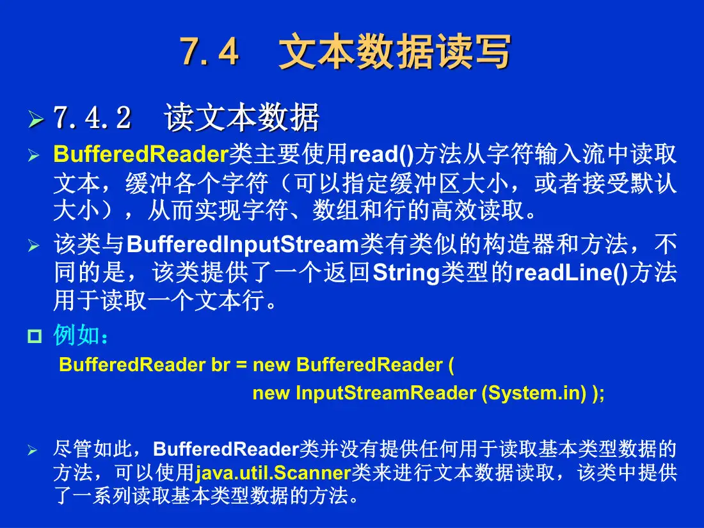

原文：

7.4 文本数据读写

➢ 7.4.2 读文本数据

BufferedReader类主要使用read()方法从字符输入流中读取文本，缓冲各个字符（可以指定缓冲区大小，或者接受默认大小），从而实现字符、数组和行的高效读取。

该类与BufferedInputStream类有类似的构造器和方法，不同的是，该类提供了一个返回String类型的readLine()方法用于读取一个文本行。

 例如： BufferedReader br = new BufferedReader ( new InputStreamReader (System.in) );

尽管如此，BufferedReader类并没有提供任何用于读取基本类型数据的方法，可以使用java.util.Scanner类来进行文本数据读取，该类中提供了一系列读取基本类型数据的方法。

### 7.4 文本数据读写

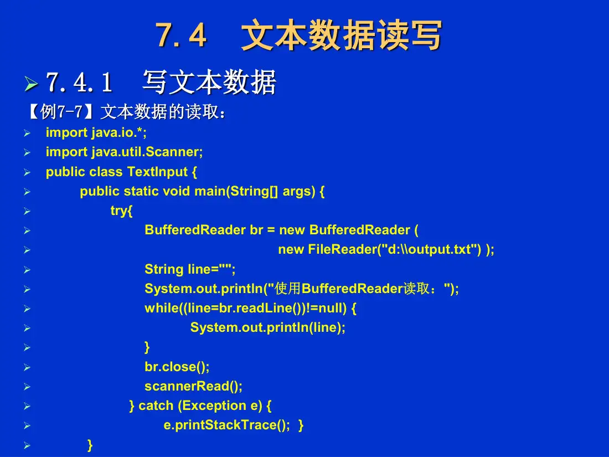

原文：

7.4 文本数据读写

7.4.1 写文本数据

【例7-7】文本数据的读取：

➢ import java.io.\*;

import java.util.Scanner;

➢ public class TextInput {

public static void main(String[] args) {

try{

BufferedReader br = new BufferedReader ( new FileReader("d:\\output.txt") );

String line="";

System.out.println("使用BufferedReader读取：");

while((line=br.readLine())!=null) {

System.out.println(line);

br.close();

scannerRead();

} catch (Exception e) {

e.printStackTrace(); }

### 7.4 文本数据读写

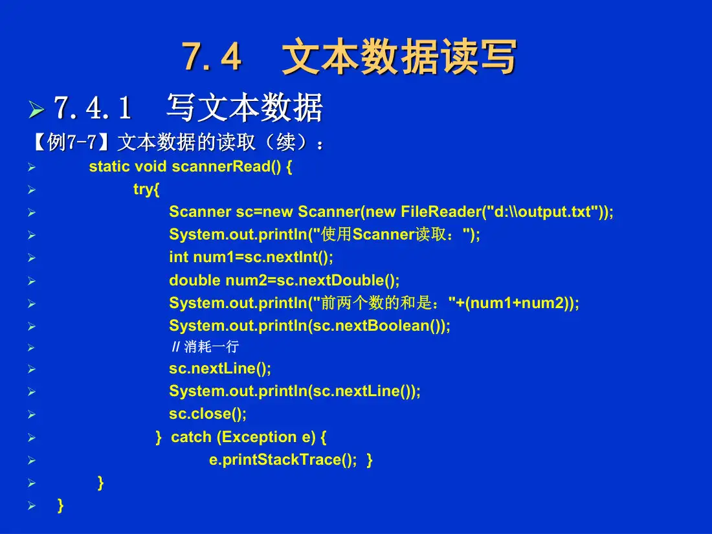

原文：

7.4 文本数据读写

7.4.1 写文本数据

【例7-7】文本数据的读取（续）：

static void scannerRead() {

try{

Scanner sc=new Scanner(new FileReader("d:\\output.txt"));

System.out.println("使用Scanner读取：");

int num1=sc.nextInt();

double num2=sc.nextDouble();

System.out.println("前两个数的和是："+(num1+num2));

System.out.println(sc.nextBoolean());

// 消耗一行

sc.nextLine();

System.out.println(sc.nextLine());

sc.close();

} catch (Exception e) {

e.printStackTrace(); }

### 7.4 文本数据读写

原文：

7.4 文本数据读写

7.4.1 写文本数据

例7-7展示了如何利用BuffedReader类和Scanner类从例7-6运行后生成的文件中读取信息。

➢ 该程序运行后将在屏幕上打印出如下结果：

12 3.5

你好JAUA!

使用scanner读卖取：

你好JAUA！

Press any key to continue...

### 7.5 ZIP文件读写

原文：

7.5 ZIP文件读写

在Java中，对ZIP文档进行读写可以使用java.util.zip包中的ZipOutputStream和ZipInputStream类

 ZipOutputStream：写ZIP文件，即把普通文件与目录文件压缩到压缩文件之中

 ZipInputStream：读ZIP文件，即解压缩

➢ 这两个类的构造方法非常简单，通常采用关联字节流的方式的创建对象。例如：

 ZipOutputStream zos = new ZipOutputStream

new FileOutputStream("d:\\data.zip"));

 ZipInputStream zis = new ZipInputStream

new FileInputStream("d:\\data.zip"));

### 7.5 ZIP文件读写

原文：

7.5 ZIP文件读写

➢ 7.5.1 写ZIP文件

对于你想写入到Zip文件中的每一个文件，都需要先为其创建一个压缩项（即ZipEntry对象，该对象可以通过将文件名传递给构造器的方式获得）。

接着，需要调用ZipOutputStream对象的putNextEntry方法将这一新的压缩项写入ZIP文件并将流定位到压缩项数据的开始处，再通过调用write方法将文件数据写入ZIP流中。

➢ 当完成一个压缩项的写入时，需要调用closeEntry方法关闭当前ZIP压缩项并定位流以写入下一个压缩项。

### 7.5 ZIP文件读写

原文：

7.5 ZIP文件读写

➢ 7.5.1 写ZIP文件

【例7-8】创建ZIP压缩文件:

import java.io.\*;

import java.util.zip.\*;

public class ZipWrite {

public static void main(String[] args) throws Exception {

// 创建压缩流

ZipOutputStream zos=new ZipOutputStream

new FileOutputStream("d:\\zipwrite.zip"));

File newfile=new File("d:\\temp");

File[] files=newfile.listFiles();

byte[] data=new byte[200];

int r=-1;

for(File tmpf : files) {

if(tmpf.isFile()) {

ZipEntry ze=new ZipEntry(tmpf.getCanonicalPath());

// 添加一个压缩项

zos.putNextEntry(ze);

### 7.5 ZIP文件读写

原文：

7.5 ZIP文件读写

➢ 7.5.1 写ZIP文件

【例7-8】创建ZIP压缩文件（续）:

FileInputStream fis=new FileInputStream(tmpf);

// 往压缩项写数据

while((r=fis.read(data))!=-1) {

zos.write(data,0,r);

fis.close();

// 关闭一个压缩项

zos.closeEntry();

// 关闭压缩流

zos.close();

 例7-8的功能是将目录"d:\\temp"下的所有普通文件进行压缩，并将压缩后得到的ZIP文件"zipwrite.zip"置于d盘根目录下。

### 7.5 ZIP文件读写

原文：

7.5 ZIP文件读写

➢ 7.5.2 读ZIP文件

调用ZipInputStream对象的getNextEntry方法可以返回一个描述压缩项信息的ZipEntry对象，并将流定位到当前压缩项数据的开始处。

➢ 再通过调用read方法从ZIP流中读取压缩项中的数据。

➢ 当完成一个压缩项的读取时，需要调用closeEntry方法关闭当前ZIP压缩项并定位流以读入下一个压缩项。

### 7.5 ZIP文件读写

原文：

7.5 ZIP文件读写

➢ 7.5.2 读ZIP文件

【例7-9】读取ZIP压缩文件:

➢ import java.io.\*;

import java.util.zip.\*;

➢ public class ZipRead {

public static void main(String[] args) throws Exception{

// 创建解压缩流

ZipInputStream zis=new ZipInputStream

new FileInputStream("d:\\zipwrite.zip"));

byte[] data=new byte[200];

int r=-1;

ZipEntry ze=null;

// 得到一个压缩项

while((ze=zis.getNextEntry())!=null) {

FileOutputStream fos=new FileOutputStream(ze.getName());

// 从压缩项读数据

while((r=zis.read(data))!=-1) {

fos.write(data,0,r);

### 7.5 ZIP文件读写

原文：

7.5 ZIP文件读写

➢ 7.5.2 读ZIP文件

【例7-9】读取ZIP压缩文件（续）:

fos.close();

// 关闭一个压缩项

zis.closeEntry();

// 关闭解压缩流

zis.close();

 例7-9的功能是将d盘下的ZIP文件"zipwrite.zip"进行解压缩，并将解压缩后得到的所有文件放置在已有的目录"d:\\temp"下。

### 7.6 对象序列化

原文：

7.6 对象序列化

对象序列化（object serialization）机制，它可以将任何对象输出到字节流中，并在之后可以将其读回。

序列化的主要目的是数据持久化，所谓持久化就是数据的物理存储，比如保存到磁盘。反序列化还得把持久化的数据恢复成原来的格式。

Java的对象要想实现序列化，必须实现java.io.Serializable接口。该接口没有任何接口方法，由JDK在底层实现。

当一个对象a被序列化时，若该对象的一个域是另一个对象b的引用并且对象b的类也实现了序列化接口，则对象b也会被序列化。

对于那些不允许被序列化或者没有必要序列化的域，可以使用transient修饰符号禁止这些域被序列化，transient类型的域在对象序列化时总是被跳过的。

对象的静态域中存储的值不会被序列化。当对象进行反序列化（deserialization）时，静态域的值会被置为类中声明的值，而非静态的transient域的值将会被置为该域的数据类型的默认值。

### 7.6 对象序列化

原文：

7.6 对象序列化

DataOutputStream (from io)

ObjectOutputStream (from io)

RandomAccessFile (from io)

DataOutput (from io)

ObjectOutput (from io)

DataInput (from io)

ObjectInput (from io)

DataInputStream (from io)

ObjectInputStream (from io)

### 7.6 对象序列化

原文：

7.6 对象序列化

使用实现了ObjectOutput接口的ObjectOutputStream类来进行对象的写操作，其基本步骤是：

 首先确定对象写往的目的地（通常目的地是文件和网络）；

 然后采用过滤方式构造ObjectOutputStream对象；

 再通过writeObject方法写对象。注意的是，需要确保被写对象实现了序列化接口。

使用实现了ObjectInput接口的ObjectInputStream类来进行对象的读操作，其基本步骤是：

 首先确定读取对象的源；

 然后使用流过滤得到ObjectInputStream对象；

 通过调用ObjectInputStream对象的readObject方法可以直接读取对象。

### 7.6 对象序列化

原文：

7.6 对象序列化

【例7-10】对象序列化的读写操作:

import java.io.\*;

➢ public class ObjectIO {

static void WriteObj() {

try {

ObjectOutputStream oos=new ObjectOutputStream( new FileOutputStream("d:\\data.dat"));

SerA obj1=new SerA(30);

oos.writeObject(obj1);

oos.close();

} catch(Exception e) {

e.printStackTrace(); }

static void ReadObj() {

try {

ObjectInputStream ois=new ObjectInputStream (

new FileInputStream("d:\\data.dat"));

SerA obj2=(SerA)ois.readObject();

obj2.display();

### 7.6 对象序列化

原文：

7.6 对象序列化

【例7-10】对象序列化的读写操作（续）:

System.out.println("The value of field is: "+obj2.getValue());

ois.close();

} catch(Exception e) {

e.printStackTrace(); }

public static void main(String[] args) {

WriteObj();

ReadObj();

class SerA implements Serializable {

private int a;

public SerA(int num) {

a=num;

public int getValue() {

return a;

### 7.6 对象序列化

原文：

7.6 对象序列化

【例7-10】对象序列化的读写操作（续）:

public void display() {

System.out.println("This is a serializable object!");

➢ 例7-10运行后将会在屏幕上打印以下结果：

This is a serializable objectt

The value of field is: 30

Press any key to continue...

### 小结

原文：

小结

抽象类InputStream和OutputStream构成了面向字节的输入/输出类层次结构的基础，字节流的读写通常由其子类实现；

抽象类Reader和Writer是所有字符流的基类，字符流的读写通常由其子类实现；

➢ File、FileInputStream和FileOutputStream是处理本地文件的类；

➢ BufferedInputStream和BufferedOutputStream类提供了数据缓冲的功能；

DataInputStream和DataOutputStream类提供了以二进制格式对基本类型数据进行读写的功能；

➢ PrintWriter类提供了以文本格式对基本类型数据进行输出的功能；

➢ ZipInputStream和ZipOutputStream类提供了对ZIP文件读写功能；

➢ ObjectInputStream和ObjectOutputStream类提供了对象序列化的功能；

➢ 通常，我们使用将多个流相关联的流过滤方式进行流对象的创建。
