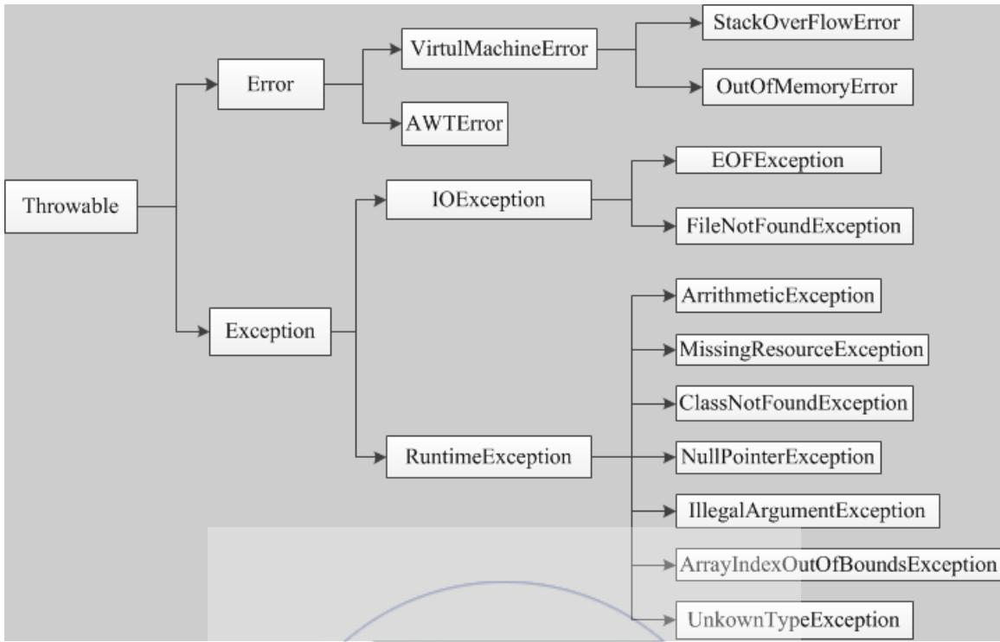

# 《Java软件开发》期末复习笔记

原件经识别和整理；“参考解答”是我们补的。

## Java 语言概述

### 简答 1：Java SE、Java EE、Java ME 指什么

Java SE（Java Standard Edition）主要用于桌面程序、控制台开发（JFC）。

Java EE（Java Enterprise Edition）用于企业级开发（JSP、EJB）。

Java ME（Java Mobile Edition）用于嵌入式开发（手机、小家电）。

知识点：[Java SE、Java EE、Java ME的区别与应用领域](../../../topics/Java开发/Java版本体系.md)

### 简答 2：Java 的优点

Java 语言在安全性、平台无关性、支持多线程、内存管理等许多方面具有卓越的优点。

知识点：[Java平台、JVM定义及编译解释执行原理](../../../topics/Java开发/Java平台与JVM.md)、[Java SE、Java EE、Java ME的区别与应用领域](../../../topics/Java开发/Java版本体系.md)

### 简答 3：基本数据类型的种类和长度

一个字节等于 8 位。

| 基本型别 | 大小 | 最小值 | 最大值 |
| --- | --- | --- | --- |
| boolean | ---- | ---- | ---- |
| char | 16-bit | Unicode 0 | Unicode $2^{16}-1$ |
| byte | 8-bit | -128 | +127 |
| short | 16-bit | $-2^{15}$ | $+2^{15}-1$ |
| int | 32-bit | $-2^{31}$ | $+2^{31}-1$ |
| long | 64-bit | $-2^{63}$ | $+2^{63}-1$ |
| float | 32-bit | IEEE754 | IEEE754 |
| double | 64-bit | IEEE754 | IEEE754 |
| void | | | |

知识点：[基本数据类型（整型、浮点型、字符型、布尔型）及Unicode编码](../../../topics/Java开发/基本数据类型.md)

### 简答 4：强制转换

在 Java 中由于继承和向上转型，子类可以非常自然地转换成父类，但是父类转换成子类则需要强制转换。因为子类拥有比父类更多的属性、更强的功能，所以父类转换为子类需要强制。那么，是不是只要是父类转换为子类就会成功呢？其实不然，他们之间的强制类型转换是有条件的。

当我们用一个类型的构造器构造出一个对象时，这个对象的类型就已经确定的，也就说它的本质是不会再发生变化了。在 Java 中我们可以通过继承、向上转型的关系使用父类类型来引用它，这个时候我们是使用功能较弱的类型引用功能较强的对象，这是可行的。但是将功能较弱的类型强制转功能较强的对象时，就不一定可以行了。

基本数据类型之间的强制类型转换：Java 规范强烈地不建议布尔型和整型或者浮点型之间进行转化，很容易出错。

知识点：[基本数据类型（整型、浮点型、字符型、布尔型）及Unicode编码](../../../topics/Java开发/基本数据类型.md)、[基本数据类型的隐式转换与强制转换规则](../../../topics/Java开发/数据类型转换.md)、[对象(Object)和类(Class)的概念、实例变量与方法](../../../topics/Java开发/对象与类的概念.md)

### 简答 5：关于 static

static 方法属于整个类，它不能操纵和处理属于某个对象的成员变量，只能处理属于整个类的成员变量，即 static 方法只能处理本类中的 static 变量或调用 static 方法。

知识点：[对象(Object)和类(Class)的概念、实例变量与方法](../../../topics/Java开发/对象与类的概念.md)、[成员变量与局部变量的作用范围、默认值及final终止变量](../../../topics/Java开发/变量的作用域与初始化.md)

### 简答 6：调用权限

public 是公共方法，在你的这个项目里面你所有的类都能访问这个方法，不加的话就是默认的 default，这个是只能在你当前包里才能调用这个方法。

1. private：Java 语言中对访问权限限制的最窄的修饰符，一般称之为“私有的”。被其修饰的属性以及方法只能被该类的对象访问，其子类不能访问，更不能允许跨包访问。
2. default：即不加任何访问修饰符，通常称为“默认访问权限”或者“包访问权限”。该模式下，只允许在同一个包中进行访问。
3. protected：介于 public 和 private 之间的一种访问修饰符，一般称之为“保护访问权限”。被其修饰的属性以及方法只能被类本身的方法及子类访问，即使子类在不同的包中也可以访问。
4. public：Java 语言中访问限制最宽的修饰符，一般称之为“公共的”。被其修饰的类、属性以及方法不仅可以跨类访问，而且允许跨包访问。

知识点：[Java标识符命名规则与保留关键字](../../../topics/Java开发/标识符与关键字.md)、[成员变量与局部变量的作用范围、默认值及final终止变量](../../../topics/Java开发/变量的作用域与初始化.md)

### 简答 7：数据初始化

不管程序有没有显示的初始化，Java 虚拟机都会先自动给它初始化为默认值。

对于数组：

1. 整数类型（byte、short、int、long）的基本类型变量的默认值为 0。
2. 单精度浮点型（float）的基本类型变量的默认值为 0.0f。
3. 双精度浮点型（double）的基本类型变量的默认值为 0.0d。
4. 字符型（char）的基本类型变量的默认为 `'/u0000'`。
5. 布尔性的基本类型变量的默认值为 false。
6. 引用类型的变量是默认值为 null。
7. 数组引用类型的变量的默认值为 null。当数组变量的实例后，如果没有显示的为每个元素赋值，Java 就会把该数组的所有元素初始化为其相应类型的默认值。

注意：对于单个数据，如果不进行初始化不能对其进行操作，编译时报错。

知识点：[成员变量与局部变量的作用范围、默认值及final终止变量](../../../topics/Java开发/变量的作用域与初始化.md)、[基本数据类型（整型、浮点型、字符型、布尔型）及Unicode编码](../../../topics/Java开发/基本数据类型.md)

### 简答 8：数组遍历的三种方法

1. for 循环

知识点：[数组的声明、初始化、访问、数组复制及数组的数组](../../../topics/Java开发/一维数组与多维数组.md)、[if-else、switch、while、do-while、for语句及break/continue/return分支控制](../../../topics/Java开发/流程控制语句.md)

### 简答 9：方法重载和重写

| 区别点 | 重载 | 重写（覆写） |
| --- | --- | --- |
| 英文 | Overloading | Overiding |
| 定义 | 方法名称相同，参数的类型或个数不同；对权限没有要求 | 方法名称、参数类型、返回值类型全部相同；被重写的方法不能拥有更严格的权限 |
| 范围 | 发生在一个类中 | 发生在继承类中 |

方法重载：所谓方法重载是指在一个类中，多个方法的方法名相同，但是参数列表不同。参数列表不同指的是参数个数、参数类型或者参数的顺序不同。

1. 在使用重载时只能通过不同的参数列表，必须具有不同的参数列表。例如，不同的参数类型，不同的参数个数，不同的参数顺序。
2. 不能通过访问权限、返回类型、抛出的异常进行重载。
3. 方法的异常类型和数目不会对重载造成影响。
4. 可以有不同的返回类型，只要参数列表不同就可以了。
5. 可以有不同的访问修饰符。

方法重写：当子类需要修改父类的一些方法进行扩展，增大功能，程序设计者常常把这样的一种操作方法称为重写，也叫称为覆写或覆盖。所谓方法的重写是指子类中的方法与父类中继承的方法有完全相同的返回值类型、方法名、参数个数以及参数类型。注意，重写方法时，可以增大父类中的方法权限，但是不能缩小父类的方法权限。当父类方法为 private，子类不能将其重写。

super 关键字可以从子类访问父类中的内容，如果要访问被重写过的方法，使用“super.方法名(参数列表)”的形式调用。

知识点：[方法的声明、调用、按值/按引用参数传递及方法的重载(Overloading)](../../../topics/Java开发/方法的定义与重载.md)、[类之间的继承、聚合、合成、依赖关系及开闭原则(OCP)](../../../topics/Java开发/类之间的关系.md)、[对象(Object)和类(Class)的概念、实例变量与方法](../../../topics/Java开发/对象与类的概念.md)

### 简答 10：异常处理

（1）Java 把异常当作对象来处理，并定义一个基类 java.lang.Throwable 作为所有异常的超类。在 Java API 中已经定义了许多异常类，这些异常类分为两大类，错误 Error 和异常 Exception。Error 和 Exception 的区别：Error 通常是灾难性的致命的错误，是程序无法控制和处理的，当出现这些异常时，Java 虚拟机（JVM）一般会选择终止线程；Exception 通常情况下是可以被程序处理的，并且在程序中应该尽可能的去处理这些异常。

（2）层次结构



（3）处理方法

Try-catch 方法

try 块：用于捕获异常。其后可接零个或多个 catch 块，如果没有 catch 块，则必须跟一个 finally 块。

catch 块：用于处理 try 捕获到的异常。

finally 块：无论是否捕获或处理异常，finally 块里的语句都会被执行。当在 try 块或 catch 块中遇到 return 语句时，finally 语句块将在方法返回之前被执行。

编写多重 catch 语句块注意顺序问题：先小后大，即先子类后父类。

throws 方法声明抛出异常，只是抛出异常，并没有去处理它。

（4）自定义异常

- 创建自定义异常类。
- 在方法中通过 throw 关键字抛出异常对象。
- 如果在当前抛出异常的方法中处理异常，可以使用 try-catch 语句捕获并处理；否则在方法的声明处通过 throws 关键字指明要抛出给方法调用者的异常，继续进行下一步操作。
- 在出现异常方法的调用者中捕获并处理异常。

知识点：[对象(Object)和类(Class)的概念、实例变量与方法](../../../topics/Java开发/对象与类的概念.md)、[Java标识符命名规则与保留关键字](../../../topics/Java开发/标识符与关键字.md)、[if-else、switch、while、do-while、for语句及break/continue/return分支控制](../../../topics/Java开发/流程控制语句.md)

### 简答 11：继承的限制

1. Java 只能显示单继承，即一个类只能有一个父类。
2. 不允许多重继承（多重继承指的是一个类可以同时从多于一个的父类那里继承行为和特征，Java 为了保证数据安全，它只允许单继承。子类只能继承一个父类，也就是说只能存在单一继承，但是却可以实现多个接口，间接实现了多重继承）。
3. 继承只能继承非私有的属性和方法。
4. 构造方法不能被继承。

构造方法：如果子类需要继承父类的含参构造函数则需要使用 super 命令（如果父类包含多个含参构造函数则依据参数使用 super 命令）。如果父类建立了构造函数且都含有参数，则子类必须使用 super 命令。

知识点：[类之间的继承、聚合、合成、依赖关系及开闭原则(OCP)](../../../topics/Java开发/类之间的关系.md)、[对象(Object)和类(Class)的概念、实例变量与方法](../../../topics/Java开发/对象与类的概念.md)、[接口(Interface)用于定义协议或行为的作用](../../../topics/Java开发/接口的基础概念.md)

### 简答 12：Object 类

Object 类存储在 java.lang 包中，是所有 Java 类（Object 类除外）的终极父类。当然，数组也继承了 Object 类。然而，接口是不继承 Object 类的。一般来说，我们所建立的类都会有如下方法：

- protected Object clone()
- boolean equals(Object obj)
- protected void finalize()
- Class<> getClass()
- int hashCode()
- void notify()
- void notifyAll()
- String toString()
- void wait()
- void wait(long timeout)
- void wait(long timeout, int nanos)

这是因为所有其他 Java 类都继承了 Object 类。

知识点：[对象(Object)和类(Class)的概念、实例变量与方法](../../../topics/Java开发/对象与类的概念.md)、[类之间的继承、聚合、合成、依赖关系及开闭原则(OCP)](../../../topics/Java开发/类之间的关系.md)

### 简答 13：抽象类

用关键字 abstract 修饰的类就是抽象类，它是所有子类的公共属性（数据）和行为方法的集合，抽象类没有具体对象，是出于组织概念的层次关系而存在的类。

用关键字 abstract 修饰的方法就是抽象方法（没有抽象变量），抽象方法只有方法头，后面跟一个分号（；），没有方法体，抽象方法的方法体可在其子类中根据子类的具体情况来实现，抽象方法只存在抽象类或接口中。

知识点：[对象(Object)和类(Class)的概念、实例变量与方法](../../../topics/Java开发/对象与类的概念.md)、[接口(Interface)用于定义协议或行为的作用](../../../topics/Java开发/接口的基础概念.md)、[类之间的继承、聚合、合成、依赖关系及开闭原则(OCP)](../../../topics/Java开发/类之间的关系.md)

### 简答 14：final 类

声明为 final 的类不能是父类，即 final 不再派生子类，final 可以用来修饰变量和方法。

final 类是处在类的最底层的类，如果没必要再派生子类，通常用 final 关键字来修饰，表明它是最终类，被 final 修饰的类通常是有固定作用、完成一定标准功能的类，例如 Java 库中的数学类 Math 等。

abstract 和 final 不能同时使用，关键字 abstract 不能修饰实例变量，也不能与 private、static、final 等同时修饰一个成员方法，并且 abstract 方法必须在 abstract 类中。关键字 static 修饰的方法只能修饰 static 成员变量，同时 static 修饰的成员变量和方法不能 this 引用。

知识点：[Java标识符命名规则与保留关键字](../../../topics/Java开发/标识符与关键字.md)、[类之间的继承、聚合、合成、依赖关系及开闭原则(OCP)](../../../topics/Java开发/类之间的关系.md)、[成员变量与局部变量的作用范围、默认值及final终止变量](../../../topics/Java开发/变量的作用域与初始化.md)

### 简答 15：接口

接口（Interface），在 Java 编程语言中是一个抽象类型，是抽象方法的集合。接口通常以 interface 来声明。一个类通过继承接口的方式，从而来继承接口的抽象方法。

如果一个类只由抽象方法和全局常量组成，那么这种情况下不会将其定义为一个抽象类。只会定义为一个接口，所以接口严格的来讲属于一个特殊的类，而这个类里面只有抽象方法和全局常量，就连构造方法也没有。

由于接口里面存在抽象方法，所以接口对象不能直接使用关键字 new 进行实例化。接口的使用原则如下：

1. 接口可以多继承，如 `interface C extends A,B{…}`，使用的是 extends。
2. 接口必须要有子类，但此时一个子类可以使用 implements 关键字实现多个接口。
3. 接口的子类（如果不是抽象类），那么必须要覆写接口中的全部抽象方法。
4. 接口的对象可以利用子类对象的向上转型进行实例化。

注意：接口中的访问权限只有一种：public，即定义接口方法和全局常量的时候就算没有写上 public，那么最终的访问权限也是 public，注意不是 default。若子类中没有用 public 修饰，则访问权限变严格了，给子类分配的是更低的访问权限。所以，在定义接口的时候强烈建议在抽象方法前加上 public。

| 参数 | 抽象类 | 接口 |
| --- | --- | --- |
| 默认的方法实现 | 它可以有默认的方法实现 | 接口完全是抽象的。它根本不存在方法的实现 |
| 实现 | 子类使用 extends 关键字来继承抽象类。如果子类不是抽象类的话，它需要提供抽象类中所有声明的方法的实现。 | 子类使用关键字 implements 来实现接口。它需要提供接口中所有声明的方法的实现 |
| 构造器 | 抽象类可以有构造器 | 接口不能有构造器 |
| 与正常 Java 类的区别 | 除了你不能实例化抽象类之外，它和普通 Java 类没有任何区别 | 接口是完全不同的类型 |
| 访问修饰符 | 抽象方法可以有 public、protected 和 default 这些修饰符 | 接口方法默认修饰符是 public。你不可以使用其它修饰符。 |
| main 方法 | 抽象方法可以有 main 方法并且我们可以运行它 | 接口没有 main 方法，因此我们不能运行它。 |
| 多继承 | 抽象方法可以继承一个类和实现多个接口 | 接口只可以继承一个或多个其它接口 |
| 速度 | 它比接口速度要快 | 接口是稍微有点慢的，因为它需要时间去寻找在类中实现的方法。 |
| 添加新方法 | 如果你往抽象类中添加新的方法，你可以给它提供默认的实现。因此你不需要改变你现在的代码。 | 如果你往接口中添加方法，那么你必须改变实现该接口的类。 |

知识点：[接口(Interface)用于定义协议或行为的作用](../../../topics/Java开发/接口的基础概念.md)、[类之间的继承、聚合、合成、依赖关系及开闭原则(OCP)](../../../topics/Java开发/类之间的关系.md)、[对象(Object)和类(Class)的概念、实例变量与方法](../../../topics/Java开发/对象与类的概念.md)

### 简答 16：塑型

塑型（type-casting）又称为类型转换方式。

将对象暂时当成更一般的对象来对待，并不改变其类型，只能被塑型为父类类型。

当一个类对象被塑型为其父类后，它提供的方法会减少。

方法的查找——总是在变量声明时所属的类中进行查找。

# 2021—2022 学年第二学期《Java 软件开发》期末复习笔记（第 2 部分）

## 一、多态与虚方法调用

知识点：[对象(Object)和类(Class)的概念、实例变量与方法](../../../topics/Java开发/对象与类的概念.md)、[类之间的继承、聚合、合成、依赖关系及开闭原则(OCP)](../../../topics/Java开发/类之间的关系.md)

### 选择 16：多态的定义与条件

题干：关于 Java 中的多态，下列说法正确的是？

- A. 多态指不同类的对象对同一消息做出相同的响应
- B. 多态存在的三个必要条件包括继承、重写以及父类引用指向子类对象
- C. 编译时多态性是指在运行时才能确定执行哪个同名方法
- D. 在继承链中，`this.show(O)` 的优先级低于 `super.show((super)O)`

答案：B。

**多态的定义**：指允许不同类的对象对同一消息做出响应。即同一消息可以根据发送对象的不同而采用多种不同的行为方式。（发送消息就是函数调用）。

**多态存在的三个必要条件**：
1. 要有继承；
2. 要有重写；
3. 父类引用指向子类对象。

**多态性的两种类型**：
1. **编译时多态性**：对于多个同名方法，如果在编译时能够确定执行同名方法中的哪一个，则称为编译时多态性。
2. **运行时多态性**：如果在编译时不能确定，只能在运行时才能确定执行多个同名方法中的哪一个，则称为运行时多态性。

**具有继承关系的多态调用优先级**：
在继承链中对象方法的调用存在一个优先级顺序：
$$ \text{this.show}(O) > \text{super.show}(O) > \text{this.show}((\text{super})O) > \text{super.show}((\text{super})O) $$

知识点：[消息(Message)的组成及其在对象通信中的作用](../../../topics/Java开发/消息传递机制.md)、[类之间的继承、聚合、合成、依赖关系及开闭原则(OCP)](../../../topics/Java开发/类之间的关系.md)、[方法的声明、调用、按值/按引用参数传递及方法的重载(Overloading)](../../../topics/Java开发/方法的定义与重载.md)

### 选择 17：虚方法调用

题干：关于 Java 虚方法的理解，以下说法错误的是？

- A. Java 里所有被 overriding 的方法都是 virtual 的
- B. 所有重写的方法都是 override 的
- C. 虚方法和抽象方法是同一个概念
- D. 虚方法允许子类重写以实现多态

答案：C。

**说明**：
- Java 虚方法你可以理解为 Java 里所有被 overriding 的方法都是 virtual 的，所有重写的方法都是 override 的。
- 虚方法和抽象方法并不是同一个概念。

## 二、I/O 流与序列化

知识点：[对象(Object)和类(Class)的概念、实例变量与方法](../../../topics/Java开发/对象与类的概念.md)、[类之间的继承、聚合、合成、依赖关系及开闭原则(OCP)](../../../topics/Java开发/类之间的关系.md)

### 简答 18：I/O 流分类与使用

题干：请简述 Java I/O 流的分类方式，并列举 JDK 提供的四大基础类及其用途。

**I/O 流的分类**：
1. **按数据流向**：输入流和输出流。
   - 输出流：从程序输出到文件。
   - 输入流：从文件输入到程序。
2. **按处理数据单位**：字节流和字符流。
   - 字节流：一次读入或读出是 8 位二进制。
   - 字符流：一次读入或读出是 16 位二进制。
3. **按实现功能**：节点流和处理流。

**JDK 提供的四大基础类**：
InputStream（字节输入流）、OutputStream（字节输出流）、Reader（字符输入流）、Writer（字符输出流）。

**常用流示例代码**：
```java
// 缓冲器流，高效
BufferedWriter out = new BufferedWriter(new FileWriter(fileName));
BufferedReader in = new BufferedReader(new FileReader(fileName));

// 数据流
DataOutputStream out = new DataOutputStream(new FileOutputStream(fileName)); // 写
DataInputStream in = new DataInputStream(new FileInputStream(fileName));     // 读

// 嵌套 BufferedInputStream 提高效率
// InputStream in = new BufferedInputStream(new FileInputStream(fileName));
```

知识点：[System.out.printf格式化输出与Scanner类输入](../../../topics/Java开发/输入输出基础.md)

### 简答 19：对象序列化

题干：简述对象序列化的基本操作及迭代遍历集合的方法。

**序列化（写对象）**：
```java
ObjectOutputStream ofs1 = new ObjectOutputStream(new FileOutputStream("file.dat"));
ofs1.writeObject(object);
```

**反序列化（从文件中读对象）**：
```java
ObjectInputStream ifs1 = new ObjectInputStream(new FileInputStream("file.dat"));
Student s = (Student) ifs1.readObject();
```

**迭代遍历**：
```java
Iterator<Student> i = students.values().iterator();
while(i.hasNext()){
    Student stu = i.next();
    // 处理学生对象
}
```

## 三、集合框架

知识点：[对象(Object)和类(Class)的概念、实例变量与方法](../../../topics/Java开发/对象与类的概念.md)、[接口(Interface)用于定义协议或行为的作用](../../../topics/Java开发/接口的基础概念.md)

### 简答 20：集合接口与实现类

题干：请说明 Collection、Set、Map 接口的特点及常见实现类。

**Collection 接口**：
- 是最基本的集合接口，List 和 Set 的父接口。
- 代表一组 Object（元素 Elements）。

**Set 接口**：
- 表示数学意义上的集合概念。
- 不包含重复元素：不存在两个元素 $e_1$ 和 $e_2$，使得 $e_1.equals(e_2)$ 为 true。

**Map 接口**：
- Key-Value 的键值对，Key 不允许重复，Value 可以重复。
- **严格来说 Map 并不是一个集合**，而是两个集合之间的映射关系。
- 每一条数据通过映射关系可看成一条 Entry (key, value)。
- Map 集合没有实现 Collection 接口，也没有实现 Iterable 接口，所以不能直接对 Map 集合进行 for-each 遍历（需遍历 entrySet 或 keySet）。

**常见实现类对照表**：

| 接口 | 实现类 | 历史集合类 |
| :--- | :--- | :--- |
| Set | HashSet | - |
| | TreeSet | - |
| List | ArrayList | Vector |
| | LinkedList | Stack |
| Map | HashMap | Hashtable |
| | TreeMap | Properties |

## 四、多线程

知识点：[类之间的继承、聚合、合成、依赖关系及开闭原则(OCP)](../../../topics/Java开发/类之间的关系.md)

### 简答 21：多线程实现与同步

题干：Java 中创建线程的两种方式是什么？如何实现线程共享数据和同步控制？

**两种实现方式**：
1. **继承 Thread 类**：新建一个继承 Thread 类的线程类，其中有一个重写的 `run` 方法。
2. **实现 Runnable 接口**：新建一个实现 Runnable 接口的类，这个类在新线程中运行。
   ```java
   Thread t = new Thread(runnableObj, "线程名");
   t.start();
   ```

**线程中的数据共享**：
只用一个 Runnable 对象为参数创建多个线程：
```java
new Thread(runnableObj, "线程名").start();
```

**线程的同步控制**：
- 锁标志 `synchronized(对象){代码段}`，可以放在 `run` 方法里，也可以放在共享的资源类中作为一个方法：
  ```java
  public synchronized void methodName() { ... }
  ```
  或者带返回类型的：`public synchronized [type] [name]() {}`

## 五、泛型与参数传递

知识点：[接口(Interface)用于定义协议或行为的作用](../../../topics/Java开发/接口的基础概念.md)、[对象(Object)和类(Class)的概念、实例变量与方法](../../../topics/Java开发/对象与类的概念.md)

### 简答 22：泛型的意义

题干：什么是泛型？使用泛型有什么优势？

**定义**：
泛型，即“参数化类型”。将类型由原来的具体的类型参数化，类似于方法中的变量参数，此时类型也定义成参数形式（类型形参），然后在使用/调用时传入具体的类型（类型实参）。

**优势**：
把类重新设计，使用泛型，强制转换的错误将被编译器捕获，而不是在运行时出错导致程序崩溃。

知识点：[接口(Interface)用于定义协议或行为的作用](../../../topics/Java开发/接口的基础概念.md)、[类之间的继承、聚合、合成、依赖关系及开闭原则(OCP)](../../../topics/Java开发/类之间的关系.md)、[Java平台、JVM定义及编译解释执行原理](../../../topics/Java开发/Java平台与JVM.md)

### 简答 23：参数传递机制

题干：Java 中的参数传递机制是怎样的？针对原始类型和引用类型分别如何操作？

**核心原则**：
Java 中只存在**值传递**。

1. **原始类型**：
   - 传过来的是参数的一个副本（值的拷贝）。
   - 在函数中改变副本的值不会改变原始的值。
   - **情况讨论**：
     - 不希望改变值：直接传递即可。
     - 希望改变值：必须将其变成引用类型（如建一个类生成两个对象使其成员变量等于原始数据），操作这两个对象即可，过程较繁杂。

2. **引用类型**：
   - 传过来的是引用参数的副本，这个副本存放的是参数的地址。
   - **情况讨论**：
     - 不希望改变其值：必须 new 一个新的对象，用该对象的引用进行操作。
     - 希望改变其值：直接传入对象的引用即可（因为修改的是地址中的内容）。
     - **注意**：如果在函数中改变了副本的地址（如 `obj = new Object()`），那么副本就指向了一个新的地址，此时传入的参数还是指向原来的地址，所以不会改变参数的值。

## 六、构造函数与继承

知识点：[方法的声明、调用、按值/按引用参数传递及方法的重载(Overloading)](../../../topics/Java开发/方法的定义与重载.md)、[对象(Object)和类(Class)的概念、实例变量与方法](../../../topics/Java开发/对象与类的概念.md)

### 简答 24：父子类构造函数规则

题干：子类能否继承或重写父类的构造函数？`super` 调用的规则是什么？

**规则说明**：
1. 父类的构造函数不能被子类继承、重写。
2. 使用 `super` 调用父类构造器的语句必须是子类构造器的**第一条语句**。
3. 如果子类构造器没有显式地调用父类的构造器，则将自动调用父类的默认（没有参数）的构造器。
4. 如果父类没有不带参数的构造器，并且在子类的构造器中又没有显式地调用父类的构造器，则 Java 编译器将报告错误。

**私有属性赋值**：
对于父类的私有化属性，在子类中只能通过调用父类的构造器对其进行赋值，不能通过父类的对象调用父类的私有化属性。这就是为什么要用 `super` 对父类私有化属性进行赋值。

知识点：[对象(Object)和类(Class)的概念、实例变量与方法](../../../topics/Java开发/对象与类的概念.md)、[类之间的继承、聚合、合成、依赖关系及开闭原则(OCP)](../../../topics/Java开发/类之间的关系.md)、[方法的声明、调用、按值/按引用参数传递及方法的重载(Overloading)](../../../topics/Java开发/方法的定义与重载.md)
