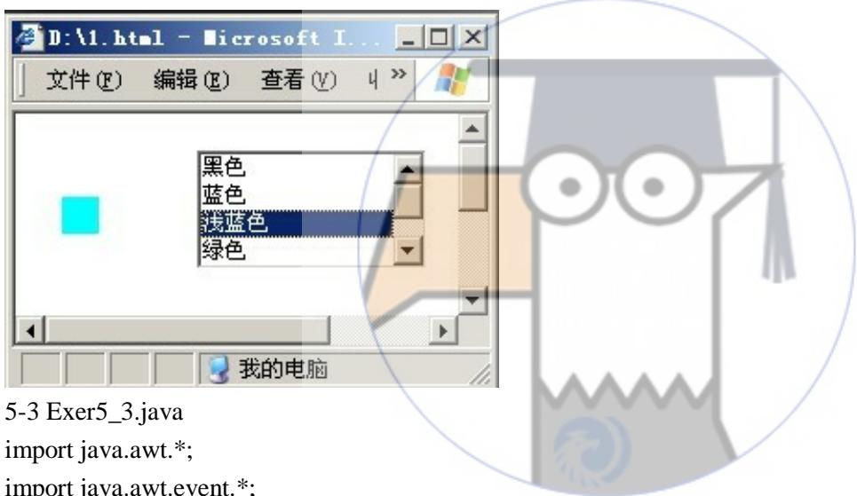
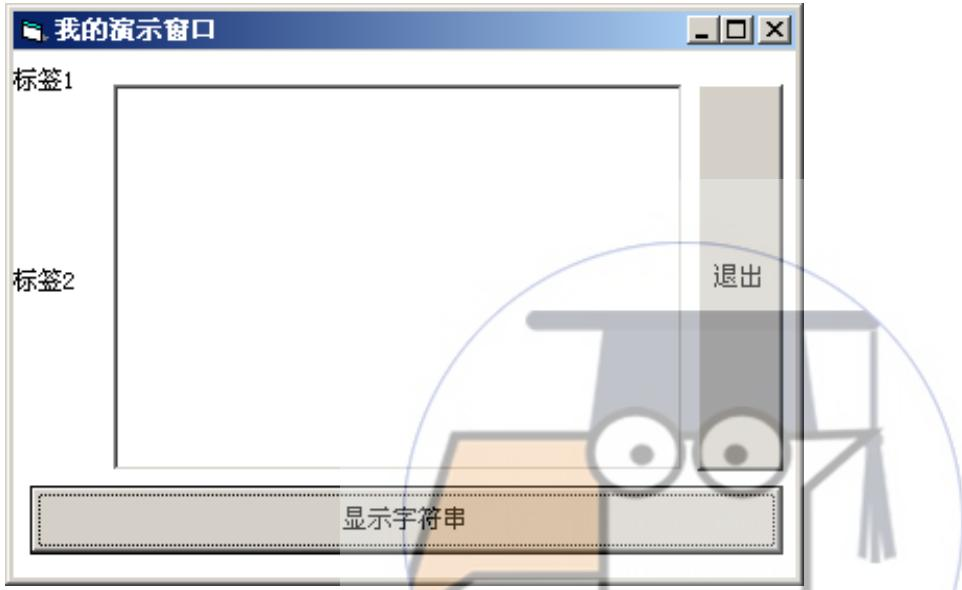

# 《Java软件开发》期末复习题全

原件经识别和整理；“参考解答”是我们补的。

### 选择 1

在下列概念中，Java 语言只保留了

- A. 运算符重载
- B. 方法重载
- C. 指针
- D. 结构和联合

答案：B。

知识点：[对象(Object)和类(Class)的概念、实例变量与方法](../../../topics/Java开发/对象与类的概念.md)

### 选择 2

下列关于 Java 语言特征的描述中，错误的是

- A. 支持多线程操作
- B. Java 程序与平台无关
- C. Java 程序可以直接访问 Internet 上的对象
- D. 支持单继承和多继承

答案：D。

知识点：[类之间的继承、聚合、合成、依赖关系及开闭原则(OCP)](../../../topics/Java开发/类之间的关系.md)、[接口(Interface)用于定义协议或行为的作用](../../../topics/Java开发/接口的基础概念.md)

### 选择 3

下列关于 Java Application 程序在结构上特点的描述中，错误的是

- A. Java 程序是由一个或多个类组成的
- B. 组成 Java 程序的若干个类可以放在一个文件中，也可以放在多个文件中
- C. Java 程序的文件名要与某个类名相同
- D. 组成 Java 程序的多个类中，有且仅有一个主类

答案：C。

知识点：[算术、关系、逻辑、位运算、移位、条件及复合赋值运算符与优先级](../../../topics/Java开发/运算符与表达式.md)、[对象(Object)和类(Class)的概念、实例变量与方法](../../../topics/Java开发/对象与类的概念.md)

### 选择 4

Java 程序经过编译后生成的文件的后缀是 。

- A. .obj
- B. .exe
- C. .class
- D. .java

答案：C。

知识点：[类之间的继承、聚合、合成、依赖关系及开闭原则(OCP)](../../../topics/Java开发/类之间的关系.md)、[对象(Object)和类(Class)的概念、实例变量与方法](../../../topics/Java开发/对象与类的概念.md)、[Java标识符命名规则与保留关键字](../../../topics/Java开发/标识符与关键字.md)

### 选择 5

下列关于运行字节码文件的命令行参数的描述中，正确的是

- A. 第一个命令行参数（紧跟命令字的参数）被存放在 args[0] 中。
- B. 第一个命令行参数被存放在 args[1] 中。
- C. 命令行的命令字被存放在 args[0] 中。
- D. 数组 args[] 的大小与命令行参数的个数无关。

答案：A。

## 判断题

知识点：[成员变量与局部变量的作用范围、默认值及final终止变量](../../../topics/Java开发/变量的作用域与初始化.md)、[对象(Object)和类(Class)的概念、实例变量与方法](../../../topics/Java开发/对象与类的概念.md)、[Java标识符命名规则与保留关键字](../../../topics/Java开发/标识符与关键字.md)

### 判断 1

Java 语言是在 C++ 语言之前问世的。（ ）

答案：错。

知识点：[Java标识符命名规则与保留关键字](../../../topics/Java开发/标识符与关键字.md)

### 判断 2

Java 语言具有较好的安全性和可移植性及与平台无关等特性。（ ）

答案：对。

知识点：[Java标识符命名规则与保留关键字](../../../topics/Java开发/标识符与关键字.md)、[第一个Java程序（源文件创建、javac编译、类定义、main方法）](../../../topics/Java开发/HelloWorld程序结构.md)

### 判断 3

Java 语言中取消了联合概念，保留了结构概念。（ ）

答案：错。

知识点：[Java标识符命名规则与保留关键字](../../../topics/Java开发/标识符与关键字.md)

### 判断 4

Java 语言中数据类型占内存字节数与平台无关。（ ）

答案：对。

知识点：[Java注释类型及javadoc文档生成工具的使用](../../../topics/Java开发/Java注释与javadoc.md)

### 判断 5

Java 语言中可用下标和指针两种方式表示数组元素。（ ）

答案：错。

知识点：[基本数据类型（整型、浮点型、字符型、布尔型）及Unicode编码](../../../topics/Java开发/基本数据类型.md)

### 判断 6

Java 语言的源程序不是编译型的，而是编译解释型的。（ ）

答案：对。

知识点：[基本数据类型（整型、浮点型、字符型、布尔型）及Unicode编码](../../../topics/Java开发/基本数据类型.md)、[数组的声明、初始化、访问、数组复制及数组的数组](../../../topics/Java开发/一维数组与多维数组.md)、[对象(Object)和类(Class)的概念、实例变量与方法](../../../topics/Java开发/对象与类的概念.md)

### 判断 7

操作系统中进程和线程两个概念是没有区别的。（ ）

答案：错。

知识点：[基本数据类型（整型、浮点型、字符型、布尔型）及Unicode编码](../../../topics/Java开发/基本数据类型.md)、[Java标识符命名规则与保留关键字](../../../topics/Java开发/标识符与关键字.md)

### 判断 8

Java 语言既是面向对象的又是面向网络的高级语言。（ ）

答案：对。

知识点：[基本数据类型的隐式转换与强制转换规则](../../../topics/Java开发/数据类型转换.md)、[基本数据类型（整型、浮点型、字符型、布尔型）及Unicode编码](../../../topics/Java开发/基本数据类型.md)、[Java平台、JVM定义及编译解释执行原理](../../../topics/Java开发/Java平台与JVM.md)

### 判断 9

Java 程序分为两大类：一类是 Application 程序，另一类是 Applet 程序。前者又称 Java 应用程序，后者又称 Java 小应用程序。（ ）

答案：对。

知识点：[基本数据类型的隐式转换与强制转换规则](../../../topics/Java开发/数据类型转换.md)

### 判断 10

Java Application 程序是由多个文件组成的，其中可以有也可以没有主文件。（ ）

答案：错。

知识点：[基本数据类型的隐式转换与强制转换规则](../../../topics/Java开发/数据类型转换.md)、[基本数据类型（整型、浮点型、字符型、布尔型）及Unicode编码](../../../topics/Java开发/基本数据类型.md)

### 判断 11

组成 Java Application 的若干类中，有且仅有一个主类，只有主类中含有主方法 main( )。（ ）

答案：对。

知识点：[基本数据类型（整型、浮点型、字符型、布尔型）及Unicode编码](../../../topics/Java开发/基本数据类型.md)

### 判断 12

Java Application 程序中，必有一个方法 main( )，该方法有没有参数都可以。（ ）

答案：对。

知识点：[基本数据类型（整型、浮点型、字符型、布尔型）及Unicode编码](../../../topics/Java开发/基本数据类型.md)、[Java平台、JVM定义及编译解释执行原理](../../../topics/Java开发/Java平台与JVM.md)

### 判断 13

Java 程序中是不区分大小写字母的。（ ）

答案：错。

知识点：[成员变量与局部变量的作用范围、默认值及final终止变量](../../../topics/Java开发/变量的作用域与初始化.md)、[Java标识符命名规则与保留关键字](../../../topics/Java开发/标识符与关键字.md)、[基本数据类型（整型、浮点型、字符型、布尔型）及Unicode编码](../../../topics/Java开发/基本数据类型.md)

### 判断 14

Java 程序编译后生成的是字节码文件，其后缀是 .exe。（ ）

答案：错。

知识点：[基本数据类型（整型、浮点型、字符型、布尔型）及Unicode编码](../../../topics/Java开发/基本数据类型.md)

### 判断 15

字节码文件机器是不能直接识别的，它要经过解释器，边解释边执行。（ ）

答案：对。

知识点：[基本数据类型（整型、浮点型、字符型、布尔型）及Unicode编码](../../../topics/Java开发/基本数据类型.md)

### 判断 16

在 Java 程序中，使用 import 语句引入类是在解释器中实现的。（ ）

答案：对。

知识点：[基本数据类型的隐式转换与强制转换规则](../../../topics/Java开发/数据类型转换.md)、[算术、关系、逻辑、位运算、移位、条件及复合赋值运算符与优先级](../../../topics/Java开发/运算符与表达式.md)

### 判断 17

在运行字节码文件时，使用 java 命令，一定要给出字节码文件的扩展名 .class 。（ ）

答案：错。

知识点：[算术、关系、逻辑、位运算、移位、条件及复合赋值运算符与优先级](../../../topics/Java开发/运算符与表达式.md)

### 判断 18

如果一个 Java 程序中有多个类，编译后只生成一个字节码文件，其名字同主类名。（ ）

答案：错。

知识点：[基本数据类型的隐式转换与强制转换规则](../../../topics/Java开发/数据类型转换.md)、[算术、关系、逻辑、位运算、移位、条件及复合赋值运算符与优先级](../../../topics/Java开发/运算符与表达式.md)

### 判断 19

Java 程序中出现的输出方法 println( ) 和 print( ) 是完全一致的。（ ）

答案：错。

知识点：[Java标识符命名规则与保留关键字](../../../topics/Java开发/标识符与关键字.md)、[算术、关系、逻辑、位运算、移位、条件及复合赋值运算符与优先级](../../../topics/Java开发/运算符与表达式.md)、[对象(Object)和类(Class)的概念、实例变量与方法](../../../topics/Java开发/对象与类的概念.md)

### 判断 20

Java 程序中出现的输出方法 println( ) 和 print( ) 是完全一致的。（ ）

答案：错。

## 选择题

知识点：[基本数据类型（整型、浮点型、字符型、布尔型）及Unicode编码](../../../topics/Java开发/基本数据类型.md)、[数组的声明、初始化、访问、数组复制及数组的数组](../../../topics/Java开发/一维数组与多维数组.md)

### 选择 1

Java 语言所用的字符集中字符是 位。

- A. 8
- B. 16
- C. 32
- D. 64

答案：B。

知识点：[对象(Object)和类(Class)的概念、实例变量与方法](../../../topics/Java开发/对象与类的概念.md)

### 选择 2

下列关于标识符的描述中，正确的是 。

- A. 标识符中可以使用下划线和美元符
- B. 标识符中可以使用连接符和 # 号符
- C. 标识符中大小写字母是无区别的
- D. 标识符可选用关键字

答案：A。

知识点：[类之间的继承、聚合、合成、依赖关系及开闭原则(OCP)](../../../topics/Java开发/类之间的关系.md)、[接口(Interface)用于定义协议或行为的作用](../../../topics/Java开发/接口的基础概念.md)

### 选择 3

Java 语言的各种分隔符中，非法的是 。

- A. 空白符
- B. 分号
- C. 逗号
- D. 问号

答案：D。

知识点：[算术、关系、逻辑、位运算、移位、条件及复合赋值运算符与优先级](../../../topics/Java开发/运算符与表达式.md)、[对象(Object)和类(Class)的概念、实例变量与方法](../../../topics/Java开发/对象与类的概念.md)

### 选择 4

下列是 Java 语言中可用的注释符，其中错误的是 。

- A. //
- B. /\*···\*/
- C. /\*\*···\*\*/
- D. /\*\*···\*/

答案：C。

知识点：[类之间的继承、聚合、合成、依赖关系及开闭原则(OCP)](../../../topics/Java开发/类之间的关系.md)、[对象(Object)和类(Class)的概念、实例变量与方法](../../../topics/Java开发/对象与类的概念.md)、[Java标识符命名规则与保留关键字](../../../topics/Java开发/标识符与关键字.md)

### 选择 5

Java 语言中字符型数据的长度是 位。

- A. 8
- B. 16
- C. 32
- D. 64

答案：B。

知识点：[成员变量与局部变量的作用范围、默认值及final终止变量](../../../topics/Java开发/变量的作用域与初始化.md)、[对象(Object)和类(Class)的概念、实例变量与方法](../../../topics/Java开发/对象与类的概念.md)、[Java标识符命名规则与保留关键字](../../../topics/Java开发/标识符与关键字.md)

### 选择 6

下列描述的两种数据类型的长度不相等的是 。

- A. 字符型和布尔型
- B. 字节型和布尔型
- C. 短整型和字符型
- D. 整型和单精度浮点型

答案：A。

知识点：[成员变量与局部变量的作用范围、默认值及final终止变量](../../../topics/Java开发/变量的作用域与初始化.md)

### 选择 7

下列是 Java 语言中的复合数据类型，其中错误的是 。

- A. 数组
- B. 接口
- C. 枚举
- D. 类

答案：C。

知识点：[方法的声明、调用、按值/按引用参数传递及方法的重载(Overloading)](../../../topics/Java开发/方法的定义与重载.md)、[对象(Object)和类(Class)的概念、实例变量与方法](../../../topics/Java开发/对象与类的概念.md)

### 选择 8

下列是关于 Java 语言中数据类型的强制转换的描述，其中错误的是 。

- A. 当数据类型从高转换为低时需要强制转换
- B. 强制转换时使用强制转换运算符，形如（<类型>）
- C. 浮点型数据强制转换为整型时，小数部分四舍五入
- D. 赋值操作中都要采用强制类型转换

答案：CD。

知识点：[对象(Object)和类(Class)的概念、实例变量与方法](../../../topics/Java开发/对象与类的概念.md)

### 选择 9

下面是关于常量的描述中，错误的是 。

- A. Java 语言的常量有 5 种
- B. 浮点型数 12.456 是单精度的
- C. 布尔型常量只有两个可选值：true 和 false
- D. 字符串常量含有结束符 '\0'

答案：BD。

知识点：[基本数据类型（整型、浮点型、字符型、布尔型）及Unicode编码](../../../topics/Java开发/基本数据类型.md)、[Java标识符命名规则与保留关键字](../../../topics/Java开发/标识符与关键字.md)

### 选择 10

下列关于定义符号常量的描述中，错误的是 。

- A. 定义符号常量是用关键字 const
- B. 定义符号常量时要赋初值
- C. 符号常量既可定义为类成员，又可在方法中定义
- D. 定义符号常量时必须给出数据类型

答案：A。

知识点：[Java标识符命名规则与保留关键字](../../../topics/Java开发/标识符与关键字.md)、[成员变量与局部变量的作用范围、默认值及final终止变量](../../../topics/Java开发/变量的作用域与初始化.md)

### 选择 11

下列关于变量的默认值的描述，其中错误的是 。

- A. 定义变量而没有进行初始化时，该变量具有默认值
- B. 字符型变量的默认值为换行符
- C. 布尔型变量的默认值为 true
- D. 变量的默认值是可以被改变的

答案：BC。

知识点：[成员变量与局部变量的作用范围、默认值及final终止变量](../../../topics/Java开发/变量的作用域与初始化.md)、[基本数据类型（整型、浮点型、字符型、布尔型）及Unicode编码](../../../topics/Java开发/基本数据类型.md)

### 选择 12

下列关于变量定义的描述中，正确的是 。

- A. 定义变量时至少应指出变量名字和类型
- B. 定义变量时没有给出初值，该变量可能是无意义值
- C. 定义变量时，同一个类型多个变量间可用逗号分隔
- D. 定义变量时必须要给变量初始化

答案：AC。

知识点：[成员变量与局部变量的作用范围、默认值及final终止变量](../../../topics/Java开发/变量的作用域与初始化.md)、[Java标识符命名规则与保留关键字](../../../topics/Java开发/标识符与关键字.md)、[基本数据类型（整型、浮点型、字符型、布尔型）及Unicode编码](../../../topics/Java开发/基本数据类型.md)

### 选择 13

下列关于变量作用域的描述，错误的是 。

- A. 在某个作用域定义的变量，仅在该作用域内是可见的，而在该作用域外是不可见的
- B. 在类中定义的变量的作用域在该类中的方法内可以使用
- C. 在方法中定义的变量的作用域仅在该方法体内
- D. 在方法中作用域可嵌套，在嵌套的作用域中可以定义同名变量

答案：D。

知识点：[成员变量与局部变量的作用范围、默认值及final终止变量](../../../topics/Java开发/变量的作用域与初始化.md)

### 选择 14

下列关于增 1（++）减 1（--）运算符的描述中，正确的是 。

- A. 增 1 减 1 运算符都是单目运算符
- B. 增 1 减 1 运算符都具有前缀运算和后缀运算
- C. 增 1 减 1 运算符不会改变变量的值
- D. 增 1 减 1 运算符前缀运算和后缀运算后表达式值是相同的

答案：AB。

知识点：[算术、关系、逻辑、位运算、移位、条件及复合赋值运算符与优先级](../../../topics/Java开发/运算符与表达式.md)、[基本数据类型（整型、浮点型、字符型、布尔型）及Unicode编码](../../../topics/Java开发/基本数据类型.md)、[成员变量与局部变量的作用范围、默认值及final终止变量](../../../topics/Java开发/变量的作用域与初始化.md)

### 选择 15

下列关于运算符优先级的描述中，错误的是 。

- A. 在表达式中，优先级高的运算符先进行计算
- B. 赋值运算符优先级最低
- C. 单目运算符优先级高于双目和三目运算符
- D. 逻辑运算符优先级高于逻辑位运算符

答案：D。

知识点：[算术、关系、逻辑、位运算、移位、条件及复合赋值运算符与优先级](../../../topics/Java开发/运算符与表达式.md)

### 选择 16

下列关于表达式的描述中，正确的是 。

- A. 任何表达式都有确定的值和类型
- B. 算术表达式的类型由第一个操作数的类型决定
- C. 逻辑表达式的操作数是逻辑型的
- D. 赋值表达式的类型取决于右值表达式的类型

答案：AC。

知识点：[算术、关系、逻辑、位运算、移位、条件及复合赋值运算符与优先级](../../../topics/Java开发/运算符与表达式.md)、[基本数据类型（整型、浮点型、字符型、布尔型）及Unicode编码](../../../topics/Java开发/基本数据类型.md)

### 选择 17

下列表达式中，非法的是 。

```java
int a=5,b=6; double c=1.1,d=2.2;
```

- A. a+c+++d
- B. (a+c)--
- C. c<<b
- D. a!=b?c:d

答案：B。

知识点：[算术、关系、逻辑、位运算、移位、条件及复合赋值运算符与优先级](../../../topics/Java开发/运算符与表达式.md)、[基本数据类型（整型、浮点型、字符型、布尔型）及Unicode编码](../../../topics/Java开发/基本数据类型.md)、[基本数据类型的隐式转换与强制转换规则](../../../topics/Java开发/数据类型转换.md)

### 选择 18

下列关于条件语句的描述中，错误的是 。

- A. if 语句可以有多个 else 子句和 else if 子句
- B. if 语句中可以没有 else 子句和 else if 子句
- C. if 语句中的<条件>可以使用任何表达式
- D. if 语句的 if 体、else 体内可以有循环语句

答案：AC。

知识点：[if-else、switch、while、do-while、for语句及break/continue/return分支控制](../../../topics/Java开发/流程控制语句.md)

### 选择 19

下列关于开关语句的描述中，错误的是 。

- A. 开关语句中，default 子句可以省略
- B. 开关语句中，case 子句的<语句序列>中一定含有 break 语句
- C. 开关语句中，case 子句和 default 子句都可以有多个
- D. 退出开关语句的唯一条件是执行 break 语句

答案：BCD。

知识点：[if-else、switch、while、do-while、for语句及break/continue/return分支控制](../../../topics/Java开发/流程控制语句.md)、[算术、关系、逻辑、位运算、移位、条件及复合赋值运算符与优先级](../../../topics/Java开发/运算符与表达式.md)、[基本数据类型（整型、浮点型、字符型、布尔型）及Unicode编码](../../../topics/Java开发/基本数据类型.md)

### 选择 20

下列关于循环语句的描述中，错误的是 。

- A. 任何一种循环体内都可以包含一种循环语句
- B. 循环体可以是空语句，也可以是空
- C. 循环体内可以出现多个 break 语句
- D. 循环语句中，循环体至少被执行一次

答案：BD。

知识点：[if-else、switch、while、do-while、for语句及break/continue/return分支控制](../../../topics/Java开发/流程控制语句.md)

### 选择 21

下列循环语句的循环次数是 。

```java
int i=5;
do{
    System.out.println(i--);
    i--;
}while(i!=0);
```

- A. 0
- B. 1
- C. 5
- D. 无限

答案：D。

知识点：[if-else、switch、while、do-while、for语句及break/continue/return分支控制](../../../topics/Java开发/流程控制语句.md)

### 选择 22

下列循环语句中，循环体被执行的次数为 。

```java
for(int i=0,j=0;(j!=18)||(i<4);i++);
```

- A. 3
- B. 4
- C. 不确定
- D. 无限

答案：D。

知识点：[if-else、switch、while、do-while、for语句及break/continue/return分支控制](../../../topics/Java开发/流程控制语句.md)

### 选择 23

下列关于 Java 语言的数组描述中，错误的是 。

- A. 数组的长度通常用 length
- B. 数组下标从 0 开始
- C. 数组元素是按顺序存放在内存的
- D. 数组在赋初值和赋值时都不判越界

答案：D。

知识点：[数组的声明、初始化、访问、数组复制及数组的数组](../../../topics/Java开发/一维数组与多维数组.md)、[算术、关系、逻辑、位运算、移位、条件及复合赋值运算符与优先级](../../../topics/Java开发/运算符与表达式.md)

### 选择 24

下列关于数组的定义形式，错误的是 。

- A. int[] a; a=new int;
- B. char b[]; b=new char[80];
- C. int[] c=new char[10];
- D. int[] d[3]=new int[2][];

答案：ACD。

## 判断题

知识点：[数组的声明、初始化、访问、数组复制及数组的数组](../../../topics/Java开发/一维数组与多维数组.md)、[基本数据类型（整型、浮点型、字符型、布尔型）及Unicode编码](../../../topics/Java开发/基本数据类型.md)

### 判断 1

Java 语言标识符中可以使用美元符。（ ）

答案：对。

知识点：[Java标识符命名规则与保留关键字](../../../topics/Java开发/标识符与关键字.md)

### 判断 2

Java 语言标识符中大小写字母是没有区别的。（ ）

答案：错。

知识点：[Java标识符命名规则与保留关键字](../../../topics/Java开发/标识符与关键字.md)、[第一个Java程序（源文件创建、javac编译、类定义、main方法）](../../../topics/Java开发/HelloWorld程序结构.md)

### 判断 3

分号（；）、逗号（，）和冒号（：）都可作为 Java 语言中的分隔符。（ ）

答案：对。

知识点：[Java标识符命名规则与保留关键字](../../../topics/Java开发/标识符与关键字.md)

### 判断 4

文档注释符 /\*\*···\*/ 是 Java 语言特有的注释符。（ ）

答案：对。

知识点：[Java注释类型及javadoc文档生成工具的使用](../../../topics/Java开发/Java注释与javadoc.md)

### 判断 5

Java 语言的基础数据类型有 4 种：整型、浮点型、字符型和布尔型。（ ）

答案：对。

知识点：[基本数据类型（整型、浮点型、字符型、布尔型）及Unicode编码](../../../topics/Java开发/基本数据类型.md)

### 判断 6

Java 语言的复合数据类型有 3 种：数组、类和包。（ ）

答案：错。

知识点：[基本数据类型（整型、浮点型、字符型、布尔型）及Unicode编码](../../../topics/Java开发/基本数据类型.md)、[数组的声明、初始化、访问、数组复制及数组的数组](../../../topics/Java开发/一维数组与多维数组.md)、[对象(Object)和类(Class)的概念、实例变量与方法](../../../topics/Java开发/对象与类的概念.md)

### 判断 7

Java 语言中，字节型与字符型是一样的。（ ）

答案：错。

知识点：[基本数据类型（整型、浮点型、字符型、布尔型）及Unicode编码](../../../topics/Java开发/基本数据类型.md)、[Java标识符命名规则与保留关键字](../../../topics/Java开发/标识符与关键字.md)

### 判断 8

Java 语言是一种强类型语言，数据类型转换有两种：隐含转换和强制转换。（ ）

答案：对。

知识点：[基本数据类型的隐式转换与强制转换规则](../../../topics/Java开发/数据类型转换.md)、[基本数据类型（整型、浮点型、字符型、布尔型）及Unicode编码](../../../topics/Java开发/基本数据类型.md)、[Java平台、JVM定义及编译解释执行原理](../../../topics/Java开发/Java平台与JVM.md)

### 判断 9

数据由高类型转换到低类型时，采用强制转换，数据精度要受到损失。（ ）

答案：对。

知识点：[基本数据类型的隐式转换与强制转换规则](../../../topics/Java开发/数据类型转换.md)

### 判断 10

布尔型常量可以自动转换为短整型变量。（ ）

答案：错。

知识点：[基本数据类型的隐式转换与强制转换规则](../../../topics/Java开发/数据类型转换.md)、[基本数据类型（整型、浮点型、字符型、布尔型）及Unicode编码](../../../topics/Java开发/基本数据类型.md)

### 判断 11

Java 语言使用的是 Unicode 字符集，每个字符在内存中占 8 位。（ ）

答案：错。

知识点：[基本数据类型（整型、浮点型、字符型、布尔型）及Unicode编码](../../../topics/Java开发/基本数据类型.md)

### 判断 12

Java 语言的字符中都不隐含结束符。（ ）

答案：对。

知识点：[基本数据类型（整型、浮点型、字符型、布尔型）及Unicode编码](../../../topics/Java开发/基本数据类型.md)、[Java平台、JVM定义及编译解释执行原理](../../../topics/Java开发/Java平台与JVM.md)

### 判断 13

Java 语言中定义符号常量使用 final 关键字。（ ）

答案：对。

知识点：[成员变量与局部变量的作用范围、默认值及final终止变量](../../../topics/Java开发/变量的作用域与初始化.md)、[Java标识符命名规则与保留关键字](../../../topics/Java开发/标识符与关键字.md)、[基本数据类型（整型、浮点型、字符型、布尔型）及Unicode编码](../../../topics/Java开发/基本数据类型.md)

### 判断 14

Java 语言中不同数据类型的长度是固定的，不随机器硬件不同而改变。（ ）

答案：对。

知识点：[基本数据类型（整型、浮点型、字符型、布尔型）及Unicode编码](../../../topics/Java开发/基本数据类型.md)

### 判断 15

Java 语言中只有无符号的字符型。（ ）

答案：对。

知识点：[基本数据类型（整型、浮点型、字符型、布尔型）及Unicode编码](../../../topics/Java开发/基本数据类型.md)

### 判断 16

赋值运算符组成的赋值表达式中，通常将右边的表达式的类型转换为左边变量的类型后再赋值。（ ）

答案：对。

知识点：[基本数据类型的隐式转换与强制转换规则](../../../topics/Java开发/数据类型转换.md)、[算术、关系、逻辑、位运算、移位、条件及复合赋值运算符与优先级](../../../topics/Java开发/运算符与表达式.md)

### 判断 17

三目运算符的 3 个操作数中，第一个操作数的类型必须是逻辑型的。（ ）

答案：对。

知识点：[算术、关系、逻辑、位运算、移位、条件及复合赋值运算符与优先级](../../../topics/Java开发/运算符与表达式.md)

### 判断 18

强制类型转换运算符的功能是将一个表达式的类型转换为所指定的类型。（ ）

答案：对。

知识点：[基本数据类型的隐式转换与强制转换规则](../../../topics/Java开发/数据类型转换.md)、[算术、关系、逻辑、位运算、移位、条件及复合赋值运算符与优先级](../../../topics/Java开发/运算符与表达式.md)

### 判断 19

对象运算符 instanceof 是一个单目运算符，其表达式的值是类的对象。（ ）

答案：错。

知识点：[Java标识符命名规则与保留关键字](../../../topics/Java开发/标识符与关键字.md)、[算术、关系、逻辑、位运算、移位、条件及复合赋值运算符与优先级](../../../topics/Java开发/运算符与表达式.md)、[对象(Object)和类(Class)的概念、实例变量与方法](../../../topics/Java开发/对象与类的概念.md)

### 判断 20

内存分配运算符 new 可以为创建的数组分配内存空间，但不能为创建的变量分配空间。（ ）

答案：错。

知识点：[基本数据类型（整型、浮点型、字符型、布尔型）及Unicode编码](../../../topics/Java开发/基本数据类型.md)、[数组的声明、初始化、访问、数组复制及数组的数组](../../../topics/Java开发/一维数组与多维数组.md)

### 判断 21

运算符的优先级中，最低的是三目运算符。（ ）

答案：错。

知识点：[算术、关系、逻辑、位运算、移位、条件及复合赋值运算符与优先级](../../../topics/Java开发/运算符与表达式.md)

### 判断 22

运算符的结合性中，除了三目运算符是自右向左。（ ）

答案：错。

知识点：[算术、关系、逻辑、位运算、移位、条件及复合赋值运算符与优先级](../../../topics/Java开发/运算符与表达式.md)

### 判断 23

关系表达式和逻辑表达式的值都是布尔型的。（ ）

答案：对。

知识点：[算术、关系、逻辑、位运算、移位、条件及复合赋值运算符与优先级](../../../topics/Java开发/运算符与表达式.md)、[基本数据类型（整型、浮点型、字符型、布尔型）及Unicode编码](../../../topics/Java开发/基本数据类型.md)、[if-else、switch、while、do-while、for语句及break/continue/return分支控制](../../../topics/Java开发/流程控制语句.md)

### 判断 24

条件语句的嵌套结构中，一个 if 子句最多有一个 else 子句与它配对，而且一定是距离它最近的。（ ）

答案：对。

知识点：[if-else、switch、while、do-while、for语句及break/continue/return分支控制](../../../topics/Java开发/流程控制语句.md)、[Java标识符命名规则与保留关键字](../../../topics/Java开发/标识符与关键字.md)

### 判断 25

开关语句中，case 子句后面的<语句序列>可以是块语句。（ ）

答案：对。

知识点：[if-else、switch、while、do-while、for语句及break/continue/return分支控制](../../../topics/Java开发/流程控制语句.md)

### 判断 26

循环语句中，<条件>表达式必须是逻辑型表达式。（ ）

答案：对。

知识点：[if-else、switch、while、do-while、for语句及break/continue/return分支控制](../../../topics/Java开发/流程控制语句.md)、[基本数据类型（整型、浮点型、字符型、布尔型）及Unicode编码](../../../topics/Java开发/基本数据类型.md)

### 判断 27

在 Java 语言中，break 语句不能作用在<标号名>的左边。（ ）

答案：错。

知识点：[if-else、switch、while、do-while、for语句及break/continue/return分支控制](../../../topics/Java开发/流程控制语句.md)

### 判断 28

Java 语言中，数组在静态和动态赋值时都判越界。（ ）

答案：对。

知识点：[数组的声明、初始化、访问、数组复制及数组的数组](../../../topics/Java开发/一维数组与多维数组.md)、[Java平台、JVM定义及编译解释执行原理](../../../topics/Java开发/Java平台与JVM.md)、[基本数据类型（整型、浮点型、字符型、布尔型）及Unicode编码](../../../topics/Java开发/基本数据类型.md)

### 判断 29

说明或声明数组时不分配内存大小，创建数组时分配内存大小。（ ）

答案：对。

知识点：[数组的声明、初始化、访问、数组复制及数组的数组](../../../topics/Java开发/一维数组与多维数组.md)、[基本数据类型（整型、浮点型、字符型、布尔型）及Unicode编码](../../../topics/Java开发/基本数据类型.md)、[成员变量与局部变量的作用范围、默认值及final终止变量](../../../topics/Java开发/变量的作用域与初始化.md)

### 判断 30

基本数据类型的数组在创建时系统将指定默认值。（ ）

答案：对。

知识点：[基本数据类型（整型、浮点型、字符型、布尔型）及Unicode编码](../../../topics/Java开发/基本数据类型.md)、[数组的声明、初始化、访问、数组复制及数组的数组](../../../topics/Java开发/一维数组与多维数组.md)

### 判断 31

数组在定义时可以进行初始化，使用初始值表。（ ）

答案：对。

知识点：[数组的声明、初始化、访问、数组复制及数组的数组](../../../topics/Java开发/一维数组与多维数组.md)

### 判断 32

Java 语言中数组元素只有下标表示，没有指针表示。（ ）

答案：对。

知识点：[数组的声明、初始化、访问、数组复制及数组的数组](../../../topics/Java开发/一维数组与多维数组.md)

### 判断 33

创建数组时，系统自动将数组元素个数存放在 length 变量中，可供用户对数组操作时使用。（ ）

答案：对。

知识点：[数组的声明、初始化、访问、数组复制及数组的数组](../../../topics/Java开发/一维数组与多维数组.md)

### 判断 34

字符串可分为字符串常量和字符串变量两种，它们都是对象。（ ）

答案：对。

知识点：[对象(Object)和类(Class)的概念、实例变量与方法](../../../topics/Java开发/对象与类的概念.md)、[基本数据类型（整型、浮点型、字符型、布尔型）及Unicode编码](../../../topics/Java开发/基本数据类型.md)

### 判断 35

Java 语言中不使用字符数组存放字符串。（ ）

答案：对。

知识点：[基本数据类型（整型、浮点型、字符型、布尔型）及Unicode编码](../../../topics/Java开发/基本数据类型.md)、[Java平台、JVM定义及编译解释执行原理](../../../topics/Java开发/Java平台与JVM.md)

### 判断 36

下列创建字符串 s 的方法是错误的。（ ）

```java
char ch[]={'m','m','n','n'};
char s[]=new char(ch);
```

答案：对。

## 选择题

知识点：[数组的声明、初始化、访问、数组复制及数组的数组](../../../topics/Java开发/一维数组与多维数组.md)、[基本数据类型（整型、浮点型、字符型、布尔型）及Unicode编码](../../../topics/Java开发/基本数据类型.md)

### 选择 1

下列对封装性的描述中，错误的是

- A. 封装体包含了属性和行为
- B. 封装体中的属性和行为的访问权限是相同的
- C. 被封装的某些信息在封装体外是不可见的
- D. 封装使得抽象的数据类型提高了可重用性

答案：B。

知识点：[对象(Object)和类(Class)的概念、实例变量与方法](../../../topics/Java开发/对象与类的概念.md)

### 选择 2

下列关于继承性的描述中，错误的是 。

- A. 一个类可以同时生成多个子类
- B. 子类继承了父类的所有成员
- C. Java 语言支持单重继承和多重继承
- D. Java 语言通过接口可使子类使用多个父类的成员

答案：C。

知识点：[类之间的继承、聚合、合成、依赖关系及开闭原则(OCP)](../../../topics/Java开发/类之间的关系.md)、[接口(Interface)用于定义协议或行为的作用](../../../topics/Java开发/接口的基础概念.md)

### 选择 3

下列对多态性的描述中，错误的是 。

- A. Java 语言允许运算符重载
- B. Java 语言允许方法重载
- C. Java 语言允许变量覆盖
- D. 多态性提高了程序的抽象性和简洁性

答案：A。

知识点：[算术、关系、逻辑、位运算、移位、条件及复合赋值运算符与优先级](../../../topics/Java开发/运算符与表达式.md)、[对象(Object)和类(Class)的概念、实例变量与方法](../../../topics/Java开发/对象与类的概念.md)

### 选择 4

在类的修饰符中，规定只能被同一包类所使用的修饰符是

- A. public
- B. 默认
- C. final
- D. abstract

答案：B。

知识点：[类之间的继承、聚合、合成、依赖关系及开闭原则(OCP)](../../../topics/Java开发/类之间的关系.md)、[对象(Object)和类(Class)的概念、实例变量与方法](../../../topics/Java开发/对象与类的概念.md)、[Java标识符命名规则与保留关键字](../../../topics/Java开发/标识符与关键字.md)

### 选择 5

在成员变量的修饰符中，规定只允许该类自身访问的修饰符是 。

- A. private
- B. public
- C. 默认
- D. protected

答案：A。

知识点：[成员变量与局部变量的作用范围、默认值及final终止变量](../../../topics/Java开发/变量的作用域与初始化.md)、[对象(Object)和类(Class)的概念、实例变量与方法](../../../topics/Java开发/对象与类的概念.md)、[Java标识符命名规则与保留关键字](../../../topics/Java开发/标识符与关键字.md)

### 选择 6

在成员方法的访问控制修饰符中，规定访问权限包含该类自身、同包的其他类和其他包的该类子类的修饰符是 。

- A. public
- B. private
- C. 默认
- D. protected

答案：D。

知识点：[成员变量与局部变量的作用范围、默认值及final终止变量](../../../topics/Java开发/变量的作用域与初始化.md)

### 选择 7

下列关于构造方法的特点的描述中，错误的是 。

- A. 不可重载
- B. 方法名同类名
- C. 无返回类型
- D. 系统自动调用

答案：A。

知识点：[方法的声明、调用、按值/按引用参数传递及方法的重载(Overloading)](../../../topics/Java开发/方法的定义与重载.md)、[对象(Object)和类(Class)的概念、实例变量与方法](../../../topics/Java开发/对象与类的概念.md)

### 选择 8

下列关于构造方法的特点的描述中，错误的是 。

- A. 在类体内说明静态方法使用关键字 static
- B. 静态方法只能访问静态成员变量
- C. 静态方法不能访问非静态成员变量
- D. 静态方法可以不通过对象直接调用

答案：A。

知识点：[对象(Object)和类(Class)的概念、实例变量与方法](../../../topics/Java开发/对象与类的概念.md)

### 选择 3-8

下列关于静态方法的描述中，错误的是（　）。

- A．……
- B．静态方法只能处理静态变量或调用静态方法
- C．静态方法不占用对象的内存空间，非静态方法占用对象的内存空间
- D．静态方法只能用类名调用

答案：D

知识点：[Java标识符命名规则与保留关键字](../../../topics/Java开发/标识符与关键字.md)、[方法的声明、调用、按值/按引用参数传递及方法的重载(Overloading)](../../../topics/Java开发/方法的定义与重载.md)、[对象(Object)和类(Class)的概念、实例变量与方法](../../../topics/Java开发/对象与类的概念.md)

### 选择 3-9

下列对静态初始化器的描述中，错误的是（　）。

- A．静态初始化器是用来对类进行初始化的，而不是对某个对象初始化
- B．静态初始化器是由关键字 static 和一对花括号组成的语句组
- C．静态初始化器不同于构造方法，它不是方法
- D．静态初始化器在产生新对象时，是由系统自动调用的

答案：D

知识点：[成员变量与局部变量的作用范围、默认值及final终止变量](../../../topics/Java开发/变量的作用域与初始化.md)、[对象(Object)和类(Class)的概念、实例变量与方法](../../../topics/Java开发/对象与类的概念.md)、[方法的声明、调用、按值/按引用参数传递及方法的重载(Overloading)](../../../topics/Java开发/方法的定义与重载.md)

### 选择 3-10

下列关于抽象类的描述中，错误的是（　）。

- A．抽象类是用修饰符 abstract 说明的
- B．抽象类是不可以定义对象的
- C．抽象类是不可以有构造方法的
- D．抽象类通常要有它的子类

答案：C

知识点：[对象(Object)和类(Class)的概念、实例变量与方法](../../../topics/Java开发/对象与类的概念.md)、[类之间的继承、聚合、合成、依赖关系及开闭原则(OCP)](../../../topics/Java开发/类之间的关系.md)、[接口(Interface)用于定义协议或行为的作用](../../../topics/Java开发/接口的基础概念.md)

### 选择 3-11

下列关于类的继承性的描述中，错误的是（　）。

- A．继承是在已有的类基础上生成新类的一种方法
- B．子类继承父类的所有成员
- C．Java 语言要求一个子类只有一个父类
- D．父类中成员的访问权限在子类中将被改变

答案：D

知识点：[类之间的继承、聚合、合成、依赖关系及开闭原则(OCP)](../../../topics/Java开发/类之间的关系.md)、[对象(Object)和类(Class)的概念、实例变量与方法](../../../topics/Java开发/对象与类的概念.md)

### 选择 3-12

下列关于子类继承父类的成员的描述中，错误的是（　）。

- A．子类中继承父类中的所有成员都可以直接访问
- B．子类中定义有与父类同名变量时，子类继承父类的操作中，使用继承父类的变量；子类执行自己的操作中，使用自己定义的变量
- C．当子类中出现成员方法头与父类方法头相同的方法时，子类成员方法覆盖父类中的成员方法
- D．方法重载时编译时处理的，而方法覆盖是在运行时处理的

答案：A

知识点：[类之间的继承、聚合、合成、依赖关系及开闭原则(OCP)](../../../topics/Java开发/类之间的关系.md)、[方法的声明、调用、按值/按引用参数传递及方法的重载(Overloading)](../../../topics/Java开发/方法的定义与重载.md)

### 选择 3-13

下列关于接口的描述中，错误的是（　）。

- A．接口实际上是由常量和抽象方法构成的特殊类
- B．一个类只允许继承一个接口
- C．定义接口使用的关键字是 interface
- D．在继承接口的类中通常要给出接口中定义的抽象方法的具体实现

答案：B

知识点：[接口(Interface)用于定义协议或行为的作用](../../../topics/Java开发/接口的基础概念.md)、[类之间的继承、聚合、合成、依赖关系及开闭原则(OCP)](../../../topics/Java开发/类之间的关系.md)

### 选择 3-14

下列关于包的描述中，错误的是（　）。

- A．包是一种特殊的类
- B．包是若干个类的集合
- C．包是使用 package 语句创建的
- D．包有有名包和无名包两种

答案：A

知识点：[Java SE、Java EE、Java ME的区别与应用领域](../../../topics/Java开发/Java版本体系.md)、[对象(Object)和类(Class)的概念、实例变量与方法](../../../topics/Java开发/对象与类的概念.md)

### 选择 3-15

下列常用包中，存放用户图形界面类库的包是（　）。

- A．java.awt
- B．java.lang
- C．java.util
- D．java.io

答案：A

知识点：[Java平台、JVM定义及编译解释执行原理](../../../topics/Java开发/Java平台与JVM.md)、[第一个Java程序（源文件创建、javac编译、类定义、main方法）](../../../topics/Java开发/HelloWorld程序结构.md)、[对象(Object)和类(Class)的概念、实例变量与方法](../../../topics/Java开发/对象与类的概念.md)

### 选择 3-16

下列选项中，不属于常用包中类的是（　）。

- A．Math
- B．Object
- C．System
- D．String

答案：B

## 二、判断题

知识点：[第一个Java程序（源文件创建、javac编译、类定义、main方法）](../../../topics/Java开发/HelloWorld程序结构.md)、[对象(Object)和类(Class)的概念、实例变量与方法](../../../topics/Java开发/对象与类的概念.md)

### 判断 3-1

类是一种类型，也是对象的模板。

答案：对

知识点：[对象(Object)和类(Class)的概念、实例变量与方法](../../../topics/Java开发/对象与类的概念.md)

### 判断 3-2

Java 语言只支持单重继承，不支持多重继承。

答案：对

知识点：[类之间的继承、聚合、合成、依赖关系及开闭原则(OCP)](../../../topics/Java开发/类之间的关系.md)

### 判断 3-5

某类的对象可以作为另一类的成员。

答案：对

知识点：[对象(Object)和类(Class)的概念、实例变量与方法](../../../topics/Java开发/对象与类的概念.md)、[类之间的继承、聚合、合成、依赖关系及开闭原则(OCP)](../../../topics/Java开发/类之间的关系.md)

### 判断 3-6

在类体内说明成员变量时是不允许赋初值的。

答案：错

知识点：[成员变量与局部变量的作用范围、默认值及final终止变量](../../../topics/Java开发/变量的作用域与初始化.md)

### 判断 3-7

最终变量就是 Java 语言的符号常量。

答案：对

知识点：[成员变量与局部变量的作用范围、默认值及final终止变量](../../../topics/Java开发/变量的作用域与初始化.md)、[基本数据类型（整型、浮点型、字符型、布尔型）及Unicode编码](../../../topics/Java开发/基本数据类型.md)

### 判断 3-8

静态变量的引入只能使用对象。

答案：错

知识点：[成员变量与局部变量的作用范围、默认值及final终止变量](../../../topics/Java开发/变量的作用域与初始化.md)、[对象(Object)和类(Class)的概念、实例变量与方法](../../../topics/Java开发/对象与类的概念.md)、[Java标识符命名规则与保留关键字](../../../topics/Java开发/标识符与关键字.md)

### 判断 3-9

静态方法只能处理静态变量。

答案：对

知识点：[方法的声明、调用、按值/按引用参数传递及方法的重载(Overloading)](../../../topics/Java开发/方法的定义与重载.md)、[成员变量与局部变量的作用范围、默认值及final终止变量](../../../topics/Java开发/变量的作用域与初始化.md)

### 判断 3-10

抽象方法是一种只有说明而无具体实现的方法。

答案：对

知识点：[对象(Object)和类(Class)的概念、实例变量与方法](../../../topics/Java开发/对象与类的概念.md)、[接口(Interface)用于定义协议或行为的作用](../../../topics/Java开发/接口的基础概念.md)

### 判断 3-11

最终方法是不能被当前子类重新定义的方法。

答案：对

知识点：[类之间的继承、聚合、合成、依赖关系及开闭原则(OCP)](../../../topics/Java开发/类之间的关系.md)、[对象(Object)和类(Class)的概念、实例变量与方法](../../../topics/Java开发/对象与类的概念.md)

### 判断 3-12

Java 语言中，方法调用一律都是传址的引用调用。

答案：错

知识点：[消息(Message)的组成及其在对象通信中的作用](../../../topics/Java开发/消息传递机制.md)、[方法的声明、调用、按值/按引用参数传递及方法的重载(Overloading)](../../../topics/Java开发/方法的定义与重载.md)

### 判断 3-13

非静态方法中，方法调用一律都是传址的引用调用。

答案：错

知识点：[方法的声明、调用、按值/按引用参数传递及方法的重载(Overloading)](../../../topics/Java开发/方法的定义与重载.md)、[对象(Object)和类(Class)的概念、实例变量与方法](../../../topics/Java开发/对象与类的概念.md)

### 判断 3-14

静态初始化器是在构造方法被自动调用之前运行的。

答案：对

知识点：[对象(Object)和类(Class)的概念、实例变量与方法](../../../topics/Java开发/对象与类的概念.md)、[成员变量与局部变量的作用范围、默认值及final终止变量](../../../topics/Java开发/变量的作用域与初始化.md)

### 判断 3-15

抽象方法仅有方法头，而无方法体。

答案：对

知识点：[接口(Interface)用于定义协议或行为的作用](../../../topics/Java开发/接口的基础概念.md)、[方法的声明、调用、按值/按引用参数传递及方法的重载(Overloading)](../../../topics/Java开发/方法的定义与重载.md)

### 判断 3-16

抽象方法一定出现在抽象类中。

答案：对

知识点：[对象(Object)和类(Class)的概念、实例变量与方法](../../../topics/Java开发/对象与类的概念.md)、[类之间的继承、聚合、合成、依赖关系及开闭原则(OCP)](../../../topics/Java开发/类之间的关系.md)

### 判断 3-17

最终类、最终方法和最终变量的修饰符都用 final。

答案：对

知识点：[Java标识符命名规则与保留关键字](../../../topics/Java开发/标识符与关键字.md)、[成员变量与局部变量的作用范围、默认值及final终止变量](../../../topics/Java开发/变量的作用域与初始化.md)

### 判断 3-18

创建对象时系统将调用适当的构造方法给对象初始化。

答案：对

知识点：[对象(Object)和类(Class)的概念、实例变量与方法](../../../topics/Java开发/对象与类的概念.md)、[成员变量与局部变量的作用范围、默认值及final终止变量](../../../topics/Java开发/变量的作用域与初始化.md)

### 判断 3-19

使用运算符 new 创建对象时，赋给对象的值实际上是一个地址值。

答案：对

知识点：[对象(Object)和类(Class)的概念、实例变量与方法](../../../topics/Java开发/对象与类的概念.md)、[Java标识符命名规则与保留关键字](../../../topics/Java开发/标识符与关键字.md)、[基本数据类型（整型、浮点型、字符型、布尔型）及Unicode编码](../../../topics/Java开发/基本数据类型.md)

### 判断 3-20

使用构造方法只能给非静态成员变量赋初值。

答案：对

知识点：[对象(Object)和类(Class)的概念、实例变量与方法](../../../topics/Java开发/对象与类的概念.md)、[成员变量与局部变量的作用范围、默认值及final终止变量](../../../topics/Java开发/变量的作用域与初始化.md)

### 判断 3-21

创建对象时，该对象占有的内存空间除了非静态的成员变量外，还有非静态的成员方法。

答案：对

知识点：[对象(Object)和类(Class)的概念、实例变量与方法](../../../topics/Java开发/对象与类的概念.md)、[Java平台、JVM定义及编译解释执行原理](../../../topics/Java开发/Java平台与JVM.md)

### 判断 3-22

Java 语言中，对象成员的标识是指使用运算符“.”。

答案：对

知识点：[对象(Object)和类(Class)的概念、实例变量与方法](../../../topics/Java开发/对象与类的概念.md)、[消息(Message)的组成及其在对象通信中的作用](../../../topics/Java开发/消息传递机制.md)

### 判断 3-24

对象可作方法参数，对象数组不能做方法参数。

答案：错

知识点：[对象(Object)和类(Class)的概念、实例变量与方法](../../../topics/Java开发/对象与类的概念.md)、[方法的声明、调用、按值/按引用参数传递及方法的重载(Overloading)](../../../topics/Java开发/方法的定义与重载.md)、[数组的声明、初始化、访问、数组复制及数组的数组](../../../topics/Java开发/一维数组与多维数组.md)

### 判断 3-25

Java 语言中，所创建的子类都应有一个父类。

答案：对

知识点：[类之间的继承、聚合、合成、依赖关系及开闭原则(OCP)](../../../topics/Java开发/类之间的关系.md)

### 判断 3-26

Java 语言中，类的继承是可以传递的。

答案：对

知识点：[类之间的继承、聚合、合成、依赖关系及开闭原则(OCP)](../../../topics/Java开发/类之间的关系.md)

### 判断 3-27

Java 语言中，构造方法是可以继承的。

答案：错

知识点：[对象(Object)和类(Class)的概念、实例变量与方法](../../../topics/Java开发/对象与类的概念.md)、[类之间的继承、聚合、合成、依赖关系及开闭原则(OCP)](../../../topics/Java开发/类之间的关系.md)

### 判断 3-28

子类中构造方法应包含自身类的构造方法和直接父类的构造方法。

答案：对

知识点：[对象(Object)和类(Class)的概念、实例变量与方法](../../../topics/Java开发/对象与类的概念.md)、[类之间的继承、聚合、合成、依赖关系及开闭原则(OCP)](../../../topics/Java开发/类之间的关系.md)

### 判断 3-29

调用 this 或 super 的构造方法的语句必须放在第一条语句。

答案：对

知识点：[对象(Object)和类(Class)的概念、实例变量与方法](../../../topics/Java开发/对象与类的概念.md)、[方法的声明、调用、按值/按引用参数传递及方法的重载(Overloading)](../../../topics/Java开发/方法的定义与重载.md)

### 判断 3-30

子类对象可以直接赋值给父类对象，而父类对象不可以赋值给子类对象。

答案：错

知识点：[类之间的继承、聚合、合成、依赖关系及开闭原则(OCP)](../../../topics/Java开发/类之间的关系.md)

### 判断 3-31

子类中所继承父类的成员都可以在子类中访问。

答案：错

知识点：[类之间的继承、聚合、合成、依赖关系及开闭原则(OCP)](../../../topics/Java开发/类之间的关系.md)

### 判断 3-32

成员方法的重载和覆盖是一回事。

答案：错

知识点：[方法的声明、调用、按值/按引用参数传递及方法的重载(Overloading)](../../../topics/Java开发/方法的定义与重载.md)、[类之间的继承、聚合、合成、依赖关系及开闭原则(OCP)](../../../topics/Java开发/类之间的关系.md)

### 判断 3-33

一个类可以实现多个接口。接口可以实现“多重继承”。

答案：对

知识点：[接口(Interface)用于定义协议或行为的作用](../../../topics/Java开发/接口的基础概念.md)、[类之间的继承、聚合、合成、依赖关系及开闭原则(OCP)](../../../topics/Java开发/类之间的关系.md)

### 判断 3-34

实现接口的类不能是抽象类。

答案：对

知识点：[接口(Interface)用于定义协议或行为的作用](../../../topics/Java开发/接口的基础概念.md)、[对象(Object)和类(Class)的概念、实例变量与方法](../../../topics/Java开发/对象与类的概念.md)

### 答案汇总

选择题：1.B　2.C　3.A　4.B　5.A　6.D　7.A　8.D　9.D　10.C　11.D　12.A　13.B　14.A　15.A　16.B

判断题：1.对　2.对　3.错　4.错　5.对　6.错　7.对　8.错　9.对　10.对　11.对　12.错　13.错　14.对　15.对　16.对　17.对　18.对　19.对　20.对　21.对　22.对　23.对　24.错　25.对　26.对　27.错　28.对　29.对　30.错　31.错　32.错　33.对　34.对

## 第四部分 Java Applet 及其应用

## 一、选择题

知识点：[Java标识符命名规则与保留关键字](../../../topics/Java开发/标识符与关键字.md)、[基本数据类型（整型、浮点型、字符型、布尔型）及Unicode编码](../../../topics/Java开发/基本数据类型.md)、[成员变量与局部变量的作用范围、默认值及final终止变量](../../../topics/Java开发/变量的作用域与初始化.md)

### 选择 4-1

Applet 类是属于（　）包的。

- A．java.awt
- B．java.applet
- C．java.io
- D．java.lang

答案：B

知识点：[Java平台、JVM定义及编译解释执行原理](../../../topics/Java开发/Java平台与JVM.md)

### 选择 4-2

下列关于 Applet 程序的描述中，错误的是（　）。

- A．Applet 程序的主类必须是 Applet 类的子类
- B．Applet 程序的主类中应有一个 main() 方法
- C．Applet 不是完整的独立程序
- D．Applet 的字节码文件必须嵌套在一个 HTML 文件中

答案：B

知识点：[第一个Java程序（源文件创建、javac编译、类定义、main方法）](../../../topics/Java开发/HelloWorld程序结构.md)、[Java SE、Java EE、Java ME的区别与应用领域](../../../topics/Java开发/Java版本体系.md)

### 选择 4-3

下列关于 Applet 程序的描述中，错误的是（　）。

- A．将编译好的 Java 源文件，使用 javac 命令生成字节码文件
- B．将字节码文件嵌入 HTML 文件，并存放在一个 WWW 服务器中
- C．使用浏览器解释 HTML 文件中的标记
- D．使用编译器直接执行嵌套在 HTML 文件中的字节码文件

答案：D

知识点：[Java平台、JVM定义及编译解释执行原理](../../../topics/Java开发/Java平台与JVM.md)、[第一个Java程序（源文件创建、javac编译、类定义、main方法）](../../../topics/Java开发/HelloWorld程序结构.md)

### 选择 4-4

在 Applet 类的主要方法中，用来实现初始化操作的是（　）。

- A．init()
- B．stop()
- C．start()
- D．paint()

答案：A

知识点：[第一个Java程序（源文件创建、javac编译、类定义、main方法）](../../../topics/Java开发/HelloWorld程序结构.md)、[Java SE、Java EE、Java ME的区别与应用领域](../../../topics/Java开发/Java版本体系.md)

### 选择 4-5

下列关于 HTML 文件的描述中，错误的是（　）。

- A．HTML 文件是使用一种超文本标记语言（HTML）书写的文件
- B．HTML 文件中使用的标记通常使用一对尖括号括起的，两个标记之间是正文内容
- C．HTML 文件中没有单独出现的标记
- D．HTML 中不区分大小写字母

答案：C

### 选择 4-6

下列关于向 Applet 程序传递参数的描述中，错误的是（　）。

- A．Applet 程序可以通过命令行获取外部参数
- B．Applet 程序可以通过 HTML 文件获取外部参数
- C．使用 Applet 标记中的 PARAM 标记来实现
- D．Applet 程序中使用 getParameter() 方法读取参数值

答案：A

知识点：[Java SE、Java EE、Java ME的区别与应用领域](../../../topics/Java开发/Java版本体系.md)、[对象(Object)和类(Class)的概念、实例变量与方法](../../../topics/Java开发/对象与类的概念.md)

### 选择 4-7

下列关于字体的描述中，错误的是（　）。

- A．Font 类提供了创建字体对象的方法
- B．字体风格（字体）使用了 3 个静态常量表示
- C．表示字形的字体风格只能单独使用，不可以组合
- D．字号表示字的大小，用点表示，一个点为 1/72 英寸

答案：C

知识点：[接口(Interface)用于定义协议或行为的作用](../../../topics/Java开发/接口的基础概念.md)、[基本数据类型（整型、浮点型、字符型、布尔型）及Unicode编码](../../../topics/Java开发/基本数据类型.md)、[成员变量与局部变量的作用范围、默认值及final终止变量](../../../topics/Java开发/变量的作用域与初始化.md)

### 选择 4-8

下列用来获取当前颜色的方法是（　）。

- A．getColor()
- B．setColor()
- C．getRed()
- D．Color()

答案：B

知识点：[Java平台、JVM定义及编译解释执行原理](../../../topics/Java开发/Java平台与JVM.md)

### 选择 4-9

下列各种绘制矩形的方法中，绘制实心的矩形的方法是（　）。

- A．fillRect()
- B．drawRect()
- C．clearRect()
- D．drawRoundRect()

答案：A

### 选择 4-10

下列对显示图像的描述中，错误的是（　）。

- A．使用图像类 Image 定义图像对象
- B．使用方法 getImage() 获取图像信息
- C．使用方法 drawImage() 显示图像
- D．不可使用显示图像的方法进行缩放

答案：D

## 二、判断题

知识点：[Java平台、JVM定义及编译解释执行原理](../../../topics/Java开发/Java平台与JVM.md)、[基本数据类型（整型、浮点型、字符型、布尔型）及Unicode编码](../../../topics/Java开发/基本数据类型.md)

### 判断 4-1

Applet 程序是通过浏览器中内置的 Java 解释器来解释执行的。

答案：对

知识点：[Java平台、JVM定义及编译解释执行原理](../../../topics/Java开发/Java平台与JVM.md)、[第一个Java程序（源文件创建、javac编译、类定义、main方法）](../../../topics/Java开发/HelloWorld程序结构.md)

### 判断 4-2

Applet 程序是以 .java 为扩展名的 Java 语言源程序，该程序经过编译器后便成为可执行文件。

答案：错

知识点：[Java平台、JVM定义及编译解释执行原理](../../../topics/Java开发/Java平台与JVM.md)、[第一个Java程序（源文件创建、javac编译、类定义、main方法）](../../../topics/Java开发/HelloWorld程序结构.md)

### 判断 4-4

运行 Applet 程序是使用 AppletViewer 命令运行嵌入了字节码文件的 HTML 文件，从而获得运行结果。

答案：对

知识点：[Java平台、JVM定义及编译解释执行原理](../../../topics/Java开发/Java平台与JVM.md)、[第一个Java程序（源文件创建、javac编译、类定义、main方法）](../../../topics/Java开发/HelloWorld程序结构.md)

### 判断 4-5

Applet 程序中的主类必须是 Applet 类的子类。

答案：对

知识点：[对象(Object)和类(Class)的概念、实例变量与方法](../../../topics/Java开发/对象与类的概念.md)、[Java SE、Java EE、Java ME的区别与应用领域](../../../topics/Java开发/Java版本体系.md)

### 判断 4-6

Applet 类是 Java 语言类库中的一个重要的系统类，它被存放在 java.awt 包中。

答案：错

知识点：[Java平台、JVM定义及编译解释执行原理](../../../topics/Java开发/Java平台与JVM.md)、[第一个Java程序（源文件创建、javac编译、类定义、main方法）](../../../topics/Java开发/HelloWorld程序结构.md)、[对象(Object)和类(Class)的概念、实例变量与方法](../../../topics/Java开发/对象与类的概念.md)

### 判断 4-7

init() 方法是用来完成初始化操作的，在 Applet 程序运行期间只执行一次。

答案：对

知识点：[对象(Object)和类(Class)的概念、实例变量与方法](../../../topics/Java开发/对象与类的概念.md)、[方法的声明、调用、按值/按引用参数传递及方法的重载(Overloading)](../../../topics/Java开发/方法的定义与重载.md)

### 判断 4-12

HTML 语言中 `<HEAD>` 和 `</HEAD>` 是用来表示 HTML 文件开始和结束的标记。

答案：错

知识点：[Java平台、JVM定义及编译解释执行原理](../../../topics/Java开发/Java平台与JVM.md)

### 判断 4-13

HTML 中多数标记是成对出现的，也有不成对出现的标记。

答案：对

知识点：[Java平台、JVM定义及编译解释执行原理](../../../topics/Java开发/Java平台与JVM.md)

### 判断 4-20

绘制椭圆的方法是 drawOval()，使用该方法也可以绘制圆。

答案：对

知识点：[Java平台、JVM定义及编译解释执行原理](../../../topics/Java开发/Java平台与JVM.md)

### 答案汇总

选择题：1.B　2.B　3.D　4.A　5.C　6.A　7.C　8.B　9.A　10.D

判断题：1.对　2.错　3.错　4.对　5.对　6.错　7.对　8.对　9.对　10.错　11.对　12.错　13.对　14.错　15.对　16.错　17.对　18.错　19.对　20.对

## 第五章

## 一、选择题

知识点：[Java标识符命名规则与保留关键字](../../../topics/Java开发/标识符与关键字.md)、[基本数据类型（整型、浮点型、字符型、布尔型）及Unicode编码](../../../topics/Java开发/基本数据类型.md)、[成员变量与局部变量的作用范围、默认值及final终止变量](../../../topics/Java开发/变量的作用域与初始化.md)

### 选择 5-1

下列关于容器的描述中，错误的是（　）。

- A．容器是由若干个组件和容器组成的
- B．容器是对图形界面中界面元素的一种管理
- C．容器是一种对指定宽和高的矩形范围
- D．容器都是可以独立的窗口

答案：D

知识点：[Java平台、JVM定义及编译解释执行原理](../../../topics/Java开发/Java平台与JVM.md)

### 选择 5-2

下列界面元素中，不是容器的是（　）。

- A．List
- B．Frame
- C．Dialog
- D．Panel

答案：A

知识点：[对象(Object)和类(Class)的概念、实例变量与方法](../../../topics/Java开发/对象与类的概念.md)

### 选择 5-3

下列关于实现图形用户界面的描述中，错误的是（　）。

- A．放在容器中的组件首先要定义，接着要初始化
- B．放在容器中的多个组件是要进行布局的，默认的布局策略是 FlowLayout
- C．容器中所有组件都是事件组件，都可以产生事件对象
- D．事件处理是由监听者定义的方法来实现的

答案：D

知识点：[Java平台、JVM定义及编译解释执行原理](../../../topics/Java开发/Java平台与JVM.md)

### 选择 5-4

下列关于组件类的描述中，错误的是（　）。

- A．组件类中包含了文本组件类（TextComponent）和菜单组件类（MenuComponent）
- B．标签（Label）和按钮（Button）是组件类（Component）的子类
- C．面板（Panel）和窗口（Window）是容器类（Container）的子类
- D．文本框（TextField）和文本区（TextArea）是文本组件类（TextComponent）的子类

答案：A

知识点：[对象(Object)和类(Class)的概念、实例变量与方法](../../../topics/Java开发/对象与类的概念.md)、[类之间的继承、聚合、合成、依赖关系及开闭原则(OCP)](../../../topics/Java开发/类之间的关系.md)

### 选择 5-5

在对下列语句的解释中，错误的是（　）。

`but.addActionListener(this);`

- A．but 是某种事件对象，如按钮事件对象
- B．this 表示当前容器
- C．ActionListener 是动作事件的监听者
- D．该语句的功能是将 but 对象注册为 this

答案：C

知识点：[对象(Object)和类(Class)的概念、实例变量与方法](../../../topics/Java开发/对象与类的概念.md)、[接口(Interface)用于定义协议或行为的作用](../../../topics/Java开发/接口的基础概念.md)、[消息(Message)的组成及其在对象通信中的作用](../../../topics/Java开发/消息传递机制.md)

### 选择 5-6

所有事件类的父类是（　）。

- A．ActionEvent
- B．AwtEvent
- C．KeyEvent
- D．MouseEvent

答案：B

知识点：[对象(Object)和类(Class)的概念、实例变量与方法](../../../topics/Java开发/对象与类的概念.md)、[类之间的继承、聚合、合成、依赖关系及开闭原则(OCP)](../../../topics/Java开发/类之间的关系.md)

### 选择 5-7

所有 GUI 标准组件类的父类是（　）。

- A．Button
- B．List
- C．Component
- D．Container

答案：C

知识点：[对象(Object)和类(Class)的概念、实例变量与方法](../../../topics/Java开发/对象与类的概念.md)

### 选择 5-8

下列各种布局管理器中，Window 类、Dialog 类和 Frame 类的默认布局是（　）。

- A．FlowLayout
- B．CardLayout
- C．BorderLayout
- D．GridLayout

答案：C

### 选择 5-9

在下列各种容器中，最简单的无边框的又不能移动和缩放的只能包含在另一种容器中的容器是（　）。

- A．Window
- B．Dialog
- C．Frame
- D．Panel

答案：D

知识点：[对象(Object)和类(Class)的概念、实例变量与方法](../../../topics/Java开发/对象与类的概念.md)、[类之间的继承、聚合、合成、依赖关系及开闭原则(OCP)](../../../topics/Java开发/类之间的关系.md)

### 选择 5-10

下列关于菜单和对话框的描述中，错误的是（　）。

- A．Frame 容器是可以容纳菜单组件的容器
- B．菜单条中可包含若干个菜单，菜单中又可包含若干菜单项，菜单项中还可包含菜单子项
- C．对话框与 Frame 一样都可作为程序的最外层容器
- D．对话框内不含有菜单条，它由 Frame 弹出

答案：C

## 二、判断题

知识点：[Java平台、JVM定义及编译解释执行原理](../../../topics/Java开发/Java平台与JVM.md)、[对象(Object)和类(Class)的概念、实例变量与方法](../../../topics/Java开发/对象与类的概念.md)、[System.out.printf格式化输出与Scanner类输入](../../../topics/Java开发/输入输出基础.md)

### 判断 5-1

AWT 是抽象窗口工具包的英文缩写。

答案：对

知识点：[Java平台、JVM定义及编译解释执行原理](../../../topics/Java开发/Java平台与JVM.md)

### 判断 5-4

单选按钮提供“多选一”的输入选择，下拉列表提供“多选多”的输入选择。

答案：错

知识点：[System.out.printf格式化输出与Scanner类输入](../../../topics/Java开发/输入输出基础.md)

### 判断 5-5

所有容器的默认布局都是 FlowLayout。

答案：错

知识点：[第一个Java程序（源文件创建、javac编译、类定义、main方法）](../../../topics/Java开发/HelloWorld程序结构.md)

### 判断 5-11

图形用户界面是由用户自定义成分、控制组件和容器组成的。

答案：对

知识点：[接口(Interface)用于定义协议或行为的作用](../../../topics/Java开发/接口的基础概念.md)

### 判断 5-13

所有容器类的父类是 Frame 类。

答案：错

知识点：[类之间的继承、聚合、合成、依赖关系及开闭原则(OCP)](../../../topics/Java开发/类之间的关系.md)

### 判断 5-16

每个复选框有两种状态：“打开”和“关闭”状态。

答案：对

知识点：[基本数据类型（整型、浮点型、字符型、布尔型）及Unicode编码](../../../topics/Java开发/基本数据类型.md)

### 判断 5-17

复选框组（CheckboxGroup）是由若干个按钮组成的。在一组按钮中可选多个。

答案：错

知识点：[System.out.printf格式化输出与Scanner类输入](../../../topics/Java开发/输入输出基础.md)、[对象(Object)和类(Class)的概念、实例变量与方法](../../../topics/Java开发/对象与类的概念.md)

### 判断 5-18

列表（List）是由多个选项组成的，只可在列表框的若干个选项选取一个。

答案：错

知识点：[if-else、switch、while、do-while、for语句及break/continue/return分支控制](../../../topics/Java开发/流程控制语句.md)

### 判断 5-19

下拉列表（Choice）是一种“多选多”的输入界面。

答案：错

知识点：[System.out.printf格式化输出与Scanner类输入](../../../topics/Java开发/输入输出基础.md)

### 判断 5-20

滚动条有两类：水平滚动条和垂直滚动条。

答案：对

知识点：[基本数据类型（整型、浮点型、字符型、布尔型）及Unicode编码](../../../topics/Java开发/基本数据类型.md)

### 判断 5-21

画布（Canvas）是一种可容纳多个组件的容器。

答案：错

知识点：[对象(Object)和类(Class)的概念、实例变量与方法](../../../topics/Java开发/对象与类的概念.md)、[类之间的继承、聚合、合成、依赖关系及开闭原则(OCP)](../../../topics/Java开发/类之间的关系.md)

### 判断 5-22

所有容器都采用顺序布局（FlowLayout）作为默认布局管理器。

答案：错

知识点：[Java SE、Java EE、Java ME的区别与应用领域](../../../topics/Java开发/Java版本体系.md)

### 判断 5-23

边界布局（BorderLayout）将容器分为东、西、南、北共 4 个区域。

答案：错

知识点：[对象(Object)和类(Class)的概念、实例变量与方法](../../../topics/Java开发/对象与类的概念.md)、[类之间的继承、聚合、合成、依赖关系及开闭原则(OCP)](../../../topics/Java开发/类之间的关系.md)、[接口(Interface)用于定义协议或行为的作用](../../../topics/Java开发/接口的基础概念.md)

### 判断 5-24

卡片布局（CardLayout）可使容器容纳多个组件，在同一时刻只显示若干个组件中的一个。

答案：对

### 判断 5-25

容器可容纳组件和容器，同一个容器中的组件可被同时显示或者同时隐藏。

答案：对

知识点：[Java SE、Java EE、Java ME的区别与应用领域](../../../topics/Java开发/Java版本体系.md)

### 判断 5-26

所有容器都是有边框的。

答案：错

知识点：[对象(Object)和类(Class)的概念、实例变量与方法](../../../topics/Java开发/对象与类的概念.md)、[类之间的继承、聚合、合成、依赖关系及开闭原则(OCP)](../../../topics/Java开发/类之间的关系.md)

### 判断 5-27

Panel 容器是可以嵌套使用的。

答案：对

知识点：[Java平台、JVM定义及编译解释执行原理](../../../topics/Java开发/Java平台与JVM.md)

### 判断 5-28

Applet 实际是一种特殊的 Panel 容器。Java Applet 程序只负责它拥有的 Applet 容器内的无边框区域。

答案：对

知识点：[Java SE、Java EE、Java ME的区别与应用领域](../../../topics/Java开发/Java版本体系.md)、[对象(Object)和类(Class)的概念、实例变量与方法](../../../topics/Java开发/对象与类的概念.md)

### 判断 5-29

窗口（Window）容器是一种独立窗口，但它不能作为程序的最外层容器。

答案：对

知识点：[对象(Object)和类(Class)的概念、实例变量与方法](../../../topics/Java开发/对象与类的概念.md)、[UML主要模型（用例图、类图、时序图、状态图）](../../../topics/Java开发/UML模型图.md)

### 判断 5-30

Frame 容器是有边框的容器，它也是一种独立窗口，只能作为最外层容器。

答案：对

知识点：[Java平台、JVM定义及编译解释执行原理](../../../topics/Java开发/Java平台与JVM.md)、[第一个Java程序（源文件创建、javac编译、类定义、main方法）](../../../topics/Java开发/HelloWorld程序结构.md)

### 判断 5-31

Frame 容器可以容纳菜单组件，它实现了 MenuContainer 接口。

答案：对

知识点：[接口(Interface)用于定义协议或行为的作用](../../../topics/Java开发/接口的基础概念.md)

### 判断 5-32

MenuComponent 类是菜单组件的父类。

答案：对

知识点：[对象(Object)和类(Class)的概念、实例变量与方法](../../../topics/Java开发/对象与类的概念.md)、[类之间的继承、聚合、合成、依赖关系及开闭原则(OCP)](../../../topics/Java开发/类之间的关系.md)

### 判断 5-33

菜单条（MenuBar）、菜单（Menu）、菜单项（MenuItem）是 3 种不同的菜单组件。

答案：错

知识点：[Java平台、JVM定义及编译解释执行原理](../../../topics/Java开发/Java平台与JVM.md)、[对象(Object)和类(Class)的概念、实例变量与方法](../../../topics/Java开发/对象与类的概念.md)、[接口(Interface)用于定义协议或行为的作用](../../../topics/Java开发/接口的基础概念.md)

### 判断 5-34

对话框（Dialog）不是一种独立使用的容器。

答案：错

知识点：[对象(Object)和类(Class)的概念、实例变量与方法](../../../topics/Java开发/对象与类的概念.md)

### 判断 5-35

文件对话框（FileDialog）是对话框（Dialog）的子类，它是一种打开文件和保存文件的对话框窗口。

答案：对

## 分析题

知识点：[对象(Object)和类(Class)的概念、实例变量与方法](../../../topics/Java开发/对象与类的概念.md)、[类之间的继承、聚合、合成、依赖关系及开闭原则(OCP)](../../../topics/Java开发/类之间的关系.md)

### 分析 5-1

运行该程序后，输出结果如图 5-5 所示。


运行该程序后，输出结果如图 5-6 所示。



运行该程序后，输出结果如图 5-7 所示。

| 第一张 | 下一张 |
| --- | --- |
| 前一张 | 最末张 |

知识点：[方法的声明、调用、按值/按引用参数传递及方法的重载(Overloading)](../../../topics/Java开发/方法的定义与重载.md)、[基本数据类型（整型、浮点型、字符型、布尔型）及Unicode编码](../../../topics/Java开发/基本数据类型.md)

### 5-4 Exer5_4.java

# 《Java软件开发》期末复习题全（习题）第 3 部分

本资料整理自《Java软件开发》期末复习题全的第三部分，包含图形用户界面、异常处理、线程及集合操作等章节的编程题、测试题及简答题。

## 第五章 图形用户界面与事件处理

知识点：[System.out.printf格式化输出与Scanner类输入](../../../topics/Java开发/输入输出基础.md)、[if-else、switch、while、do-while、for语句及break/continue/return分支控制](../../../topics/Java开发/流程控制语句.md)、[方法的声明、调用、按值/按引用参数传递及方法的重载(Overloading)](../../../topics/Java开发/方法的定义与重载.md)

### 编程题 5-2

使用 Java Application 编写满足下列要求的程序：
1. 使用 GridLayout 布局。
2. 设计一个简单的计算器。包括数字按钮0~9，以及加、减、乘、除、清零、等于运算按钮和一个现实计算结果的文本区。

请读者参照本书本章 5.2 程序举例中的例 5.1的程序内容进行编写。

知识点：[Java平台、JVM定义及编译解释执行原理](../../../topics/Java开发/Java平台与JVM.md)、[第一个Java程序（源文件创建、javac编译、类定义、main方法）](../../../topics/Java开发/HelloWorld程序结构.md)、[对象(Object)和类(Class)的概念、实例变量与方法](../../../topics/Java开发/对象与类的概念.md)

### 编程题 5-3

编写一个图形用户界面的 Application 程序。
1. 有一个菜单条；
2. 菜单条中有3 个菜单；
3. 每个菜单有2 个菜单项，其中一个菜单项又具有2个菜单子项。

程序内容如下：

运行该程序后，输出结果如图5-10所示。



一个练习菜单的窗口结构示意：
| 一个练习菜单的窗口 | | |
| :--- | :--- | :--- |
| **文件** | **编辑** | **插入** |
| | | |

知识点：[Java SE、Java EE、Java ME的区别与应用领域](../../../topics/Java开发/Java版本体系.md)、[对象(Object)和类(Class)的概念、实例变量与方法](../../../topics/Java开发/对象与类的概念.md)、[方法的声明、调用、按值/按引用参数传递及方法的重载(Overloading)](../../../topics/Java开发/方法的定义与重载.md)

### 编程题 5-4

编写一个可以弹出对话框的程序。

请读者参考本书本章5.2程序举例中的例 5.4的程序内容进行编程。

知识点：[System.out.printf格式化输出与Scanner类输入](../../../topics/Java开发/输入输出基础.md)

### 测试题：单选题

#### 选择 1

下列关于图形用户界面元素的描述中，错误的是（）
- A. java.awt 包中含有 GUI 的各类组件
- B. 容器类（Container）是组件类(Component)的一个子类
- C. 可以向容器中填加组件，不能向容器中填加容器
- D. 组件在容器中的安排是由布局管理器类来决定的

答案：C。
补充：容器本身也是组件的一种，因此可以向容器中填充其他容器。

#### 选择 2

下列关于事件和事件处理的描述中，错误的是（）
- A. 每个事件源只能发出一种类型的事件
- B. 事件对象是指某种事件类的对象
- C. 事件监听者是某种监听者类的对象
- D. 通常注册当前容器为事件对象的监听者

答案：D。
订正：通常是将监听者对象注册到事件源上，而不是将容器注册为监听者。此外，A选项表述也不严谨，但D选项逻辑错误更明显或需结合具体语境，此处依据常见考点，通常D为干扰项，若单选且必须选错，需注意题目原意。根据常规Java知识，A也是错误的（如Button可产生ActionEvent），但若按原题可能考察点不同。此处保留原题答案倾向，通常此类题D为典型错误描述“反向注册”。*注：原题未给明确答案，根据常识判断A和D均有问题，但D关于注册关系的描述常作为考点。*

#### 选择 3

下列的事件类中，所有事件类的父类是（）
- A. AWTEvent 类
- B. EventObject 类
- C. ActionEvent 类
- D. InputEvent 类

答案：B。
知识点：[接口(Interface)用于定义协议或行为的作用](../../../topics/Java开发/接口的基础概念.md)、[对象(Object)和类(Class)的概念、实例变量与方法](../../../topics/Java开发/对象与类的概念.md)

### 测试题：判断题

#### 判断 1

容器中的若干组件是由该容器的布局管理器来确定其位置的。
答案：对。

#### 判断 2

很多事件类都在 java.awt.event 包中。
答案：对。

#### 判断 3

容器类（Container）不是组件类(Component)的子类。
答案：错。
补充：Container 继承自 Component。

#### 判断 4

Window 类和 Frame 类的默认布局管理器都是 FlowLayout。
答案：错。
补充：Frame 的默认布局管理器是 BorderLayout。Window 作为抽象类，其具体实现（如Frame）通常遵循此规则。

#### 判断 5

菜单组件包含一个菜单条，每个菜单条又包含若干个菜单项，每个菜单项还可以再含有若干个菜单子项。
答案：对。

知识点：[对象(Object)和类(Class)的概念、实例变量与方法](../../../topics/Java开发/对象与类的概念.md)、[类之间的继承、聚合、合成、依赖关系及开闭原则(OCP)](../../../topics/Java开发/类之间的关系.md)

### 测试题：分析程序的输出结果

*(注：原题此处涉及具体代码截图或代码块，因OCR识别缺失具体代码，仅保留题型标记)*

知识点：[if-else、switch、while、do-while、for语句及break/continue/return分支控制](../../../topics/Java开发/流程控制语句.md)、[基本数据类型（整型、浮点型、字符型、布尔型）及Unicode编码](../../../topics/Java开发/基本数据类型.md)

### 测试题：编程题

编写一个简单的图形用户界面，使用 Application 程序和 Applet 程序。要求该图形界面上至少有 4 种不同的组件。

### 测试题：简答题

#### 简答 1

文本框与文本区有何不同？

答案：
1. **单行 vs 多行**：文本框（TextField）通常用于输入单行文本；文本区（TextArea）用于输入多行文本。
2. **滚动支持**：文本区通常支持滚动条以显示大量文本，文本框不支持。
3. **编辑模式**：文本区可以设置是否允许编辑，文本框默认可编辑。

#### 简答 2

实现图形用户界面应该至少做哪3 件事情？

答案：
1. **创建组件**：实例化所需的GUI组件（如按钮、标签、文本框等）。
2. **设置布局**：确定组件在容器中的排列方式（使用布局管理器）。
3. **添加组件**：将组件添加到容器中。
4. *(补充)* **显示窗口**：如果是顶层容器，需要设置可见性（setVisible(true)）。
*(注：题目问3件，通常指前3步核心步骤)*

#### 简答 3

布局设计的目的是什么？它由什么来实现？

答案：
1. **目的**：为了合理地在容器内安排组件的位置和大小，使界面美观且适应不同窗口尺寸。
2. **实现**：由布局管理器（LayoutManager）来实现。

#### 简答 4

什么是文本对话框？它有什么特点？

答案：
文本对话框通常指 JOptionPane 或自定义的 Dialog，用于与用户进行简单的交互输入或信息展示。
**特点**：
1. 模态（Modal）：阻塞主线程直到关闭。
2. 标准化：提供统一的样式和按钮（如OK/Cancel）。
3. 便捷：简化了输入验证和信息提示的流程。

## 第六部分 异常和异常处理

知识点：[Java平台、JVM定义及编译解释执行原理](../../../topics/Java开发/Java平台与JVM.md)、[第一个Java程序（源文件创建、javac编译、类定义、main方法）](../../../topics/Java开发/HelloWorld程序结构.md)、[对象(Object)和类(Class)的概念、实例变量与方法](../../../topics/Java开发/对象与类的概念.md)

### 选择题

#### 选择 1

下列关于异常的描述中，错误的是（）
- A. 异常是一种经过修正后程序仍可执行的错误
- B. 异常是一种程序在运行中出现的不可恢复执行的错误
- C. 不仅Java 语言有异常处理，C++语言也有异常处理
- D. 出现异常不是简单结束程序，而是执行某种处理异常的代码，设法恢复程序的执行

答案：B。
知识点：[System.out.printf格式化输出与Scanner类输入](../../../topics/Java开发/输入输出基础.md)、[Java标识符命名规则与保留关键字](../../../topics/Java开发/标识符与关键字.md)

### 判断题

#### 判断 1

异常是一种特殊的运行错误的对象。（ ）
答案：对。

#### 判断 2

捕获异常时 try 语句后面通常跟有一个或多个 catch() 方法用来处理 try 块内生成的异常事件。（ ）
答案：对。

#### 判断 3

使用 finally 语句的程序代码为该程序提供一个统一的出口。（ ）
答案：对。

#### 判断 4

抛出异常的方法说明中要加关键字 throw 并在该方法中还应添加 throw 语句。（ ）
答案：错。
补充：方法说明中应加关键字 `throws`，方法体内使用 `throw` 语句抛出具体异常对象。

#### 判断 5

创建异常类是要给出该异常类的父类。（ ）
答案：对。

#### 判断 6

如果异常类没有被捕获将会产生不正常的终止。（ ）
答案：对。

## 第七部分 线程

知识点：[System.out.printf格式化输出与Scanner类输入](../../../topics/Java开发/输入输出基础.md)

### 选择题

#### 选择 1

下面的关键词和方法，不是线程同步所需要的。
- A. synchronized
- B. wait()
- C. notify()
- D. sleep()

答案：D。
知识点：[System.out.printf格式化输出与Scanner类输入](../../../topics/Java开发/输入输出基础.md)、[Java标识符命名规则与保留关键字](../../../topics/Java开发/标识符与关键字.md)

### 判断题

#### 判断 1

线程的启动是通过引用其 start() 方法而实现的。（ ）
答案：对。

#### 判断 2

当线程类所定义的 run() 方法执行完毕，线程的运行就会终止。（ ）
答案：对。

#### 判断 3

线程组的作用是将多个线程作为一个整体来进行控制。（ ）
答案：对。

#### 判断 4

死锁的产生是因为多个线程间存在资源竞争。（ ）
答案：对。
补充：更准确地说是循环等待资源。

#### 判断 5

若所有的用户线程都终止了，Java程序就会结束。（ ）
答案：对。

#### 判断 6

线程优先级代表了线程的执行顺序。（ ）
答案：错。
补充：优先级仅影响调度器优先选择哪个线程，不代表严格的执行顺序。

#### 判断 7

关键词 synchronized 只能对方法进行修饰。（ ）
答案：错。
补充：synchronized 也可以修饰代码块。

## 第八部分 Java 语言的集合操作

知识点：[System.out.printf格式化输出与Scanner类输入](../../../topics/Java开发/输入输出基础.md)

### 选择题

#### 选择 1

______ 可以实现有序的对象操作。
- A. HashMap
- B. HashSet
- C. TreeMap
- D. LinkedList

答案：C, D。
补充：TreeMap 基于红黑树，按键自然排序或比较器排序；LinkedList 是链表，保持插入顺序。HashMap 和 HashSet 无序。

#### 选择 2

在默认情况下就实现了同步控制的类是
- A. Vector
- B. ArrayList
- C. HashMap
- D. Hashtable

答案：A, D。
补充：Vector 和 Hashtable 是遗留类，方法是同步的。ArrayList 和 HashMap 不是。

#### 选择 3

迭代器（Iterator）接口所定义的方法是
- A. hasNext()
- B. next()
- C. remove()
- D. nextElement()

答案：A, B, C。
补充：nextElement() 是 Enumeration 接口的方法。

#### 选择 4

关于链表结构，陈述错误的是
- A. 在链表中查找对象是最有效的
- B. 链表可以动态增长
- C. 链表中的元素可以重复
- D. 链表中的每一个元素都有其前后元素的链接

答案：A。
补充：链表查找效率低 O(n)，数组查找效率高 O(1)。

#### 选择 5

Collections 类可对集合对象进行
- A. 只读
- B. 同步
- C. 排序
- D. 删除

答案：A, B, C。
补充：Collections 提供静态方法对集合进行操作，如 unmodifiableList (只读), synchronizedList (同步), sort (排序)。它不提供直接删除单个元素的方法，那是集合接口本身的功能。

#### 选择 6

Java 语言的集合框架类定义在 ______ 语言包中。
- A. java.util
- B. java.lang
- C. java.array
- D. java.collection

答案：A。

知识点：[System.out.printf格式化输出与Scanner类输入](../../../topics/Java开发/输入输出基础.md)、[Java标识符命名规则与保留关键字](../../../topics/Java开发/标识符与关键字.md)

### 判断题

#### 判断 1

Arrays类主要是对数组进行操作。（对）
答案：对。

#### 判断 2

集合（Set）是通过键－值对的方式来存储对象的。（错）
答案：错。
补充：Map 才是键值对。Set 是单一值的集合。

#### 判断 3

Map 接口是自 Collection 接口的继承而来的。（错）
答案：错。
补充：Map 和 Collection 是两个独立的根接口。

#### 判断 4

“线程安全”是指当多个线程同时对同一个集合对象进行修改和读取操作，可以保证数据的一致性。（对）
答案：对。

#### 判断 5

集合中元素类型必须是相同的。（错）
答案：错。
补充：在泛型之前可以是任意 Object，泛型之后要求一致，但“相同”一词可能引起歧义，通常指类型兼容。严格来说，非泛型集合可以存不同类型。

#### 判断 6

集合（Set）中可以包含相同的对象。（错）
答案：错。
补充：Set 的定义就是不允许重复元素。

#### 判断 7

枚举接口中定义了具有删除功能的方法。（错）
答案：错。
补充：Enumeration 接口只有 hasMoreElements() 和 nextElement()，没有删除功能。Iterator 才有 remove()。

## 第九部分 Java 输入/输出

知识点：[System.out.printf格式化输出与Scanner类输入](../../../topics/Java开发/输入输出基础.md)

### 选择题

#### 选择 1

实现字符流的读操作类是
- A. FileInputStream
- B. FileOutputStream
- C. FileReader
- D. Writer

答案：C。
补充：FileInputStream 是字节流；Writer 是字符流但用于写；Reader 是字符流读。

#### 选择 2

进行文件操作的类是
- A. Reader
- B. FileOutputStream
- C. FileWriter
- D. Writer

答案：B, C。
补充：FileOutputStream 和 FileWriter 都用于文件写入。Reader 和 Writer 是抽象基类。

#### 选择 3

可以实现对基本数据类型的读/写操作类是
- A. FileReader
- B. DataInputStream
- C. FileWriter
- D. Writer

答案：B。
补充：DataInputStream 和 DataOutputStream 提供了读写基本数据类型的方法。

#### 选择 4

随机文件访问是由 ______ 类实现的。
- A. File
- B. BufferedInputStream
- C. RandomAccessFile
- D. FileWriter

答案：C。

#### 选择 5

可用于获得文件或目录的路径名 ______ 操作。
- A. File
- B. RandomAccessFile
- C. FileInputStream
- D. BufferedReader

答案：A。
补充：File 类提供了 getPath(), getAbsolutePath() 等方法。

#### 选择 6

可提供管道连接的作用类是
- A. PipedWriter
- B. PipedOutputStream
- C. FileReader
- D. SequenceInputStream

答案：A, B。
补充：PipedWriter 和 PipedOutputStream 用于线程间的管道通信。SequenceInputStream 用于串联多个输入流。

#### 选择 7

用于关闭流的方法是
- A. close()
- B. flush()
- C. read()
- D. write()

答案：A。

知识点：[System.out.printf格式化输出与Scanner类输入](../../../topics/Java开发/输入输出基础.md)、[Java标识符命名规则与保留关键字](../../../topics/Java开发/标识符与关键字.md)

### 判断题

#### 判断 1

当 DataInputStream 对象读到文件结束处，则返回 -1。（错）
答案：错。
补充：read() 方法返回 -1 表示结束。但 DataInputStream 的 readXXX 方法在结束时可能抛出 EOFException。

#### 判断 2

文件缓冲流的作用是提高文件的读/写效率。（对）
答案：对。

#### 判断 3

管道流可在一个线程中使用。（错）
答案：错。
补充：管道流通常需要两个线程，一个写（PipedOutputStream/PipedWriter），一个读（PipedInputStream/PipedReader）。

#### 判断 4

通过 File 类可对文件属性进行修改。（对）
答案：对。
补充：File 类提供了 setReadable, setWritable, setExecutable 等方法。

#### 判断 5

通过 SequenceInputStream 类可将两个或多个输入流有序地组合为一个输入流。（对）
答案：对。

#### 判断 6

RandomAccessFile 对象是通过移动文件指针的方式来进行随机访问的。（对）
答案：对。

知识点：[System.out.printf格式化输出与Scanner类输入](../../../topics/Java开发/输入输出基础.md)
