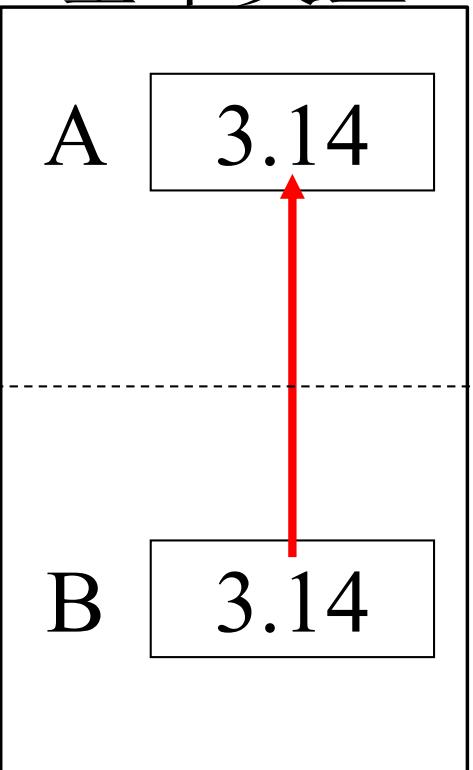
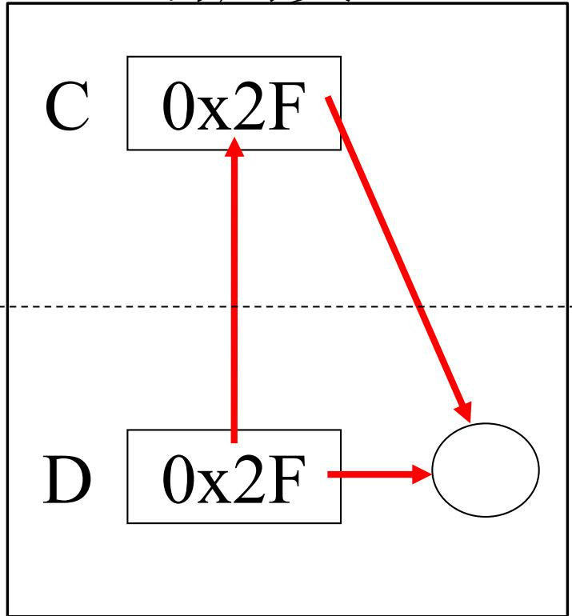
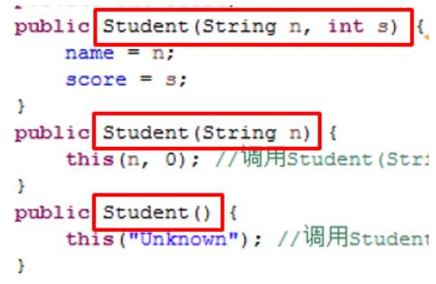
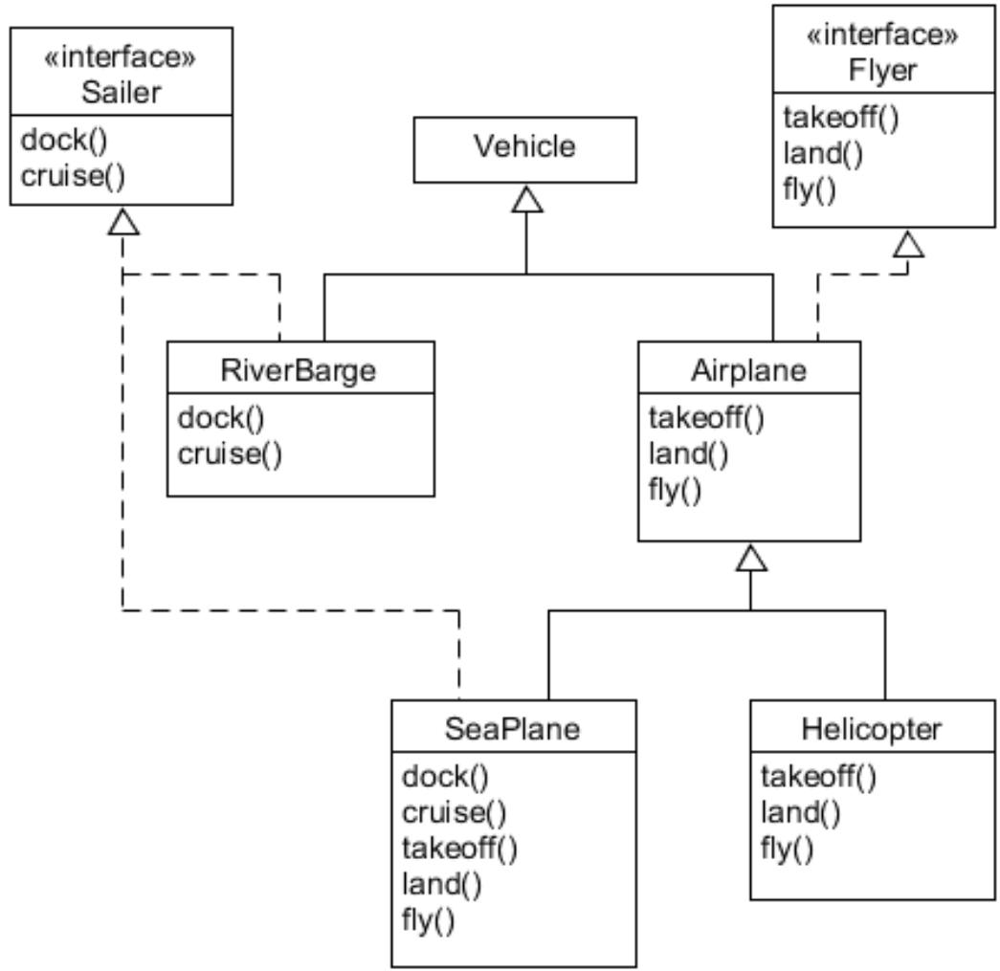

# 《Java软件开发》期末考前复习要点（课件）

原件经识别和整理；“参考解答”是我们补的。

---
title: Java软件开发期末考前复习要点（课件）第1部分
kind: 复习要点
course: Java软件开发
term: 
source: 上海财经大学 信息管理与工程学院《Java软件开发》课件
---

# Java软件开发期末考前复习要点（课件）第1部分

本资料由识别工具读取的《Java软件开发》期末考前复习要点（课件）第 1–37 页整理而成，主要涵盖考试题型、考核范围及第一部分核心知识点。

## 一、考试题型与考核范围

### 考试题型结构

- 判断题：2分 × 10个，共计20分
- 不定项选择题：2分 × 15个，共计30分
- 程序阅读题：5分 × 5个，共计25分
- 编程题：3道题，合计25分

**复习重点**：重点在于复习课上指出的有关例题。

知识点：[基本数据类型（整型、浮点型、字符型、布尔型）及Unicode编码](../../../topics/Java开发/基本数据类型.md)、[成员变量与局部变量的作用范围、默认值及final终止变量](../../../topics/Java开发/变量的作用域与初始化.md)、[if-else、switch、while、do-while、for语句及break/continue/return分支控制](../../../topics/Java开发/流程控制语句.md)

### 考核范围说明

- **基础依据**：以课堂PPT为蓝本，以郎波老师的教材为基础。
- **不考或少考内容**：数据库。
- **明确不考内容**：Applet、JSP、JS。


## 二、主要考核知识点：第一部分

知识点：[对象(Object)和类(Class)的概念、实例变量与方法](../../../topics/Java开发/对象与类的概念.md)、[消息(Message)的组成及其在对象通信中的作用](../../../topics/Java开发/消息传递机制.md)、[UML主要模型（用例图、类图、时序图、状态图）](../../../topics/Java开发/UML模型图.md)、[类之间的继承、聚合、合成、依赖关系及开闭原则(OCP)](../../../topics/Java开发/类之间的关系.md)、[接口(Interface)用于定义协议或行为的作用](../../../topics/Java开发/接口的基础概念.md)

### 消息与平台无关性

#### 消息的概念

- **定义**：对象之间交互的手段。
- **构成**：包括接收者、方法名和参数。
- **情况**：涉及方法的调用过程。

#### Java跨平台原理

- **核心原因**：JVM（Java Virtual Machine，Java虚拟机）。
- JVM屏蔽了底层操作系统的差异，使得“一次编写，到处运行”。

知识点：[消息(Message)的组成及其在对象通信中的作用](../../../topics/Java开发/消息传递机制.md)、[Java平台、JVM定义及编译解释执行原理](../../../topics/Java开发/Java平台与JVM.md)

### Application程序的创建过程

Java应用程序的执行包含两个主要阶段：

1. **编译阶段**：使用 `javac.exe` 将 `.java` 源文件编译成 `.class` 字节码文件。
2. **解释执行阶段**：使用 `java.exe` 启动JVM，解释执行 `.class` 文件。

知识点：[Java平台、JVM定义及编译解释执行原理](../../../topics/Java开发/Java平台与JVM.md)、[第一个Java程序（源文件创建、javac编译、类定义、main方法）](../../../topics/Java开发/HelloWorld程序结构.md)、[Java SE、Java EE、Java ME的区别与应用领域](../../../topics/Java开发/Java版本体系.md)

### 类之间的关系：聚合与关联

- **关联（Association）**：类之间的结构性关系，表示一个类的对象与另一个类的对象存在联系。
- **聚合（Aggregation）**：一种特殊的关联关系，表示“拥有”或“包含”的关系，但整体与部分可以独立存在（弱拥有）。
- **区别**：聚合强调整体与部分的分离性，而关联更通用。需理解两者在代码实现上的差异（如成员变量引用）。


## 三、主要考核知识点：第三部分（数据类型与数组）

知识点：[UML主要模型（用例图、类图、时序图、状态图）](../../../topics/Java开发/UML模型图.md)、[类之间的继承、聚合、合成、依赖关系及开闭原则(OCP)](../../../topics/Java开发/类之间的关系.md)

### 标识符定义规则

- 由字母、数字、下划线 `_` 和美元符号 `$` 组成。
- 不能以数字开头。
- 区分大小写。
- 不能使用Java关键字作为标识符。

知识点：[Java标识符命名规则与保留关键字](../../../topics/Java开发/标识符与关键字.md)

### 数据类型的转换

#### 基本类型层级

Java中数据的基本类型（不包括逻辑类型 boolean）按精度从“低”到“高”排列如下：

$$ \text{byte} \rightarrow \text{short} \rightarrow \text{char} \rightarrow \text{int} \rightarrow \text{long} \rightarrow \text{float} \rightarrow \text{double} $$

#### 自动类型转换（隐式转换）

- **规则**：当把级别低的变量的值赋给级别高的变量时，系统自动完成数据类型的转换。
- **示例**：
  ```java
  float x = 100; // int 100 自动转换为 float
  ```
- **注意**：虽然 `long` 是8字节，`float` 是4字节，但由于 `float` 的范围比 `long` 大，因此可以将 `long` 自动转化为 `float`。但这可能会导致**精度损失**。

#### 强制类型转换（显式转换）

- **规则**：当把级别高的变量的值赋给级别低的变量时，必须使用显示类型转换运算。
- **格式**：`(类型名) 要转换的值;`
- **示例**：
  ```java
  int x = (int) 34.89; // 结果为 34
  ```
- **限制**：当把一个 `int` 型常量赋值给一个 `byte` 和 `short` 型变量时，不可以超出这些变量的取值范围，否则必须进行类型转换运算。
  - `byte` 取值范围为：$-128 \sim +127$ （即 $-2^7 \sim 2^7-1$）。
  - 例如：`byte a = (byte) 128;` 需要强制转换，且结果可能溢出。

#### Boolean类型的特殊性

- `boolean` 类型不能和其他类型进行转换。

知识点：[基本数据类型的隐式转换与强制转换规则](../../../topics/Java开发/数据类型转换.md)

### 引用类型变量

- **存储内容**：存储的是其对应对象的**地址**，而不是该对象的值。
- **范围**：在Java中，除基本类型以外的变量均为引用类型变量。用户自己定义的类的变量都是引用类型变量。

知识点：[对象(Object)和类(Class)的概念、实例变量与方法](../../../topics/Java开发/对象与类的概念.md)、[基本数据类型（整型、浮点型、字符型、布尔型）及Unicode编码](../../../topics/Java开发/基本数据类型.md)、[成员变量与局部变量的作用范围、默认值及final终止变量](../../../topics/Java开发/变量的作用域与初始化.md)

### 数组详解

#### 数组的基本特性

- **元素类型**：数组中的元素都是同一种类型。
- **长度固定**：数组的长度在创建（不是在声明时指定）的时候确定，并且在创建后固定不变。
- **索引**：数组元素索引从 0 开始。
- **引用性质**：数组变量是引用型，存储的是数组内容所在内存空间的地址。

#### 数组的声明

1. **C/C++/Java 通用标准格式**：`[]` 在数组变量之后。
   ```java
   int a[];
   Date d[];
   ```
2. **Java 特有格式**：`[]` 在数组类型之后。
   ```java
   int[] a;
   Date[] d;
   ```
   - **注意**：表示数组标志 `[]` 之后出现的所有变量都将是数组变量。
     ```java
     int a[], b; // a是数组，b是普通int变量
     int[] a, b; // a和b都是数组
     ```
- **声明不创建数据空间**：仅仅分配一个引用空间，此时值为 `null`。

#### 二维数组声明

有两种格式：
1. `数组的元素类型 数组名[][];`
2. `数组的元素类型 [][]数组名;`

示例：
```java
float a[][];
char[][] b;
```

#### 数组的初始化

1. **使用初始值直接初始化**：
   ```java
   int[] a = {1, 2, 3};
   ```
2. **先声明后初始化**：
   ```java
   int[] a;
   a = new int[10];
   ```
3. **在声明的同时初始化**：
   ```java
   int[] a = new int[10];
   Date[] d = new Date[3];
   ```
- **动态长度**：如果要在Java中建立长度可以动态变化的“数组”，可以使用 `List` 类（如 `ArrayList`）。

#### 数组访问示例

```java
String[] a = {"aa", "bb"};
// a[0] = "aa"
// a[1] = "bb"
```


## 四、主要考核知识点：String类

知识点：[数组的声明、初始化、访问、数组复制及数组的数组](../../../topics/Java开发/一维数组与多维数组.md)

### String类概述

- **包位置**：`java.lang` 包中。
- **默认引入**：由于 `java.lang` 包中的类被默认引入，因此程序可直接使用 `String` 类。
- **不可变性**：Java把 `String` 类声明为 `final` 类，因此不能扩展 `String` 类。即 `String` 类不可以有子类。

知识点：[对象(Object)和类(Class)的概念、实例变量与方法](../../../topics/Java开发/对象与类的概念.md)、[成员变量与局部变量的作用范围、默认值及final终止变量](../../../topics/Java开发/变量的作用域与初始化.md)

### 构造字符串对象

1. **通过构造函数**：
   ```java
   String s = new String("Hello");
   ```
2. **直接赋值**：
   ```java
   String s = "Hello";
   ```
   - **引用共享**：`s1`, `s2` 具有相同的引用（指向字符串常量池中的同一实体），故具有相同的实体。
   - **内存示意图**：见原图8.1，展示字符串常量池与堆内存的关系。

知识点：[对象(Object)和类(Class)的概念、实例变量与方法](../../../topics/Java开发/对象与类的概念.md)、[Java平台、JVM定义及编译解释执行原理](../../../topics/Java开发/Java平台与JVM.md)

### String类的常用方法

1. **获取长度**：
   ```java
   public int length()
   ```
   - 获取一个字符串的长度。

2. **比较内容**：
   ```java
   public boolean equals(String s)
   ```
   - 比较当前字符串对象实体的值是否与参数 `s` 指定的字符串实体的值相同。
   - **示例**：
     ```java
     String tom = "tom";
     String boy = "boy";
     String jerry = "tom";
     
     // 比较内容
     tom.equals(boy); // false
     tom.equals(jerry); // true
     
     // 比较引用地址
     tom == jerry; // false (因为它们是不同对象，尽管内容相同且都在常量池中，但在某些情况下==判断的是引用。注：对于字符串常量 "tom"，若直接赋值，jvm优化可能导致==为true，但通常建议用equals比较内容。原题解析指出tom==jerry为false，暗示可能是new出来的不同对象或特定语境，此处遵循原题解析逻辑：判断是否有相同的引用。)
     ```
   - **注意**：`==` 用于判断引用是否相同（即是否是同一个对象实例），`equals()` 用于判断内容是否相同。


## 五、主要考核知识点：流程控制

知识点：[对象(Object)和类(Class)的概念、实例变量与方法](../../../topics/Java开发/对象与类的概念.md)、[方法的声明、调用、按值/按引用参数传递及方法的重载(Overloading)](../../../topics/Java开发/方法的定义与重载.md)

### 三种基本结构

1. **顺序结构**：按语句书写的先后顺序执行。
2. **分支结构**：在若干路径中有条件地择一执行。
3. **循环结构**：当某条件成立时，反复执行一段代码。

知识点：[if-else、switch、while、do-while、for语句及break/continue/return分支控制](../../../topics/Java开发/流程控制语句.md)

### 分支（选择）语句

#### if语句

1. **单分支**：
   ```java
   if (条件表达式) 语句组;
   ```
2. **双分支**：
   ```java
   if (条件表达式) 语句组1;
   else 语句组2;
   ```
- **语句组**：用大括号 `{}` 括起的语句集合。
- **else匹配原则**：`else` 与最近的 `if` 配合，用来消除二义性。

#### 嵌套的 if-else-if

```java
if (expression)
    statement;
else if (expression)
    statement;
else if (expression)
    statement;
else
    statement;
```

**示例：绩点计算**
- 根据成绩区间计算绩点。
- 运算结果示例：`ji_dian = 2.0`

知识点：[if-else、switch、while、do-while、for语句及break/continue/return分支控制](../../../topics/Java开发/流程控制语句.md)、[算术、关系、逻辑、位运算、移位、条件及复合赋值运算符与优先级](../../../topics/Java开发/运算符与表达式.md)、[基本数据类型（整型、浮点型、字符型、布尔型）及Unicode编码](../../../topics/Java开发/基本数据类型.md)

### 循环语句

#### for循环语句

1. **语法格式**：
   ```java
   for (表达式1; 表达式2; 表达式3) {
       // 若干语句
   }
   ```
   - **表达式1**：初始化（仅执行一次）。
   - **表达式2**：循环条件（布尔值）。
   - **表达式3**：更新循环变量。

2. **执行规则**：
   1. 计算“表达式1”，完成必要的初始化工作。
   2. 判断“表达式2”的值，若为 `true`，则进入步骤3；否则结束循环。
   3. 执行循环体，然后计算“表达式3”，以便改变循环条件，返回步骤2。
   4. 结束 `for` 语句的执行。

**示例**：
```java
for (j = 0; j < 10; j++) {
    // 循环体语句组
}
```


## 六、运算符

知识点：[if-else、switch、while、do-while、for语句及break/continue/return分支控制](../../../topics/Java开发/流程控制语句.md)

### 算术运算符

- **二元算术运算符**：`+`, `-`, `*`, `/`, `%`
- **字符串连接**：`+` 可连接字符串。
  - `"He" + "llo"` 结果为 `"Hello"`
- **混合运算类型提升**：
  - 整型、浮点进行混合运算时，不同类型的数据首先转换为同一类型，然后进行运算。
  - 低级数据类型自动转化为高级数据类型：
    $$ \text{byte, short, char} \rightarrow \text{int} \rightarrow \text{long} \rightarrow \text{float} \rightarrow \text{double} $$
  - **特例**：全是 `byte` 或 `short` 型操作数，结果也是 `int` 型。

知识点：[算术、关系、逻辑、位运算、移位、条件及复合赋值运算符与优先级](../../../topics/Java开发/运算符与表达式.md)、[基本数据类型的隐式转换与强制转换规则](../../../topics/Java开发/数据类型转换.md)

### 自增/自减运算符 (++ / --)

| 运算符 | 用法 | 功能描述 |
| :--- | :--- | :--- |
| `++` | `op++` | `op` 加1；先求 `op` 的值，再把 `op` 加1 |
| `++` | `++op` | `op` 加1；先把 `op` 加1，再求 `op` 的值 |
| `--` | `op--` | `op` 减1；先求 `op` 的值，再把 `op` 减1 |
| `--` | `--op` | `op` 减1；先把 `op` 减1，再求 `op` 的值 |

知识点：[算术、关系、逻辑、位运算、移位、条件及复合赋值运算符与优先级](../../../topics/Java开发/运算符与表达式.md)

### 其他运算符

- **扩展赋值运算符**：`@=`, `a @= b` 即 `a = a @ b`（`@` 为 `+`, `-`, `*`, `/`, `%`）。
  - 例如：`a += b` $\rightarrow$ `a = a + b;`
- **运算符优先级**：
  - 一般原则：算术运算符 > 关系运算符 > 逻辑运算符
  - 括号 `()` 最优先


## 七、主要考核知识点：第三部分4（面向对象编程基础）

知识点：[算术、关系、逻辑、位运算、移位、条件及复合赋值运算符与优先级](../../../topics/Java开发/运算符与表达式.md)

### Java中的OOP概念回顾

1. **类（Class）**：抽象的集合概念。
   - 系统类库中已定义好的类。
   - 用户自定义的类。
2. **对象（Object/Instance）**：实际个体。
   - 创建某个类的具体对象（类似变量声明）。
   - **语法**：`类名 欲创建的对象名 = new 类名(参数表);`
   - **示例**：`String s = new String("Hello!");`
3. **继承**：
   - 子类是父类的特例，继承了父类的变量和方法。
   - 关键词：`extends`。

知识点：[对象(Object)和类(Class)的概念、实例变量与方法](../../../topics/Java开发/对象与类的概念.md)、[类之间的继承、聚合、合成、依赖关系及开闭原则(OCP)](../../../topics/Java开发/类之间的关系.md)

### 完整程序结构

- 一个 `.java` 文件中最多只有一个 `public` 类。
- 这个类称为**主类**，与 `.java` 文件名相同。

知识点：[第一个Java程序（源文件创建、javac编译、类定义、main方法）](../../../topics/Java开发/HelloWorld程序结构.md)、[Java标识符命名规则与保留关键字](../../../topics/Java开发/标识符与关键字.md)、[对象(Object)和类(Class)的概念、实例变量与方法](../../../topics/Java开发/对象与类的概念.md)

### Java中类的声明

#### 类修饰符（Modifier）

1. **public**：允许其他类（没有限制）访问本类。
2. **缺省（Default）**：可被当前包中的其他类访问。
3. **abstract**：没有实例的抽象类，只能创建其子类的实例。
   - 目的：使类的结构清晰，实现多态。
4. **final**：不能再被扩展，不包含子类的类。
   - 易于安全性的实现，或用于创建固定功能的类。

**类声明语法结构**：
```java
[类修饰符] class 类名 [extends 父类名] [implements 接口名] {
    // 成员变量定义：表示类和对象的状态
    // 构造方法定义：构造和初始化新对象
    // 方法定义：实现类和对象的行为
}
```

知识点：[类之间的继承、聚合、合成、依赖关系及开闭原则(OCP)](../../../topics/Java开发/类之间的关系.md)、[接口(Interface)用于定义协议或行为的作用](../../../topics/Java开发/接口的基础概念.md)、[对象(Object)和类(Class)的概念、实例变量与方法](../../../topics/Java开发/对象与类的概念.md)

### 成员变量的声明

- **定义**：在类体中声明，但不属于任何一个方法。
- **语法**：`[修饰符] 数据类型 变量名;`

#### 访问控制符（修饰符）

| 修饰符 | Class | Package | Subclass | World |
| :--- | :---: | :---: | :---: | :---: |
| `public` | y | y | y | y |
| `protected` | y | y | y | n |
| 缺省 (no modifier) | y | y | n | n |
| `private` | y | n | n | n |

- **public**：可被所有其他类访问。
- **protected**：该类自身、子类、同一包中的其他类。
- **缺省**：可被本包中的类访问。
- **private**：仅可被该类自身访问和修改，不能被其他任何类（包括子类）访问。

知识点：[对象(Object)和类(Class)的概念、实例变量与方法](../../../topics/Java开发/对象与类的概念.md)、[成员变量与局部变量的作用范围、默认值及final终止变量](../../../topics/Java开发/变量的作用域与初始化.md)

### 其他修饰符

- **static**：类成员变量（静态变量）。
  - 对所有的实例一致。
  - 引用时前缀可使用类名或对象名。
- **final**：程序中不能修改其值。
  - 即常量，定义的同时应对其进行初始化。

知识点：[成员变量与局部变量的作用范围、默认值及final终止变量](../../../topics/Java开发/变量的作用域与初始化.md)

### 方法的定义

- **作用**：定义对类的成员变量（数据）的操作。
- **语法**：
  ```java
  [修饰符] 返回类型 方法名 ([参数列表]) [throws 异常名] {
      // 方法体
      // 声明内容
      // 方法的性质、接受哪些参数、返回什么信息
  }
  ```
- **组成部分**：
  - **方法声明部分**：修饰符、返回类型、方法名、参数列表、异常声明。
  - **方法体部分**：具体的实现逻辑。


## 方法的声明

修饰符

*   访问控制符[修饰符] 返回类型 方法名（参数列表）[throws 例外名 ] {方法体；
    *   public, protected, 缺省, private
    *   static：静态方法，又称类方法。
        *   使用类名或对象名作为前缀，建议使用类名作前缀
        *   在static型的方法体中，只能访问static变量和自身局部变量
        *   优点：不必对类实例化操作就能被其他类使用该方法。
        *   可开发通用工具，如数学计算: `Math.sqrt( )`
    *   abstract：只有方法名,没有方法体。
        *   要在子类中通过重新定义（override）来实现
    *   final：不能被子类所重新定义（override）

知识点：[方法的声明、调用、按值/按引用参数传递及方法的重载(Overloading)](../../../topics/Java开发/方法的定义与重载.md)、[Java标识符命名规则与保留关键字](../../../topics/Java开发/标识符与关键字.md)

### 方法的声明（续）

返回类型：

`[修饰符]返回类型 方法名（参数列表）[throws 例外名 ] {`

*   方法内return语句返回值的类型、void（无返回值）

参数列表：参数类型可为基本类型或引用类型

知识点：[方法的声明、调用、按值/按引用参数传递及方法的重载(Overloading)](../../../topics/Java开发/方法的定义与重载.md)、[基本数据类型（整型、浮点型、字符型、布尔型）及Unicode编码](../../../topics/Java开发/基本数据类型.md)

### throws：

*   通告本方法中会产生的例外（异常）类型
    *   提醒调用者要对相应的可能例外进行处理。
*   当执行此方法并发生了例外时，程序会转入调用者编制的例外处理程序段。

知识点：[Java平台、JVM定义及编译解释执行原理](../../../topics/Java开发/Java平台与JVM.md)、[if-else、switch、while、do-while、for语句及break/continue/return分支控制](../../../topics/Java开发/流程控制语句.md)、[方法的声明、调用、按值/按引用参数传递及方法的重载(Overloading)](../../../topics/Java开发/方法的定义与重载.md)

### 例外触发示例

知识点：[if-else、switch、while、do-while、for语句及break/continue/return分支控制](../../../topics/Java开发/流程控制语句.md)

### 方法体

在方法体中定义的变量称为局部变量。

*   生命周期：程序流执行进入方法体时创建，程序流退出方法时撤消。
*   局部变量使用之前必须初始化。
*   局部变量名若与类的成员变量名相同，则成员变量被隐藏。
    *   可用this显示相应的成员变量。

知识点：[成员变量与局部变量的作用范围、默认值及final终止变量](../../../topics/Java开发/变量的作用域与初始化.md)、[方法的声明、调用、按值/按引用参数传递及方法的重载(Overloading)](../../../topics/Java开发/方法的定义与重载.md)

### 方法体（续）

在方法体中可访问本类所有的类变量，并可调用本类中定义的非静态方法。

*   static方法只能直接调用本类的static方法和static变量。

知识点：[成员变量与局部变量的作用范围、默认值及final终止变量](../../../topics/Java开发/变量的作用域与初始化.md)、[方法的声明、调用、按值/按引用参数传递及方法的重载(Overloading)](../../../topics/Java开发/方法的定义与重载.md)

### 方法的参数

`(参数列表)`

*   方法的参数要“有名有型”
*   方法调用中，基本类型参数是值传送；
*   引用类型参数是地址传送。
*   参数的作用域在本方法中可像方法内的局部变量一样使用。

`[throws 例外名 ] {`

`方法体；`

知识点：[方法的声明、调用、按值/按引用参数传递及方法的重载(Overloading)](../../../topics/Java开发/方法的定义与重载.md)、[成员变量与局部变量的作用范围、默认值及final终止变量](../../../topics/Java开发/变量的作用域与初始化.md)

### 值传送与地址传送

方法定义： `void method1(int A)` `void method2(String C)` A,C是形参

方法调用： `instance.method1(B)` `instance.method2(D)` B,D是实参

**基本类型**



**引用类型**



知识点：[方法的声明、调用、按值/按引用参数传递及方法的重载(Overloading)](../../../topics/Java开发/方法的定义与重载.md)、[基本数据类型（整型、浮点型、字符型、布尔型）及Unicode编码](../../../topics/Java开发/基本数据类型.md)、[对象(Object)和类(Class)的概念、实例变量与方法](../../../topics/Java开发/对象与类的概念.md)

### 构造方法

*   构造方法与类同名，且不声明返回类型。

```java
[类修饰符] class 类名
[extends 父类名]
[implements 接口名]{
    成员变量定义；//表示类和对象的状态
    方法定义；//实现类和对象的行为
}
```

*   在创建每个新对象时自动执行
*   以保证新对象的各成员都有合法、确定的初值。

Java试图在每个对象一诞生时，就给它一个指定的状态（即成员变量的初值），但有时系统的缺省初值并不合适；所以在创建一个新对象时，需用构造方法完成合法的初始化，使成员变量的初始化工作不依赖于外界（系统）完成。

知识点：[对象(Object)和类(Class)的概念、实例变量与方法](../../../topics/Java开发/对象与类的概念.md)、[成员变量与局部变量的作用范围、默认值及final终止变量](../../../topics/Java开发/变量的作用域与初始化.md)、[方法的声明、调用、按值/按引用参数传递及方法的重载(Overloading)](../../../topics/Java开发/方法的定义与重载.md)

### 构造方法的特点

*   构造方法与成员方法不同，不能被直接调用。

知识点：[对象(Object)和类(Class)的概念、实例变量与方法](../../../topics/Java开发/对象与类的概念.md)、[方法的声明、调用、按值/按引用参数传递及方法的重载(Overloading)](../../../topics/Java开发/方法的定义与重载.md)

### 必须通过new调用;

创建对象时，利用运算符new 在内存中开辟专用空间，存放指定的类的实例（即对象），这时会自动执行类的构造方法，初始化新对象的成员变量.

例：`Date d = new Date (22, 5, 2003);`

知识点：[对象(Object)和类(Class)的概念、实例变量与方法](../../../topics/Java开发/对象与类的概念.md)、[成员变量与局部变量的作用范围、默认值及final终止变量](../../../topics/Java开发/变量的作用域与初始化.md)、[方法的声明、调用、按值/按引用参数传递及方法的重载(Overloading)](../../../topics/Java开发/方法的定义与重载.md)

### 构造方法的缺省

*   每一个类至少有一个构造方法。（可以有多个，重载）
*   当未定义任何构造方法时，系统在编译时，会提供一个缺省（默认）构造方法
    *   无参数，方法体中没有内容
    *   缺省构造方法的初始化数据初值：
        *   数值型：0；
        *   布尔型：false;
        *   引用型：null;
        *   字符串型：null;

一旦程序员定义了构造方法，缺省（默认）构造方法自动失效！

知识点：[对象(Object)和类(Class)的概念、实例变量与方法](../../../topics/Java开发/对象与类的概念.md)、[成员变量与局部变量的作用范围、默认值及final终止变量](../../../topics/Java开发/变量的作用域与初始化.md)

### 缺省构造方法示例

知识点：[方法的声明、调用、按值/按引用参数传递及方法的重载(Overloading)](../../../topics/Java开发/方法的定义与重载.md)

### 自定义构造方法示例1

知识点：[对象(Object)和类(Class)的概念、实例变量与方法](../../../topics/Java开发/对象与类的概念.md)、[方法的声明、调用、按值/按引用参数传递及方法的重载(Overloading)](../../../topics/Java开发/方法的定义与重载.md)

### 自定义构造方法示例2

知识点：[对象(Object)和类(Class)的概念、实例变量与方法](../../../topics/Java开发/对象与类的概念.md)、[方法的声明、调用、按值/按引用参数传递及方法的重载(Overloading)](../../../topics/Java开发/方法的定义与重载.md)

### 以“this” 调用构造方法

知识点：[对象(Object)和类(Class)的概念、实例变量与方法](../../../topics/Java开发/对象与类的概念.md)、[方法的声明、调用、按值/按引用参数传递及方法的重载(Overloading)](../../../topics/Java开发/方法的定义与重载.md)

### 类的继承：Extends 关键字

*   Java中用 extends 关键字定义子类。

```java
public class Manager extends Employee {
```

要使得子类直接可以访问父类属性，必须声明父类属性的访问符为protected (或public)

*   子类是从已有的类创建新类的一种方法。

知识点：[类之间的继承、聚合、合成、依赖关系及开闭原则(OCP)](../../../topics/Java开发/类之间的关系.md)、[对象(Object)和类(Class)的概念、实例变量与方法](../../../topics/Java开发/对象与类的概念.md)、[Java标识符命名规则与保留关键字](../../../topics/Java开发/标识符与关键字.md)

### 类的继承

知识点：[类之间的继承、聚合、合成、依赖关系及开闭原则(OCP)](../../../topics/Java开发/类之间的关系.md)、[对象(Object)和类(Class)的概念、实例变量与方法](../../../topics/Java开发/对象与类的概念.md)

### 创建类时指明它为某类的子类

`extends 父类名`

子类将继承protected和public的所有父类成员（可直接访问）

*   private：不能被继承
*   缺省：除非子类和父类在同一个包，否则也不能继承

Java是单继承,不支持多继承

*   extends后的类名只能有一个
*   可通过接口间接实现多继承

知识点：[类之间的继承、聚合、合成、依赖关系及开闭原则(OCP)](../../../topics/Java开发/类之间的关系.md)、[Java平台、JVM定义及编译解释执行原理](../../../topics/Java开发/Java平台与JVM.md)

### 类的继承：扩展

子类对父类可做扩展和特殊化。

*   子类继承父类的属性、功能(方法)
*   子类中只需声明特有的东西。
    *   创建新的成员：属性和方法
*   重新定义父类中已有的属性 ：父类属性被隐藏
*   重新定义父类中已有的方法 ：重写(override)
    *   子类中的方法应与父类中的被重写的方法有完全相同的参数列表、返回值 。

知识点：[类之间的继承、聚合、合成、依赖关系及开闭原则(OCP)](../../../topics/Java开发/类之间的关系.md)、[对象(Object)和类(Class)的概念、实例变量与方法](../../../topics/Java开发/对象与类的概念.md)

### 方法重写规则

知识点：[对象(Object)和类(Class)的概念、实例变量与方法](../../../topics/Java开发/对象与类的概念.md)、[类之间的继承、聚合、合成、依赖关系及开闭原则(OCP)](../../../topics/Java开发/类之间的关系.md)

### 方法重写规则

知识点：[对象(Object)和类(Class)的概念、实例变量与方法](../../../topics/Java开发/对象与类的概念.md)、[类之间的继承、聚合、合成、依赖关系及开闭原则(OCP)](../../../topics/Java开发/类之间的关系.md)

### 可扩大访问权限

知识点：[类之间的继承、聚合、合成、依赖关系及开闭原则(OCP)](../../../topics/Java开发/类之间的关系.md)、[对象(Object)和类(Class)的概念、实例变量与方法](../../../topics/Java开发/对象与类的概念.md)

### 类的继承:上溯造型

子类对象可自动转换成父类对象，即，父类变量可以指向子类对象，称为上溯造型（upcast），系统自动完成。

知识点：[类之间的继承、聚合、合成、依赖关系及开闭原则(OCP)](../../../topics/Java开发/类之间的关系.md)、[对象(Object)和类(Class)的概念、实例变量与方法](../../../topics/Java开发/对象与类的概念.md)、[方法的声明、调用、按值/按引用参数传递及方法的重载(Overloading)](../../../topics/Java开发/方法的定义与重载.md)

### 父类变量执行子类方法

父类变量指向子类对象，但如果要使用子类特有的方法，需要强制转换为子类。

知识点：[类之间的继承、聚合、合成、依赖关系及开闭原则(OCP)](../../../topics/Java开发/类之间的关系.md)、[对象(Object)和类(Class)的概念、实例变量与方法](../../../topics/Java开发/对象与类的概念.md)

### 父类变量执行子类重写方法

如果父类变量指向子类对象，执行某个父类定义但被子类重写的方法，实际执行的代码是子类的相应方法。

运行时多态：在运行时根据对象的具体情况来决定调用的方法是父类的还是子类的。

知识点：[类之间的继承、聚合、合成、依赖关系及开闭原则(OCP)](../../../topics/Java开发/类之间的关系.md)、[对象(Object)和类(Class)的概念、实例变量与方法](../../../topics/Java开发/对象与类的概念.md)

### 回顾方法重载（与重写对比）

知识点：[方法的声明、调用、按值/按引用参数传递及方法的重载(Overloading)](../../../topics/Java开发/方法的定义与重载.md)

### •方法重载：同类中的同名方法

• 参数必须不同

• 形参的个数、类型、顺序的不同

• 返回值、修饰符可以相同，可以不同



要打印不同类型的数据，如int, float, String等(通过不同参数区分)

```java
void print (int i);
void print (float f);
void print (String s);
```

编译时多态：由编译器在编译时根据参数的区别，来调用绑定方法体。

知识点：[方法的声明、调用、按值/按引用参数传递及方法的重载(Overloading)](../../../topics/Java开发/方法的定义与重载.md)

### 方法重写vs 方法重载

| 区别点 | 重载方法 | 重写方法 |
| :--- | :--- | :--- |
| 参数列表 | 必须修改 | 不能修改 |
| 返回类型 | 可以修改 | 不能修改 |
| 异常 | 可以修改 | 不能抛出新的异常 |
| 访问 | 可以修改 | 不能缩小访问权限 |
| 多态 | 编译时 | 运行时 |

知识点：[对象(Object)和类(Class)的概念、实例变量与方法](../../../topics/Java开发/对象与类的概念.md)、[类之间的继承、聚合、合成、依赖关系及开闭原则(OCP)](../../../topics/Java开发/类之间的关系.md)

### 注意1：属性无运行时多态！

子类重新定义父类属性后，父类属性被隐藏，子类对象无法直接访问父类属性。

如果把子类对象赋值给父类变量（上溯造型），再访问该属性，则将访问到父类属性。

知识点：[对象(Object)和类(Class)的概念、实例变量与方法](../../../topics/Java开发/对象与类的概念.md)、[类之间的继承、聚合、合成、依赖关系及开闭原则(OCP)](../../../topics/Java开发/类之间的关系.md)

### 注意2：static、final、private方法无运行时多态！

静态联编（早联编）: Static Binding (Early Binding)

*   Java对static、final、private方法的调用，是在运行前将方法调用和方法体连接到一起
*   不存在运行时多态

动态联编（晚联编）: Dynamic Binding (Late Binding)

*   对非static、final、private方法的调用，是在运行时才将方法调用和方法体连接到一起
*   实现运行时多态的机理

知识点：[方法的声明、调用、按值/按引用参数传递及方法的重载(Overloading)](../../../topics/Java开发/方法的定义与重载.md)、[对象(Object)和类(Class)的概念、实例变量与方法](../../../topics/Java开发/对象与类的概念.md)、[类之间的继承、聚合、合成、依赖关系及开闭原则(OCP)](../../../topics/Java开发/类之间的关系.md)

### 上溯造型总结

上溯造型中:

*   同名方法，若子类重写，则调用子类自己的，是运行时多态：利用动态联编实现。
*   注意：static、final、private方法，利用静态联编实现，故不存在运行时多态。
*   同名属性是调用父类的。
*   一个引用类型变量如果声明为父类的类型，但实际引用的是子类对象，那么该变量不能再访问子类中添加的子类独有的属性和方法。

知识点：[对象(Object)和类(Class)的概念、实例变量与方法](../../../topics/Java开发/对象与类的概念.md)、[类之间的继承、聚合、合成、依赖关系及开闭原则(OCP)](../../../topics/Java开发/类之间的关系.md)

### 课堂练习

知识点：[Java平台、JVM定义及编译解释执行原理](../../../topics/Java开发/Java平台与JVM.md)、[第一个Java程序（源文件创建、javac编译、类定义、main方法）](../../../topics/Java开发/HelloWorld程序结构.md)、[System.out.printf格式化输出与Scanner类输入](../../../topics/Java开发/输入输出基础.md)

### 课堂练习1

知识点：[if-else、switch、while、do-while、for语句及break/continue/return分支控制](../../../topics/Java开发/流程控制语句.md)、[System.out.printf格式化输出与Scanner类输入](../../../topics/Java开发/输入输出基础.md)

### 课堂练习2

执行结果？

知识点：[if-else、switch、while、do-while、for语句及break/continue/return分支控制](../../../topics/Java开发/流程控制语句.md)、[System.out.printf格式化输出与Scanner类输入](../../../topics/Java开发/输入输出基础.md)、[数组的声明、初始化、访问、数组复制及数组的数组](../../../topics/Java开发/一维数组与多维数组.md)

### 课堂练习4

知识点：[System.out.printf格式化输出与Scanner类输入](../../../topics/Java开发/输入输出基础.md)、[成员变量与局部变量的作用范围、默认值及final终止变量](../../../topics/Java开发/变量的作用域与初始化.md)

### final关键字

*   被定义成final的类不能有子类。
*   被定义成final 的成员方法不能被重写。
*   被定义成final的成员变量不能改变。
*   该变量实际上是常量，一般大写，并必须在声明时初始化。

final变量不在声明时初始化会报错

©The blank final field NUM may not have been initialized

final变量不能改变

知识点：[成员变量与局部变量的作用范围、默认值及final终止变量](../../../topics/Java开发/变量的作用域与初始化.md)、[Java标识符命名规则与保留关键字](../../../topics/Java开发/标识符与关键字.md)

### static关键词

在一些编程场景中，某些成员应该属于一个类，即被所有该类的对象共享。

*   例：一个类希望通过一个成员属性记录程序中共生成多少个它的对象

*   关键词static可用于定义类成员（类属性、类方法），也叫做静态成员（静态属性、静态方法）
*   不用static修饰的成员被称为实例成员（实例属性、实例方法）
*   类属性和类方法可直接通过类名访问
    *   虽然也可以通过该类的对象访问，但属于不良的编程习惯，不推荐。

实例属性和实例方法必须通过该类的对象才可访问

知识点：[对象(Object)和类(Class)的概念、实例变量与方法](../../../topics/Java开发/对象与类的概念.md)、[成员变量与局部变量的作用范围、默认值及final终止变量](../../../topics/Java开发/变量的作用域与初始化.md)

### static方法使用注意点

*   static方法中不能直接访问本类的实例属性，只能访问static属性、方法参数及局部变量
*   static方法中不能直接访问本类的实例方法，只能访问本类的static方法
*   如果要访问实例属性或实例方法，可在static方法中先创建本类的对象，再使用该对象的实例属性或实例方法
*   static方法中不能访问this引用

知识点：[对象(Object)和类(Class)的概念、实例变量与方法](../../../topics/Java开发/对象与类的概念.md)、[成员变量与局部变量的作用范围、默认值及final终止变量](../../../topics/Java开发/变量的作用域与初始化.md)、[方法的声明、调用、按值/按引用参数传递及方法的重载(Overloading)](../../../topics/Java开发/方法的定义与重载.md)

### 抽象类

知识点：[对象(Object)和类(Class)的概念、实例变量与方法](../../../topics/Java开发/对象与类的概念.md)、[类之间的继承、聚合、合成、依赖关系及开闭原则(OCP)](../../../topics/Java开发/类之间的关系.md)

### ⚫抽象方法：

⚫只声明方法而没有方法的实现（方法体）

⚫在方法声明中，在紧接着类访问限定词之后增加关键字abstract。

知识点：[方法的声明、调用、按值/按引用参数传递及方法的重载(Overloading)](../../../topics/Java开发/方法的定义与重载.md)、[类之间的继承、聚合、合成、依赖关系及开闭原则(OCP)](../../../topics/Java开发/类之间的关系.md)、[接口(Interface)用于定义协议或行为的作用](../../../topics/Java开发/接口的基础概念.md)

### ⚫抽象类：

⚫在类声明中，在紧接着类访问限定词之后增加关键字abstract。

⚫在无方法体的方法（抽象方法）前也要加上abstract。

```java
public abstract class Drawing{ //抽象类 
    public abstract void drawDot( int x, int y);//抽象方法 
    public void drawLine(int x1, int y1, int x2, int y2) { 
        … //非抽象方法 
    } 
}
```

一个abstract 类可以包含有非抽象方法和变量，但至少包含一个抽象方法。

知识点：[对象(Object)和类(Class)的概念、实例变量与方法](../../../topics/Java开发/对象与类的概念.md)、[类之间的继承、聚合、合成、依赖关系及开闭原则(OCP)](../../../topics/Java开发/类之间的关系.md)、[接口(Interface)用于定义协议或行为的作用](../../../topics/Java开发/接口的基础概念.md)

### 抽象类

⚫抽象类不能直接用来生成实例。

⚫一般通过定义子类进行实例化

⚫可以声明抽象类的变量

```java
Employee e = new Manager( ) ; //指向子类实例
```

知识点：[对象(Object)和类(Class)的概念、实例变量与方法](../../../topics/Java开发/对象与类的概念.md)、[类之间的继承、聚合、合成、依赖关系及开闭原则(OCP)](../../../topics/Java开发/类之间的关系.md)

### 接口(Interface/Protocol)

可看作“特殊的抽象类”

⚫ 一个接口定义了一组对外的公共接口（一系列操作的组合）

⚫ 只包含操作签名Signature（即操作名、参数类型、返回值类型）

⚫ 不包含操作的具体实现

知识点：[接口(Interface)用于定义协议或行为的作用](../../../topics/Java开发/接口的基础概念.md)、[对象(Object)和类(Class)的概念、实例变量与方法](../../../topics/Java开发/对象与类的概念.md)、[类之间的继承、聚合、合成、依赖关系及开闭原则(OCP)](../../../topics/Java开发/类之间的关系.md)

### 接口(Interface/Protocol)

知识点：[接口(Interface)用于定义协议或行为的作用](../../../topics/Java开发/接口的基础概念.md)、[对象(Object)和类(Class)的概念、实例变量与方法](../../../topics/Java开发/对象与类的概念.md)、[类之间的继承、聚合、合成、依赖关系及开闭原则(OCP)](../../../topics/Java开发/类之间的关系.md)

### 接口的方法需要类进行实现（<sub>implements</sub>）

知识点：[接口(Interface)用于定义协议或行为的作用](../../../topics/Java开发/接口的基础概念.md)

### Java中的接口（Interface）

1) Java允许定义public static final的常量（修饰符只能写public，static，或final，但无论怎么写，都不会影响该变量是public static final）

2) interface的方法，默认为public abstract（类在实现接口时，必须将实现的接口方法声明为public）

A,B,C,D都是TInterface的public static final变量思考：怎样写程序验证A,B,C,D都是public static final?

其他类实现接口的method方法时必须声明public，否则报错

知识点：[接口(Interface)用于定义协议或行为的作用](../../../topics/Java开发/接口的基础概念.md)、[Java标识符命名规则与保留关键字](../../../topics/Java开发/标识符与关键字.md)

### 一个类可实现多个接口

知识点：[接口(Interface)用于定义协议或行为的作用](../../../topics/Java开发/接口的基础概念.md)、[类之间的继承、聚合、合成、依赖关系及开闭原则(OCP)](../../../topics/Java开发/类之间的关系.md)

### 类可以实现（implements）多个接口

知识点：[接口(Interface)用于定义协议或行为的作用](../../../topics/Java开发/接口的基础概念.md)、[类之间的继承、聚合、合成、依赖关系及开闭原则(OCP)](../../../topics/Java开发/类之间的关系.md)

### 接口之间的继承

知识点：[接口(Interface)用于定义协议或行为的作用](../../../topics/Java开发/接口的基础概念.md)、[类之间的继承、聚合、合成、依赖关系及开闭原则(OCP)](../../../topics/Java开发/类之间的关系.md)

### 接口可以继承（extends）接口

◦ 假设接口B继承接口A

◦ 类C实现接口B，则需实现接口A和B中定义的所有抽象方法。

知识点：[接口(Interface)用于定义协议或行为的作用](../../../topics/Java开发/接口的基础概念.md)、[类之间的继承、聚合、合成、依赖关系及开闭原则(OCP)](../../../topics/Java开发/类之间的关系.md)

### 子接口可继承多个父接口

注意：一个子接口可以继承（extends）多个父接口

◦ 接口C继承接口A和B

◦ 类D实现接口C，则需要实现A，B和C中所有的抽象方法

知识点：[接口(Interface)用于定义协议或行为的作用](../../../topics/Java开发/接口的基础概念.md)、[类之间的继承、聚合、合成、依赖关系及开闭原则(OCP)](../../../topics/Java开发/类之间的关系.md)

### interface 要注意的问题

尽量不向interface定义中随意增加方法。

◦ 直接在接口中增加方法，会带来所有实现该接口的类的维护问题。

◦ 推荐：定义新接口，继承原接口来增加方法

```java
public interface ShapeWithArea extends Shape{ //通过子接口来新增方法 
    double area( ); 
}

## 接口与多态

知识点：[接口(Interface)用于定义协议或行为的作用](../../../topics/Java开发/接口的基础概念.md)、[类之间的继承、聚合、合成、依赖关系及开闭原则(OCP)](../../../topics/Java开发/类之间的关系.md)

### interface：多态性

可声明 interface 的变量，指向具体实现该 interface 的类的实例，并实现多态性。

知识点：[接口(Interface)用于定义协议或行为的作用](../../../topics/Java开发/接口的基础概念.md)、[对象(Object)和类(Class)的概念、实例变量与方法](../../../topics/Java开发/对象与类的概念.md)、[类之间的继承、聚合、合成、依赖关系及开闭原则(OCP)](../../../topics/Java开发/类之间的关系.md)

### 接口实现配合类继承：多继承

这是示意图，考试不必画，这里用来帮助大家理解的。



知识点：[接口(Interface)用于定义协议或行为的作用](../../../topics/Java开发/接口的基础概念.md)、[类之间的继承、聚合、合成、依赖关系及开闭原则(OCP)](../../../topics/Java开发/类之间的关系.md)

### Java中接口与抽象类的比较

- 接口中的所有方法都是抽象的，而抽象类可以定义有方法体的不同方法。
- 一个类可以实现多个接口，但是只能继承一个父类。
- 继承父类和实现接口相组合，可实现多继承。

知识点：[接口(Interface)用于定义协议或行为的作用](../../../topics/Java开发/接口的基础概念.md)、[类之间的继承、聚合、合成、依赖关系及开闭原则(OCP)](../../../topics/Java开发/类之间的关系.md)、[对象(Object)和类(Class)的概念、实例变量与方法](../../../topics/Java开发/对象与类的概念.md)

### 上机练习

1. 创建一个接口，接口名 `Function`，具有一个方法 `evaluate`，参数为一个 `int` 型变量，返回值为 `int`。
2. 创建一个类，类名 `Half`，实现 `Function` 接口的 `evaluate` 方法：将传入的参数除以 2 返回。
3. 创建一个类，类名 `TwoTimes`，实现 `Function` 接口的 `evaluate` 方法：将传入的参数乘以 2 返回。
4. 再新建一个类，在类中实现一个方法，该方法的参数列表为一个 `int` 型数组和一个 `Function` 类型对象，功能为利用 `Function` 对象的 `evaluate` 操作对数组的每个元素进行改变，最后返回改变后的 `int` 型数组。
5. 利用上述方法，以及 `Half` 和 `TwoTimes` 类，对一个数组的所有元素进行除以 2 或者乘以 2 的操作。

## 第四部分 Java类库-异常

知识点：[System.out.printf格式化输出与Scanner类输入](../../../topics/Java开发/输入输出基础.md)、[数组的声明、初始化、访问、数组复制及数组的数组](../../../topics/Java开发/一维数组与多维数组.md)、[if-else、switch、while、do-while、for语句及break/continue/return分支控制](../../../topics/Java开发/流程控制语句.md)

### 异常分类

#### Error

- 很难恢复的严重错误。
- 一般属于系统内部错误，不由程序处理。
- 发生时，由用户按照系统提示关闭程序。

#### Exception

- 由程序本身或环境产生的错误，可通过异常处理来进行有效控制。
- **Runtime Exception**：程序设计或实现上的问题，如数组越界等。
- **其他 Exception**：通常是由环境因素引起的，并且可以被处理的。如文件不存在，无效 URL 等。

知识点：[Java平台、JVM定义及编译解释执行原理](../../../topics/Java开发/Java平台与JVM.md)

### Exception类的常用方法

常用方法（均继承自 `Throwable` 类）：

- `String getMessage()`：返回详细信息。
- `String toString()`：返回包括异常类名以及 `getMessage()` 信息的描述。
- `void printStackTrace()`：打印出异常发生的路径（精确到第几行），即引起异常的方法调用的序列。

知识点：[对象(Object)和类(Class)的概念、实例变量与方法](../../../topics/Java开发/对象与类的概念.md)、[类之间的继承、聚合、合成、依赖关系及开闭原则(OCP)](../../../topics/Java开发/类之间的关系.md)

### 异常处理

良好的程序应预见并处理可能发生的各种异常。Java 中的异常处理方法：

- 捕获并处理异常（由发生异常的方法自行处理）。
- 将方法中产生的异常抛出（在其他程序调用该方法时进行处理）。

知识点：[if-else、switch、while、do-while、for语句及break/continue/return分支控制](../../../topics/Java开发/流程控制语句.md)、[方法的声明、调用、按值/按引用参数传递及方法的重载(Overloading)](../../../topics/Java开发/方法的定义与重载.md)

### 异常处理：捕获与处理异常

`try` 语句块后必须跟随至少一个 `catch` 或者 `finally` 语句块。

结构组成：
- `try` 语句块
- `catch` 语句块
- `finally` 语句块

知识点：[对象(Object)和类(Class)的概念、实例变量与方法](../../../topics/Java开发/对象与类的概念.md)、[if-else、switch、while、do-while、for语句及break/continue/return分支控制](../../../topics/Java开发/流程控制语句.md)

### try/catch/finally一般形式

- **try 语句块**：包含可能产生异常的 Java 语句。
- **catch 语句块**：提供发生异常时的处理方法。
- **finally 语句块**：无论是否发生异常，均会执行。

知识点：[if-else、switch、while、do-while、for语句及break/continue/return分支控制](../../../topics/Java开发/流程控制语句.md)、[基本数据类型（整型、浮点型、字符型、布尔型）及Unicode编码](../../../topics/Java开发/基本数据类型.md)

### catch处理多个异常

可写多个 `catch` 语句块捕获不同种类的异常。

- 当抛出一个异常时，依次匹配各个 `catch` 语句内捕获的异常类型，执行第一个类型匹配的 `catch` 语句，其他 `catch` 语句不再执行。
- 匹配规则：抛出对象与 `catch` 参数的类型相同或是参数类的子类。

知识点：[if-else、switch、while、do-while、for语句及break/continue/return分支控制](../../../topics/Java开发/流程控制语句.md)、[基本数据类型（整型、浮点型、字符型、布尔型）及Unicode编码](../../../topics/Java开发/基本数据类型.md)、[对象(Object)和类(Class)的概念、实例变量与方法](../../../topics/Java开发/对象与类的概念.md)

### catch处理多个异常示例

（此处原课件展示除 0 异常的代码示例）

知识点：[if-else、switch、while、do-while、for语句及break/continue/return分支控制](../../../topics/Java开发/流程控制语句.md)

### finally语句块

- 无论是否发生异常都要执行。
- `finally` 语句块执行完后，继续执行程序的后续代码。

知识点：[if-else、switch、while、do-while、for语句及break/continue/return分支控制](../../../topics/Java开发/流程控制语句.md)

### 异常处理：抛出异常

在方法声明中说明可能产生的异常，但该方法本身将不处理该异常，而将它抛到调用该方法的程序中去。

知识点：[方法的声明、调用、按值/按引用参数传递及方法的重载(Overloading)](../../../topics/Java开发/方法的定义与重载.md)、[对象(Object)和类(Class)的概念、实例变量与方法](../../../topics/Java开发/对象与类的概念.md)、[Java平台、JVM定义及编译解释执行原理](../../../topics/Java开发/Java平台与JVM.md)

### throw语句抛出异常类对象

方法声明中 `throws` 后的 `Exception` 类可配合方法体内 `throw` 语句抛出异常类对象。

知识点：[消息(Message)的组成及其在对象通信中的作用](../../../topics/Java开发/消息传递机制.md)、[方法的声明、调用、按值/按引用参数传递及方法的重载(Overloading)](../../../topics/Java开发/方法的定义与重载.md)

### 自定义异常

继承 `Throwable` 或者它的子类（如 `Exception`）自定义异常。

```java
public static void main(String[] args) { 
    printAverage(100, 0); 
    System.out.println("Exit main().");
}
```

知识点：[对象(Object)和类(Class)的概念、实例变量与方法](../../../topics/Java开发/对象与类的概念.md)、[方法的声明、调用、按值/按引用参数传递及方法的重载(Overloading)](../../../topics/Java开发/方法的定义与重载.md)

### 课堂练习1

程序输出？

- A. The program will only print 5.
- B. The program will only print 1 and 4, in that order.
- C. The program will only print 1, 2, and 4, in that order.
- D. The program will only print 1, 4, and 5, in that order.
- E. The program will only print 1, 2, 4, and 5, in that order.
- F. The program will only print 3 and 5, in that order.

知识点：[if-else、switch、while、do-while、for语句及break/continue/return分支控制](../../../topics/Java开发/流程控制语句.md)、[System.out.printf格式化输出与Scanner类输入](../../../topics/Java开发/输入输出基础.md)

### 课堂练习2

Given the following program, which statements are true? Select the two correct answers.

- A. If run with no arguments, the program will produce no output.
- B. If run with no arguments, the program will print "The end".
- C. The program will throw an ArrayIndexOutOfBoundsException.
- D. If run with one argument, the program will simply print the given argument.
- E. If run with one argument, the program will print the given argument followed by "The end".

知识点：[if-else、switch、while、do-while、for语句及break/continue/return分支控制](../../../topics/Java开发/流程控制语句.md)、[System.out.printf格式化输出与Scanner类输入](../../../topics/Java开发/输入输出基础.md)、[数组的声明、初始化、访问、数组复制及数组的数组](../../../topics/Java开发/一维数组与多维数组.md)

### 课堂练习3

What is wrong with the following code? Select the one correct answer.

- A. The main() method must declare that it throws B.
- B. The finally block must follow the catch block in the main() method.
- C. The catch block in the main() method must declare that it catches B rather than A.
- D. A single try block cannot be followed by both a finally and a catch block.
- E. The declaration of class A is illegal.

## 第四部分 Java类库-线程

知识点：[if-else、switch、while、do-while、for语句及break/continue/return分支控制](../../../topics/Java开发/流程控制语句.md)、[Java标识符命名规则与保留关键字](../../../topics/Java开发/标识符与关键字.md)

### 进程 VS 线程

**进程：**
- 当程序进入到内存运行时，即变成了一个进程。
- 处于运行过程中的程序。
- 具有一定的独立功能，是系统进行资源分配和调度的一个独立单位。
- 具有独立性、动态性和并发性。

**线程：**
- 线程可使得同一个进程可以同时并发处理多个任务。
- 也被称为轻量级进程。
- 是进程的执行单元，是进程的组成部分。
- 一个进程可以拥有多个线程，一个线程必须拥有一个父进程。

关系总结：
- 一个程序运行后至少有一个进程，一个进程可以包含多个线程，但至少有一个线程。
- 操作系统可以同时执行多个任务，每个任务就是进程；进程可以同时执行多个任务，每个任务就是线程。

知识点：[Java平台、JVM定义及编译解释执行原理](../../../topics/Java开发/Java平台与JVM.md)

### 线程的创建

两种方式，均需要编写 `run()` 方法：

- 实现 `Runnable` 接口。
- 继承 `Thread` 类。

推荐使用 `Runnable` 接口的方式，便于继承其他类。

## 第四部分 4.4 Java类库-输入输出

知识点：[接口(Interface)用于定义协议或行为的作用](../../../topics/Java开发/接口的基础概念.md)

### 缓存流

- **BufferedInputStream / BufferedOutputStream**
- **BufferedReader / BufferedWriter**

特点：
- 数据从原始流成块读入或将数据积累到一个大数据块后再成批输出。
- 减少读写次数，提高程序执行效率。
- 属于过滤流，需在构造方法时给出前端流（输入）或后端流（输出）。

构造方法示例：
- `public BufferedInputStream(InputStream in)`
- `public BufferedOutputStream(OutputStream out)`

知识点：[System.out.printf格式化输出与Scanner类输入](../../../topics/Java开发/输入输出基础.md)

### 缓存流示例：按行读取文件

- `BufferedReader` 增加 `readLine()` 方法，读一行字符返回（文件尾返回 `null`）。
- `BufferedReader` 常和 `FileReader` 构成输入流套接用于读取文本文件。

知识点：[System.out.printf格式化输出与Scanner类输入](../../../topics/Java开发/输入输出基础.md)、[对象(Object)和类(Class)的概念、实例变量与方法](../../../topics/Java开发/对象与类的概念.md)、[Java标识符命名规则与保留关键字](../../../topics/Java开发/标识符与关键字.md)

### 标准文件类：File

**File 类对象对应于文件系统中的一个目录或者文件。**

功能：
- 可获取文件的信息：路径、名字、长度、可否读写等。
- 可管理文件：创建、删除、更名等。
- **不可**对文件数据读写（由文件流实现）。

**File 对象的创建：**

1. `public File(String pathname)`：可使用绝对路径或相对路径。
   ```java
   File f1 = new File("c:/work/myfile.txt"); 
   File f2 = new File("mydir/dir1");
   ```
2. `public File(String parent, String child)`：
   - `parent` - 父目录，`child` - 文件名或目录名。
   ```java
   File mydir = new File("d:/fatherDir", "sonDir") // 指向 d:/fatherDir/SonDir
   ```
3. `public File(File parent, String child)`：用 `File` 类对象来表示父目录。

知识点：[对象(Object)和类(Class)的概念、实例变量与方法](../../../topics/Java开发/对象与类的概念.md)、[数组的声明、初始化、访问、数组复制及数组的数组](../../../topics/Java开发/一维数组与多维数组.md)

### File类创建文件或目录

（此处原课件展示创建文件/目录的代码示例）

知识点：[Java平台、JVM定义及编译解释执行原理](../../../topics/Java开发/Java平台与JVM.md)、[第一个Java程序（源文件创建、javac编译、类定义、main方法）](../../../topics/Java开发/HelloWorld程序结构.md)

### 上机练习

修改掷骰子程序，将用户玩游戏的结果存入文件内，并提供一个方法让用户查看自己的历史游戏胜率。

提示：`FileWriter` 的构造使用 `FileWriter(String filename, boolean append)`，设定 `append` 为 `true`，从而向原文件的尾部继续添加内容。

## 第四部分 4.5 Java类库-GUI

知识点：[System.out.printf格式化输出与Scanner类输入](../../../topics/Java开发/输入输出基础.md)、[数组的声明、初始化、访问、数组复制及数组的数组](../../../topics/Java开发/一维数组与多维数组.md)、[if-else、switch、while、do-while、for语句及break/continue/return分支控制](../../../topics/Java开发/流程控制语句.md)

### BorderLayout边界布局管理器

将容器分成五个区域：
- `BorderLayout.NORTH`
- `BorderLayout.SOUTH`
- `BorderLayout.CENTER`
- `BorderLayout.EAST`
- `BorderLayout.WEST`

每个区域只能放置一个组件。

| NORTH |
| :---: |
| WEST | CENTER | EAST |
| SOUTH |

- 当用户改变容器窗口的大小时，各个组件的相对位置不变，而组件的大小改变。
- `BorderLayout` 是 `JFrame` 的默认布局管理器。

### GUI的事件处理

GUI 中事件处理的一般过程：当用户在界面上利用鼠标或键盘进行操作时：
1. 监测 GUI 的操作系统将发生的事件传递给 GUI 应用程序。
2. 应用程序根据事件的类型做出相应的反应。

事件处理模型中的 3 类对象：
- **事件 (event)**：操作产生事件（按下键盘、拖动或单击鼠标等）。
- **事件源 (event source)**：产生事件的组件（如按钮 `JButton`）。
- **事件处理器 (event handler)**：接受事件对象，进行解释，并做出相应处理。

知识点：[对象(Object)和类(Class)的概念、实例变量与方法](../../../topics/Java开发/对象与类的概念.md)、[接口(Interface)用于定义协议或行为的作用](../../../topics/Java开发/接口的基础概念.md)

### 委托方式的事件处理

当界面操作事件产生并发送到产生事件的组件时，该组件将把事件发送给能接收和处理该事件的监听器。

- **监听器 (listener)**：包含事件处理器的对象。
- 需要用户操作的组件事先已经注册（register）方可使用。

知识点：[对象(Object)和类(Class)的概念、实例变量与方法](../../../topics/Java开发/对象与类的概念.md)、[接口(Interface)用于定义协议或行为的作用](../../../topics/Java开发/接口的基础概念.md)

### 委托方式的实现机制

**定义监听器类：**
- 声明监听器类：在负责事件处理的类的申明中指定要实现的监听器接口 `public class MyClass implements ActionListener {}`。
- 实现监听器接口的所有方法。

`ActionListener` 可用于捕获各类用户行为，例：
1. 按钮的鼠标点击；
2. 文本输入框输入回车；
3. 选择了菜单栏中的某一个栏目等。

知识点：[接口(Interface)用于定义协议或行为的作用](../../../topics/Java开发/接口的基础概念.md)、[对象(Object)和类(Class)的概念、实例变量与方法](../../../topics/Java开发/对象与类的概念.md)、[类之间的继承、聚合、合成、依赖关系及开闭原则(OCP)](../../../topics/Java开发/类之间的关系.md)

### 概念总结

- **事件类**：在 `java.awt.Event` 包中定义了若干类型的事件类。
- **监听器接口**：
  - 每类事件（按功能分类，如鼠标操作类）有一个相应的监听器接口，其中定义了接收事件的抽象方法。
  - 由 JDK 提供。
- **监听器类（事件处理类）**：
  - 实现了某种监听器接口的类，提供对某些事件的响应代码。
  - 由编程者定义。
- **事件监听器**：
  - 某个监听器类的对象，具体监听某个组件的某类事件。
  - 由编程者创建。

知识点：[接口(Interface)用于定义协议或行为的作用](../../../topics/Java开发/接口的基础概念.md)、[对象(Object)和类(Class)的概念、实例变量与方法](../../../topics/Java开发/对象与类的概念.md)

### 事件与监听器类型

`XXXListener` 接口常与 `XXXEvent` 相对应，`XXX` 为特定类型。

常用类型对比：
- Action, Focus, Key, Window, MouseEvent
- VS. MouseListener / MouseMotionListener

注册与取消：
- `addXXXListener()` 与 `removeXXXListener()`

注意：鼠标点击和移动分别对应两个不同的 Listener 接口。

## 监听器接口

每种监听器接口均定义了一套 abstract 方法，编程者必须在监听器类中实现这些方法来实现事件处理。

- ActionListener：actionPerformed()
- WindowListener：windowOpened() / closing() / closed() / activated() / deactivated() / iconified() / deiconified()

## Adapter

为了简化编程，引入了 Adapter 类。

- Adapter 类提供了接口中每个方法的缺省实现。
- 只要继承 Adapter 类后仅需重写需要的方法即可。

```java
public class WindowClosingHandler extends WindowAdapter {
    public void windowClosing(WindowEvent e) {
        ...
    }
}
```

Adapter 类只针对有两个以上 abstract 方法的 Listener，当只有一个方法的 Listener 时不存在 Adapter：如 ActionAdapter 不存在。

## 主要考核知识点

第四部分 4.7 Java 类库——网络编程

## 传输层协议

知识点：[接口(Interface)用于定义协议或行为的作用](../../../topics/Java开发/接口的基础概念.md)、[对象(Object)和类(Class)的概念、实例变量与方法](../../../topics/Java开发/对象与类的概念.md)

### 数据报

- 一台计算机向另一个计算机发送独立的数据包。
- 各个数据报之间是独立的。

知识点：[对象(Object)和类(Class)的概念、实例变量与方法](../../../topics/Java开发/对象与类的概念.md)、[消息(Message)的组成及其在对象通信中的作用](../../../topics/Java开发/消息传递机制.md)

### TCP (Transmission Control Protocol)

- 基于连接的协议，数据传输前需先建立连接。
- 为两个计算机之间提供点到点的可靠数据流，保证数据能够以正确的顺序到达连接的另一端。
- 数据发送和接收顺序非常重要的应用都应采用 TCP 协议。
- HTTP、FTP 和 Telnet 等采用 TCP 协议作为传输层协议。

知识点：[Java平台、JVM定义及编译解释执行原理](../../../topics/Java开发/Java平台与JVM.md)、[Java SE、Java EE、Java ME的区别与应用领域](../../../topics/Java开发/Java版本体系.md)、[System.out.printf格式化输出与Scanner类输入](../../../topics/Java开发/输入输出基础.md)

### UDP (User Datagram Protocol)

- 不是基于连接的，不能保证数据报以正确的顺序到达目的的主机。
- UDP 虽然不能保证数据的可靠传输，但可减少 TCP 中的额外开销，提高数据传输速度。
- DNS、DHCP 等采用 UDP 协议作为传输层协议。

## Java 网络通信的支持层次

知识点：[Java平台、JVM定义及编译解释执行原理](../../../topics/Java开发/Java平台与JVM.md)

### URL 层次

- 使用 URL 访问网络资源，不需要考虑 URL 中标识的各种协议的处理过程，直接获得 URL 资源信息。
- 在 Java 中，URL 类使用 TCP 实现网络通信。

## 需要重点掌握的有关算法

- 斐波那契数列
- 矩阵的输入输出

知识点：[System.out.printf格式化输出与Scanner类输入](../../../topics/Java开发/输入输出基础.md)、[数组的声明、初始化、访问、数组复制及数组的数组](../../../topics/Java开发/一维数组与多维数组.md)
