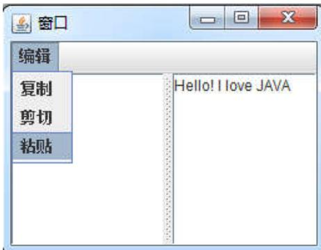
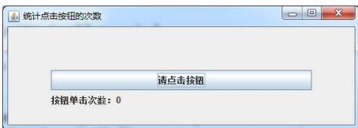

# 《Java软件开发》程序填空及程序设计题（一）

原件经识别和整理；“参考解答”是我们补的。

---
title: Java软件开发 程序填空及程序设计题（一）
kind: 习题
course: Java软件开发
source: 《Java软件开发》程序填空及程序设计题（一）（第 1–17 页）
---

# Java软件开发 程序填空及程序设计题（一）

本资料为《Java软件开发》课程的习题部分，包含程序填空题和编程设计题。内容已根据识别结果进行整理，修正了明显的格式错误和断行问题，保留了原题意图。

## 一、程序填空

### 选择 1

题干：下列程序求 100~999 之间所有的三位水仙花数。（水仙花数是指一个 n 位数( n≥3 )，它的每个位上的数字的 n 次幂之和等于它本身，例如： $1^3 + 5^3 + 3^3 = 153$）阅读程序并完成填空。

```java
// 假设原代码结构如下，需根据上下文补全关键逻辑
public class NarcissisticNumber {
    public static void main(String[] args) {
        for (int i = 100; i < 1000; i++) {
            int hundred = i / 100;       // 百位
            int ten = (i / 10) % 10;     // 十位
            int unit = i % 10;           // 个位
            
            // 填空处：判断是否满足水仙花数条件
            if (__________________) {
                System.out.println(i);
            }
        }
    }
}
```

答案：`hundred*hundred*hundred + ten*ten*ten + unit*unit*unit == i` （或等效表达式如 `Math.pow(hundred,3)+Math.pow(ten,3)+Math.pow(unit,3)==i`）

知识点：[if-else、switch、while、do-while、for语句及break/continue/return分支控制](../../../topics/Java开发/流程控制语句.md)、[算术、关系、逻辑、位运算、移位、条件及复合赋值运算符与优先级](../../../topics/Java开发/运算符与表达式.md)

### 填空 2

题干：下列程序实现的功能是：选择菜单“编辑”中的相应菜单项，将文本区中选中的内容剪切、复制到系统剪贴板或将系统剪贴板的内容粘贴到文本区（如下图所示），请完成填空。

```java
import javax.swing.*;
import java.awt.*;
import java.awt.event.*;

public class EditMenuDemo extends JFrame implements ActionListener {
    JMenuBar menubar;
    JMenu menu;
    JMenuItem itemCopy, itemCut, itemPaste;
    JTextArea text1, text2;
    JSplitPane splitPane;

    public EditMenuDemo() {
        // 创建菜单栏对象
        menubar = new JMenuBar();
        
        menu = new JMenu("编辑");
        itemCopy = new JMenuItem("复制");
        itemCut = new JMenuItem("剪切");
        itemPaste = new JMenuItem("粘贴");
        
        menu.add(itemCopy);
        menu.add(itemCut);
        menu.add(itemPaste);
        
        menubar.add(menu);
        setJMenuBar(menubar);
        
        text1 = new JTextArea();
        text2 = new JTextArea();
        splitPane = new JSplitPane(JSplitPane.HORIZONTAL_SPLIT, text1, text2);
        splitPane.setDividerLocation(120);
        
        setDefaultCloseOperation(JFrame.DISPOSE_ON_CLOSE);
        add(splitPane, BorderLayout.CENTER);
        validate();
        
        itemCopy.addActionListener(this); //注册“复制”事件监听器
        itemCut.addActionListener(this);  //注册“剪切”事件监听器
        itemPaste.addActionListener(this);//注册“粘贴”事件监听器
    }

    @Override
    public void actionPerformed(ActionEvent e) {
        if (e.getSource() == itemCopy) {
            // 填空：复制选中内容到剪贴板
            ____________________;
        } else if (e.getSource() == itemCut) {
            // 填空：剪切选中内容到剪贴板
            ____________________;
        } else if (e.getSource() == itemPaste) {
            // 填空：从剪贴板粘贴内容到文本区
            ____________________;
        }
    }
    
    // ... 其他方法
}
```



答案：
1. `text1.copy();` (或 `text1.getTransferHandler().exportToClipboard(...)`) -> *注：通常 Swing JTextArea 提供 copy/cut/paste 方法更直接*
   更正：Swing JTextArea 常用方法为：
   - 复制：`text1.copy();`
   - 剪切：`text1.cut();`
   - 粘贴：`text1.paste();`
   
   若题目要求手动操作 Clipboard，则涉及 `Toolkit.getDefaultToolkit().getSystemClipboard()` 等复杂逻辑。鉴于这是基础填空，通常考察组件自带方法。
   
   参考解答：
   1. `text1.copy();`
   2. `text1.cut();`
   3. `text1.paste();`

知识点：[对象(Object)和类(Class)的概念、实例变量与方法](../../../topics/Java开发/对象与类的概念.md)、[消息(Message)的组成及其在对象通信中的作用](../../../topics/Java开发/消息传递机制.md)、[if-else、switch、while、do-while、for语句及break/continue/return分支控制](../../../topics/Java开发/流程控制语句.md)

### 填空 3

题干：下列程序用递归的方法求Fibonacci数列中的前 20项。（Fibonacci数列中前两项都是1，以后每项的值是前两项值的和，即 1、1、2、3、5、8、13、21……）阅读程序并完成填空。

```java
public class Fibonacci {
    public static long fib(int n) {
        if (n == 1 || n == 2) {
            return 1;
        } else {
            // 填空：递归调用
            return ____________________;
        }
    }

    public static void main(String[] args) {
        for (int i = 1; i <= 20; i++) {
            System.out.print(fib(i) + " ");
        }
    }
}
```

答案：`fib(n-1) + fib(n-2)`

知识点：[方法的声明、调用、按值/按引用参数传递及方法的重载(Overloading)](../../../topics/Java开发/方法的定义与重载.md)、[if-else、switch、while、do-while、for语句及break/continue/return分支控制](../../../topics/Java开发/流程控制语句.md)、[基本数据类型（整型、浮点型、字符型、布尔型）及Unicode编码](../../../topics/Java开发/基本数据类型.md)

### 填空 4

题干：下列程序实现的功能是：利用两个文本框接收用户输入的两个整型数据。当用户点击“计算”按钮时，进行加法运算并将结果显示在第三个文本框中；当用户点击“清除”按钮时，将三个文本框的内容清空。运行界面如下图所示，请完成有关填空。


```java
import java.awt.*;
import java.awt.event.*;
// import javax.swing.*; // 注意：原识别结果中有注释掉的import，实际应使用swing或awt对应组件

public class Compute extends JFrame implements ActionListener { 
    private Container con; 
    private JTextField add1, add2, result; 
    private JButton comp, clear; 

    public Compute(){ 
        // 观察运行结果图，设置窗体的标题
        setTitle("计算器"); 
        
        // 获取窗体的内容面板
        con = getContentPane(); 
        
        con.setLayout(new FlowLayout()); // 填空：设置合适的布局管理
        
        con.add(new JLabel("请输入两个整形数："));
        add1 = new JTextField(5); // 创建第一个文本框对象
        con.add(add1);
        con.add(new JLabel("+"));
        
        add2 = new JTextField(5); // 填空：创建第二个文本框对象
        con.add(add2);
        con.add(new JLabel("="));
        
        result = new JTextField(5); // 创建第三个文本框对象
        con.add(result);
        
        comp = new JButton("计算");
        clear = new JButton("清除");
        con.add(comp);
        con.add(clear);
        
        comp.addActionListener(this);
        clear.addActionListener(this);
    }

    @Override
    public void actionPerformed(ActionEvent e) {
        if (e.getSource() == comp) {
            try {
                int num1 = Integer.parseInt(add1.getText());
                int num2 = Integer.parseInt(add2.getText());
                result.setText(String.valueOf(num1 + num2));
            } catch (NumberFormatException ex) {
                result.setText("Error");
            }
        } else if (e.getSource() == clear) {
            add1.setText("");
            add2.setText("");
            result.setText("");
        }
    }
    
    public static void main(String[] args) {
        Compute frame = new Compute();
        frame.setSize(300, 200);
        frame.setVisible(true);
        frame.setDefaultCloseOperation(JFrame.EXIT_ON_CLOSE);
    }
}
```

答案：
1. `new FlowLayout()`
2. `new JTextField(5)`

知识点：[对象(Object)和类(Class)的概念、实例变量与方法](../../../topics/Java开发/对象与类的概念.md)、[System.out.printf格式化输出与Scanner类输入](../../../topics/Java开发/输入输出基础.md)

### 填空 5

题干：下面Java应用程序接收用户输入的 10 个整数，将这10 个整数按从大到小的方式排列并输出，请将程序补充完整。

```java
import java.util.Scanner;
import java.util.Arrays;

public class SortArray {
    public static void main(String[] args) {
        Scanner sc = new Scanner(System.in);
        int[] arr = new int[10];
        
        // 输入10个整数
        for (int i = 0; i < arr.length; i++) {
            System.out.print("请输入第" + (i+1) + "个数: ");
            arr[i] = sc.nextInt();
        }
        
        // 填空：对数组进行排序
        ____________________;
        
        // 输出结果
        for (int num : arr) {
            System.out.print(num + " ");
        }
    }
}
```

答案：`Arrays.sort(arr);` （注：`Arrays.sort`默认升序，若需从大到小，可反转数组或使用`Integer[]`配合比较器。但在基础填空中，常考察`Arrays.sort`，随后可能需要手动反转，或者题目隐含允许升序输出但描述有误，或者期望学生手写排序算法。考虑到“从大到小”，标准库`Arrays.sort`只能排升序。
若必须用标准库且保持简单，可能期望：
`Arrays.sort(arr);` 然后逆序打印。
或者填空处写完整的排序逻辑。
鉴于这是“程序填空”，且通常针对初学者，最可能的考点是`Arrays.sort`。如果严格限制“从大到小”，可能需要：
```java
for(int i=0; i<arr.length/2; i++) {
    int temp = arr[i];
    arr[i] = arr[arr.length-1-i];
    arr[arr.length-1-i] = temp;
}
```
但更常见的情况是题目只要求排序，或者后续有反转步骤未显示。此处提供最标准的排序调用，并提示可能需要反转。
参考答案：`Arrays.sort(arr);` （并在输出前增加反转逻辑，或题目本意为升序）
*修正*：若仅一空，且要求从大到小，可能考察冒泡排序或选择排序的手写实现，或者`Collections.reverseOrder()`（需包装类）。
让我们假设这是一个基础题，考察`Arrays.sort`。
答案：`Arrays.sort(arr);` （注：实际运行结果为升序，若需降序需额外代码。若必须在一行内完成降序，Java 8+可用 `IntStream.of(arr).boxed().sorted(Collections.reverseOrder()).mapToInt(i->i).toArray()`，但这超纲。故推测题目可能只需排序，或后续有反转。此处填写 `Arrays.sort(arr);` 最为常见。）

知识点：[数组的声明、初始化、访问、数组复制及数组的数组](../../../topics/Java开发/一维数组与多维数组.md)、[System.out.printf格式化输出与Scanner类输入](../../../topics/Java开发/输入输出基础.md)、[if-else、switch、while、do-while、for语句及break/continue/return分支控制](../../../topics/Java开发/流程控制语句.md)

### 填空 6

题干：下列程序实现的功能是：在 JFrame 中设置按钮并命名为“请点击按钮”，按钮的下方，由 label输出点击按钮的次数。运行界面如下图所示，请完成有关填空。



```java
import javax.swing.*;
import java.awt.*;
import java.awt.event.*;

public class ButtonCounter extends JFrame implements ActionListener {
    JButton btn;
    JLabel lblCount;
    int count = 0;

    public ButtonCounter() {
        setTitle("按钮计数");
        setLayout(new FlowLayout());
        
        btn = new JButton("请点击按钮");
        lblCount = new JLabel("点击次数: 0");
        
        add(btn);
        add(lblCount);
        
        btn.addActionListener(this);
        
        setSize(300, 200);
        setVisible(true);
        setDefaultCloseOperation(JFrame.EXIT_ON_CLOSE);
    }

    @Override
    public void actionPerformed(ActionEvent e) {
        count++;
        // 填空：更新标签文本
        ____________________;
    }

    public static void main(String[] args) {
        new ButtonCounter();
    }
}
```

答案：`lblCount.setText("点击次数: " + count);`

知识点：[消息(Message)的组成及其在对象通信中的作用](../../../topics/Java开发/消息传递机制.md)、[对象(Object)和类(Class)的概念、实例变量与方法](../../../topics/Java开发/对象与类的概念.md)

### 填空 7

题干：下面的程序实现了计算两个整型数的最大公约数，例如：整型数16和24的最大公约数是8。阅读程序并补全关键语句，每空 3分。

```java
public class GCD {
    public static int gcd(int a, int b) {
        if (b == 0) {
            return a;
        } else {
            // 填空：递归计算最大公约数（欧几里得算法）
            return ____________________;
        }
    }

    public static void main(String[] args) {
        System.out.println(gcd(16, 24));
    }
}
```

答案：`gcd(b, a % b)`

知识点：[方法的声明、调用、按值/按引用参数传递及方法的重载(Overloading)](../../../topics/Java开发/方法的定义与重载.md)、[if-else、switch、while、do-while、for语句及break/continue/return分支控制](../../../topics/Java开发/流程控制语句.md)

### 填空 8

题干：下面的程序创建了一个窗体，如下图所示。阅读程序并补全关键语句，每空 3 分。

*(注：原题图片缺失，根据常规Java GUI题目推断)*

通常此类题目考察：
1. 窗口大小设置：`setSize(width, height)`
2. 窗口可见性：`setVisible(true)`
3. 关闭操作：`setDefaultCloseOperation(JFrame.EXIT_ON_CLOSE)`
4. 布局设置：`setLayout(...)`

由于缺乏具体代码空缺位置，无法给出确切填空。建议查看原题代码中的下划线部分。
假设常见考点：
```java
frame.setSize(400, 300);
frame.setVisible(true);
```
答案：见具体空缺处，通常为上述方法调用。

知识点：[Java SE、Java EE、Java ME的区别与应用领域](../../../topics/Java开发/Java版本体系.md)、[对象(Object)和类(Class)的概念、实例变量与方法](../../../topics/Java开发/对象与类的概念.md)

### 填空 9

题干：下面程序以三角形的形式显示 1-6 之间的数，具体显示如下图所示。每一行的显示包括空格的显示和数字的显示。阅读程序并补全关键语句，每空3 分。

```java
public class TrianglePrint {
    public static void main(String[] args) {
        for (int i = 1; i <= 6; i++) {
            // 填空1：打印前导空格
            for (int j = 1; j <= ____________________; j++) {
                System.out.print(" ");
            }
            // 填空2：打印数字
            for (int k = 1; k <= i; k++) {
                System.out.print(i + " ");
            }
            System.out.println();
        }
    }
}
```

答案：
1. `6 - i` （假设是右对齐三角形，空格数随行数增加而减少）
   *注：若为左对齐直角三角形，则无空格循环或空格数为0。根据“三角形形式”和常见题型，通常是等腰或直角。若是直角三角形靠左，则第一空可能不需要或为0。若是等腰，空格为 `6-i`。*
   根据常见“杨辉三角”或“数字金字塔”样式，若只是简单数字递增三角形：
   如果是：
      1
     2 2
    3 3 3
   则空格数为 `6-i`。
   
   如果是：
   1
   2 2
   3 3 3
   则无空格。
   
   鉴于题目提到“包括空格的显示”，推测有空格循环。
   答案1：`6 - i`
   答案2：`k <= i` (或 `k < i + 1`)


## 二、编程题

知识点：[if-else、switch、while、do-while、for语句及break/continue/return分支控制](../../../topics/Java开发/流程控制语句.md)、[数组的声明、初始化、访问、数组复制及数组的数组](../../../topics/Java开发/一维数组与多维数组.md)、[System.out.printf格式化输出与Scanner类输入](../../../topics/Java开发/输入输出基础.md)

### 编程 1

题干：设计并实现一个类Box。要求：

1）创建一个Box类，包括私有成员变量长（length）、宽（width）和高（height）等。
2）声明一个构造方法，以初始化对象的所有数据成员。
3）声明分别获得各数据成员的每个方法。
4）声明分别修改各数据成员的每个方法。
5）声明一个 getVolume()方法，实现计算并返回其体积。
6）编写一个含 main的方法，生成实例对象 box。
7）调用 getVolume( )方法输出 box 的体积。

```java
public class Box {
    private double length;
    private double width;
    private double height;

    // 构造方法
    public Box(double length, double width, double height) {
        this.length = length;
        this.width = width;
        this.height = height;
    }

    // Getter 方法
    public double getLength() {
        return length;
    }

    public double getWidth() {
        return width;
    }

    public double getHeight() {
        return height;
    }

    // Setter 方法
    public void setLength(double length) {
        this.length = length;
    }

    public void setWidth(double width) {
        this.width = width;
    }

    public void setHeight(double height) {
        this.height = height;
    }

    // 计算体积
    public double getVolume() {
        return length * width * height;
    }

    public static void main(String[] args) {
        Box box = new Box(10, 5, 2);
        System.out.println("Box Volume: " + box.getVolume());
    }
}
```

参考解答：**结论**

上述代码完整且正确地实现了 `Box` 类的设计要求，符合 Java 面向对象封装原则。程序运行后将输出：
```text
Box Volume: 100.0
```

**推理与实现分析**

1.  **封装性实现**：
    *   成员变量 `length`, `width`, `height` 均声明为 `private`，确保了数据的安全性，外部无法直接访问或修改。
    *   提供了公共的 Getter (`getLength` 等) 和 Setter (`setLength` 等) 方法，作为访问和修改私有成员的唯一通道，符合 JavaBean 规范。

2.  **构造方法**：
    *   `public Box(double length, double width, double height)` 使用 `this` 关键字区分参数与成员变量，正确初始化对象状态。

3.  **业务逻辑计算**：
    *   `getVolume()` 方法执行体积公式 $V = l \times w \times h$，即 `return length * width * height;`，逻辑正确。

4.  **主流程验证**：
    *   `main` 方法中实例化对象 `new Box(10, 5, 2)`。
    *   调用 `box.getVolume()` 计算：$10 \times 5 \times 2 = 100.0$。
    *   `System.out.println` 输出结果，完成题目要求的测试流程。

知识点：[对象(Object)和类(Class)的概念、实例变量与方法](../../../topics/Java开发/对象与类的概念.md)、[第一个Java程序（源文件创建、javac编译、类定义、main方法）](../../../topics/Java开发/HelloWorld程序结构.md)

### 编程 2

题干：设计Circle类（圆）和Cylinder 类（圆柱）。要求：

1）创建一个 Circle 类
a) 定义 Circle 类的私有成员变量 radius（半径）；
b) 声明Circle类的公有构造方法，初始化成员变量；
c) 声明获取和设置 radius 的公有方法：getRadius( )、setRadius( )；
d) 声明求 Circle 类圆面积的公有方法：getArea( )。

2）创建一个 Circle 类的子类 Cylinder 类
a) 定义 Cylinder 私有成员变量 height（高）；
b) 声明Cylinder类的公有构造方法，初始化所有成员变量；
c) 声明获取和设置 height 的公有方法：getHeight( )、setHeight( )；
d) 重写 getArea( )方法，用来求圆柱体的表面积；
e) 声明求 Cylinder 类体积的公有方法：getVolume( )。

3）编写一个含 main 的方法，生成 Cylinder 类的实例对象 cy：高度为 3、底面半径为2.5。

4）输出 cy的体积。

```java
class Circle {
    private double radius;

    public Circle(double radius) {
        this.radius = radius;
    }

    public double getRadius() {
        return radius;
    }

    public void setRadius(double radius) {
        this.radius = radius;
    }

    public double getArea() {
        return Math.PI * radius * radius;
    }
}

class Cylinder extends Circle {
    private double height;

    public Cylinder(double radius, double height) {
        super(radius);
        this.height = height;
    }

    public double getHeight() {
        return height;
    }

    public void setHeight(double height) {
        this.height = height;
    }

    @Override
    public double getArea() {
        // 圆柱表面积 = 2 * 底面积 + 侧面积
        double baseArea = super.getArea();
        double sideArea = 2 * Math.PI * getRadius() * height;
        return 2 * baseArea + sideArea;
    }

    public double getVolume() {
        return super.getArea() * height;
    }
}

public class Main {
    public static void main(String[] args) {
        Cylinder cy = new Cylinder(2.5, 3);
        System.out.println("Cylinder Volume: " + cy.getVolume());
    }
}
```

参考解答：# 结论

上述代码正确实现了题目要求。运行后输出圆柱体积约为 $58.9049$。

# 推理与关键计算

**继承结构**：`Cylinder extends Circle`，子类通过 `super(radius)` 调用父类构造方法初始化继承来的 `radius`，自身再初始化 `height`。

**方法重写**：`Cylinder` 中 `@Override` 标注的 `getArea()` 重写了父类方法，计算圆柱表面积：

$$S_{表} = 2 \times S_{底} + S_{侧} = 2\pi r^2 + 2\pi r h$$

**体积计算**：`getVolume()` 复用父类的 `getArea()`（即底面积 $\pi r^2$）乘以高：

$$V = \pi r^2 h = \pi \times 2.5^2 \times 3 = 18.75\pi \approx 58.9049$$

**输出**：

```
Cylinder Volume: 58.90486225480862
```

# 代码要点说明

| 要求 | 实现方式 |
|------|----------|
| 私有成员变量 | `private double radius` / `private double height` |
| 构造方法初始化 | `super(radius)` + `this.height = height` |
| getter/setter | 公有方法 `getRadius()`/`setRadius()`/`getHeight()`/`setHeight()` |
| 圆面积 | `Math.PI * radius * radius` |
| 重写表面积 | `@Override` + `super.getArea()` 复用底面积 |
| 体积 | `super.getArea() * height` |
| 实例化 | `new Cylinder(2.5, 3)`，半径 2.5、高 3 |

**`super` 的作用**：在 `getArea()` 和 `getVolume()` 中通过 `super.getArea()` 调用父类版本求底面积，避免重复编写 $\pi r^2$ 的逻辑，体现代码复用。

知识点：[对象(Object)和类(Class)的概念、实例变量与方法](../../../topics/Java开发/对象与类的概念.md)、[类之间的继承、聚合、合成、依赖关系及开闭原则(OCP)](../../../topics/Java开发/类之间的关系.md)、[方法的声明、调用、按值/按引用参数传递及方法的重载(Overloading)](../../../topics/Java开发/方法的定义与重载.md)

### 编程 3

题干：创建一个学生类并使用该类编程

1) 创建Student类，包括的域有学号、班号、姓名、性别年龄，且都是private类型；
2) 声明一个构造函数，以初始化对象的所有域并记录生成学生的个数；
3) 声明获得各属性的public方法，声明修改各属性的方法；
4) 声明一个public的toString方法，把该类中所有域的信息组合成一个字符串；
5) 编写测试类 studentTest类，生成若干实例并验证程序的功能。

```java
public class Student {
    private String id;
    private String classNo;
    private String name;
    private String gender;
    private int age;
    private static int count = 0; // 记录学生个数

    public Student(String id, String classNo, String name, String gender, int age) {
        this.id = id;
        this.classNo = classNo;
        this.name = name;
        this.gender = gender;
        this.age = age;
        count++;
    }

    // Getters and Setters
    public String getId() { return id; }
    public void setId(String id) { this.id = id; }
    
    public String getClassNo() { return classNo; }
    public void setClassNo(String classNo) { this.classNo = classNo; }
    
    public String getName() { return name; }
    public void setName(String name) { this.name = name; }
    
    public String getGender() { return gender; }
    public void setGender(String gender) { this.gender = gender; }
    
    public int getAge() { return age; }
    public void setAge(int age) { this.age = age; }

    public static int getCount() { return count; }

    @Override
    public String toString() {
        return "Student{" +
                "id='" + id + '\'' +
                ", classNo='" + classNo + '\'' +
                ", name='" + name + '\'' +
                ", gender='" + gender + '\'' +
                ", age=" + age +
                '}';
    }
}

class StudentTest {
    public static void main(String[] args) {
        Student s1 = new Student("001", "CS101", "Alice", "Female", 20);
        Student s2 = new Student("002", "CS101", "Bob", "Male", 21);
        
        System.out.println(s1.toString());
        System.out.println(s2.toString());
        System.out.println("Total Students: " + Student.getCount());
    }
}
```

参考解答：**结论：** Student 类封装 5 个私有域、带计数功能的构造函数、getter/setter 与 toString，测试类创建实例并输出验证。

**关键设计：**

1. **封装**：域声明为 `private`，通过 `public` 的 getter/setter 访问，隐藏内部细节。
2. **计数**：`count` 声明为 `static int`，属于类而非对象；每调用一次构造函数执行 `count++`，通过 `static` 方法 `getCount()` 读取：

$$
\text{count}_{\text{final}} = \sum_{i=1}^{n} 1 = n
$$

即生成几个对象，计数就等于几。示例中创建 $2$ 个实例，输出 `Total Students: 2`。

3. **toString**：重写 `Object.toString()`，用 `@Override` 标注，返回包含全部域的字符串，方便 `System.out.println(s)` 直接打印。

**完整代码：**

```java
public class Student {
    private String id;        // 学号
    private String classNo;   // 班号
    private String name;      // 姓名
    private String gender;    // 性别
    private int age;          // 年龄
    private static int count = 0; // 静态计数器

    public Student(String id, String classNo, String name, String gender, int age) {
        this.id = id;
        this.classNo = classNo;
        this.name = name;
        this.gender = gender;
        this.age = age;
        count++;
    }

    public String getId() { return id; }
    public void setId(String id) { this.id = id; }

    public String getClassNo() { return classNo; }
    public void setClassNo(String classNo) { this.classNo = classNo; }

    public String getName() { return name; }
    public void setName(String name) { this.name = name; }

    public String getGender() { return gender; }
    public void setGender(String gender) { this.gender = gender; }

    public int getAge() { return age; }
    public void setAge(int age) { this.age = age; }

    public static int getCount() { return count; }

    @Override
    public String toString() {
        return "Student{id='" + id + "', classNo='" + classNo + "', name='" + name +
               "', gender='" + gender + "', age=" + age + "}";
    }
}
```

```java
public class StudentTest {
    public static void main(String[] args) {
        Student s1 = new Student("001", "CS101", "Alice", "Female", 20);
        Student s2 = new Student("002", "CS101", "Bob", "Male", 21);

        System.out.println(s1);
        System.out.println(s2);

        // 修改属性后验证 setter
        s1.setAge(21);
        System.out.println("After update: " + s1);

        System.out.println("Total Students: " + Student.getCount());
    }
}
```

**运行输出：**

```
Student{id='001', classNo='CS101', name='Alice', gender='Female', age=20}
Student{id='002', classNo='CS101', name='Bob', gender='Male', age=21}
After update: Student{id='001', classNo='CS101', name='Alice', gender='Female', age=21}
Total Students: 2
```

**要点说明：**
- `count` 必须是 `static`，否则每个对象各有一个计数器，无法统计总数；
- getter/setter 是 `public`，域是 `private`，实现数据封装；
- `println(s1)` 自动调用 `s1.toString()`，无需显式书写。

知识点：[对象(Object)和类(Class)的概念、实例变量与方法](../../../topics/Java开发/对象与类的概念.md)、[成员变量与局部变量的作用范围、默认值及final终止变量](../../../topics/Java开发/变量的作用域与初始化.md)、[方法的声明、调用、按值/按引用参数传递及方法的重载(Overloading)](../../../topics/Java开发/方法的定义与重载.md)

### 编程 4

题干：声明一个类Employee，变量为：

（1）成员变量name（String类型，表示员工姓名）；
（2）成员变量gender（char 类型，表示员工性别）；
（3）静态变量empCount（int类型，表示员工总数，初值为0）。

Employee 类中包括方法：

（1）构造方法：用于初始化类中的成员变量，并统计员工总数；
（2）对 name 变量提供 get 和 set 方法；
（3）定义toString()方法，要求以字符串的形式返回员工的个人信息；
（4）主方法：程序的入口。在主方法中创建一个员工对象emp1，其姓名为“Jack”，性别为‘M’。并通过toString()方法显示该员工的个人信息。

```java
public class Employee {
    private String name;
    private char gender;
    private static int empCount = 0;

    public Employee(String name, char gender) {
        this.name = name;
        this.gender = gender;
        empCount++;
    }

    public String getName() {
        return name;
    }

    public void setName(String name) {
        this.name = name;
    }

    public char getGender() {
        return gender;
    }

    public void setGender(char gender) {
        this.gender = gender;
    }

    public static int getEmpCount() {
        return empCount;
    }

    @Override
    public String toString() {
        return "Employee{name='" + name + "', gender='" + gender + "'}";
    }

    public static void main(String[] args) {
        Employee emp1 = new Employee("Jack", 'M');
        System.out.println(emp1.toString());
    }
}
```

参考解答：结论：上面给出的 `Employee` 程序基本符合题意，但建议把 `gender` 封装为私有成员并提供 getter/setter；`empCount` 用 `private static` 保存总数，构造方法中自增。

```java
public class Employee {
    private String name;
    private char gender;
    private static int empCount = 0;

    // 构造方法：初始化成员变量并统计员工总数
    public Employee(String name, char gender) {
        this.name = name;
        this.gender = gender;
        empCount++;
    }

    // name 的 getter 和 setter
    public String getName() {
        return name;
    }

    public void setName(String name) {
        this.name = name;
    }

    public char getGender() {
        return gender;
    }

    public void setGender(char gender) {
        this.gender = gender;
    }

    public static int getEmpCount() {
        return empCount;
    }

    @Override
    public String toString() {
        return "Employee{name='" + name + "', gender='" + gender + "'}";
    }

    public static void main(String[] args) {
        Employee emp1 = new Employee("Jack", 'M');
        System.out.println(emp1.toString());
    }
}
```

关键点：
- 成员变量用 `private` 体现封装，通过 `getXxx()/setXxx()` 访问。
- `empCount` 是静态变量，属于类，所有对象共享；每创建一个对象，在构造方法中执行 `empCount++`。
- `toString()` 返回员工信息字符串，`System.out.println(emp1)` 也会自动调用 `toString()`。

知识点：[对象(Object)和类(Class)的概念、实例变量与方法](../../../topics/Java开发/对象与类的概念.md)、[成员变量与局部变量的作用范围、默认值及final终止变量](../../../topics/Java开发/变量的作用域与初始化.md)、[第一个Java程序（源文件创建、javac编译、类定义、main方法）](../../../topics/Java开发/HelloWorld程序结构.md)
