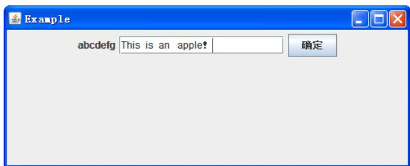
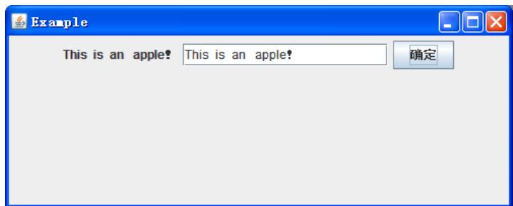

# 《Java软件开发》考试题型及各章学习要点（复习要点）

原件经识别和整理；“参考解答”是我们补的。

# 考试题型

## 一、选择题（20分，每题2分）
10题

## 二、简答题（15分，每题5分）
3题

## 三、程序填空（共45分，每空 3分）
3大题

## 四、编程题（20分）
1大题

# 各章复习要点

## 第 2 章 Java 基本语法

### 1、标识符

标识符的作用是用于标识程序中的各个元素。由字母、下划线（`_`）、美元符（`$`）、数字（0~9）组成，数字不能开头。

知识点：[Java标识符命名规则与保留关键字](../../../topics/Java开发/标识符与关键字.md)

### 2、关键字

P20（浏览一下，留意学过的关键字）

知识点：[Java标识符命名规则与保留关键字](../../../topics/Java开发/标识符与关键字.md)

### 3、数据类型

基本数据类型 P20 图2-1 、P21 表2-1。各类型需要掌握的要点：类型名称、关键字，占用位数、取值范围（整数类型的取值范围取决于占用位数，如：占用位数为 $n$，则表示的范围是：$-2^n \sim 2^n-1$）。

知识点：[基本数据类型（整型、浮点型、字符型、布尔型）及Unicode编码](../../../topics/Java开发/基本数据类型.md)、[Java标识符命名规则与保留关键字](../../../topics/Java开发/标识符与关键字.md)、[成员变量与局部变量的作用范围、默认值及final终止变量](../../../topics/Java开发/变量的作用域与初始化.md)

### 4、运算符与表达式

自增、自减符号在变量的前后位置不同，表达式的结果是不一样的。

例如：
```java
int a = 1, b = 2;   
System.out.print(a++ > -b); // 结果为 false
```

`++` 在 `a` 变量后面，那表达式 `a++` 的值是取 `a` 的值作为表达式的值，值为 1。

`--` 在 `b` 变量之前，那表达式 `--b` 的值是多少？先让 `b` 自减 1，而后在取 `b` 的值作为表达式的值，即为 1。最后 `a` 自增 1。

条件运算符 `?:` 例如：
```java
int x=-1,y; 
y=x>=0?x:-x; 
// y 的值是? y 值为 1
```

知识点：[算术、关系、逻辑、位运算、移位、条件及复合赋值运算符与优先级](../../../topics/Java开发/运算符与表达式.md)

### 5、利用 Scanner 类输入

(1) 导入 util 包。例如：`import java.util.*;`

(2) 创建 Scanner 类对象引用 。例如：`Scanner s=new Scanner(System.in);`

(3) 获得键盘输入的数据，可以调用 `nextXXX()` 方法。获得整型数据，使用 `nextInt()`；获得双精度浮点数据，使用 `nextDouble()`；获得一字符串，使用 `nextLine()`。例如 `int a=s.nextInt();`

P29 例 2-3

知识点：[System.out.printf格式化输出与Scanner类输入](../../../topics/Java开发/输入输出基础.md)、[Java标识符命名规则与保留关键字](../../../topics/Java开发/标识符与关键字.md)、[基本数据类型（整型、浮点型、字符型、布尔型）及Unicode编码](../../../topics/Java开发/基本数据类型.md)

### 6、程序流程控制

顺序结构、选择结构（`if()…; if()…else…; switch() case n:…;[default:…;]`）、循环结构(`while(){…}; do{…}while(); for(;;)…`)

P49 例 2-20、P60 例 2-29

知识点：[if-else、switch、while、do-while、for语句及break/continue/return分支控制](../../../topics/Java开发/流程控制语句.md)、[基本数据类型（整型、浮点型、字符型、布尔型）及Unicode编码](../../../topics/Java开发/基本数据类型.md)、[算术、关系、逻辑、位运算、移位、条件及复合赋值运算符与优先级](../../../topics/Java开发/运算符与表达式.md)

### 7、数组

一维数组的声明与创建

**声明：**
`类型 数组名[] ;` 或 `类型 [] 数组名;`

**创建：**
`数组名=new 类型[数组长度];`

也可以声明与创建合并：
`类型 数组名[]=new 类型[数组长度];`
注意等号左边的中括号中不要写出数组长度。

也可以声明数组的同时进行初始化赋值，例如：
```java
int a[] = {1, 2, 3, 4, 5};
```
注意大括号仅在数组声明后给值的情况。
```java
int a[]; 
a = {1, 2, 3, 4, 5}; // 这种用法是不对的。
```

知识点：[数组的声明、初始化、访问、数组复制及数组的数组](../../../topics/Java开发/一维数组与多维数组.md)、[Java标识符命名规则与保留关键字](../../../topics/Java开发/标识符与关键字.md)、[基本数据类型（整型、浮点型、字符型、布尔型）及Unicode编码](../../../topics/Java开发/基本数据类型.md)

### 8、方法的重载

在一个类中可以定义多个同名的方法，但要求各方法具有不同的参数类型或参数个数。方法重载通常用于创建完成一组任务相似但参数不同的方法。

## 第 3章 类与对象

知识点：[方法的声明、调用、按值/按引用参数传递及方法的重载(Overloading)](../../../topics/Java开发/方法的定义与重载.md)

### 1、类的定义

```java
[类的修饰符] class 类名 [extends 父类名] //中括号表示可以省略
{
    // 实例变量的定义
    // 成员变量的定义
    // 类(static)变量的定义
    
    // 实例方法的定义 (方法中的变量称为方法变量)
    // 成员方法的定义
    // 类(static)方法的定义
}
```

知识点：[对象(Object)和类(Class)的概念、实例变量与方法](../../../topics/Java开发/对象与类的概念.md)、[类之间的继承、聚合、合成、依赖关系及开闭原则(OCP)](../../../topics/Java开发/类之间的关系.md)、[成员变量与局部变量的作用范围、默认值及final终止变量](../../../topics/Java开发/变量的作用域与初始化.md)

### 2、构造方法

构造方法是类中一种特殊的方法，主要用于初始化类对象实体。类的构造方法的名字必须与它所在类的名字完全相同，而且没有类型。允许一个类中编写若干个构造方法，但必须保证它们的参数不同，参数不同是指：参数的个数不同，或参数个数相同，但参数列表中对应的某个参数的类型不同。

知识点：[对象(Object)和类(Class)的概念、实例变量与方法](../../../topics/Java开发/对象与类的概念.md)、[方法的声明、调用、按值/按引用参数传递及方法的重载(Overloading)](../../../topics/Java开发/方法的定义与重载.md)

### 3、类对象的创建

(1) 分2步：先声明，后创建。
```java
类名 引用变量名; 
引用变量名=new 构造方法(实际参数);
```
构造方法中的实际参数取决于构造方法定义给定的形式参数。

(2) 1步：
```java
类名 引用变量名=new 构造方法(实际参数);
```

知识点：[对象(Object)和类(Class)的概念、实例变量与方法](../../../topics/Java开发/对象与类的概念.md)、[成员变量与局部变量的作用范围、默认值及final终止变量](../../../topics/Java开发/变量的作用域与初始化.md)、[方法的声明、调用、按值/按引用参数传递及方法的重载(Overloading)](../../../topics/Java开发/方法的定义与重载.md)

### 4、综合（实验报告二（4））

学生类的创建和使用

①创建一个 `Student` 类，成员变量包括：学号、姓名、性别、年龄等，且都是 `private` 类型。

②声明一个构造方法，初始化所有成员变量。

③分别声明获得各属性的 `public` 成员方法，方法名要求以 `get` 开头。

④分别声明修改各属性的 `public` 成员方法，方法名要求以 `set` 开头。

⑤声明一个 `public` 类型的 `toString()` 方法，把该类中的所有域信息组合成一个字符串。

⑥声明统计创建 `Student` 对象的个数的私有域 `count` 和得到 `Student` 对象的个数的 `public` 方法。

主方法测试类功能（2 种，任取一种）

○7 编写测试类 `Test`，在主类中，创建 2 个 `Student` 对象，输出对象的所有域信息；修改对象的姓名和年龄，输出修改后的姓名和年龄；比较两个 `Student` 对象的年龄的大小，输出年龄较大的 `Student` 对象。

○8 在 `Student` 类中编写主方法，创建 2 个 `Student` 对象，输出对象的所有域信息；修改对象的姓名和年龄，输出修改后的姓名和年龄；比较两个 `Student` 对象的年龄的大小，输出年龄较大的 `Student` 对象。

## 第 4 章 继 承

Java 不支持类的多重继承，继承关键字 `extends` ，参见第三章类的定义。

## 第 5章 抽象、接口

知识点：[对象(Object)和类(Class)的概念、实例变量与方法](../../../topics/Java开发/对象与类的概念.md)、[方法的声明、调用、按值/按引用参数传递及方法的重载(Overloading)](../../../topics/Java开发/方法的定义与重载.md)、[Java标识符命名规则与保留关键字](../../../topics/Java开发/标识符与关键字.md)

### 1、抽象类

知识点：[对象(Object)和类(Class)的概念、实例变量与方法](../../../topics/Java开发/对象与类的概念.md)、[接口(Interface)用于定义协议或行为的作用](../../../topics/Java开发/接口的基础概念.md)、[类之间的继承、聚合、合成、依赖关系及开闭原则(OCP)](../../../topics/Java开发/类之间的关系.md)

### 2、接口

接口成员有 3 种：
a. 常量（接口中的成员量都是常量，可以省略 `public`、`static` 、`final` 关键字）
b. 接口中的方法都是抽象方法（接口中一般省略了 `public`、`abstract` 关键字）
c. 嵌套类和嵌套接口

类通过实现(`implements`)接口来发挥接口的功能，如果该类是非抽象类，那就必须重写接口中的所有方法。

接口和抽象类有些相似，区别在于：
（1）接口可以多继承，而类只允许单继承；
（2）抽象类可以有部分实现，可以有静态方法等；而接口不允许有任何实现。

## 第 6 章 异常

在程序执行期间，可能会有许多意外的事件发生。Java 把这些意外的事件成为“异常”。对发生的异常，进行处理，将使程序更加清晰、健壮、容错能力强。

异常处理的方式：
(1) `try-catch-finally` 语句
(2) 使用 `throw` 语句直接抛出异常或使用 `throws` 语句间接抛出异常。

## 第 7章 文件管理与输入/输出

Java 支持两种类型的流：字节流和字符流。字节流由抽象类 `InputStream` 和 `OutputStream` 的子类实现。字符流由抽象类 `Reader` 和 `Writer` 的子类实现。

## 第 8章 线 程

知识点：[接口(Interface)用于定义协议或行为的作用](../../../topics/Java开发/接口的基础概念.md)、[类之间的继承、聚合、合成、依赖关系及开闭原则(OCP)](../../../topics/Java开发/类之间的关系.md)、[if-else、switch、while、do-while、for语句及break/continue/return分支控制](../../../topics/Java开发/流程控制语句.md)

### 1、线程的概念

线程是比进程更小的执行单位，一个进程在其执行过程中，可以产生多个线程，形成多条执行线索，每条线索，即每个线程也有它自身的产生、存在和消亡的过程。

知识点：[Java平台、JVM定义及编译解释执行原理](../../../topics/Java开发/Java平台与JVM.md)

### 2、线程的生命周期

(1) **新建**
a. 一个用 `Thread` 类或其子类的对象被声明并创建
b．一个用实现了 `Runnable` 接口的类创建的

(2) **运行**
线程调用 `start()` 方法。JVM 会知道又有一个新线程排队等候切换了，当 JVM 将 CPU 使用权切换给线程时，该类中的 `run()` 方法就立刻执行，`run()` 方法规定了该线程的具体使命。

(3) **中断**
有 4 种中断原因：
a. JVM 将 CPU 资源从当前线程切换给其他线程，使本线程让出 CPU 的使用权。
b. 线程使用 CPU 资源期间，执行了 `sleep(int millsecond)` 方法，使当前线程进入休眠状态。经过参数指定的毫秒数后，该线程重新进到线程队列排队等待 CPU 资源，该方法可能会引起 `InterruptedException` 异常。
c． 线程使用 CPU 资源期间，执行了 `wait()` 方法，使得当前线程进入等待状态。等待状态线程不会主动进到线程队列中排队等待 CPU 资源，必须由其他线程调用 `notify()` 或 `notifyall()` 方法通知它，使得它重新排队等待 CPU 资源。
d. 线程使用 CPU 资源期间，执行某个操作进入阻塞状态，比如执行读/写操作引起阻塞。只有当引起阻塞的原因消除时，线程才重新进到线程队列中排队等待 CPU 资源。

(4) **死亡**
死亡原因有二种：
a. 执行完 `run()` 方法中的全部语句；
b. 被提前强制性终止 `run()` 方法。所谓死亡状态就是线程释放了实体，即释放分配给线程对象的内存。

P162 方式一：继承 Thread 类
P163 方式二：实现 Runnable 接口

## 第 9章 图形用户界面设计

知识点：[Java平台、JVM定义及编译解释执行原理](../../../topics/Java开发/Java平台与JVM.md)、[对象(Object)和类(Class)的概念、实例变量与方法](../../../topics/Java开发/对象与类的概念.md)、[接口(Interface)用于定义协议或行为的作用](../../../topics/Java开发/接口的基础概念.md)

### 1、组件和容器

组件是图形用户界面的基本部分，比如一个按钮，一个标签等。

容器用于包含组件和容器，可以通过 `add(组件或容器)` 方法添加括号中的参数到当前容器。

知识点：[对象(Object)和类(Class)的概念、实例变量与方法](../../../topics/Java开发/对象与类的概念.md)、[消息(Message)的组成及其在对象通信中的作用](../../../topics/Java开发/消息传递机制.md)

### 2、布局管理

常用布局：

a. **FlowLayout**
该布局的特点：将各个组件按 `add` 方法顺序地添加到容器，组件按照从左向右，第一行排满后排第二行，每行中组件都居中排列。是 `JPanel` 型容器的默认布局。

b. **BorderLayout**
如果一个容器使用这种布局，那么容器空间简单的划分为东、西、南、北、中五个区域，中间的区域最大。每加入一个组件都应该指明这个组件加在哪个区域中，区域由 `BorderLayout` 的静态常量 `CENTER`、`NORTH`、`SOUTH`、`WEST`、`EAST` 表示。

c. **CardLayout**
使用 `CardLayout` 的容器可以容纳多个组件，这些组件被层叠放入容器中，最先加入容器的是第一张（最上面），依次向下排序。使用该布局的特点是，同一时刻容器只能从这个组件中选出一个来显示，这个被显示的组件将占据所有的容器空间。

d. **GridLayout**
其基本布局策略是把容器划分成若干行乘若干列的网格区域，组件就由 `add()` 方法添加顺序依次从第一行第一列、第一行第二列……被填充到这些划分出来的小格中。

知识点：[对象(Object)和类(Class)的概念、实例变量与方法](../../../topics/Java开发/对象与类的概念.md)、[接口(Interface)用于定义协议或行为的作用](../../../topics/Java开发/接口的基础概念.md)

### 3、事件处理模型

编写代码时注意以下三点：
(1) 确定事件源
(2) `事件源.addXXXListener(实现事件监听接口类对象引用)`
(3) 事件监听接口相应的事件处理方法重写

知识点：[接口(Interface)用于定义协议或行为的作用](../../../topics/Java开发/接口的基础概念.md)、[对象(Object)和类(Class)的概念、实例变量与方法](../../../topics/Java开发/对象与类的概念.md)、[消息(Message)的组成及其在对象通信中的作用](../../../topics/Java开发/消息传递机制.md)

### 4、创建窗口有2 种方法

a. 在主类中创建 `JFrame` 类对象引用，再创建各组件并添加到窗口。
b. 创建 `JFrame` 类的子类。

例如：
窗口中有三个组件，依次是：标签(`JLabel`)、文本框(`JTextField`)、按钮(`JButton`)。
现在在文本框中输入字符，单击“确定”按钮后，标签就显示为文本框中的内容。

如图 1 所示，点击“确定”按钮后，如图 2 所示





方法一：在主类中创建 JFrame 类对象引用，再创建各组件并添加到窗口
方法二：创建 JFrame 类的子类

知识点：[对象(Object)和类(Class)的概念、实例变量与方法](../../../topics/Java开发/对象与类的概念.md)、[类之间的继承、聚合、合成、依赖关系及开闭原则(OCP)](../../../topics/Java开发/类之间的关系.md)、[System.out.printf格式化输出与Scanner类输入](../../../topics/Java开发/输入输出基础.md)
