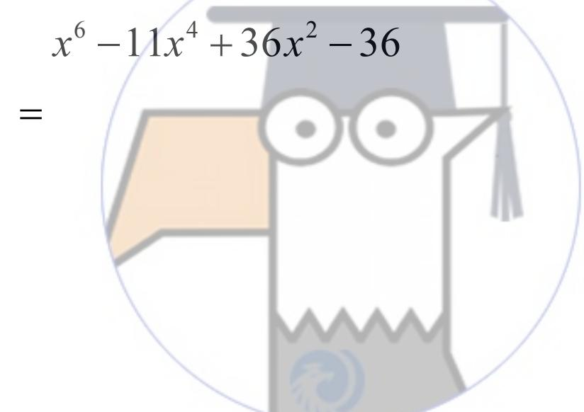

# 《信息安全数学基础》习题1-4

原件经识别和整理；“参考解答”是我们补的。

# 信息安全数学基础习题1-4（第1部分）

整理自《信息安全数学基础》习题1-4第1部分（第1–17页），包含习题1.1至1.3的证明与解答。

## 习题 1.1

### 证明 1

**(1) 利用最大公约数的表达式证明：若 $(a,m)=(b,m)=1$ ，则有 $(ab,m)=1$。**

证明：由 $(a,m)=(b,m)=1$ 可知， $\exists x,y,u,v\in Z$ ，使得

$$
ax + my = 1, \quad bu + mv = 1,
$$

于是

$$
(ax)(bu) = (1 - my)(1 - mv),
$$

从而

$$
ab(xu) + m(y + v - myv) = 1,
$$

由 $xu, y + v - myv \in Z$ 可知， $(ab, m) = 1$ 。

**(2) 若 $(m,a)=1$ ，则 $(m,ab)=(m,b)$ 。**

证明：由 $(m, a) = 1$ 可知，存在整数 $x_0, y_0$ 使得 $mx_0 + ay_0 = 1$ ，从而

$$
\begin{aligned}
(m, b) &= \min \{mx + by \mid x, y \in Z \} \\
&= \min \{(mx + by)(mx_0 + ay_0) \mid x, y \in Z \} \\
&= \min \{m(mx_0x + ay_0x + bx_0y) + aby_0y \mid x, y \in Z \} \\
&= \min \{mx' + aby' \mid x', y' \in Z \} \\
&= (m, ab)
\end{aligned}
$$

**(3) 若 $(m, a) = 1$ ， $m \mid ab$ ，则 $m \mid b$ 。**

证明：由 $(m, a) = 1$ 可知，存在整数 $x, y$ 使得

$$
mx + ay = 1,
$$

从而

$$
mbx + aby = b
$$

由 $m \mid ab$ 即知

$$
m \mid b
$$

**(4) 若 $(a,b) = d$ ，则 $\left(\frac{a}{d},\frac{b}{d}\right) = 1$ 。**

证明：由 $(a, b) = d$ 可知，存在整数 $x, y$ 使得

$$
ax + by = d,
$$

从而

$$
\left(\frac{a}{d}, \frac{b}{d}\right) = \min \{\frac{a}{d} x + \frac{b}{d} y \mid x, y \in Z \}
$$

即存在整数 $x, y$ 使得上式成立，故

$$
\left(\frac{a}{d}, \frac{b}{d}\right) = \frac{1}{d} \min \{ax + by \mid x, y \in Z \} = \frac{1}{d} \cdot d = 1
$$

知识点：[模m的乘法逆元的定义、存在条件与计算方法](../../../topics/信息安全数学基础/逆元.md)

### 证明 2

**(2) 若 $\forall 1 \leq i, j \leq n, (a_i, m_i) = 1, (M_i, m_j) = \begin{cases} 1 & i = j \\ m_j & i \neq j \end{cases}$ , 求证: $(\sum_{i=1}^{n} a_i M_i, \prod_{i=1}^{n} m_i) = 1$ 。**

证明：由题设可知， $\forall 1 \leq i \neq j \leq n$ 有， $(M_{i}, m_{i}) = 1, m_{i} \mid M_{j}, (a_{i}, m_{i}) = 1$ 由最大公约数的性质及(1)中结论知， $\forall 1 \leq i \leq n$ ，

$$
\begin{aligned}
(\sum_{k = 1} ^ {n} a _ {k} M _ {k}, m _ {i}) &= (a _ {i} M _ {i} + \sum_{\substack {1 \leq k \leq n \\ k \neq i}} a _ {k} M _ {k}, m _ {i}) \\
&= (a _ {i} M _ {i}, m _ {i}) \\
&= 1
\end{aligned}
$$

进而有 $(\sum_{i=1}^{n} a_i M_i, \prod_{i=1}^{n} m_i) = 1$ 。

### 证明 3

**对每一奇数 $n$ ，求证： $8 \mid (n^2 - 1)$ 。**

证明：设 $n=2k+1,\quad k\in Z$ ，则

$$
n ^ {2} - 1 = (2 k + 1) ^ {2} - 1 = 4 k ^ {2} + 4 k = 4 k (k + 1),
$$

由于 $2 \mid k(k + 1)$ ，设 $k(k + 1) = 2x, x \in Z$ ，则

$$
n ^ {2} - 1 = 4 \times 2 x = 8 x
$$

从而 $8 \mid n^{2} - 1$ 。

### 证明 4

**设 $n \in Z$ ，求证： $6|n^3 - n$ 。**

证明： $n^3 - n = n(n^2 - 1) = n(n - 1)(n + 1)$ ，

由于 $n - 1, n, n + 1$ 中至少有一个偶数，有且仅有一个能被3整除，从而 $2 \mid n^3 - n, 3 \mid n^3 - n,$

①仿例 2: 设 $n^{3} - n = 2k$ ，则 $3 \mid 2k$ ，由此及 $3 \mid 3k$ ，利用 TH1.1.1(5)有 $3 \mid (3k - 2k)$ ，所以 $k = 3u, u \in Z$ ，从而 $n^{3} - n = 6u$ ，即 $6 \mid n^{3} - n$ 。

②设 $n^3 - n = 2k$ ，则 $3 \mid 2k$ ，由 $(3,2) = 1$ 知，利用 TH1.1.1(5)有 $3 \mid k$

③ $n^3 - n$ 是2和3的公倍数，从而 $6 = [2, 3] \mid n^3 - n$

### 证明 5

**设 $f(x)=a_{n}x^{n}+\cdots+a_{0}$ 为整系数多项式， $m\mid x_{2}-x_{1}, x_{1}, x_{2}\in Z$ ，求证： $m\mid f(x_{1})-f(x_{2})$ 。**

证明：由于 $\forall 1 \leq k \leq n$ ，有

$$
x _ {2} ^ {k} - x _ {1} ^ {k} = (x _ {2} - x _ {1}) \sum^ {k - 1} x _ {2} ^ {(k - 1) - i} x _ {1} ^ {i},
$$

所以 $x_{2} - x_{1}\mid a_{k}x_{2}^{k} - a_{k}x_{1}^{k}$ ，进而有 $x_{2} - x_{1}\mid f(x_{2}) - f(x_{1})$

由 $m \mid x_{2} - x_{1}$ 可知， $m \mid f(x_{2}) - f(x_{1})$

即 $m \mid f(x_{1}) - f(x_{2})$ 。

知识点：[高次同余方程f(x)≡0(mod m)化归为素数幂模的方法](../../../topics/信息安全数学基础/模非素数的高次同余方程.md)

### 证明 6

**设 $m, n$ 为正整数， $m$ 是奇数，求证： $2^{m} - 1$ 和 $2^{n} + 1$ 互素。**

证明：假设 $(2^{m} - 1, 2^{n} + 1) = d$ ， $d \geq 2$

于是 $\exists x, y \in Z$ 使得

$$
2 ^ {m} = d x + 1\tag{①}
$$

$$
2 ^ {n} = d y - 1\tag{②}
$$

由①可知， $\exists u \in Z$ 使得 $2^{mn} = (2^m)^n = du + 1$ 。

注意到 $m$ 为奇数，由②可知， $\exists v\in Z$ 使得 $2^{mn} = (2^n)^m = dv - 1$ 。

所以有

$$
d (v - u) = 2,
$$

从而必有

$$
d = 2,
$$

这与 $2^{m} - 1$ ， $2^{n} + 1$ 均为奇数矛盾。

知识点：[模奇素数p的二次剩余与二次非剩余的定义及判定](../../../topics/信息安全数学基础/二次剩余与二次非剩余.md)、[勒让德符号(a/p)的定义与基本计算性质](../../../topics/信息安全数学基础/勒让德符号.md)、[x²≡a(mod m)在一般模数下的可解性与求解步骤](../../../topics/信息安全数学基础/模合数的二次同余方程.md)

### 解答 7

**(1) 探讨 $y = [x]$ 的单调性；(2) 探讨 $y = \{x\}$ 的周期性。**

解：(1)设 $x_{1} \leq x_{2}$ ，由取整的定义有，

$$
[ x _ {2} ] \leq x _ {2},
$$

$$
[ x _ {1} ] \leq x _ {1} \leq x _ {2},
$$

从而 $[x_{1}] \leq [x_{2}]$ ，单调增。

(2) $\forall a \in Z$ , 都有

$$
\{x + a \} = x + a - [ x + a ]
$$

于是任一正整数都是 $y = \{x\}$ 的周期。其中正整数集的最小元 1 即为其最小正周期。

### 证明 8

**求证：若 $x \in Z$ ，则 $[-x] = -[x]$ ; 若 $x \notin Z$ ，则 $[-x] = -[x] - 1$ 。**

证明：若 $x \in Z$ ，则 $[-x] = -x$ ， $[x] = x$ ，所以 $[-x] = -[x]$ 。

若 $x \notin Z$ ，则 $[-x] = [-([x] + \{x\})] = [-[x] - 1 + 1 - \{x\}]$ ，

因为 $0 < \{x\} < 1$ ，所以 $0 < 1 - \{x\} < 1$

由第6题定义III可知 $[-x] = -[x] - 1$ 。

## 习题 1.2

### 解答 1

**利用算术基本定理求 120, 150, 210, 35 的最大公约数和最小公倍数。**

解：由于

$$
1 2 0 = 2 ^ {3} \times 3 \times 5,
$$

$$
1 5 0 = 2 \times 3 \times 5 ^ {2},
$$

$$
2 1 0 = 2 \times 3 \times 5 \times 7,
$$

$$
3 5 = 5 \times 7,
$$

所以

$$
(1 2 0, 1 5 0, 2 1 0, 3 5) = 2 ^ {0} \times 3 ^ {0} \times 5 ^ {1} \times 7 ^ {0} = 5,
$$

$$
[ 1 2 0, 1 5 0, 2 1 0, 3 5 ] = 2 ^ {3} \times 3 ^ {1} \times 5 ^ {2} \times 7 ^ {1} = 4 2 0 0 。
$$

### 证明 2

**设 $a, b$ 是互素的正整数， $k \geq 2, k \in Z$ ，求证：如果 $\exists c \in Z$ 使得 $ab = c^k$ ，则必 $\exists c_1, c_2 \in Z$ 使得 $a = c_1^k, b = c_2^k$ 。**

*(注：原题此处仅有题目，无解答内容)*

### 证明 3

**对任意整数 $a, b, c$ ，证明： $[(a, b), (a, c)] = (a, [b, c])$ 。**

证明：设 $a=p_{1}^{a_{1}}p_{2}^{a_{2}}\cdots p_{s}^{a_{s}}$ ， $b=p_{1}^{b_{1}}p_{2}^{b_{2}}\cdots p_{s}^{b_{s}}$ ， $c=p_{1}^{c_{1}}p_{2}^{c_{2}}\cdots p_{s}^{c_{s}}$

则

$$
\begin{array}{l} {[ (a, b), (a, c) ] = \prod_ {i = 1} ^ {s} p _ {i} ^ {\max \{\min \{a _ {i}, b _ {i} \}, \min \{a _ {i}, c _ {i} \} \}},} \\ {(a, [ b, c ]) = \prod_ {i = 1} ^ {s} p _ {i} ^ {\min \{a _ {i}, \max \{b _ {i}, c _ {i} \} \}}.} \end{array}
$$

要证 $[(a,b),(a,c)] = (a,[b,c])$ ，只要证 $\forall 1\leq i\leq s$

$$
\max \left\{\min \left\{a _ {i}, b _ {i} \right\}, \min \left\{a _ {i}, c _ {i} \right\} \right\} = \min \left\{a _ {i}, \max \left\{b _ {i}, c _ {i} \right\} \right\}
$$

### 证明 4

**(3) 求证: $\sqrt{15}$ 为无理数。**

证明：（反证）设 $\sqrt{15}$ 为有理数，则存在 $p \neq 0, q \in Z, (p, q) = 1$ 使得

$$
\sqrt {1 5} = \frac {q}{p},
$$

从而

$$
1 5 p ^ {2} = q ^ {2}.
$$

考虑等式左右两端素因子 3, 5 的指数，则

左端含有奇数个 3、奇数个 5，而右端含有偶数个 3、偶数个 5矛盾。故而 $\sqrt{15}$ 是个无理数。

## 习题 1.3

### 解答 1

**利用 Eratoschenes 筛法求出 300 以内全部素数。**

解: 利用不超过 $\sqrt{300}$ 的素数 2, 3, 5, 7, 11, 13, 17 筛得 300 以内的全部素数为 3, 5, 7, 11, 13, 17, 19, 23, 29, 31, 37, 41, 43, 47, 53, 59, 61, 67, 71, 73, 79, 83, 89, 97, 101, 103, 107, 109, 113, 127, 131, 137, 139, 149, 151, 157, 163, 167, 173, 179, 181, 191, 193, 197, 199, 211, 223, 227, 229, 233, 239, 241, 251, 257, 263, 269, 271, 277, 281, 283, 293。

2. 设 $m$ 为正整数，求证：若 $2^{m} + 1$ 为素数，则 $m$ 为 2 的整数次幂。

证明：利用当 $n$ 为奇数时，$x + y \mid x^n + y^n$ 可得：

若 $m > 2$ 且 $m$ 有奇素因子 $p_0$，则 $2^m + 1 = (2^{p_0})^{p_0} + 1$ 有真因子 $2^{p_0} + 1$，

$$
2^{\frac{m}{p_0}} + 1
$$

这与 $2^{m} + 1$ 为素数矛盾，所以 $m > 2$ 时，$m$ 只有素因子 2。

结合 $2^{1} + 1 = 3$ 以及 $2^{2} + 1 = 5$ 均为素数，可知 $m$ 必为 2 的整数次幂。

4. (1) 分别以下述的方式证明素数有无穷多个：

① 设 $n \in N^{+}$，$n > 2$，则在 $n$ 和 $n!$ 之间必有素数；

证明：考虑 $n! - 1$ 的素因子 $p$，则有 $n < p < n!$（$n > 2$）。

事实上，$n>2$ 时，$p < n! - 1 < n!$。

若 $p \leq n$，则 $p \mid n!$，从而 $p \nmid n! - 1$，矛盾。故 $p > n$。

设仅有有限个素数 $p_1, p_2, \cdots, p_s$，令 $n = p_1 p_2 \cdots p_s$，则

$n$ 与 $n!$ 之间有素数 $p$。

由假设 $p$ 只能是 $p_{1}, p_{2}, \cdots, p_{s}$ 中的一个，这与 $p > n$ 矛盾。从而素数有无穷多个。

### 习题 1.4

1. 用 Euclid 算法求 $(2108,3720,2046)$。

解：由 $(a, b, c) = ((a, b), c)$，利用 Euclid 算法易得

$$
(2108, 3720, 2046) = ((2108, 3720), 2046)
$$

$$
3720 = 1 \times 2108 + 1612
$$

$$
2108 = 1 \times 1612 + 496
$$

$$
2046 = 16 \times 124 + 62
$$

$$
1612 = 3 \times 496 + 124
$$

$$
124 = 2 \times 62
$$

$$
496 = 4 \times 124
$$

2. 用 Euclid 算法求 $(210, -330)$ 并将它表示为这两个数的整系数线性组合。

解：利用 Euclid 算法，由

$$
-330 = (-2) \times 210 + 90
$$

$$
210 = 2 \times 90 + 30
$$

$$
90 = 3 \times 30
$$

可知 $(210, -330) = 30$，且

$$
\begin{array}{r l} 30 & = \underline{210 - 2 \times 90} = 210 - 2 \times (-330 - (-2) \times 210) \\ & = (-2) \times (-330) + (-3) \times 210 \end{array}
$$

3. 求方程 $243x + 198y = 909$ 的一组整数解。

解：利用 Euclid 算法，由

$$
243 = 1 \times 198 + 45
$$

$$
198 = 4 \times 45 + 18
$$

$$
45 = 2 \times 18 + 9
$$

$$
18 = 2 \times 9
$$

可知 $(243,198)=9|909$，故有解，且

$$
\begin{array}{r l} 9 & = \underline{45 - 2 \times 18} = 45 - 2 \times (198 - 4 \times 45) \\ & = 9 \times 45 - 2 \times 198 = 9 \times (243 - 198) - 2 \times 198 \\ & = 9 \times 243 - 11 \times 198 \end{array}
$$

所以 $909 = 9 \times 101 = 243 \times (9 \times 101) + 198 \times (-11 \times 101)$

原不定方程的一组解为 $x = 909, y = -1111$。

4. 设 $m, n \in N^{+}$，求证：$(2^{m} - 1, 2^{n} - 1) = 2^{(m, n)} - 1$。

证明：不妨设 $m > n$。设 $m = nq_{1} + r_{1}, q_{1} \in N, 0 \leq r_{1} < n$，则

$$
\begin{array}{r l} x^m - 1 & = g(x)(x^n - 1) + (x^{r_1} - 1) \\ & = (x^{m-n} + x^{m-2n} + \dots + x^{m-q_1 n})(x^n - 1) + (x^{r_1} - 1)。 \end{array}
$$

设 $n = r_{1}q_{2} + r_{2}, q_{2} \in N, 0 \leq r_{2} < r_{1}$，则

$$
x^n - 1 = (x^{n-r_1} + x^{n-2r_1} + \dots + x^{n-q_2 r_1})(x^{r_1} - 1) + (x^{r_2} - 1)。
$$

这样以来，关于多项式 $x^{m} - 1$，$x^{n} - 1$ 的辗转相除与整数 $m, n$ 的辗转相除就对应起来。

利用最大公约数的性质知，若 $m, n \in N^{+}$，$\forall a \in N^{+}$，$a \geq 2$，都有

$$
(a^m - 1, a^n - 1) = a^{(m, n)} - 1。
$$

令 $a = 2$ 就完成了证明。

5.(1) 设 $m, n \in N^{+}$，$1 < a \in Z$，求证：$a^{m} - 1 \mid a^{n} - 1 \Leftrightarrow m \mid n$；

证明：(⇐) 由“4”知

$$
(a^m - 1, a^n - 1) = a^{(m, n)} - 1
$$

又由 $m \mid n$ 知 $(a^{m} - 1, a^{n} - 1) = a^{m} - 1$，从而 $a^{m} - 1 \mid a^{n} - 1$。

(⇒) 若 $a^m - 1 \mid a^n - 1$，则 $(a^m - 1, a^n - 1) = a^m - 1$。

由本节第 4 题的证明可知，$a^m - 1 = a^{(m,n)} - 1$，

从而有

$$
m = (m, n),
$$

这时必有 $m \mid n$。

知识点：[模m的乘法逆元的定义、存在条件与计算方法](../../../topics/信息安全数学基础/逆元.md)、[一次同余方程ax≡b(mod m)的解的存在性与求解](../../../topics/信息安全数学基础/一次同余方程.md)

### 习题 2.1

1. 写出模 15 的一个同余类 $\overline{6}$ 中绝对值不超过 100 的整数。

解：由

$$
\overline{6} = \{i \mid i \in Z, i \equiv 6 \pmod{15}\}
$$

知其中绝对值不超过 100 的有

6, 21, 36, 51, 66, 81, 96,

$$
-9, -24, -39, -54, -69, -84, -99。
$$

2. 写出模 9 的两个完全剩余系，要求其中一个完系中的每个数均为奇数，另一个中每个数均为偶数。问对模 10 是否能写出这样的剩余系？

解：所有数均为偶数的一个完系为：

0, 10, 2, 12, 4, 14, 6, 16, 8;

所有数均为奇数的一个完系为：

9, 1, 11, 3, 13, 5, 15, 7, 17。

对模 10 而言不存在上述的完系，因为 $\forall a, k \in Z$，

$a + 10k$ 与 $a$ 有着相同的奇偶性。

4. 设 $p$ 为素数，$a, b \in Z$，求证：

(1) $a^2 \equiv b^2 \pmod p \Leftrightarrow a \equiv b \pmod p$ 或 $a \equiv -b \pmod p$；

(2) 若 $(p, a) = 1$，$p > 2$，则 $a \equiv b \pmod p$，$a \equiv -b \pmod p$ 不可能同时成立。

证明：(1) $p$ 为素数，故有

$$
\begin{array}{r l} a^2 \equiv b^2 \pmod p & \Leftrightarrow p \mid a^2 - b^2 \Leftrightarrow p \mid (a - b)(a + b) \\ & \Leftrightarrow p \mid a - b \text{ 或 } p \mid a + b \Leftrightarrow a \equiv b \pmod p \text{ 或 } a \equiv -b \pmod p \end{array}
$$

(2) 若 $a \equiv b \pmod p$，$a \equiv -b \pmod p$，则 $2a \equiv 0 \pmod p$。

由于 $(2, p) = 1$，所以 $2^{-1}(2a) \equiv 2^{-1} \cdot 0 \pmod p$，

即

$$
a \equiv 0 \pmod p,
$$

这与 $(p, a) = 1$ 矛盾。

8. 求解同余方程 (1) $17x \equiv 4 \pmod{19}$；

解：(1) 由于 $17^{-1} \equiv 9 \pmod{19}$，

所以

$$
x \equiv 17^{-1} \times 4 \pmod{19} \equiv 9 \times 4 \pmod{19} \equiv 17 \pmod{19}。
$$

9. 就 $n = 30$ 的情形验证 $\sum_{\substack{d \mid n \\ d > 0}} \varphi(d) = n$。

解：$\sum_{\substack{d \mid 30 \\ d > 0}} \varphi(d) = \varphi(1) + \varphi(2) + \varphi(3) + \varphi(5) + \varphi(6) + \varphi(10) + \varphi(15) + \varphi(30)$
$= 1 + 1 + 2 + 4 + 2 + 4 + 8 + 8$
$= 30$。

11. 设 $p$ 为素数，$l \in N^{+}$，求证：(1) $\varphi(p^{l}) = p^{l} - p^{l-1}$；(2) $\varphi(p^{l+1}) = p\varphi(p^{l})$。

证明：(1) 由于 $(a, p^l) = 1 \Leftrightarrow (a, p) = 1 \Leftrightarrow p \nmid a$，

而在 1 到 $p^{l}$ 中能被 $p$ 整除的数共 $\frac{p^{l}}{p}=p^{l-1}$ 个，

所以 $\varphi(p^l) = p^l - p^{l-1}$。

(2) 由 (1) 知

$$
\varphi(p^{l+1}) = p^{l+1} - p^{l} = p(p^{l} - p^{l-1}) = p\varphi(p^{l})。
$$

知识点：[一次同余方程ax≡b(mod m)的解的存在性与求解](../../../topics/信息安全数学基础/一次同余方程.md)、[模m的乘法逆元的定义、存在条件与计算方法](../../../topics/信息安全数学基础/逆元.md)

### 习题 2.2

1. 利用 $\varphi(n) = n \prod_{\substack{p \mid n \\ p \text{为素数}}} (1 - p^{-1})$ 证明：

(1) 当 $n \geq 3$ 时，$\varphi(n)$ 为偶数；(2) 素数有无穷多个。

证明：(1) $n \geq 3$ 时，可分两种情形：

情形Ⅰ 存在奇素数 $p_0 \mid n$，这时

由于 $(p_0, p_0 - 1) = 1$，所以 $p_0 \mid n \prod_{\substack{p \mid n \\ p \text{为素数且} p \neq p_0}} (1 - \frac{1}{p})$，

进而 $p_0 - 1 \mid \varphi(n)$。

注意到 $p_0 - 1$ 为偶数，故有 $\varphi(n)$ 必为偶数。

情形 II $n = 2^{l}$，$l \geq 2$，$l \in N^{+}$，这时

$\varphi(n) = 2^{l}(1 - \frac{1}{2}) = 2^{l-1}$ 为偶数。

(2) 假设素数为有限个，可记其为 $p_i$，$1 \leq i \leq m$，取 $n = \prod_{i=1}^{m} p_i$，显然不超过 $n$ 与 $n$ 互素的正整数只有 1，即 $\varphi(\prod_{i=1}^{m} p_i) = 1$，由 $\varphi(n) = n \prod_{\substack{p \mid n \\ p \text{为素数}}} (1 - p^{-1})$ 知

$$
\varphi(\prod_{i=1}^{m} p_i) = \prod_{i=1}^{m} (p_i - 1) > 1,
$$

从而产生矛盾。

## 习题2.3 补充题

知识点：[模m的乘法逆元的定义、存在条件与计算方法](../../../topics/信息安全数学基础/逆元.md)

### 计算 1

用快速指数算法、孙子定理分别求 $37^{31} \bmod 77$ 。

解：快速指数算法：

$$
31 = 2^4 + 2^3 + 2^2 + 2 + 1 = (11111)_2,
$$

$$
a_4 = 1
$$

$$
\alpha_1 \equiv 37^2 \equiv -17 (\mathrm{mod}\ 77),
$$

$$
a_3 = 1
$$

$$
\alpha_2 \equiv ((-17) \times 37)^2 \equiv 15 (\mathrm{mod}\ 77),
$$

$$
a_2 = 1
$$

$$
\alpha_3 \equiv (15 \times 37)^2 \equiv 25 (\mathrm{mod}\ 77),
$$

$$
a_1 = 1
$$

$$
\alpha_4 \equiv (25 \times 37)^2 \equiv 1 (\mathrm{mod}\ 77),
$$

$$
a_0 = 1
$$

$$
\alpha_5 \equiv 1 \times 37 \equiv 37 (\mathrm{mod}\ 77),
$$

所以

$$
37^{31} \bmod 77 = 37。
$$

利用孙子定理:

$$
x \equiv 37^{31} (\mathrm{mod}\ 77) \Leftrightarrow \left\{ \begin{array}{l} x \equiv 37^{31} (\mathrm{mod}\ 7) \\ x \equiv 37^{31} (\mathrm{mod}\ 11) \end{array} \right.
$$

由Fermat小定理：

$$
37^6 \equiv 1 (\mathrm{mod}\ 7), \quad 37^{10} \equiv 1 (\mathrm{mod}\ 11)
$$

故

$$
37^{31} \equiv 37 \equiv 2 (\bmod\ 7), \quad 37^{31} \equiv 37 \equiv 4 (\bmod\ 11)
$$

从而

$$
\left\{ \begin{array}{l} x \equiv 37^{31} (\bmod\ 7) \\ x \equiv 37^{31} (\bmod\ 11) \end{array} \right. \Leftrightarrow \left\{ \begin{array}{l} x \equiv 2 (\bmod\ 7) \\ x \equiv 4 (\bmod\ 11) \end{array} \right.
$$

由孙子定理得

$$
x \equiv 11 \times (11^{-1})_7 \times 2 + 7 \times (7^{-1})_{11} \times 4 (\mathrm{mod}\ 77)
$$

知识点：[寻找模m的原根的具体算法与判定方法](../../../topics/信息安全数学基础/原根的求法.md)、[指标（离散对数）ind_g(a)的定义、性质表及运算法则](../../../topics/信息安全数学基础/指标与离散对数.md)、[利用指标将x^n≡a(mod m)转化为一次同余方程求解](../../../topics/信息安全数学基础/利用指标解高次同余方程.md)

### 计算 2

求解同余方程组 $\left\{\begin{aligned}x&\equiv1(\bmod6)\\ 2x&\equiv5(\bmod7)\\ 2x&\equiv-1(\bmod3)\end{aligned}\right.$

解：原同余方程组等价于

$$
\left\{ \begin{array}{l} x \equiv 1 (\bmod\ 6) \\ x \equiv 5 \times 4 \equiv -1 (\bmod\ 7) \\ x \equiv (-1) \times 2 \equiv 1 (\bmod\ 3) \end{array} \right.
$$

由孙子定理得

$$
x \equiv 7 \times (7^{-1})_6 \times 1 + 6 \times (6^{-1})_7 \times (-1) {\pmod {42}}
$$

## 习题2.4 补充题

知识点：[雅可比符号的定义、性质及其在合数模下的计算](../../../topics/信息安全数学基础/雅可比符号.md)、[x²≡a(mod m)在一般模数下的可解性与求解步骤](../../../topics/信息安全数学基础/模合数的二次同余方程.md)、[模奇素数p的二次剩余与二次非剩余的定义及判定](../../../topics/信息安全数学基础/二次剩余与二次非剩余.md)

### 计算 1

求解同余方程 $10x \equiv 25 \pmod{65}$ 。

解: 因为 $(10,65) = 5 \mid 25$ , 所以原同余方程有 5 个解。

$$
10x \equiv 25 (\mathrm{mod}\ 65) \Leftrightarrow 2x \equiv 5 (\mathrm{mod}\ 13)
$$

所以原同余方程的解为

$$
x \equiv 9 + t \cdot \frac{65}{5} (\mathrm{mod}\ 65), \quad t = 0, 1, 2, 3, 4
$$

即

$$
x \equiv 9, 22, 35, 48, 61 (\mathrm{mod}\ 65)。
$$

知识点：[寻找模m的原根的具体算法与判定方法](../../../topics/信息安全数学基础/原根的求法.md)、[指标（离散对数）ind_g(a)的定义、性质表及运算法则](../../../topics/信息安全数学基础/指标与离散对数.md)、[利用指标将x^n≡a(mod m)转化为一次同余方程求解](../../../topics/信息安全数学基础/利用指标解高次同余方程.md)

### 计算 2

求解同余方程 $x^{3} + x^{2} - 5 \equiv 0 (\bmod 7^{3})$ 。

解：易得同余方程 $x^{3} + x^{2} - 5 \equiv 0 (\bmod 7)$ 的解为 $x \equiv 2 (\bmod 7)$ 。

进而解 $x^{3} + x^{2} - 5\equiv 0(\mathrm{mod}7^{2})$

(此时$l=2,p=7$)

其解为

$$
x \equiv 2 + y \cdot 7^{2 - 1} (\mathrm{mod}\ 7^2)
$$

其中 $y$ 满足

$$
f'(2) y \equiv - f(2) \cdot 7^{1 - 2} (\mathrm{mod}\ 7)
$$

即

$$
16 y \equiv - 7 \times \frac{1}{7} (\mathrm{mod}\ 7)
$$

所以

$$
x \equiv 2 + 3 \times 7 \equiv 23 (\mathrm{mod}\ 7^2)
$$

进而解 $x^{3} + x^{2} - 5\equiv 0(\mathrm{mod}7^{3})$

$$
(\text{此时 } l = 3, p = 7)
$$

其解为

$$
x \equiv 23 + y \cdot 7^{3 - 1} (\mathrm{mod}\ 7^3)
$$

其中 $y$ 满足

$$
f'(23) y \equiv - f(23) \cdot 7^{1 - 3} (\mathrm{mod}\ 7)
$$

即

$$
(3 \times 23^2 + 2 \times 23) y \equiv - (23^3 + 23^2 - 5) \times \frac{1}{7^2} (\mathrm{mod}\ 7)
$$

所以

$$
x \equiv 23 + 0 \times 7^{3 - 1} \equiv 23 (\mathrm{mod}\ 7^3)
$$

## 习题3.1

知识点：[雅可比符号的定义、性质及其在合数模下的计算](../../../topics/信息安全数学基础/雅可比符号.md)、[x²≡a(mod m)在一般模数下的可解性与求解步骤](../../../topics/信息安全数学基础/模合数的二次同余方程.md)、[模奇素数p的二次剩余与二次非剩余的定义及判定](../../../topics/信息安全数学基础/二次剩余与二次非剩余.md)

### 简答 3

写出 23 的全部二次非剩余。

解：由定理3.1.1知模23的全部二次剩余为

故而知模23的全部二次非剩余为

5, 7, 10, 11, 14, 15, 17, 19, 20, 21, 22。

知识点：[模奇素数p的二次剩余与二次非剩余的定义及判定](../../../topics/信息安全数学基础/二次剩余与二次非剩余.md)、[勒让德符号(a/p)的定义与基本计算性质](../../../topics/信息安全数学基础/勒让德符号.md)

### 证明 6

(1) 设 $p$ 为奇素数，求证： $\forall a, b \in Z$ ，下述同余方程必有解

$$
(x^2 - a)(x^2 - b)(x^2 - ab) \equiv 0 (\mathrm{mod}\ p);
$$

(2) 利用(1)证明同余方程 $x^{6} - 11x^{4} + 36x^{2} - 36 \equiv 0 (\bmod p)$ 必有解。

证明: (1) 若 $a, b$ 中至少有一个能被 $p$ 整除, 无妨设为 $a$ , 这时

$x^{2} - a\equiv 0(\mathrm{mod}p)$ 必有解，

进而原同余方程必有解。

若 $a, b$ 中至少有模 $p$ 的一个二次剩余，无妨设为 $a$ ，这时

$x^{2} - a\equiv 0(\mathrm{mod}p)$ 必有解，

进而原同余方程必有解。

若 $a, b$ 均为模 $p$ 的二次非剩余，则 $ab$ 必为模 $p$ 的二次剩余，

这时

$x^{2} - ab\equiv 0(\mathrm{mod}p)$ 必有解，

进而原同余方程必有解。

(2) 由于

由(1)可知原同余方程 $x^{6}-11x^{4}+36x^{2}-36\equiv 0(\bmod p)$ 必有解。

## 习题 3.2

知识点：[模奇素数p的二次剩余与二次非剩余的定义及判定](../../../topics/信息安全数学基础/二次剩余与二次非剩余.md)、[勒让德符号(a/p)的定义与基本计算性质](../../../topics/信息安全数学基础/勒让德符号.md)、[x²≡a(mod m)在一般模数下的可解性与求解步骤](../../../topics/信息安全数学基础/模合数的二次同余方程.md)

### 判断 1

判断下述同余方程是否有解:

(2) $59x^{2} \equiv 23 \pmod{89}$ .

解：(2) 由于 89 为素数，所以

$$
59^{\varphi(89)} \equiv 1 (\mathrm{mod}\ 89),
$$

原同余方程等价于

$$
x^2 \equiv 59^{87} \times 23 (\mathrm{mod}\ 89)。
$$

考虑 Legendre 符号

$$
\left(\frac{59^{87} \times 23}{89}\right) = \left(\frac{59}{89}\right)^{87} \cdot \left(\frac{23}{89}\right) = \left(\frac{59}{89}\right) \cdot \left(\frac{23}{89}\right),
$$

## 习题 3.2

知识点：[勒让德符号(a/p)的定义与基本计算性质](../../../topics/信息安全数学基础/勒让德符号.md)、[欧拉判别准则（a^((p-1)/2)≡(a/p)(mod p)的证明与应用）](../../../topics/信息安全数学基础/欧拉判别准则.md)、[模奇素数p的二次剩余与二次非剩余的定义及判定](../../../topics/信息安全数学基础/二次剩余与二次非剩余.md)

### 计算 1

**题干：**
（根据上下文推断，此题为求 Legendre 符号 $\left(\frac{59^{87} \times 23}{89}\right)$ 并判断方程 $59x^2 \equiv 23 (\bmod 89)$ 是否有解）

**参考解答：**
$$
\left(\frac {5 9}{8 9}\right) = (- 1) ^ {\frac {8 9 - 1}{2} \cdot \frac {5 9 - 1}{2}} \left(\frac {8 9}{5 9}\right) = \left(\frac {3 0}{5 9}\right)
$$

$$
= (- 1) ^ {\frac {3 0 - 1}{2} \cdot \frac {5 9 - 1}{2}} \left(\frac {5 9}{3 0}\right)
$$

$$
\left(\frac {5 9}{8 9}\right) = \left(\frac {- 2 9}{8 9}\right) = (- 1) ^ {\frac {5 9 - 1}{2}} \left(\frac {2 9}{8 9}\right) = - (- 1) ^ {\frac {2 9 - 1}{2} \cdot \frac {5 9 - 1}{2}} \left(\frac {5 9}{2 9}\right) = - \left(\frac {1}{2 9}\right) = - 1,
$$

$$
\begin{array}{r l} \left(\frac {2 3}{8 9}\right) & = (- 1) ^ {\frac {2 3 - 1}{2} \cdot \frac {8 9 - 1}{2}} \left(\frac {8 9}{2 3}\right) = \left(\frac {- 3}{2 3}\right) = (- 1) ^ {\frac {2 3 - 1}{2}} \left(\frac {3}{2 3}\right) \\ & = - (- 1) ^ {\frac {3 - 1}{2} \cdot \frac {2 3 - 1}{2}} \left(\frac {2 3}{3}\right) = \left(\frac {- 1}{3}\right) = - 1 \end{array} ,
$$

所以 $\left(\frac{59^{87}\times23}{89}\right)=(-1)\times(-1)=1,$

从而断言二次同余方程 $59x^{2} \equiv 23(\mathrm{mod}89)$ 有解。

知识点：[寻找模m的原根的具体算法与判定方法](../../../topics/信息安全数学基础/原根的求法.md)、[指标（离散对数）ind_g(a)的定义、性质表及运算法则](../../../topics/信息安全数学基础/指标与离散对数.md)、[利用指标将x^n≡a(mod m)转化为一次同余方程求解](../../../topics/信息安全数学基础/利用指标解高次同余方程.md)

### 计算 2

**题干：**
设 $p$ 为奇素数，若 $x^{2} - 2 \equiv 0 (\bmod p)$ 有解，而 $x^{2} - 3 \equiv 0 (\bmod p)$ 无解，试求 $p$ 。

**参考解答：**
(2) $x^{2} \equiv 2 (\bmod p)$ 有解 $\Leftrightarrow \left(\frac{2}{p}\right) = (-1)^{\frac{p^{2}-1}{8}} = 1 \Leftrightarrow p \equiv \pm 1 (\bmod 8)$ 。当 $p \neq 3$ 时， $x^{2} \equiv 3 (\bmod p)$ 有解 $\Leftrightarrow \left(\frac{3}{p}\right) = 1$ 。利用二次互反律有， $\left(\frac{3}{p}\right) = (-1)^{\frac{3-1}{2} \times \frac{p-1}{2}} \left(\frac{p}{3}\right)$ 。由于 $\left(\frac{p}{3}\right) = \begin{cases} 1 & \text{当 } p \equiv 1 (\bmod 3) \\ -1 & \text{当 } p \equiv -1 (\bmod 3) \end{cases}, (-1)^{\frac{p-1}{2}} = \begin{cases} 1 & \text{当 } p \equiv 1 (\bmod 4) \\ -1 & \text{当 } p \equiv 3 (\bmod 4) \end{cases}$ ，

所以

$$
\left(\frac {3}{p}\right) = 1 \Leftrightarrow
$$

$$
\begin{array}{l} \hline p \equiv 1 (\mathrm{mod} 4) \\ p \equiv 1 (\mathrm{mod} 3) \end{array}
$$

或

$$
\left\{ \begin{array}{l} p \equiv 3 (\text {mod} 4) \\ p \equiv 2 (\text {mod} 3) \end{array} \right.,
$$

解上述同余方程组得， $p \equiv 1,11(\text{mod } 12)$ 。

综上有，当奇素数 $p > 3$ 时，

$x^{2} - 2\equiv 0(\mathrm{mod}p)$ 有解而 $x^{2} - 3\equiv 0(\mathrm{mod}p)$ 无解

$$
\Leftrightarrow \left\{ \begin{array}{l} p \equiv 1 (\mathrm{mod} 8) \\ p \equiv 5, 9 (\mathrm{mod} 1 2) \end{array} \right.
$$

或

$$
\left\{ \begin{array}{l} p \equiv - 1 (\text {mod} 8) \\ p \equiv 3, 7 (\text {mod} 1 2) \end{array} \right.
$$

## 习题 3.3

知识点：[雅可比符号的定义、性质及其在合数模下的计算](../../../topics/信息安全数学基础/雅可比符号.md)、[x²≡a(mod m)在一般模数下的可解性与求解步骤](../../../topics/信息安全数学基础/模合数的二次同余方程.md)、[模奇素数p的二次剩余与二次非剩余的定义及判定](../../../topics/信息安全数学基础/二次剩余与二次非剩余.md)

### 计算 1

**题干：**
判断下述同余方程是否有解：
(1) $x^{2} \equiv 118 (\text{mod } 229)$ ;

**参考解答：**
(1) 容易验证 229 为奇素数。

$$
\begin{array}{r l} \left(\frac {1 1 8}{2 2 9}\right) & = \left(\frac {2}{2 2 9}\right) \left(\frac {5 9}{2 2 9}\right) = (- 1) (- 1) ^ {\frac {5 9 - 1}{2} \cdot \frac {2 2 9 - 1}{2}} \left(\frac {2 2 9}{5 9}\right) = (- 1) \left(\frac {5 2}{5 9}\right) \\ & = (- 1) \left(\frac {2 ^ {2}}{5 9}\right) \left(\frac {1 3}{5 9}\right) = (- 1) (- 1) ^ {\frac {1 3 - 1}{2} \cdot \frac {5 9 - 1}{2}} \left(\frac {5 9}{1 3}\right) \\ & = (- 1) \left(\frac {7}{1 3}\right) = (- 1) (- 1) ^ {\frac {7 - 1}{2} \cdot \frac {1 3 - 1}{2}} \left(\frac {1 3}{7}\right) \\ & = (- 1) \left(\frac {- 1}{7}\right) = 1 \end{array}
$$

Legendre 符号 $\left(\frac{118}{229}\right)$ 的值为 1，由此可断言原同余方程有解。

知识点：[寻找模m的原根的具体算法与判定方法](../../../topics/信息安全数学基础/原根的求法.md)、[指标（离散对数）ind_g(a)的定义、性质表及运算法则](../../../topics/信息安全数学基础/指标与离散对数.md)、[利用指标将x^n≡a(mod m)转化为一次同余方程求解](../../../topics/信息安全数学基础/利用指标解高次同余方程.md)

### 计算 2

**题干：**
试给出一个同余方程 $x^{2} \equiv a (\bmod m)$ 满足 Jacobi 符号 $\left(\frac{a}{m}\right)=1$ ，而该方程无解。

**参考解答：**
一个构造反例的方法如下：取不同的素数 $p_1, p_2$ 满足， $p_1 \equiv 3 (\bmod 4)$ ， $p_2 \equiv 3 (\bmod 4)$ ，令 $m = p_1 p_2$ ， $a = -1$ ，则 Jacobi 符号 $\left(\frac{a}{m}\right) = \left(\frac{-1}{p_1}\right) \left(\frac{-1}{p_2}\right) = (-1)(-1) = 1$ ，这时 $x^2 \equiv a (\bmod m) \Leftrightarrow \begin{cases} x^2 \equiv -1 (\bmod p_1) \\ x^2 \equiv -1 (\bmod p_2) \end{cases}$ ，由于右边的同余方程组无解，从而知原同余方程 $x^2 \equiv a (\bmod m)$ 无解。

## 习题 4.1

知识点：[雅可比符号的定义、性质及其在合数模下的计算](../../../topics/信息安全数学基础/雅可比符号.md)、[x²≡a(mod m)在一般模数下的可解性与求解步骤](../../../topics/信息安全数学基础/模合数的二次同余方程.md)、[模奇素数p的二次剩余与二次非剩余的定义及判定](../../../topics/信息安全数学基础/二次剩余与二次非剩余.md)

### 计算 1

**题干：**
试求模23的最小正原根。

**参考解答：**
23 是一个素数，我们通过试算来求解它的最小正原根。 $\varphi(23)=22$ ，其因子 d=1, 2, 11, 22。
先求 2 模 23 的阶：因为 $2^{2} \equiv 4 (\bmod 23)$ ， $2^{11} \equiv 1 (\bmod 23)$ ，所以 $\delta_{23}(2)=11 \neq \varphi(23)$ 
再求 3 模 23 的阶：因为 $3^{2} \equiv 9 (\bmod 23)$ ， $3^{11} \equiv 1 (\bmod 23)$ ，所以 $\delta_{23}(3)=11 \neq \varphi(23)$ 
再求 4 模 23 的阶：因为 $4^{2} \equiv 16 (\bmod 23)$ ， $4^{11} \equiv 1 (\bmod 23)$ ，所以 $\delta_{23}(4)=11 \neq \varphi(23)$ 
再求 5 模 23 的阶：因为 $5^{2} \equiv 2 (\bmod 23)$ ， $5^{11} \equiv -1 (\bmod 23)$ ，所以 $\delta_{23}(5)=22=\varphi(23)$ 
所以模 23 的最小正原根为 5。

知识点：[寻找模m的原根的具体算法与判定方法](../../../topics/信息安全数学基础/原根的求法.md)、[指标（离散对数）ind_g(a)的定义、性质表及运算法则](../../../topics/信息安全数学基础/指标与离散对数.md)、[利用指标将x^n≡a(mod m)转化为一次同余方程求解](../../../topics/信息安全数学基础/利用指标解高次同余方程.md)

### 证明 9

**题干：**
设 $p$ 为奇素数， $g$ 为模 $p$ 的原根，
(1) 求证: $g^{2}, g^{4}, \cdots, g^{p-1}$ 为模 $p$ 的二次剩余; $g, g^{3}, \cdots, g^{p-2}$ 为模 $p$ 的二次非剩余。
(2) 利用(1)证明 $g^{\frac{p-1}{2}} \equiv -1 (\bmod p)$ 。

**参考解答：**
(1) 由于 $\forall 1 \leq k \leq \frac{p - 1}{2}, (g^{2k})^{\frac{p - 1}{2}} = g^{p - 1} \equiv 1 (\bmod p)$ ，依照 Euler 判别法知 $g^2, \cdots, g^{p - 1}$ 为模 $p$ 的 $\frac{p - 1}{2}$ 个二次剩余；相应地， $g^1, \cdots, g^{p - 2}$ 为模 $p$ 的二次非剩余。

(2) 由 (1) 知 $g$ 为模 $p$ 的二次非剩余, 所以由 Euler 判别法知

$$
g ^ {\frac {p - 1}{2}} \equiv - 1 (\mathrm{mod} p) 。
$$

## 习题 4.2

知识点：[模奇素数p的二次剩余与二次非剩余的定义及判定](../../../topics/信息安全数学基础/二次剩余与二次非剩余.md)、[原根的定义及存在原根的模m的条件（2,4,p^k,2p^k）](../../../topics/信息安全数学基础/原根的定义与存在性.md)、[欧拉判别准则（a^((p-1)/2)≡(a/p)(mod p)的证明与应用）](../../../topics/信息安全数学基础/欧拉判别准则.md)

### 计算 1

**题干：**
(1) 求出模 23 的一个原根，借助此构造模 23 的指数表；
(2) 求解同余方程 $x^{8} \equiv 41 (\text{mod } 23)$ 。

**参考解答：**
(1) 由习题 4.1 第 1 题知, 5 为模 23 的最小正原根。由此可构造 23 的指数表如下:

| a | 1 | 2 | 3 | 4 | 5 | 6 | 7 | 8 | 9 | 10 | 11 |
| :---: | :---: | :---: | :---: | :---: | :---: | :---: | :---: | :---: | :---: | :---: | :---: |
| $ind_{5} a$ | 0 | 2 | 16 | 4 | 1 | 18 | 19 | 6 | 10 | 3 | 9 |

| a | 12 | 13 | 14 | 15 | 16 | 17 | 18 | 19 | 20 | 21 | 22 |
| :---: | :---: | :---: | :---: | :---: | :---: | :---: | :---: | :---: | :---: | :---: | :---: |
| $ind_{5} a$ | 20 | 14 | 21 | 17 | 8 | 7 | 12 | 15 | 5 | 13 | 11 |

*(注：原文中第(2)问的解答在提供的文本片段中缺失，仅提供了第(1)问的表格)*

知识点：[寻找模m的原根的具体算法与判定方法](../../../topics/信息安全数学基础/原根的求法.md)、[指标（离散对数）ind_g(a)的定义、性质表及运算法则](../../../topics/信息安全数学基础/指标与离散对数.md)、[利用指标将x^n≡a(mod m)转化为一次同余方程求解](../../../topics/信息安全数学基础/利用指标解高次同余方程.md)

### 计算 3

**题干：**
(1) 写出模 23 的全部 6 次剩余。

**参考解答：**
(1)
a 为 23 的 6 次剩余 $\Leftrightarrow (6, \varphi(23)) | ind_{5} a$

$$
\begin{array}{l} \Leftrightarrow (6, \varphi (2 3)) | i n d _ {5} a \\ \Leftrightarrow 2 | i n d _ {5} a \end{array}
$$

$$
\Leftrightarrow a \equiv 1, 2, 4, 8, 1 6, 9, 1 8, 1 3, 3, 6, 1 2 (\mathrm{mod} 2 3)
$$

知识点：[模m的n次剩余的存在条件与解的个数判定](../../../topics/信息安全数学基础/n次剩余.md)、[指标（离散对数）ind_g(a)的定义、性质表及运算法则](../../../topics/信息安全数学基础/指标与离散对数.md)

### 计算 4

**题干：**
(2) 试求所有整数 $n$ ，使得同余方程 $5x^{6} \equiv n (\bmod 23)$ 可解。

**参考解答：**
(2)

$5x^{6} \equiv n (\bmod 23)$ 有解 $\Leftrightarrow 6ind_{5}x + ind_{5}5 \equiv ind_{5}n (\bmod 22)$ 有解

$$
\Leftrightarrow (6, 2 2) \mid (i n d _ {5} n - i n d _ {5} 5)
$$

$$
\Leftrightarrow i n d _ {5} n \equiv 1 (\mathrm{mod} 2)
$$

$$
\Leftrightarrow n \equiv 5, 1 0, 2 0, 1 7, 1 1, 2 2, 2 1, 1 9, 1 5, 7, 1 4 (\mathrm{mod} 2 3) 。
$$

知识点：[指标（离散对数）ind_g(a)的定义、性质表及运算法则](../../../topics/信息安全数学基础/指标与离散对数.md)、[利用指标将x^n≡a(mod m)转化为一次同余方程求解](../../../topics/信息安全数学基础/利用指标解高次同余方程.md)
