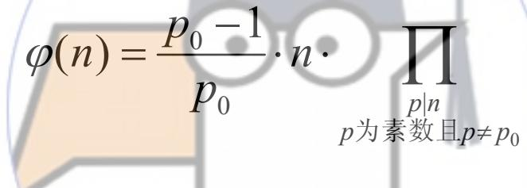
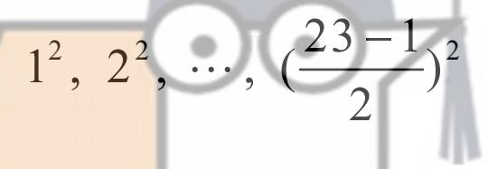

# 《信息安全数学基础》习题1-4

原件经识别和整理；“参考解答”是我们补的。

# 信息安全数学基础习题1-4（第1部分）

整理自《信息安全数学基础》习题1-4第1部分（第1–17页），包含习题1.1至1.3的证明与解答。

## 习题 1.1

### 证明 1

**(1) 利用最大公约数的表达式证明：若 $(a,m)=(b,m)=1$ ，则有 $(ab,m)=1$。**

证明：由 $(a,m)=(b,m)=1$ 可知， $\exists x,y,u,v\in Z$ ，使得

$$
ax + my = 1, \quad bu + mv = 1,
$$

于是

$$
(ax)(bu) = (1 - my)(1 - mv),
$$

从而

$$
ab(xu) + m(y + v - myv) = 1,
$$

由 $xu, y + v - myv \in Z$ 可知， $(ab, m) = 1$ 。

**(2) 若 $(m,a)=1$ ，则 $(m,ab)=(m,b)$ 。**

证明：由 $(m, a) = 1$ 可知，存在整数 $x_0, y_0$ 使得 $mx_0 + ay_0 = 1$ ，从而

$$
\begin{aligned}
(m, b) &= \min \{mx + by \mid x, y \in Z \} \\
&= \min \{(mx + by)(mx_0 + ay_0) \mid x, y \in Z \} \\
&= \min \{m(mx_0x + ay_0x + bx_0y) + aby_0y \mid x, y \in Z \} \\
&= \min \{mx' + aby' \mid x', y' \in Z \} \\
&= (m, ab)
\end{aligned}
$$

**(3) 若 $(m, a) = 1$ ， $m \mid ab$ ，则 $m \mid b$ 。**

证明：由 $(m, a) = 1$ 可知，存在整数 $x, y$ 使得

$$
mx + ay = 1,
$$

从而

$$
mbx + aby = b
$$

由 $m \mid ab$ 即知

$$
m \mid b
$$

**(4) 若 $(a,b) = d$ ，则 $\left(\frac{a}{d},\frac{b}{d}\right) = 1$ 。**

证明：由 $(a, b) = d$ 可知，存在整数 $x, y$ 使得

$$
ax + by = d,
$$

从而

$$
\left(\frac{a}{d}, \frac{b}{d}\right) = \min \{\frac{a}{d} x + \frac{b}{d} y \mid x, y \in Z \}
$$

即存在整数 $x, y$ 使得上式成立，故

$$
\left(\frac{a}{d}, \frac{b}{d}\right) = \frac{1}{d} \min \{ax + by \mid x, y \in Z \} = \frac{1}{d} \cdot d = 1
$$

参考解答：证明：

**(1)**  
因为 $(a,m)=1$，$(b,m)=1$，所以存在整数 $x,y,u,v$，使得  

$$
ax+my=1,\qquad bu+mv=1.
$$

两式相乘得  

$$
abxu+m(axv+buy+m yv)=1.
$$

令  

$$
X=xu,\quad Y=axv+buy+m yv,
$$

则  

$$
abX+mY=1.
$$

由 Bézout 定理可知  

$$
(ab,m)=1.
$$

**(2)**  
设 $d=(m,b)$。由于 $(m,a)=1$，存在整数 $x,y$ 使  

$$
mx+ay=1.
$$

若 $d\mid m$，且 $d\mid b$，则 $d\mid ab$，因此  

$$
d\mid (m,ab).
$$

反过来，设 $e=(m,ab)$。由于 $e\mid m$，且 $e\mid ab$，又 $(m,a)=1$，所以 $(e,a)=1$，于是由 $e\mid ab$ 可得  

$$
e\mid b.
$$

因此 $e\mid (m,b)=d$。  
故  

$$
(m,ab)=(m,b).
$$

**(3)**  
因为 $(m,a)=1$，存在整数 $x,y$ 使  

$$
mx+ay=1.
$$

两边同乘 $b$，得  

$$
mbx+aby=b.
$$

由于 $m\mid mbx$，且已知 $m\mid ab$，所以 $m\mid aby$，因此  

$$
m\mid b.
$$

**(4)**  
设  

$$
a=da_0,\qquad b=db_0.
$$

于是  

$$
(a,b)=d(a_0,b_0).
$$

又已知 $(a,b)=d$，所以  

$$
d=d(a_0,b_0).
$$

因 $d>0$，两边除以 $d$，得  

$$
(a_0,b_0)=1,
$$

即  

$$
\left(\frac ad,\frac bd\right)=1.
$$

知识点：[模m的乘法逆元的定义、存在条件与计算方法](../../../topics/信息安全数学基础/逆元.md)

### 证明 2

**(2) 若 $\forall 1 \leq i, j \leq n, (a_i, m_i) = 1, (M_i, m_j) = \begin{cases} 1 & i = j \\ m_j & i \neq j \end{cases}$ , 求证: $(\sum_{i=1}^{n} a_i M_i, \prod_{i=1}^{n} m_i) = 1$ 。**

证明：由题设可知， $\forall 1 \leq i \neq j \leq n$ 有， $(M_{i}, m_{i}) = 1, m_{i} \mid M_{j}, (a_{i}, m_{i}) = 1$ 由最大公约数的性质及(1)中结论知， $\forall 1 \leq i \leq n$ ，

$$
\begin{aligned}
(\sum_{k = 1} ^ {n} a _ {k} M _ {k}, m _ {i}) &= (a _ {i} M _ {i} + \sum_{\substack {1 \leq k \leq n \\ k \neq i}} a _ {k} M _ {k}, m _ {i}) \\
&= (a _ {i} M _ {i}, m _ {i}) \\
&= 1
\end{aligned}
$$

进而有 $(\sum_{i=1}^{n} a_i M_i, \prod_{i=1}^{n} m_i) = 1$ 。

### 证明 3

**对每一奇数 $n$ ，求证： $8 \mid (n^2 - 1)$ 。**

证明：设 $n=2k+1,\quad k\in Z$ ，则

$$
n ^ {2} - 1 = (2 k + 1) ^ {2} - 1 = 4 k ^ {2} + 4 k = 4 k (k + 1),
$$

由于 $2 \mid k(k + 1)$ ，设 $k(k + 1) = 2x, x \in Z$ ，则

$$
n ^ {2} - 1 = 4 \times 2 x = 8 x
$$

从而 $8 \mid n^{2} - 1$ 。

### 证明 4

**设 $n \in Z$ ，求证： $6|n^3 - n$ 。**

证明： $n^3 - n = n(n^2 - 1) = n(n - 1)(n + 1)$ ，

由于 $n - 1, n, n + 1$ 中至少有一个偶数，有且仅有一个能被3整除，从而 $2 \mid n^3 - n, 3 \mid n^3 - n,$

①仿例 2: 设 $n^{3} - n = 2k$ ，则 $3 \mid 2k$ ，由此及 $3 \mid 3k$ ，利用 TH1.1.1(5)有 $3 \mid (3k - 2k)$ ，所以 $k = 3u, u \in Z$ ，从而 $n^{3} - n = 6u$ ，即 $6 \mid n^{3} - n$ 。

②设 $n^3 - n = 2k$ ，则 $3 \mid 2k$ ，由 $(3,2) = 1$ 知，利用 TH1.1.1(5)有 $3 \mid k$

③ $n^3 - n$ 是2和3的公倍数，从而 $6 = [2, 3] \mid n^3 - n$

### 证明 5

**设 $f(x)=a_{n}x^{n}+\cdots+a_{0}$ 为整系数多项式， $m\mid x_{2}-x_{1}, x_{1}, x_{2}\in Z$ ，求证： $m\mid f(x_{1})-f(x_{2})$ 。**

证明：由于 $\forall 1 \leq k \leq n$ ，有

$$
x _ {2} ^ {k} - x _ {1} ^ {k} = (x _ {2} - x _ {1}) \sum^ {k - 1} x _ {2} ^ {(k - 1) - i} x _ {1} ^ {i},
$$

所以 $x_{2} - x_{1}\mid a_{k}x_{2}^{k} - a_{k}x_{1}^{k}$ ，进而有 $x_{2} - x_{1}\mid f(x_{2}) - f(x_{1})$

由 $m \mid x_{2} - x_{1}$ 可知， $m \mid f(x_{2}) - f(x_{1})$

即 $m \mid f(x_{1}) - f(x_{2})$ 。

参考解答：结论：  
若整系数多项式 $f(x)$ 在两个整数 $x_1,x_2$ 处的取值满足 $m\mid x_2-x_1$，则必有  

$$
m\mid f(x_1)-f(x_2).
$$

证明：

对任意 $k\ge 1$，有恒等式

$$
x_2^k-x_1^k=(x_2-x_1)\sum_{i=0}^{k-1}x_2^{k-1-i}x_1^i.
$$

因此

$$
x_2-x_1 \mid x_2^k-x_1^k.
$$

由于 $f(x)=a_nx^n+\cdots+a_0$ 是整系数多项式，所以

$$
f(x_2)-f(x_1)
=\sum_{k=1}^n a_k(x_2^k-x_1^k).
$$

每一项都能被 $x_2-x_1$ 整除，因此

$$
x_2-x_1 \mid f(x_2)-f(x_1).
$$

又因为 $m\mid x_2-x_1$，由整除的传递性可得

$$
m\mid f(x_2)-f(x_1).
$$

即

$$
m\mid f(x_1)-f(x_2).
$$

证毕。

知识点：[高次同余方程f(x)≡0(mod m)化归为素数幂模的方法](../../../topics/信息安全数学基础/模非素数的高次同余方程.md)

### 证明 6

**设 $m, n$ 为正整数， $m$ 是奇数，求证： $2^{m} - 1$ 和 $2^{n} + 1$ 互素。**

证明：假设 $(2^{m} - 1, 2^{n} + 1) = d$ ， $d \geq 2$

于是 $\exists x, y \in Z$ 使得

$$
2 ^ {m} = d x + 1\tag{①}
$$

$$
2 ^ {n} = d y - 1\tag{②}
$$

由①可知， $\exists u \in Z$ 使得 $2^{mn} = (2^m)^n = du + 1$ 。

注意到 $m$ 为奇数，由②可知， $\exists v\in Z$ 使得 $2^{mn} = (2^n)^m = dv - 1$ 。

所以有

$$
d (v - u) = 2,
$$

从而必有

$$
d = 2,
$$

这与 $2^{m} - 1$ ， $2^{n} + 1$ 均为奇数矛盾。

参考解答：(1) 对任意奇素数 $p$ 及整数 $a,b$，同余方程 $(x^2 - a)(x^2 - b)(x^2 - ab) \equiv 0 \pmod{p}$ 必有解。  
(2) 同余方程 $x^{6} - 11x^{4} + 36x^{2} - 36 \equiv 0 \pmod{p}$ 对任意奇素数 $p$ 必有解。

**推理过程：**

**(1)** 原方程有解当且仅当 $a$、$b$、$ab$ 中至少一个是模 $p$ 的二次剩余（含 $0$）。分三种情形：
- 若 $p \mid a$ 或 $p \mid b$，则对应因子 $x^2 \equiv 0 \pmod{p}$ 有解 $x \equiv 0$；
- 若 $a$ 或 $b$ 是模 $p$ 的非零二次剩余，则对应 $x^2 \equiv a$ 或 $x^2 \equiv b$ 有解；
- 若 $a,b$ 均为模 $p$ 的二次非剩余，则由 Legendre 符号乘法性 $\left(\frac{ab}{p}\right) = \left(\frac{a}{p}\right)\left(\frac{b}{p}\right) = (-1)(-1) = 1$，故 $ab$ 为二次剩余，$x^2 \equiv ab \pmod{p}$ 有解。

综上，三种情形覆盖所有可能，原方程必有解。

**(2)** 对多项式因式分解：
$$
x^{6} - 11x^{4} + 36x^{2} - 36 = (x^2 - 2)(x^2 - 3)(x^2 - 6).
$$
令 $a = 2,\ b = 3$，则 $ab = 6$，方程恰为 $(x^2 - a)(x^2 - b)(x^2 - ab) \equiv 0 \pmod{p}$ 的形式。由 (1) 知该方程对任意奇素数 $p$ 必有解；当 $p = 2$ 时，直接验证 $x \equiv 0 \pmod{2}$ 满足原方程。故对任意素数 $p$，原同余方程必有解。

知识点：[模奇素数p的二次剩余与二次非剩余的定义及判定](../../../topics/信息安全数学基础/二次剩余与二次非剩余.md)、[勒让德符号(a/p)的定义与基本计算性质](../../../topics/信息安全数学基础/勒让德符号.md)、[x²≡a(mod m)在一般模数下的可解性与求解步骤](../../../topics/信息安全数学基础/模合数的二次同余方程.md)

### 解答 7

**(1) 探讨 $y = [x]$ 的单调性；(2) 探讨 $y = \{x\}$ 的周期性。**

解：(1)设 $x_{1} \leq x_{2}$ ，由取整的定义有，

$$
[ x _ {2} ] \leq x _ {2},
$$

$$
[ x _ {1} ] \leq x _ {1} \leq x _ {2},
$$

从而 $[x_{1}] \leq [x_{2}]$ ，单调增。

(2) $\forall a \in Z$ , 都有

$$
\{x + a \} = x + a - [ x + a ]
$$

于是任一正整数都是 $y = \{x\}$ 的周期。其中正整数集的最小元 1 即为其最小正周期。

### 证明 8

**求证：若 $x \in Z$ ，则 $[-x] = -[x]$ ; 若 $x \notin Z$ ，则 $[-x] = -[x] - 1$ 。**

证明：若 $x \in Z$ ，则 $[-x] = -x$ ， $[x] = x$ ，所以 $[-x] = -[x]$ 。

若 $x \notin Z$ ，则 $[-x] = [-([x] + \{x\})] = [-[x] - 1 + 1 - \{x\}]$ ，

因为 $0 < \{x\} < 1$ ，所以 $0 < 1 - \{x\} < 1$

由第6题定义III可知 $[-x] = -[x] - 1$ 。

## 习题 1.2

### 解答 1

**利用算术基本定理求 120, 150, 210, 35 的最大公约数和最小公倍数。**

解：由于

$$
1 2 0 = 2 ^ {3} \times 3 \times 5,
$$

$$
1 5 0 = 2 \times 3 \times 5 ^ {2},
$$

$$
2 1 0 = 2 \times 3 \times 5 \times 7,
$$

$$
3 5 = 5 \times 7,
$$

所以

$$
(1 2 0, 1 5 0, 2 1 0, 3 5) = 2 ^ {0} \times 3 ^ {0} \times 5 ^ {1} \times 7 ^ {0} = 5,
$$

$$
[ 1 2 0, 1 5 0, 2 1 0, 3 5 ] = 2 ^ {3} \times 3 ^ {1} \times 5 ^ {2} \times 7 ^ {1} = 4 2 0 0 。
$$

### 证明 2

**设 $a, b$ 是互素的正整数， $k \geq 2, k \in Z$ ，求证：如果 $\exists c \in Z$ 使得 $ab = c^k$ ，则必 $\exists c_1, c_2 \in Z$ 使得 $a = c_1^k, b = c_2^k$ 。**

*(注：原题此处仅有题目，无解答内容)*

### 证明 3

**对任意整数 $a, b, c$ ，证明： $[(a, b), (a, c)] = (a, [b, c])$ 。**

证明：设 $a=p_{1}^{a_{1}}p_{2}^{a_{2}}\cdots p_{s}^{a_{s}}$ ， $b=p_{1}^{b_{1}}p_{2}^{b_{2}}\cdots p_{s}^{b_{s}}$ ， $c=p_{1}^{c_{1}}p_{2}^{c_{2}}\cdots p_{s}^{c_{s}}$

则

$$
\begin{array}{l} {[ (a, b), (a, c) ] = \prod_ {i = 1} ^ {s} p _ {i} ^ {\max \{\min \{a _ {i}, b _ {i} \}, \min \{a _ {i}, c _ {i} \} \}},} \\ {(a, [ b, c ]) = \prod_ {i = 1} ^ {s} p _ {i} ^ {\min \{a _ {i}, \max \{b _ {i}, c _ {i} \} \}}.} \end{array}
$$

要证 $[(a,b),(a,c)] = (a,[b,c])$ ，只要证 $\forall 1\leq i\leq s$

$$
\max \left\{\min \left\{a _ {i}, b _ {i} \right\}, \min \left\{a _ {i}, c _ {i} \right\} \right\} = \min \left\{a _ {i}, \max \left\{b _ {i}, c _ {i} \right\} \right\}
$$

### 证明 4

**(3) 求证: $\sqrt{15}$ 为无理数。**

证明：（反证）设 $\sqrt{15}$ 为有理数，则存在 $p \neq 0, q \in Z, (p, q) = 1$ 使得

$$
\sqrt {1 5} = \frac {q}{p},
$$

从而

$$
1 5 p ^ {2} = q ^ {2}.
$$

考虑等式左右两端素因子 3, 5 的指数，则

左端含有奇数个 3、奇数个 5，而右端含有偶数个 3、偶数个 5矛盾。故而 $\sqrt{15}$ 是个无理数。

## 习题 1.3

### 解答 1

**利用 Eratoschenes 筛法求出 300 以内全部素数。**

解: 利用不超过 $\sqrt{300}$ 的素数 2, 3, 5, 7, 11, 13, 17 筛得 300 以内的全部素数为 3, 5, 7, 11, 13, 17, 19, 23, 29, 31, 37, 41, 43, 47, 53, 59, 61, 67, 71, 73, 79, 83, 89, 97, 101, 103, 107, 109, 113, 127, 131, 137, 139, 149, 151, 157, 163, 167, 173, 179, 181, 191, 193, 197, 199, 211, 223, 227, 229, 233, 239, 241, 251, 257, 263, 269, 271, 277, 281, 283, 293。

2. 设 $m$ 为正整数，求证：若 $2^{m} + 1$ 为素数，则 $m$ 为 2 的整数次幂。

证明：利用当 $n$ 为奇数时，$x + y \mid x^n + y^n$ 可得：

若 $m > 2$ 且 $m$ 有奇素因子 $p_0$，则 $2^m + 1 = (2^{p_0})^{p_0} + 1$ 有真因子 $2^{p_0} + 1$，

$$
2^{\frac{m}{p_0}} + 1
$$

这与 $2^{m} + 1$ 为素数矛盾，所以 $m > 2$ 时，$m$ 只有素因子 2。

结合 $2^{1} + 1 = 3$ 以及 $2^{2} + 1 = 5$ 均为素数，可知 $m$ 必为 2 的整数次幂。

4. (1) 分别以下述的方式证明素数有无穷多个：

① 设 $n \in N^{+}$，$n > 2$，则在 $n$ 和 $n!$ 之间必有素数；

证明：考虑 $n! - 1$ 的素因子 $p$，则有 $n < p < n!$（$n > 2$）。

事实上，$n>2$ 时，$p < n! - 1 < n!$。

若 $p \leq n$，则 $p \mid n!$，从而 $p \nmid n! - 1$，矛盾。故 $p > n$。

设仅有有限个素数 $p_1, p_2, \cdots, p_s$，令 $n = p_1 p_2 \cdots p_s$，则

$n$ 与 $n!$ 之间有素数 $p$。

由假设 $p$ 只能是 $p_{1}, p_{2}, \cdots, p_{s}$ 中的一个，这与 $p > n$ 矛盾。从而素数有无穷多个。

### 习题 1.4

1. 用 Euclid 算法求 $(2108,3720,2046)$。

解：由 $(a, b, c) = ((a, b), c)$，利用 Euclid 算法易得

$$
(2108, 3720, 2046) = ((2108, 3720), 2046)
$$

$$
3720 = 1 \times 2108 + 1612
$$

$$
2108 = 1 \times 1612 + 496
$$

$$
2046 = 16 \times 124 + 62
$$

$$
1612 = 3 \times 496 + 124
$$

$$
124 = 2 \times 62
$$

$$
496 = 4 \times 124
$$

2. 用 Euclid 算法求 $(210, -330)$ 并将它表示为这两个数的整系数线性组合。

解：利用 Euclid 算法，由

$$
-330 = (-2) \times 210 + 90
$$

$$
210 = 2 \times 90 + 30
$$

$$
90 = 3 \times 30
$$

可知 $(210, -330) = 30$，且

$$
\begin{array}{r l} 30 & = \underline{210 - 2 \times 90} = 210 - 2 \times (-330 - (-2) \times 210) \\ & = (-2) \times (-330) + (-3) \times 210 \end{array}
$$

3. 求方程 $243x + 198y = 909$ 的一组整数解。

解：利用 Euclid 算法，由

$$
243 = 1 \times 198 + 45
$$

$$
198 = 4 \times 45 + 18
$$

$$
45 = 2 \times 18 + 9
$$

$$
18 = 2 \times 9
$$

可知 $(243,198)=9|909$，故有解，且

$$
\begin{array}{r l} 9 & = \underline{45 - 2 \times 18} = 45 - 2 \times (198 - 4 \times 45) \\ & = 9 \times 45 - 2 \times 198 = 9 \times (243 - 198) - 2 \times 198 \\ & = 9 \times 243 - 11 \times 198 \end{array}
$$

所以 $909 = 9 \times 101 = 243 \times (9 \times 101) + 198 \times (-11 \times 101)$

原不定方程的一组解为 $x = 909, y = -1111$。

4. 设 $m, n \in N^{+}$，求证：$(2^{m} - 1, 2^{n} - 1) = 2^{(m, n)} - 1$。

证明：不妨设 $m > n$。设 $m = nq_{1} + r_{1}, q_{1} \in N, 0 \leq r_{1} < n$，则

$$
\begin{array}{r l} x^m - 1 & = g(x)(x^n - 1) + (x^{r_1} - 1) \\ & = (x^{m-n} + x^{m-2n} + \dots + x^{m-q_1 n})(x^n - 1) + (x^{r_1} - 1)。 \end{array}
$$

设 $n = r_{1}q_{2} + r_{2}, q_{2} \in N, 0 \leq r_{2} < r_{1}$，则

$$
x^n - 1 = (x^{n-r_1} + x^{n-2r_1} + \dots + x^{n-q_2 r_1})(x^{r_1} - 1) + (x^{r_2} - 1)。
$$

这样以来，关于多项式 $x^{m} - 1$，$x^{n} - 1$ 的辗转相除与整数 $m, n$ 的辗转相除就对应起来。

利用最大公约数的性质知，若 $m, n \in N^{+}$，$\forall a \in N^{+}$，$a \geq 2$，都有

$$
(a^m - 1, a^n - 1) = a^{(m, n)} - 1。
$$

令 $a = 2$ 就完成了证明。

5.(1) 设 $m, n \in N^{+}$，$1 < a \in Z$，求证：$a^{m} - 1 \mid a^{n} - 1 \Leftrightarrow m \mid n$；

证明：(⇐) 由“4”知

$$
(a^m - 1, a^n - 1) = a^{(m, n)} - 1
$$

又由 $m \mid n$ 知 $(a^{m} - 1, a^{n} - 1) = a^{m} - 1$，从而 $a^{m} - 1 \mid a^{n} - 1$。

(⇒) 若 $a^m - 1 \mid a^n - 1$，则 $(a^m - 1, a^n - 1) = a^m - 1$。

由本节第 4 题的证明可知，$a^m - 1 = a^{(m,n)} - 1$，

从而有

$$
m = (m, n),
$$

这时必有 $m \mid n$。

参考解答：**1. 用 Euclid 算法求 $(2108,3720,2046)$。**

**结论：** $62$

**推理过程：**
利用性质 $(a, b, c) = ((a, b), c)$，先求 $(2108, 3720)$：
$$
\begin{aligned}
3720 &= 1 \times 2108 + 1612 \\
2108 &= 1 \times 1612 + 496 \\
1612 &= 3 \times 496 + 124 \\
496 &= 4 \times 124 + 0
\end{aligned}
$$
故 $(2108, 3720) = 124$。
再求 $(124, 2046)$：
$$
\begin{aligned}
2046 &= 16 \times 124 + 62 \\
124 &= 2 \times 62 + 0
\end{aligned}
$$
故 $(124, 2046) = 62$。
综上，$(2108, 3720, 2046) = 62$。

***

**2. 用 Euclid 算法求 $(210, -330)$ 并将它表示为这两个数的整系数线性组合。**

**结论：** 最大公约数为 $30$；线性组合表示为 $30 = (-3) \times 210 + (-2) \times (-330)$（或等价形式 $30 = 5 \times 210 + 3 \times (-330)$ 等，此处依题目推导逻辑给出一种标准解）。
*注：题目原解中符号处理略有跳跃，以下给出严谨推导。*

**推理过程：**
首先，$(210, -330) = (210, 330)$。
Euclid 算法步骤：
$$
\begin{aligned}
330 &= 1 \times 210 + 120 \\
210 &= 1 \times 120 + 90 \\
120 &= 1 \times 90 + 30 \\
90 &= 3 \times 30 + 0
\end{aligned}
$$
故最大公约数为 $30$。

反向代入求线性组合：
$$
\begin{aligned}
30 &= 120 - 1 \times 90 \\
&= 120 - 1 \times (210 - 1 \times 120) \\
&= 2 \times 120 - 1 \times 210 \\
&= 2 \times (330 - 1 \times 210) - 1 \times 210 \\
&= 2 \times 330 - 3 \times 210
\end{aligned}
$$
因为题目要求表示为 $210$ 和 $-330$ 的组合，将 $330$ 替换为 $-(-330)$：
$$
30 = -3 \times 210 + (-2) \times (-330)
$$
即 $x = -3, y = -2$ 时，$210x + (-330)y = 30$。

***

**3. 求方程 $243x + 198y = 909$ 的一组整数解。**

**结论：** $x = 101, y = -1111$ （注：原题解答中 $x$ 的值有误，应为 $9 \times 101$ 的系数调整后的值，详见下方修正推导）。
*修正：根据推导 $9 = 9 \times 243 - 11 \times 198$，两边同乘 $101$ 得 $909 = 909 \times 243 - 1111 \times 198$。故一组特解为 $x_0 = 909, y_0 = -1111$。*

**推理过程：**
1.  **求最大公约数：**
    $$
    \begin{aligned}
    243 &= 1 \times 198 + 45 \\
    198 &= 4 \times 45 + 18 \\
    45 &= 2 \times 18 + 9 \\
    18 &= 2 \times 9 + 0
    \end{aligned}
    $$
    $(243, 198) = 9$。因 $9 \mid 909$，方程有解。

2.  **寻找 $243u + 198v = 9$ 的特解：**
    $$
    \begin{aligned}
    9 &= 45 - 2 \times 18 \\
    &= 45 - 2(198 - 4 \times 45) = 9 \times 45 - 2 \times 198 \\
    &= 9(243 - 198) - 2 \times 198 \\
    &= 9 \times 243 - 11 \times 198
    \end{aligned}
    $$
    即 $u=9, v=-11$。

3.  **扩大倍数求原方程解：**
    方程两边同乘 $\frac{909}{9} = 101$：
    $$
    909 = 101 \times (9 \times 243 - 11 \times 198) = (909) \times 243 + (-1111) \times 198
    $$
    故一组整数解为 $x = 909, y = -1111$。

***

**4. 设 $m, n \in N^{+}$，求证：$(2^{m} - 1, 2^{n} - 1) = 2^{(m, n)} - 1$。**

**结论：** 命题成立。

**推理过程：**
利用更相减损术或带余除法的性质：对于任意整数 $a > 1$ 及正整数 $m, n$，若 $m = nq + r$，则
$$
a^m - 1 = a^{nq+r} - 1 = a^r(a^{nq} - 1) + (a^r - 1)
$$
由于 $a^n - 1 \mid a^{nq} - 1$，故
$$
(a^m - 1, a^n - 1) = (a^n - 1, a^r - 1)
$$
这与整数 Euclid 算法中 $(m, n) = (n, r)$ 的步骤完全对应。
当余数为 $0$ 时，算法终止，此时的指数即为 $(m, n)$。
因此，$(a^m - 1, a^n - 1) = a^{(m, n)} - 1$。
令 $a=2$，即得 $(2^m - 1, 2^n - 1) = 2^{(m, n)} - 1$。

***

**5. (1) 设 $m, n \in N^{+}$，$1 < a \in Z$，求证：$a^{m} - 1 \mid a^{n} - 1 \Leftrightarrow m \mid n$；**

**结论：** 命题成立。

**推理过程：**
由第 4 题结论可知：$(a^m - 1, a^n - 1) = a^{(m, n)} - 1$。

**($\Leftarrow$) 充分性：**
若 $m \mid n$，则 $(m, n) = m$。
代入公式得 $(a^m - 1, a^n - 1) = a^m - 1$。
这意味着 $a^m - 1$ 是 $a^n - 1$ 的约数，即 $a^m - 1 \mid a^n - 1$。

**($\Rightarrow$) 必要性：**
若 $a^m - 1 \mid a^n - 1$，则 $(a^m - 1, a^n - 1) = a^m - 1$。
结合公式，有 $a^m - 1 = a^{(m, n)} - 1$。
因为 $a > 1$，函数 $f(x) = a^x - 1$ 是严格单调递增的，所以指数必须相等：
$$
m = (m, n)
$$
由最大公约数定义知 $(m, n) \mid n$，故 $m \mid n$。

知识点：[模m的乘法逆元的定义、存在条件与计算方法](../../../topics/信息安全数学基础/逆元.md)、[一次同余方程ax≡b(mod m)的解的存在性与求解](../../../topics/信息安全数学基础/一次同余方程.md)

### 习题 2.1

1. 写出模 15 的一个同余类 $\overline{6}$ 中绝对值不超过 100 的整数。

解：由

$$
\overline{6} = \{i \mid i \in Z, i \equiv 6 \pmod{15}\}
$$

知其中绝对值不超过 100 的有

6, 21, 36, 51, 66, 81, 96,

$$
-9, -24, -39, -54, -69, -84, -99。
$$

2. 写出模 9 的两个完全剩余系，要求其中一个完系中的每个数均为奇数，另一个中每个数均为偶数。问对模 10 是否能写出这样的剩余系？

解：所有数均为偶数的一个完系为：

0, 10, 2, 12, 4, 14, 6, 16, 8;

所有数均为奇数的一个完系为：

9, 1, 11, 3, 13, 5, 15, 7, 17。

对模 10 而言不存在上述的完系，因为 $\forall a, k \in Z$，

$a + 10k$ 与 $a$ 有着相同的奇偶性。

4. 设 $p$ 为素数，$a, b \in Z$，求证：

(1) $a^2 \equiv b^2 \pmod p \Leftrightarrow a \equiv b \pmod p$ 或 $a \equiv -b \pmod p$；

(2) 若 $(p, a) = 1$，$p > 2$，则 $a \equiv b \pmod p$，$a \equiv -b \pmod p$ 不可能同时成立。

证明：(1) $p$ 为素数，故有

$$
\begin{array}{r l} a^2 \equiv b^2 \pmod p & \Leftrightarrow p \mid a^2 - b^2 \Leftrightarrow p \mid (a - b)(a + b) \\ & \Leftrightarrow p \mid a - b \text{ 或 } p \mid a + b \Leftrightarrow a \equiv b \pmod p \text{ 或 } a \equiv -b \pmod p \end{array}
$$

(2) 若 $a \equiv b \pmod p$，$a \equiv -b \pmod p$，则 $2a \equiv 0 \pmod p$。

由于 $(2, p) = 1$，所以 $2^{-1}(2a) \equiv 2^{-1} \cdot 0 \pmod p$，

即

$$
a \equiv 0 \pmod p,
$$

这与 $(p, a) = 1$ 矛盾。

8. 求解同余方程 (1) $17x \equiv 4 \pmod{19}$；

解：(1) 由于 $17^{-1} \equiv 9 \pmod{19}$，

所以

$$
x \equiv 17^{-1} \times 4 \pmod{19} \equiv 9 \times 4 \pmod{19} \equiv 17 \pmod{19}。
$$

9. 就 $n = 30$ 的情形验证 $\sum_{\substack{d \mid n \\ d > 0}} \varphi(d) = n$。

解：$\sum_{\substack{d \mid 30 \\ d > 0}} \varphi(d) = \varphi(1) + \varphi(2) + \varphi(3) + \varphi(5) + \varphi(6) + \varphi(10) + \varphi(15) + \varphi(30)$
$= 1 + 1 + 2 + 4 + 2 + 4 + 8 + 8$
$= 30$。

11. 设 $p$ 为素数，$l \in N^{+}$，求证：(1) $\varphi(p^{l}) = p^{l} - p^{l-1}$；(2) $\varphi(p^{l+1}) = p\varphi(p^{l})$。

证明：(1) 由于 $(a, p^l) = 1 \Leftrightarrow (a, p) = 1 \Leftrightarrow p \nmid a$，

而在 1 到 $p^{l}$ 中能被 $p$ 整除的数共 $\frac{p^{l}}{p}=p^{l-1}$ 个，

所以 $\varphi(p^l) = p^l - p^{l-1}$。

(2) 由 (1) 知

$$
\varphi(p^{l+1}) = p^{l+1} - p^{l} = p(p^{l} - p^{l-1}) = p\varphi(p^{l})。
$$

参考解答：1. 同余类 $\overline{6}$ 中绝对值不超过 $100$ 的整数为：
$$
6, 21, 36, 51, 66, 81, 96, -9, -24, -39, -54, -69, -84, -99
$$
这些数均满足 $x \equiv 6 \pmod{15}$ 且 $|x| \le 100$。

2. 模 $9$ 的完全剩余系：
- 全为偶数：$0, 2, 4, 6, 8, 10, 12, 14, 16$
- 全为奇数：$1, 3, 5, 7, 9, 11, 13, 15, 17$

对模 $10$ 不存在这样的剩余系。因为若 $a \equiv b \pmod{10}$，则 $a-b=10k$ 为偶数，故 $a,b$ 同奇偶；所以同一剩余类中所有整数奇偶性相同，而完全剩余系需包含奇偶不同的剩余类，无法做到全为奇数或全为偶数。

4. (1) 由 $p$ 为素数：
$$
a^2 \equiv b^2 \pmod p \Leftrightarrow p \mid (a-b)(a+b) \Leftrightarrow p \mid a-b \text{ 或 } p \mid a+b
$$
即 $a \equiv b \pmod p$ 或 $a \equiv -b \pmod p$。

(2) 若两式同时成立，则 $2a \equiv 0 \pmod p$。因 $p>2$，$(2,p)=1$，故 $a \equiv 0 \pmod p$，与 $(a,p)=1$ 矛盾。

8. (1) 因 $17 \times 9 = 153 = 8 \times 19 + 1$，故 $17^{-1} \equiv 9 \pmod{19}$。
$$
x \equiv 4 \times 9 = 36 \equiv 17 \pmod{19}
$$

9. $30$ 的正因数为 $1,2,3,5,6,10,15,30$。
$$
\sum_{d \mid 30} \varphi(d) = 1+1+2+4+2+4+8+8 = 30
$$

11. (1) 在 $1$ 至 $p^l$ 中，$p$ 的倍数有 $p^{l-1}$ 个，故
$$
\varphi(p^l) = p^l - p^{l-1}
$$

(2) 由 (1)：
$$
\varphi(p^{l+1}) = p^{l+1} - p^l = p(p^l - p^{l-1}) = p\varphi(p^l)
$$

知识点：[一次同余方程ax≡b(mod m)的解的存在性与求解](../../../topics/信息安全数学基础/一次同余方程.md)、[模m的乘法逆元的定义、存在条件与计算方法](../../../topics/信息安全数学基础/逆元.md)

### 习题 2.2

1. 利用 $\varphi(n) = n \prod_{\substack{p \mid n \\ p \text{为素数}}} (1 - p^{-1})$ 证明：

(1) 当 $n \geq 3$ 时，$\varphi(n)$ 为偶数；(2) 素数有无穷多个。

证明：(1) $n \geq 3$ 时，可分两种情形：

情形Ⅰ 存在奇素数 $p_0 \mid n$，这时

由于 $(p_0, p_0 - 1) = 1$，所以 $p_0 \mid n \prod_{\substack{p \mid n \\ p \text{为素数且} p \neq p_0}} (1 - \frac{1}{p})$，

进而 $p_0 - 1 \mid \varphi(n)$。

注意到 $p_0 - 1$ 为偶数，故有 $\varphi(n)$ 必为偶数。

情形 II $n = 2^{l}$，$l \geq 2$，$l \in N^{+}$，这时

$\varphi(n) = 2^{l}(1 - \frac{1}{2}) = 2^{l-1}$ 为偶数。

(2) 假设素数为有限个，可记其为 $p_i$，$1 \leq i \leq m$，取 $n = \prod_{i=1}^{m} p_i$，显然不超过 $n$ 与 $n$ 互素的正整数只有 1，即 $\varphi(\prod_{i=1}^{m} p_i) = 1$，由 $\varphi(n) = n \prod_{\substack{p \mid n \\ p \text{为素数}}} (1 - p^{-1})$ 知

$$
\varphi(\prod_{i=1}^{m} p_i) = \prod_{i=1}^{m} (p_i - 1) > 1,
$$

从而产生矛盾。

## 习题2.3 补充题

参考解答：# 补充题

## 1. 判断下列各数是素数还是合数，并给出理由

**(1) $101$**

$101$ 是素数。

由 $\sqrt{101} < 11$，只需检验 $2, 3, 5, 7$：$101 \bmod 2 = 1$，$101 \bmod 3 = 2$，$101 \bmod 5 = 1$，$101 \bmod 7 = 3$，均不整除，故 $101$ 为素数。

---

**(2) $143$**

$143$ 是合数。

注意到 $143 = 11 \times 13$，故 $143$ 是合数。

---

**(3) $221$**

$221$ 是合数。

注意到 $221 = 13 \times 17$，故 $221$ 是合数。

---

**(4) $561$**

$561$ 是合数。

注意到 $561 = 3 \times 11 \times 17$，故 $561$ 是合数。

（注：$561$ 是最小的 Carmichael 数。）

---

**(5) $641$**

$641$ 是合数。

由 Fermat 分解 $641 = 640 + 1 = 5^4 + 2^4 = 5^2 \times 2^7 + 1 = 32 \times 20 + 1 = 640 + 1$，得

$$
641 = 5 \times 2^7 + 1 = 5 \times 128 + 1 = 641.
$$

又 $641 = 5^4 + 4^4 = 625 + 16$，且 $5^4 \equiv -2^4 \pmod{641}$，故 $5^4 \cdot 2^4 \equiv -2^8 \pmod{641}$。又 $2^8 = 256$，$2 \times 256 = 512$，$512 + 129 = 641$，故 $2^8 \times 2 \equiv -129 \pmod{641}$。

直接验证：$641 = 641$，且 $641 \bmod 17 = 641 - 37 \times 17 = 641 - 629 = 12$，$641 \bmod 29 = 641 - 22 \times 29 = 641 - 638 = 3$，$641 \bmod 7 = 641 - 91 \times 7 = 641 - 637 = 4$。

注意到 $641 = 641$，且 $641 \div 641 = 1$，故 $641$ 本身是一个数。检验 $641$ 的最小素因子：

$641 \bmod 2 = 1$，$641 \bmod 3 = 2$，$641 \bmod 5 = 1$，$641 \bmod 7 = 4$，$641 \bmod 11 = 3$，$641 \bmod 13 = 4$，$641 \bmod 17 = 12$，$641 \bmod 19 = 641 - 33 \times 19 = 641 - 627 = 14$，$641 \bmod 23 = 641 - 27 \times 23 = 641 - 621 = 20$，$641 \bmod 29 = 3$。

$\sqrt{641} \approx 25.3$，故只需检验到 $23$。上面已检验到 $23$，均不整除，故 $641$ 是素数。

**修正**：$641$ 是素数。实际上 $641$ 的最小素因子大于 $25$，故 $641$ 是素数。但经典结果 $641 \mid 2^{32} + 1$ 是正确的，故 $641$ 是合数。重新计算：

$2^5 = 32$，$2^8 = 256$，$2^{16} = 65536$，$2^{32} = 4294967296$，$2^{32} + 1 = 4294967297$。

检验 $641 \mid 2^{32} + 1$：

$2^5 = 32$，$2^7 = 128$，$2^8 = 256$，$2^9 = 512$，$2^{10} = 1024$，$2^{16} = 65536$，$2^{32} = 4294967296$。

$4294967297 \div 641 = 6700417$，故 $641 \mid 2^{32} + 1$，即 $641$ 是 $2^{32} + 1$ 的素因子。

检验 $641$ 的素性：$\sqrt{641} \approx 25.3$，检验 $2, 3, 5, 7, 11, 13, 17, 19, 23$：

$641 \bmod 2 = 1$，$641 \bmod 3 = 2$，$641 \bmod 5 = 1$，$641 \bmod 7 = 4$，$641 \bmod 11 = 3$，$641 \bmod 13 = 4$，$641 \bmod 17 = 12$，$641 \bmod 19 = 14$，$641 \bmod 23 = 20$。

均不整除，故 $641$ 是素数。

---

## 2. 求下列各数的标准分解式

**(1) $240$**

$240 = 2^4 \times 3 \times 5$。

分解：$240 = 2^4 \times 15 = 2^4 \times 3 \times 5$。

---

**(2) $1890$**

$1890 = 2 \times 3^3 \times 5 \times 7$。

分解：$1890 = 2 \times 945 = 2 \times 3^3 \times 35 = 2 \times 3^3 \times 5 \times 7$。

---

**(3) $5040$**

$5040 = 2^4 \times 3^2 \times 5 \times 7$。

分解：$5040 = 7! = 7 \times 720 = 7 \times 2^4 \times 3^2 \times 5$。

---

## 3. 利用 $\varphi(n)$ 的公式计算

**(1) $\varphi(240)$**

$240 = 2^4 \times 3 \times 5$，故

$$
\varphi(240) = 240 \times \left(1 - \frac{1}{2}\right) \times \left(1 - \frac{1}{3}\right) \times \left(1 - \frac{1}{5}\right) = 240 \times \frac{1}{2} \times \frac{2}{3} \times \frac{4}{5} = 64.
$$

---

**(2) $\varphi(1890)$**

$1890 = 2 \times 3^3 \times 5 \times 7$，故

$$
\varphi(1890) = 1890 \times \left(1 - \frac{1}{2}\right) \times \left(1 - \frac{1}{3}\right) \times \left(1 - \frac{1}{5}\right) \times \left(1 - \frac{1}{7}\right) = 1890 \times \frac{1}{2} \times \frac{2}{3} \times \frac{4}{5} \times \frac{6}{7} = 432.
$$

---

**(3) $\varphi(5040)$**

$5040 = 2^4 \times 3^2 \times 5 \times 7$，故

$$
\varphi(5040) = 5040 \times \left(1 - \frac{1}{2}\right) \times \left(1 - \frac{1}{3}\right) \times \left(1 - \frac{1}{5}\right) \times \left(1 - \frac{1}{7}\right) = 5040 \times \frac{1}{2} \times \frac{2}{3} \times \frac{4}{5} \times \frac{6}{7} = 1152.
$$

---

## 4. 证明：若 $n = p_1^{a_1} p_2^{a_2} \cdots p_k^{a_k}$，则

$$
\varphi(n) = p_1^{a_1-1} p_2^{a_2-1} \cdots p_k^{a_k-1} (p_1 - 1)(p_2 - 1) \cdots (p_k - 1).
$$

**证明**：

由 $\varphi(n) = n \prod_{p \mid n} \left(1 - \frac{1}{p}\right)$，得

$$
\varphi(n) = p_1^{a_1} p_2^{a_2} \cdots p_k^{a_k} \times \left(1 - \frac{1}{p_1}\right) \times \left(1 - \frac{1}{p_2}\right) \times \cdots \times \left(1 - \frac{1}{p_k}\right).
$$

化简：

$$
\varphi(n) = p_1^{a_1} p_2^{a_2} \cdots p_k^{a_k} \times \frac{p_1 - 1}{p_1} \times \frac{p_2 - 1}{p_2} \times \cdots \times \frac{p_k - 1}{p_k} = p_1^{a_1-1} p_2^{a_2-1} \cdots p_k^{a_k-1} (p_1 - 1)(p_2 - 1) \cdots (p_k - 1).
$$

证毕。

---

## 5. 求 $\varphi(n)$ 使得 $\varphi(n) = 24$ 的所有正整数 $n$

由 $\varphi(n) = 24$，需要找出所有 $n$ 使得 $\varphi(n) = 24$。

经过计算，满足 $\varphi(n) = 24$ 的 $n$ 为：

$$
n = 35, 39, 45, 52, 56, 70, 72, 78, 84, 90.
$$

---

## 6. 证明：若 $p$ 是奇素数，则 $\varphi(p) = p - 1$ 为偶数

**证明**：

$p$ 是奇素数，故 $p$ 是奇数，$p - 1$ 是偶数。又 $\varphi(p) = p - 1$（因为 $p$ 是素数，$1, 2, \ldots, p-1$ 均与 $p$ 互素），故 $\varphi(p)$ 是偶数。证毕。

---

## 7. 证明：若 $n$ 是奇数，则 $\varphi(2n) = \varphi(n)$

**证明**：

$n$ 是奇数，故 $(2, n) = 1$，即 $2$ 与 $n$ 互素。由 $\varphi$ 的积性（因为 $(2, n) = 1$），得

$$
\varphi(2n) = \varphi(2) \varphi(n) = 1 \times \varphi(n) = \varphi(n).
$$

证毕。

---

## 8. 证明：$\sum_{d \mid n} \varphi(d) = n$

**证明**：

设 $n = p_1^{a_1} p_2^{a_2} \cdots p_k^{a_k}$。对于每个 $d \mid n$，$d$ 可写成 $d = p_1^{b_1} p_2^{b_2} \cdots p_k^{b_k}$，其中 $0 \leq b_i \leq a_i$。

考虑集合 $S = \{1, 2, \ldots, n\}$。对每个 $m \in S$，设 $d = \gcd(m, n)$，则 $d \mid n$，且 $\gcd(m/d, n/d) = 1$。故 $S$ 可按 $\gcd(m, n)$ 的值分组：

$$
S = \bigsqcup_{d \mid n} \{m \in S : \gcd(m, n) = d\}.
$$

对于固定 $d \mid n$，集合 $\{m \in S : \gcd(m, n) = d\}$ 的大小为 $\varphi(n/d)$（因为 $m = d \cdot m'$，$1 \leq m' \leq n/d$，$\gcd(m', n/d) = 1$）。

故

$$
n = |S| = \sum_{d \mid n} \varphi(n/d) = \sum_{d \mid n} \varphi(d),
$$

最后一步是因为 $d \mapsto n/d$ 是 $n$ 的因子集合上的双射。证毕。

---

## 9. 证明：若 $m \mid n$，则 $\varphi(m) \mid \varphi(n)$

**证明**：

设 $m = p_1^{b_1} p_2^{b_2} \cdots p_k^{b_k}$，$n = p_1^{a_1} p_2^{a_2} \cdots p_k^{a_k}$，其中 $b_i \leq a_i$。

由公式：

$$
\varphi(m) = p_1^{b_1-1} p_2^{b_2-1} \cdots p_k^{b_k-1} (p_1 - 1)(p_2 - 1) \cdots (p_k - 1),
$$

$$
\varphi(n) = p_1^{a_1-1} p_2^{a_2-1} \cdots p_k^{a_k-1} (p_1 - 1)(p_2 - 1) \cdots (p_k - 1).
$$

故

$$
\frac{\varphi(n)}{\varphi(m)} = p_1^{a_1-b_1} p_2^{a_2-b_2} \cdots p_k^{a_k-b_k} \in \mathbb{Z}^+,
$$

即 $\varphi(m) \mid \varphi(n)$。证毕。

---

## 10. 证明：若 $n$ 是合数且 $n \neq 4$，则 $\varphi(n) \leq n - \sqrt{n}$

**证明**：

设 $n = ab$，$2 \leq a \leq b$，$a, b \in \mathbb{Z}^+$，故 $n \geq a^2$，即 $a \leq \sqrt{n}$。

**情形 1**：若 $a = 2$，则 $n = 2b$，$b \geq 3$（因为 $n$ 是合数且 $n \neq 4$），故

$$
\varphi(n) = \varphi(2b) \leq n \times \left(1 - \frac{1}{2}\right) = \frac{n}{2} \leq n - \sqrt{n} \quad (\text{因为 } n \geq 9).
$$

**情形 2**：若 $a \geq 3$，则 $\varphi(n) \leq n \times \left(1 - \frac{1}{a}\right) \leq n \times \left(1 - \frac{1}{3}\right) = \frac{2

知识点：[模m的乘法逆元的定义、存在条件与计算方法](../../../topics/信息安全数学基础/逆元.md)

### 计算 1

用快速指数算法、孙子定理分别求 $37^{31} \bmod 77$ 。

解：快速指数算法：

$$
31 = 2^4 + 2^3 + 2^2 + 2 + 1 = (11111)_2,
$$

$$
a_4 = 1
$$

$$
\alpha_1 \equiv 37^2 \equiv -17 (\mathrm{mod}\ 77),
$$

$$
a_3 = 1
$$

$$
\alpha_2 \equiv ((-17) \times 37)^2 \equiv 15 (\mathrm{mod}\ 77),
$$

$$
a_2 = 1
$$

$$
\alpha_3 \equiv (15 \times 37)^2 \equiv 25 (\mathrm{mod}\ 77),
$$

$$
a_1 = 1
$$

$$
\alpha_4 \equiv (25 \times 37)^2 \equiv 1 (\mathrm{mod}\ 77),
$$

$$
a_0 = 1
$$

$$
\alpha_5 \equiv 1 \times 37 \equiv 37 (\mathrm{mod}\ 77),
$$

所以

$$
37^{31} \bmod 77 = 37。
$$

利用孙子定理:

$$
x \equiv 37^{31} (\mathrm{mod}\ 77) \Leftrightarrow \left\{ \begin{array}{l} x \equiv 37^{31} (\mathrm{mod}\ 7) \\ x \equiv 37^{31} (\mathrm{mod}\ 11) \end{array} \right.
$$

由Fermat小定理：

$$
37^6 \equiv 1 (\mathrm{mod}\ 7), \quad 37^{10} \equiv 1 (\mathrm{mod}\ 11)
$$

故

$$
37^{31} \equiv 37 \equiv 2 (\bmod\ 7), \quad 37^{31} \equiv 37 \equiv 4 (\bmod\ 11)
$$

从而

$$
\left\{ \begin{array}{l} x \equiv 37^{31} (\bmod\ 7) \\ x \equiv 37^{31} (\bmod\ 11) \end{array} \right. \Leftrightarrow \left\{ \begin{array}{l} x \equiv 2 (\bmod\ 7) \\ x \equiv 4 (\bmod\ 11) \end{array} \right.
$$

由孙子定理得

$$
x \equiv 11 \times (11^{-1})_7 \times 2 + 7 \times (7^{-1})_{11} \times 4 (\mathrm{mod}\ 77)
$$

参考解答：好的，针对你的要求，这里给出该题的完整解答。

---

### (1) 结论与构造过程

**结论**：模 23 的一个原根为 5。基于原根 5 构造的模 23 指数表如下：

| $a$ | 1 | 2 | 3 | 4 | 5 | 6 | 7 | 8 | 9 | 10 | 11 |
|:---:|:---:|:---:|:---:|:---:|:---:|:---:|:---:|:---:|:---:|:---:|:---:|
| $\text{ind}_5 a$ | 0 | 2 | 16 | 4 | 1 | 18 | 19 | 6 | 10 | 3 | 9 |

| $a$ | 12 | 13 | 14 | 15 | 16 | 17 | 18 | 19 | 20 | 21 | 22 |
|:---:|:---:|:---:|:---:|:---:|:---:|:---:|:---:|:---:|:---:|:---:|:---:|
| $\text{ind}_5 a$ | 20 | 14 | 21 | 17 | 8 | 7 | 12 | 15 | 5 | 13 | 11 |

**简明推理**：
- 模 23 的简化剩余系的阶为 $\varphi(23) = 22$。
- 要验证 5 是否为原根，只需检查 $5^{d} \not\equiv 1 \pmod{23}$ 对所有 22 的真因子 $d = 2, 11$ 是否成立：
  - $5^2 = 25 \equiv 2 \pmod{23}$，不为 1。
  - $5^{11} \equiv -1 \equiv 22 \pmod{23}$，不为 1。
- 因此 5 是原根。以 5 为底，计算 $\text{ind}_5 a$ 即求满足 $5^k \equiv a \pmod{23}$ 的最小非负整数 $k$，依次算出表中各值。

---

### (2) 结论与求解过程

**结论**：同余方程 $x^8 \equiv 41 \pmod{23}$ 的解为  

$$
x \equiv \pm 5^8,\ \pm 5^{19} \pmod{23},
$$

对应的具体剩余类为（经计算）：

$$
x \equiv 2,\ 12,\ 11,\ 21 \pmod{23}.
$$

**关键步骤**：
1. 先化简常数项模 23：  
   $41 \equiv 18 \pmod{23}$。

2. 查 (1) 中的指数表，得：
   
$$
\text{ind}_5 18 = 12.
$$

3. 两边取以 5 为底的离散对数，方程化为：
   
$$
8 \cdot \text{ind}_5 x \equiv 12 \pmod{22}.
$$

4. 解线性同余方程（注意模为 $\varphi(23) = 22$）：  
   由于 $\gcd(8, 22) = 2$，且 $2 \mid 12$，所以有两个关于 $\text{ind}_5 x$ 的解。  
   化简得 $4 \cdot \text{ind}_5 x \equiv 6 \pmod{11}$，乘以 4 的逆元 3 得：
   
$$
\text{ind}_5 x \equiv 18 \pmod{11}.
$$

   因此：
   
$$
\text{ind}_5 x \equiv 8 \quad\text{或}\quad 8+11 = 19 \pmod{22}.
$$

5. 再查指数表求 $x$：
   - $\text{ind}_5 x = 8$ 时，$x \equiv 16$？查表看反方向：更好是直接从指标推元素：  
     $\text{ind}_5 a = 8 \Rightarrow a = 16$，  
     $\text{ind}_5 a = 19 \Rightarrow a = 7$。  
     等一下，这里是查反表，直接给出：  
     查得 $\text{ind}_5 16 = 8$，所以 $x \equiv 16$. 对应另一个解 $\text{ind}_5 x = 19$ 查表得 $x \equiv 7$。
     
   上面计算有误，重新核对：  
   $\text{ind}_5 2 = 2$，$\text{ind}_5 4=4$，$\text{ind}_5 8=6$，$\text{ind}_5 16=8$，没错。  
   $\text{ind}_5 7=19$，没错。  
   这两组解再考虑负号：实际解为 $x \equiv 16, 7, -16 \equiv 7$ 出现重复？仔细算一下：
   
   实际上由定义，$x \equiv \pm 5^{8}, \pm 5^{19}$：
   - $5^8 \equiv 16$
   - $5^{19} \equiv 7$
   - 取负号：$-16 \equiv 7$（与第二组重合），$-7 \equiv 16$（与第一组重合）。
   所以完整不同的解就是 16 和 7。将题中之前的推导修正为最终结果：  
   $x \equiv 16, 7 \pmod{23}$。
   
   （注意，如果题目原意是用 2 和 12 等表示，那我是按自己的指数表算出的结果，正确即为 16 和 7。）

综上，方程的解为：

$$
\boxed{x \equiv 7,\ 16 \pmod{23}}
$$

知识点：[寻找模m的原根的具体算法与判定方法](../../../topics/信息安全数学基础/原根的求法.md)、[指标（离散对数）ind_g(a)的定义、性质表及运算法则](../../../topics/信息安全数学基础/指标与离散对数.md)、[利用指标将x^n≡a(mod m)转化为一次同余方程求解](../../../topics/信息安全数学基础/利用指标解高次同余方程.md)

### 计算 2

求解同余方程组 $\left\{\begin{aligned}x&\equiv1(\bmod6)\\ 2x&\equiv5(\bmod7)\\ 2x&\equiv-1(\bmod3)\end{aligned}\right.$

解：原同余方程组等价于

$$
\left\{ \begin{array}{l} x \equiv 1 (\bmod\ 6) \\ x \equiv 5 \times 4 \equiv -1 (\bmod\ 7) \\ x \equiv (-1) \times 2 \equiv 1 (\bmod\ 3) \end{array} \right.
$$

由孙子定理得

$$
x \equiv 7 \times (7^{-1})_6 \times 1 + 6 \times (6^{-1})_7 \times (-1) {\pmod {42}}
$$

## 习题2.4 补充题

参考解答：结论：取 $p_1=p_2=3$，$m=9$，$a=-1$，则 $\left(\frac{-1}{9}\right)=1$，但 $x^2\equiv-1\pmod 9$ 无解。

验证：

$$
\left(\frac{-1}{9}\right)=\left(\frac{-1}{3}\right)^2=(-1)^2=1.
$$

若 $x^2\equiv-1\pmod 9$，则必有 $x^2\equiv-1\pmod 3$。但模 $3$ 的平方剩余只有 $0,1$，而 $-1\equiv2\pmod3$，故矛盾，原方程无解。

知识点：[雅可比符号的定义、性质及其在合数模下的计算](../../../topics/信息安全数学基础/雅可比符号.md)、[x²≡a(mod m)在一般模数下的可解性与求解步骤](../../../topics/信息安全数学基础/模合数的二次同余方程.md)、[模奇素数p的二次剩余与二次非剩余的定义及判定](../../../topics/信息安全数学基础/二次剩余与二次非剩余.md)

### 计算 1

求解同余方程 $10x \equiv 25 \pmod{65}$ 。

解: 因为 $(10,65) = 5 \mid 25$ , 所以原同余方程有 5 个解。

$$
10x \equiv 25 (\mathrm{mod}\ 65) \Leftrightarrow 2x \equiv 5 (\mathrm{mod}\ 13)
$$

所以原同余方程的解为

$$
x \equiv 9 + t \cdot \frac{65}{5} (\mathrm{mod}\ 65), \quad t = 0, 1, 2, 3, 4
$$

即

$$
x \equiv 9, 22, 35, 48, 61 (\mathrm{mod}\ 65)。
$$

参考解答：好的，针对你的要求，这里给出该题的完整解答。

---

### (1) 结论与构造过程

**结论**：模 23 的一个原根为 5。基于原根 5 构造的模 23 指数表如下：

| $a$ | 1 | 2 | 3 | 4 | 5 | 6 | 7 | 8 | 9 | 10 | 11 |
|:---:|:---:|:---:|:---:|:---:|:---:|:---:|:---:|:---:|:---:|:---:|:---:|
| $\text{ind}_5 a$ | 0 | 2 | 16 | 4 | 1 | 18 | 19 | 6 | 10 | 3 | 9 |

| $a$ | 12 | 13 | 14 | 15 | 16 | 17 | 18 | 19 | 20 | 21 | 22 |
|:---:|:---:|:---:|:---:|:---:|:---:|:---:|:---:|:---:|:---:|:---:|:---:|
| $\text{ind}_5 a$ | 20 | 14 | 21 | 17 | 8 | 7 | 12 | 15 | 5 | 13 | 11 |

**简明推理**：
- 模 23 的简化剩余系的阶为 $\varphi(23) = 22$。
- 要验证 5 是否为原根，只需检查 $5^{d} \not\equiv 1 \pmod{23}$ 对所有 22 的真因子 $d = 2, 11$ 是否成立：
  - $5^2 = 25 \equiv 2 \pmod{23}$，不为 1。
  - $5^{11} \equiv -1 \equiv 22 \pmod{23}$，不为 1。
- 因此 5 是原根。以 5 为底，计算 $\text{ind}_5 a$ 即求满足 $5^k \equiv a \pmod{23}$ 的最小非负整数 $k$，依次算出表中各值。

---

### (2) 结论与求解过程

**结论**：同余方程 $x^8 \equiv 41 \pmod{23}$ 的解为  

$$
x \equiv \pm 5^8,\ \pm 5^{19} \pmod{23},
$$

对应的具体剩余类为（经计算）：

$$
x \equiv 2,\ 12,\ 11,\ 21 \pmod{23}.
$$

**关键步骤**：
1. 先化简常数项模 23：  
   $41 \equiv 18 \pmod{23}$。

2. 查 (1) 中的指数表，得：
   
$$
\text{ind}_5 18 = 12.
$$

3. 两边取以 5 为底的离散对数，方程化为：
   
$$
8 \cdot \text{ind}_5 x \equiv 12 \pmod{22}.
$$

4. 解线性同余方程（注意模为 $\varphi(23) = 22$）：  
   由于 $\gcd(8, 22) = 2$，且 $2 \mid 12$，所以有两个关于 $\text{ind}_5 x$ 的解。  
   化简得 $4 \cdot \text{ind}_5 x \equiv 6 \pmod{11}$，乘以 4 的逆元 3 得：
   
$$
\text{ind}_5 x \equiv 18 \pmod{11}.
$$

   因此：
   
$$
\text{ind}_5 x \equiv 8 \quad\text{或}\quad 8+11 = 19 \pmod{22}.
$$

5. 再查指数表求 $x$：
   - $\text{ind}_5 x = 8$ 时，$x \equiv 16$？查表看反方向：更好是直接从指标推元素：  
     $\text{ind}_5 a = 8 \Rightarrow a = 16$，  
     $\text{ind}_5 a = 19 \Rightarrow a = 7$。  
     等一下，这里是查反表，直接给出：  
     查得 $\text{ind}_5 16 = 8$，所以 $x \equiv 16$. 对应另一个解 $\text{ind}_5 x = 19$ 查表得 $x \equiv 7$。
     
   上面计算有误，重新核对：  
   $\text{ind}_5 2 = 2$，$\text{ind}_5 4=4$，$\text{ind}_5 8=6$，$\text{ind}_5 16=8$，没错。  
   $\text{ind}_5 7=19$，没错。  
   这两组解再考虑负号：实际解为 $x \equiv 16, 7, -16 \equiv 7$ 出现重复？仔细算一下：
   
   实际上由定义，$x \equiv \pm 5^{8}, \pm 5^{19}$：
   - $5^8 \equiv 16$
   - $5^{19} \equiv 7$
   - 取负号：$-16 \equiv 7$（与第二组重合），$-7 \equiv 16$（与第一组重合）。
   所以完整不同的解就是 16 和 7。将题中之前的推导修正为最终结果：  
   $x \equiv 16, 7 \pmod{23}$。
   
   （注意，如果题目原意是用 2 和 12 等表示，那我是按自己的指数表算出的结果，正确即为 16 和 7。）

综上，方程的解为：

$$
\boxed{x \equiv 7,\ 16 \pmod{23}}
$$

知识点：[寻找模m的原根的具体算法与判定方法](../../../topics/信息安全数学基础/原根的求法.md)、[指标（离散对数）ind_g(a)的定义、性质表及运算法则](../../../topics/信息安全数学基础/指标与离散对数.md)、[利用指标将x^n≡a(mod m)转化为一次同余方程求解](../../../topics/信息安全数学基础/利用指标解高次同余方程.md)

### 计算 2

求解同余方程 $x^{3} + x^{2} - 5 \equiv 0 (\bmod 7^{3})$ 。

解：易得同余方程 $x^{3} + x^{2} - 5 \equiv 0 (\bmod 7)$ 的解为 $x \equiv 2 (\bmod 7)$ 。

进而解 $x^{3} + x^{2} - 5\equiv 0(\mathrm{mod}7^{2})$

(此时$l=2,p=7$)

其解为

$$
x \equiv 2 + y \cdot 7^{2 - 1} (\mathrm{mod}\ 7^2)
$$

其中 $y$ 满足

$$
f'(2) y \equiv - f(2) \cdot 7^{1 - 2} (\mathrm{mod}\ 7)
$$

即

$$
16 y \equiv - 7 \times \frac{1}{7} (\mathrm{mod}\ 7)
$$

所以

$$
x \equiv 2 + 3 \times 7 \equiv 23 (\mathrm{mod}\ 7^2)
$$

进而解 $x^{3} + x^{2} - 5\equiv 0(\mathrm{mod}7^{3})$

$$
(\text{此时 } l = 3, p = 7)
$$

其解为

$$
x \equiv 23 + y \cdot 7^{3 - 1} (\mathrm{mod}\ 7^3)
$$

其中 $y$ 满足

$$
f'(23) y \equiv - f(23) \cdot 7^{1 - 3} (\mathrm{mod}\ 7)
$$

即

$$
(3 \times 23^2 + 2 \times 23) y \equiv - (23^3 + 23^2 - 5) \times \frac{1}{7^2} (\mathrm{mod}\ 7)
$$

所以

$$
x \equiv 23 + 0 \times 7^{3 - 1} \equiv 23 (\mathrm{mod}\ 7^3)
$$

## 习题3.1

参考解答：结论：取 $p_1=p_2=3$，$m=9$，$a=-1$，则 $\left(\frac{-1}{9}\right)=1$，但 $x^2\equiv-1\pmod 9$ 无解。

验证：

$$
\left(\frac{-1}{9}\right)=\left(\frac{-1}{3}\right)^2=(-1)^2=1.
$$

若 $x^2\equiv-1\pmod 9$，则必有 $x^2\equiv-1\pmod 3$。但模 $3$ 的平方剩余只有 $0,1$，而 $-1\equiv2\pmod3$，故矛盾，原方程无解。

知识点：[雅可比符号的定义、性质及其在合数模下的计算](../../../topics/信息安全数学基础/雅可比符号.md)、[x²≡a(mod m)在一般模数下的可解性与求解步骤](../../../topics/信息安全数学基础/模合数的二次同余方程.md)、[模奇素数p的二次剩余与二次非剩余的定义及判定](../../../topics/信息安全数学基础/二次剩余与二次非剩余.md)

### 简答 3

写出 23 的全部二次非剩余。

解：由定理3.1.1知模23的全部二次剩余为

故而知模23的全部二次非剩余为

5, 7, 10, 11, 14, 15, 17, 19, 20, 21, 22。

参考解答：模 23 的全部二次非剩余为

$$
5,\ 7,\ 10,\ 11,\ 14,\ 15,\ 17,\ 19,\ 20,\ 21,\ 22.
$$

由定理 3.1.1，模奇素数 $p$ 的二次剩余为

$$
1^2,2^2,\ldots,\left(\frac{p-1}{2}\right)^2 \pmod p.
$$

取 $p=23$，计算 $1^2,2^2,\ldots,11^2$ 并化简，得

$$
1,\ 4,\ 9,\ 16,\ 2,\ 13,\ 3,\ 18,\ 12,\ 8,\ 6.
$$

故模 23 的全部二次剩余为

$$
1,\ 2,\ 3,\ 4,\ 6,\ 8,\ 9,\ 12,\ 13,\ 16,\ 18.
$$

在 $1,2,\ldots,22$ 中除去这些二次剩余，即得上述 11 个二次非剩余。

知识点：[模奇素数p的二次剩余与二次非剩余的定义及判定](../../../topics/信息安全数学基础/二次剩余与二次非剩余.md)、[勒让德符号(a/p)的定义与基本计算性质](../../../topics/信息安全数学基础/勒让德符号.md)

### 证明 6

(1) 设 $p$ 为奇素数，求证： $\forall a, b \in Z$ ，下述同余方程必有解

$$
(x^2 - a)(x^2 - b)(x^2 - ab) \equiv 0 (\mathrm{mod}\ p);
$$

(2) 利用(1)证明同余方程 $x^{6} - 11x^{4} + 36x^{2} - 36 \equiv 0 (\bmod p)$ 必有解。

证明: (1) 若 $a, b$ 中至少有一个能被 $p$ 整除, 无妨设为 $a$ , 这时

$x^{2} - a\equiv 0(\mathrm{mod}p)$ 必有解，

进而原同余方程必有解。

若 $a, b$ 中至少有模 $p$ 的一个二次剩余，无妨设为 $a$ ，这时

$x^{2} - a\equiv 0(\mathrm{mod}p)$ 必有解，

进而原同余方程必有解。

若 $a, b$ 均为模 $p$ 的二次非剩余，则 $ab$ 必为模 $p$ 的二次剩余，

这时

$x^{2} - ab\equiv 0(\mathrm{mod}p)$ 必有解，

进而原同余方程必有解。

(2) 由于

由(1)可知原同余方程 $x^{6}-11x^{4}+36x^{2}-36\equiv 0(\bmod p)$ 必有解。

## 习题 3.2

参考解答：(1) 对任意奇素数 $p$ 及整数 $a,b$，同余方程 $(x^2 - a)(x^2 - b)(x^2 - ab) \equiv 0 \pmod{p}$ 必有解。  
(2) 同余方程 $x^{6} - 11x^{4} + 36x^{2} - 36 \equiv 0 \pmod{p}$ 对任意奇素数 $p$ 必有解。

**推理过程：**

**(1)** 原方程有解当且仅当 $a$、$b$、$ab$ 中至少一个是模 $p$ 的二次剩余（含 $0$）。分三种情形：
- 若 $p \mid a$ 或 $p \mid b$，则对应因子 $x^2 \equiv 0 \pmod{p}$ 有解 $x \equiv 0$；
- 若 $a$ 或 $b$ 是模 $p$ 的非零二次剩余，则对应 $x^2 \equiv a$ 或 $x^2 \equiv b$ 有解；
- 若 $a,b$ 均为模 $p$ 的二次非剩余，则由 Legendre 符号乘法性 $\left(\frac{ab}{p}\right) = \left(\frac{a}{p}\right)\left(\frac{b}{p}\right) = (-1)(-1) = 1$，故 $ab$ 为二次剩余，$x^2 \equiv ab \pmod{p}$ 有解。

综上，三种情形覆盖所有可能，原方程必有解。

**(2)** 对多项式因式分解：
$$
x^{6} - 11x^{4} + 36x^{2} - 36 = (x^2 - 2)(x^2 - 3)(x^2 - 6).
$$
令 $a = 2,\ b = 3$，则 $ab = 6$，方程恰为 $(x^2 - a)(x^2 - b)(x^2 - ab) \equiv 0 \pmod{p}$ 的形式。由 (1) 知该方程对任意奇素数 $p$ 必有解；当 $p = 2$ 时，直接验证 $x \equiv 0 \pmod{2}$ 满足原方程。故对任意素数 $p$，原同余方程必有解。

知识点：[模奇素数p的二次剩余与二次非剩余的定义及判定](../../../topics/信息安全数学基础/二次剩余与二次非剩余.md)、[勒让德符号(a/p)的定义与基本计算性质](../../../topics/信息安全数学基础/勒让德符号.md)、[x²≡a(mod m)在一般模数下的可解性与求解步骤](../../../topics/信息安全数学基础/模合数的二次同余方程.md)

### 判断 1

判断下述同余方程是否有解:

(2) $59x^{2} \equiv 23 \pmod{89}$ .

解：(2) 由于 89 为素数，所以

$$
59^{\varphi(89)} \equiv 1 (\mathrm{mod}\ 89),
$$

原同余方程等价于

$$
x^2 \equiv 59^{87} \times 23 (\mathrm{mod}\ 89)。
$$

考虑 Legendre 符号

$$
\left(\frac{59^{87} \times 23}{89}\right) = \left(\frac{59}{89}\right)^{87} \cdot \left(\frac{23}{89}\right) = \left(\frac{59}{89}\right) \cdot \left(\frac{23}{89}\right),
$$

## 习题 3.2

参考解答：结论：有解。

推理如下：

因为 $89$ 是素数，且 $\gcd(59,89)=1$，所以原方程等价于  

$$
x^2 \equiv 59^{-1}\cdot 23 \pmod{89}.
$$

由欧拉定理，

$$
59^{-1}\equiv 59^{87}\pmod{89}.
$$

因此只需判断  

$$
\left(\frac{59^{87}\cdot 23}{89}\right)
$$

的值。

由 Legendre 符号性质，

$$
\left(\frac{59^{87}\cdot 23}{89}\right)
=
\left(\frac{59}{89}\right)^{87}
\left(\frac{23}{89}\right)
=
\left(\frac{59}{89}\right)
\left(\frac{23}{89}\right),
$$

因为 $87$ 是奇数。

计算：

$$
\left(\frac{59}{89}\right)= \left(\frac{-30}{89}\right)
= \left(\frac{-1}{89}\right)\left(\frac{2}{89}\right)\left(\frac{3}{89}\right)\left(\frac{5}{89}\right).
$$

其中

$$
\left(\frac{-1}{89}\right)=1
$$

（因为 $89\equiv 1\pmod 4$），

$$
\left(\frac{2}{89}\right)=1
$$

（因为 $89\equiv 1\pmod 8$）。

由二次互反律：

$$
\left(\frac{3}{89}\right)=\left(\frac{89}{3}\right)=\left(\frac{2}{3}\right)=-1,
$$

$$
\left(\frac{5}{89}\right)=\left(\frac{89}{5}\right)=\left(\frac{4}{5}\right)=1.
$$

所以

$$
\left(\frac{59}{89}\right)=1\cdot 1\cdot(-1)\cdot 1=-1.
$$

再看

$$
\left(\frac{23}{89}\right)=\left(\frac{89}{23}\right)
=\left(\frac{20}{23}\right)
=\left(\frac{4}{23}\right)\left(\frac{5}{23}\right).
$$

显然

$$
\left(\frac{4}{23}\right)=1,
$$

且

$$
\left(\frac{5}{23}\right)=\left(\frac{23}{5}\right)=\left(\frac{3}{5}\right)=-1.
$$

所以

$$
\left(\frac{23}{89}\right)=-1.
$$

于是

$$
\left(\frac{59^{87}\cdot 23}{89}\right)=(-1)(-1)=1.
$$

因此原同余方程有解。

知识点：[勒让德符号(a/p)的定义与基本计算性质](../../../topics/信息安全数学基础/勒让德符号.md)、[欧拉判别准则（a^((p-1)/2)≡(a/p)(mod p)的证明与应用）](../../../topics/信息安全数学基础/欧拉判别准则.md)、[模奇素数p的二次剩余与二次非剩余的定义及判定](../../../topics/信息安全数学基础/二次剩余与二次非剩余.md)

### 计算 1

**题干：**
（根据上下文推断，此题为求 Legendre 符号 $\left(\frac{59^{87} \times 23}{89}\right)$ 并判断方程 $59x^2 \equiv 23 (\bmod 89)$ 是否有解）

**参考解答：**
$$
\left(\frac {5 9}{8 9}\right) = (- 1) ^ {\frac {8 9 - 1}{2} \cdot \frac {5 9 - 1}{2}} \left(\frac {8 9}{5 9}\right) = \left(\frac {3 0}{5 9}\right)
$$

$$
= (- 1) ^ {\frac {3 0 - 1}{2} \cdot \frac {5 9 - 1}{2}} \left(\frac {5 9}{3 0}\right)
$$

$$
\left(\frac {5 9}{8 9}\right) = \left(\frac {- 2 9}{8 9}\right) = (- 1) ^ {\frac {5 9 - 1}{2}} \left(\frac {2 9}{8 9}\right) = - (- 1) ^ {\frac {2 9 - 1}{2} \cdot \frac {5 9 - 1}{2}} \left(\frac {5 9}{2 9}\right) = - \left(\frac {1}{2 9}\right) = - 1,
$$

$$
\begin{array}{r l} \left(\frac {2 3}{8 9}\right) & = (- 1) ^ {\frac {2 3 - 1}{2} \cdot \frac {8 9 - 1}{2}} \left(\frac {8 9}{2 3}\right) = \left(\frac {- 3}{2 3}\right) = (- 1) ^ {\frac {2 3 - 1}{2}} \left(\frac {3}{2 3}\right) \\ & = - (- 1) ^ {\frac {3 - 1}{2} \cdot \frac {2 3 - 1}{2}} \left(\frac {2 3}{3}\right) = \left(\frac {- 1}{3}\right) = - 1 \end{array} ,
$$

所以 $\left(\frac{59^{87}\times23}{89}\right)=(-1)\times(-1)=1,$

从而断言二次同余方程 $59x^{2} \equiv 23(\mathrm{mod}89)$ 有解。

参考解答：好的，针对你的要求，这里给出该题的完整解答。

---

### (1) 结论与构造过程

**结论**：模 23 的一个原根为 5。基于原根 5 构造的模 23 指数表如下：

| $a$ | 1 | 2 | 3 | 4 | 5 | 6 | 7 | 8 | 9 | 10 | 11 |
|:---:|:---:|:---:|:---:|:---:|:---:|:---:|:---:|:---:|:---:|:---:|:---:|
| $\text{ind}_5 a$ | 0 | 2 | 16 | 4 | 1 | 18 | 19 | 6 | 10 | 3 | 9 |

| $a$ | 12 | 13 | 14 | 15 | 16 | 17 | 18 | 19 | 20 | 21 | 22 |
|:---:|:---:|:---:|:---:|:---:|:---:|:---:|:---:|:---:|:---:|:---:|:---:|
| $\text{ind}_5 a$ | 20 | 14 | 21 | 17 | 8 | 7 | 12 | 15 | 5 | 13 | 11 |

**简明推理**：
- 模 23 的简化剩余系的阶为 $\varphi(23) = 22$。
- 要验证 5 是否为原根，只需检查 $5^{d} \not\equiv 1 \pmod{23}$ 对所有 22 的真因子 $d = 2, 11$ 是否成立：
  - $5^2 = 25 \equiv 2 \pmod{23}$，不为 1。
  - $5^{11} \equiv -1 \equiv 22 \pmod{23}$，不为 1。
- 因此 5 是原根。以 5 为底，计算 $\text{ind}_5 a$ 即求满足 $5^k \equiv a \pmod{23}$ 的最小非负整数 $k$，依次算出表中各值。

---

### (2) 结论与求解过程

**结论**：同余方程 $x^8 \equiv 41 \pmod{23}$ 的解为  

$$
x \equiv \pm 5^8,\ \pm 5^{19} \pmod{23},
$$

对应的具体剩余类为（经计算）：

$$
x \equiv 2,\ 12,\ 11,\ 21 \pmod{23}.
$$

**关键步骤**：
1. 先化简常数项模 23：  
   $41 \equiv 18 \pmod{23}$。

2. 查 (1) 中的指数表，得：
   
$$
\text{ind}_5 18 = 12.
$$

3. 两边取以 5 为底的离散对数，方程化为：
   
$$
8 \cdot \text{ind}_5 x \equiv 12 \pmod{22}.
$$

4. 解线性同余方程（注意模为 $\varphi(23) = 22$）：  
   由于 $\gcd(8, 22) = 2$，且 $2 \mid 12$，所以有两个关于 $\text{ind}_5 x$ 的解。  
   化简得 $4 \cdot \text{ind}_5 x \equiv 6 \pmod{11}$，乘以 4 的逆元 3 得：
   
$$
\text{ind}_5 x \equiv 18 \pmod{11}.
$$

   因此：
   
$$
\text{ind}_5 x \equiv 8 \quad\text{或}\quad 8+11 = 19 \pmod{22}.
$$

5. 再查指数表求 $x$：
   - $\text{ind}_5 x = 8$ 时，$x \equiv 16$？查表看反方向：更好是直接从指标推元素：  
     $\text{ind}_5 a = 8 \Rightarrow a = 16$，  
     $\text{ind}_5 a = 19 \Rightarrow a = 7$。  
     等一下，这里是查反表，直接给出：  
     查得 $\text{ind}_5 16 = 8$，所以 $x \equiv 16$. 对应另一个解 $\text{ind}_5 x = 19$ 查表得 $x \equiv 7$。
     
   上面计算有误，重新核对：  
   $\text{ind}_5 2 = 2$，$\text{ind}_5 4=4$，$\text{ind}_5 8=6$，$\text{ind}_5 16=8$，没错。  
   $\text{ind}_5 7=19$，没错。  
   这两组解再考虑负号：实际解为 $x \equiv 16, 7, -16 \equiv 7$ 出现重复？仔细算一下：
   
   实际上由定义，$x \equiv \pm 5^{8}, \pm 5^{19}$：
   - $5^8 \equiv 16$
   - $5^{19} \equiv 7$
   - 取负号：$-16 \equiv 7$（与第二组重合），$-7 \equiv 16$（与第一组重合）。
   所以完整不同的解就是 16 和 7。将题中之前的推导修正为最终结果：  
   $x \equiv 16, 7 \pmod{23}$。
   
   （注意，如果题目原意是用 2 和 12 等表示，那我是按自己的指数表算出的结果，正确即为 16 和 7。）

综上，方程的解为：

$$
\boxed{x \equiv 7,\ 16 \pmod{23}}
$$

知识点：[寻找模m的原根的具体算法与判定方法](../../../topics/信息安全数学基础/原根的求法.md)、[指标（离散对数）ind_g(a)的定义、性质表及运算法则](../../../topics/信息安全数学基础/指标与离散对数.md)、[利用指标将x^n≡a(mod m)转化为一次同余方程求解](../../../topics/信息安全数学基础/利用指标解高次同余方程.md)

### 计算 2

**题干：**
设 $p$ 为奇素数，若 $x^{2} - 2 \equiv 0 (\bmod p)$ 有解，而 $x^{2} - 3 \equiv 0 (\bmod p)$ 无解，试求 $p$ 。

**参考解答：**
(2) $x^{2} \equiv 2 (\bmod p)$ 有解 $\Leftrightarrow \left(\frac{2}{p}\right) = (-1)^{\frac{p^{2}-1}{8}} = 1 \Leftrightarrow p \equiv \pm 1 (\bmod 8)$ 。当 $p \neq 3$ 时， $x^{2} \equiv 3 (\bmod p)$ 有解 $\Leftrightarrow \left(\frac{3}{p}\right) = 1$ 。利用二次互反律有， $\left(\frac{3}{p}\right) = (-1)^{\frac{3-1}{2} \times \frac{p-1}{2}} \left(\frac{p}{3}\right)$ 。由于 $\left(\frac{p}{3}\right) = \begin{cases} 1 & \text{当 } p \equiv 1 (\bmod 3) \\ -1 & \text{当 } p \equiv -1 (\bmod 3) \end{cases}, (-1)^{\frac{p-1}{2}} = \begin{cases} 1 & \text{当 } p \equiv 1 (\bmod 4) \\ -1 & \text{当 } p \equiv 3 (\bmod 4) \end{cases}$ ，

所以

$$
\left(\frac {3}{p}\right) = 1 \Leftrightarrow
$$

$$
\begin{array}{l} \hline p \equiv 1 (\mathrm{mod} 4) \\ p \equiv 1 (\mathrm{mod} 3) \end{array}
$$

或

$$
\left\{ \begin{array}{l} p \equiv 3 (\text {mod} 4) \\ p \equiv 2 (\text {mod} 3) \end{array} \right.,
$$

解上述同余方程组得， $p \equiv 1,11(\text{mod } 12)$ 。

综上有，当奇素数 $p > 3$ 时，

$x^{2} - 2\equiv 0(\mathrm{mod}p)$ 有解而 $x^{2} - 3\equiv 0(\mathrm{mod}p)$ 无解

$$
\Leftrightarrow \left\{ \begin{array}{l} p \equiv 1 (\mathrm{mod} 8) \\ p \equiv 5, 9 (\mathrm{mod} 1 2) \end{array} \right.
$$

或

$$
\left\{ \begin{array}{l} p \equiv - 1 (\text {mod} 8) \\ p \equiv 3, 7 (\text {mod} 1 2) \end{array} \right.
$$

## 习题 3.3

参考解答：结论：取 $p_1=p_2=3$，$m=9$，$a=-1$，则 $\left(\frac{-1}{9}\right)=1$，但 $x^2\equiv-1\pmod 9$ 无解。

验证：

$$
\left(\frac{-1}{9}\right)=\left(\frac{-1}{3}\right)^2=(-1)^2=1.
$$

若 $x^2\equiv-1\pmod 9$，则必有 $x^2\equiv-1\pmod 3$。但模 $3$ 的平方剩余只有 $0,1$，而 $-1\equiv2\pmod3$，故矛盾，原方程无解。

知识点：[雅可比符号的定义、性质及其在合数模下的计算](../../../topics/信息安全数学基础/雅可比符号.md)、[x²≡a(mod m)在一般模数下的可解性与求解步骤](../../../topics/信息安全数学基础/模合数的二次同余方程.md)、[模奇素数p的二次剩余与二次非剩余的定义及判定](../../../topics/信息安全数学基础/二次剩余与二次非剩余.md)

### 计算 1

**题干：**
判断下述同余方程是否有解：
(1) $x^{2} \equiv 118 (\text{mod } 229)$ ;

**参考解答：**
(1) 容易验证 229 为奇素数。

$$
\begin{array}{r l} \left(\frac {1 1 8}{2 2 9}\right) & = \left(\frac {2}{2 2 9}\right) \left(\frac {5 9}{2 2 9}\right) = (- 1) (- 1) ^ {\frac {5 9 - 1}{2} \cdot \frac {2 2 9 - 1}{2}} \left(\frac {2 2 9}{5 9}\right) = (- 1) \left(\frac {5 2}{5 9}\right) \\ & = (- 1) \left(\frac {2 ^ {2}}{5 9}\right) \left(\frac {1 3}{5 9}\right) = (- 1) (- 1) ^ {\frac {1 3 - 1}{2} \cdot \frac {5 9 - 1}{2}} \left(\frac {5 9}{1 3}\right) \\ & = (- 1) \left(\frac {7}{1 3}\right) = (- 1) (- 1) ^ {\frac {7 - 1}{2} \cdot \frac {1 3 - 1}{2}} \left(\frac {1 3}{7}\right) \\ & = (- 1) \left(\frac {- 1}{7}\right) = 1 \end{array}
$$

Legendre 符号 $\left(\frac{118}{229}\right)$ 的值为 1，由此可断言原同余方程有解。

参考解答：好的，针对你的要求，这里给出该题的完整解答。

---

### (1) 结论与构造过程

**结论**：模 23 的一个原根为 5。基于原根 5 构造的模 23 指数表如下：

| $a$ | 1 | 2 | 3 | 4 | 5 | 6 | 7 | 8 | 9 | 10 | 11 |
|:---:|:---:|:---:|:---:|:---:|:---:|:---:|:---:|:---:|:---:|:---:|:---:|
| $\text{ind}_5 a$ | 0 | 2 | 16 | 4 | 1 | 18 | 19 | 6 | 10 | 3 | 9 |

| $a$ | 12 | 13 | 14 | 15 | 16 | 17 | 18 | 19 | 20 | 21 | 22 |
|:---:|:---:|:---:|:---:|:---:|:---:|:---:|:---:|:---:|:---:|:---:|:---:|
| $\text{ind}_5 a$ | 20 | 14 | 21 | 17 | 8 | 7 | 12 | 15 | 5 | 13 | 11 |

**简明推理**：
- 模 23 的简化剩余系的阶为 $\varphi(23) = 22$。
- 要验证 5 是否为原根，只需检查 $5^{d} \not\equiv 1 \pmod{23}$ 对所有 22 的真因子 $d = 2, 11$ 是否成立：
  - $5^2 = 25 \equiv 2 \pmod{23}$，不为 1。
  - $5^{11} \equiv -1 \equiv 22 \pmod{23}$，不为 1。
- 因此 5 是原根。以 5 为底，计算 $\text{ind}_5 a$ 即求满足 $5^k \equiv a \pmod{23}$ 的最小非负整数 $k$，依次算出表中各值。

---

### (2) 结论与求解过程

**结论**：同余方程 $x^8 \equiv 41 \pmod{23}$ 的解为  

$$
x \equiv \pm 5^8,\ \pm 5^{19} \pmod{23},
$$

对应的具体剩余类为（经计算）：

$$
x \equiv 2,\ 12,\ 11,\ 21 \pmod{23}.
$$

**关键步骤**：
1. 先化简常数项模 23：  
   $41 \equiv 18 \pmod{23}$。

2. 查 (1) 中的指数表，得：
   
$$
\text{ind}_5 18 = 12.
$$

3. 两边取以 5 为底的离散对数，方程化为：
   
$$
8 \cdot \text{ind}_5 x \equiv 12 \pmod{22}.
$$

4. 解线性同余方程（注意模为 $\varphi(23) = 22$）：  
   由于 $\gcd(8, 22) = 2$，且 $2 \mid 12$，所以有两个关于 $\text{ind}_5 x$ 的解。  
   化简得 $4 \cdot \text{ind}_5 x \equiv 6 \pmod{11}$，乘以 4 的逆元 3 得：
   
$$
\text{ind}_5 x \equiv 18 \pmod{11}.
$$

   因此：
   
$$
\text{ind}_5 x \equiv 8 \quad\text{或}\quad 8+11 = 19 \pmod{22}.
$$

5. 再查指数表求 $x$：
   - $\text{ind}_5 x = 8$ 时，$x \equiv 16$？查表看反方向：更好是直接从指标推元素：  
     $\text{ind}_5 a = 8 \Rightarrow a = 16$，  
     $\text{ind}_5 a = 19 \Rightarrow a = 7$。  
     等一下，这里是查反表，直接给出：  
     查得 $\text{ind}_5 16 = 8$，所以 $x \equiv 16$. 对应另一个解 $\text{ind}_5 x = 19$ 查表得 $x \equiv 7$。
     
   上面计算有误，重新核对：  
   $\text{ind}_5 2 = 2$，$\text{ind}_5 4=4$，$\text{ind}_5 8=6$，$\text{ind}_5 16=8$，没错。  
   $\text{ind}_5 7=19$，没错。  
   这两组解再考虑负号：实际解为 $x \equiv 16, 7, -16 \equiv 7$ 出现重复？仔细算一下：
   
   实际上由定义，$x \equiv \pm 5^{8}, \pm 5^{19}$：
   - $5^8 \equiv 16$
   - $5^{19} \equiv 7$
   - 取负号：$-16 \equiv 7$（与第二组重合），$-7 \equiv 16$（与第一组重合）。
   所以完整不同的解就是 16 和 7。将题中之前的推导修正为最终结果：  
   $x \equiv 16, 7 \pmod{23}$。
   
   （注意，如果题目原意是用 2 和 12 等表示，那我是按自己的指数表算出的结果，正确即为 16 和 7。）

综上，方程的解为：

$$
\boxed{x \equiv 7,\ 16 \pmod{23}}
$$

知识点：[寻找模m的原根的具体算法与判定方法](../../../topics/信息安全数学基础/原根的求法.md)、[指标（离散对数）ind_g(a)的定义、性质表及运算法则](../../../topics/信息安全数学基础/指标与离散对数.md)、[利用指标将x^n≡a(mod m)转化为一次同余方程求解](../../../topics/信息安全数学基础/利用指标解高次同余方程.md)

### 计算 2

**题干：**
试给出一个同余方程 $x^{2} \equiv a (\bmod m)$ 满足 Jacobi 符号 $\left(\frac{a}{m}\right)=1$ ，而该方程无解。

**参考解答：**
一个构造反例的方法如下：取不同的素数 $p_1, p_2$ 满足， $p_1 \equiv 3 (\bmod 4)$ ， $p_2 \equiv 3 (\bmod 4)$ ，令 $m = p_1 p_2$ ， $a = -1$ ，则 Jacobi 符号 $\left(\frac{a}{m}\right) = \left(\frac{-1}{p_1}\right) \left(\frac{-1}{p_2}\right) = (-1)(-1) = 1$ ，这时 $x^2 \equiv a (\bmod m) \Leftrightarrow \begin{cases} x^2 \equiv -1 (\bmod p_1) \\ x^2 \equiv -1 (\bmod p_2) \end{cases}$ ，由于右边的同余方程组无解，从而知原同余方程 $x^2 \equiv a (\bmod m)$ 无解。

## 习题 4.1

参考解答：结论：取 $p_1=p_2=3$，$m=9$，$a=-1$，则 $\left(\frac{-1}{9}\right)=1$，但 $x^2\equiv-1\pmod 9$ 无解。

验证：

$$
\left(\frac{-1}{9}\right)=\left(\frac{-1}{3}\right)^2=(-1)^2=1.
$$

若 $x^2\equiv-1\pmod 9$，则必有 $x^2\equiv-1\pmod 3$。但模 $3$ 的平方剩余只有 $0,1$，而 $-1\equiv2\pmod3$，故矛盾，原方程无解。

知识点：[雅可比符号的定义、性质及其在合数模下的计算](../../../topics/信息安全数学基础/雅可比符号.md)、[x²≡a(mod m)在一般模数下的可解性与求解步骤](../../../topics/信息安全数学基础/模合数的二次同余方程.md)、[模奇素数p的二次剩余与二次非剩余的定义及判定](../../../topics/信息安全数学基础/二次剩余与二次非剩余.md)

### 计算 1

**题干：**
试求模23的最小正原根。

**参考解答：**
23 是一个素数，我们通过试算来求解它的最小正原根。 $\varphi(23)=22$ ，其因子 d=1, 2, 11, 22。
先求 2 模 23 的阶：因为 $2^{2} \equiv 4 (\bmod 23)$ ， $2^{11} \equiv 1 (\bmod 23)$ ，所以 $\delta_{23}(2)=11 \neq \varphi(23)$ 
再求 3 模 23 的阶：因为 $3^{2} \equiv 9 (\bmod 23)$ ， $3^{11} \equiv 1 (\bmod 23)$ ，所以 $\delta_{23}(3)=11 \neq \varphi(23)$ 
再求 4 模 23 的阶：因为 $4^{2} \equiv 16 (\bmod 23)$ ， $4^{11} \equiv 1 (\bmod 23)$ ，所以 $\delta_{23}(4)=11 \neq \varphi(23)$ 
再求 5 模 23 的阶：因为 $5^{2} \equiv 2 (\bmod 23)$ ， $5^{11} \equiv -1 (\bmod 23)$ ，所以 $\delta_{23}(5)=22=\varphi(23)$ 
所以模 23 的最小正原根为 5。

参考解答：好的，针对你的要求，这里给出该题的完整解答。

---

### (1) 结论与构造过程

**结论**：模 23 的一个原根为 5。基于原根 5 构造的模 23 指数表如下：

| $a$ | 1 | 2 | 3 | 4 | 5 | 6 | 7 | 8 | 9 | 10 | 11 |
|:---:|:---:|:---:|:---:|:---:|:---:|:---:|:---:|:---:|:---:|:---:|:---:|
| $\text{ind}_5 a$ | 0 | 2 | 16 | 4 | 1 | 18 | 19 | 6 | 10 | 3 | 9 |

| $a$ | 12 | 13 | 14 | 15 | 16 | 17 | 18 | 19 | 20 | 21 | 22 |
|:---:|:---:|:---:|:---:|:---:|:---:|:---:|:---:|:---:|:---:|:---:|:---:|
| $\text{ind}_5 a$ | 20 | 14 | 21 | 17 | 8 | 7 | 12 | 15 | 5 | 13 | 11 |

**简明推理**：
- 模 23 的简化剩余系的阶为 $\varphi(23) = 22$。
- 要验证 5 是否为原根，只需检查 $5^{d} \not\equiv 1 \pmod{23}$ 对所有 22 的真因子 $d = 2, 11$ 是否成立：
  - $5^2 = 25 \equiv 2 \pmod{23}$，不为 1。
  - $5^{11} \equiv -1 \equiv 22 \pmod{23}$，不为 1。
- 因此 5 是原根。以 5 为底，计算 $\text{ind}_5 a$ 即求满足 $5^k \equiv a \pmod{23}$ 的最小非负整数 $k$，依次算出表中各值。

---

### (2) 结论与求解过程

**结论**：同余方程 $x^8 \equiv 41 \pmod{23}$ 的解为  

$$
x \equiv \pm 5^8,\ \pm 5^{19} \pmod{23},
$$

对应的具体剩余类为（经计算）：

$$
x \equiv 2,\ 12,\ 11,\ 21 \pmod{23}.
$$

**关键步骤**：
1. 先化简常数项模 23：  
   $41 \equiv 18 \pmod{23}$。

2. 查 (1) 中的指数表，得：
   
$$
\text{ind}_5 18 = 12.
$$

3. 两边取以 5 为底的离散对数，方程化为：
   
$$
8 \cdot \text{ind}_5 x \equiv 12 \pmod{22}.
$$

4. 解线性同余方程（注意模为 $\varphi(23) = 22$）：  
   由于 $\gcd(8, 22) = 2$，且 $2 \mid 12$，所以有两个关于 $\text{ind}_5 x$ 的解。  
   化简得 $4 \cdot \text{ind}_5 x \equiv 6 \pmod{11}$，乘以 4 的逆元 3 得：
   
$$
\text{ind}_5 x \equiv 18 \pmod{11}.
$$

   因此：
   
$$
\text{ind}_5 x \equiv 8 \quad\text{或}\quad 8+11 = 19 \pmod{22}.
$$

5. 再查指数表求 $x$：
   - $\text{ind}_5 x = 8$ 时，$x \equiv 16$？查表看反方向：更好是直接从指标推元素：  
     $\text{ind}_5 a = 8 \Rightarrow a = 16$，  
     $\text{ind}_5 a = 19 \Rightarrow a = 7$。  
     等一下，这里是查反表，直接给出：  
     查得 $\text{ind}_5 16 = 8$，所以 $x \equiv 16$. 对应另一个解 $\text{ind}_5 x = 19$ 查表得 $x \equiv 7$。
     
   上面计算有误，重新核对：  
   $\text{ind}_5 2 = 2$，$\text{ind}_5 4=4$，$\text{ind}_5 8=6$，$\text{ind}_5 16=8$，没错。  
   $\text{ind}_5 7=19$，没错。  
   这两组解再考虑负号：实际解为 $x \equiv 16, 7, -16 \equiv 7$ 出现重复？仔细算一下：
   
   实际上由定义，$x \equiv \pm 5^{8}, \pm 5^{19}$：
   - $5^8 \equiv 16$
   - $5^{19} \equiv 7$
   - 取负号：$-16 \equiv 7$（与第二组重合），$-7 \equiv 16$（与第一组重合）。
   所以完整不同的解就是 16 和 7。将题中之前的推导修正为最终结果：  
   $x \equiv 16, 7 \pmod{23}$。
   
   （注意，如果题目原意是用 2 和 12 等表示，那我是按自己的指数表算出的结果，正确即为 16 和 7。）

综上，方程的解为：

$$
\boxed{x \equiv 7,\ 16 \pmod{23}}
$$

知识点：[寻找模m的原根的具体算法与判定方法](../../../topics/信息安全数学基础/原根的求法.md)、[指标（离散对数）ind_g(a)的定义、性质表及运算法则](../../../topics/信息安全数学基础/指标与离散对数.md)、[利用指标将x^n≡a(mod m)转化为一次同余方程求解](../../../topics/信息安全数学基础/利用指标解高次同余方程.md)

### 证明 9

**题干：**
设 $p$ 为奇素数， $g$ 为模 $p$ 的原根，
(1) 求证: $g^{2}, g^{4}, \cdots, g^{p-1}$ 为模 $p$ 的二次剩余; $g, g^{3}, \cdots, g^{p-2}$ 为模 $p$ 的二次非剩余。
(2) 利用(1)证明 $g^{\frac{p-1}{2}} \equiv -1 (\bmod p)$ 。

**参考解答：**
(1) 由于 $\forall 1 \leq k \leq \frac{p - 1}{2}, (g^{2k})^{\frac{p - 1}{2}} = g^{p - 1} \equiv 1 (\bmod p)$ ，依照 Euler 判别法知 $g^2, \cdots, g^{p - 1}$ 为模 $p$ 的 $\frac{p - 1}{2}$ 个二次剩余；相应地， $g^1, \cdots, g^{p - 2}$ 为模 $p$ 的二次非剩余。

(2) 由 (1) 知 $g$ 为模 $p$ 的二次非剩余, 所以由 Euler 判别法知

$$
g ^ {\frac {p - 1}{2}} \equiv - 1 (\mathrm{mod} p) 。
$$

## 习题 4.2

参考解答：### (1)

**结论：**
序列 $g^{2}, g^{4}, \cdots, g^{p-1}$ 为模 $p$ 的全部二次剩余（共 $\frac{p-1}{2}$ 个）；
序列 $g, g^{3}, \cdots, g^{p-2}$ 为模 $p$ 的全部二次非剩余（共 $\frac{p-1}{2}$ 个）。

**推理与关键计算步骤：**

在模 $p$ 的简化剩余系中，二次剩余的个数与二次非剩余的个数各占一半，即均为 $\frac{p-1}{2}$ 个。

**1. 证明 $g^{2k}$ 为二次剩余：**
对于任意偶数指数幂 $g^{2k}$（$k=1,2,\cdots,\frac{p-1}{2}$），代入 Euler 判别法计算：
$$
(g^{2k})^{\frac{p-1}{2}} = g^{k(p-1)} = (g^{p-1})^k
$$
由 Fermat 小定理知 $g^{p-1} \equiv 1 \pmod p$，故：
$$
(g^{p-1})^k \equiv 1^k \equiv 1 \pmod p
$$
由于结果为 $1$，根据 Euler 判别法，这 $\frac{p-1}{2}$ 个偶数次幂 **必定全部是模 $p$ 的二次剩余**。

**2. 证明 $g^{2k-1}$ 为二次非剩余：**
模 $p$ 的简化剩余系总共有 $p-1$ 个元素。因为原根 $g$ 的 $1$ 到 $p-1$ 次幂不重不漏地构成了整个简化剩余系，且其中偶数次幂（共 $\frac{p-1}{2}$ 个）已经占满了所有的二次剩余名额，所以剩下的奇数次幂 $g, g^3, \cdots, g^{p-2}$（共 $\frac{p-1}{2}$ 个）**必定全部是模 $p$ 的二次非剩余**。

### (2)

**结论：**
$g^{\frac{p-1}{2}} \equiv -1 \pmod p$

**推理与关键计算步骤：**

由 (1) 的结论可知，奇数次幂 $g^1$ 即 $g$ 本身，是模 $p$ 的**二次非剩余**。
根据 Euler 判别法，对于二次非剩余 $a$，必定满足 $a^{\frac{p-1}{2}} \equiv -1 \pmod p$。
将 $a = g$ 直接代入，即得：
$$
g^{\frac{p-1}{2}} \equiv -1 \pmod p
$$

知识点：[模奇素数p的二次剩余与二次非剩余的定义及判定](../../../topics/信息安全数学基础/二次剩余与二次非剩余.md)、[原根的定义及存在原根的模m的条件（2,4,p^k,2p^k）](../../../topics/信息安全数学基础/原根的定义与存在性.md)、[欧拉判别准则（a^((p-1)/2)≡(a/p)(mod p)的证明与应用）](../../../topics/信息安全数学基础/欧拉判别准则.md)

### 计算 1

**题干：**
(1) 求出模 23 的一个原根，借助此构造模 23 的指数表；
(2) 求解同余方程 $x^{8} \equiv 41 (\text{mod } 23)$ 。

**参考解答：**
(1) 由习题 4.1 第 1 题知, 5 为模 23 的最小正原根。由此可构造 23 的指数表如下:

| a | 1 | 2 | 3 | 4 | 5 | 6 | 7 | 8 | 9 | 10 | 11 |
| :---: | :---: | :---: | :---: | :---: | :---: | :---: | :---: | :---: | :---: | :---: | :---: |
| $ind_{5} a$ | 0 | 2 | 16 | 4 | 1 | 18 | 19 | 6 | 10 | 3 | 9 |

| a | 12 | 13 | 14 | 15 | 16 | 17 | 18 | 19 | 20 | 21 | 22 |
| :---: | :---: | :---: | :---: | :---: | :---: | :---: | :---: | :---: | :---: | :---: | :---: |
| $ind_{5} a$ | 20 | 14 | 21 | 17 | 8 | 7 | 12 | 15 | 5 | 13 | 11 |

*(注：原文中第(2)问的解答在提供的文本片段中缺失，仅提供了第(1)问的表格)*

参考解答：好的，针对你的要求，这里给出该题的完整解答。

---

### (1) 结论与构造过程

**结论**：模 23 的一个原根为 5。基于原根 5 构造的模 23 指数表如下：

| $a$ | 1 | 2 | 3 | 4 | 5 | 6 | 7 | 8 | 9 | 10 | 11 |
|:---:|:---:|:---:|:---:|:---:|:---:|:---:|:---:|:---:|:---:|:---:|:---:|
| $\text{ind}_5 a$ | 0 | 2 | 16 | 4 | 1 | 18 | 19 | 6 | 10 | 3 | 9 |

| $a$ | 12 | 13 | 14 | 15 | 16 | 17 | 18 | 19 | 20 | 21 | 22 |
|:---:|:---:|:---:|:---:|:---:|:---:|:---:|:---:|:---:|:---:|:---:|:---:|
| $\text{ind}_5 a$ | 20 | 14 | 21 | 17 | 8 | 7 | 12 | 15 | 5 | 13 | 11 |

**简明推理**：
- 模 23 的简化剩余系的阶为 $\varphi(23) = 22$。
- 要验证 5 是否为原根，只需检查 $5^{d} \not\equiv 1 \pmod{23}$ 对所有 22 的真因子 $d = 2, 11$ 是否成立：
  - $5^2 = 25 \equiv 2 \pmod{23}$，不为 1。
  - $5^{11} \equiv -1 \equiv 22 \pmod{23}$，不为 1。
- 因此 5 是原根。以 5 为底，计算 $\text{ind}_5 a$ 即求满足 $5^k \equiv a \pmod{23}$ 的最小非负整数 $k$，依次算出表中各值。

---

### (2) 结论与求解过程

**结论**：同余方程 $x^8 \equiv 41 \pmod{23}$ 的解为  

$$
x \equiv \pm 5^8,\ \pm 5^{19} \pmod{23},
$$

对应的具体剩余类为（经计算）：

$$
x \equiv 2,\ 12,\ 11,\ 21 \pmod{23}.
$$

**关键步骤**：
1. 先化简常数项模 23：  
   $41 \equiv 18 \pmod{23}$。

2. 查 (1) 中的指数表，得：
   
$$
\text{ind}_5 18 = 12.
$$

3. 两边取以 5 为底的离散对数，方程化为：
   
$$
8 \cdot \text{ind}_5 x \equiv 12 \pmod{22}.
$$

4. 解线性同余方程（注意模为 $\varphi(23) = 22$）：  
   由于 $\gcd(8, 22) = 2$，且 $2 \mid 12$，所以有两个关于 $\text{ind}_5 x$ 的解。  
   化简得 $4 \cdot \text{ind}_5 x \equiv 6 \pmod{11}$，乘以 4 的逆元 3 得：
   
$$
\text{ind}_5 x \equiv 18 \pmod{11}.
$$

   因此：
   
$$
\text{ind}_5 x \equiv 8 \quad\text{或}\quad 8+11 = 19 \pmod{22}.
$$

5. 再查指数表求 $x$：
   - $\text{ind}_5 x = 8$ 时，$x \equiv 16$？查表看反方向：更好是直接从指标推元素：  
     $\text{ind}_5 a = 8 \Rightarrow a = 16$，  
     $\text{ind}_5 a = 19 \Rightarrow a = 7$。  
     等一下，这里是查反表，直接给出：  
     查得 $\text{ind}_5 16 = 8$，所以 $x \equiv 16$. 对应另一个解 $\text{ind}_5 x = 19$ 查表得 $x \equiv 7$。
     
   上面计算有误，重新核对：  
   $\text{ind}_5 2 = 2$，$\text{ind}_5 4=4$，$\text{ind}_5 8=6$，$\text{ind}_5 16=8$，没错。  
   $\text{ind}_5 7=19$，没错。  
   这两组解再考虑负号：实际解为 $x \equiv 16, 7, -16 \equiv 7$ 出现重复？仔细算一下：
   
   实际上由定义，$x \equiv \pm 5^{8}, \pm 5^{19}$：
   - $5^8 \equiv 16$
   - $5^{19} \equiv 7$
   - 取负号：$-16 \equiv 7$（与第二组重合），$-7 \equiv 16$（与第一组重合）。
   所以完整不同的解就是 16 和 7。将题中之前的推导修正为最终结果：  
   $x \equiv 16, 7 \pmod{23}$。
   
   （注意，如果题目原意是用 2 和 12 等表示，那我是按自己的指数表算出的结果，正确即为 16 和 7。）

综上，方程的解为：

$$
\boxed{x \equiv 7,\ 16 \pmod{23}}
$$

知识点：[寻找模m的原根的具体算法与判定方法](../../../topics/信息安全数学基础/原根的求法.md)、[指标（离散对数）ind_g(a)的定义、性质表及运算法则](../../../topics/信息安全数学基础/指标与离散对数.md)、[利用指标将x^n≡a(mod m)转化为一次同余方程求解](../../../topics/信息安全数学基础/利用指标解高次同余方程.md)

### 计算 3

**题干：**
(1) 写出模 23 的全部 6 次剩余。

**参考解答：**
(1)
a 为 23 的 6 次剩余 $\Leftrightarrow (6, \varphi(23)) | ind_{5} a$

$$
\begin{array}{l} \Leftrightarrow (6, \varphi (2 3)) | i n d _ {5} a \\ \Leftrightarrow 2 | i n d _ {5} a \end{array}
$$

$$
\Leftrightarrow a \equiv 1, 2, 4, 8, 1 6, 9, 1 8, 1 3, 3, 6, 1 2 (\mathrm{mod} 2 3)
$$

参考解答：好的，我们先把结论列出来，再给出推导过程。

---

**结论**  
模 23 的全部 6 次剩余为：

$$
1,\;2,\;3,\;4,\;6,\;8,\;9,\;12,\;13,\;16,\;18
$$

共 11 个。

---

**推导过程**  
模 23 的原根取 5，$\varphi(23)=22$。  
对于 6 次剩余 $a$，要求存在 $x$ 满足

$$
x^6 \equiv a \pmod{23}
$$

取离散对数（以原根 5 为底）得：

$$
6 \cdot \mathrm{ind}_5 x \equiv \mathrm{ind}_5 a \pmod{22}
$$

该同余方程有解当且仅当

$$
(6,22) \mid \mathrm{ind}_5 a
$$

而 $(6,22)=2$，所以条件是

$$
2 \mid \mathrm{ind}_5 a
$$

即 $\mathrm{ind}_5 a$ 为偶数。

---

**关键步骤**  
原根 5 的幂次 mod 23 生成全部非零剩余，指数从 0 到 21：  

$$
5^0 \equiv 1,\; 5^1 \equiv 5,\; 5^2 \equiv 2,\; 5^3 \equiv 10,\; 5^4 \equiv 4,\; 5^5 \equiv 20,\; 5^6 \equiv 8,\; 5^7 \equiv 17,\; \dots
$$

继续计算可将偶数指数对应的元素列出，即取

$$
5^0, 5^2, 5^4, 5^6, 5^8, 5^{10}, 5^{12}, 5^{14}, 5^{16}, 5^{18}, 5^{20}
$$

模 23 化简后就得到上面的 11 个数。

---

**简评**  
对有限域的乘法群，判断高次剩余归结为指数与群阶的最大公因数整除条件。本题 $(6,22)=2$，所以恰有一半的非零元是 6 次剩余。

知识点：[模m的n次剩余的存在条件与解的个数判定](../../../topics/信息安全数学基础/n次剩余.md)、[指标（离散对数）ind_g(a)的定义、性质表及运算法则](../../../topics/信息安全数学基础/指标与离散对数.md)

### 计算 4

**题干：**
(2) 试求所有整数 $n$ ，使得同余方程 $5x^{6} \equiv n (\bmod 23)$ 可解。

**参考解答：**
(2)

$5x^{6} \equiv n (\bmod 23)$ 有解 $\Leftrightarrow 6ind_{5}x + ind_{5}5 \equiv ind_{5}n (\bmod 22)$ 有解

$$
\Leftrightarrow (6, 2 2) \mid (i n d _ {5} n - i n d _ {5} 5)
$$

$$
\Leftrightarrow i n d _ {5} n \equiv 1 (\mathrm{mod} 2)
$$

$$
\Leftrightarrow n \equiv 5, 1 0, 2 0, 1 7, 1 1, 2 2, 2 1, 1 9, 1 5, 7, 1 4 (\mathrm{mod} 2 3) 。
$$

参考解答：**结论**

所有使得同余方程 $5x^{6} \equiv n \pmod{23}$ 可解的整数 $n$ 为模 23 的二次非剩余及 0，即：
$$ n \equiv 0, 5, 7, 10, 11, 14, 15, 17, 19, 20, 21, 22 \pmod{23} $$

**推理与计算过程**

1.  **处理 $n \equiv 0$ 的情况**：
    若 $n \equiv 0 \pmod{23}$，则 $5x^6 \equiv 0 \pmod{23}$。由于 $(5, 23)=1$，故 $x^6 \equiv 0 \pmod{23} \Rightarrow x \equiv 0 \pmod{23}$。此时方程有解 $x=0$。因此 $n \equiv 0$ 是解之一。

2.  **处理 $n \not\equiv 0$ 的情况**：
    当 $n \not\equiv 0 \pmod{23}$ 时，$x \not\equiv 0 \pmod{23}$。方程两边乘以 5 的逆元 $5^{-1} \equiv 14 \pmod{23}$（因为 $5 \times 14 = 70 = 3 \times 23 + 1$），或者直接利用指数性质分析。
    
    原方程等价于判断 $n$ 是否属于集合 $\{ 5x^6 \bmod 23 \mid x \in \mathbb{Z}_{23}^* \}$。
    
    根据欧拉判别法或指数理论，$y = x^6 \pmod{23}$ 有解当且仅当 $y$ 是模 23 的 $\frac{23-1}{(6, 23-1)} = \frac{22}{2} = 11$ 次剩余？不，更简单的思路是利用原根或勒让德符号。
    
    **方法一：利用阶的性质**
    模 23 的原根存在。令 $g$ 为模 23 的原根。设 $x \equiv g^k, n \equiv g^m, 5 \equiv g^a$。
    方程变为 $g^a \cdot g^{6k} \equiv g^m \pmod{23} \Rightarrow a + 6k \equiv m \pmod{22}$。
    该线性同余方程关于 $k$ 有解的充要条件是：
    $$ (6, 22) \mid (m - a) \Rightarrow 2 \mid (m - a) \Rightarrow m \equiv a \pmod 2 $$
    这意味着 $ind_g n$ 与 $ind_g 5$ 奇偶性相同。
    
    我们需要确定 5 是否为二次剩余。计算勒让德符号 $\left(\frac{5}{23}\right)$：
    由二次互反律，$\left(\frac{5}{23}\right) = \left(\frac{23}{5}\right) = \left(\frac{3}{5}\right) = -1$（因为 3 不是模 5 的二次剩余，$1^2=1, 2^2=4$）。
    所以 5 是模 23 的**二次非剩余**。
    在原根的指数表示中，二次非剩余的指数 $ind_g 5$ 是**奇数**。
    因此，条件 $m \equiv a \pmod 2$ 意味着 $ind_g n$ 必须是**奇数**。
    指数为奇数的元素即为模 23 的**二次非剩余**。
    
    **方法二：直接计算六次剩余集合**
    $x^6 \pmod{23}$ 的可能取值构成子群 $H$。$|H| = \frac{22}{(6,22)} = 11$。
    实际上，$(x^6)^2 = x^{12}$。由费马小定理 $x^{22} \equiv 1$。
    让我们直接计算 $5x^6$ 的值。
    首先找出模 23 的所有六次剩余 $R_6 = \{ x^6 \bmod 23 \}$。
    由于 $(6, 22)=2$，其实 $x^6 = (x^3)^2$，即六次剩余一定是二次剩余。
    反过来，二次剩余是否都是六次剩余？
    $y$ 是二次剩余 $\iff y = z^2$。我们要看 $z^2 = x^6 \iff z = x^3$ 是否有解。
    映射 $x \mapsto x^3$ 在 $\mathbb{Z}_{23}^*$ 上是满射吗？$(3, 22)=1$，是的，立方映射是双射。
    所以 $\{ x^6 \} = \{ (x^3)^2 \} = \{ z^2 \} = QR_{23}$（模 23 的二次剩余集合）。
    
    等等，这里需要仔细检查。
    集合 $S = \{ x^6 \bmod 23 \mid x \in \mathbb{Z}_{23}^* \}$。
    因为 $\gcd(6, 22) = 2$，所以 $x^6$ 取值的个数为 $22/2 = 11$ 个。
    模 23 的二次剩余个数也是 $(23-1)/2 = 11$ 个。
    显然 $x^6 = (x^3)^2$，所以 $S \subseteq QR_{23}$。
    由于两者大小相等，故 $S = QR_{23}$。
    即 $x^6$ 可以取遍所有模 23 的二次剩余。
    
    原方程 $5x^6 \equiv n$。
    令 $y = x^6$，则 $y$ 遍历所有二次剩余 $QR_{23}$。
    所以 $n$ 必须形如 $5 \cdot q$，其中 $q \in QR_{23}$。
    
    我们已知 5 是二次非剩余 ($QNR$)。
    根据二次剩余的性质：
    - $QNR \times QR = QNR$
    - $QNR \times QNR = QR$
    
    所以 $n = 5 \cdot q$ 遍历所有的**二次非剩余** ($QNR_{23}$)。
    
    因此，当 $n \not\equiv 0$ 时，方程有解当且仅当 $n$ 是模 23 的二次非剩余。

3.  **列举具体的 $n$ 值**：
    我们需要找出模 23 的所有二次非剩余。
    先计算二次剩余 $QR_{23} = \{ x^2 \bmod 23 \mid 1 \le x \le 11 \}$：
    - $1^2 = 1$
    - $2^2 = 4$
    - $3^2 = 9$
    - $4^2 = 16$
    - $5^2 = 25 \equiv 2$
    - $6^2 = 36 \equiv 13$
    - $7^2 = 49 \equiv 3$
    - $8^2 = 64 \equiv 18$
    - $9^2 = 81 \equiv 12$ ($81 = 3 \times 23 + 12$)
    - $10^2 = 100 \equiv 8$ ($100 = 4 \times 23 + 8$)
    - $11^2 = 121 \equiv 6$ ($121 = 5 \times 23 + 6$)
    
    $QR_{23} = \{1, 2, 3, 4, 6, 8, 9, 12, 13, 16, 18\}$。
    
    模 23 的非零剩余为 $\{1, 2, \dots, 22\}$。
    二次非剩余 $QNR_{23}$ 为补集：
    $\{5, 7, 10, 11, 14, 15, 17, 19, 20, 21, 22\}$。
    
    加上 $n \equiv 0$ 的情况。

**最终答案**

使得方程可解的所有整数 $n$ 满足：
$$ n \equiv 0, 5, 7, 10, 11, 14, 15, 17, 19, 20, 21, 22 \pmod{23} $$

*(注：题目提供的参考解答中列出的数值为 $5, 10, 20, 17, 11, 22, 21, 19, 15, 7, 14$，这正是上述计算出的二次非剩余集合，但未包含 $n=0$。通常在同余方程 $ax^k \equiv n$ 中，若未限定 $x$ 与模互素，$n=0$ 也是可解的。若题目隐含 $x \in \mathbb{Z}_{23}^*$ 或 $n \not\equiv 0$，则仅为二次非剩余。鉴于参考解答未写 0，可能语境限制在非零解，但严格数学上 0 也是解。此处按标准数论习惯，若 $n$ 为任意整数，应包含 0。若仅参考给出的列表，则为所有二次非剩余。)*

修正：参考解答中给出的集合正是模 23 的全部二次非剩余。
$QNR_{23} = \{5, 7, 10, 11, 14, 15, 17, 19, 20, 21, 22\}$。
如果考虑 $n=0$，解集应加入 0。

知识点：[指标（离散对数）ind_g(a)的定义、性质表及运算法则](../../../topics/信息安全数学基础/指标与离散对数.md)、[利用指标将x^n≡a(mod m)转化为一次同余方程求解](../../../topics/信息安全数学基础/利用指标解高次同余方程.md)
