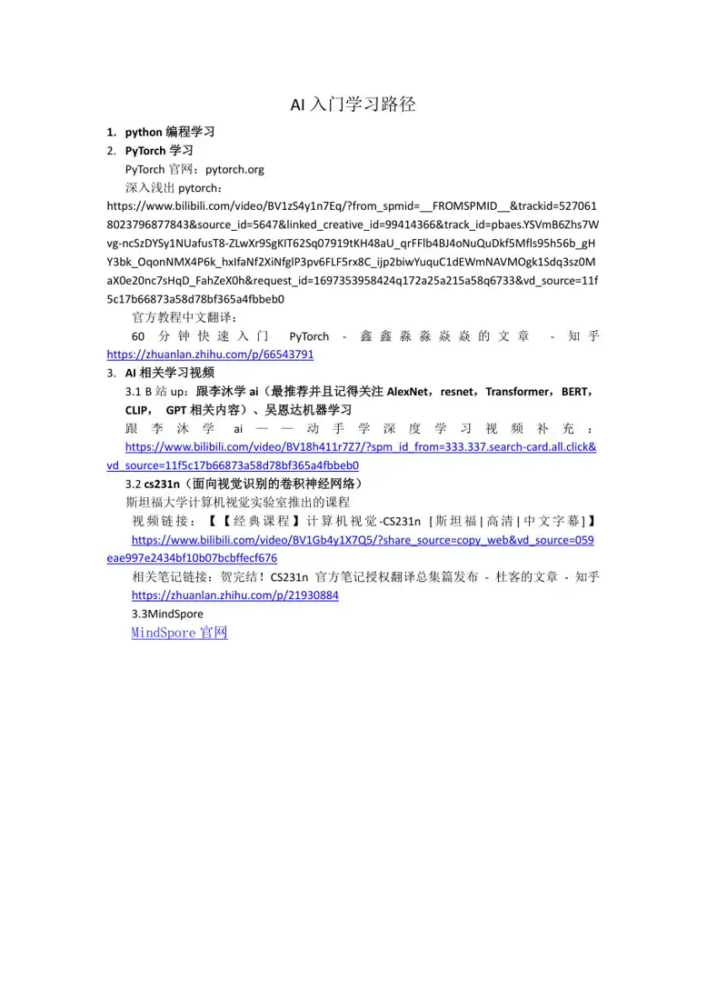

# AI入门学习路径

原件的每一页，下面附识别出的文字。

### AI入门学习路径

原文：

AI入门学习路径

1. python 编程学习

2. PyTorch 学习

PyTorch 官网：pytorch.org

深入浅出 pytorch：

https://www.bilibili.com/video/BV1zS4y1n7Eq/?from\_spmid=\_\_FROMSPMID\_\_&trackid=527061 8023796877843&source\_id=5647&linked\_creative\_id=99414366&track\_id=pbaes.YSVmB6Zhs7W vg-ncSzDYSy1NUafusT8-ZLwXr9SgKIT62Sq07919tKH48aU\_qrFFlb4BJ4oNuQuDkf5Mfls95h56b\_gH Y3bk\_OqonNMX4P6k\_hxIfaNf2XiNfglP3pv6FLF5rx8C\_ijp2biwYuquC1dEWmNAVMOgk1Sdq3sz0M aX0e20nc7sHqD\_FahZeX0h&request\_id=1697353958424q172a25a215a58q6733&vd\_source=11f 5c17b66873a58d78bf365a4fbbeb0

官方教程中文翻译：

60 分 钟 快 速 入 门 PyTorch - 鑫 鑫 淼 淼 焱 焱 的 文 章 - 知 乎https://zhuanlan.zhihu.com/p/66543791

3. AI相关学习视频

3.1 B 站 up：跟李沐学 ai（最推荐并且记得关注 AlexNet，resnet，Transformer，BERT，CLIP， GPT相关内容）、吴恩达机器学习

跟 李 沐 学 ai 动 手 学 深 度 学 习 视 频 补 充 ：https://www.bilibili.com/video/BV18h411r7Z7/?spm\_id\_from=333.337.search-card.all.click&vd\_source=11f5c17b66873a58d78bf365a4fbbeb0

3.2 cs231n（面向视觉识别的卷积神经网络）

斯坦福大学计算机视觉实验室推出的课程

视频链接：【【经典课程】计算机视觉-CS231n [斯坦福|高清|中文字幕]】https://www.bilibili.com/video/BV1Gb4y1X7Q5/?share\_source=copy\_web&vd\_source=059

eae997e2434bf10b07bcbffecf676

相关笔记链接：贺完结！CS231n 官方笔记授权翻译总集篇发布 - 杜客的文章 - 知乎https://zhuanlan.zhihu.com/p/21930884

3.3MindSpore

MindSpore 官网
