# 《统计学习方法》第10章 隐马尔科夫模型（课件）

原件的每一页，下面附识别出的文字。

### 第十章 隐马尔科夫模型

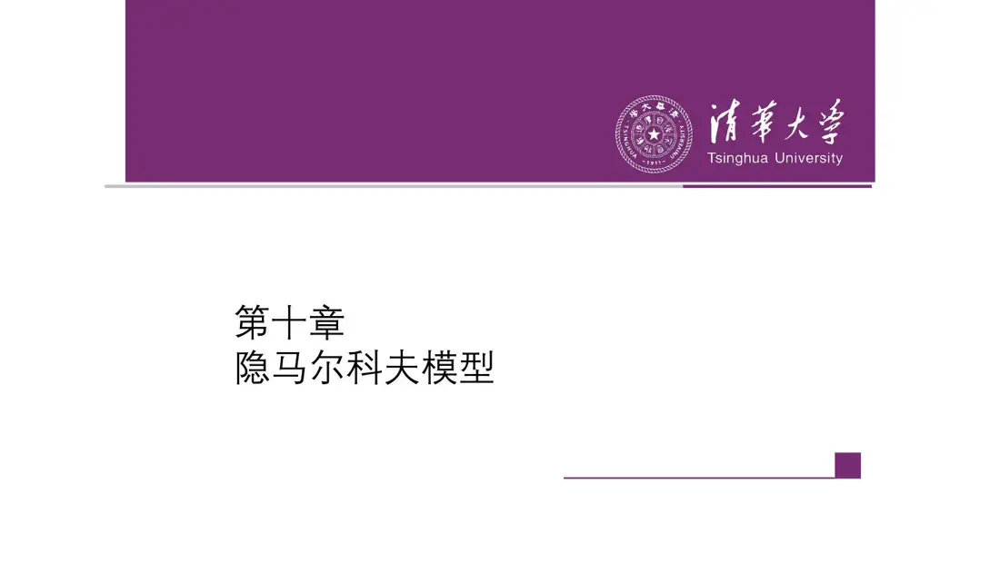

原文：

第十章 隐马尔科夫模型

大華洋
TSINGHUA UNIVERSITY
清華大學
Tsinghua University

### Andrey Markov

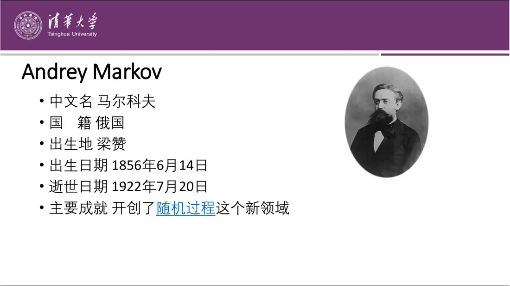

原文：

Andrey Markov

\- 中文名 马尔科夫

\- 国籍俄国

\- 出生地 梁赞

\- 出生日期 1856年6月14日

\- 逝世日期 1922年7月20日

\- 主要成就 开创了 随机过程 这个新领域

Tsinghua University
清華大學
1911-1911

### HMM应用

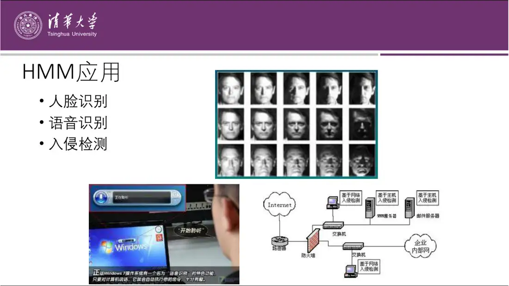

原文：

HMM应用

\- 人脸识别

\- 语音识别

\- 入侵检测

Tsinghua University
清華大學
1911-1911

### 例：

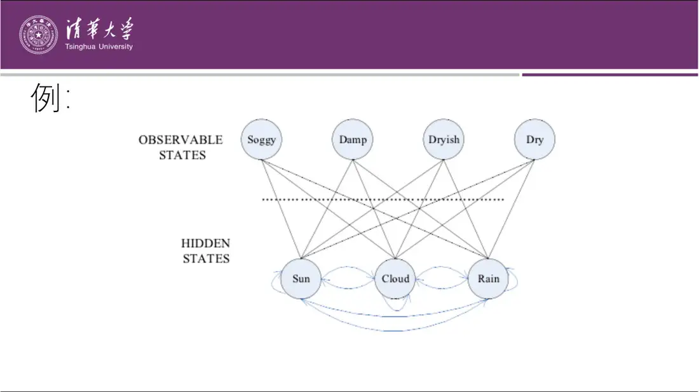

原文：

例：

清華大學 Tsinghua University

OBSERVABLE
STATES

HIDDEN
STATES

### 隐马尔科夫模型的定义

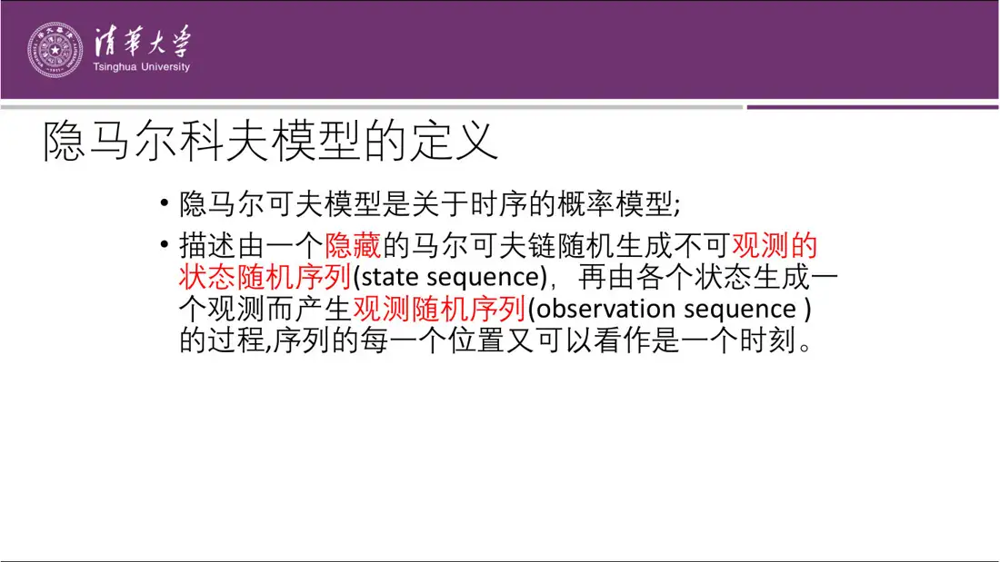

原文：

隐马尔科夫模型的定义

\- 隐马尔可夫模型是关于时序的概率模型;

\- 描述由一个隐藏的马尔可夫链随机生成不可观测的状态随机序列(state sequence)，再由各个状态生成一个观测而产生观测随机序列(observation sequence)的过程,序列的每一个位置又可以看作是一个时刻。

Tsinghua University
清華大學
1911-1911

### 隐马尔科夫模型

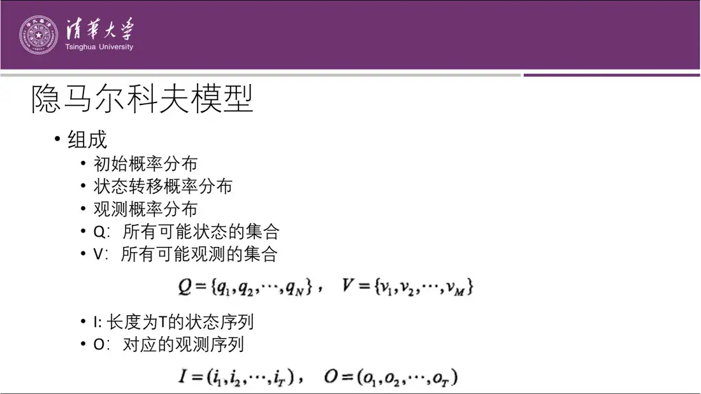

原文：

隐马尔科夫模型

\- 组成

\- 初始概率分布

\- 状态转移概率分布

\- 观测概率分布

• Q: 所有可能状态的集合

• V: 所有可能观测的集合

$$
Q = \left\{q _ {1}, q _ {2}, \dots , q _ {N} \right\}, \quad V = \left\{v _ {1}, v _ {2}, \dots , v _ {M} \right\}
$$

\- I: 长度为T的状态序列

\- O: 对应的观测序列

$$
I = \left(i _ {1}, i _ {2}, \dots , i _ {T}\right), \quad O = \left(o _ {1}, o _ {2}, \dots , o _ {T}\right)
$$

Tsinghua University
清華大學

### 隐马尔科夫模型

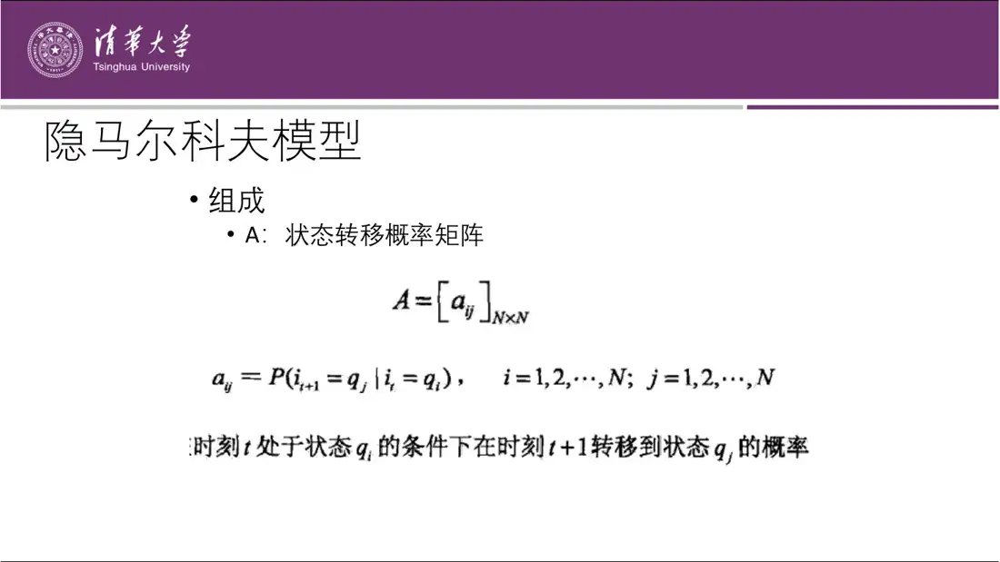

原文：

隐马尔科夫模型

\- 组成

A: 状态转移概率矩阵

$$
A = \left[ a _ {i j} \right] _ {N \times N}
$$

$$
a _ {i j} = P \left(i _ {i + 1} = q _ {j} \mid i _ {i} = q _ {i}\right), \quad i = 1, 2, \dots , N; j = 1, 2, \dots , N
$$

时刻 $t$ 处于状态 $q_{i}$ 的条件下在时刻 $t + 1$ 转移到状态 $q_{j}$ 的概率

Tsinghua University
清華大學

### 隐马尔科夫模型

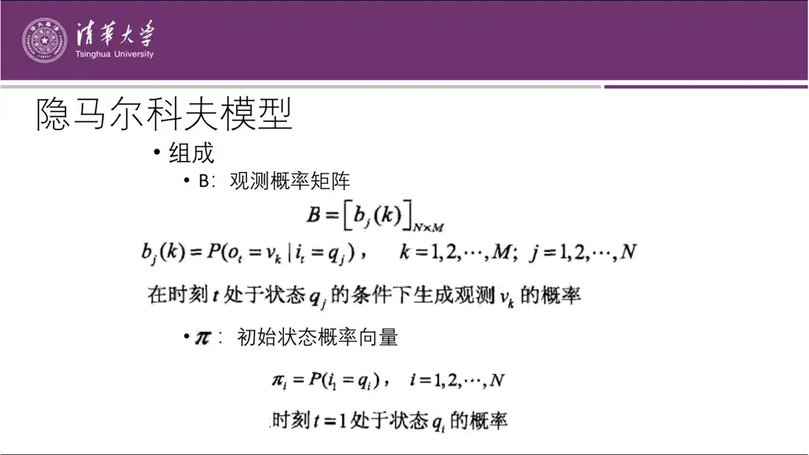

原文：

隐马尔科夫模型

\- 组成

B: 观测概率矩阵

$$
B = \left[ b _ {j} (k) \right] _ {N \times M}
$$

$$
b _ {j} (k) = P \left(o _ {t} = v _ {k} \mid i _ {t} = q _ {j}\right), \quad k = 1, 2, \dots , M; j = 1, 2, \dots , N
$$

在时刻 t 处于状态 $q_{j}$ 的条件下生成观测 $v_{k}$ 的概率

\- $\pi$ ：初始状态概率向量

$$
\pi_ {i} = P (i _ {1} = q _ {i}), \quad i = 1, 2, \dots , N
$$

时刻 $t = 1$ 处于状态 $q_{i}$ 的概率

Tsinghua University
清華大學

### 隐马尔科夫模型

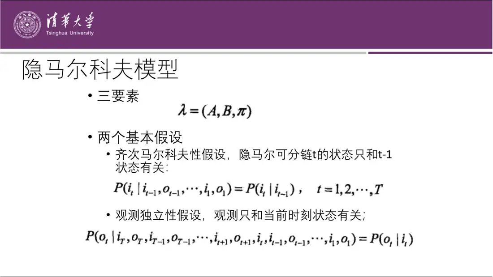

原文：

隐马尔科夫模型

\- 三要素

$$
\lambda = (A, B, \pi)
$$

\- 两个基本假设

\- 齐次马尔科夫性假设，隐马尔可分链t的状态只和t-1状态有关：

$$
P (i _ {t} \mid i _ {t - 1}, o _ {t - 1}, \dots , i _ {1}, o _ {1}) = P (i _ {t} \mid i _ {t - 1}), \quad t = 1, 2, \dots , T
$$

\- 观测独立性假设，观测只和当前时刻状态有关；

$$
P \left(o _ {t} \mid i _ {T}, o _ {T}, i _ {T - 1}, o _ {T - 1}, \dots , i _ {t + 1}, o _ {t + 1}, i _ {t}, i _ {t - 1}, o _ {t - 1}, \dots , i _ {1}, o _ {1}\right) = P \left(o _ {t} \mid i _ {t}\right)
$$

Tsinghua University
清華大學

### ·盒子:1234·红球:5368·白球:5742

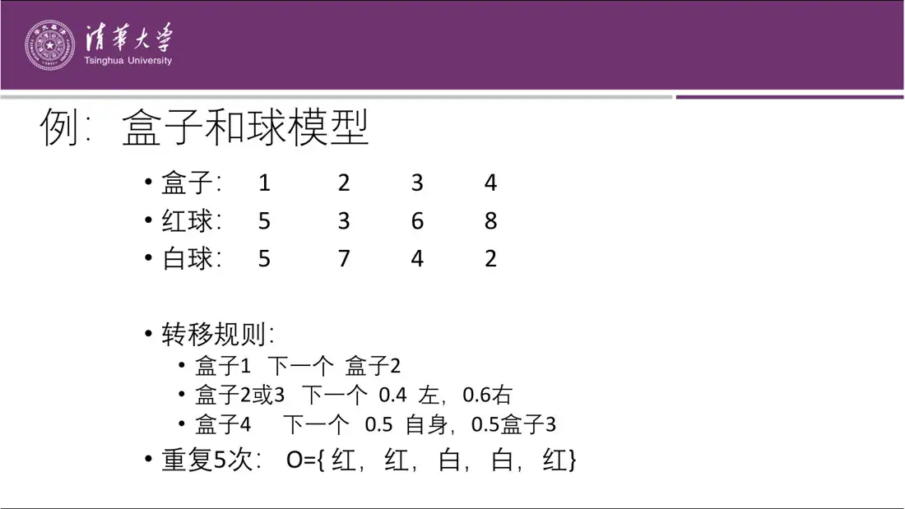

原文：

<table><tr><td>·盒子:</td><td>1</td><td>2</td><td>3</td><td>4</td></tr><tr><td>·红球:</td><td>5</td><td>3</td><td>6</td><td>8</td></tr><tr><td>·白球:</td><td>5</td><td>7</td><td>4</td><td>2</td></tr></table>

例：盒子和球模型

\- 转移规则:

\- 盒子1 下一个 盒子2

\- 盒子2或3 下一个 0.4 左，0.6右

\- 盒子4 下一个 0.5 自身，0.5盒子3

\- 重复5次: $O = \{\text {红}, \text {红}, \text {白}, \text {白}, \text {红} \}$

清華大學 Tsinghua University

### 例：盒子和球模型

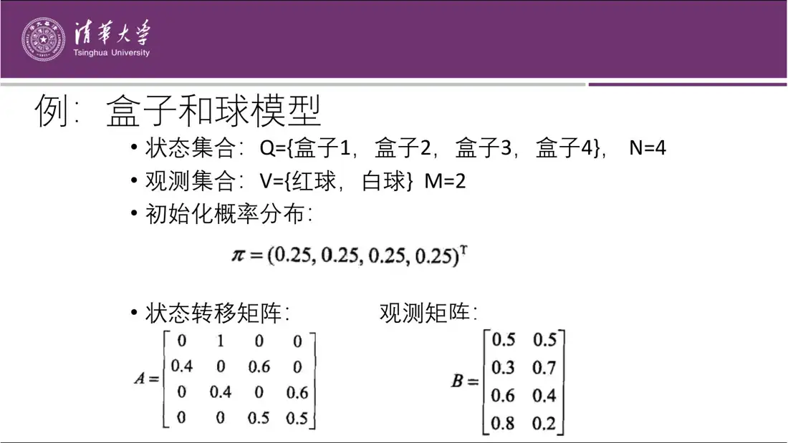

原文：

例：盒子和球模型

\- 状态集合: $Q = \{\text{盒子} 1, \text{盒子} 2, \text{盒子} 3, \text{盒子} 4\}, N = 4$

\- 观测集合：V={红球，白球} M=2

\- 初始化概率分布：

$$
\pi = (0. 2 5, 0. 2 5, 0. 2 5, 0. 2 5) ^ {\mathrm{T}}
$$

\- 状态转移矩阵:

$$
A = \left[ \begin{array}{c c c c} 0 & 1 & 0 & 0 \\ 0. 4 & 0 & 0. 6 & 0 \\ 0 & 0. 4 & 0 & 0. 6 \\ 0 & 0 & 0. 5 & 0. 5 \end{array} \right]
$$

观测矩阵：

$$
B = \left[ \begin{array}{l l} 0. 5 & 0. 5 \\ 0. 3 & 0. 7 \\ 0. 6 & 0. 4 \\ 0. 8 & 0. 2 \end{array} \right]
$$

Tsinghua University
清華大學

### 观测序列的生成过程

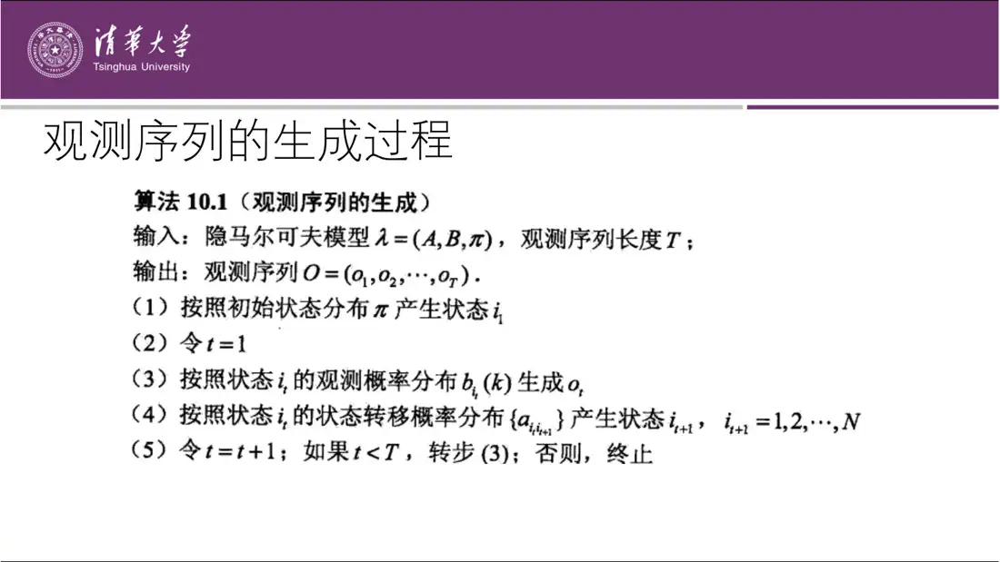

原文：

观测序列的生成过程

算法 10.1（观测序列的生成）

输入：隐马尔可夫模型 $\lambda=(A,B,\pi)$ ，观测序列长度 T；

输出：观测序列 $O=(o_{1},o_{2},\cdots,o_{T})$ .

(1) 按照初始状态分布 $\pi$ 产生状态 $i_{1}$

(2) 令 t=1

(3) 按照状态 $i_{t}$ 的观测概率分布 $b_{i_{t}}(k)$ 生成 $o_{t}$

(4) 按照状态 $i_{t}$ 的状态转移概率分布 $\{a_{i_{t}i_{t+1}}\}$ 产生状态 $i_{t+1}, i_{t+1}=1,2,\cdots,N$

(5) 令 $t = t + 1$ ; 如果 $t < T$ , 转步 (3); 否则, 终止

Tsinghua University
清華大學

### 隐马尔科夫模型的三个基本问题

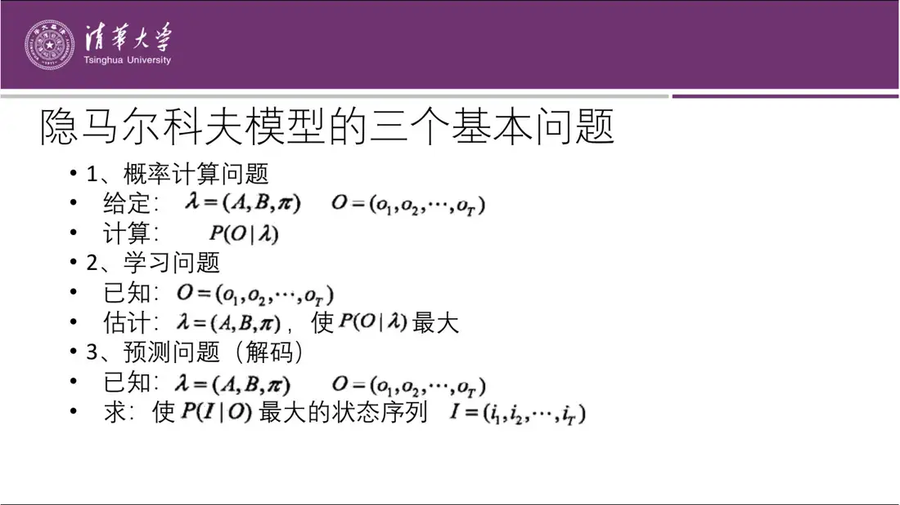

原文：

隐马尔科夫模型的三个基本问题

• 1、概率计算问题

\- 给定： $\lambda = (A, B, \pi)$ $O = (o_1, o_2, \dots, o_T)$

\- 计算: $P(O|\lambda)$

• 2、学习问题

\- 已知： $O=(o_{1},o_{2},\cdots,o_{T})$

\- 估计： $\lambda = (A,B,\pi)$ ，使 $P(O|\lambda)$ 最大

• 3、预测问题（解码）

\- 已知： $\lambda=(A,B,\pi)$ $O=(o_{1},o_{2},\cdots,o_{T})$

• 求：使 $P(I \mid O)$ 最大的状态序列 $I = (i_{1}, i_{2}, \cdots, i_{T})$

Tsinghua University
清華大學

### 概率计算方法

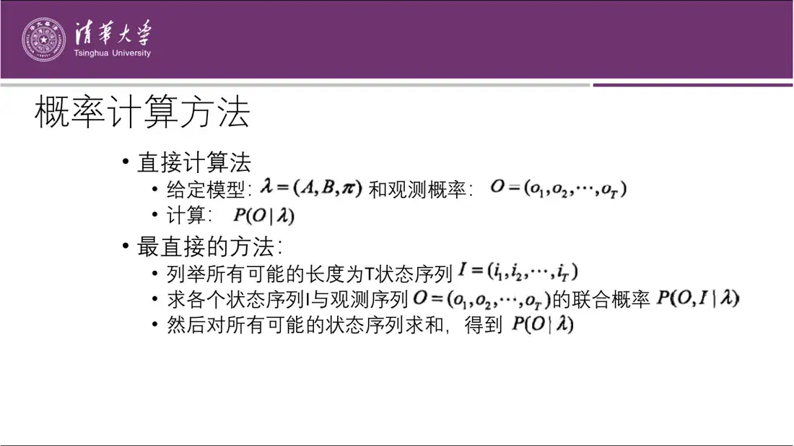

原文：

概率计算方法

\- 直接计算法

\- 给定模型: $\lambda = (A, B, \pi)$ 和观测概率: $O = (o_1, o_2, \cdots, o_T)$

\- 计算: $P(O|\lambda)$

\- 最直接的方法:

\- 列举所有可能的长度为T状态序列 $I = (i_1, i_2, \dots, i_T)$

\- 求各个状态序列与观测序列 $O = (o_{1}, o_{2}, \cdots, o_{T})$ 的联合概率 $P(O, I \mid \lambda)$

\- 然后对所有可能的状态序列求和，得到 $P(O|\lambda)$

Tsinghua University
清華大學

### 概率计算方法

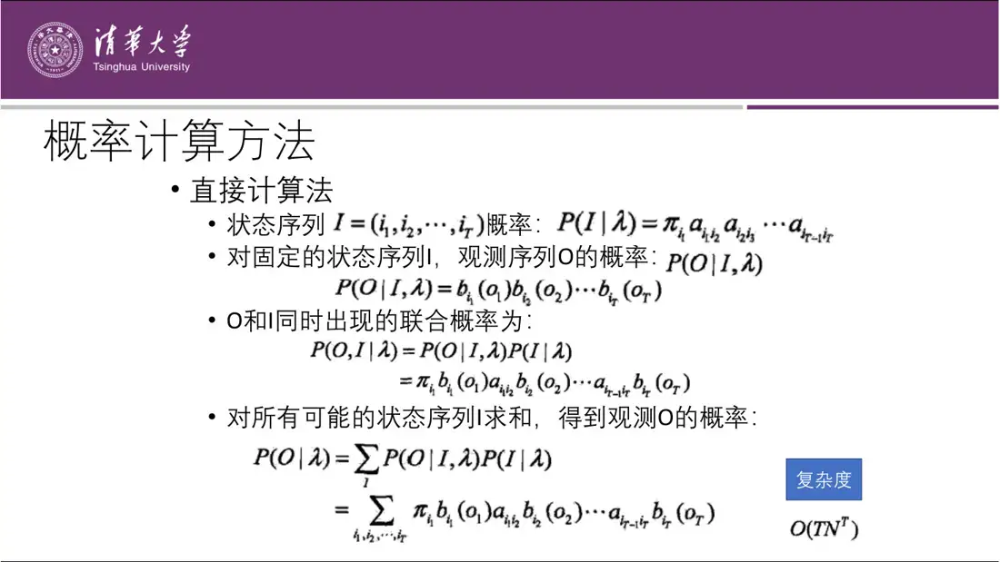

原文：

概率计算方法

\- 直接计算法

\- 状态序列 $I = (i_1, i_2, \dots, i_T)$ 概率： $P(I \mid \lambda) = \pi_{i_1} a_{i_1 i_2} a_{i_2 i_3} \dots a_{i_{T-1} i_T}$

\- 对固定的状态序列I，观测序列O的概率： $P(O|I,\lambda)$

$$
P (O \mid I, \lambda) = b _ {i _ {1}} (o _ {1}) b _ {i _ {2}} (o _ {2}) \dots b _ {i _ {T}} (o _ {T})
$$

\- O和I同时出现的联合概率为:

$$
\begin{array}{r l} P (O, I \mid \lambda) & = P (O \mid I, \lambda) P (I \mid \lambda) \\ & = \pi_ {i _ {1}} b _ {i _ {1}} (o _ {1}) a _ {i _ {1} i _ {2}} b _ {i _ {2}} (o _ {2}) \dots a _ {i _ {T - 1} i _ {T}} b _ {i _ {T}} (o _ {T}) \end{array}
$$

\- 对所有可能的状态序列I求和，得到观测O的概率：

$$
\begin{array}{r l} P (O \mid \lambda) & = \sum_ {I} P (O \mid I, \lambda) P (I \mid \lambda) \\ & = \sum_ {i _ {1}, i _ {2}, \dots , i _ {T}} \pi_ {i _ {1}} b _ {i _ {1}} (o _ {1}) a _ {i _ {1} i _ {2}} b _ {i _ {2}} (o _ {2}) \dots a _ {i _ {T - 1} i _ {T}} b _ {i _ {T}} (o _ {T}) \end{array}
$$

复杂度

$$
O (T N ^ {T})
$$

Tsinghua University
清華大學

### 前向算法

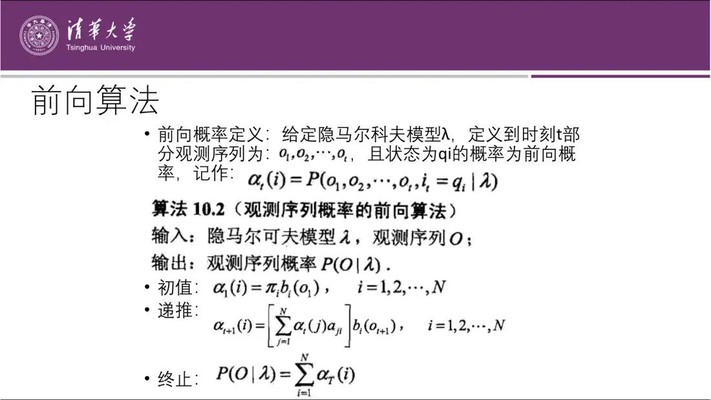

原文：

前向算法

\- 前向概率定义：给定隐马尔科夫模型 $\lambda$ ，定义到时刻t部分观测序列为： $o_1, o_2, \cdots, o_t$ ，且状态为qi的概率为前向概率，记作： $\alpha_t(i) = P(o_1, o_2, \cdots, o_t, i_t = q_i \mid \lambda)$

算法10.2（观测序列概率的前向算法）

输入：隐马尔可夫模型 $\lambda$ ，观测序列 O；

输出：观测序列概率 $P(O \mid \lambda)$ .

\- 初值： $\alpha_{1}(i)=\pi_{i}b_{i}(o_{1})$ ， $i=1,2,\cdots,N$

\- 递推:

$$
\alpha_ {t + 1} (i) = \left[ \sum_ {j = 1} ^ {N} \alpha_ {t} (j) a _ {j i} \right] b _ {i} (o _ {t + 1}), \quad i = 1, 2, \dots , N
$$

\- 终止: $P(O \mid \lambda) = \sum_{i=1}^{N} \alpha_T(i)$

Tsinghua University
清華大學

### 前向算法

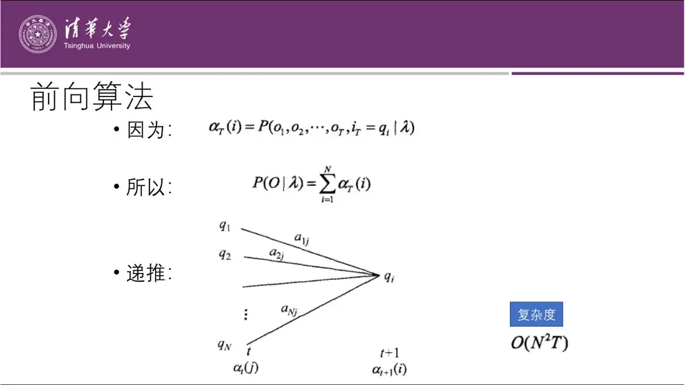

原文：

前向算法

\- 因为： $\alpha_{T}(i) = P(o_{1},o_{2},\dots ,o_{T},i_{T} = q_{i}\mid \lambda)$

\- 所以:

$$
P (O \mid \lambda) = \sum_ {i = 1} ^ {N} \alpha_ {T} (i)
$$

\- 递推:

复杂度

$$
O (N ^ {2} T)
$$

清華大學 Tsinghua University

### 前向算法

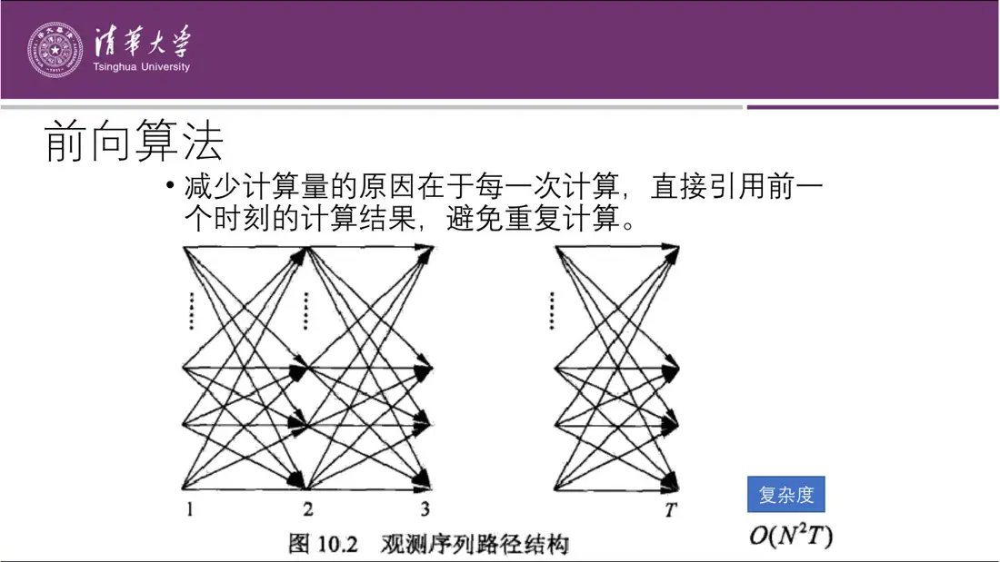

原文：

前向算法

\- 减少计算量的原因在于每一次计算，直接引用前一个时刻的计算结果，避免重复计算。

Tsinghua University
清華大學
TSINGHUA UNIVERSITY
1911
清華大學
TSINGHUA UNIVERSITY

### 例：

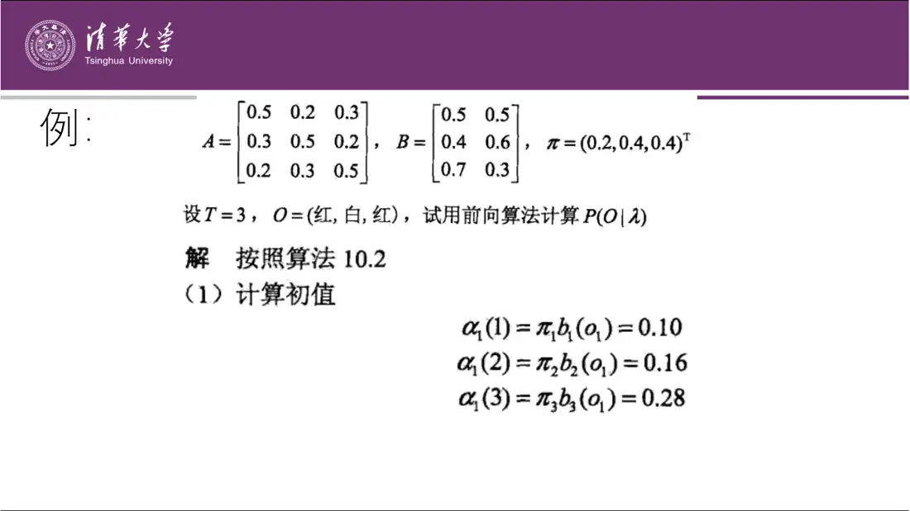

原文：

例：

$$
A = \left[ \begin{array}{l l l} 0. 5 & 0. 2 & 0. 3 \\ 0. 3 & 0. 5 & 0. 2 \\ 0. 2 & 0. 3 & 0. 5 \end{array} \right], \quad B = \left[ \begin{array}{l l} 0. 5 & 0. 5 \\ 0. 4 & 0. 6 \\ 0. 7 & 0. 3 \end{array} \right], \quad \pi = (0. 2, 0. 4, 0. 4) ^ {\mathrm{T}}
$$

设 $T = 3$ ， $O =$ （红，白，红），试用前向算法计算 $P(O|\lambda)$

解 按照算法 10.2

(1) 计算初值

$$
\alpha_ {1} (1) = \pi_ {1} b _ {1} (o _ {1}) = 0. 1 0
$$

$$
\alpha_ {1} (2) = \pi_ {2} b _ {2} (o _ {1}) = 0. 1 6
$$

$$
\alpha_ {1} (3) = \pi_ {3} b _ {3} (o _ {1}) = 0. 2 8
$$

清華大學 Tsinghua University

### 例：

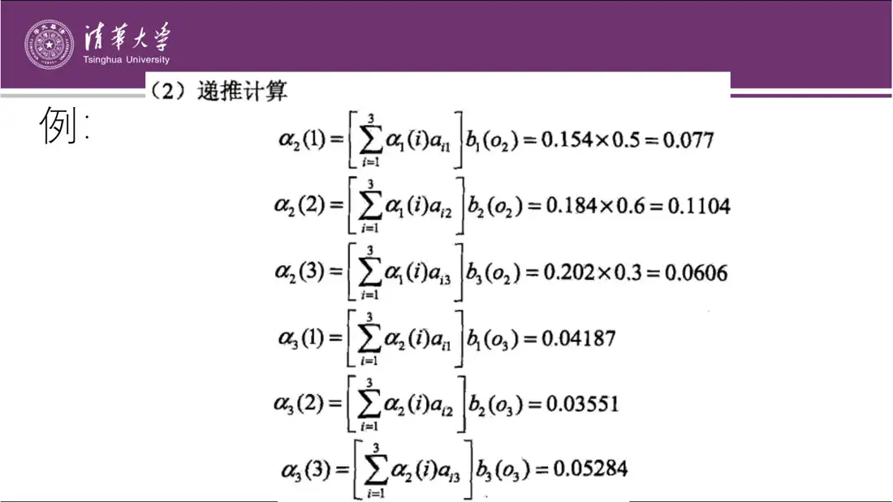

原文：

例：

(2) 递推计算

$$
\alpha_ {2} (1) = \left[ \sum_ {i = 1} ^ {3} \alpha_ {1} (i) a _ {i 1} \right] b _ {1} \left(o _ {2}\right) = 0. 1 5 4 \times 0. 5 = 0. 0 7 7
$$

$$
\alpha_ {2} (2) = \left[ \sum_ {i = 1} ^ {3} \alpha_ {1} (i) a _ {i 2} \right] b _ {2} \left(o _ {2}\right) = 0. 1 8 4 \times 0. 6 = 0. 1 1 0 4
$$

$$
\alpha_ {2} (3) = \left[ \sum_ {i = 1} ^ {3} \alpha_ {1} (i) a _ {i 3} \right] b _ {3} \left(o _ {2}\right) = 0. 2 0 2 \times 0. 3 = 0. 0 6 0 6
$$

$$
\alpha_ {3} (1) = \left[ \sum_ {i = 1} ^ {3} \alpha_ {2} (i) a _ {i 1} \right] b _ {1} \left(o _ {3}\right) = 0. 0 4 1 8 7
$$

$$
\alpha_ {3} (2) = \left[ \sum_ {i = 1} ^ {3} \alpha_ {2} (i) a _ {i 2} \right] b _ {2} \left(o _ {3}\right) = 0. 0 3 5 5 1
$$

$$
\alpha_ {3} (3) = \left[ \sum_ {i = 1} ^ {3} \alpha_ {2} (i) a _ {i 3} \right] b _ {3} \left(o _ {3}\right) = 0. 0 5 2 8 4
$$

Tsinghua University
清華大學

### 例：

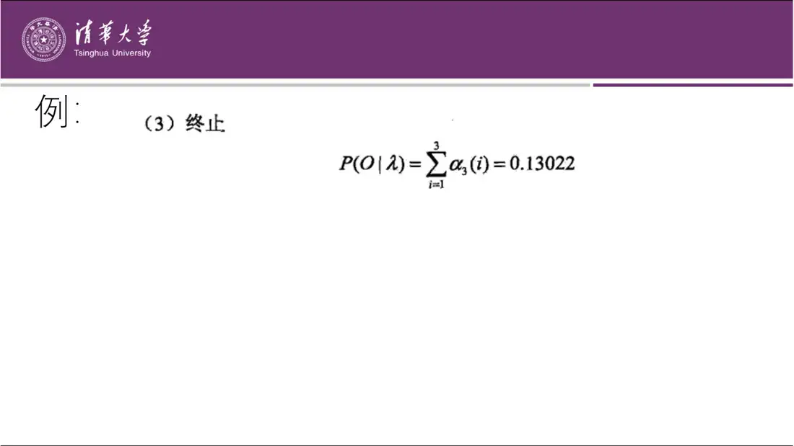

原文：

例：

(3) 终止

$$
P (O \mid \lambda) = \sum_ {i = 1} ^ {3} \alpha_ {3} (i) = 0. 1 3 0 2 2
$$

清華大學 Tsinghua University

### 后向算法

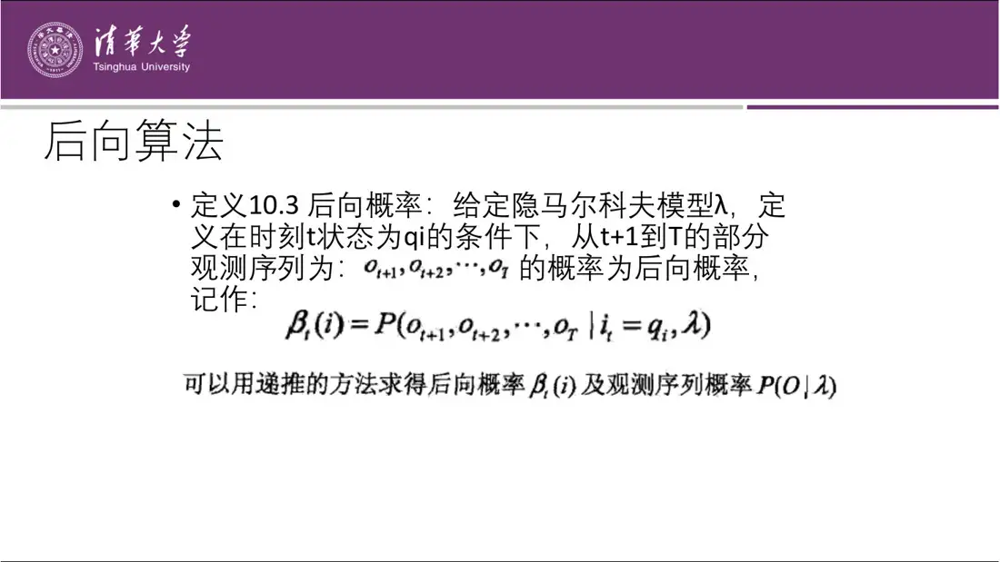

原文：

后向算法

\- 定义10.3 后向概率：给定隐马尔科夫模型λ，定义在时刻t状态为qi的条件下，从t+1到T的部分观测序列为： $O_{i+1}, O_{i+2}, \cdots, O_T$ 的概率为后向概率，

记作:

$$
\beta_ {i} (i) = P \left(o _ {t + 1}, o _ {t + 2}, \dots , o _ {T} \mid i _ {t} = q _ {i}, \lambda\right)
$$

可以用递推的方法求得后向概率 $\beta_{i}(i)$ 及观测序列概率 $P(O|\lambda)$

清華大學 Tsinghua University

### 后向算法

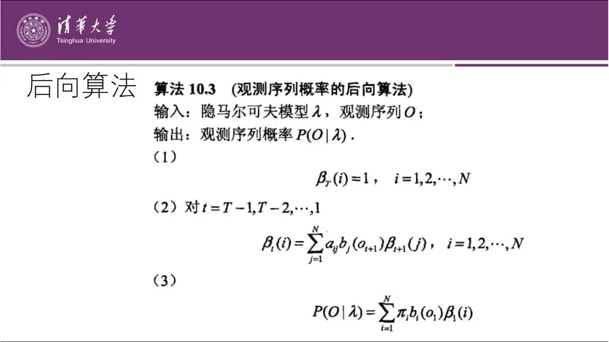

原文：

后向算法

算法 10.3 (观测序列概率的后向算法)

输入：隐马尔可夫模型 $\lambda$ ，观测序列 O；

输出：观测序列概率 $P(O \mid \lambda)$ .

(1)

$$
\beta_ {T} (i) = 1, \quad i = 1, 2, \dots , N
$$

(2) 对 $t = T - 1, T - 2, \cdots, 1$

$$
\beta_ {i} (i) = \sum_ {j = 1} ^ {N} a _ {i j} b _ {j} \left(o _ {i + 1}\right) \beta_ {i + 1} (j), \quad i = 1, 2, \dots , N
$$

(3)

$$
P (O \mid \lambda) = \sum_ {i = 1} ^ {N} \pi_ {i} b _ {i} (o _ {1}) \beta_ {1} (i)
$$

清華大學 Tsinghua University

### 后向算法

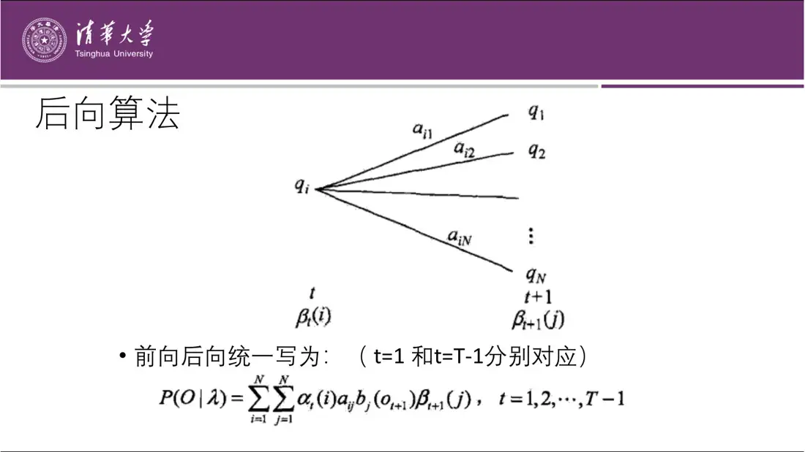

原文：

后向算法

\- 前向后向统一写为：（t=1 和 t=T-1 分别对应）

$$
P (O \mid \lambda) = \sum_ {i = 1} ^ {N} \sum_ {j = 1} ^ {N} \alpha_ {t} (i) a _ {i j} b _ {j} \left(o _ {t + 1}\right) \beta_ {t + 1} (j), \quad t = 1, 2, \dots , T - 1
$$

清華大學 Tsinghua University

### 一些概率和期望值的计算

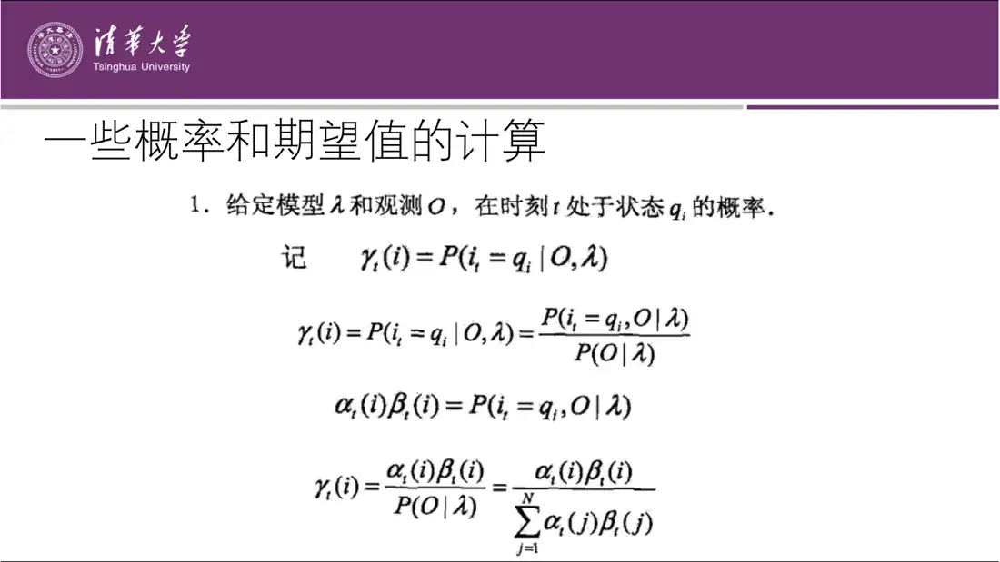

原文：

一些概率和期望值的计算

1. 给定模型 $\lambda$ 和观测 O，在时刻 t 处于状态 $q_{i}$ 的概率.

记 $\gamma_{i}(i) = P(i_{t} = q_{i}\mid O,\lambda)$

$$
\gamma_ {i} (i) = P (i _ {t} = q _ {i} \mid O, \lambda) = \frac {P (i _ {t} = q _ {i} , O \mid \lambda)}{P (O \mid \lambda)}
$$

$$
\alpha_ {t} (i) \beta_ {t} (i) = P (i _ {t} = q _ {i}, O | \lambda)
$$

$$
\gamma_ {i} (i) = \frac {\alpha_ {i} (i) \beta_ {i} (i)}{P (O \mid \lambda)} = \frac {\alpha_ {i} (i) \beta_ {i} (i)}{\sum_ {j = 1} ^ {N} \alpha_ {i} (j) \beta_ {i} (j)}
$$

Tsinghua University
清華大學

### 一些概率和期望值的计算

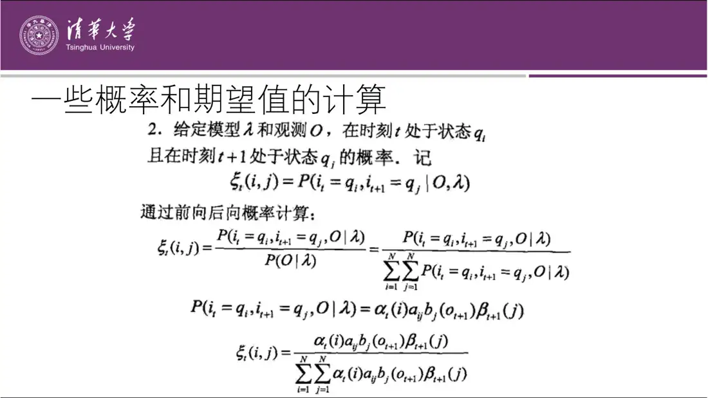

原文：

一些概率和期望值的计算

2. 给定模型 $\lambda$ 和观测 O，在时刻 t 处于状态 $q_{i}$

且在时刻 $t + 1$ 处于状态 $q_{j}$ 的概率。记

$$
\xi_ {t} (i, j) = P \left(i _ {t} = q _ {i}, i _ {t + 1} = q _ {j} \mid O, \lambda\right)
$$

通过前向后向概率计算：

$$
\xi_ {t} (i, j) = \frac {P (i _ {t} = q _ {i} , i _ {t + 1} = q _ {j} , O \mid \lambda)}{P (O \mid \lambda)} = \frac {P (i _ {t} = q _ {i} , i _ {t + 1} = q _ {j} , O \mid \lambda)}{\sum_ {i = 1} ^ {N} \sum_ {j = 1} ^ {N} P (i _ {t} = q _ {i} , i _ {t + 1} = q _ {j} , O \mid \lambda)}
$$

$$
P (i _ {t} = q _ {i}, i _ {t + 1} = q _ {j}, O \mid \lambda) = \alpha_ {i} (i) a _ {i j} b _ {j} (o _ {t + 1}) \beta_ {t + 1} (j)
$$

$$
\xi_ {t} (i, j) = \frac {\alpha_ {t} (i) a _ {i j} b _ {j} \left(o _ {t + 1}\right) \beta_ {t + 1} (j)}{\sum_ {i = 1} ^ {N} \sum_ {j = 1} ^ {N} \alpha_ {t} (i) a _ {i j} b _ {j} \left(o _ {t + 1}\right) \beta_ {t + 1} (j)}
$$

Tsinghua University
清華大學

### 一些概率和期望值的计算

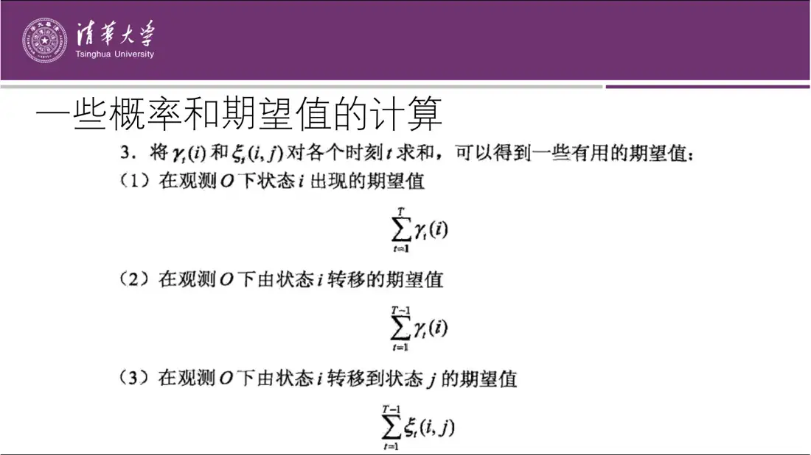

原文：

一些概率和期望值的计算

3. 将 $\gamma_{t}(i)$ 和 $\xi_{t}(i,j)$ 对各个时刻 $t$ 求和，可以得到一些有用的期望值：

(1) 在观测 O 下状态 i 出现的期望值

$$
\sum_ {t = 1} ^ {T} \gamma_ {i} (i)
$$

(2) 在观测 O 下由状态 i 转移的期望值

$$
\sum_ {t = 1} ^ {T - 1} \gamma_ {t} (i)
$$

(3) 在观测 O 下由状态 i 转移到状态 j 的期望值

$$
\sum_ {t = 1} ^ {T - 1} \xi_ {t} (i, j)
$$

Tsinghua University
清華大學

### 学习算法

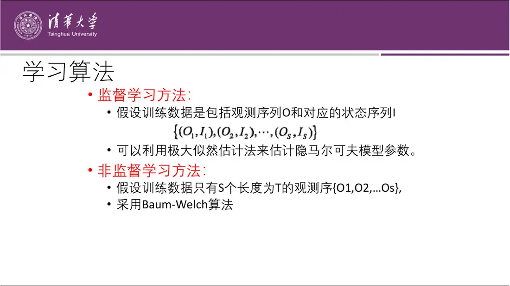

原文：

学习算法

\- 监督学习方法:

\- 假设训练数据是包括观测序列O和对应的状态序列I

$$
\left\{\left(O _ {1}, I _ {1}\right), \left(O _ {2}, I _ {2}\right), \dots , \left(O _ {S}, I _ {S}\right) \right\}
$$

\- 可以利用极大似然估计法来估计隐马尔可夫模型参数。

\- 非监督学习方法:

\- 假设训练数据只有S个长度为T的观测序{O1,O2,...Os},

\- 采用Baum-Welch算法

Tsinghua University
清華大學

### 监督学习方法

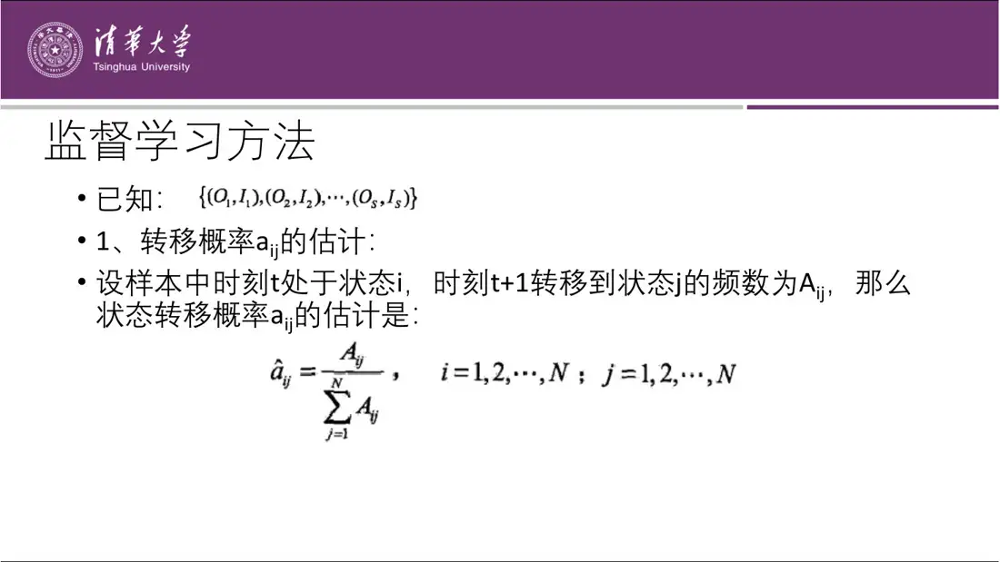

原文：

监督学习方法

\- 已知： $\{(O_1,I_1),(O_2,I_2),\dots ,(O_S,I_S)\}$

• 1、转移概率 $a_{ij}$ 的估计：

\- 设样本中时刻t处于状态i，时刻t+1转移到状态j的频数为 $A_{ij}$ ，那么状态转移概率 $a_{ij}$ 的估计是：

$$
\hat {a} _ {i j} = \frac {A _ {i j}}{\sum_ {j = 1} ^ {N} A _ {i j}}, \quad i = 1, 2, \dots , N; j = 1, 2, \dots , N
$$

Tsinghua University
清華大學

### 监督学习方法

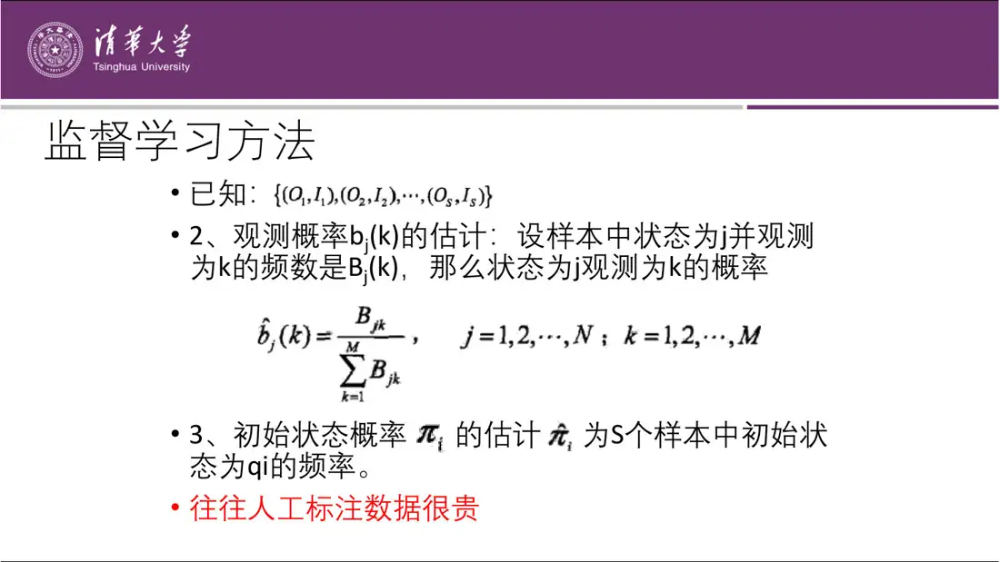

原文：

监督学习方法

\- 已知： $\{(O_1, I_1), (O_2, I_2), \cdots, (O_S, I_S)\}$

• 2、观测概率 $b_{j}(k)$ 的估计：设样本中状态为j并观测为k的频数是 $B_{j}(k)$ ，那么状态为j观测为k的概率

$$
\hat {b} _ {j} (k) = \frac {B _ {j k}}{\sum_ {k = 1} ^ {M} B _ {j k}}, \quad j = 1, 2, \dots , N; k = 1, 2, \dots , M
$$

• 3、初始状态概率 $\pi_{i}$ 的估计 $\hat{\pi}_{i}$ 为S个样本中初始状态为qi的频率。

\- 往往人工标注数据很贵

Tsinghua University
清華大學

### Baum-Welch算法

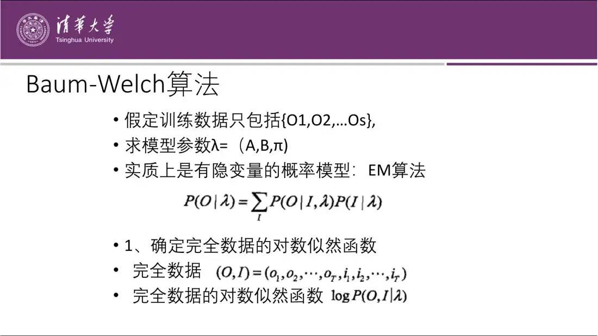

原文：

Baum-Welch算法

\- 假定训练数据只包括{01,02,...Os},

\- 求模型参数 $\lambda = (A, B, \pi)$

\- 实质上是有隐变量的概率模型：EM算法

$$
P (O \mid \lambda) = \sum_ {I} P (O \mid I, \lambda) P (I \mid \lambda)
$$

• 1、确定完全数据的对数似然函数

\- 完全数据 $(O,I) = (o_{1},o_{2},\dots ,o_{T},i_{1},i_{2},\dots ,i_{T})$

\- 完全数据的对数似然函数 $\log P(O, I|\lambda)$

Tsinghua University
清華大學

### Baum Welch算法

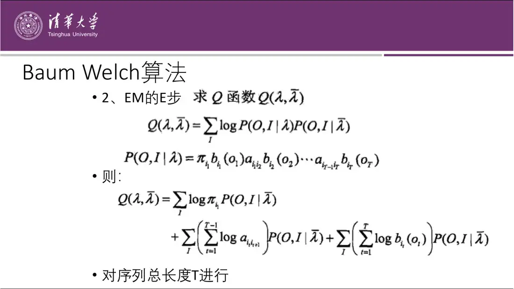

原文：

Baum Welch算法

• 2、EM的E步 求 Q 函数 $Q(\lambda, \bar{\lambda})$

$$
Q (\lambda , \overline {{{\lambda}}}) = \sum_ {I} \log P (O, I | \lambda) P (O, I | \overline {{{\lambda}}})
$$

$$
P (O, I \mid \lambda) = \pi_ {i _ {1}} b _ {i _ {1}} (o _ {1}) a _ {i _ {1} i _ {2}} b _ {i _ {2}} (o _ {2}) \dots a _ {i _ {T - 1} i _ {T}} b _ {i _ {T}} (o _ {T})
$$

$$
\begin{array}{l} Q (\lambda , \overline {{\lambda}}) = \sum_ {I} \log \pi_ {i _ {1}} P (O, I | \overline {{\lambda}}) \\ + \sum_ {I} \left(\sum_ {t = 1} ^ {T - 1} \log a _ {i _ {t} i _ {t + 1}}\right) P (O, I | \overline {{\lambda}}) + \sum_ {I} \left(\sum_ {t = 1} ^ {T} \log b _ {i _ {t}} (o _ {t})\right) P (O, I | \overline {{\lambda}}) \end{array}
$$

\- 对序列总长度T进行

清華大學 Tsinghua University

### Baum Welch算法

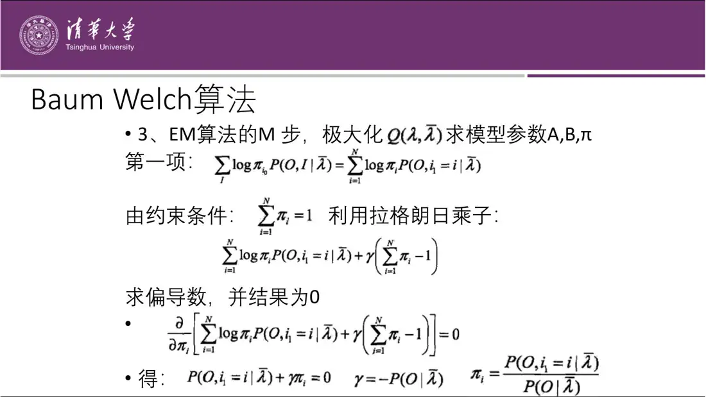

原文：

Baum Welch算法

• 3、EM算法的M步，极大化 $Q(\lambda,\bar{\lambda})$ 求模型参数A,B,π

第一项： $\sum_{I}\log \pi_{i_0}P(O,I|\overline{\lambda}) = \sum_{i = 1}^{N}\log \pi_iP(O,i_1 = i|\overline{\lambda})$

由约束条件: $\sum_{i=1}^{N} \pi_i = 1$ 利用拉格朗日乘子:

$$
\sum_ {i = 1} ^ {N} \log \pi_ {i} P (O, i _ {1} = i \mid \bar {\lambda}) + \gamma \left(\sum_ {i = 1} ^ {N} \pi_ {i} - 1\right)
$$

求偏导数，并结果为0

$$
\frac {\partial}{\partial \pi_ {i}} \left[ \sum_ {i = 1} ^ {N} \log \pi_ {i} P (O, i _ {1} = i \mid \bar {\lambda}) + \gamma \left(\sum_ {i = 1} ^ {N} \pi_ {i} - 1\right) \right] = 0
$$

$$
\bullet \text {得:} P (O, i _ {1} = i \mid \bar {\lambda}) + \gamma \pi_ {i} = 0 \quad \gamma = - P (O \mid \bar {\lambda}) \quad \pi_ {i} = \frac {P (O , i _ {1} = i \mid \bar {\lambda})}{P (O \mid \bar {\lambda})}
$$

清華大學 Tsinghua University

### 学习算法 Baum Welch算法

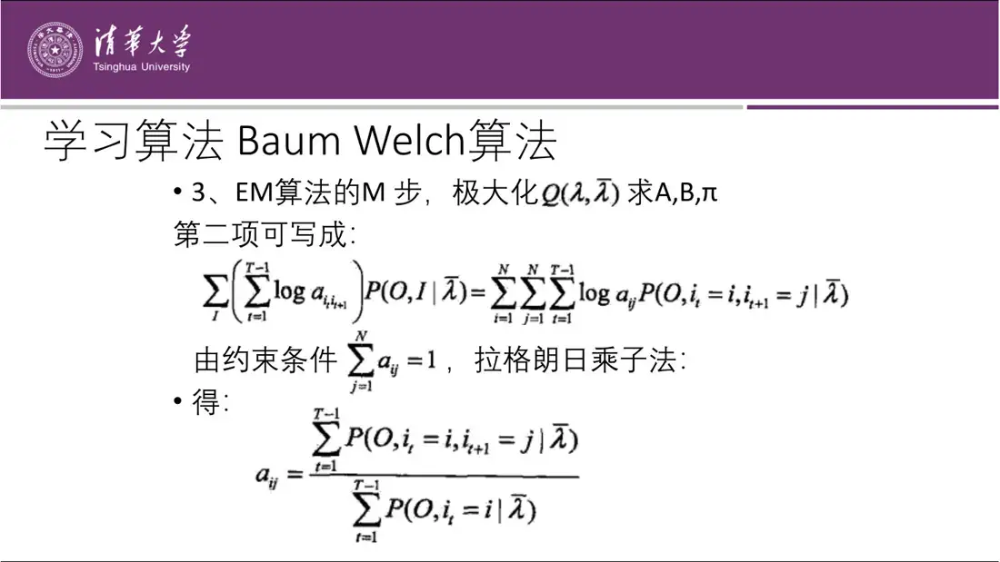

原文：

学习算法 Baum Welch算法

• 3、EM算法的M步，极大化 $Q(\lambda,\bar{\lambda})$ 求A,B, $\pi$

第二项可写成:

$$
\sum_ {I} \left(\sum_ {t = 1} ^ {T - 1} \log a _ {i, i _ {t + 1}}\right) P (O, I \mid \bar {\lambda}) = \sum_ {i = 1} ^ {N} \sum_ {j = 1} ^ {N} \sum_ {t = 1} ^ {T - 1} \log a _ {i j} P (O, i _ {t} = i, i _ {t + 1} = j \mid \bar {\lambda})
$$

由约束条件 $\sum_{j=1}^{N} a_{ij} = 1$ ，拉格朗日乘子法：

\- 得:

$$
a _ {i j} = \frac {\sum_ {t = 1} ^ {T - 1} P (O , i _ {t} = i , i _ {t + 1} = j \mid \overline {{\lambda}})}{\sum_ {t = 1} ^ {T - 1} P (O , i _ {t} = i \mid \overline {{\lambda}})}
$$

清華大學 Tsinghua University

### Baum Welch算法

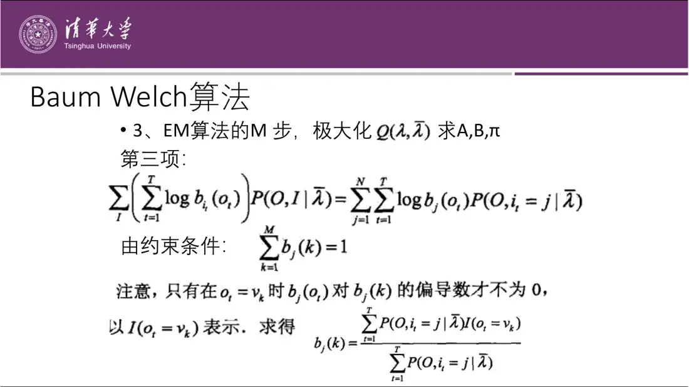

原文：

Baum Welch算法

• 3、EM算法的M步，极大化 $Q(\lambda,\bar{\lambda})$ 求A,B,π

第三项:

$$
\sum_ {I} \left(\sum_ {t = 1} ^ {T} \log b _ {i _ {t}} (o _ {t})\right) P (O, I \mid \overline {{\lambda}}) = \sum_ {j = 1} ^ {N} \sum_ {t = 1} ^ {T} \log b _ {j} (o _ {t}) P (O, i _ {t} = j \mid \overline {{\lambda}})
$$

由约束条件: $\sum_{k=1}^{M} b_j(k) = 1$

注意，只有在 $o_{t} = \nu_{k}$ 时 $b_{j}(o_{t})$ 对 $b_{j}(k)$ 的偏导数才不为0，

以 $I(o_{t} = \nu_{k})$ 表示，求得

$$
b _ {j} (k) = \frac {\sum_ {t = 1} ^ {T} P (O , i _ {t} = j \mid \overline {{{\lambda}}}) I (o _ {t} = v _ {k})}{\sum_ {t = 1} ^ {T} P (O , i _ {t} = j \mid \overline {{{\lambda}}})}
$$

Tsinghua University
清華大學

### 学习算法 Baum Welch算法

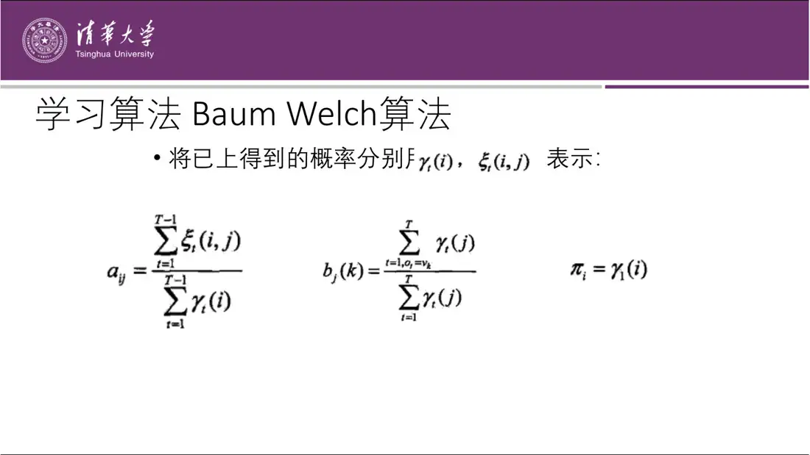

原文：

学习算法 Baum Welch算法

\- 将已上得到的概率分别 $\gamma_{t}(i)$ , $\xi_{t}(i,j)$ 表示:

$$
a _ {i j} = \frac {\sum_ {t = 1} ^ {T - 1} \xi_ {t} (i , j)}{\sum_ {t = 1} ^ {T - 1} \gamma_ {t} (i)} \quad b _ {j} (k) = \frac {\sum_ {t = 1 , o _ {t} = v _ {k}} ^ {T} \gamma_ {t} (j)}{\sum_ {t = 1} ^ {T} \gamma_ {t} (j)} \quad \pi_ {i} = \gamma_ {1} (i)
$$

清華大學 Tsinghua University

### 学习算法 Baum Welch算法

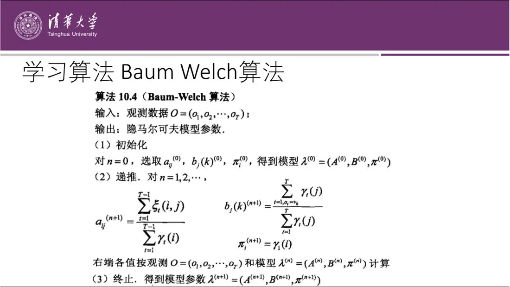

原文：

学习算法 Baum Welch算法

算法 10.4（Baum-Welch 算法）

输入：观测数据 $O=(o_{1},o_{2},\cdots,o_{T})$ ;

输出：隐马尔可夫模型参数.

(1) 初始化

对 $n = 0$ ，选取 $a_{ij}^{(0)}$ ， $b_{j}(k)^{(0)}$ ， $\pi_i^{(0)}$ ，得到模型 $\lambda^{(0)} = (A^{(0)},B^{(0)},\pi^{(0)})$

(2) 递推. 对 $n = 1,2,\dots$

$$
a _ {i j} ^ {(n + 1)} = \frac {\sum_ {t = 1} ^ {T - 1} \xi_ {t} (i , j)}{\sum_ {t = 1} ^ {T - 1} \gamma_ {t} (i)} \quad b _ {j} (k) ^ {(n + 1)} = \frac {\sum_ {t = 1 , o _ {i} = v _ {k}} ^ {T} \gamma_ {t} (j)}{\sum_ {t = 1} ^ {T} \gamma_ {t} (j)} \pi_ {i} ^ {(n + 1)} = \gamma_ {1} (i)
$$

右端各值按观测 $O=(o_{1},o_{2},\cdots,o_{T})$ 和模型 $\lambda^{(n)}=(A^{(n)},B^{(n)},\pi^{(n)})$ 计算

(3) 终止. 得到模型参数 $\lambda^{(n+1)}=(A^{(n+1)},B^{(n+1)},\pi^{(n+1)})$

Tsinghua University
清華大學

### 预测算法

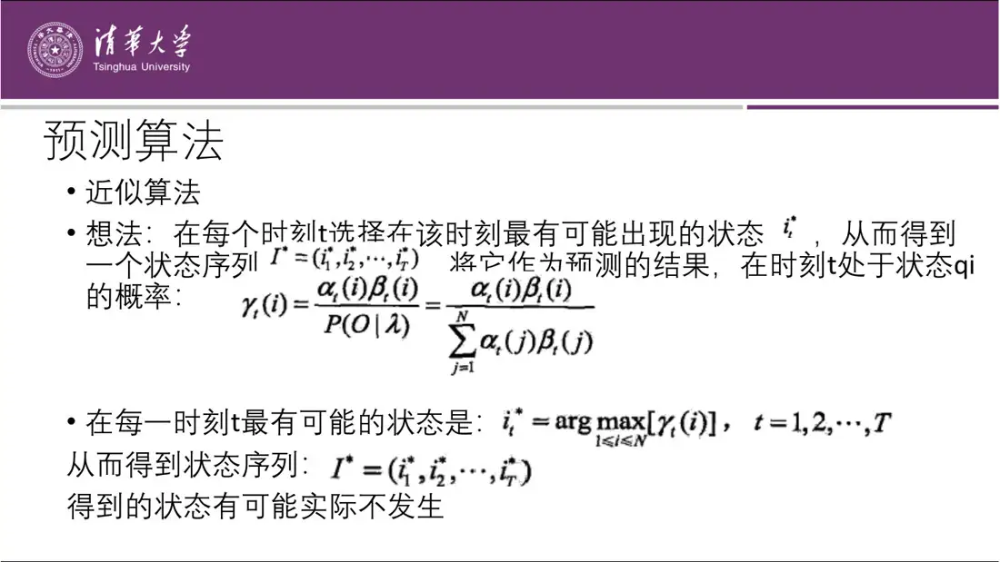

原文：

预测算法

\- 近似算法

\- 想法：在每个时刻t选择在该时刻最有可能出现的状态 $i_{t}^{*}$ ，从而得到一个状态序列 $I^{*} = (i_{1}^{*}, i_{2}^{*}, \dots, i_{T}^{*})$ 将它作为预测的结果，在时刻t处于状态qi的概率： $\gamma_{t}(i) = \frac{\alpha_{t}(i)\beta_{t}(i)}{P(O|\lambda)} = \frac{\alpha_{t}(i)\beta_{t}(i)}{\sum_{j=1}^{N}\alpha_{t}(j)\beta_{t}(j)}$

\- 在每一时刻t最有可能的状态是： $i_{t}^{*}=\arg\max_{1\leqslant i\leqslant N}\left[\gamma_{t}(i)\right],\quad t=1,2,\cdots,T$ 从而得到状态序列： $I^{*}=(i_{1}^{*},i_{2}^{*},\cdots,i_{T}^{*})$ 得到的状态有可能实际不发生

Tsinghua University
清華大學

### 维特比算法

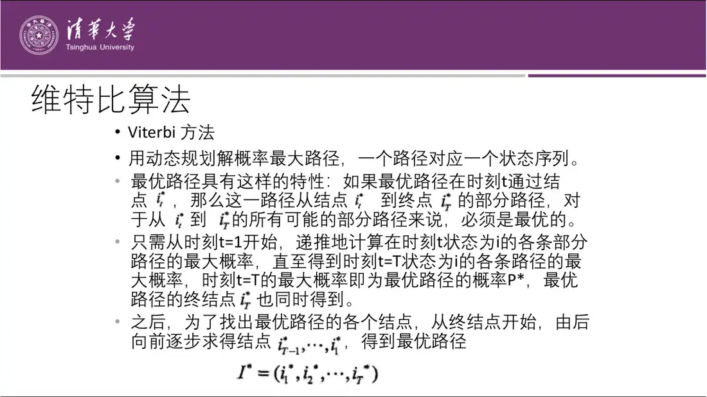

原文：

维特比算法

\- Viterbi 方法

\- 用动态规划解概率最大路径，一个路径对应一个状态序列。

\- 最优路径具有这样的特性：如果最优路径在时刻t通过结点 $i_{t}^{*}$ ，那么这一路径从结点 $i_{t}^{*}$ 到终点 $i_{T}^{*}$ 的部分路径，对于从 $i_{t}^{*}$ 到 $i_{T}^{*}$ 的所有可能的部分路径来说，必须是最优的。

\- 只需从时刻t=1开始，递推地计算在时刻t状态为i的各条部分路径的最大概率，直至得到时刻t=T状态为i的各条路径的最大概率，时刻t=T的最大概率即为最优路径的概率P\*，最优路径的终结点 $i_{T}^{*}$ 也同时得到。

\- 之后，为了找出最优路径的各个结点，从终结点开始，由后向前逐步求得结点 $i_{T-1}^{*}, \cdots, i_{1}^{*}$ ，得到最优路径

$$
I ^ {*} = (i _ {1} ^ {*}, i _ {2} ^ {*}, \dots , i _ {T} ^ {*})
$$

Tsinghua University
清華大學

### 维特比算法

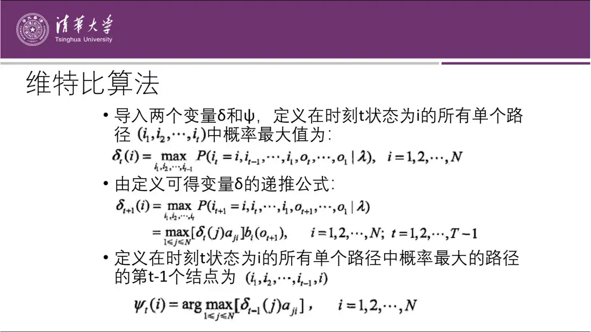

原文：

维特比算法

\- 导入两个变量 $\delta$ 和 $\psi$ ，定义在时刻t状态为i的所有单个路径 $(i_1, i_2, \dots, i_t)$ 中概率最大值为：

$$
\delta_ {i} (i) = \max _ {i _ {1}, i _ {2}, \dots , i _ {t - 1}} P (i _ {t} = i, i _ {t - 1}, \dots , i _ {1}, o _ {t}, \dots , o _ {1} | \lambda), \quad i = 1, 2, \dots , N
$$

\- 由定义可得变量δ的递推公式:

$$
\begin{array}{r l} \delta_ {t + 1} (i) & = \max _ {i _ {1}, i _ {2}, \dots , i _ {t}} P (i _ {t + 1} = i, i _ {t}, \dots , i _ {1}, o _ {t + 1}, \dots , o _ {1} \mid \lambda) \\ & = \max _ {1 \leqslant j \leqslant N} [ \delta_ {t} (j) a _ {j i} ] b _ {i} (o _ {t + 1}), \quad i = 1, 2, \dots , N; t = 1, 2, \dots , T - 1 \end{array}
$$

\- 定义在时刻t状态为i的所有单个路径中概率最大的路径的第t-1个结点为 $(i_{1}, i_{2}, \cdots, i_{t-1}, i)$

$$
\psi_ {t} (i) = \arg \max _ {1 \leqslant j \leqslant N} [ \delta_ {t - 1} (j) a _ {j i} ], \quad i = 1, 2, \dots , N
$$

Tsinghua University
清華大學

### Viterbi 方法

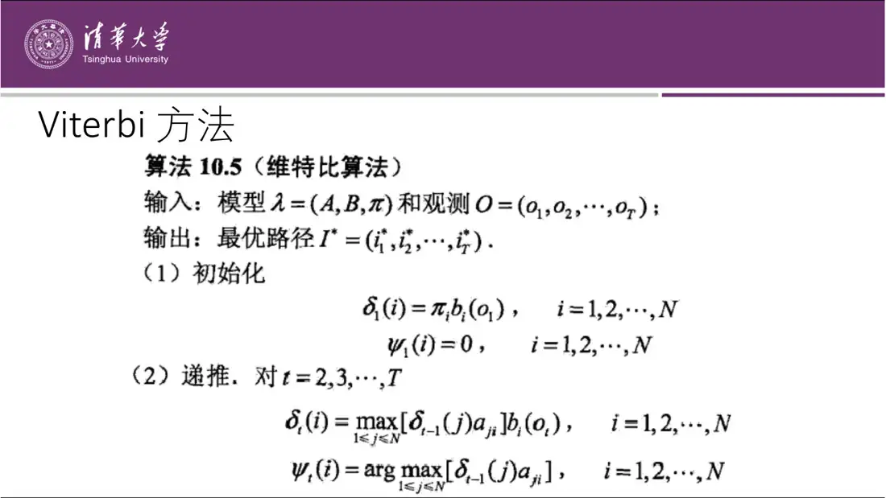

原文：

Viterbi 方法

算法 10.5（维特比算法）

输入：模型 $\lambda=(A,B,\pi)$ 和观测 $O=(o_{1},o_{2},\cdots,o_{T})$ ;

输出：最优路径 $I^{*}=(i_{1}^{*},i_{2}^{*},\cdots,i_{T}^{*})$ .

(1) 初始化

$$
\delta_ {1} (i) = \pi_ {i} b _ {i} (o _ {1}), \quad i = 1, 2, \dots , N
$$

$$
\psi_ {1} (i) = 0, \quad i = 1, 2, \dots , N
$$

(2) 递推. 对 $t = 2,3,\dots,T$

$$
\delta_ {i} (i) = \max _ {1 \leqslant j \leqslant N} [ \delta_ {i - 1} (j) a _ {j i} ] b _ {i} (o _ {i}), \quad i = 1, 2, \dots , N
$$

$$
\psi_ {t} (i) = \arg \max _ {1 \leqslant j \leqslant N} [ \delta_ {t - 1} (j) a _ {j i} ], \quad i = 1, 2, \dots , N
$$

清華大學 Tsinghua University

### Viterbi 方法

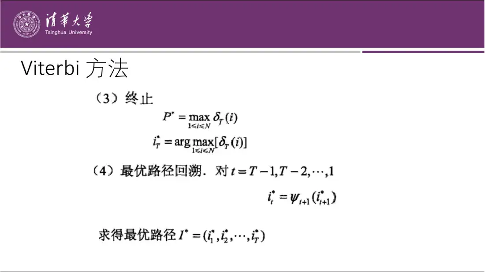

原文：

Viterbi 方法

(3) 终止

$$
P ^ {*} = \max _ {1 \leqslant i \leqslant N} \delta_ {T} (i)
$$

$$
i _ {T} ^ {*} = \arg \max _ {1 \leqslant i \leqslant N} [ \delta_ {T} (i) ]
$$

(4) 最优路径回溯. 对 $t = T - 1, T - 2, \cdots, 1$

$$
i _ {i} ^ {*} = \psi_ {i + 1} (i _ {i + 1} ^ {*})
$$

求得最优路径 $I^{*}=(i_{1}^{*},i_{2}^{*},\cdots,i_{T}^{*})$

清華大學 Tsinghua University

### $$

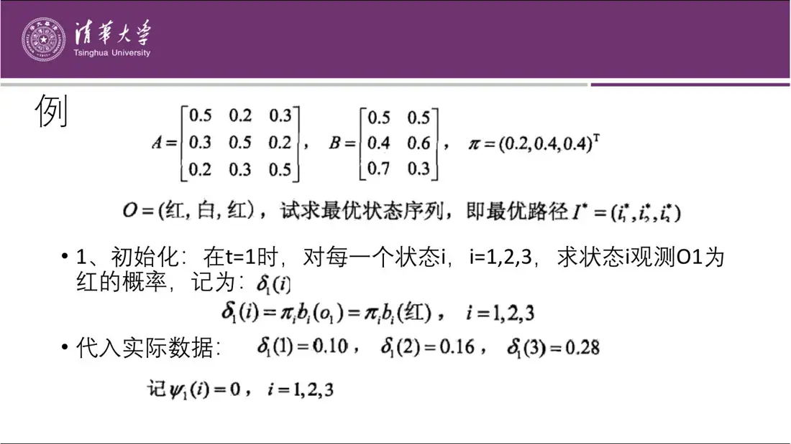

原文：

例

$$
A = \left[ \begin{array}{l l l} 0. 5 & 0. 2 & 0. 3 \\ 0. 3 & 0. 5 & 0. 2 \\ 0. 2 & 0. 3 & 0. 5 \end{array} \right], \quad B = \left[ \begin{array}{l l} 0. 5 & 0. 5 \\ 0. 4 & 0. 6 \\ 0. 7 & 0. 3 \end{array} \right], \quad \pi = (0. 2, 0. 4, 0. 4) ^ {\mathrm{T}}
$$

$O = (\text{红}, \text{白}, \text{红})$ ，试求最优状态序列，即最优路径 $I^{*} = (i_{1}^{*}, i_{2}^{*}, i_{3}^{*})$

• 1、初始化：在t=1时，对每一个状态i，i=1,2,3，求状态i观测01为红的概率，记为： $\delta_{1}(i)$

$$
\delta_ {1} (i) = \pi_ {i} b _ {i} (o _ {1}) = \pi_ {i} b _ {i} (\text {红}), \quad i = 1, 2, 3
$$

\- 代入实际数据： $\delta_{1}(1) = 0.10$ ， $\delta_{1}(2) = 0.16$ ， $\delta_{1}(3) = 0.28$

记 $\psi_{1}(i) = 0$ ， $i = 1,2,3$

Tsinghua University
清華大學

### Tsinghua University

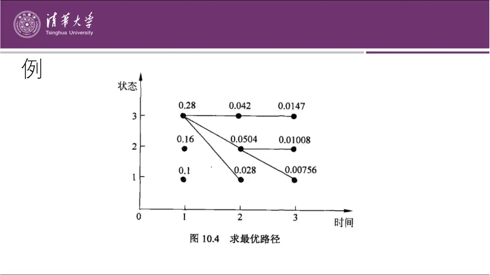

原文：

例

Tsinghua University
清華大學
TSINGHUA UNIVERSITY
1911
清華大學
TSINGHUA UNIVERSITY

### $$

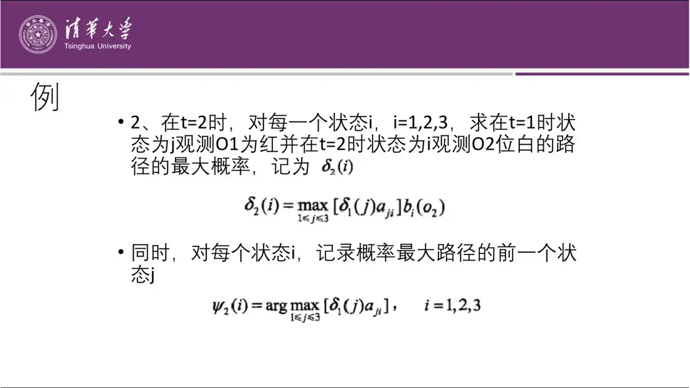

原文：

例

• 2、在t=2时，对每一个状态i，i=1,2,3，求在t=1时状态为j观测O1为红并在t=2时状态为i观测O2位白的路径的最大概率，记为 $\delta_{2}(i)$

$$
\delta_ {2} (i) = \max _ {1 \leqslant j \leqslant 3} [ \delta_ {1} (j) a _ {j i} ] b _ {i} (o _ {2})
$$

\- 同时，对每个状态i，记录概率最大路径的前一个状态j

$$
\psi_ {2} (i) = \arg \max _ {1 \leqslant j \leqslant 3} [ \delta_ {1} (j) a _ {j i} ], \quad i = 1, 2, 3
$$

Tsinghua University
清華大學

### 计算：

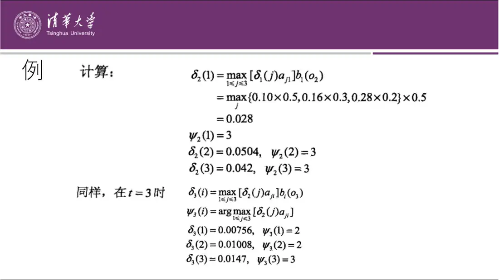

原文：

例

计算：

$$
\begin{array}{r l} \delta_ {2} (1) & = \max _ {1 \leqslant j \leqslant 3} [ \delta_ {1} (j) a _ {j 1} ] b _ {1} (o _ {2}) \\ & = \max _ {j} \{0. 1 0 \times 0. 5, 0. 1 6 \times 0. 3, 0. 2 8 \times 0. 2 \} \times 0. 5 \\ & = 0. 0 2 8 \end{array}
$$

$$
\psi_ {2} (1) = 3
$$

$$
\delta_ {2} (2) = 0. 0 5 0 4, \quad \psi_ {2} (2) = 3
$$

$$
\delta_ {2} (3) = 0. 0 4 2, \quad \psi_ {2} (3) = 3
$$

同样，在 $t = 3$ 时

$$
\delta_ {3} (i) = \max _ {1 \leqslant j \leqslant 3} [ \delta_ {2} (j) a _ {j i} ] b _ {i} (o _ {3})
$$

$$
\psi_ {3} (i) = \arg \max _ {1 \leqslant j \leqslant 3} [ \delta_ {2} (j) a _ {j i} ]
$$

$$
\delta_ {3} (1) = 0. 0 0 7 5 6, \quad \psi_ {3} (1) = 2
$$

$$
\delta_ {3} (2) = 0. 0 1 0 0 8, \quad \psi_ {3} (2) = 2
$$

$$
\delta_ {3} (3) = 0. 0 1 4 7, \psi_ {3} (3) = 3
$$

清華大學 Tsinghua University

### • 3、以P\*表示最优路径的概率:

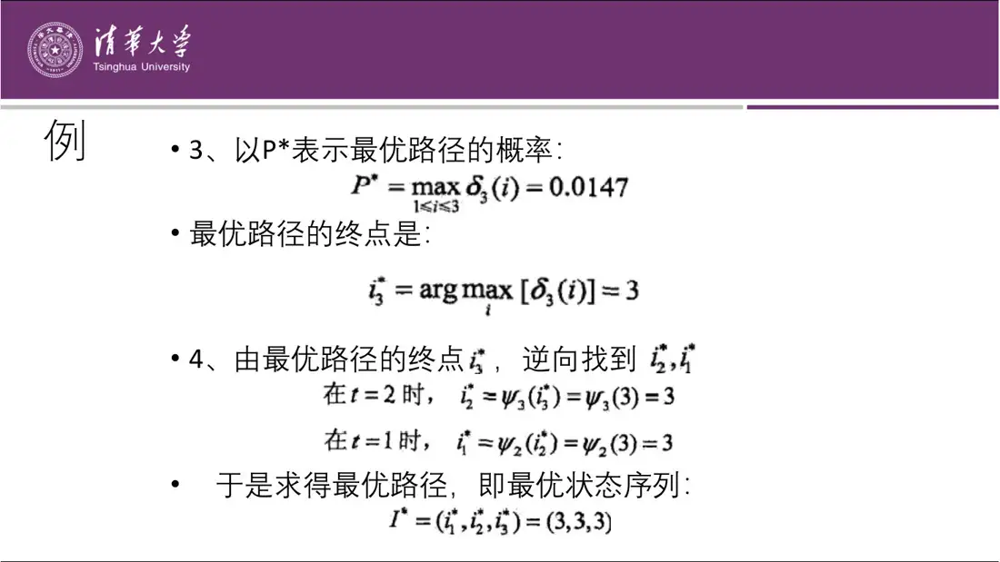

原文：

• 3、以P\*表示最优路径的概率:

$$
P ^ {*} = \max _ {1 \leqslant i \leqslant 3} \delta_ {3} (i) = 0. 0 1 4 7
$$

\- 最优路径的终点是:

$$
i _ {3} ^ {*} = \arg \max _ {i} [ \delta_ {3} (i) ] = 3
$$

• 4、由最优路径的终点 $i_{3}^{*}$ ，逆向找到 $i_{2}^{*}, i_{1}^{*}$

在 $t = 2$ 时， $i_2^* = \psi_3(i_3^*) = \psi_3(3) = 3$

$$
\text {在} t = 1 \text {时}, \quad i _ {1} ^ {*} = \psi_ {2} (i _ {2} ^ {*}) = \psi_ {2} (3) = 3
$$

\- 于是求得最优路径，即最优状态序列：

$$
I ^ {*} = (i _ {1} ^ {*}, i _ {2} ^ {*}, i _ {3} ^ {*}) = (3, 3, 3)
$$

Tsinghua University
清華大學

### 人脸检测

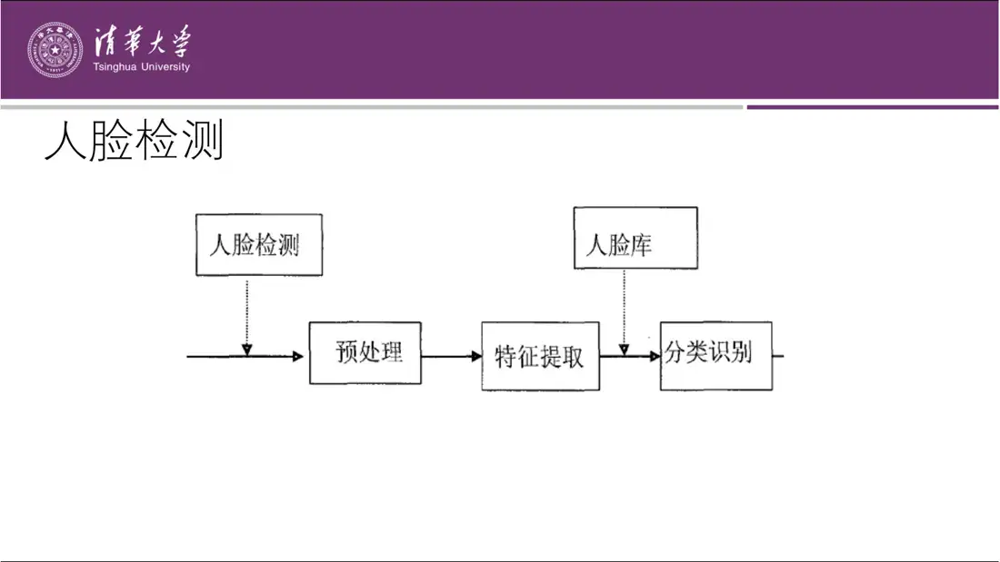

原文：

人脸检测

人脸检测

人脸库

预处理

特征提取

分类识别

Tsinghua University
清華大學
1911-1911

### 人脸检测

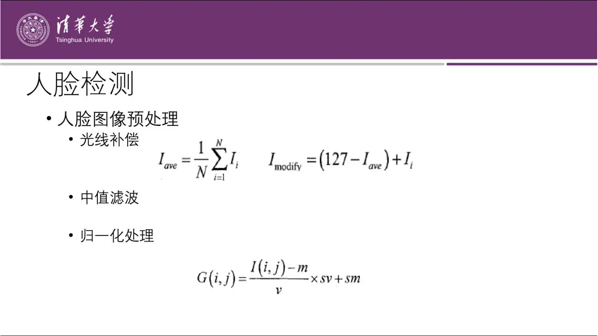

原文：

人脸检测

\- 人脸图像预处理

\- 光线补偿

$$
I _ {a v e} = \frac {1}{N} \sum_ {i = 1} ^ {N} I _ {i} \quad I _ {\text { modify }} = (1 2 7 - I _ {a v e}) + I _ {i}
$$

\- 中值滤波

\- 归一化处理

$$
G (i, j) = \frac {I (i , j) - m}{v} \times s v + s m
$$

Tsinghua University
清華大學

### 人脸识别

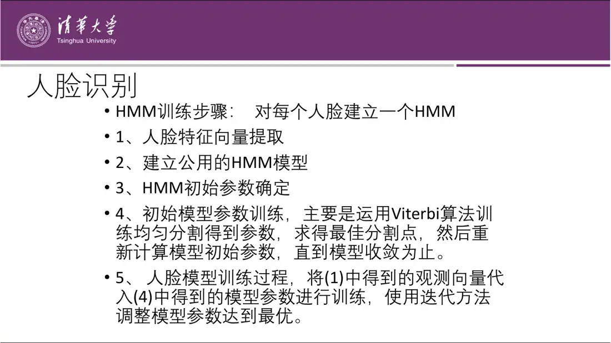

原文：

人脸识别

\- HMM训练步骤：对每个人脸建立一个HMM

• 1、人脸特征向量提取

• 2、建立公用的HMM模型

• 3、HMM初始参数确定

• 4、初始模型参数训练，主要是运用Viterbi算法训练均匀分割得到参数，求得最佳分割点，然后重新计算模型初始参数，直到模型收敛为止。

• 5、人脸模型训练过程，将(1)中得到的观测向量代入(4)中得到的模型参数进行训练，使用迭代方法调整模型参数达到最优。

Tsinghua University
清華大學
1911-

### 人脸检测

原文：

人脸检测

• 1、人脸特征向量提取：

\- 基于奇异值分解的特征提取

\- 离散余弦变换

\- 多维尺度分析(MDS)

\- 人脸等密度线分析匹配方法、

\- 弹性图匹配方法

• ○ ○ ○

Tsinghua University
清華大學
1911-1911

### 人脸检测

原文：

人脸检测

• SVD

奇异矩阵 A 可以分解为以下形式：

$$
A = U \left( \begin{array}{c c} \Delta & 0 \\ 0 & 0 \end{array} \right) V ^ {T}
$$

\- 稳定性：由于奇异值特征向量具有良好的稳定性，所以它对图像噪音、图像光照条件引起的灰度变化具有不敏感的特性；

\- 转置不变性：A和A转置具有相同的奇异值；

\- 旋转不变性：图像A和旋转后的图像有相同的特征向量；

\- 唯一不变性：对矩阵A换两行或者两列仍然具有相同的特征向量；

\- 镜像变换不变形:

Tsinghua University
清華大學
1911-UNIVERSITY

### 人脸检测

原文：

人脸检测

\- HMM模型

状态

Tsinghua University
清華大學
1911-

### 人脸检测

原文：

人脸检测

$$
T = \frac {H - L}{L - P} + 1
$$

Tsinghua University
清華大學
1911-

### 人脸检测

原文：

人脸检测

• 3、初始参数确定:

$$
\bullet \pi = (1, 0, 0, 0, 0)
$$

\- A矩阵:

$$
A = \left[ \begin{array}{c c c c c} \frac {1 9}{2 0} & \frac {1}{2 0} & 0 & 0 & 0 \\ 0 & \frac {1 9}{2 0} & \frac {1}{2 0} & 0 & 0 \\ 0 & 0 & \frac {1 9}{2 0} & \frac {1}{2 0} & 0 \\ 0 & 0 & 0 & \frac {1 9}{2 0} & \frac {1}{2 0} \\ 0 & 0 & 0 & 0 & 1 \end{array} \right]
$$

• B矩阵：用混合高斯模型，则是将均匀分割后得到的五个部分中的每个部分，使用K均值聚类，将每个状态聚成M类，然后分别计算每一类的均值和方差，将这两个值分别赋给高斯模型。

Tsinghua University
清華大學

### 人脸检测

原文：

人脸检测

\- 初始模型

\- 参数训练:

Tsinghua University
清華大學
1911-

### 人脸检测

原文：

人脸检测

表 4.1 HMM 实验结果 (ORL)
<table><tr><td></td><td>N=2</td><td>N=3</td><td>N=4</td></tr><tr><td>基于像素值特征的HMM[46-47]</td><td>84%</td><td>84%</td><td>84%</td></tr><tr><td>基于SVD的HMM</td><td>82.5%</td><td>86%</td><td>85.5%</td></tr></table>

Tsinghua University
清華大學
1911-1911

### 语音识别

原文：

语音识别

清華大學 Tsinghua University

### 语音识别

原文：

语音识别

Tsinghua University
清華大學

### 隐马尔科夫模型在入侵检测中的应用

原文：

隐马尔科夫模型在入侵检测中的应用

清華大學 Tsinghua University

### 隐马尔科夫模型在入侵检测中的应用

原文：

隐马尔科夫模型在入侵检测中的应用

正常系统调用序列

待测系统调用序列

Baum-Welch算法训练 设定阈值K

前向算法检测 检测值

判定

Tsinghua University
清華大學
1911-1911

### 数据集

原文：

数据集

\- 两种正常系统调用序列数据集。

\- Sendmail正常系统调用序列数据集

\- Sendmail的正常训练数据集是由1571583个系统调用构成的序列,这些系统调用分属147个不同的进程(在本实验中只考虑系统调用,不考虑进程)。

\- Sendmail正常系统调用序列中包含48个唯一系统调用,这些系统调用的调用号为(按照序列中出现的顺序):4,2,66,138,5,23,45,27,167,85,59,105,104,106,56,19,155,83,93,94,112,100,50,128,89,121,11,1,40,38,18,78,101,102,88,95,6,108,32,1,8,9,14,17,3,124,41,61。

清華大學 Tsinghua University

### 数据集

原文：

数据集

\- lpr的正常系统调用序列数据集

\- lpr的正常系统调用序列由2398个系统调用构成,分属9个进程,长度大约是sendmail 正常系统调用序列的六百五十五分之一。

\- Lpr正常系统调用序列包含包含37个唯一系统调用,系统调用号分别为(按照序列中出现的顺序):4, 2, 66, 138, 5, 23, 45, 27, 105, 104, 106, 83, 59, 50, 88, 167, 17, 18, 155,19, 127, 93, 100, 112, 143, 128, 85, 89, 121, 3, 56, 7, 119, 32, 9, 8, 94。

清華大學 Tsinghua University

### • END • Q&R

原文：

• END • Q&R

Tsinghua University
清華大學
1911-1911
