# 《统计学习方法》第11章 条件随机场（课件）

原件的每一页，下面附识别出的文字。

### 第十一章 条件随机场

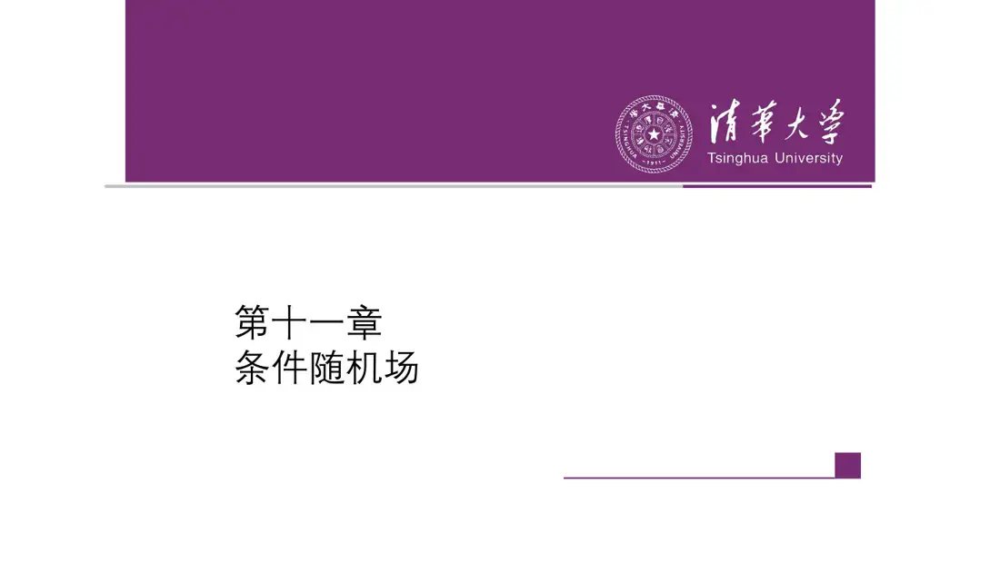

原文：

第十一章 条件随机场

大華洋
TSINGHUA UNIVERSITY
清華大學
Tsinghua University

### 混合高斯模型和HMM

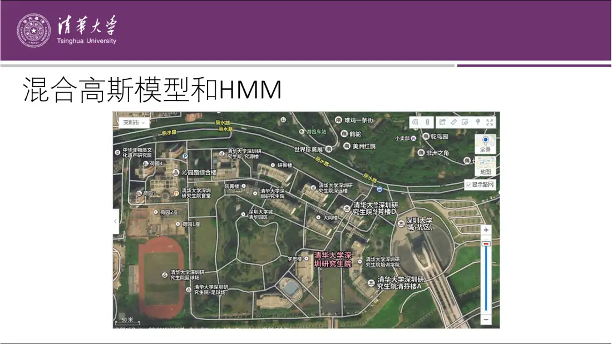

原文：

混合高斯模型和HMM

Tsinghua University
清華大學

### 行人检测和分割

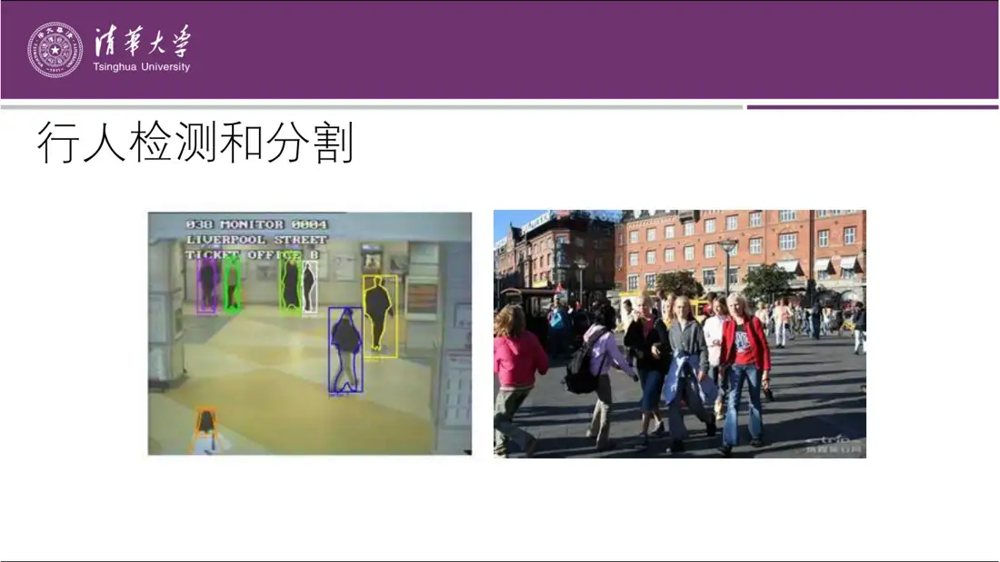

原文：

行人检测和分割

Tsinghua University
清華大學
1911-

### HMM到条件随机场

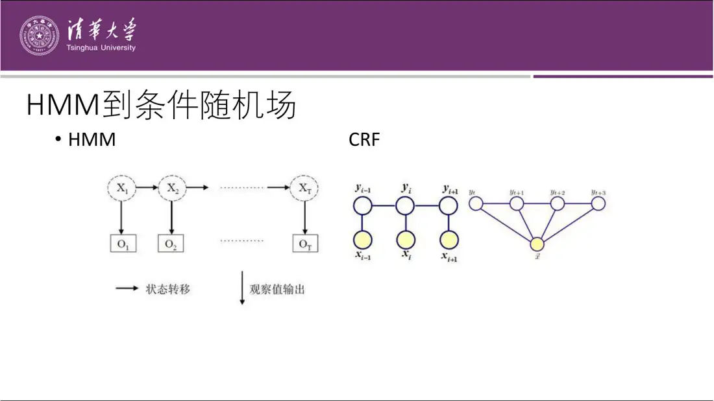

原文：

HMM到条件随机场

• HMM

CRF

→ 状态转移

观察值输出

Tsinghua University
清華大學
1911-

### HMM和CRF

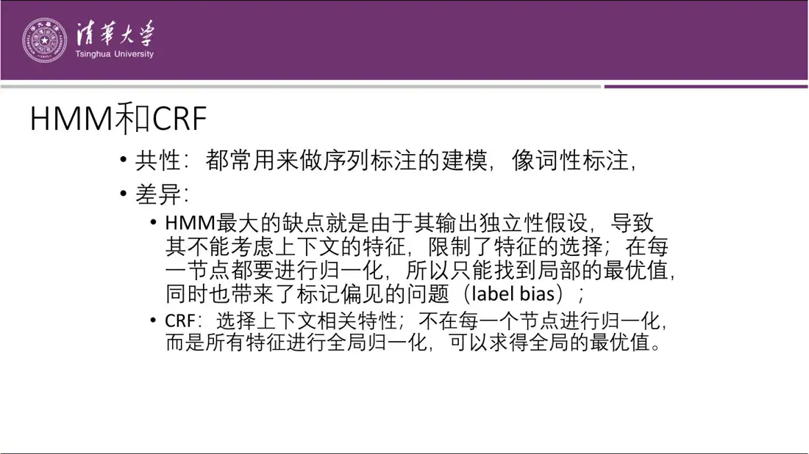

原文：

HMM和CRF

\- 共性：都常用来做序列标注的建模，像词性标注，

\- 差异:

\- HMM最大的缺点就是由于其输出独立性假设，导致其不能考虑上下文的特征，限制了特征的选择；在每一节点都要进行归一化，所以只能找到局部的最优值，同时也带来了标记偏见的问题（label bias）；

\- CRF: 选择上下文相关特性; 不在每一个节点进行归一化,而是所有特征进行全局归一化, 可以求得全局的最优值。

Tsinghua University
清華大學

### 概率无向图模型

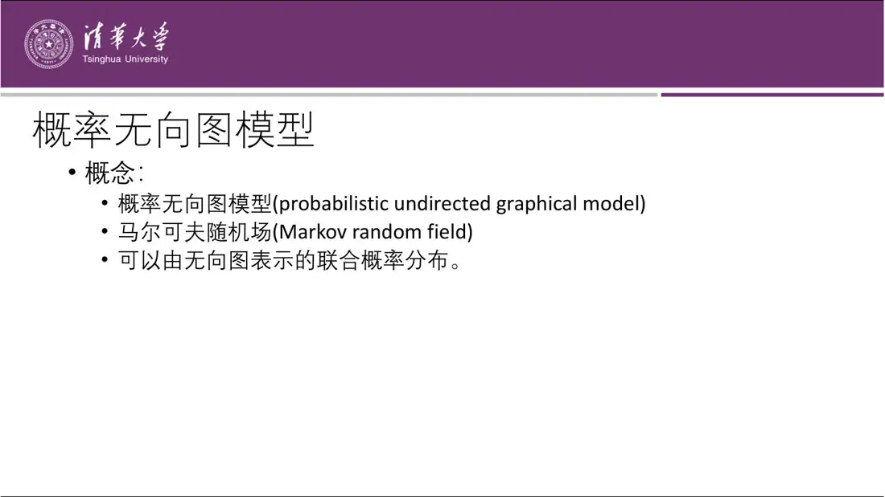

原文：

概率无向图模型

\- 概念:

\- 概率无向图模型(probabilistic undirected graphical model)

\- 马尔可夫随机场(Markov random field)

\- 可以由无向图表示的联合概率分布。

Tsinghua University
清華大學
1911-

### 模型定义

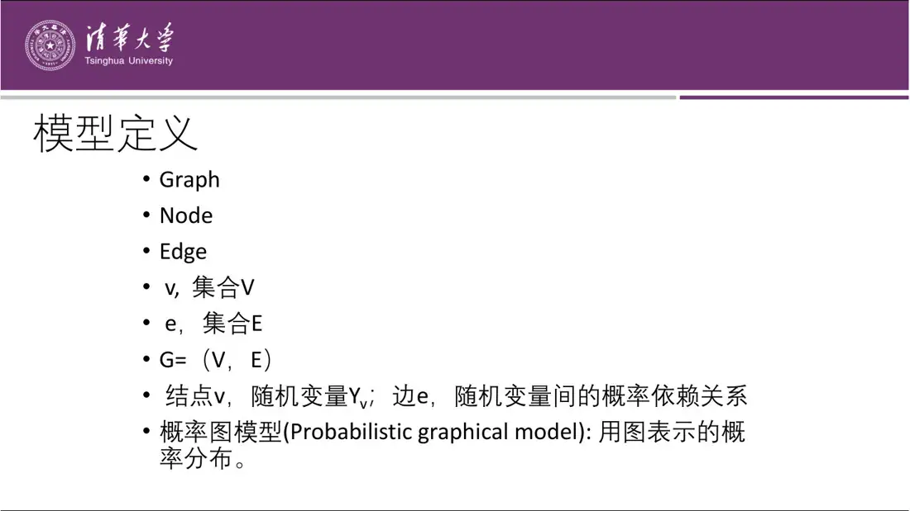

原文：

模型定义

\- Graph

\- Node

\- Edge

• v, 集合V

\- e，集合E

• G = (V, E)

\- 结点v，随机变量 $Y_{v}$ ；边e，随机变量间的概率依赖关系

\- 概率图模型(Probabilistic graphical model): 用图表示的概率分布。

清華大學 Tsinghua University

### 模型定义

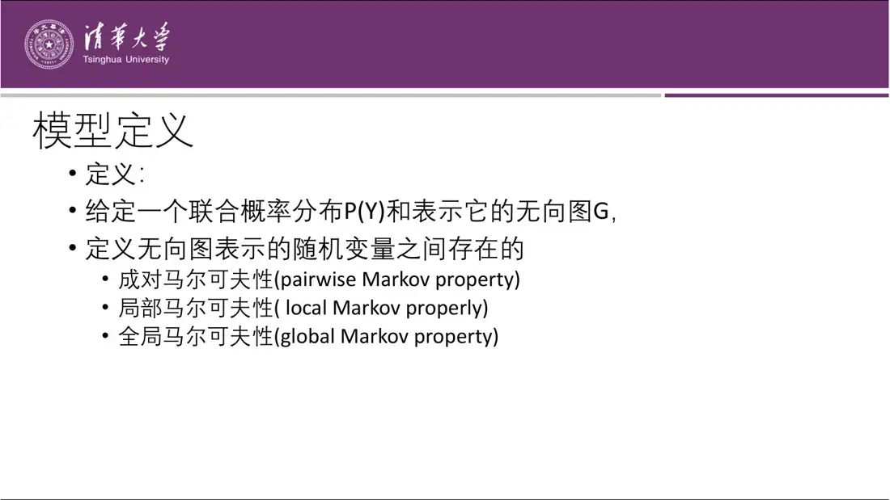

原文：

模型定义

\- 定义:

\- 给定一个联合概率分布P(Y)和表示它的无向图G,

\- 定义无向图表示的随机变量之间存在的

\- 成对马尔可夫性(pairwise Markov property)

\- 局部马尔可夫性(local Markov properly)

\- 全局马尔可夫性(global Markov property)

Tsinghua University
清華大學

### 模型定义

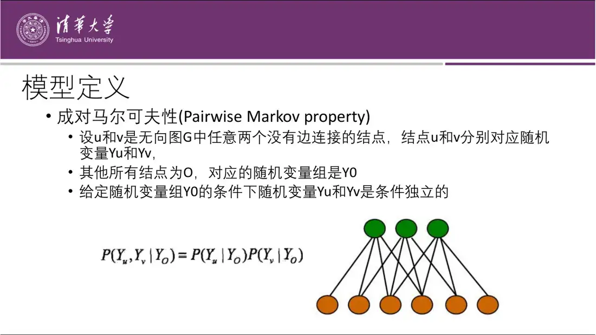

原文：

模型定义

\- 成对马尔可夫性(Pairwise Markov property)

\- 设u和v是无向图G中任意两个没有边连接的结点，结点u和v分别对应随机变量Yu和Yv，

\- 其他所有结点为O，对应的随机变量组是Y0

\- 给定随机变量组Y0的条件下随机变量Yu和Yv是条件独立的

$$
P (Y _ {u}, Y _ {v} \mid Y _ {O}) = P (Y _ {u} \mid Y _ {O}) P (Y _ {v} \mid Y _ {O})
$$

Tsinghua University
清華大學

### 模型定义

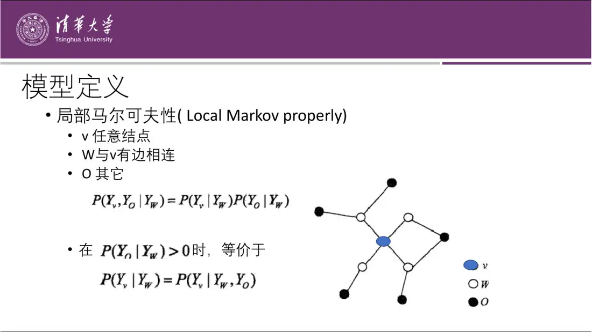

原文：

模型定义

\- 局部马尔可夫性(Local Markov properly)

\- v 任意结点

\- W与v有边相连

\- 0 其它

$$
P (Y _ {v}, Y _ {O} \mid Y _ {W}) = P (Y _ {v} \mid Y _ {W}) P (Y _ {O} \mid Y _ {W})
$$

\- 在 $P(Y_{0} \mid Y_{w}) > 0$ 时，等价于

$$
P (Y _ {v} \mid Y _ {w}) = P (Y _ {v} \mid Y _ {w}, Y _ {o})
$$

Tsinghua University
清華大學

### 模型定义

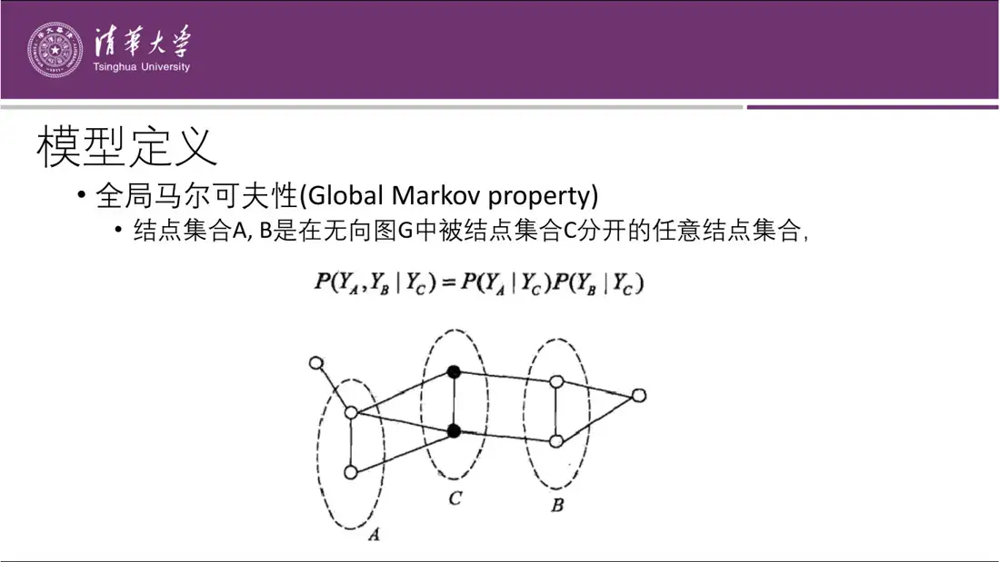

原文：

模型定义

\- 全局马尔可夫性(Global Markov property)

\- 结点集合A, B是在无向图G中被结点集合C分开的任意结点集合，

$$
P (Y _ {A}, Y _ {B} \mid Y _ {C}) = P (Y _ {A} \mid Y _ {C}) P (Y _ {B} \mid Y _ {C})
$$

清華大學 Tsinghua University

### 模型定义

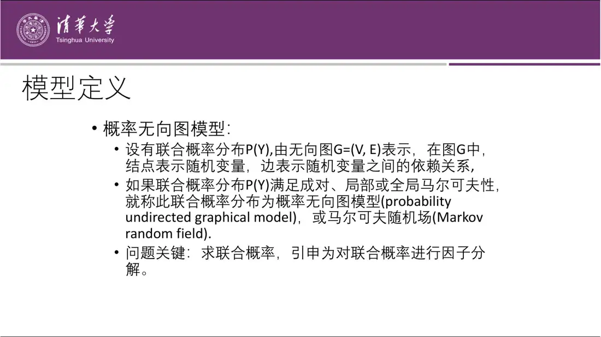

原文：

模型定义

\- 概率无向图模型:

\- 设有联合概率分布P(Y),由无向图G=(V, E)表示，在图G中，结点表示随机变量，边表示随机变量之间的依赖关系，

\- 如果联合概率分布P(Y)满足成对、局部或全局马尔可夫性, 就称此联合概率分布为概率无向图模型(probability undirected graphical model), 或马尔可夫随机场(Markov random field).

\- 问题关键：求联合概率，引申为对联合概率进行因子分解。

Tsinghua University
清華大學

### 概率无向图模型的因子分解

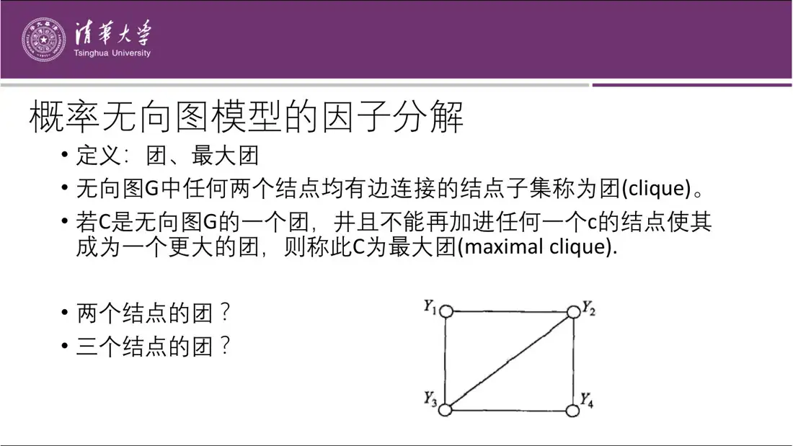

原文：

概率无向图模型的因子分解

\- 定义：团、最大团

\- 无向图G中任何两个结点均有边连接的结点子集称为团(clique)。

\- 若C是无向图G的一个团, 并且不能再加进任何一个c的结点使其成为一个更大的团, 则称此C为最大团(maximal clique).

\- 两个结点的团？

\- 三个结点的团？

Tsinghua University
清華大學

### 概率无向图模型的因子分解

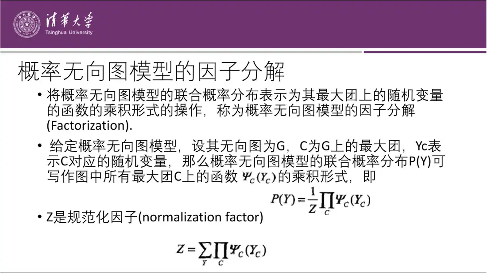

原文：

概率无向图模型的因子分解

\- 将概率无向图模型的联合概率分布表示为其最大团上的随机变量的函数的乘积形式的操作，称为概率无向图模型的因子分解 (Factorization).

\- 给定概率无向图模型，设其无向图为G，C为G上的最大团，Yc表示C对应的随机变量，那么概率无向图模型的联合概率分布P(Y)可写作图中所有最大团C上的函数 $\Psi_{c}(Y_{c})$ 的乘积形式，即

$$
P (Y) = \frac {1}{Z} \prod_ {c} \Psi_ {c} (Y _ {c})
$$

\- Z是规范化因子(normalization factor)

$$
Z = \sum_ {Y} \prod_ {C} \Psi_ {C} (Y _ {C})
$$

Tsinghua University
清華大學

### 概率无向图模型的因子分解

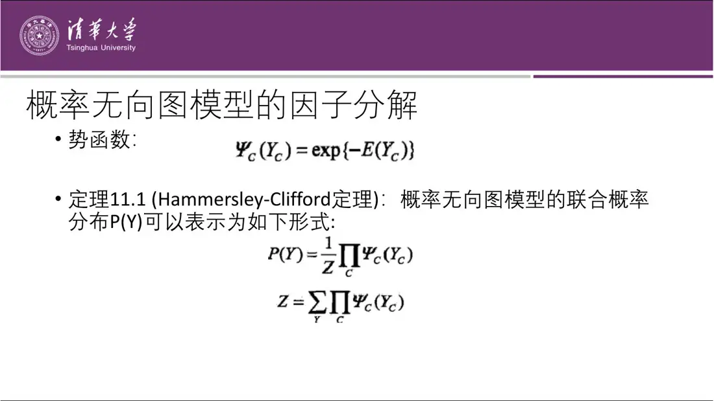

原文：

概率无向图模型的因子分解

\- 势函数:

$$
\Psi_ {c} (Y _ {c}) = \exp \{- E (Y _ {c}) \}
$$

\- 定理11.1 (Hammersley-Clifford定理): 概率无向图模型的联合概率分布P(Y)可以表示为如下形式:

$$
P (Y) = \frac {1}{Z} \prod_ {c} \Psi_ {c} (Y _ {c})
$$

$$
Z = \sum_ {Y} \prod_ {C} \Psi_ {C} (Y _ {C})
$$

清華大學 Tsinghua University

### 条件随机场的定义与形式

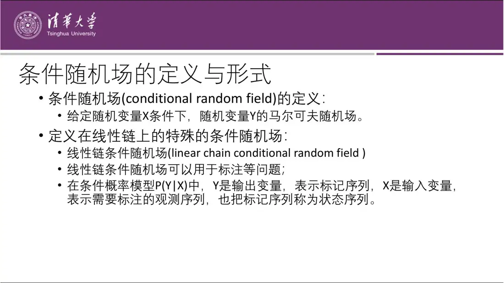

原文：

条件随机场的定义与形式

\- 条件随机场(conditional random field)的定义：

\- 给定随机变量X条件下，随机变量Y的马尔可夫随机场。

\- 定义在线性链上的特殊的条件随机场：

\- 线性链条件随机场(linear chain conditional random field)

\- 线性链条件随机场可以用于标注等问题;

\- 在条件概率模型P(Y|X)中，Y是输出变量，表示标记序列，X是输入变量，表示需要标注的观测序列，也把标记序列称为状态序列。

Tsinghua University
清華大學

### 条件随机场的定义与形式

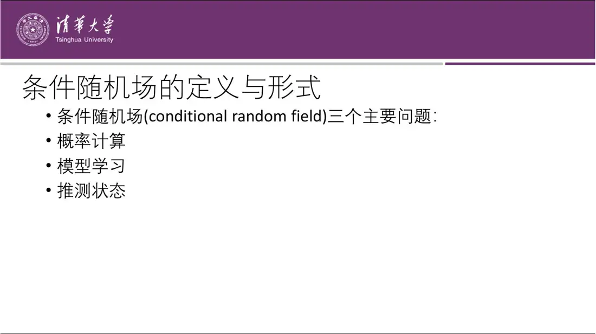

原文：

条件随机场的定义与形式

\- 条件随机场(conditional random field)三个主要问题:

\- 概率计算

\- 模型学习

\- 推测状态

Tsinghua University
清華大學
1911-1911

### 条件随机场的定义与形式

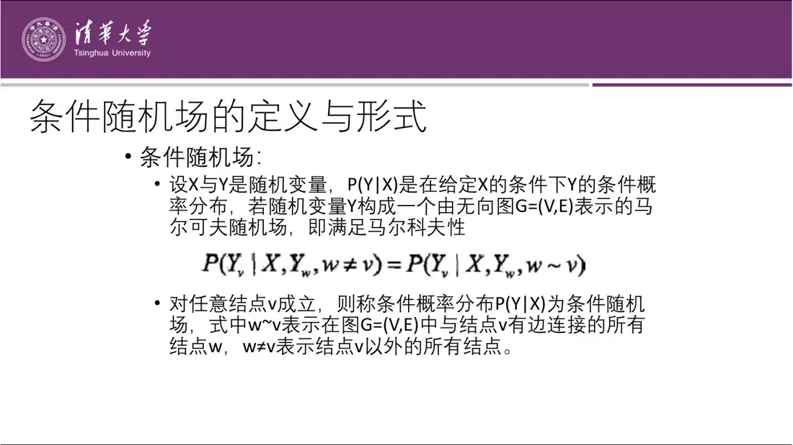

原文：

条件随机场的定义与形式

\- 条件随机场：

\- 设X与Y是随机变量，P(Y|X)是在给定X的条件下Y的条件概率分布，若随机变量Y构成一个由无向图G=(V,E)表示的马尔可夫随机场，即满足马尔科夫性

$$
P \left(Y _ {v} \mid X, Y _ {w}, w \neq v\right) = P \left(Y _ {v} \mid X, Y _ {w}, w \sim v\right)
$$

\- 对任意结点v成立，则称条件概率分布P(Y|X)为条件随机场，式中w\~v表示在图G=(V,E)中与结点v有边连接的所有结点w，w≠v表示结点v以外的所有结点。

Tsinghua University
清華大學
1911-UNIVERSITY

### 条件随机场的定义与形式

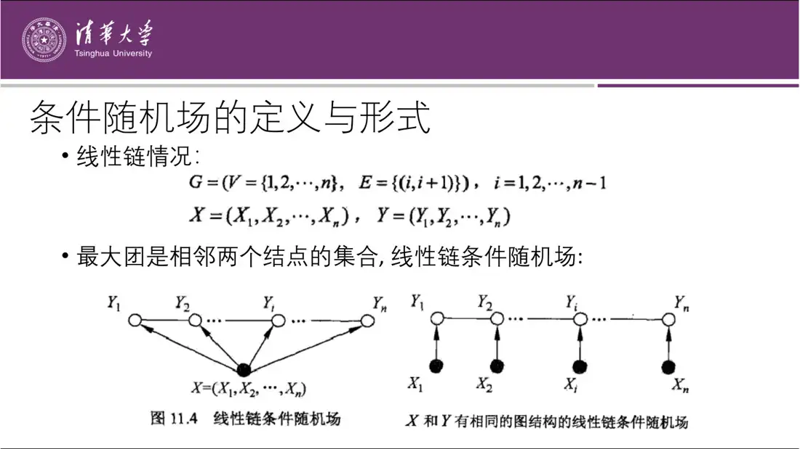

原文：

条件随机场的定义与形式

\- 线性链情况：

$$
G = (V = \{1, 2, \dots , n \}, E = \{(i, i + 1) \}), i = 1, 2, \dots , n - 1
$$

$$
X = (X _ {1}, X _ {2}, \dots , X _ {n}), \quad Y = (Y _ {1}, Y _ {2}, \dots , Y _ {n})
$$

\- 最大团是相邻两个结点的集合, 线性链条件随机场:

清華大學 Tsinghua University

### 条件随机场的定义与形式

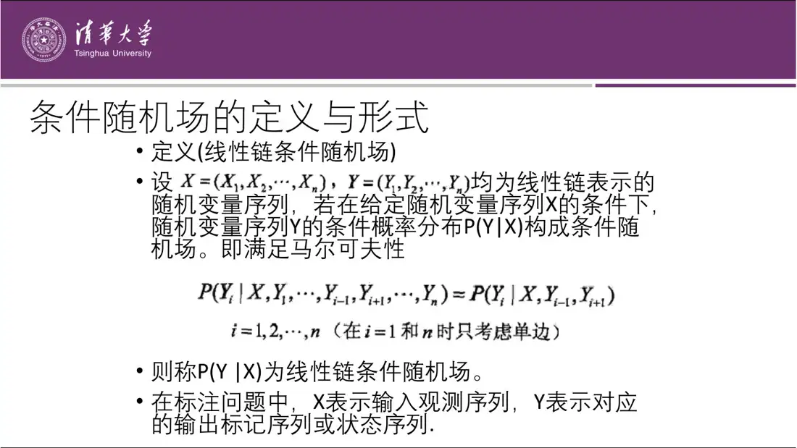

原文：

条件随机场的定义与形式

\- 定义(线性链条件随机场)

\- 设 $X = (X_{1}, X_{2}, \cdots, X_{n})$ ， $Y = (Y_{1}, Y_{2}, \cdots, Y_{n})$ 均为线性链表示的随机变量序列，若在给定随机变量序列X的条件下，随机变量序列Y的条件概率分布P(Y|X)构成条件随机场。即满足马尔可夫性

$$
\begin{array}{r l} & {P (Y _ {i} \mid X, Y _ {1}, \dots , Y _ {i - 1}, Y _ {i + 1}, \dots , Y _ {n}) = P (Y _ {i} \mid X, Y _ {i - 1}, Y _ {i + 1})} \\ & {\qquad i = 1, 2, \dots , n (\text {在} i = 1 \text {和} n \text {时只考虑单边})} \end{array}
$$

\- 则称P(Y | X)为线性链条件随机场。

\- 在标注问题中，X表示输入观测序列，Y表示对应的输出标记序列或状态序列.

Tsinghua University
清華大學

### 条件随机场的参数化形式

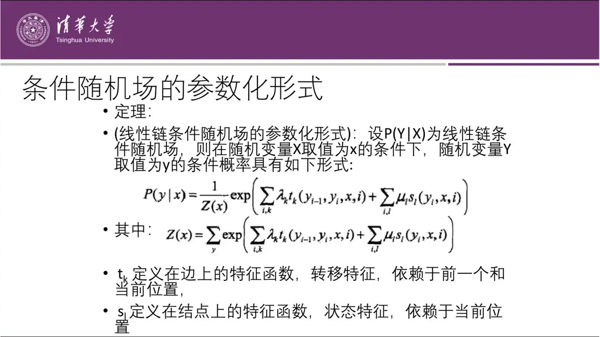

原文：

条件随机场的参数化形式

\- 定理:

\- (线性链条件随机场的参数化形式): 设 $P(Y|X)$ 为线性链条件随机场, 则在随机变量X取值为x的条件下, 随机变量Y取值为y的条件概率具有如下形式:

$$
P (y \mid x) = \frac {1}{Z (x)} \exp \left(\sum_ {i, k} \lambda_ {k} t _ {k} \left(y _ {i - 1}, y _ {i}, x, i\right) + \sum_ {i, l} \mu_ {l} s _ {l} \left(y _ {i}, x, i\right)\right)
$$

\- 其中： $Z(x) = \sum_{y}\exp \left(\sum_{i,k}\lambda_k t_k(y_{i - 1},y_i,x,i) + \sum_{i,l}\mu_ls_l(y_i,x,i)\right)$

\- $t_{k}$ 定义在边上的特征函数，转移特征，依赖于前一个和当前位置，

\- $s_{1}$ 定义在结点上的特征函数，状态特征，依赖于当前位置

清華大學 Tsinghua University

### 条件随机场的参数化形式

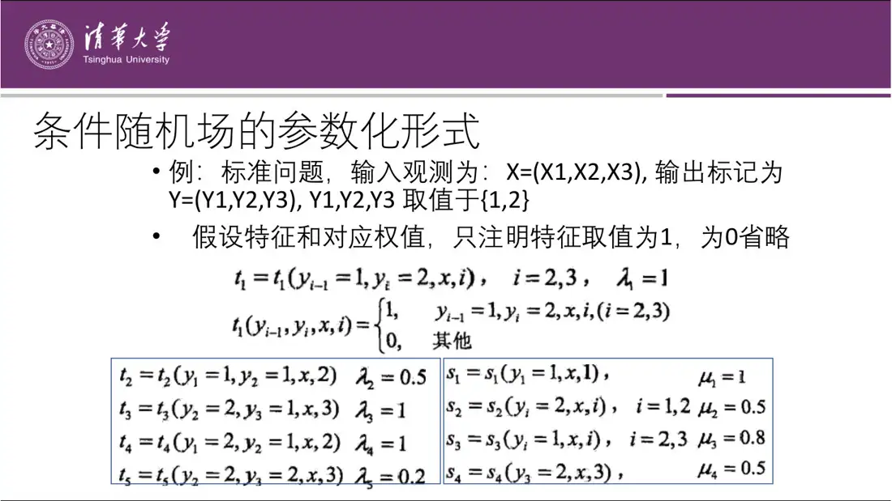

原文：

条件随机场的参数化形式

• 例：标准问题，输入观测为：X=(X1,X2,X3)，输出标记为Y=(Y1,Y2,Y3)，Y1,Y2,Y3 取值于{1,2}

\- 假设特征和对应权值，只注明特征取值为1，为0省略

$$
t _ {1} = t _ {1} \left(y _ {i - 1} = 1, y _ {i} = 2, x, i\right), \quad i = 2, 3, \quad \lambda_ {1} = 1
$$

$$
t _ {1} (y _ {i - 1}, y _ {i}, x, i) = \left\{ \begin{array}{l l} 1, & y _ {i - 1} = 1, y _ {i} = 2, x, i, (i = 2, 3) \\ 0, & \text {其他} \end{array} \right.
$$

$$
t _ {2} = t _ {2} (y _ {1} = 1, y _ {2} = 1, x, 2) \quad \lambda_ {2} = 0. 5
$$

$$
s _ {1} = s _ {1} (y _ {1} = 1, x, 1),
$$

$$
\mu_ {1} = 1
$$

$$
t _ {3} = t _ {3} (y _ {2} = 2, y _ {3} = 1, x, 3) \quad \lambda_ {3} = 1
$$

$$
s _ {2} = s _ {2} \left(y _ {i} = 2, x, i\right), \quad i = 1, 2 \mu_ {2} = 0. 5
$$

$$
t _ {4} = t _ {4} (y _ {1} = 2, y _ {2} = 1, x, 2) \lambda_ {4} = 1
$$

$$
s _ {3} = s _ {3} \left(y _ {i} = 1, x, i\right), \quad i = 2, 3 \mu_ {3} = 0. 8
$$

$$
t _ {5} = t _ {5} \left(y _ {2} = 2, y _ {3} = 2, x, 3\right) \lambda_ {5} = 0. 2
$$

$$
s _ {4} = s _ {4} \left(y _ {3} = 2, x, 3\right),
$$

$$
\mu_ {4} = 0. 5
$$

清華大學 Tsinghua University

### 条件随机场的参数化形式

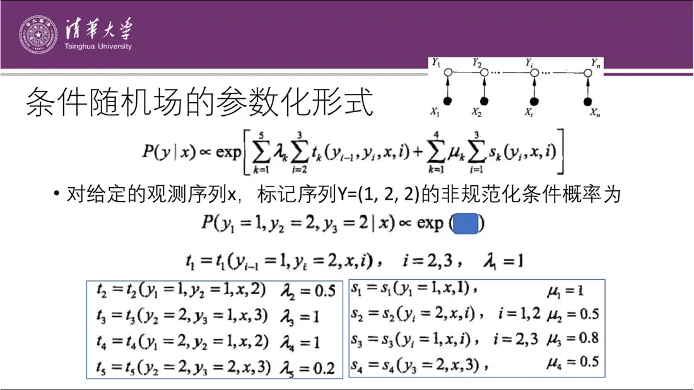

原文：

条件随机场的参数化形式

$$
P (y \mid x) \propto \exp \left[ \sum_ {k = 1} ^ {5} \lambda_ {k} \sum_ {i = 2} ^ {3} t _ {k} \left(y _ {i - 1}, y _ {i}, x, i\right) + \sum_ {k = 1} ^ {4} \mu_ {k} \sum_ {i = 1} ^ {3} s _ {k} \left(y _ {i}, x, i\right) \right]
$$

\- 对给定的观测序列x，标记序列Y=(1,2,2)的非规范化条件概率为

$$
P \left(y _ {1} = 1, y _ {2} = 2, y _ {3} = 2 \mid x\right) \propto \exp (\square)
$$

$$
t _ {1} = t _ {1} \left(y _ {i - 1} = 1, y _ {i} = 2, x, i\right), \quad i = 2, 3, \quad \lambda_ {1} = 1
$$

$$
t _ {2} = t _ {2} \left(y _ {1} = 1, y _ {2} = 1, x, 2\right) \quad \lambda_ {2} = 0. 5
$$

$$
t _ {3} = t _ {3} (y _ {2} = 2, y _ {3} = 1, x, 3) \quad \lambda_ {3} = 1
$$

$$
t _ {4} = t _ {4} (y _ {1} = 2, y _ {2} = 1, x, 2) \lambda_ {4} = 1
$$

$$
t _ {5} = t _ {5} \left(y _ {2} = 2, y _ {3} = 2, x, 3\right) \lambda_ {5} = 0. 2
$$

$$
\begin{array}{l l} s _ {1} = s _ {1} (y _ {1} = 1, x, 1), & \mu_ {1} = 1 \\ s _ {2} = s _ {2} (y _ {i} = 2, x, i), & i = 1, 2 \mu_ {2} = 0. 5 \\ s _ {3} = s _ {3} (y _ {i} = 1, x, i), & i = 2, 3 \mu_ {3} = 0. 8 \\ s _ {4} = s _ {4} (y _ {3} = 2, x, 3), & \mu_ {4} = 0. 5 \end{array}
$$

清華大學 Tsinghua University

### 条件随机场的简化形式

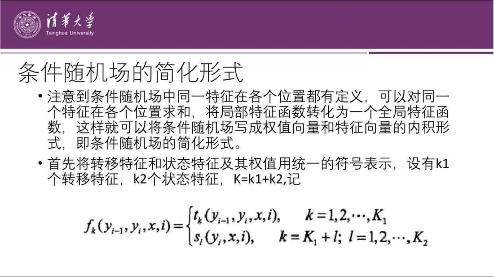

原文：

条件随机场的简化形式

\- 注意到条件随机场中同一特征在各个位置都有定义，可以对同一个特征在各个位置求和，将局部特征函数转化为一个全局特征函数，这样就可以将条件随机场写成权值向量和特征向量的内积形式，即条件随机场的简化形式。

\- 首先将转移特征和状态特征及其权值用统一的符号表示，设有k1个转移特征，k2个状态特征，K=k1+k2,记

$$
f _ {k} \left(y _ {i - 1}, y _ {i}, x, i\right) = \left\{ \begin{array}{l l} t _ {k} \left(y _ {i - 1}, y _ {i}, x, i\right), & k = 1, 2, \dots , K _ {1} \\ s _ {l} \left(y _ {i}, x, i\right), & k = K _ {1} + l; l = 1, 2, \dots , K _ {2} \end{array} \right.
$$

Tsinghua University
清華大學

### 条件随机场的简化形式

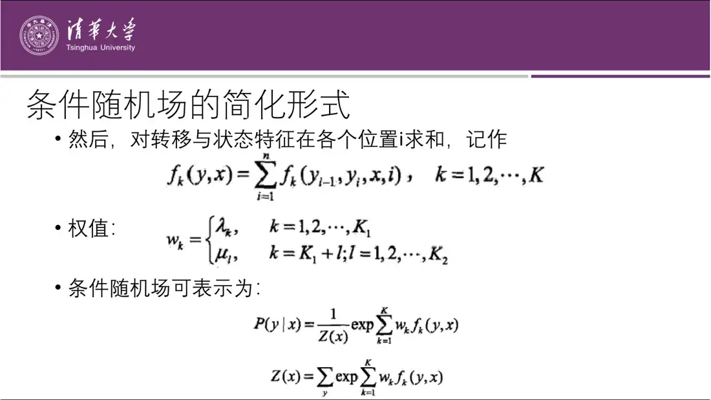

原文：

条件随机场的简化形式

\- 然后，对转移与状态特征在各个位置i求和，记作

$$
f _ {k} (y, x) = \sum_ {i = 1} ^ {n} f _ {k} \left(y _ {i - 1}, y _ {i}, x, i\right), \quad k = 1, 2, \dots , K
$$

\- 权值:

$$
w _ {k} = \left\{ \begin{array}{l l} \lambda_ {k}, & k = 1, 2, \dots , K _ {1} \\ \mu_ {l}, & k = K _ {1} + l; l = 1, 2, \dots , K _ {2} \end{array} \right.
$$

\- 条件随机场可表示为：

$$
P (y \mid x) = \frac {1}{Z (x)} \exp \sum_ {k = 1} ^ {K} w _ {k} f _ {k} (y, x)
$$

$$
Z (x) = \sum_ {y} \exp \sum_ {k = 1} ^ {K} w _ {k} f _ {k} (y, x)
$$

清華大學 Tsinghua University

### 条件随机场的简化形式

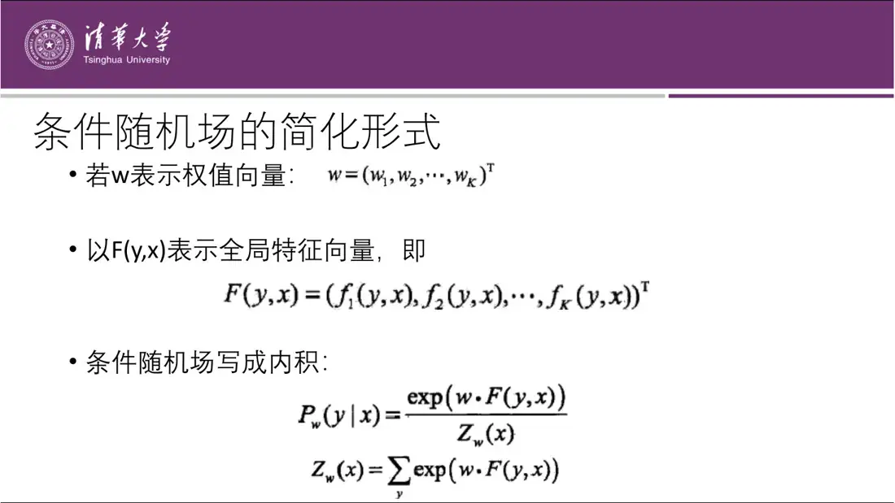

原文：

条件随机场的简化形式

\- 若w表示权值向量： $w=(w_{1},w_{2},\cdots,w_{K})^{\mathrm{T}}$

\- 以 $F(y,x)$ 表示全局特征向量，即

$$
F (y, x) = \left(f _ {1} (y, x), f _ {2} (y, x), \dots , f _ {K} (y, x)\right) ^ {\mathrm{T}}
$$

\- 条件随机场写成内积:

$$
P _ {w} (y \mid x) = \frac {\exp (w \cdot F (y , x))}{Z _ {w} (x)}
$$

$$
Z _ {w} (x) = \sum_ {y} \exp \left(w \cdot F (y, x)\right)
$$

Tsinghua University
清華大學

### 条件随机场的矩阵形式

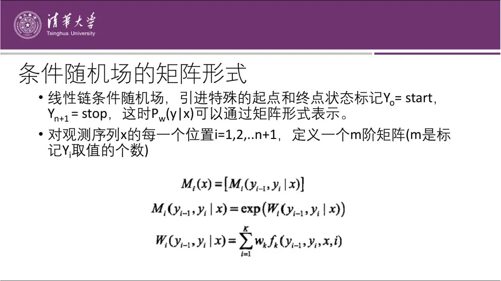

原文：

条件随机场的矩阵形式

\- 线性链条件随机场，引进特殊的起点和终点状态标记 $Y_{o}=start$ ， $Y_{n+1}=stop$ ，这时 $P_{w}(y|x)$ 可以通过矩阵形式表示。

\- 对观测序列x的每一个位置i=1,2,...n+1，定义一个m阶矩阵(m是标记Y $_{i}$ 取值的个数)

$$
\begin{array}{c} M _ {i} (x) = \left[ M _ {i} (y _ {i - 1}, y _ {i} \mid x) \right] \\ M _ {i} (y _ {i - 1}, y _ {i} \mid x) = \exp \left(W _ {i} (y _ {i - 1}, y _ {i} \mid x)\right) \\ W _ {i} (y _ {i - 1}, y _ {i} \mid x) = \sum_ {i = 1} ^ {K} w _ {k} f _ {k} (y _ {i - 1}, y _ {i}, x, i) \end{array}
$$

Tsinghua University
清華大學

### 条件随机场的矩阵形式

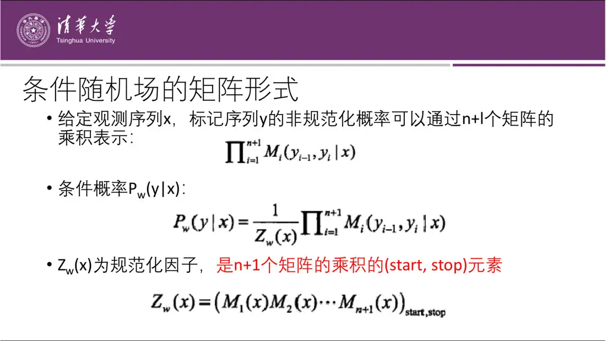

原文：

条件随机场的矩阵形式

\- 给定观测序列x，标记序列y的非规范化概率可以通过n+1个矩阵的乘积表示：

$$
\prod_ {i = 1} ^ {n + 1} M _ {i} (y _ {i - 1}, y _ {i} \mid x)
$$

\- 条件概率 $P_{w}(y|x)$ :

$$
P _ {w} (y \mid x) = \frac {1}{Z _ {w} (x)} \prod_ {i = 1} ^ {n + 1} M _ {i} (y _ {i - 1}, y _ {i} \mid x)
$$

\- $Z_{w}(x)$ 为规范化因子，是n+1个矩阵的乘积的(start, stop)元素

$$
Z _ {w} (x) = \left(M _ {1} (x) M _ {2} (x) \dots M _ {n + 1} (x)\right) _ {\text { start,stop }}
$$

Tsinghua University
清華大學

### 条件随机场的矩阵形式

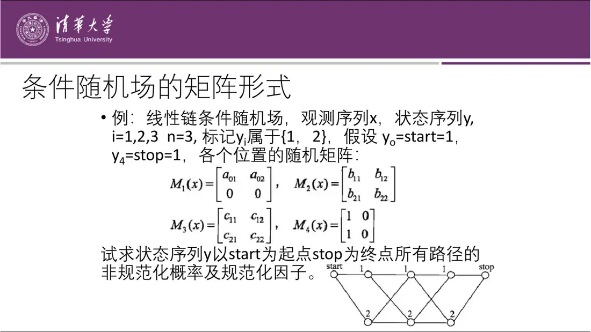

原文：

条件随机场的矩阵形式

• 例：线性链条件随机场，观测序列x，状态序列y，i=1,2,3 n=3，标记 $y_{i}$ 属于 $\{1, 2\}$ ，假设 $y_{o}=start=1$ ， $y_{4}=stop=1$ ，各个位置的随机矩阵：

$$
M _ {1} (x) = \left[ \begin{array}{c c} a _ {0 1} & a _ {0 2} \\ 0 & 0 \end{array} \right], \quad M _ {2} (x) = \left[ \begin{array}{c c} b _ {1 1} & b _ {1 2} \\ b _ {2 1} & b _ {2 2} \end{array} \right]
$$

$$
M _ {3} (x) = \left[ \begin{array}{l l} c _ {1 1} & c _ {1 2} \\ c _ {2 1} & c _ {2 2} \end{array} \right], \quad M _ {4} (x) = \left[ \begin{array}{l l} 1 & 0 \\ 1 & 0 \end{array} \right]
$$

试求状态序列y以start为起点stop为终点所有路径的

非规范化概率及规范化因子。

Tsinghua University
清華大學

### 条件随机场的矩阵形式

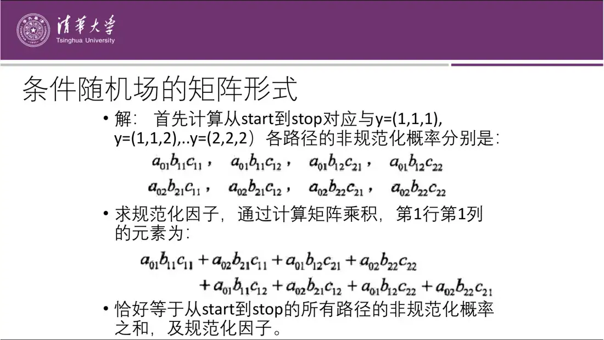

原文：

条件随机场的矩阵形式

\- 解：首先计算从start到stop对应与y=(1,1,1), y=(1,1,2),..y=(2,2,2) 各路径的非规范化概率分别是：

$$
\begin{array}{l l l l} a _ {0 1} b _ {1 1} c _ {1 1}, & a _ {0 1} b _ {1 1} c _ {1 2}, & a _ {0 1} b _ {1 2} c _ {2 1}, & a _ {0 1} b _ {1 2} c _ {2 2} \\ a _ {0 2} b _ {2 1} c _ {1 1}, & a _ {0 2} b _ {2 1} c _ {1 2}, & a _ {0 2} b _ {2 2} c _ {2 1}, & a _ {0 2} b _ {2 2} c _ {2 2} \end{array}
$$

\- 求规范化因子，通过计算矩阵乘积，第1行第1列的元素为：

$$
\begin{array}{r l} a _ {0 1} b _ {1 1} c _ {1 1} + a _ {0 2} b _ {2 1} c _ {1 1} + a _ {0 1} b _ {1 2} c _ {2 1} + a _ {0 2} b _ {2 2} c _ {2 2} \\ + a _ {0 1} b _ {1 1} c _ {1 2} + a _ {0 2} b _ {2 1} c _ {1 2} + a _ {0 1} b _ {1 2} c _ {2 2} + a _ {0 2} b _ {2 2} c _ {2 1} \end{array}
$$

\- 恰好等于从start到stop的所有路径的非规范化概率之和，及规范化因子。

清華大學 Tsinghua University

### 条件随机场的概率计算问题

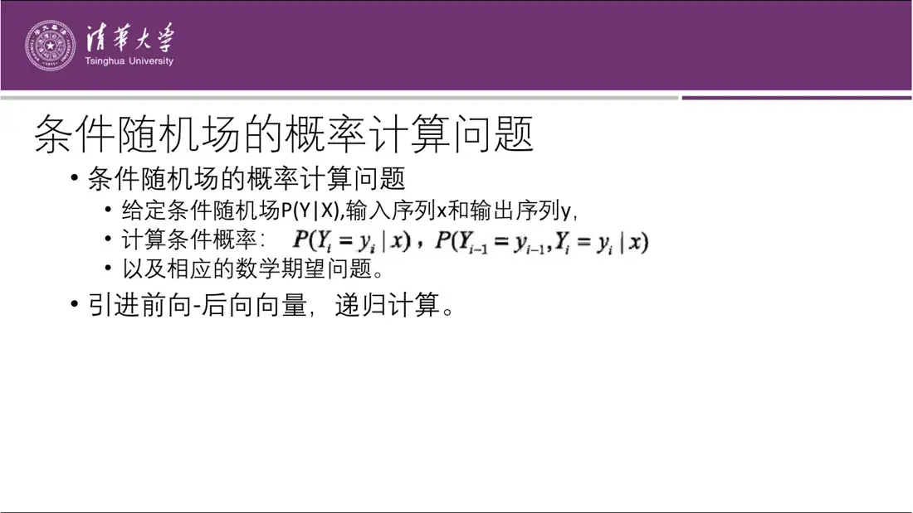

原文：

条件随机场的概率计算问题

\- 条件随机场的概率计算问题

\- 给定条件随机场P(Y|X),输入序列x和输出序列y,

\- 计算条件概率: $P(Y_{i} = y_{i} \mid x), P(Y_{i-1} = y_{i-1}, Y_{i} = y_{i} \mid x)$

\- 以及相应的数学期望问题。

\- 引进前向-后向向量，递归计算。

Tsinghua University
清華大學

### 条件随机场的概率计算问题

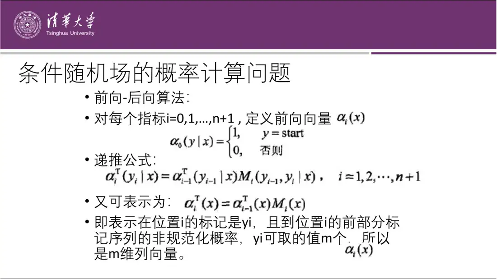

原文：

条件随机场的概率计算问题

\- 前向-后向算法:

\- 对每个指标 $i = 0,1,\dots ,n + 1$ ，定义前向向量 $\alpha_{i}(x)$

$$
\alpha_ {0} (y \mid x) = \left\{ \begin{array}{l l} 1, & y = \mathrm{start} \\ 0, & \text {否则} \end{array} \right.
$$

\- 递推公式:

$$
\alpha_ {i} ^ {\mathrm{T}} \left(y _ {i} \mid x\right) = \alpha_ {i - 1} ^ {\mathrm{T}} \left(y _ {i - 1} \mid x\right) M _ {i} \left(y _ {i - 1}, y _ {i} \mid x\right), \quad i = 1, 2, \dots , n + 1
$$

\- 又可表示为： $\alpha_{i}^{\mathrm{T}}(x) = \alpha_{i - 1}^{\mathrm{T}}(x)M_{i}(x)$

\- 即表示在位置i的标记是yi，且到位置i的前部分标记序列的非规范化概率，yi可取的值m个．所以是m维列向量。

清華大學 Tsinghua University

### 条件随机场的概率计算问题

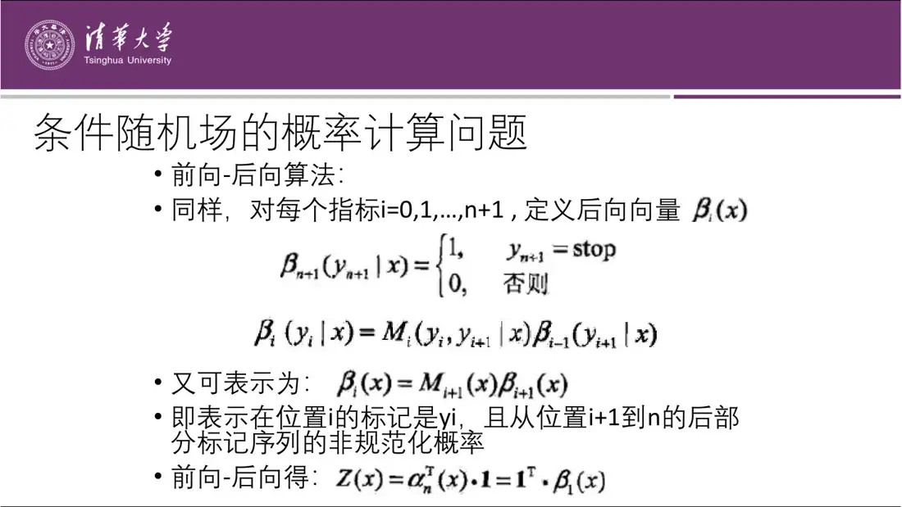

原文：

条件随机场的概率计算问题

\- 前向-后向算法:

\- 同样，对每个指标 $i = 0,1,\dots,n + 1$ ，定义后向向量 $\beta_{i}(x)$

$$
\beta_ {n + 1} (y _ {n + 1} \mid x) = \left\{ \begin{array}{l l} 1, & y _ {n + 1} = \mathrm{stop} \\ 0, & \text {否则} \end{array} \right.
$$

$$
\beta_ {i} \left(y _ {i} \mid x\right) = M _ {i} \left(y _ {i}, y _ {i + 1} \mid x\right) \beta_ {i - 1} \left(y _ {i + 1} \mid x\right)
$$

\- 又可表示为: $\beta_{i}(x) = M_{i+1}(x)\beta_{i+1}(x)$

\- 即表示在位置i的标记是yi，且从位置i+1到n的后部分标记序列的非规范化概率

\- 前向-后向得: $Z(x) = \alpha_{n}^{\mathrm{T}}(x) \cdot 1 = 1^{\mathrm{T}} \cdot \beta_{1}(x)$

Tsinghua University
清華大學

### 条件随机场的概率计算问题

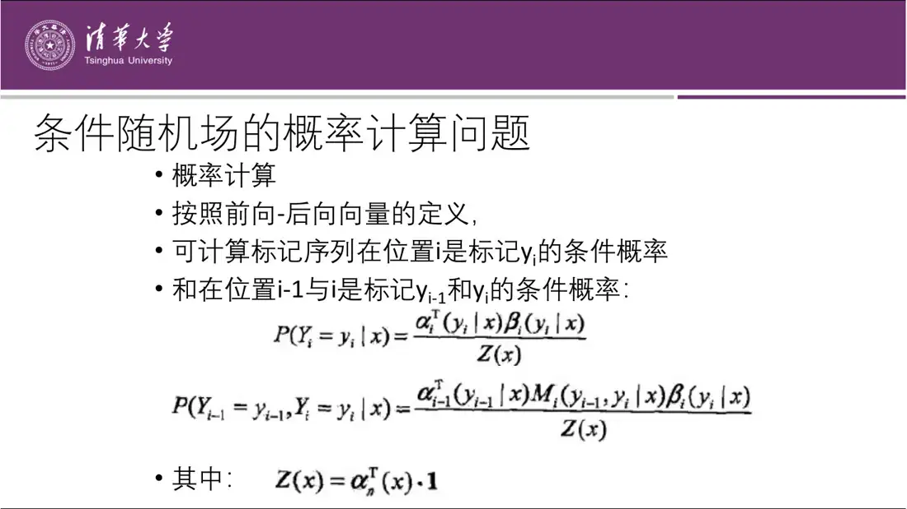

原文：

条件随机场的概率计算问题

\- 概率计算

\- 按照前向-后向向量的定义，

\- 可计算标记序列在位置i是标记 $y_{i}$ 的条件概率

\- 和在位置i-1与i是标记 $y_{i-1}$ 和 $y_i$ 的条件概率：

$$
P (Y _ {i} = y _ {i} \mid x) = \frac {\alpha_ {i} ^ {\mathrm{T}} (y _ {i} \mid x) \beta_ {i} (y _ {i} \mid x)}{Z (x)}
$$

$$
P \left(Y _ {i - 1} = y _ {i - 1}, Y _ {i} = y _ {i} \mid x\right) = \frac {\alpha_ {i - 1} ^ {\mathrm{T}} \left(y _ {i - 1} \mid x\right) M _ {i} \left(y _ {i - 1} , y _ {i} \mid x\right) \beta_ {i} \left(y _ {i} \mid x\right)}{Z (x)}
$$

\- 其中： $Z(x) = \alpha_{n}^{\mathrm{T}}(x)\cdot 1$

Tsinghua University
清華大學

### 条件随机场的概率计算问题

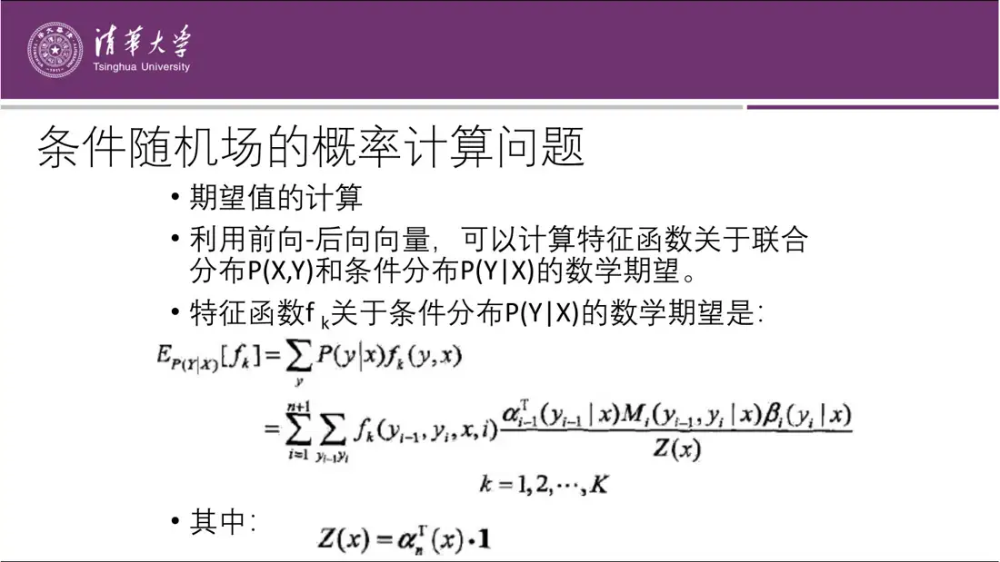

原文：

条件随机场的概率计算问题

\- 期望值的计算

\- 利用前向-后向向量，可以计算特征函数关于联合分布P(X,Y)和条件分布P(Y|X)的数学期望。

\- 特征函数 $f_{k}$ 关于条件分布 $P(Y|X)$ 的数学期望是：

$$
\begin{array}{l} E _ {P (Y \mid X)} [ f _ {k} ] = \sum_ {y} P (y | x) f _ {k} (y, x) \\ = \sum_ {i = 1} ^ {n + 1} \sum_ {y _ {i - 1} y _ {i}} f _ {k} (y _ {i - 1}, y _ {i}, x, i) \frac {\alpha_ {i - 1} ^ {\mathrm{T}} (y _ {i - 1} \mid x) M _ {i} (y _ {i - 1} , y _ {i} \mid x) \beta_ {i} (y _ {i} \mid x)}{Z (x)} \\ k = 1, 2, \dots , K \end{array}
$$

\- 其中:

$$
Z (x) = \alpha_ {n} ^ {\mathrm{T}} (x) \cdot 1
$$

Tsinghua University
清華大學
1911-UNIVERSITY

### 条件随机场的概率计算问题

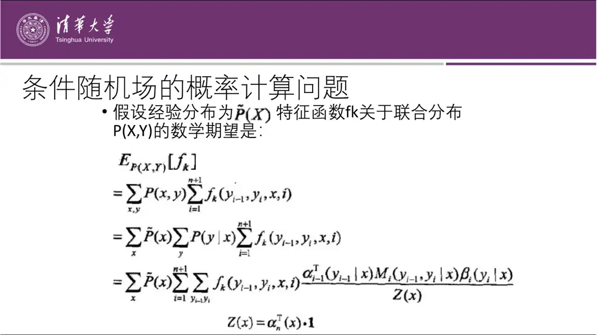

原文：

条件随机场的概率计算问题

\- 假设经验分布为 $\tilde{P}(X)$ 特征函数fk关于联合分布 $P(X,Y)$ 的数学期望是：

$$
\begin{array}{r l} & E _ {P (X, Y)} [ f _ {k} ] \\ & = \sum_ {x, y} P (x, y) \sum_ {i = 1} ^ {n + 1} f _ {k} (y _ {i - 1}, y _ {i}, x, i) \\ & = \sum_ {x} \tilde {P} (x) \sum_ {y} P (y | x) \sum_ {i = 1} ^ {n + 1} f _ {k} (y _ {i - 1}, y _ {i}, x, i) \\ & = \sum_ {x} \tilde {P} (x) \sum_ {i = 1} ^ {n + 1} \sum_ {y _ {i - 1} y _ {i}} f _ {k} (y _ {i - 1}, y _ {i}, x, i) \frac {\alpha_ {i - 1} ^ {\mathrm{T}} (y _ {i - 1} | x) M _ {i} (y _ {i - 1} , y _ {i} | x) \beta_ {i} (y _ {i} | x)}{Z (x)} \\ & Z (x) = \alpha_ {n} ^ {\mathrm{T}} (x) \cdot \mathbf {1} \end{array}
$$

清華大學 Tsinghua University

### 条件随机场的学习算法

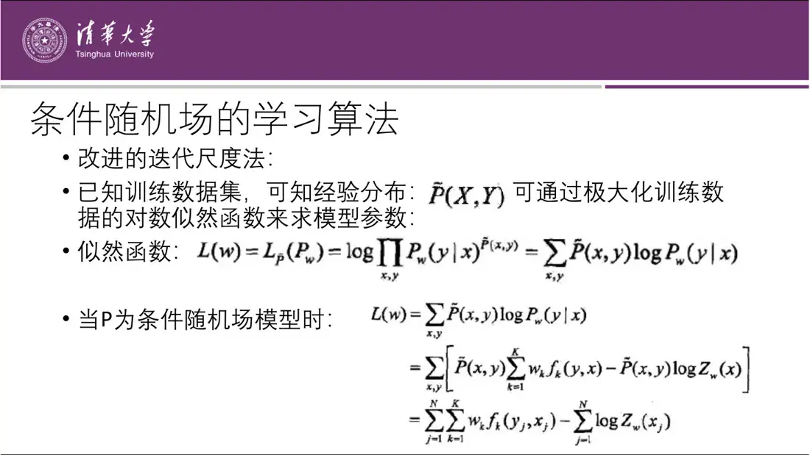

原文：

条件随机场的学习算法

\- 改进的迭代尺度法:

\- 已知训练数据集，可知经验分布： $\tilde{P}(X,Y)$ 可通过极大化训练数据的对数似然函数来求模型参数：

\- 似然函数: $L(w) = L_{\tilde{P}}(P_w) = \log \prod_{x,y} P_w(y|x)^{\tilde{P}(x,y)} = \sum_{x,y} \tilde{P}(x,y)\log P_w(y|x)$

\- 当P为条件随机场模型时： $L(w)=\sum_{x,y}\tilde{P}(x,y)\log P_{w}(y|x)$ $=\sum_{x,y}\left[\tilde{P}(x,y)\sum_{k=1}^{K}w_{k}f_{k}(y,x)-\tilde{P}(x,y)\log Z_{w}(x)\right]$ $=\sum_{j=1}^{N}\sum_{k=1}^{K}w_{k}f_{k}(y_{j},x_{j})-\sum_{j=1}^{N}\log Z_{w}(x_{j})$

Tsinghua University
清華大學

### 条件随机场的学习算法

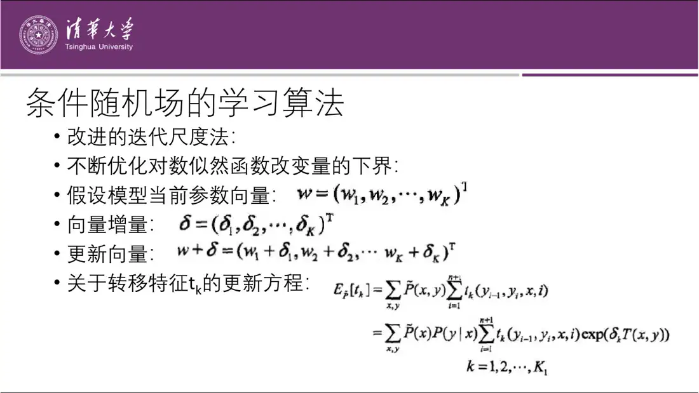

原文：

条件随机场的学习算法

\- 改进的迭代尺度法:

\- 不断优化对数似然函数改变量的下界:

\- 假设模型当前参数向量: $w = (w_{1}, w_{2}, \cdots, w_{K})^{1}$

\- 向量增量: $\delta = (\delta_{1},\delta_{2},\dots ,\delta_{K})^{\mathrm{T}}$

\- 更新向量: $w + \delta = (w_{1} + \delta_{1}, w_{2} + \delta_{2}, \cdots, w_{K} + \delta_{K})^{\mathrm{T}}$

\- 关于转移特征 $t_k$ 的更新方程： $E_{\tilde{P}}[t_k] = \sum_{x,y} \tilde{P}(x,y) \sum_{i=1}^{n+1} t_k(y_{i-1},y_i,x,i)$ $= \sum_{x,y} \tilde{P}(x) P(y|x) \sum_{i=1}^{n+1} t_k(y_{i-1},y_i,x,i) \exp(\delta_k T(x,y))$ $k = 1,2,\cdots,K_1$

Tsinghua University
清華大學

### 条件随机场的学习算法

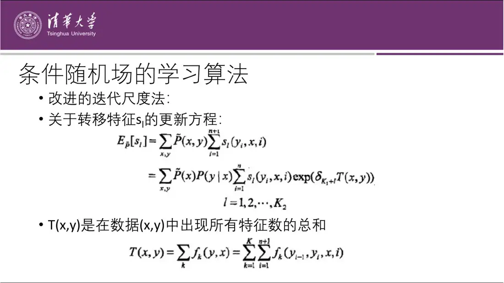

原文：

条件随机场的学习算法

\- 改进的迭代尺度法:

\- 关于转移特征 $s_{1}$ 的更新方程：

$$
\begin{array}{r l} E _ {\bar {p}} [ s _ {l} ] & = \sum_ {x, y} \tilde {P} (x, y) \sum_ {i = 1} ^ {n + 1} s _ {l} (y _ {i}, x, i) \\ & = \sum_ {x, y} \tilde {P} (x) P (y | x) \sum_ {i = 1} ^ {n} s _ {l} (y _ {i}, x, i) \exp (\delta_ {K _ {1} + l} T (x, y)) \\ & l = 1, 2, \dots , K _ {2} \end{array}
$$

\- T(x,y)是在数据(x,y)中出现所有特征数的总和

$$
T (x, y) = \sum_ {k} f _ {k} (y, x) = \sum_ {k = 1} ^ {K} \sum_ {i = 1} ^ {n + 1} f _ {k} (y _ {i - 1}, y _ {i}, x, i)
$$

Tsinghua University
清華大學

### 条件随机场的学习算法

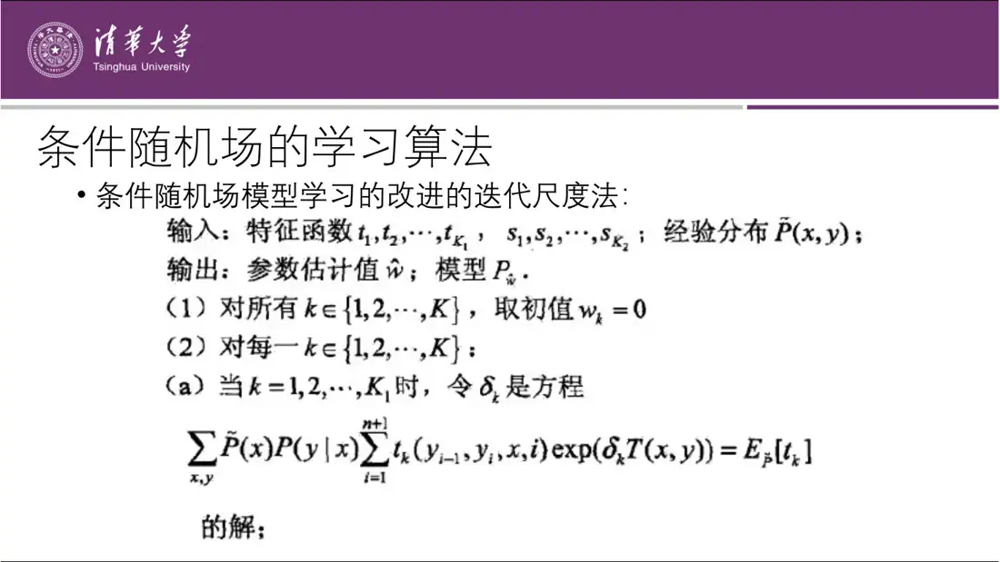

原文：

条件随机场的学习算法

\- 条件随机场模型学习的改进的迭代尺度法:

输入：特征函数 $t_1, t_2, \cdots, t_{K_1}$ ， $s_1, s_2, \cdots, s_{K_2}$ ；经验分布 $\tilde{P}(x, y)$ ；

输出：参数估计值 $\hat{w}$ ；模型 $P_{\hat{w}}$

(1) 对所有 $k \in \{1, 2, \cdots, K\}$ ，取初值 $w_{k} = 0$

(2) 对每一 $k \in \{1, 2, \cdots, K\}$ :

(a) 当 $k=1,2,\cdots,K_{1}$ 时，令 $\delta_{k}$ 是方程

$$
\sum_ {x, y} \tilde {P} (x) P (y \mid x) \sum_ {i = 1} ^ {n + 1} t _ {k} \left(y _ {i - 1}, y _ {i}, x, i\right) \exp \left(\delta_ {k} T (x, y)\right) = E _ {\text {产}} [ t _ {k} ]
$$

的解：

清華大學 Tsinghua University

### 条件随机场的学习算法

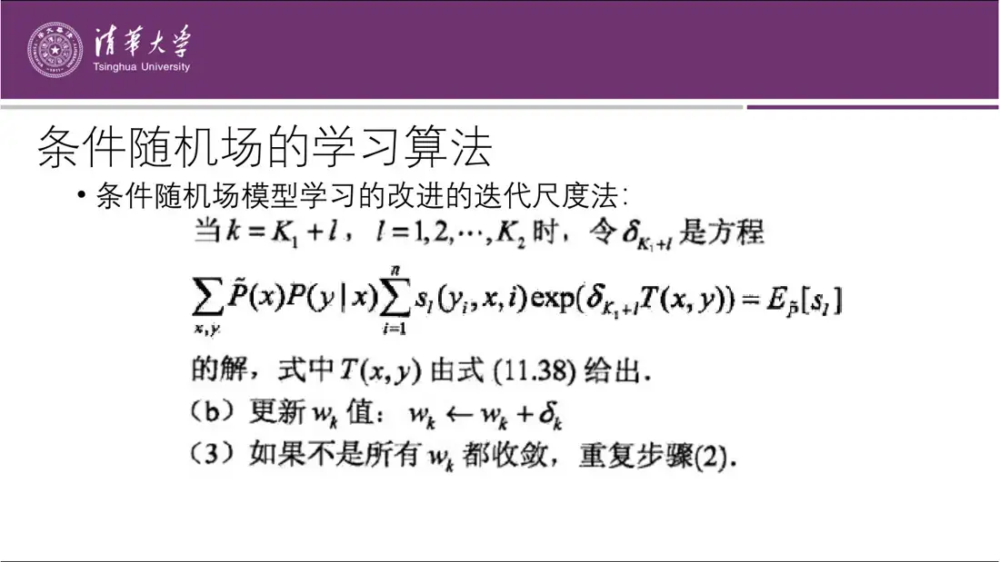

原文：

条件随机场的学习算法

\- 条件随机场模型学习的改进的迭代尺度法:

当 $k=K_{1}+l,\quad l=1,2,\cdots,K_{2}$ 时，令 $\delta_{K_{1}+l}$ 是方程

$$
\sum_ {x, y} \tilde {P} (x) P (y \mid x) \sum_ {i = 1} ^ {n} s _ {l} (y _ {i}, x, i) \exp (\delta_ {k _ {i} + l} T (x, y)) = E _ {\tilde {p}} [ s _ {l} ]
$$

的解，式中 $T(x,y)$ 由式(11.38)给出.

(b) 更新 $w_{k}$ 值: $w_{k} \leftarrow w_{k} + \delta_{k}$

(3) 如果不是所有 $w_{k}$ 都收敛，重复步骤(2).

Tsinghua University
清華大學

### 条件随机场的学习算法

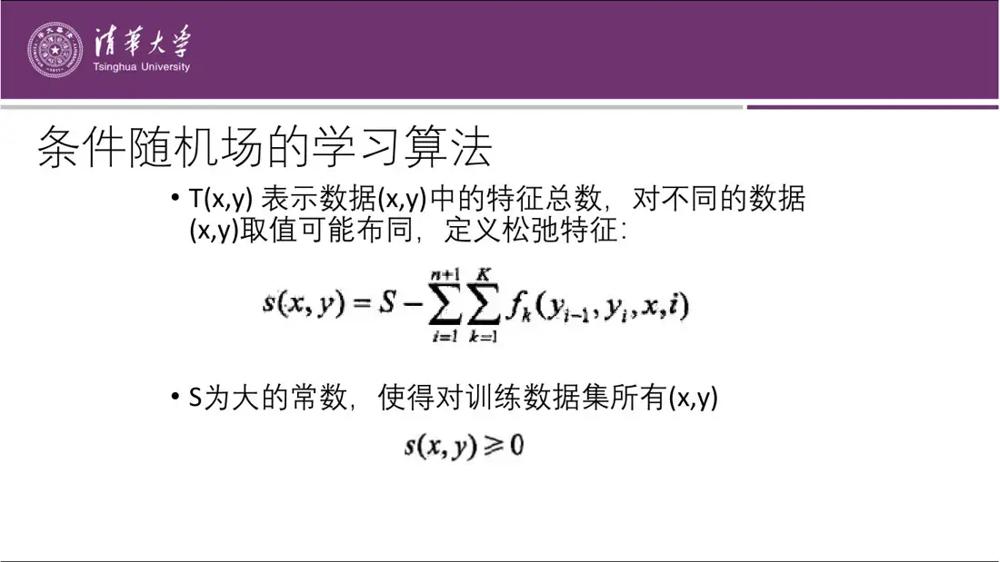

原文：

条件随机场的学习算法

\- T(x,y) 表示数据(x,y)中的特征总数，对不同的数据 (x,y)取值可能布同，定义松弛特征：

$$
s (x, y) = S - \sum_ {i = 1} ^ {n + 1} \sum_ {k = 1} ^ {K} f _ {k} \left(y _ {i - 1}, y _ {i}, x, i\right)
$$

\- S为大的常数，使得对训练数据集所有(x,y)

$$
s (x, y) \geqslant 0
$$

Tsinghua University
清華大學
1911-UNIVERSITY

### 条件随机场的学习算法

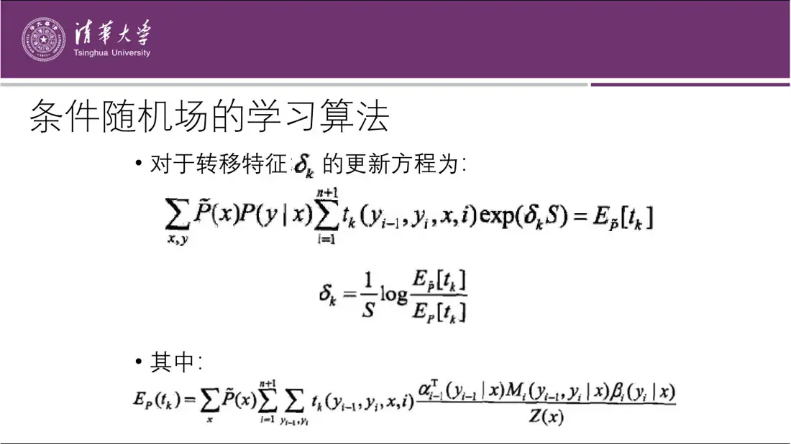

原文：

条件随机场的学习算法

\- 对于转移特征 $\delta_{k}$ 的更新方程为:

$$
\sum_ {x, y} \tilde {P} (x) P (y \mid x) \sum_ {i = 1} ^ {n + 1} t _ {k} \left(y _ {i - 1}, y _ {i}, x, i\right) \exp (\delta_ {k} S) = E _ {\tilde {p}} [ t _ {k} ]
$$

$$
\delta_ {k} = \frac {1}{S} \log \frac {E _ {\bar {P}} [ t _ {k} ]}{E _ {P} [ t _ {k} ]}
$$

\- 其中:

$$
E _ {P} \left(t _ {k}\right) = \sum_ {x} \tilde {P} (x) \sum_ {i = 1} ^ {n + 1} \sum_ {y _ {i - 1}, y _ {i}} t _ {k} \left(y _ {i - 1}, y _ {i}, x, i\right) \frac {\alpha_ {i - 1} ^ {\mathrm{T}} \left(y _ {i - 1} \mid x\right) M _ {i} \left(y _ {i - 1} , y _ {i} \mid x\right) \beta_ {i} \left(y _ {i} \mid x\right)}{Z (x)}
$$

清華大學 Tsinghua University

### 条件随机场的学习算法

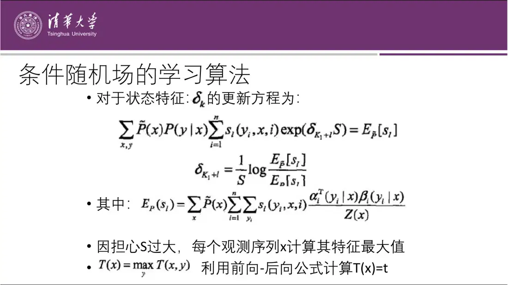

原文：

条件随机场的学习算法

\- 对于状态特征: $\delta_{k}$ 的更新方程为:

$$
\sum_ {x, y} \tilde {P} (x) P (y \mid x) \sum_ {i = 1} ^ {n} s _ {i} \left(y _ {i}, x, i\right) \exp \left(\delta_ {K _ {1} + l} S\right) = E _ {\tilde {p}} \left[ s _ {l} \right]
$$

$$
\delta_ {K _ {1} + l} = \frac {1}{S} \log \frac {E _ {\tilde {P}} [ s _ {l} ]}{E _ {p} [ s _ {l} ]}
$$

\- 其中： $E_{P}(s_{l})=\sum_{x}\tilde{P}(x)\sum_{i=1}^{n}\sum_{y_{i}}s_{l}(y_{i},x,i)\frac{\alpha_{i}^{\mathrm{T}}(y_{i}\mid x)\beta_{i}(y_{i}\mid x)}{Z(x)}$

\- 因担心S过大，每个观测序列x计算其特征最大值

\- $T(x) = \max_{y} T(x, y)$ 利用前向-后向公式计算 $T(x) = t$

清華大學 Tsinghua University

### 条件随机场的学习算法

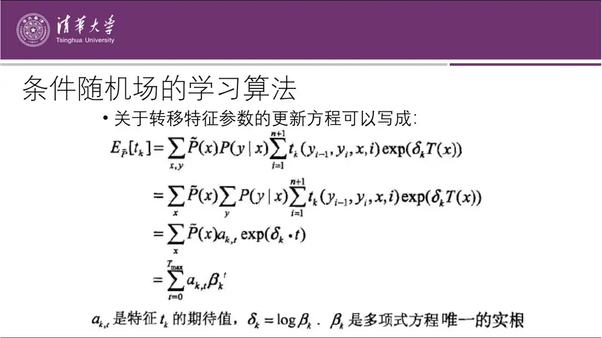

原文：

条件随机场的学习算法

\- 关于转移特征参数的更新方程可以写成:

$$
\begin{array}{r l} E _ {\tilde {P}} [ t _ {k} ] & = \sum_ {x, y} \tilde {P} (x) P (y \mid x) \sum_ {i = 1} ^ {n + 1} t _ {k} (y _ {i - 1}, y _ {i}, x, i) \exp (\delta_ {k} T (x)) \\ & = \sum_ {x} \tilde {P} (x) \sum_ {y} P (y \mid x) \sum_ {i = 1} ^ {n + 1} t _ {k} (y _ {i - 1}, y _ {i}, x, i) \exp (\delta_ {k} T (x)) \\ & = \sum_ {x} \tilde {P} (x) a _ {k, t} \exp (\delta_ {k} \cdot t) \\ & = \sum_ {t = 0} ^ {T _ {\max}} a _ {k, t} \beta_ {k} ^ {t} \end{array}
$$

$a_{k,t}$ 是特征 $t_k$ 的期待值， $\delta_k = \log \beta_k$ ， $\beta_{k}$ 是多项式方程唯一的实根

Tsinghua University
清華大學
1911-UNIVERSITY

### 条件随机场的学习算法

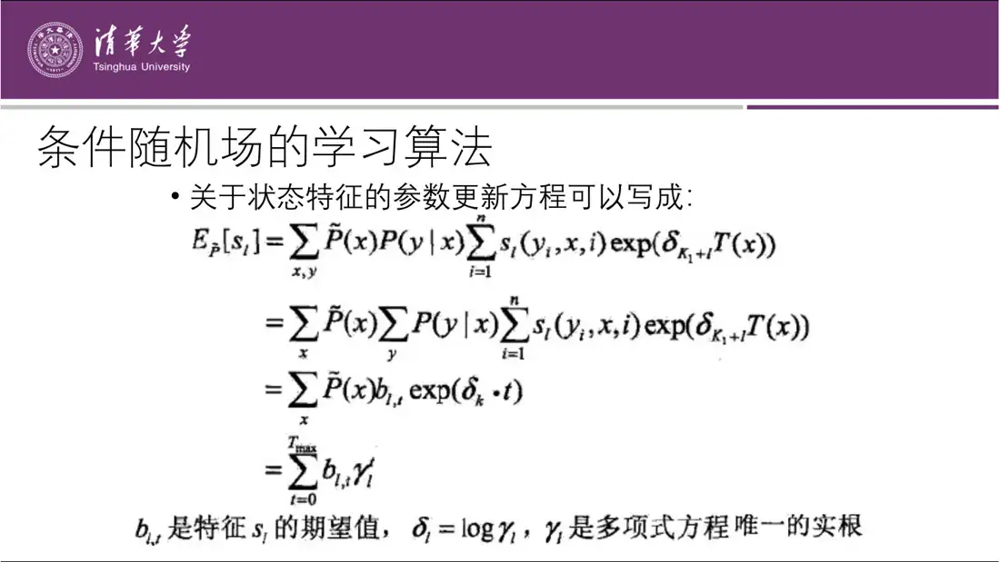

原文：

条件随机场的学习算法

\- 关于状态特征的参数更新方程可以写成:

$$
\begin{array}{r l} E _ {\tilde {P}} [ s _ {l} ] & = \sum_ {x, y} \tilde {P} (x) P (y \mid x) \sum_ {i = 1} ^ {n} s _ {l} (y _ {i}, x, i) \exp (\delta_ {K _ {1} + l} T (x)) \\ & = \sum_ {x} \tilde {P} (x) \sum_ {y} P (y \mid x) \sum_ {i = 1} ^ {n} s _ {l} (y _ {i}, x, i) \exp (\delta_ {K _ {1} + l} T (x)) \\ & = \sum_ {x} \tilde {P} (x) b _ {l, t} \exp (\delta_ {k} \cdot t) \\ & = \sum_ {t = 0} ^ {T _ {\max}} b _ {l, t} \gamma_ {l} ^ {\prime} \end{array}
$$

$b_{i,j}$ 是特征 $s_{j}$ 的期望值， $\delta_{j}=\log\gamma_{j}$ ， $\gamma_{j}$ 是多项式方程唯一的实根

Tsinghua University
清華大學
1911-UNIVERSITY

### 条件随机场的学习算法

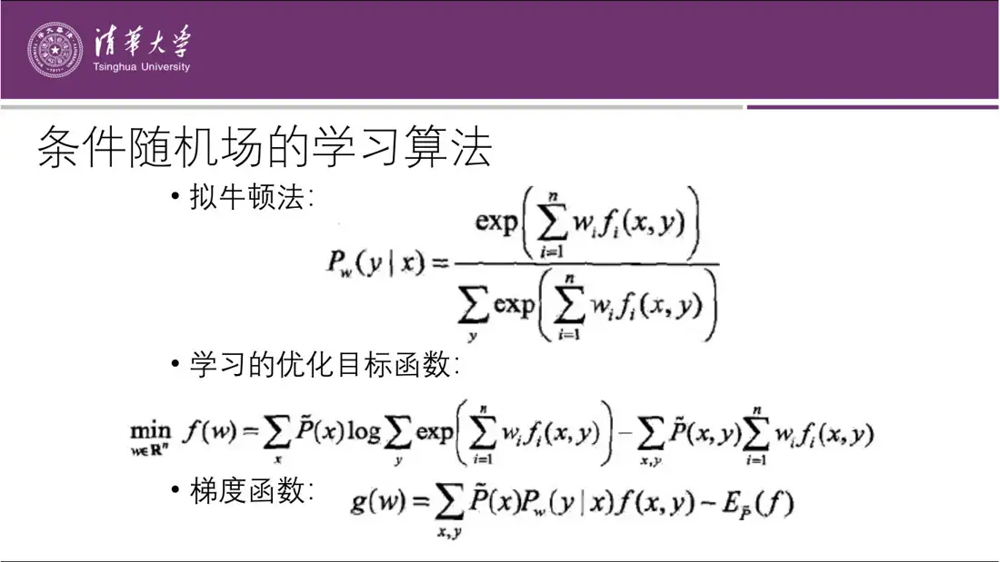

原文：

条件随机场的学习算法

\- 拟牛顿法：

$$
P _ {w} (y \mid x) = \frac {\exp \left(\sum_ {i = 1} ^ {n} w _ {i} f _ {i} (x , y)\right)}{\sum_ {y} \exp \left(\sum_ {i = 1} ^ {n} w _ {i} f _ {i} (x , y)\right)}
$$

\- 学习的优化目标函数:

$$
\min _ {w \in \mathbf {R} ^ {n}} f (w) = \sum_ {x} \tilde {P} (x) \log \sum_ {y} \exp \left(\sum_ {i = 1} ^ {n} w _ {i} f _ {i} (x, y)\right) - \sum_ {x, y} \tilde {P} (x, y) \sum_ {i = 1} ^ {n} w _ {i} f _ {i} (x, y)
$$

\- 梯度函数:

$$
g (w) = \sum_ {x, y} \tilde {P} (x) P _ {w} (y \mid x) f (x, y) - E _ {\bar {P}} (f)
$$

Tsinghua University
清華大學
1911-UNIVERSITY
清华大学

### 条件随机场的学习算法

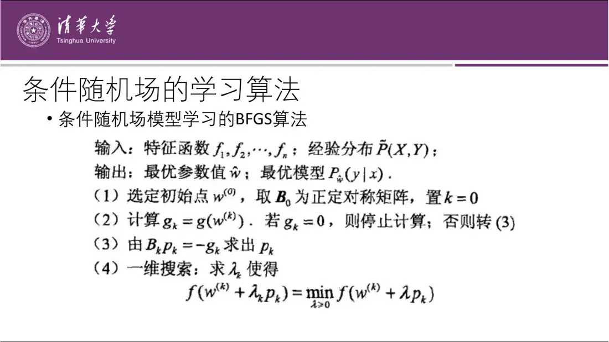

原文：

条件随机场的学习算法

\- 条件随机场模型学习的BFGS算法

输入：特征函数 $f_{1}, f_{2}, \cdots, f_{n}$ ；经验分布 $\tilde{P}(X, Y)$ ;

输出：最优参数值 $\hat{w}$ ；最优模型 $P_{\hat{w}}(y|x)$ .

(1) 选定初始点 $w^{(0)}$ ，取 $\pmb{B}_0$ 为正定对称矩阵，置 $k = 0$

(2) 计算 $g_{k} = g(w^{(k)})$ . 若 $g_{k} = 0$ ，则停止计算；否则转 (3)

(3) 由 $B_{k}p_{k} = -g_{k}$ 求出 $p_{k}$

(4) 一维搜索：求 $\lambda_{k}$ 使得

$$
f (w ^ {(k)} + \lambda_ {k} p _ {k}) = \min _ {\lambda > 0} f (w ^ {(k)} + \lambda p _ {k})
$$

清華大學 Tsinghua University

### 条件随机场的学习算法

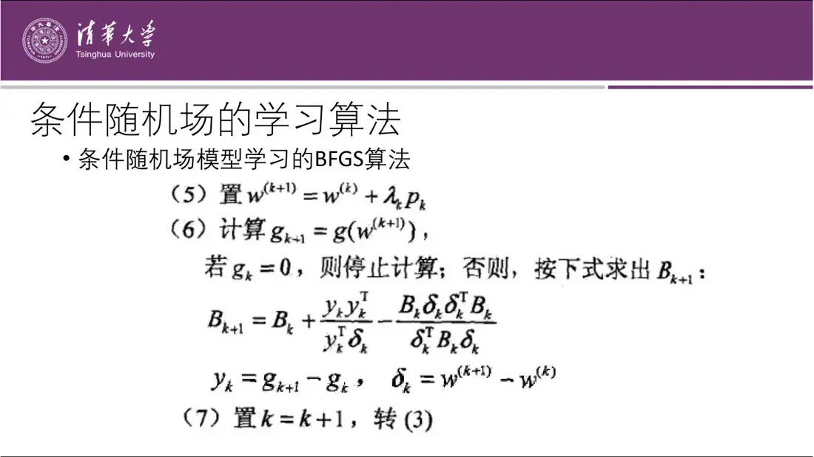

原文：

条件随机场的学习算法

\- 条件随机场模型学习的BFGS算法

(5) 置 $w^{(k + 1)} = w^{(k)} + \lambda_k p_k$

(6) 计算 $g_{k+1}=g(w^{(k+1)})$ ,

若 $g_{k} = 0$ ，则停止计算；否则，按下式求出 $B_{k + 1}$ ：

$$
B _ {k + 1} = B _ {k} + \frac {y _ {k} y _ {k} ^ {\mathrm{T}}}{y _ {k} ^ {\mathrm{T}} \delta_ {k}} - \frac {B _ {k} \delta_ {k} \delta_ {k} ^ {\mathrm{T}} B _ {k}}{\delta_ {k} ^ {\mathrm{T}} B _ {k} \delta_ {k}}
$$

$$
y _ {k} = g _ {k + 1} - g _ {k}, \quad \delta_ {k} = w ^ {(k + 1)} - w ^ {(k)}
$$

(7) 置 $k = k + 1$ ，转 (3)

清華大學 Tsinghua University

### 条件随机场的预测算法

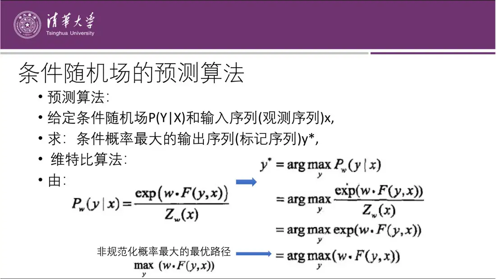

原文：

条件随机场的预测算法

\- 预测算法:

\- 给定条件随机场P(Y|X)和输入序列(观测序列)x,

\- 求：条件概率最大的输出序列(标记序列) $y^{*}$ ,

\- 维特比算法：

·由：

$$
\begin{array}{r l}&\text {持比算法:}\\&P _ {w} (y \mid x) = \frac {\exp (w \cdot F (y , x))}{Z _ {w} (x)} \quad \rightarrow \quad\begin{array}{l}y ^ {*} = \arg \max _ {y} P _ {w} (y \mid x)\\= \arg \max _ {y} \frac {\exp (w \cdot F (y , x))}{Z _ {w} (x)}\\= \arg \max _ {y} \exp (w \cdot F (y, x))\\= \arg \max _ {y} (w \cdot F (y, x))\end{array}\\&\text {非规范化概率最大的最优路径}\\&\max _ {y} (w \cdot F (y, x))\end{array}
$$

清華大學 Tsinghua University

### 条件随机场的预测算法

原文：

条件随机场的预测算法

\- 路径表示标记序列:

$$
w = \left(w _ {1}, w _ {2}, \dots , w _ {K}\right) ^ {\mathrm{T}}
$$

$$
F (y, x) = \left(f _ {1} (y, x), f _ {2} (y, x), \dots , f _ {K} (y, x)\right) ^ {\mathrm{T}}
$$

$$
f _ {k} (y, x) = \sum_ {i = 1} ^ {n} f _ {k} (y _ {i - 1}, y _ {i}, x, i), \quad k = 1, 2, \dots , K
$$

\- 只计算非规范化概率：

$$
\max _ {y} \quad \sum_ {i = 1} ^ {n} w \cdot F _ {i} (y _ {i - 1}, y _ {i}, x)
$$

$$
F _ {i} \left(y _ {i - 1}, y _ {i}, x\right) = \left(f _ {1} \left(y _ {i - 1}, y _ {i}, x, i\right), f _ {2} \left(y _ {i - 1}, y _ {i}, x, i\right), \dots , f _ {K} \left(y _ {i - 1}, y _ {i}, x, i\right)\right) ^ {\mathrm{T}}
$$

\- 为局部特征向量

清華大學 Tsinghua University

### 条件随机场的预测算法

原文：

条件随机场的预测算法

\- 维特比算法:

\- 首先求出位置1的各个标记j=1,2..m的非规范化概率:

$$
\delta_ {1} (j) = w \cdot F _ {1} \left(y _ {0} = \text { start }, y _ {1} = j, x\right), \quad j = 1, 2, \dots , m
$$

\- 由递推公式，求出到位置i的各个标记l=1,2…m的非规范化概率的最大值，同时记录最大值路径：

$$
\delta_ {i} (l) = \max _ {1 \leqslant j \leqslant m} \left\{\delta_ {i - 1} (j) + w \cdot F _ {i} \left(y _ {i - 1} = j, y _ {i} = l, x\right) \right\}, \quad l = 1, 2, \dots , m
$$

$$
\Psi_ {i} (l) = \arg \max _ {1 \leqslant j \leqslant m} \left\{\delta_ {i - 1} (j) + w \cdot F _ {i} \left(y _ {i - 1} = j, y _ {i} = l, x\right) \right\}, \quad l = 1, 2, \dots , m
$$

清華大學 Tsinghua University

### 条件随机场的预测算法

原文：

条件随机场的预测算法

\- 维特比算法:

\- 直到 $i = n$ 时终止，这时求得非规范化概率的最大值为：

$$
\max _ {y} (w \cdot F (y, x)) = \max _ {1 \leqslant j \leqslant m} \delta_ {n} (j)
$$

\- 及最优路径的终点: $y_{n}^{*} = \arg \max_{1 \leqslant j \leqslant m} \delta_{n}(j)$

\- 由此最优路径终点返回：

$$
y _ {i} ^ {*} = \Psi_ {i + 1} (y _ {i + 1} ^ {*}), \quad i = n - 1, n - 2, \dots , 1
$$

\- 得最优路径: $y^{*} = (y_{1}^{*}, y_{2}^{*}, \dots, y_{n}^{*})^{\mathrm{T}}$

Tsinghua University
清華大學

### 条件随机场的预测算法

原文：

条件随机场的预测算法

\- 条件随机场预测的维特比算法：

输入：模型特征向量 $F(y,x)$ 和权值向量 w
观测序列 $x=(x_{1},x_{2},\cdots,x_{n})$

输出：最优路径 $y^{*}=(y_{1}^{*},y_{2}^{*},\cdots,y_{n}^{*})$

(1) 初始化

$$
\delta_ {1} (j) = w \cdot F _ {1} \left(y _ {0} = s t a r t, y _ {1} = j, x\right), \quad j = 1, 2, \dots , m
$$

(2) 递推. 对 $i = 2,3,\dots ,n$

$$
\delta_ {i} (l) = \max _ {1 \leqslant j \leqslant m} \left\{\delta_ {i - 1} (j) + w \cdot F _ {i} \left(y _ {i - 1} = j, y _ {i} = l, x\right) \right\}, \quad l = 1, 2, \dots , m
$$

$$
\Psi_ {i} (l) = \arg \max _ {1 \leqslant j \leqslant m} \left\{\delta_ {i - 1} (j) + w \cdot F _ {i} \left(y _ {i - 1} = j, y _ {i} = l, x\right) \right\}, \quad l = 1, 2, \dots , m
$$

清華大學 Tsinghua University

### 条件随机场的预测算法

原文：

条件随机场的预测算法

\- 条件随机场预测的维特比算法:

(3) 终止

$$
\max _ {y} (w \cdot F (y, x)) = \max _ {1 \leqslant j \leqslant m} \delta_ {n} (j)
$$

$$
y _ {n} ^ {*} = \arg \max _ {1 \leqslant j \leqslant m} \delta_ {n} (j)
$$

(4) 返回路径

$$
y _ {i} ^ {*} = \Psi_ {i + 1} (y _ {i + 1} ^ {*}), \quad i = n - 1, n - 2, \dots , 1
$$

求得最优路径 $y^{*}=(y_{1}^{*},y_{2}^{*},\cdots,y_{n}^{*})$

清華大學 Tsinghua University

### 条件随机场的预测算法

原文：

条件随机场的预测算法

• 例：用维特比算法求给定输入序列（观测序列）x 对于的最优输出序列（标记序列） $y^{*}=(y_{1}^{*},y_{2}^{*},y_{3}^{*})$

\- 利用维特比法求最优路径问题: $\max \sum_{i=1}^{3} w \cdot F_i(y_{i-1}, y_i, x)$

(1) 初始化 $\delta_{1}(j)=w\cdot F_{1}(y_{0}=start,y_{1}=j,x)$ ，j=1,2

$$
i = 1, \quad \delta_ {i} (1) = 1, \quad \delta_ {i} (2) = 0. 5
$$

(2) 递推

$$
\begin{array}{l l} i = 2 & \delta_ {2} (l) = \max _ {j} \{\delta_ {1} (j) + w \cdot F _ {2} (j, l, x) \} \\ & \delta_ {2} (1) = \max \{1 + \lambda_ {2} t _ {2}, 0. 5 + \lambda_ {4} t _ {4} \} = 1. 6, \quad \Psi_ {2} (1) = 1 \\ & \delta_ {2} (2) = \max \{1 + \lambda_ {1} t _ {1} + \mu_ {2} s _ {2}, 0. 5 + \mu_ {2} s _ {2} \} = 2. 5, \quad \Psi_ {2} (2) = 1 \end{array}
$$

清華大學 Tsinghua University

### 条件随机场的预测算法

原文：

条件随机场的预测算法

$$
i = 3 \delta_ {3} (l) = \max _ {j} \left\{\delta_ {2} (j) + w \cdot F _ {3} (j, l, x) \right\}
$$

$$
\delta_ {3} (1) = \max \{1. 6 + \mu_ {5} s _ {5}, 2. 5 + \lambda_ {3} t _ {3} + \mu_ {3} s _ {3} \} = 4. 3, \quad \Psi_ {3} (1) = 2
$$

$$
\delta_ {3} (2) = \max \left\{1. 6 + \lambda_ {1} t _ {1} + \mu_ {4} s _ {4}, 2. 5 + \lambda_ {5} t _ {5} + \mu_ {4} s _ {4} \right\} = 3. 2, \quad \Psi_ {3} (2) = 1
$$

(3) 终止

$$
\begin{array}{l} \max _ {y} (w \cdot F (y, x)) = \max \delta_ {3} (l) = \delta_ {3} (1) = 4. 3 \\ y _ {3} ^ {*} = \arg \max _ {l} \delta_ {3} (l) = 1 \end{array}
$$

(4) 返回

$$
y _ {2} ^ {*} = \Psi_ {3} (y _ {3} ^ {*}) = \Psi_ {3} (1) = 2
$$

$$
y _ {1} ^ {*} = \Psi_ {2} (y _ {2} ^ {*}) = \Psi_ {2} (2) = 1
$$

最优标记序列 $y^{*} = (y_{1}^{*}, y_{2}^{*}, y_{3}^{*}) = (1, 2, 1)$

清華大學 Tsinghua University

### 基于二维条件随机场的视频分割

原文：

基于二维条件随机场的视频分割

Tsinghua University
清華大學
1911-

### 基于二维条件随机场的视频分割

原文：

基于二维条件随机场的视频分割

\- 标签： $L_{1} = \{0,1,2\}$

\- 二维条件随机场模型:

$$
\begin{array}{l} P (L \mid X) = \frac {1}{Z (X)} \exp (- E (L; X)) \\ E (L; X) = \sum_ {i} \lambda_ {i} f _ {1} (L _ {i}; X _ {i}) + v \sum_ {j \in N (i) \cup M (i)} f _ {2} (L _ {i}, L _ {j}) \end{array}
$$

$$
f _ {1} (L _ {i}; X _ {i}) = \delta (L _ {i}, L _ {i, m}) \quad \lambda_ {i} = \left\{ \begin{array}{l l} \log P (X _ {i} \mid L _ {i} = 0) & i f L _ {i} = 0 \\ \log P (X _ {i} \mid L _ {i} = 1) & i f L _ {i} = 1 \\ \log P (X _ {i} \mid L _ {i} = 2) & e l s e \end{array} \right.
$$

清華大學 Tsinghua University

### 基于二维条件随机场的视频分割

原文：

基于二维条件随机场的视频分割

$$
f _ {2} (L _ {i}, L _ {j}) = \left\{ \begin{array}{l l} \beta_ {1} & i f L _ {i} = L _ {j} = 0 \\ \beta_ {2} & i f L _ {i} = L _ {j} = 1 \\ \beta_ {3} & i f L _ {i} = L _ {j} = 2 \\ \beta_ {4} & i f L _ {i} \neq L _ {j} \end{array} \right.
$$

$$
f _ {2} \left(L _ {i} ^ {\prime}, L _ {j} ^ {\prime - 1}\right) = \left\{ \begin{array}{l l} \phi_ {1} & i f L _ {i} ^ {\prime} = L _ {j} ^ {\prime - 1} = 0 \\ \phi_ {2} & i f L _ {i} ^ {\prime} = L _ {j} ^ {\prime - 1} = 1 \\ \phi_ {3} & i f L _ {i} ^ {\prime} = L _ {j} ^ {\prime - 1} = 2 \\ \phi_ {4} & i f L _ {i} ^ {\prime} \neq L _ {j} ^ {\prime - 1} \end{array} \right.
$$

清華大學 Tsinghua University

### 基于二维条件随机场的视频分割

原文：

基于二维条件随机场的视频分割

基于二维条件随机场模型的视频阈值化流程：

1. 初始化条件随机场模型参数 $\nu$ ，以及常量 $\beta_{1}$ 、 $\beta_{2}$ 、 $\beta_{3}$ 、 $\beta_{4}$ 、 $\phi_{1}$ 、 $\phi_{2}$ 、 $\phi_{3}$ 和 $\phi_{4}$ ；

2. 获取一帧图像，利用背景模型、阴影模型以及前景模型获得帧中各像素对应的分类标签，并计算条件随机场模型参数 $\lambda_{i}$ ;

3. 根据第 2 步的像素分类标签计算条件随机场模型的各个特征函数；

4. 根据模型参数，计算式子（3.20）获得最优的分割结果；

5. 重复第2步直到结束。

清華大學 Tsinghua University

### 模型关联

原文：

模型关联

Tsinghua University
清華大學

### • END

原文：

• END

• Q&R

Tsinghua University
清華大學
