# 《统计学习方法》第13章 无监督学习概论（课件）

原件的每一页，下面附识别出的文字。

### 第十三章 无监督学习概论

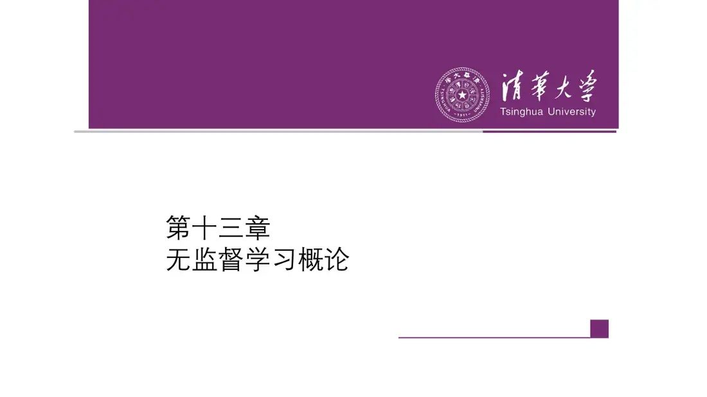

原文：

第十三章 无监督学习概论

大華津
TSINGHUA UNIVERSITY
清華大學
Tsinghua University

### 无监督学习

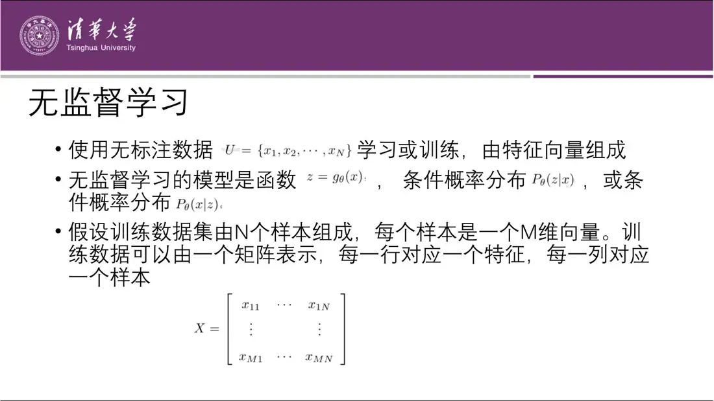

原文：

无监督学习

\- 使用无标注数据 $U = \{x_{1}, x_{2}, \dots, x_{N}\}$ 学习或训练，由特征向量组成

\- 无监督学习的模型是函数 $z = g_{\theta}(x)$ ，条件概率分布 $P_{\theta}(z|x)$ ，或条件概率分布 $P_{\theta}(x|z)$ 。

\- 假设训练数据集由N个样本组成，每个样本是一个M维向量。训练数据可以由一个矩阵表示，每一行对应一个特征，每一列对应一个样本

$$
X = \left[ \begin{array}{c c c} x _ {1 1} & \dots & x _ {1 N} \\ \vdots & & \vdots \\ x _ {M 1} & \dots & x _ {M N} \end{array} \right]
$$

Tsinghua University
清華大學

### 无监督学习

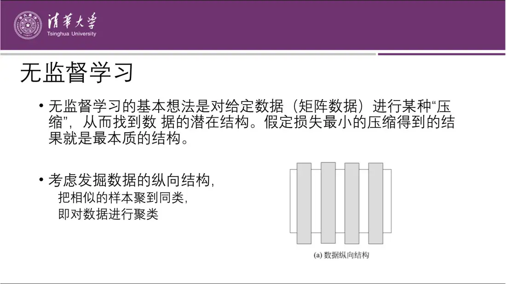

原文：

无监督学习

\- 无监督学习的基本想法是对给定数据（矩阵数据）进行某种“压缩”，从而找到数据的潜在结构。假定损失最小的压缩得到的结果就是最本质的结构。

\- 考虑发掘数据的纵向结构，把相似的样本聚到同类，即对数据进行聚类

Tsinghua University
清華大學
1911-UNIVERSITY

### 无监督学习

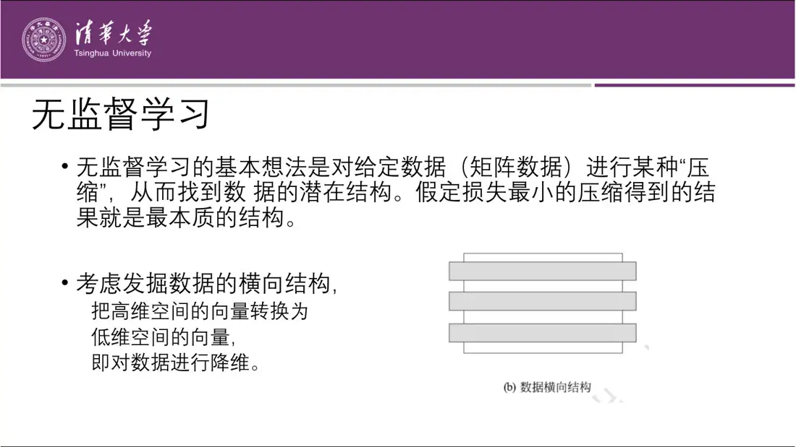

原文：

无监督学习

\- 无监督学习的基本想法是对给定数据（矩阵数据）进行某种“压缩”，从而找到数据的潜在结构。假定损失最小的压缩得到的结果就是最本质的结构。

\- 考虑发掘数据的横向结构，把高维空间的向量转换为低维空间的向量，即对数据进行降维。

(b) 数据横向结构

清華大學 Tsinghua University

### 无监督学习

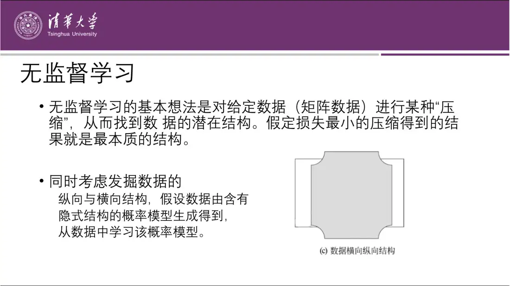

原文：

无监督学习

\- 无监督学习的基本想法是对给定数据（矩阵数据）进行某种“压缩”，从而找到数据的潜在结构。假定损失最小的压缩得到的结果就是最本质的结构。

\- 同时考虑发掘数据的
纵向与横向结构，假设数据由含有隐式结构的概率模型生成得到，从数据中学习该概率模型。

清華大學 Tsinghua University

### 聚类

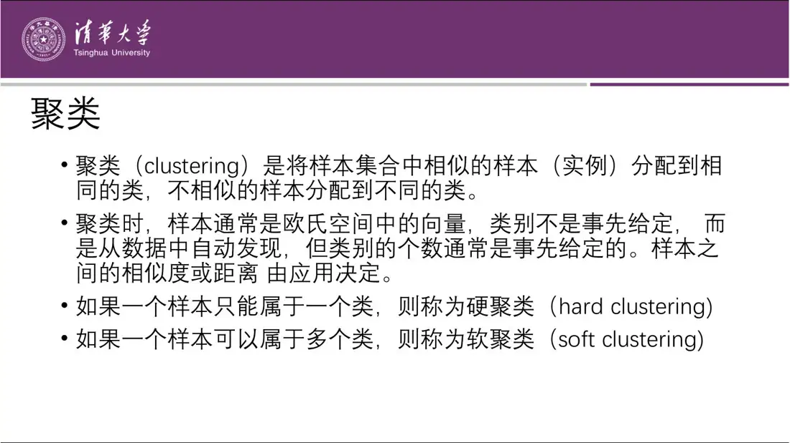

原文：

聚类

\- 聚类（clustering）是将样本集合中相似的样本（实例）分配到相同的类，不相似的样本分配到不同的类。

\- 聚类时，样本通常是欧氏空间中的向量，类别不是事先给定，而是从数据中自动发现，但类别的个数通常是事先给定的。样本之间的相似度或距离由应用决定。

\- 如果一个样本只能属于一个类，则称为硬聚类（hard clustering）

\- 如果一个样本可以属于多个类，则称为软聚类（soft clustering）

Tsinghua University
清華大學

### 聚类

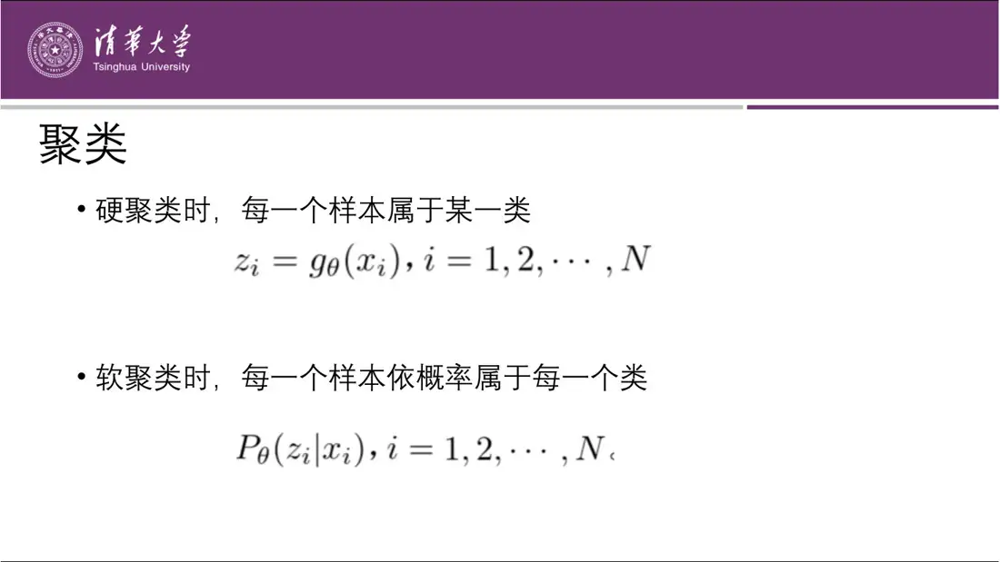

原文：

聚类

\- 硬聚类时，每一个样本属于某一类

$$
z _ {i} = g _ {\theta} (x _ {i}), i = 1, 2, \dots , N
$$

\- 软聚类时，每一个样本依概率属于每一个类

$$
P _ {\theta} (z _ {i} | x _ {i}), i = 1, 2, \dots , N.
$$

Tsinghua University
清華大學

### 降维

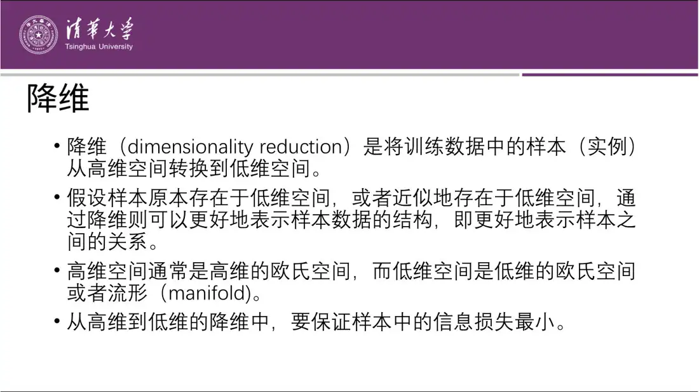

原文：

降维

\- 降维（dimensionality reduction）是将训练数据中的样本（实例）从高维空间转换到低维空间。

\- 假设样本原本存在于低维空间，或者近似地存在于低维空间，通过降维则可以更好地表示样本数据的结构，即更好地表示样本之间的关系。

\- 高维空间通常是高维的欧氏空间，而低维空间是低维的欧氏空间或者流形（manifold）。

\- 从高维到低维的降维中，要保证样本中的信息损失最小。

Tsinghua University
清華大學

### 降维

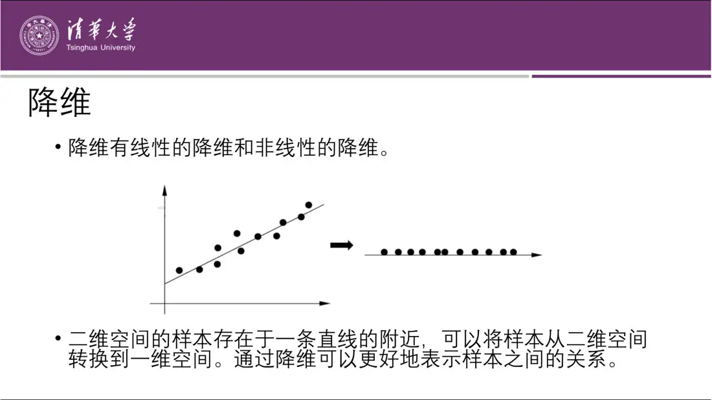

原文：

降维

\- 降维有线性的降维和非线性的降维。

\- 二维空间的样本存在于一条直线的附近，可以将样本从二维空间转换到一维空间。通过降维可以更好地表示样本之间的关系。

清華大學 Tsinghua University

### 降维

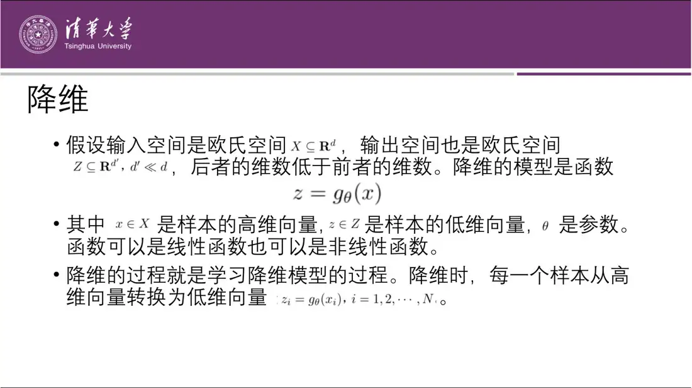

原文：

降维

\- 假设输入空间是欧氏空间 $X \subseteq \mathbf{R}^d$ ，输出空间也是欧氏空间 $Z \subseteq \mathbf{R}^{d'}$ , $d' \ll d$ ，后者的维数低于前者的维数。降维的模型是函数

$$
z = g _ {\theta} (x)
$$

\- 其中 $x \in X$ 是样本的高维向量, $z \in Z$ 是样本的低维向量, $\theta$ 是参数。函数可以是线性函数也可以是非线性函数。

\- 降维的过程就是学习降维模型的过程。降维时，每一个样本从高维向量转换为低维向量： $z_{i} = g_{\theta}(x_{i}), i = 1,2,\dots ,N$ 。

Tsinghua University
清華大學

### 概率模型估计

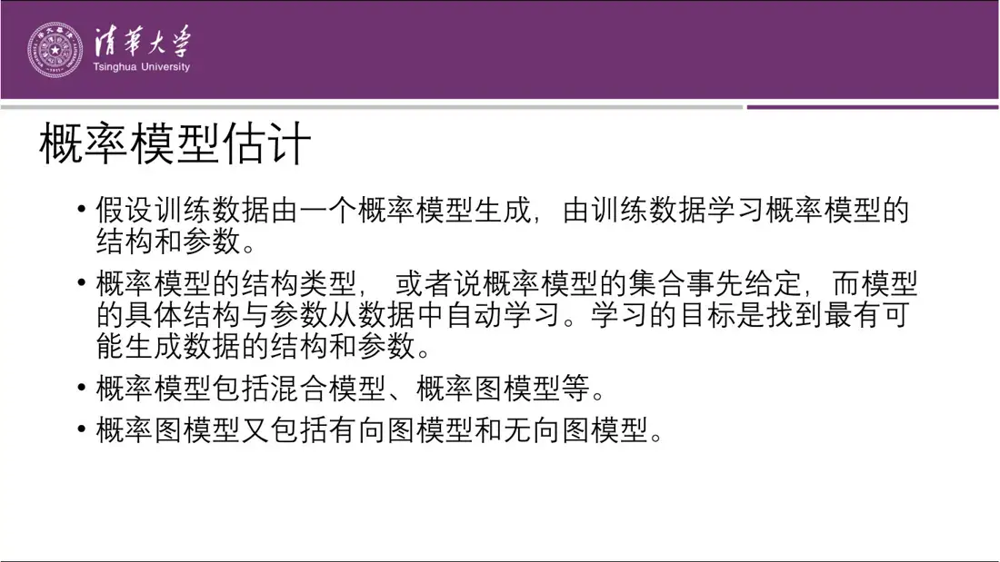

原文：

概率模型估计

\- 假设训练数据由一个概率模型生成，由训练数据学习概率模型的结构和参数。

\- 概率模型的结构类型，或者说概率模型的集合事先给定，而模型的具体结构与参数从数据中自动学习。学习的目标是找到最有可能生成数据的结构和参数。

\- 概率模型包括混合模型、概率图模型等。

\- 概率图模型又包括有向图模型和无向图模型。

Tsinghua University
清華大學

### 概率模型估计

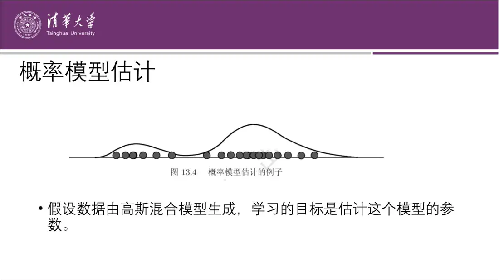

原文：

概率模型估计

\- 假设数据由高斯混合模型生成，学习的目标是估计这个模型的参数。

Tsinghua University
清華大學
TSINGHUA UNIVERSITY
1911
清華大學
TSINGHUA UNIVERSITY

### 概率模型估计

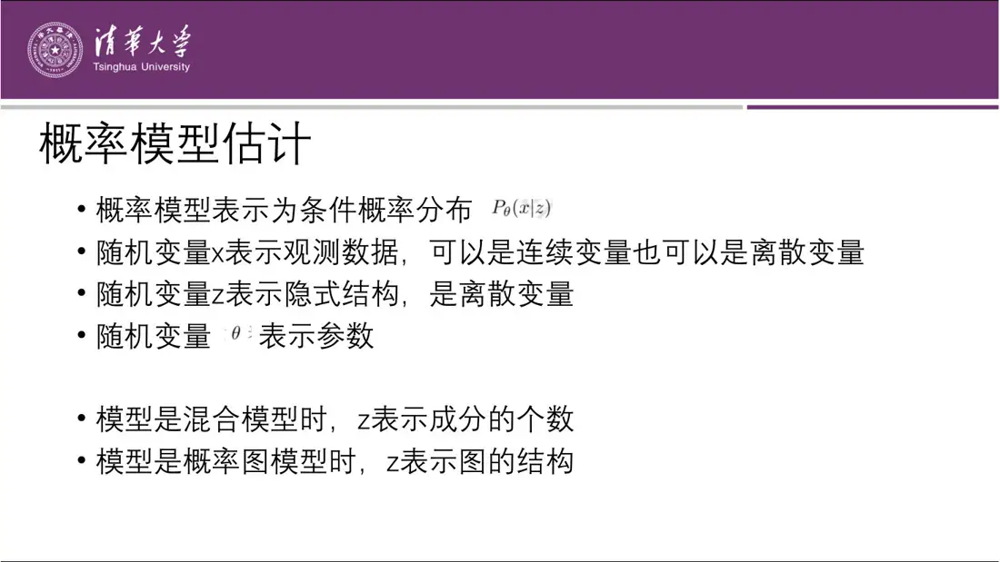

原文：

概率模型估计

\- 概率模型表示为条件概率分布 $P_{\theta}(x|z)$

\- 随机变量x表示观测数据，可以是连续变量也可以是离散变量

\- 随机变量z表示隐式结构，是离散变量

\- 随机变量 $\theta$ 表示参数

\- 模型是混合模型时，z表示成分的个数

\- 模型是概率图模型时，z表示图的结构

Tsinghua University
清華大學
1911-1911

### 概率模型估计

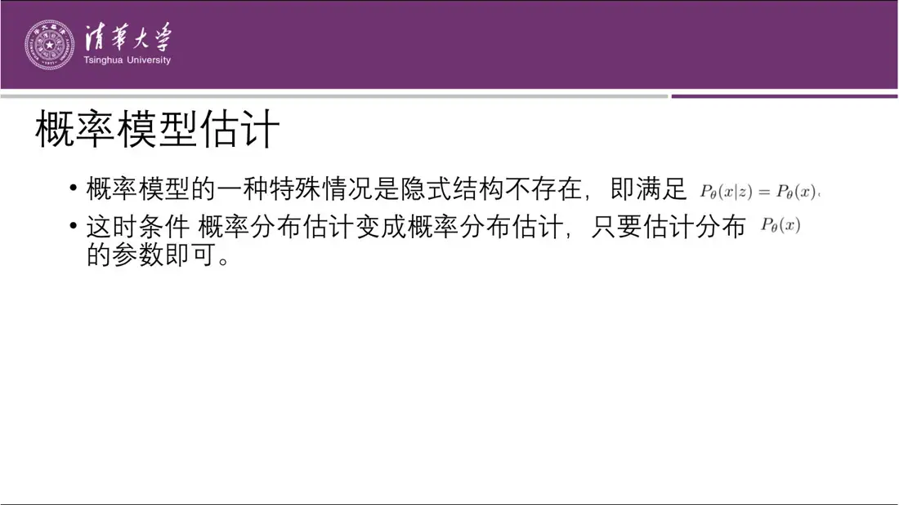

原文：

概率模型估计

\- 概率模型的一种特殊情况是隐式结构不存在，即满足 $P_{\theta}(x|z) = P_{\theta}(x)$

\- 这时条件 概率分布估计变成概率分布估计，只要估计分布的参数即可。 $P_{\theta}(x)$

Tsinghua University
清華大學

### 概率模型估计

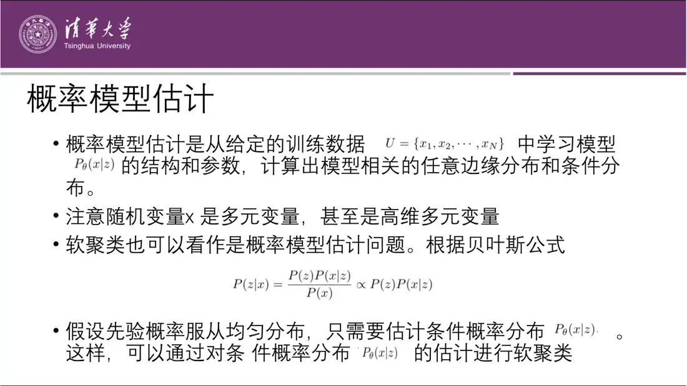

原文：

概率模型估计

\- 概率模型估计是从给定的训练数据 $U = \{x_{1}, x_{2}, \cdots, x_{N}\}$ 中学习模型 $P_{\theta}(x|z)$ 的结构和参数，计算出模型相关的任意边缘分布和条件分布。

\- 注意随机变量x是多元变量，甚至是高维多元变量

\- 软聚类也可以看作是概率模型估计问题。根据贝叶斯公式

$$
P (z | x) = \frac {P (z) P (x | z)}{P (x)} \propto P (z) P (x | z)
$$

\- 假设先验概率服从均匀分布，只需要估计条件概率分布 $P_{\theta}(x|z)$ 。这样，可以通过对条件概率分布 $P_{\theta}(x|z)$ 的估计进行软聚类

Tsinghua University
清華大學

### 无监督学习三要素

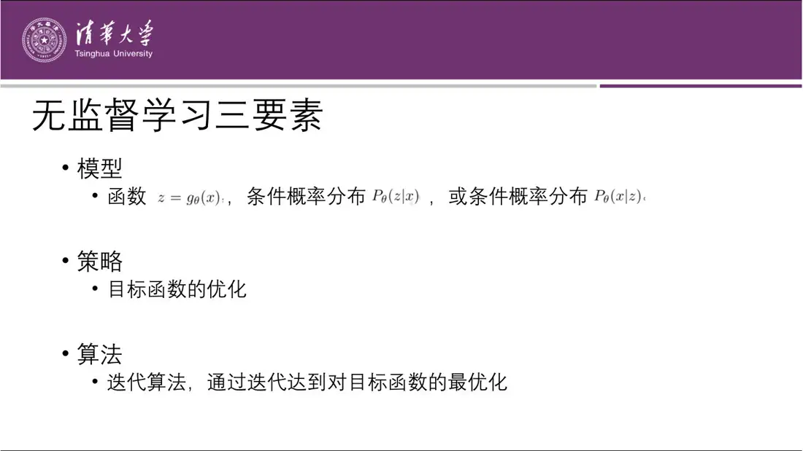

原文：

无监督学习三要素

\- 模型

\- 函数 $z = g_{\theta}(x)$ ，条件概率分布 $P_{\theta}(z|x)$ ，或条件概率分布 $P_{\theta}(x|z)$ 。

\- 策略

\- 目标函数的优化

\- 算法

\- 迭代算法，通过迭代达到对目标函数的最优化

Tsinghua University
清華大學

### 聚类

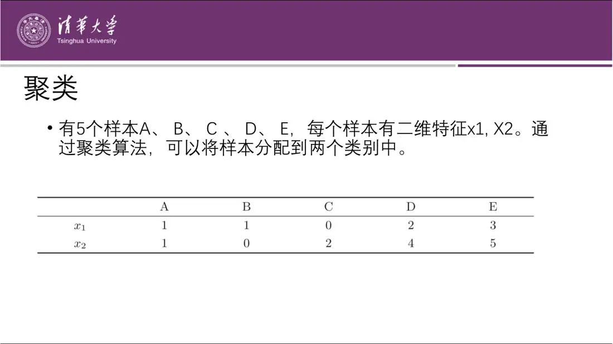

原文：

聚类

\- 有5个样本A、B、C、D、E，每个样本有二维特征x1, X2。通过聚类算法，可以将样本分配到两个类别中。

<table><tr><td></td><td>A</td><td>B</td><td>C</td><td>D</td><td>E</td></tr><tr><td> $x_{1}$ </td><td>1</td><td>1</td><td>0</td><td>2</td><td>3</td></tr><tr><td> $x_{2}$ </td><td>1</td><td>0</td><td>2</td><td>4</td><td>5</td></tr></table>

清華大學 Tsinghua University

### 聚类

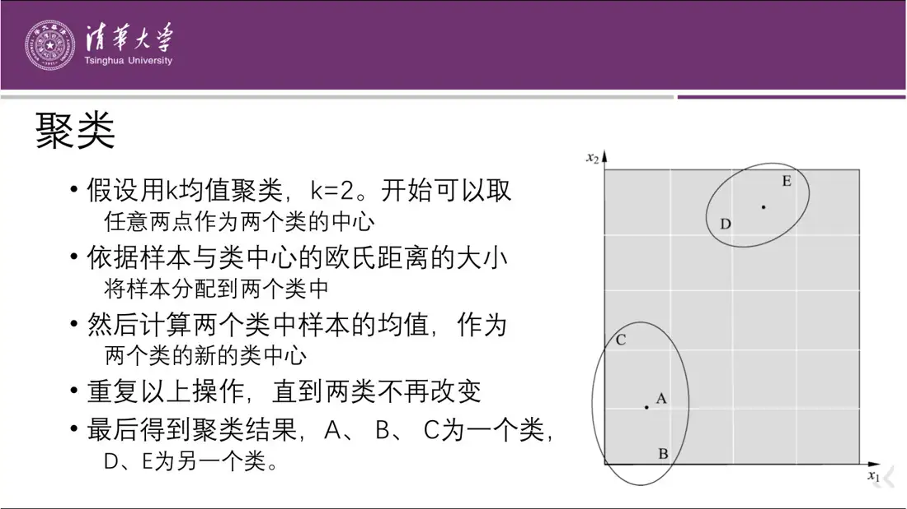

原文：

聚类

\- 假设用k均值聚类，k=2。开始可以取任意两点作为两个类的中心

\- 依据样本与类中心的欧氏距离的大小将样本分配到两个类中

\- 然后计算两个类中样本的均值，作为两个类的新的类中心

\- 重复以上操作，直到两类不再改变

\- 最后得到聚类结果，A、B、C为一个类，D、E为另一个类。

Tsinghua University
清華大學

### 降维

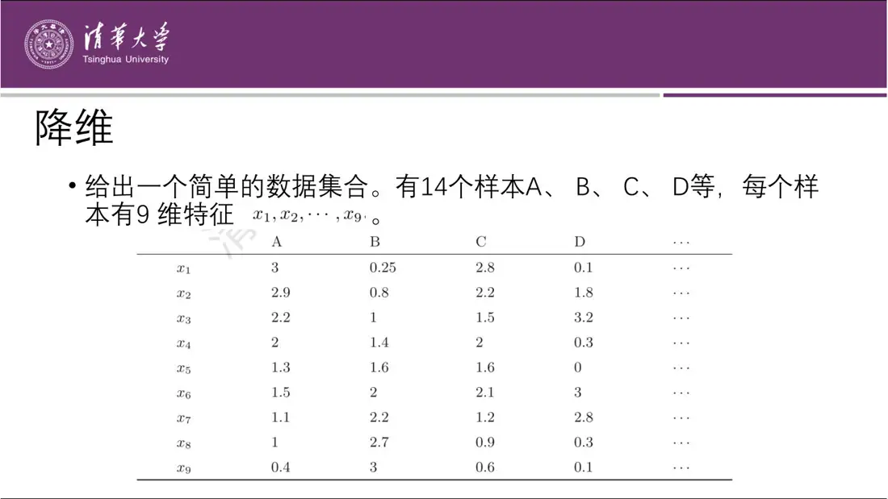

原文：

降维

\- 给出一个简单的数据集合。有14个样本A、B、C、D等，每个样本有9维特征 $x_{1}, x_{2}, \cdots, x_{9}$ 。

<table><tr><td></td><td>A</td><td>B</td><td>C</td><td>D</td><td>...</td></tr><tr><td> $x_{1}$ </td><td>3</td><td>0.25</td><td>2.8</td><td>0.1</td><td>...</td></tr><tr><td> $x_{2}$ </td><td>2.9</td><td>0.8</td><td>2.2</td><td>1.8</td><td>...</td></tr><tr><td> $x_{3}$ </td><td>2.2</td><td>1</td><td>1.5</td><td>3.2</td><td>...</td></tr><tr><td> $x_{4}$ </td><td>2</td><td>1.4</td><td>2</td><td>0.3</td><td>...</td></tr><tr><td> $x_{5}$ </td><td>1.3</td><td>1.6</td><td>1.6</td><td>0</td><td>...</td></tr><tr><td> $x_{6}$ </td><td>1.5</td><td>2</td><td>2.1</td><td>3</td><td>...</td></tr><tr><td> $x_{7}$ </td><td>1.1</td><td>2.2</td><td>1.2</td><td>2.8</td><td>...</td></tr><tr><td> $x_{8}$ </td><td>1</td><td>2.7</td><td>0.9</td><td>0.3</td><td>...</td></tr><tr><td> $x_{9}$ </td><td>0.4</td><td>3</td><td>0.6</td><td>0.1</td><td>...</td></tr></table>

清華大學 Tsinghua University

### 降维

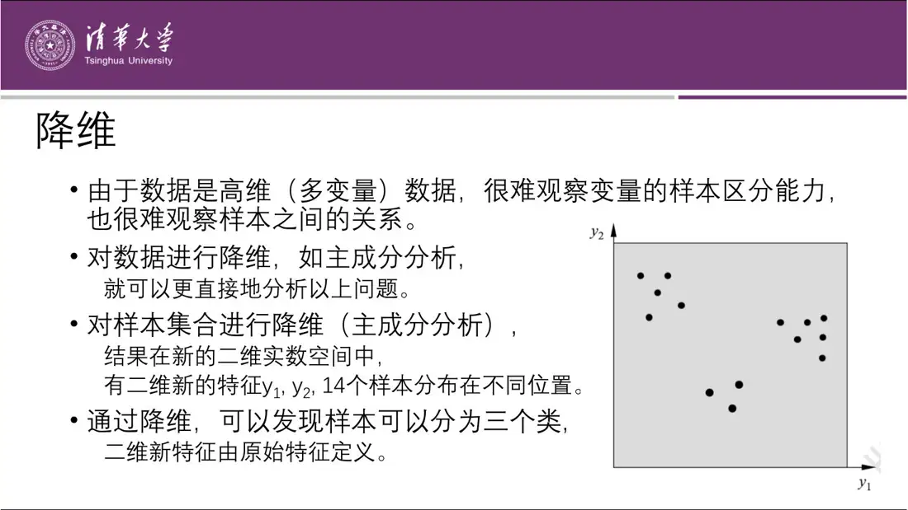

原文：

降维

\- 由于数据是高维（多变量）数据，很难观察变量的样本区分能力，也很难观察样本之间的关系。

\- 对数据进行降维，如主成分分析，就可以更直接地分析以上问题。

\- 对样本集合进行降维（主成分分析），结果在新的二维实数空间中，有二维新的特征 $y_{1}, y_{2}, 14$ 个样本分布在不同位置。

\- 通过降维，可以发现样本可以分为三个类，二维新特征由原始特征定义。

Tsinghua University
清華大學

### 话题分析

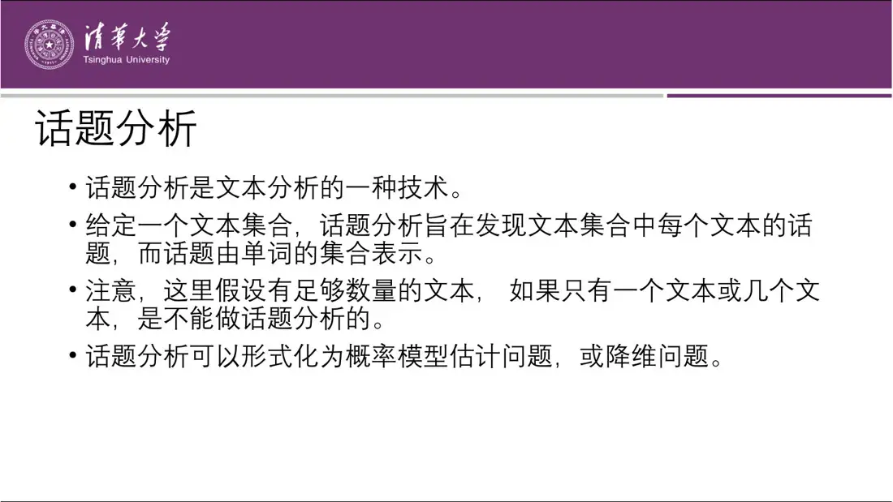

原文：

话题分析

\- 话题分析是文本分析的一种技术。

\- 给定一个文本集合，话题分析旨在发现文本集合中每个文本的话题，而话题由单词的集合表示。

\- 注意，这里假设有足够数量的文本，如果只有一个文本或几个文本，是不能做话题分析的。

\- 话题分析可以形式化为概率模型估计问题，或降维问题。

Tsinghua University
清華大學

### 话题分析

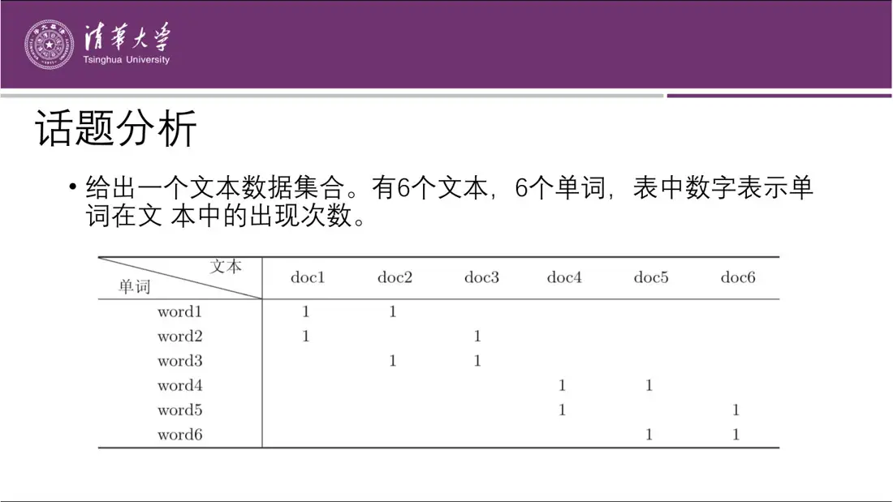

原文：

话题分析

\- 给出一个文本数据集合。有6个文本，6个单词，表中数字表示单词在文本中的出现次数。

<table><tr><td>单词\文本</td><td>doc1</td><td>doc2</td><td>doc3</td><td>doc4</td><td>doc5</td><td>doc6</td></tr><tr><td>word1</td><td>1</td><td>1</td><td></td><td></td><td></td><td></td></tr><tr><td>word2</td><td>1</td><td></td><td>1</td><td></td><td></td><td></td></tr><tr><td>word3</td><td></td><td>1</td><td>1</td><td></td><td></td><td></td></tr><tr><td>word4</td><td></td><td></td><td></td><td>1</td><td>1</td><td></td></tr><tr><td>word5</td><td></td><td></td><td></td><td>1</td><td></td><td>1</td></tr><tr><td>word6</td><td></td><td></td><td></td><td></td><td>1</td><td>1</td></tr></table>

清華大學 Tsinghua University

### 话题分析

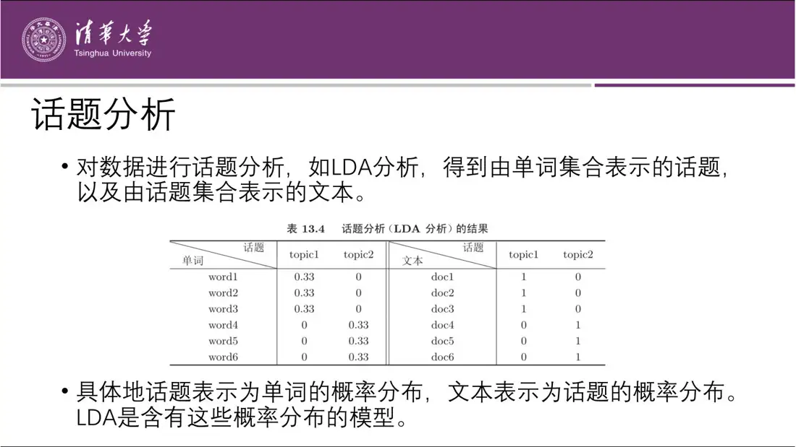

原文：

话题分析

\- 对数据进行话题分析，如LDA分析，得到由单词集合表示的话题，以及由话题集合表示的文本。

表 13.4 话题分析（LDA 分析）的结果
<table><tr><td>单词\话题</td><td>topic1</td><td>topic2</td><td>文本\话题</td><td>topic1</td><td>topic2</td></tr><tr><td>word1</td><td>0.33</td><td>0</td><td>doc1</td><td>1</td><td>0</td></tr><tr><td>word2</td><td>0.33</td><td>0</td><td>doc2</td><td>1</td><td>0</td></tr><tr><td>word3</td><td>0.33</td><td>0</td><td>doc3</td><td>1</td><td>0</td></tr><tr><td>word4</td><td>0</td><td>0.33</td><td>doc4</td><td>0</td><td>1</td></tr><tr><td>word5</td><td>0</td><td>0.33</td><td>doc5</td><td>0</td><td>1</td></tr><tr><td>word6</td><td>0</td><td>0.33</td><td>doc6</td><td>0</td><td>1</td></tr></table>

\- 具体地话题表示为单词的概率分布，文本表示为话题的概率分布。LDA是含有这些概率分布的模型。

清華大學 Tsinghua University

### 图分析

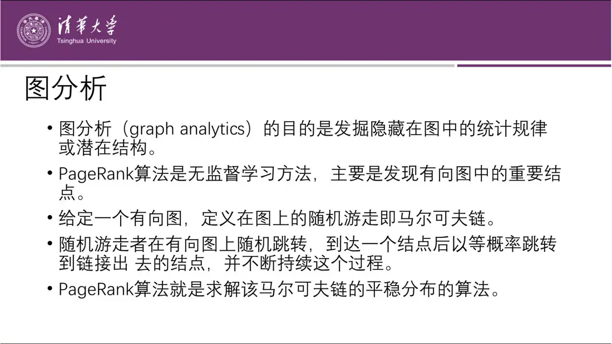

原文：

图分析

\- 图分析（graph analytics）的目的是发掘隐藏在图中的统计规律或潜在结构。

\- PageRank算法是无监督学习方法，主要是发现有向图中的重要结点。

\- 给定一个有向图，定义在图上的随机游走即马尔可夫链。

\- 随机游走者在有向图上随机跳转，到达一个结点后以等概率跳转到链接出去的结点，并不断持续这个过程。

\- PageRank算法就是求解该马尔可夫链的平稳分布的算法。

清華大學 Tsinghua University

### Page Rank

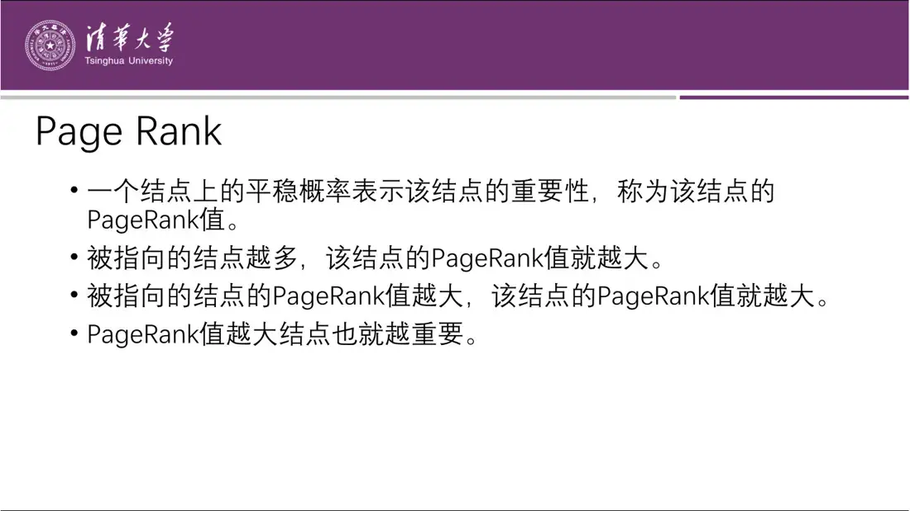

原文：

Page Rank

\- 一个结点上的平稳概率表示该结点的重要性，称为该结点的PageRank值。

\- 被指向的结点越多，该结点的PageRank值就越大。

\- 被指向的结点的PageRank值越大，该结点的PageRank值就越大。

\- PageRank值越大结点也就越重要。

清華大學 Tsinghua University

### PageRank的原理

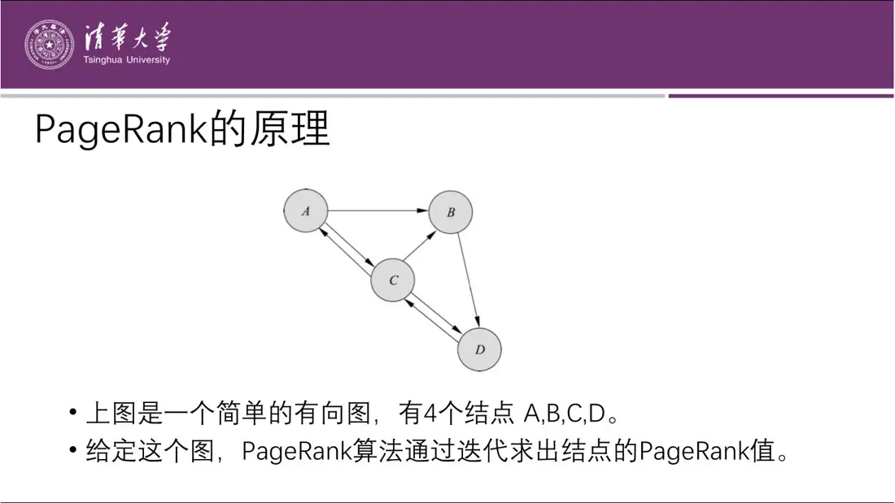

原文：

PageRank的原理

\- 上图是一个简单的有向图，有4个结点 A,B,C,D。

\- 给定这个图，PageRank算法通过迭代求出结点的PageRank值。

清華大學 Tsinghua University

### PageRank的原理

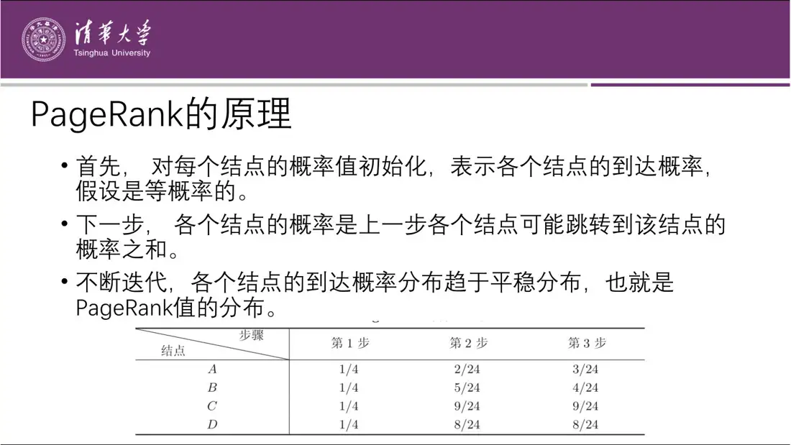

原文：

PageRank的原理

\- 首先，对每个结点的概率值初始化，表示各个结点的到达概率，假设是等概率的。

\- 下一步，各个结点的概率是上一步各个结点可能跳转到该结点的概率之和。

\- 不断迭代，各个结点的到达概率分布趋于平稳分布，也就是PageRank值的分布。

<table><tr><td>结点\步骤</td><td>第1步</td><td>第2步</td><td>第3步</td></tr><tr><td>A</td><td>1/4</td><td>2/24</td><td>3/24</td></tr><tr><td>B</td><td>1/4</td><td>5/24</td><td>4/24</td></tr><tr><td>C</td><td>1/4</td><td>9/24</td><td>9/24</td></tr><tr><td>D</td><td>1/4</td><td>8/24</td><td>8/24</td></tr></table>

Tsinghua University
清華大學
