# 《统计学习方法》第14章 聚类方法（课件）

原件的每一页，下面附识别出的文字。

### 第十四章 聚类方法

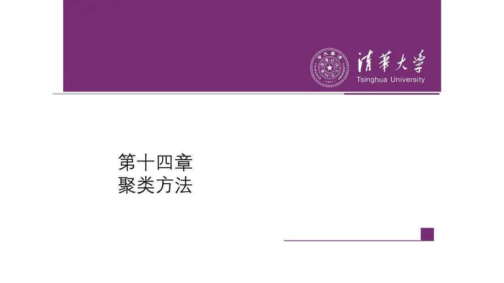

原文：

第十四章 聚类方法

大華洋
TSINGHUA UNIVERSITY
清華大學
Tsinghua University

### 相似度或距离

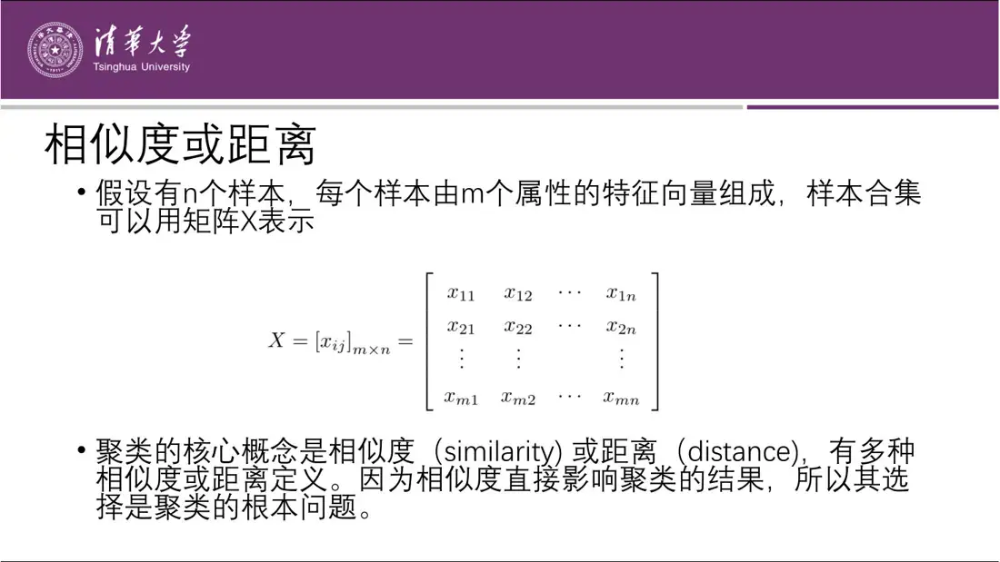

原文：

相似度或距离

\- 假设有n个样本，每个样本由m个属性的特征向量组成，样本合集可以用矩阵X表示

$$
X = [ x _ {i j} ] _ {m \times n} = \left[ \begin{array}{c c c c} x _ {1 1} & x _ {1 2} & \dots & x _ {1 n} \\ x _ {2 1} & x _ {2 2} & \dots & x _ {2 n} \\ \vdots & \vdots & & \vdots \\ x _ {m 1} & x _ {m 2} & \dots & x _ {m n} \end{array} \right]
$$

\- 聚类的核心概念是相似度（similarity）或距离（distance），有多种相似度或距离定义。因为相似度直接影响聚类的结果，所以其选择是聚类的根本问题。

清華大學 Tsinghua University

### 闵可夫斯基距离

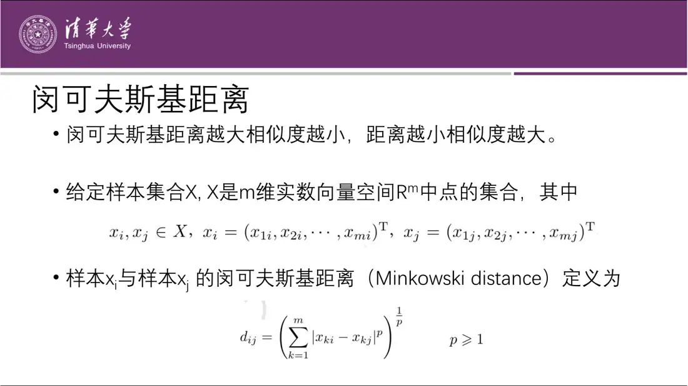

原文：

闵可夫斯基距离

\- 闵可夫斯基距离越大相似度越小，距离越小相似度越大。

\- 给定样本集合X, X是m维实数向量空间 $R^{m}$ 中点的集合，其中

$$
x _ {i}, x _ {j} \in X, x _ {i} = (x _ {1 i}, x _ {2 i}, \dots , x _ {m i}) ^ {\mathrm{T}}, x _ {j} = (x _ {1 j}, x _ {2 j}, \dots , x _ {m j}) ^ {\mathrm{T}}.
$$

\- 样本 $x_{i}$ 与样本 $x_{j}$ 的闵可夫斯基距离（Minkowski distance）定义为

$$
d _ {i j} = \left(\sum_ {k = 1} ^ {m} | x _ {k i} - x _ {k j} | ^ {p}\right) ^ {\frac {1}{p}} \qquad p \geqslant 1
$$

Tsinghua University
清華大學

### 闵可夫斯基距离

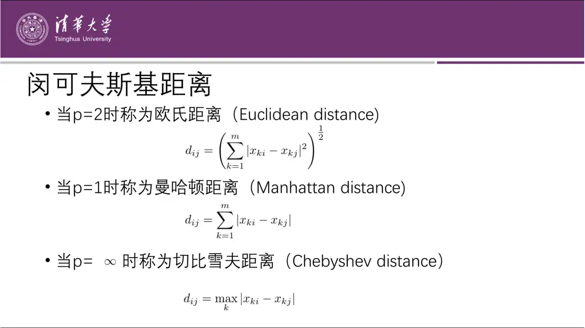

原文：

闵可夫斯基距离

\- 当 $p = 2$ 时称为欧氏距离（Euclidean distance）

$$
d _ {i j} = \left(\sum_ {k = 1} ^ {m} | x _ {k i} - x _ {k j} | ^ {2}\right) ^ {\frac {1}{2}}
$$

\- 当 $p = 1$ 时称为曼哈顿距离（Manhattan distance）

$$
d _ {i j} = \sum_ {k = 1} ^ {m} | x _ {k i} - x _ {k j} |
$$

\- 当 $p = \infty$ 时称为切比雪夫距离（Chebyshev distance）

$$
d _ {i j} = \max _ {k} | x _ {k i} - x _ {k j} |
$$

清華大學 Tsinghua University

### 马哈拉诺比斯距离

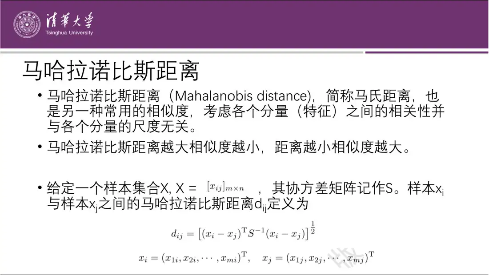

原文：

马哈拉诺比斯距离

\- 马哈拉诺比斯距离（Mahalanobis distance），简称马氏距离，也是另一种常用的相似度，考虑各个分量（特征）之间的相关性并与各个分量的尺度无关。

\- 马哈拉诺比斯距离越大相似度越小，距离越小相似度越大。

\- 给定一个样本集合 $X, X = [x_{ij}]_{m \times n}$ ，其协方差矩阵记作 $S$ 。样本 $x_{i}$ 与样本 $x_{j}$ 之间的马哈拉诺比斯距离 $d_{ij}$ 定义为

$$
d _ {i j} = \left[ (x _ {i} - x _ {j}) ^ {\mathrm{T}} S ^ {- 1} (x _ {i} - x _ {j}) \right] ^ {\frac {1}{2}}
$$

$$
x _ {i} = (x _ {1 i}, x _ {2 i}, \dots , x _ {m i}) ^ {\mathrm{T}}, \quad x _ {j} = (x _ {1 j}, x _ {2 j}, \dots , x _ {m j}) ^ {\mathrm{T}}
$$

Tsinghua University
清華大學

### 相关系数

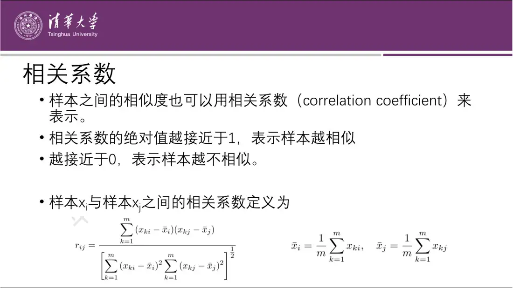

原文：

相关系数

\- 样本之间的相似度也可以用相关系数（correlation coefficient）来表示。

\- 相关系数的绝对值越接近于1，表示样本越相似

\- 越接近于0，表示样本越不相似。

\- 样本 $x_{i}$ 与样本 $x_{j}$ 之间的相关系数定义为

$$
r _ {i j} = \frac {\sum_ {k = 1} ^ {m} (x _ {k i} - \bar {x} _ {i}) (x _ {k j} - \bar {x} _ {j})}{\left[ \sum_ {k = 1} ^ {m} (x _ {k i} - \bar {x} _ {i}) ^ {2} \sum_ {k = 1} ^ {m} (x _ {k j} - \bar {x} _ {j}) ^ {2} \right] ^ {\frac {1}{2}}}
$$

$$
\bar {x} _ {i} = \frac {1}{m} \sum_ {k = 1} ^ {m} x _ {k i}, \quad \bar {x} _ {j} = \frac {1}{m} \sum_ {k = 1} ^ {m} x _ {k j}
$$

清華大學 Tsinghua University

### 夹角余弦

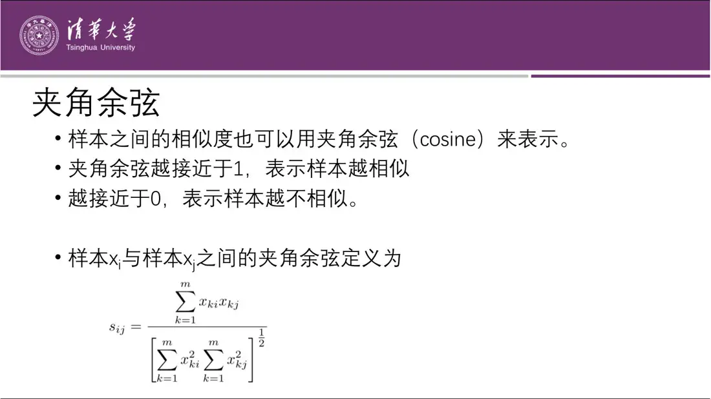

原文：

夹角余弦

\- 样本之间的相似度也可以用夹角余弦（cosine）来表示。

\- 夹角余弦越接近于1，表示样本越相似

\- 越接近于0，表示样本越不相似。

\- 样本 $x_{i}$ 与样本 $x_{j}$ 之间的夹角余弦定义为

$$
s _ {i j} = \frac {\sum_ {k = 1} ^ {m} x _ {k i} x _ {k j}}{\left[ \sum_ {k = 1} ^ {m} x _ {k i} ^ {2} \sum_ {k = 1} ^ {m} x _ {k j} ^ {2} \right] ^ {\frac {1}{2}}}
$$

清華大學 Tsinghua University

### 相似度

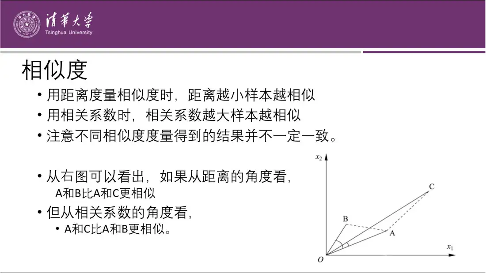

原文：

相似度

\- 用距离度量相似度时，距离越小样本越相似

\- 用相关系数时，相关系数越大样本越相似

\- 注意不同相似度度量得到的结果并不一定一致。

\- 从右图可以看出，如果从距离的角度看，A和B比A和C更相似

\- 但从相关系数的角度看，

\- A和C比A和B更相似。

Tsinghua University
清華大學
1911-

### 类或簇

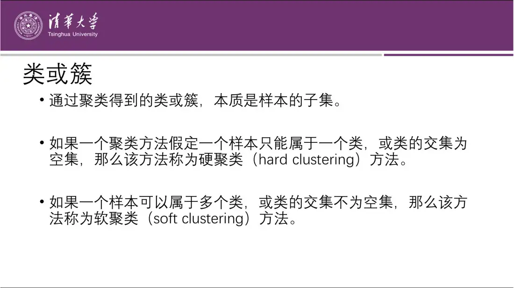

原文：

类或簇

\- 通过聚类得到的类或簇，本质是样本的子集。

\- 如果一个聚类方法假定一个样本只能属于一个类，或类的交集为空集，那么该方法称为硬聚类（hard clustering）方法。

\- 如果一个样本可以属于多个类，或类的交集不为空集，那么该方法称为软聚类（soft clustering）方法。

清華大學 Tsinghua University

### 类或簇

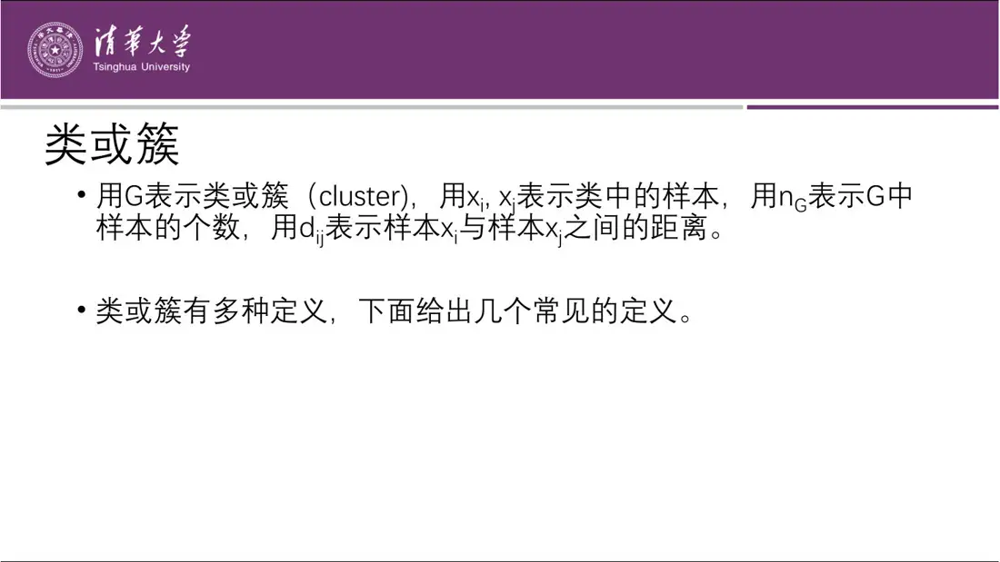

原文：

类或簇

\- 用G表示类或簇（cluster），用 $x_{i}$ ， $x_{j}$ 表示类中的样本，用 $n_{G}$ 表示G中样本的个数，用 $d_{ij}$ 表示样本 $x_{i}$ 与样本 $x_{j}$ 之间的距离。

\- 类或簇有多种定义，下面给出几个常见的定义。

Tsinghua University
清華大學

### 类或簇

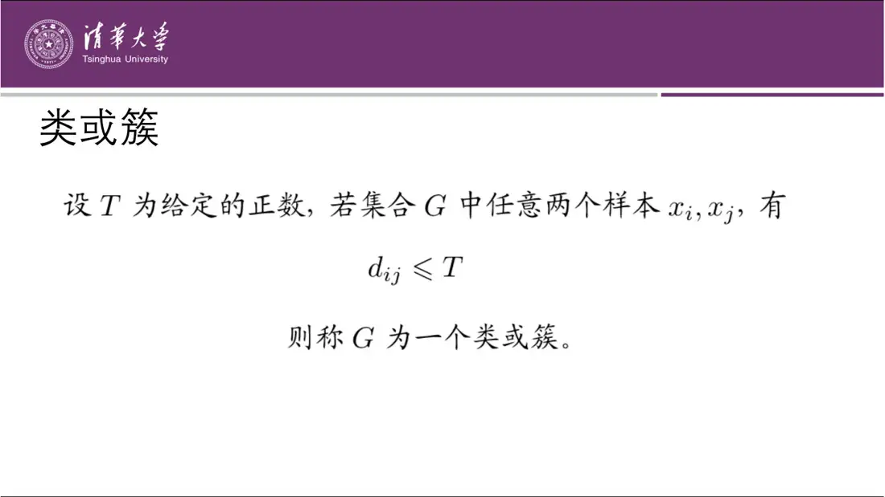

原文：

类或簇

设 $T$ 为给定的正数，若集合 $G$ 中任意两个样本 $x_{i}, x_{j}$ ，有

$$
d _ {i j} \leqslant T
$$

则称 G 为一个类或簇。

清華大學 Tsinghua University

### 类或簇

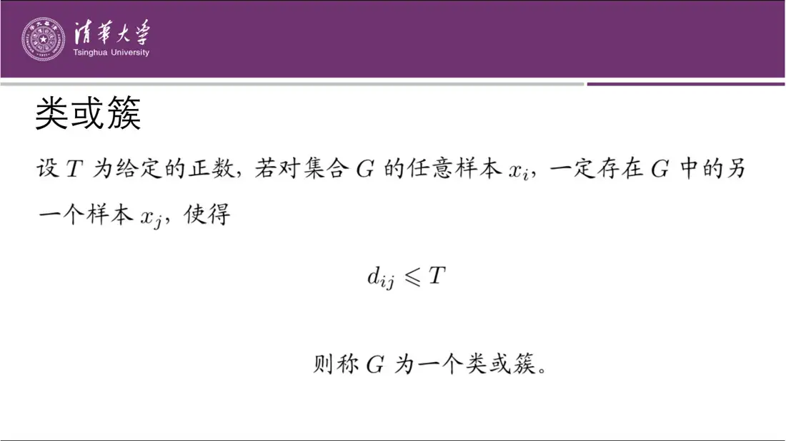

原文：

类或簇

设 $T$ 为给定的正数，若对集合 $G$ 的任意样本 $x_{i}$ ，一定存在 $G$ 中的另一个样本 $x_{j}$ ，使得

$$
d _ {i j} \leqslant T
$$

则称 G 为一个类或簇。

清華大學 Tsinghua University

### 类或簇

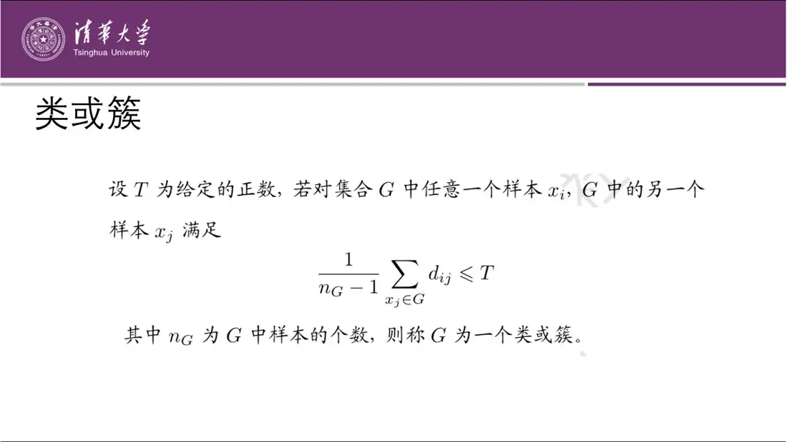

原文：

类或簇

设 T 为给定的正数，若对集合 G 中任意一个样本 $x_{i}$ ，G 中的另一个样本 $x_{j}$ 满足

$$
\frac {1}{n _ {G} - 1} \sum_ {x _ {j} \in G} d _ {i j} \leqslant T
$$

其中 $n_G$ 为 $G$ 中样本的个数，则称 $G$ 为一个类或簇。

清華大學 Tsinghua University

### 类或簇

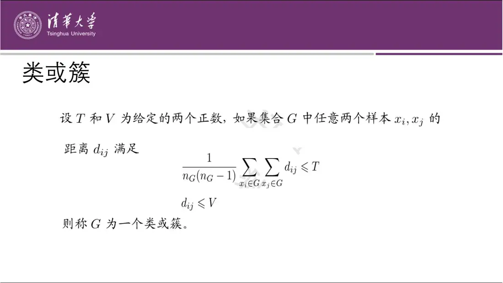

原文：

类或簇

设 T 和 V 为给定的两个正数，如果集合 G 中任意两个样本 $x_{i}, x_{j}$ 的

距离 $d_{ij}$ 满足

$$
\frac {1}{n _ {G} (n _ {G} - 1)} \sum_ {x _ {i} \in G} \sum_ {x _ {j} \in G} d _ {i j} \leqslant T
$$

$$
d _ {i j} \leqslant V
$$

则称 G 为一个类或簇。

清華大學 Tsinghua University

### 类或簇

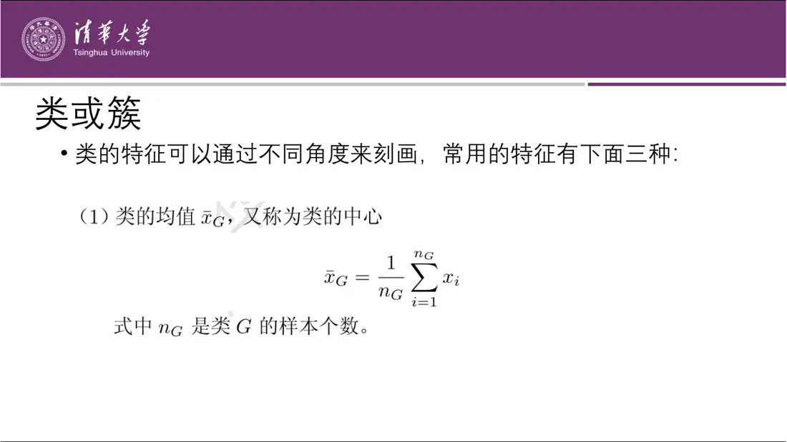

原文：

类或簇

\- 类的特征可以通过不同角度来刻画，常用的特征有下面三种：

(1) 类的均值 $\bar{x}_{G}$ ，又称为类的中心

$$
\bar {x} _ {G} = \frac {1}{n _ {G}} \sum_ {i = 1} ^ {n _ {G}} x _ {i}
$$

式中 $n_{G}$ 是类 G 的样本个数。

Tsinghua University
清華大學

### 类或簇

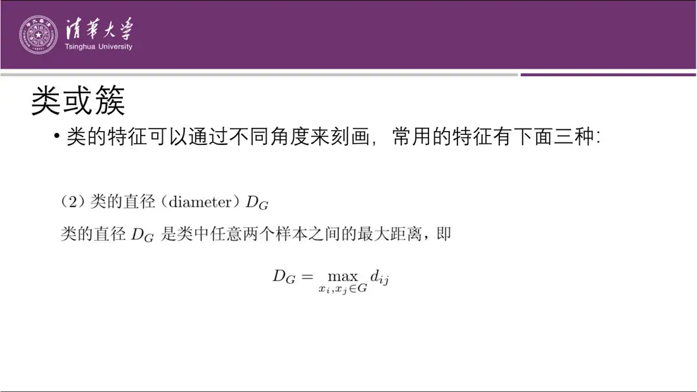

原文：

类或簇

\- 类的特征可以通过不同角度来刻画，常用的特征有下面三种：

(2) 类的直径 (diameter) $D_{G}$

类的直径 $D_{G}$ 是类中任意两个样本之间的最大距离，即

$$
D _ {G} = \max _ {x _ {i}, x _ {j} \in G} d _ {i j}
$$

Tsinghua University
清華大學

### 类或簇

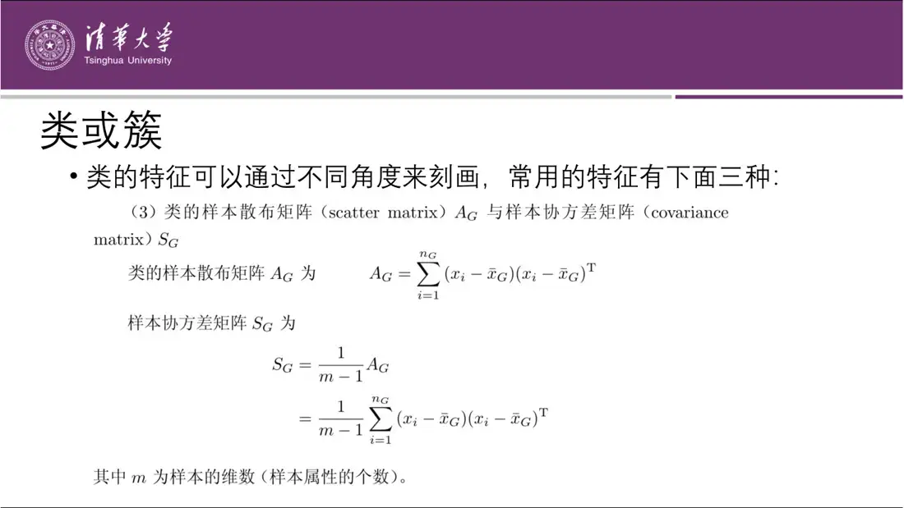

原文：

类或簇

\- 类的特征可以通过不同角度来刻画，常用的特征有下面三种：

(3) 类的样本散布矩阵（scatter matrix） $A_{G}$ 与样本协方差矩阵（covariance matrix） $S_{G}$

$$
\mathrm{类的样本散布矩阵} A _ {G} \mathrm{为} A _ {G} = \sum_ {i = 1} ^ {n _ {G}} (x _ {i} - {\bar {x}} _ {G}) (x _ {i} - {\bar {x}} _ {G}) ^ {\mathrm{T}}
$$

样本协方差矩阵 $S_{G}$ 为

$$
\begin{array}{l} S _ {G} = \frac {1}{m - 1} A _ {G} \\ = \frac {1}{m - 1} \sum_ {i = 1} ^ {n _ {G}} (x _ {i} - \bar {x} _ {G}) (x _ {i} - \bar {x} _ {G}) ^ {\mathrm{T}} \end{array}
$$

其中 m 为样本的维数（样本属性的个数）。

清華大學 Tsinghua University

### 类与类之间的距离

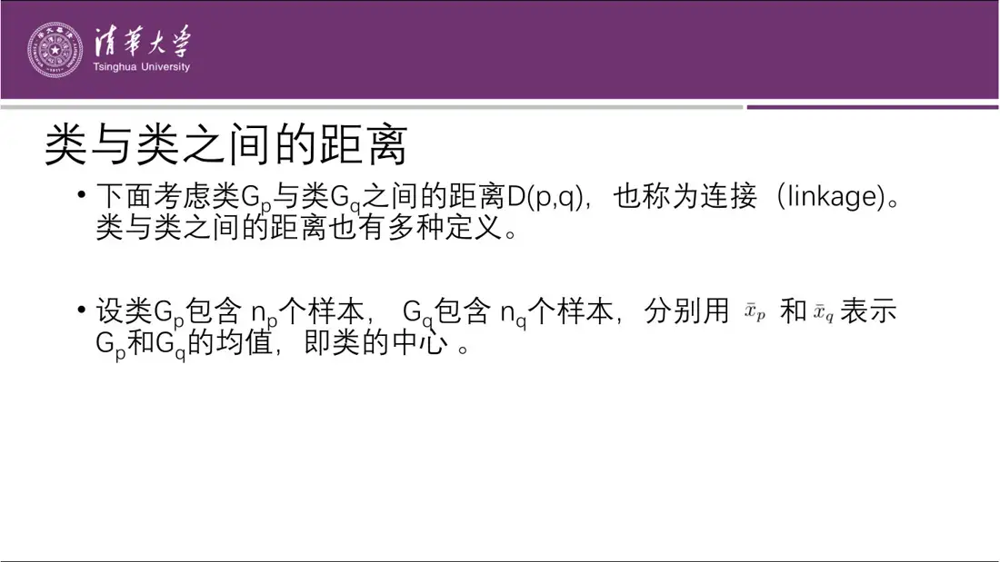

原文：

类与类之间的距离

\- 下面考虑类 $G_{p}$ 与类 $G_{q}$ 之间的距离D(p,q)，也称为连接（linkage）。类与类之间的距离也有多种定义。

\- 设类 $G_{p}$ 包含 $n_{p}$ 个样本， $G_{q}$ 包含 $n_{q}$ 个样本，分别用 $\bar{x}_{p}$ 和 $\bar{x}_{q}$ 表示 $G_{p}$ 和 $G_{q}$ 的均值，即类的中心。

Tsinghua University
清華大學

### 类与类之间的距离

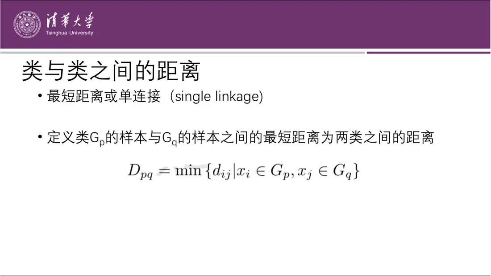

原文：

类与类之间的距离

\- 最短距离或单连接（single linkage）

\- 定义类 $G_{p}$ 的样本与 $G_{q}$ 的样本之间的最短距离为两类之间的距离

$$
D _ {p q} = \min \left\{d _ {i j} | x _ {i} \in G _ {p}, x _ {j} \in G _ {q} \right\}
$$

Tsinghua University
清華大學

### 类与类之间的距离

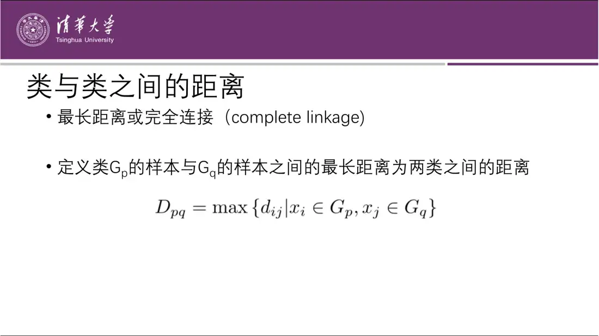

原文：

类与类之间的距离

\- 最长距离或完全连接（complete linkage）

\- 定义类 $G_{p}$ 的样本与 $G_{q}$ 的样本之间的最长距离为两类之间的距离

$$
D _ {p q} = \max \left\{d _ {i j} | x _ {i} \in G _ {p}, x _ {j} \in G _ {q} \right\}
$$

Tsinghua University
清華大學

### 类与类之间的距离

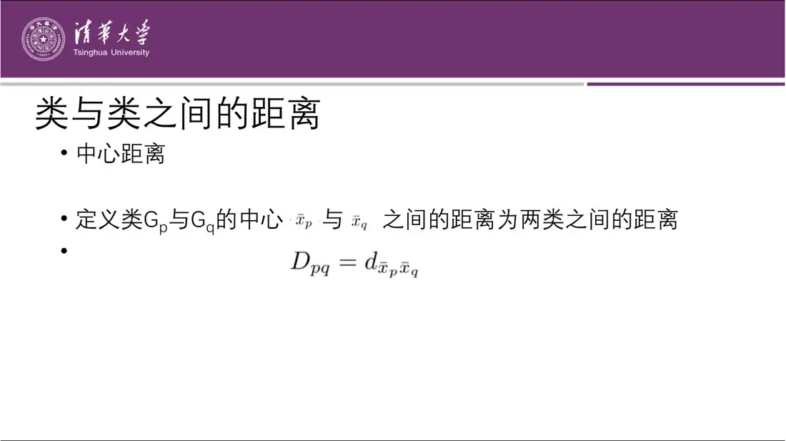

原文：

类与类之间的距离

\- 中心距离

\- 定义类 $G_{p}$ 与 $G_{q}$ 的中心 $\bar{x}_{p}$ 与 $\bar{x}_{q}$ 之间的距离为两类之间的距离

$$
D _ {p q} = d _ {\bar {x} _ {p} \bar {x} _ {q}}
$$

Tsinghua University
清華大學

### 类与类之间的距离

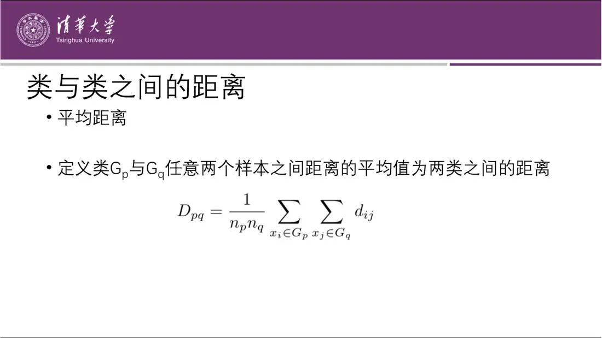

原文：

类与类之间的距离

\- 平均距离

\- 定义类 $G_{p}$ 与 $G_{q}$ 任意两个样本之间距离的平均值为两类之间的距离

$$
D _ {p q} = \frac {1}{n _ {p} n _ {q}} \sum_ {x _ {i} \in G _ {p}} \sum_ {x _ {j} \in G _ {q}} d _ {i j}
$$

Tsinghua University
清華大學

### 层次聚类

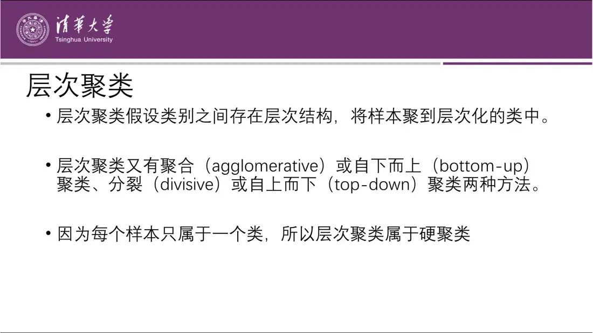

原文：

层次聚类

\- 层次聚类假设类别之间存在层次结构，将样本聚到层次化的类中。

\- 层次聚类又有聚合（agglomerative）或自下而上（bottom-up）聚类、分裂（divisive）或自上而下（top-down）聚类两种方法。

\- 因为每个样本只属于一个类，所以层次聚类属于硬聚类

清華大學 Tsinghua University

### 层次聚类

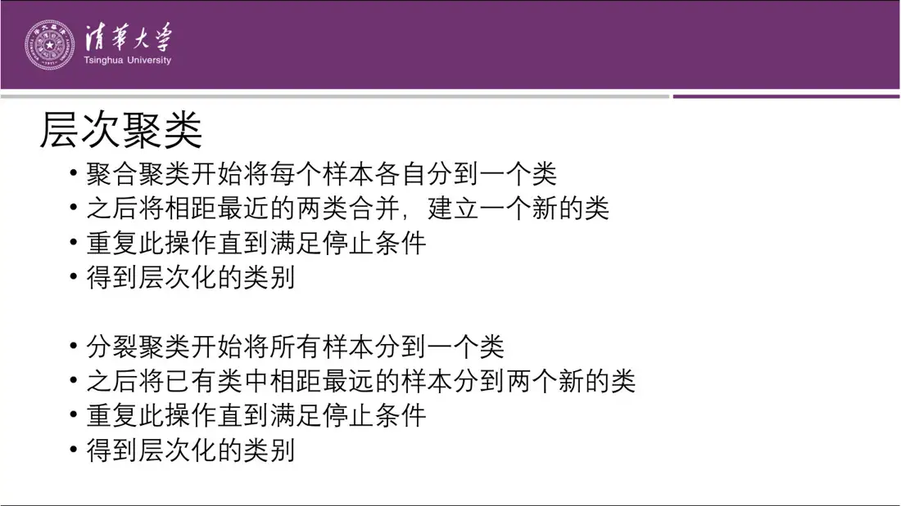

原文：

层次聚类

\- 聚合聚类开始将每个样本各自分到一个类

\- 之后将相距最近的两类合并，建立一个新的类

\- 重复此操作直到满足停止条件

\- 得到层次化的类别

\- 分裂聚类开始将所有样本分到一个类

\- 之后将已有类中相距最远的样本分到两个新的类

\- 重复此操作直到满足停止条件

\- 得到层次化的类别

Tsinghua University
清華大學
1911-

### 聚合聚类的具体过程

原文：

聚合聚类的具体过程

\- 对于给定的样本集合，开始将每个样本分到一个类

\- 然后按照一定规则，例如类间距离最小，将最满足规则条件的两个类进行合并

\- 如此反复进行，每次减少一个类，直到满足停止条件，如所有样本聚为一类。

Tsinghua University
清華大學
1911-

### 聚合聚类

原文：

聚合聚类

- 聚合聚类需要预先确定下面三个要素

\- 距离或相似度

\- 闵可夫斯基距离

\- 马哈拉诺比斯距离

\- 相关系数

\- 夹角余弦

\- 合并规则

\- 类间距离最小

\- 类间距离可以是最短距离、最长距离、中心距离、平均距离

\- 停止条件

\- 停止条件可以是类的个数达到闭值（极端情况类的个数是1）

\- 类的直径超过阈值

Tsinghua University
清華大學
1911-

### 聚合聚类算法

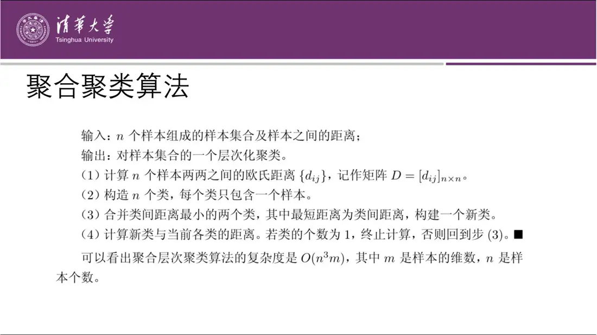

原文：

聚合聚类算法

输入：n 个样本组成的样本集合及样本之间的距离；

输出：对样本集合的一个层次化聚类。

(1) 计算 n 个样本两两之间的欧氏距离 $\{d_{ij}\}$ ，记作矩阵 $D = [d_{ij}]_{n \times n}$ 。

(2) 构造 n 个类, 每个类只包含一个样本。

(3) 合并类间距离最小的两个类, 其中最短距离为类间距离, 构建一个新类。

(4) 计算新类与当前各类的距离。若类的个数为 1，终止计算，否则回到步 (3)。■

可以看出聚合层次聚类算法的复杂度是 $O(n^{3}m)$ ，其中 m 是样本的维数，n 是样本个数。

清華大學 Tsinghua University

### \- 给定5个样本的集合，样本之间的欧氏距离由如下矩阵D表示

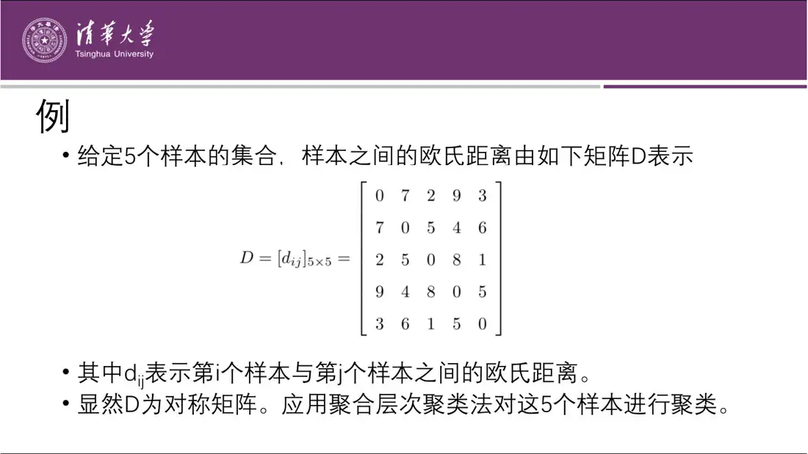

原文：

例

\- 给定5个样本的集合，样本之间的欧氏距离由如下矩阵D表示

$$
D = [ d _ {i j} ] _ {5 \times 5} = \left[ \begin{array}{l l l l l} 0 & 7 & 2 & 9 & 3 \\ 7 & 0 & 5 & 4 & 6 \\ 2 & 5 & 0 & 8 & 1 \\ 9 & 4 & 8 & 0 & 5 \\ 3 & 6 & 1 & 5 & 0 \end{array} \right]
$$

\- 其中 $d_{ij}$ 表示第i个样本与第j个样本之间的欧氏距离。

\- 显然D为对称矩阵。应用聚合层次聚类法对这5个样本进行聚类。

Tsinghua University
清華大學

### • (1)

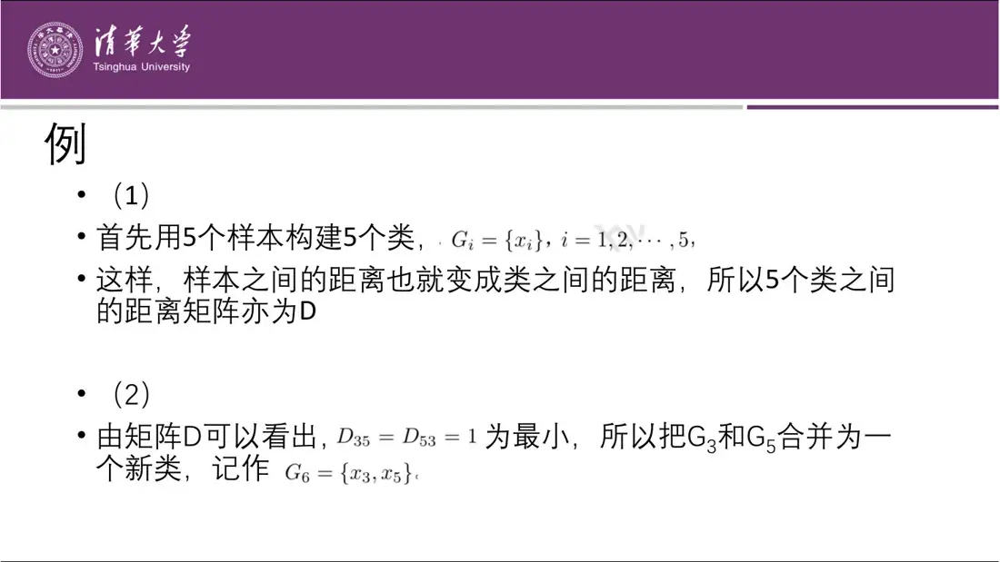

原文：

例

• (1)

\- 首先用5个样本构建5个类， $G_{i}=\{x_{i}\}, i=1,2,\cdots,5,$

\- 这样，样本之间的距离也就变成类之间的距离，所以5个类之间的距离矩阵亦为D

• (2)

\- 由矩阵D可以看出， $D_{35} = D_{53} = 1$ 为最小，所以把 $\mathsf{G}_3$ 和 $\mathsf{G}_5$ 合并为一个新类，记作 $G_6 = \{x_3, x_5\}$ 。

Tsinghua University
清華大學

### • (3)

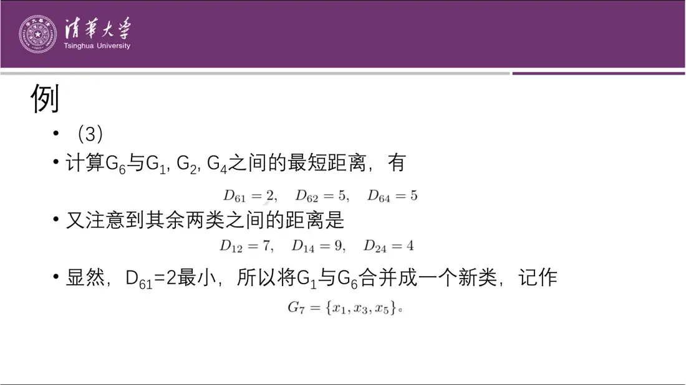

原文：

例

• (3)

\- 计算 $G_{6}$ 与 $G_{1}, G_{2}, G_{4}$ 之间的最短距离，有

$$
D _ {6 1} = 2, \quad D _ {6 2} = 5, \quad D _ {6 4} = 5
$$

\- 又注意到其余两类之间的距离是

$$
D _ {1 2} = 7, \quad D _ {1 4} = 9, \quad D _ {2 4} = 4
$$

\- 显然， $D_{61} = 2$ 最小，所以将 $G_{1}$ 与 $G_{6}$ 合并成一个新类，记作

$$
G _ {7} = \left\{x _ {1}, x _ {3}, x _ {5} \right\} 。
$$

Tsinghua University
清華大學

### • (4)

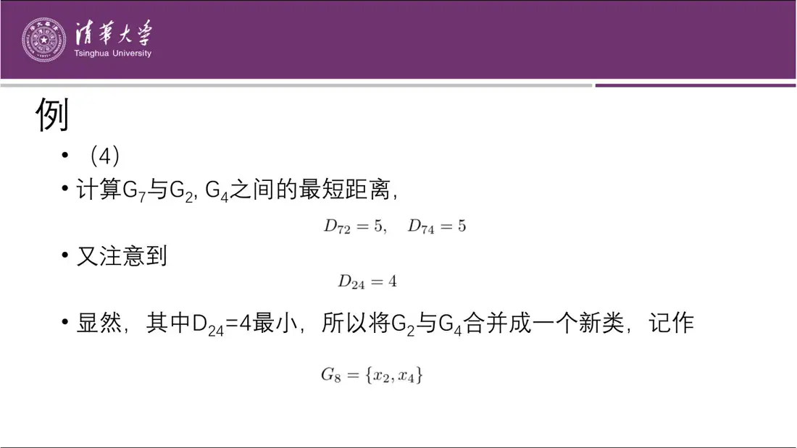

原文：

例

• (4)

\- 计算 $G_{7}$ 与 $G_{2}, G_{4}$ 之间的最短距离，

$$
D _ {7 2} = 5, \quad D _ {7 4} = 5
$$

\- 又注意到

$$
D _ {2 4} = 4
$$

\- 显然，其中 $D_{24} = 4$ 最小，所以将 $G_{2}$ 与 $G_{4}$ 合并成一个新类，记作

$$
G _ {8} = \{x _ {2}, x _ {4} \}
$$

Tsinghua University
清華大學
1911-UNIVERSITY

### • (5)

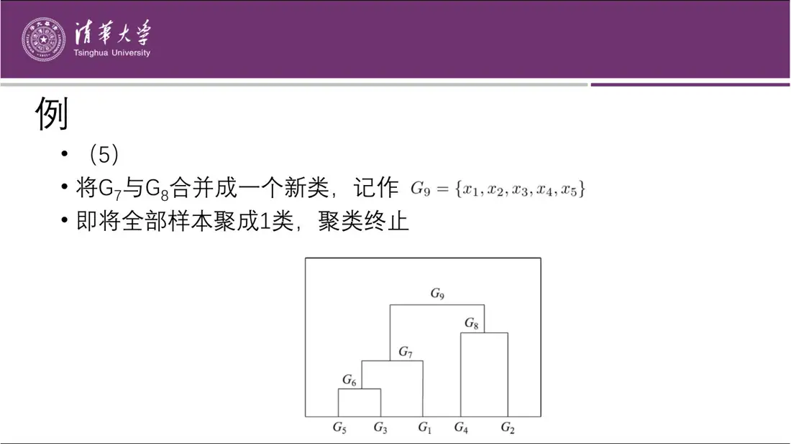

原文：

例

• (5)

\- 将 $G_{7}$ 与 $G_{8}$ 合并成一个新类，记作 $G_{9} = \{x_{1}, x_{2}, x_{3}, x_{4}, x_{5}\}$

\- 即将全部样本聚成1类，聚类终止

Tsinghua University
清華大學

### k均值聚类

原文：

k均值聚类

\- k均值聚类是基于样本集合划分的聚类算法。

\- k均值聚类将样本集合划分为k个子集，构成k个类，将n个样本分到k个类中，每个样本到其所属类的中心的距离最小。

\- 每个样本只能属于一个类，所以k均值聚类是硬聚类。

清華大學 Tsinghua University

### 模型

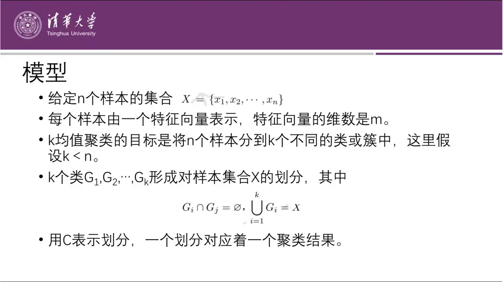

原文：

模型

\- 给定n个样本的集合 $X = \{x_{1}, x_{2}, \cdots, x_{n}\}$

\- 每个样本由一个特征向量表示，特征向量的维数是m。

\- k均值聚类的目标是将n个样本分到k个不同的类或簇中，这里假设k < n。

• k个类 $G_{1},G_{2},\cdots,G_{k}$ 形成对样本集合X的划分，其中

$$
G _ {i} \cap G _ {j} = \varnothing , \bigcup_ {i = 1} ^ {k} G _ {i} = X
$$

\- 用C表示划分，一个划分对应着一个聚类结果。

Tsinghua University
清華大學

### 模型

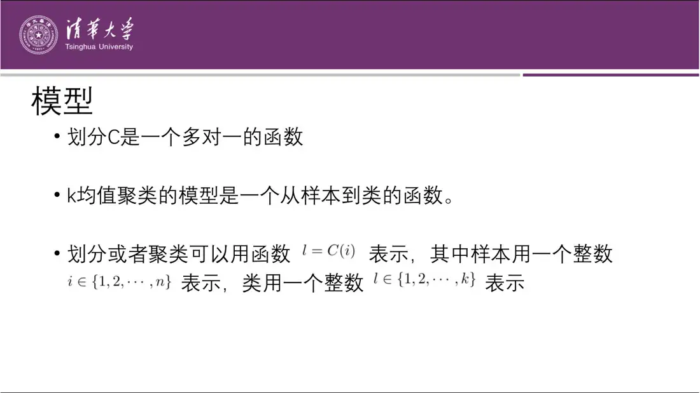

原文：

模型

\- 划分C是一个多对一的函数

\- k均值聚类的模型是一个从样本到类的函数。

\- 划分或者聚类可以用函数 $l = C(i)$ 表示，其中样本用一个整数 $i \in \{1,2,\dots,n\}$ 表示，类用一个整数 $l \in \{1,2,\dots,k\}$ 表示

Tsinghua University
清華大學

### 策略

原文：

策略

\- k均值聚类归结为样本集合X的划分，或者从样本到类的函数的选择问题。

\- k均值聚类的策略是通过损失函数的最小化选取最优的划分或函数C\*

Tsinghua University
清華大學

### 策略

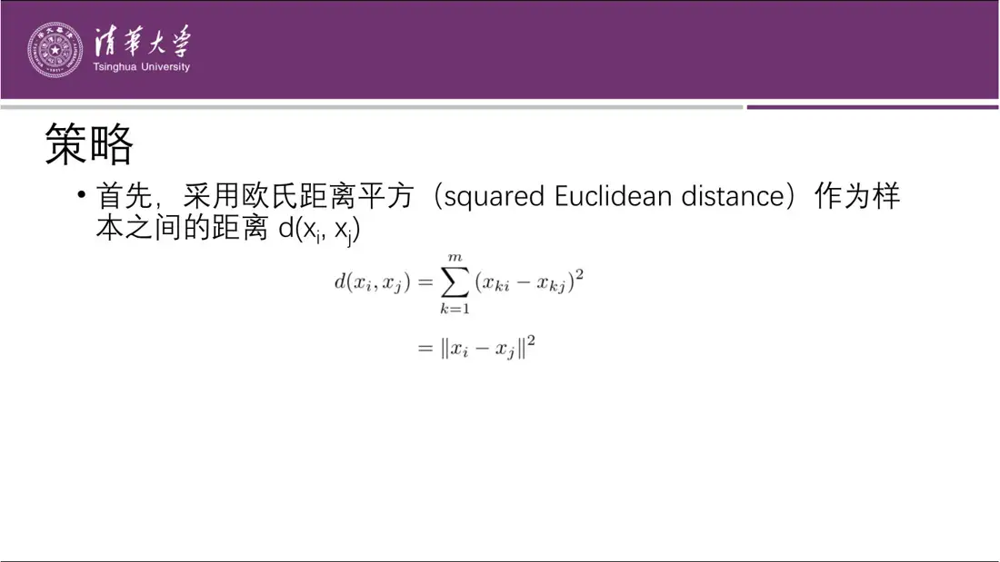

原文：

策略

\- 首先，采用欧氏距离平方（squared Euclidean distance）作为样本之间的距离 $d(x_{i}, x_{j})$

$$
\begin{array}{c} {d (x _ {i}, x _ {j}) = \sum_ {k = 1} ^ {m} (x _ {k i} - x _ {k j}) ^ {2}} \\ {= \| x _ {i} - x _ {j} \| ^ {2}} \end{array}
$$

清華大學 Tsinghua University

### 策略

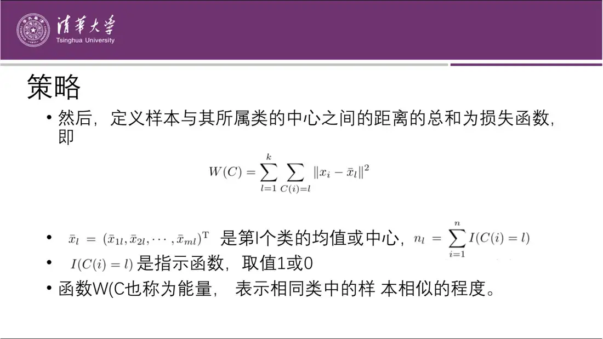

原文：

策略

\- 然后，定义样本与其所属类的中心之间的距离的总和为损失函数，即

$$
W (C) = \sum_ {l = 1} ^ {k} \sum_ {C (i) = l} \| x _ {i} - \bar {x} _ {l} \| ^ {2}
$$

• $\bar{x}_{l} = (\bar{x}_{1l}, \bar{x}_{2l}, \cdots, \bar{x}_{ml})^{\mathrm{T}}$ 是第1个类的均值或中心， $n_{l} = \sum_{i=1}^{n} I(C(i) = l)$

\- $I(C(i) = l)$ 是指示函数，取值1或0

\- 函数W(C也称为能量，表示相同类中的样本相似的程度。

Tsinghua University
清華大學

### 策略

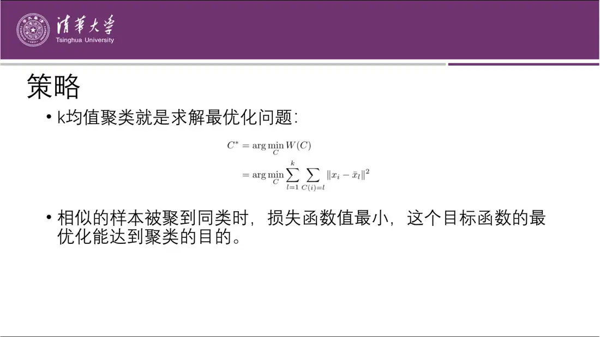

原文：

策略

\- k均值聚类就是求解最优化问题:

$$
\begin{array}{l} C ^ {*} = \arg \min _ {C} W (C) \\ = \arg \min _ {C} \sum_ {l = 1} ^ {k} \sum_ {C (i) = l} \| x _ {i} - \bar {x} _ {l} \| ^ {2} \end{array}
$$

\- 相似的样本被聚到同类时，损失函数值最小，这个目标函数的最优化能达到聚类的目的。

Tsinghua University
清華大學

### 策略

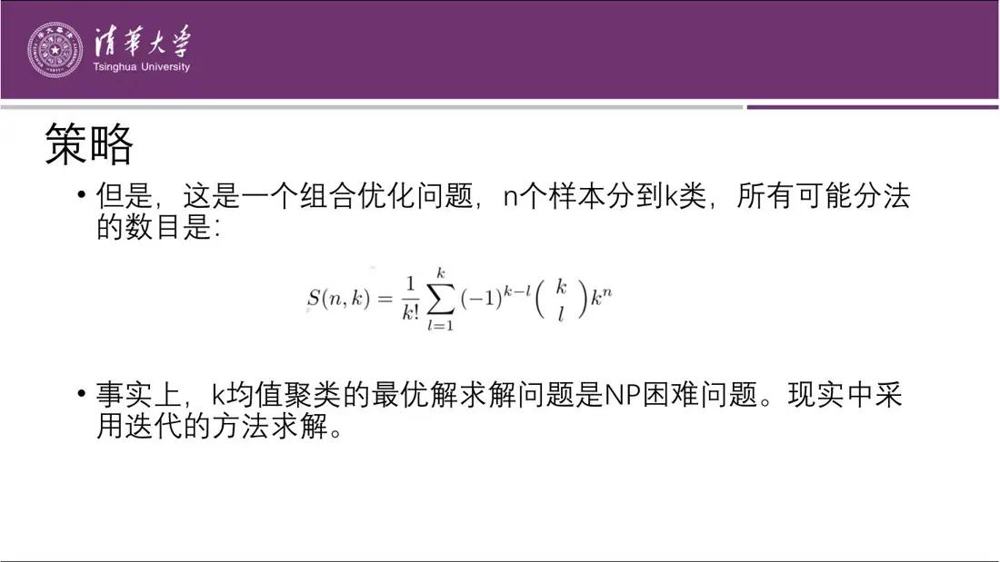

原文：

策略

\- 但是，这是一个组合优化问题，n个样本分到k类，所有可能分法的数目是：

$$
S (n, k) = \frac {1}{k !} \sum_ {l = 1} ^ {k} (- 1) ^ {k - l} \left( \begin{array}{l} k \\ l \end{array} \right) k ^ {n}
$$

\- 事实上，k均值聚类的最优解求解问题是NP困难问题。现实中采用迭代的方法求解。

清華大學 Tsinghua University

### 算法

原文：

算法

\- k均值聚类的算法是一个迭代的过程，每次迭代包括两个步骤。

\- 首先选择k个类的中心，将样本逐个指派到与其最近的中心的类中，得到一个聚类结果

\- 然后更新每个类的样本的均值，作为类的新的中心

\- 重复以上步骤，直到收敛为止。

Tsinghua University
清華大學

### 算法

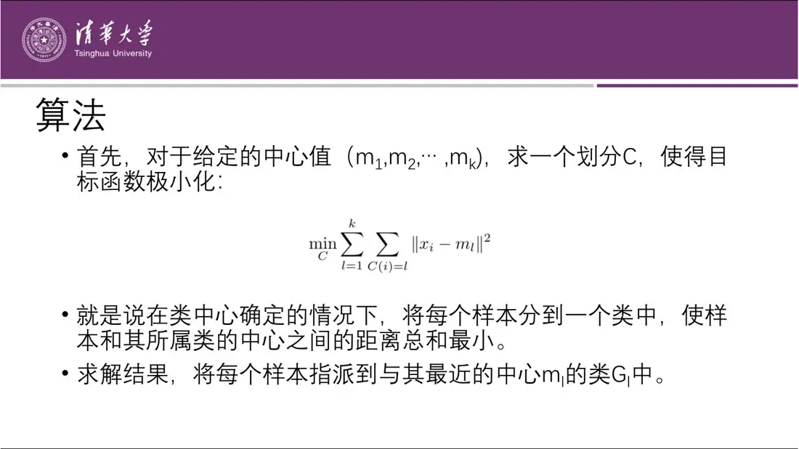

原文：

算法

\- 首先，对于给定的中心值 $(m_{1}, m_{2}, \cdots, m_{k})$ ，求一个划分C，使得目标函数极小化：

$$
\min _ {C} \sum_ {l = 1} ^ {k} \sum_ {C (i) = l} \| x _ {i} - m _ {l} \| ^ {2}
$$

\- 就是说在类中心确定的情况下，将每个样本分到一个类中，使样本和其所属类的中心之间的距离总和最小。

\- 求解结果，将每个样本指派到与其最近的中心 $m_{1}$ 的类 $G_{1}$ 中。

清華大學 Tsinghua University

### 算法

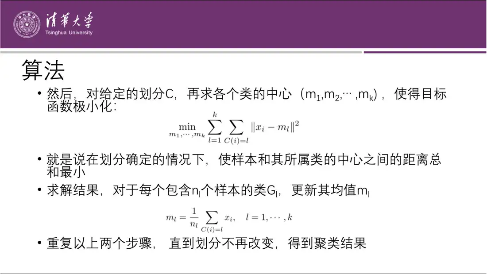

原文：

算法

\- 然后，对给定的划分C，再求各个类的中心（ $m_1, m_2, \cdots, m_k$ ），使得目标函数极小化：

$$
\min _ {m _ {1}, \dots , m _ {k}} \sum_ {l = 1} ^ {k} \sum_ {C (i) = l} \| x _ {i} - m _ {l} \| ^ {2}
$$

\- 就是说在划分确定的情况下，使样本和其所属类的中心之间的距离总和最小

\- 求解结果，对于每个包含 $n_{1}$ 个样本的类 $G_{1}$ ，更新其均值 $m_{1}$

$$
m _ {l} = \frac {1}{n _ {l}} \sum_ {C (i) = l} x _ {i}, \quad l = 1, \dots , k
$$

\- 重复以上两个步骤，直到划分不再改变，得到聚类结果

Tsinghua University
清華大學

### k均值聚类算法

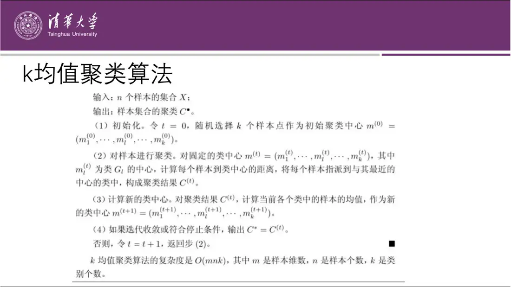

原文：

k均值聚类算法

输入： $n$ 个样本的集合 $X$

输出：样本集合的聚类 $C^{\bullet}$ 。

（1）初始化。令 t = 0，随机选择 k 个样本点作为初始聚类中心 $m^{(0)} = (m_{1}^{(0)}, \cdots, m_{l}^{(0)}, \cdots, m_{k}^{(0)})$ 。

(2) 对样本进行聚类。对固定的类中心 $m^{(t)} = (m_{1}^{(t)}, \cdots, m_{l}^{(t)}, \cdots, m_{k}^{(t)})$ ，其中 $m_{l}^{(t)}$ 为类 $G_{l}$ 的中心，计算每个样本到类中心的距离，将每个样本指派到与其最近的中心的类中，构成聚类结果 $C^{(t)}$ 。

(3) 计算新的类中心。对聚类结果 $C^{(t)}$ , 计算当前各个类中的样本的均值, 作为新的类中心 $m^{(t+1)} = (m_1^{(t+1)}, \cdots, m_l^{(t+1)}, \cdots, m_k^{(t+1)})$ 。

(4) 如果迭代收敛或符合停止条件，输出 $C^{*} = C^{(t)}$ 。

否则，令 $t = t + 1$ ，返回步 (2)。

$k$ 均值聚类算法的复杂度是 $O(mnk)$ , 其中 $m$ 是样本维数, $n$ 是样本个数, $k$ 是类别个数。

Tsinghua University
清華大學

### \- 给定含有5个样本的集合

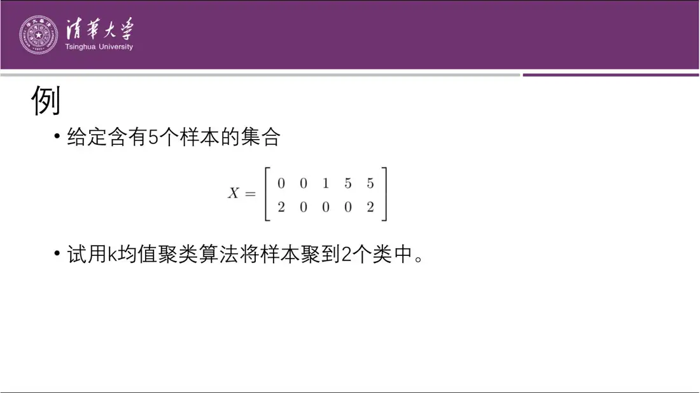

原文：

例

\- 给定含有5个样本的集合

$$
X = \left[ \begin{array}{l l l l l} 0 & 0 & 1 & 5 & 5 \\ 2 & 0 & 0 & 0 & 2 \end{array} \right]
$$

\- 试用k均值聚类算法将样本聚到2个类中。

Tsinghua University
清華大學

### Tsinghua University

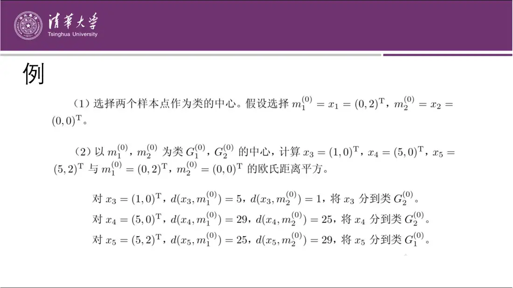

原文：

例

（1）选择两个样本点作为类的中心。假设选择 $m_1^{(0)} = x_1 = (0,2)^{\mathrm{T}}$ ， $m_2^{(0)} = x_2 = (0,0)^{\mathrm{T}}$ 。

(2) 以 $m_{1}^{(0)}, m_{2}^{(0)}$ 为类 $G_{1}^{(0)}, G_{2}^{(0)}$ 的中心，计算 $x_{3} = (1,0)^{\mathrm{T}}$ ， $x_{4} = (5,0)^{\mathrm{T}}$ ， $x_{5} = (5,2)^{\mathrm{T}}$ 与 $m_{1}^{(0)} = (0,2)^{\mathrm{T}}$ ， $m_{2}^{(0)} = (0,0)^{\mathrm{T}}$ 的欧氏距离平方。

对 $x_{3} = (1,0)^{\mathrm{T}}$ ， $d(x_{3},m_{1}^{(0)}) = 5$ ， $d(x_{3},m_{2}^{(0)}) = 1$ ，将 $x_{3}$ 分到类 $G_2^{(0)}$ 。

对 $x_{4} = (5,0)^{\mathrm{T}}$ ， $d(x_4,m_1^{(0)}) = 29$ ， $d(x_4,m_2^{(0)}) = 25$ ，将 $x_{4}$ 分到类 $G_{2}^{(0)}$ 。

对 $x_{5} = (5,2)^{\mathrm{T}}$ ， $d(x_{5},m_{1}^{(0)}) = 25$ ， $d(x_{5},m_{2}^{(0)}) = 29$ ，将 $x_{5}$ 分到类 $G_{1}^{(0)}$ 。

Tsinghua University
清華大學

### $$

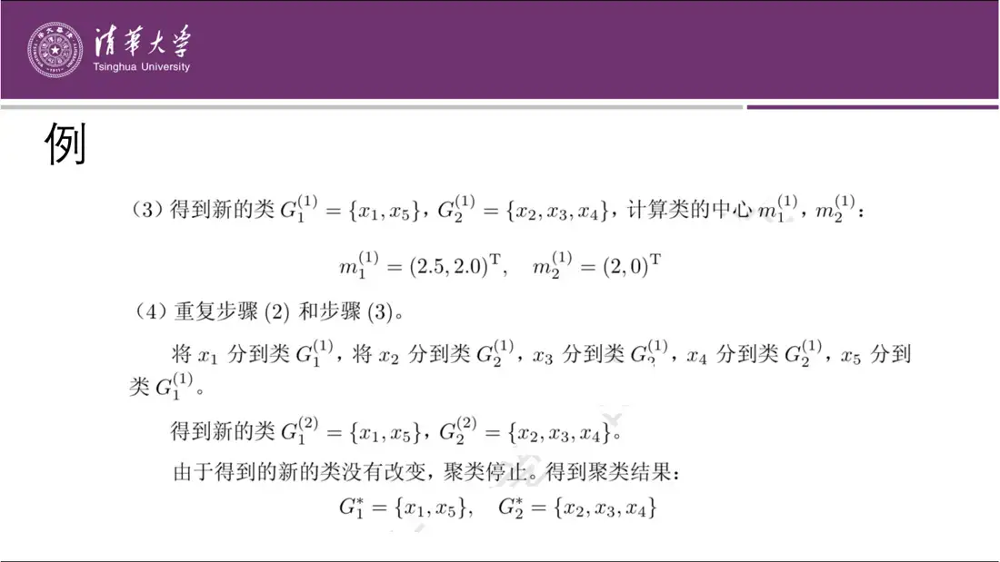

原文：

例

(3) 得到新的类 $G_{1}^{(1)} = \{x_{1}, x_{5}\}$ , $G_{2}^{(1)} = \{x_{2}, x_{3}, x_{4}\}$ , 计算类的中心 $m_{1}^{(1)}, m_{2}^{(1)}$ :

$$
m _ {1} ^ {(1)} = (2. 5, 2. 0) ^ {\mathrm{T}}, \quad m _ {2} ^ {(1)} = (2, 0) ^ {\mathrm{T}}
$$

(4) 重复步骤 (2) 和步骤 (3)。

将 $x_{1}$ 分到类 $G_{1}^{(1)}$ ，将 $x_{2}$ 分到类 $G_{2}^{(1)}$ ， $x_{3}$ 分到类 $G_{2}^{(1)}$ ， $x_{4}$ 分到类 $G_{2}^{(1)}$ ， $x_{5}$ 分到类 $G_{1}^{(1)}$ 。

得到新的类 $G_{1}^{(2)}=\{x_{1},x_{5}\}, G_{2}^{(2)}=\{x_{2},x_{3},x_{4}\}$ 。

由于得到的新的类没有改变，聚类停止。得到聚类结果：

$$
G _ {1} ^ {*} = \{x _ {1}, x _ {5} \}, \quad G _ {2} ^ {*} = \{x _ {2}, x _ {3}, x _ {4} \}
$$

Tsinghua University
清華大學

### 算法特性

原文：

算法特性

\- 总体特点

\- 基于划分的聚类方法

\- 类别数k事先指定

\- 以欧氏距离平方表示样本之间的距离，以中心或样本的均值表示类别

\- 以样本和其所属类的中心之间的距离的总和为最优化的目标函数

\- 得到的类别是平坦的、非层次化的

\- 算法是迭代算法，不能保证得到全局最优。

Tsinghua University
清華大學
1911-1911

### 算法特性

原文：

算法特性

\- 收敛性

\- k均值聚类属于启发式方法，不能保证收敛到全局最优，初始中心的选择会直接影响聚类结果。

\- 注意，类中心在聚类的过程中会发生移动，但是往往不会移动太大，因为在每一步，样本被分到与其最近的中心的类中。

清華大學 Tsinghua University

### 算法特性

原文：

算法特性

\- 初始类的选择

\- 选择不同的初始中心，会得到不同的聚类结果。

\- 初始中心的选择，比如可以用层次聚类对样本进行聚类，得到k个类时停止。然后从每个类中选取一个与中心距离最近的点。

Tsinghua University
清華大學
1911-

### 算法特性

原文：

算法特性

\- 类别数k的选择

\- k均值聚类中的类别数k值需要预先指定，而在实际应用中最优的k值是不知道的。

\- 尝试用不同的k值聚类，检验得到聚类结果的质量，推测最优的k值。

\- 聚类结果的质量可以用类的平均直径来衡量。

\- 一般地，类别数变小时，平均直径会增加

\- 类别数变大超过某个值以后，平均直径会不变，而这个值正是最优的k值。实验时，可以采用二分查找，快速找到最优的k值。

Tsinghua University
清華大學
1911-1911

### 算法特性

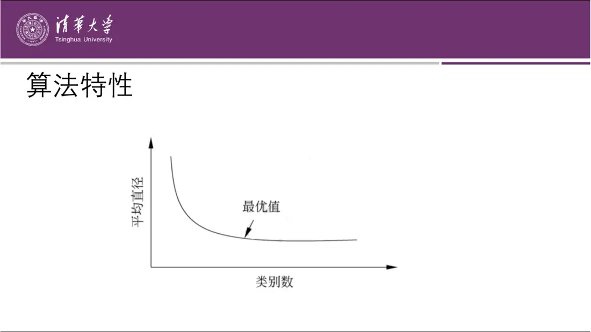

原文：

算法特性

清華大學 Tsinghua University
