# 《统计学习方法》第15章 奇异值分解（课件）

原件的每一页，下面附识别出的文字。

### 第十五章 奇异值分解

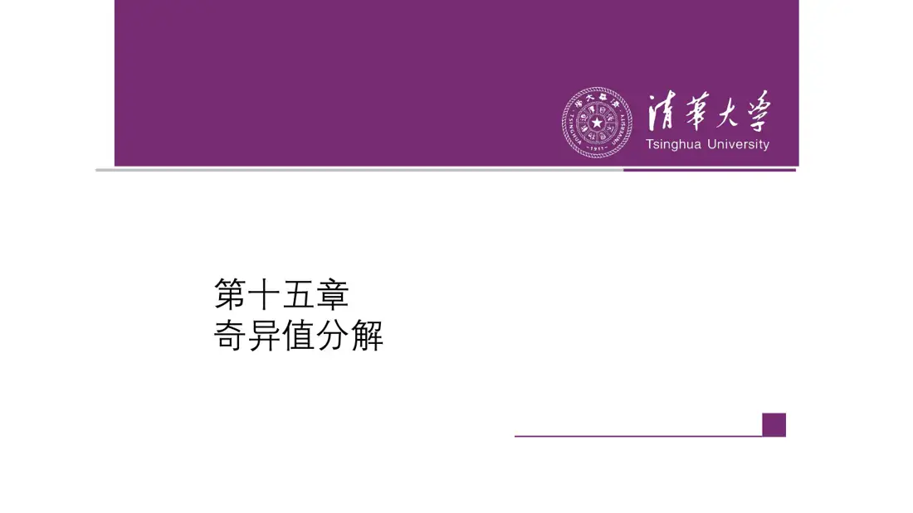

原文：

第十五章 奇异值分解

大華洋
TSINGHUA UNIVERSITY
清華大學
Tsinghua University

### 定义与定理

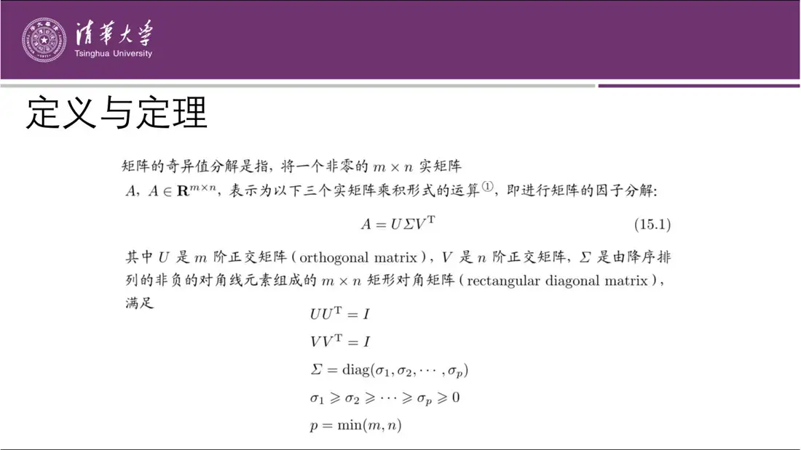

原文：

定义与定理

矩阵的奇异值分解是指，将一个非零的 $m \times n$ 实矩阵

$A, A \in \mathbf{R}^{m \times n}$ , 表示为以下三个实矩阵乘积形式的运算①, 即进行矩阵的因子分解:

$$
A = U \Sigma V ^ {\mathrm{T}}\tag{15.1}
$$

其中 U 是 m 阶正交矩阵 (orthogonal matrix)，V 是 n 阶正交矩阵， $\Sigma$ 是由降序排列的非负的对角线元素组成的 $m \times n$ 矩形对角矩阵 (rectangular diagonal matrix)，满足

$$
\begin{array}{l} U U ^ {\mathrm{T}} = I \\ V V ^ {\mathrm{T}} = I \\ \Sigma = \operatorname{diag} (\sigma_ {1}, \sigma_ {2}, \dots , \sigma_ {p}) \\ \sigma_ {1} \geqslant \sigma_ {2} \geqslant \dots \geqslant \sigma_ {p} \geqslant 0 \\ p = \min (m, n) \end{array}
$$

清華大學 Tsinghua University

### 定义与定理

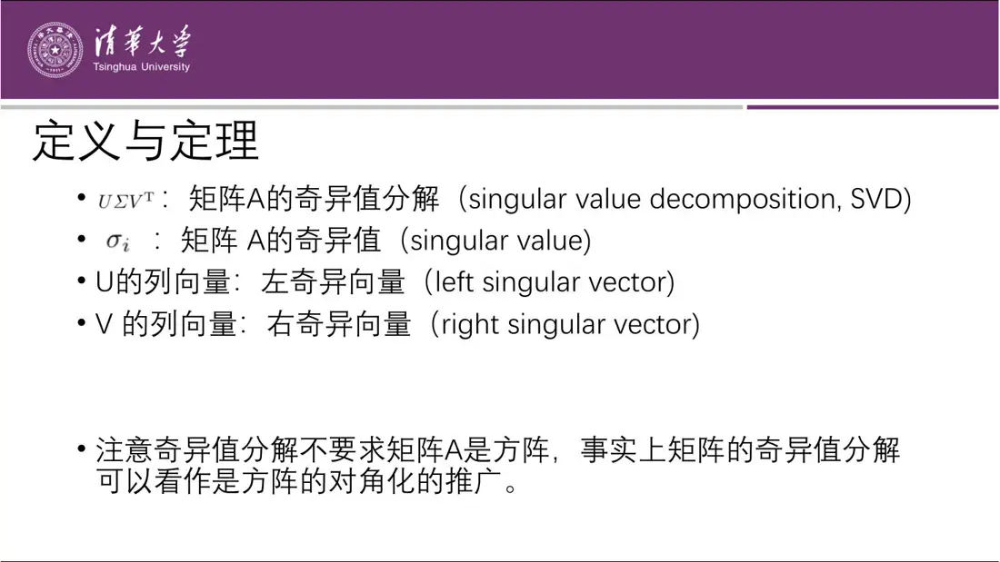

原文：

定义与定理

\- $U \Sigma V^{\mathrm{T}}$ ：矩阵A的奇异值分解（singular value decomposition, SVD）

\- $\sigma_{i}$ ：矩阵A的奇异值（singular value）

• U的列向量：左奇异向量（left singular vector）

• V 的列向量：右奇异向量（right singular vector）

\- 注意奇异值分解不要求矩阵A是方阵，事实上矩阵的奇异值分解可以看作是方阵的对角化的推广。

Tsinghua University
清華大學

### \- 给定一个5x4矩阵A

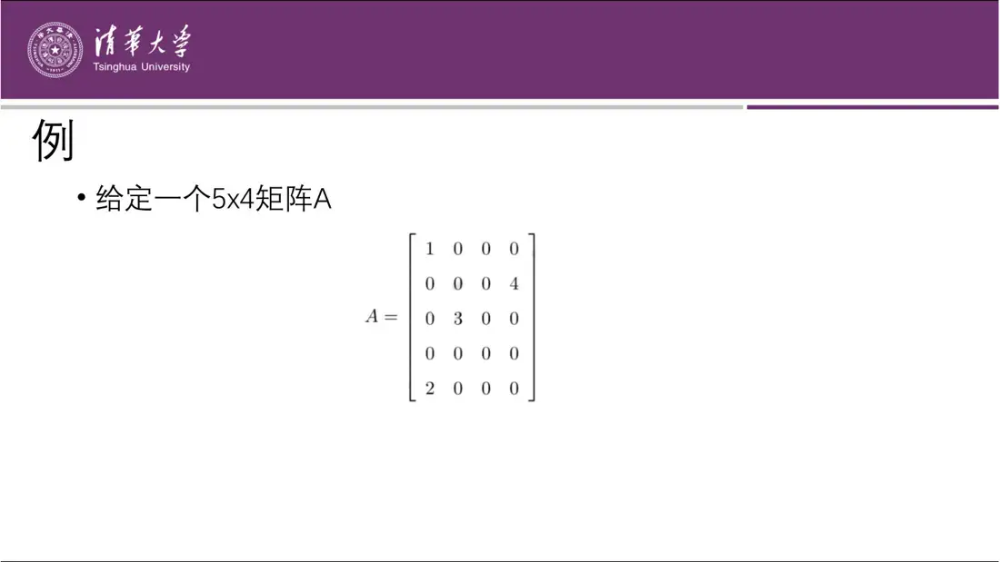

原文：

例

\- 给定一个5x4矩阵A

$$
A = \left[ \begin{array}{l l l l} 1 & 0 & 0 & 0 \\ 0 & 0 & 0 & 4 \\ 0 & 3 & 0 & 0 \\ 0 & 0 & 0 & 0 \\ 2 & 0 & 0 & 0 \end{array} \right]
$$

Tsinghua University
清華大學
1911-

### $$

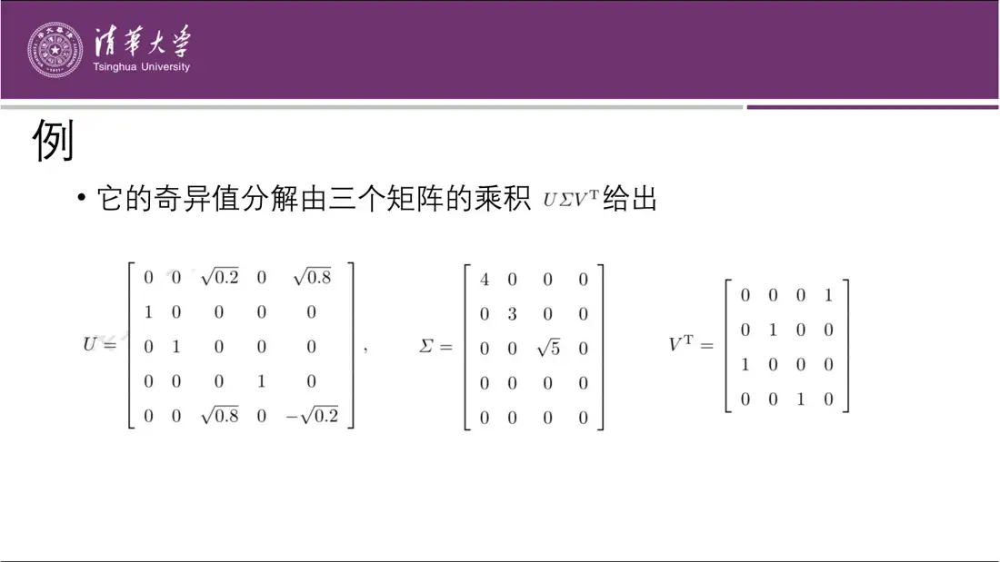

原文：

例

\- 它的奇异值分解由三个矩阵的乘积 $U\Sigma V^{\mathrm{T}}$ 给出

$$
U = \left[ \begin{array}{c c c c c} 0 & 0 & \sqrt {0 . 2} & 0 & \sqrt {0 . 8} \\ 1 & 0 & 0 & 0 & 0 \\ 0 & 1 & 0 & 0 & 0 \\ 0 & 0 & 0 & 1 & 0 \\ 0 & 0 & \sqrt {0 . 8} & 0 & - \sqrt {0 . 2} \end{array} \right]
$$

$$
\Sigma = \left[ \begin{array}{l l l l} 4 & 0 & 0 & 0 \\ 0 & 3 & 0 & 0 \\ 0 & 0 & \sqrt {5} & 0 \\ 0 & 0 & 0 & 0 \\ 0 & 0 & 0 & 0 \end{array} \right]
$$

$$
V ^ {\mathrm{T}} = \left[ \begin{array}{l l l l} 0 & 0 & 0 & 1 \\ 0 & 1 & 0 & 0 \\ 1 & 0 & 0 & 0 \\ 0 & 0 & 1 & 0 \end{array} \right]
$$

Tsinghua University
清華大學

### \- 矩阵U和V是正交矩阵，它们与各自的转置矩阵相乘是单位矩阵，即

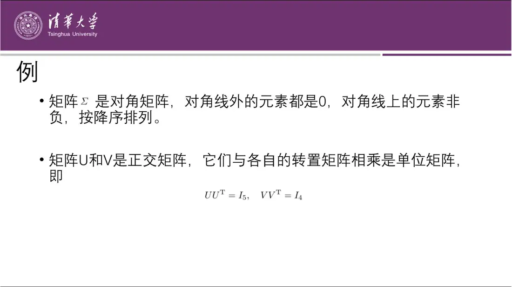

原文：

例

\- 矩阵 $\Sigma$ 是对角矩阵，对角线外的元素都是0，对角线上的元素非负，按降序排列。

\- 矩阵U和V是正交矩阵，它们与各自的转置矩阵相乘是单位矩阵，即

$$
U U ^ {\mathrm{T}} = I _ {5}, \quad V V ^ {\mathrm{T}} = I _ {4}
$$

Tsinghua University
清華大學

### \- 矩阵的奇异值分解不是唯一的。在此例中如果选择U为

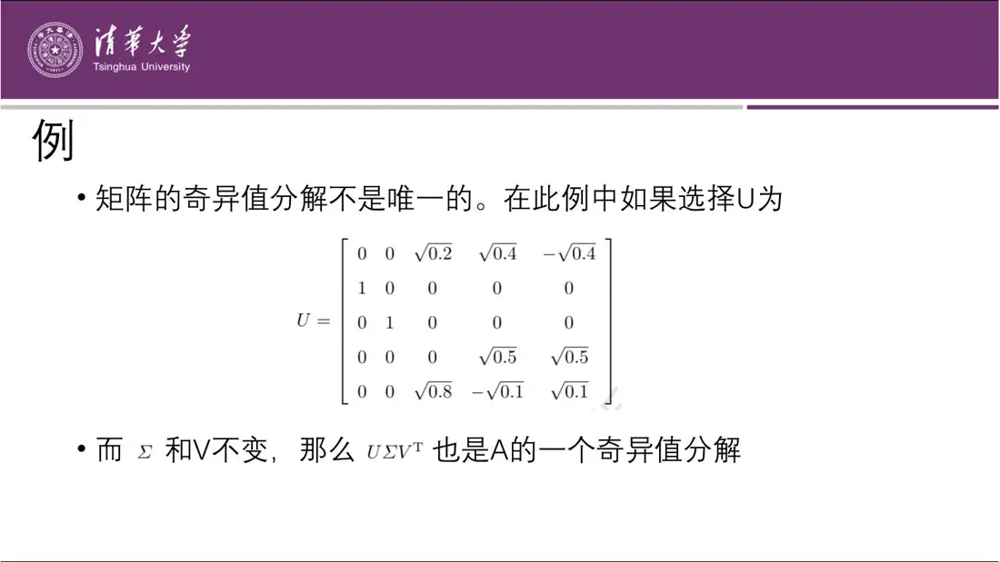

原文：

例

\- 矩阵的奇异值分解不是唯一的。在此例中如果选择U为

$$
U = \left[ \begin{array}{l l l l l} 0 & 0 & \sqrt {0 . 2} & \sqrt {0 . 4} & - \sqrt {0 . 4} \\ 1 & 0 & 0 & 0 & 0 \\ 0 & 1 & 0 & 0 & 0 \\ 0 & 0 & 0 & \sqrt {0 . 5} & \sqrt {0 . 5} \\ 0 & 0 & \sqrt {0 . 8} & - \sqrt {0 . 1} & \sqrt {0 . 1} \end{array} \right]
$$

\- 而 $\Sigma$ 和V不变，那么 $U\Sigma V^{\mathrm{T}}$ 也是A的一个奇异值分解

清華大學 Tsinghua University

### 奇异值分解基本定理

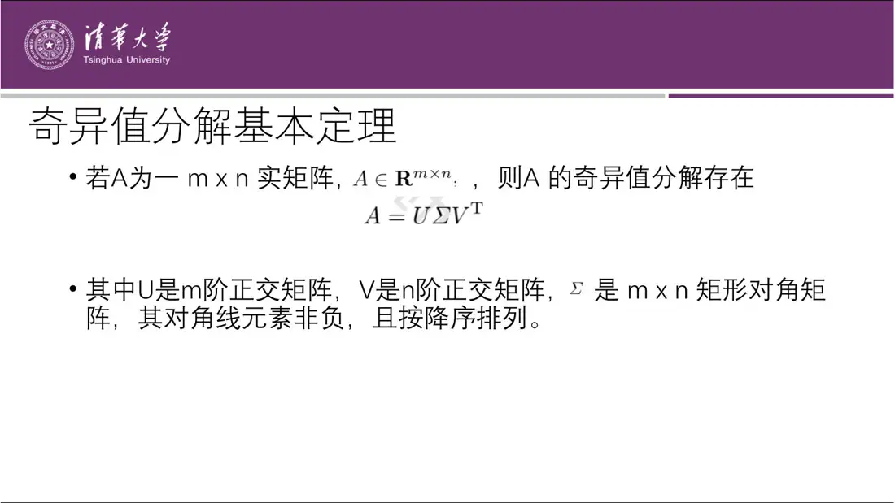

原文：

奇异值分解基本定理

\- 若A为一 $m \times n$ 实矩阵， $A \in \mathbf{R}^{m \times n}$ ，则A的奇异值分解存在

$$
A = U \Sigma V ^ {\mathrm{T}}
$$

\- 其中U是m阶正交矩阵，V是n阶正交矩阵， $\Sigma$ 是 m x n 矩形对角矩阵，其对角线元素非负，且按降序排列。

清華大學 Tsinghua University

### 奇异值分解基本定理

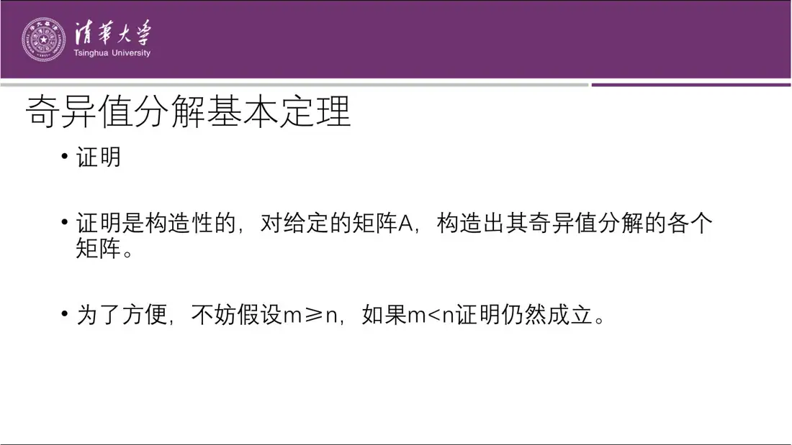

原文：

奇异值分解基本定理

\- 证明

\- 证明是构造性的，对给定的矩阵A，构造出其奇异值分解的各个矩阵。

\- 为了方便，不妨假设 $m \geqslant n$ ，如果 $m < n$ 证明仍然成立。

Tsinghua University
清華大學

### 奇异值分解基本定理

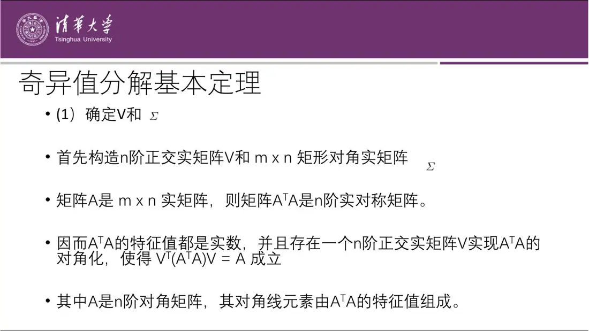

原文：

奇异值分解基本定理

• (1) 确定V和 $\Sigma$

\- 首先构造n阶正交实矩阵V和m×n矩形对角实矩阵

\- 矩阵A是 $m \times n$ 实矩阵，则矩阵 $\mathsf{A}^{\top}\mathsf{A}$ 是n阶实对称矩阵。

\- 因而 $A^{\top} A$ 的特征值都是实数，并且存在一个n阶正交实矩阵V实现 $A^{\top} A$ 的对角化，使得 $V^{\top}(A^{\top} A) V = A$ 成立

\- 其中A是n阶对角矩阵，其对角线元素由A $^{T}$ A的特征值组成。

Tsinghua University
清華大學

### 奇异值分解基本定理

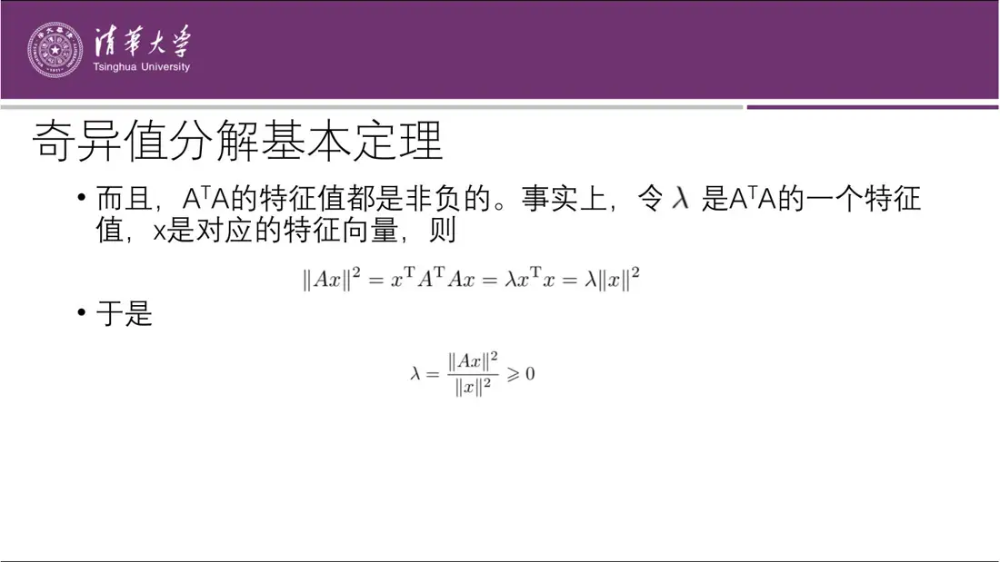

原文：

奇异值分解基本定理

\- 而且， $\mathsf{A}^{\mathsf{T}}\mathsf{A}$ 的特征值都是非负的。事实上，令 $\lambda$ 是 $\mathsf{A}^{\mathsf{T}}\mathsf{A}$ 的一个特征值， $x$ 是对应的特征向量，则

$$
\| A x \| ^ {2} = x ^ {\mathrm{T}} A ^ {\mathrm{T}} A x = \lambda x ^ {\mathrm{T}} x = \lambda \| x \| ^ {2}
$$

\- 于是

$$
\lambda = \frac {\| A x \| ^ {2}}{\| x \| ^ {2}} \geqslant 0
$$

清華大學 Tsinghua University

### 奇异值分解基本定理

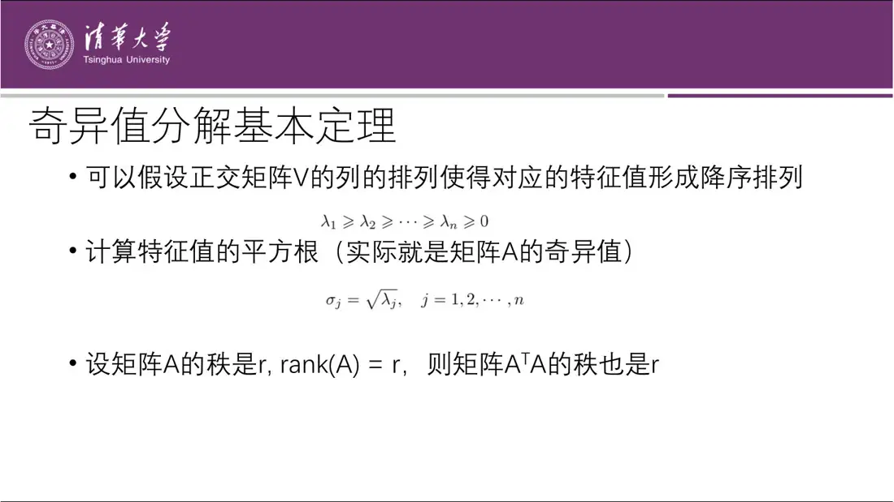

原文：

奇异值分解基本定理

\- 可以假设正交矩阵V的列的排列使得对应的特征值形成降序排列

$$
\lambda_ {1} \geqslant \lambda_ {2} \geqslant \dots \geqslant \lambda_ {n} \geqslant 0
$$

\- 计算特征值的平方根（实际就是矩阵A的奇异值）

$$
\sigma_ {j} = \sqrt {\lambda_ {j}}, \quad j = 1, 2, \dots , n
$$

\- 设矩阵A的秩是r, $\text{rank}(A) = r$ ，则矩阵 $A^{T}A$ 的秩也是r

Tsinghua University
清華大學

### 奇异值分解基本定理

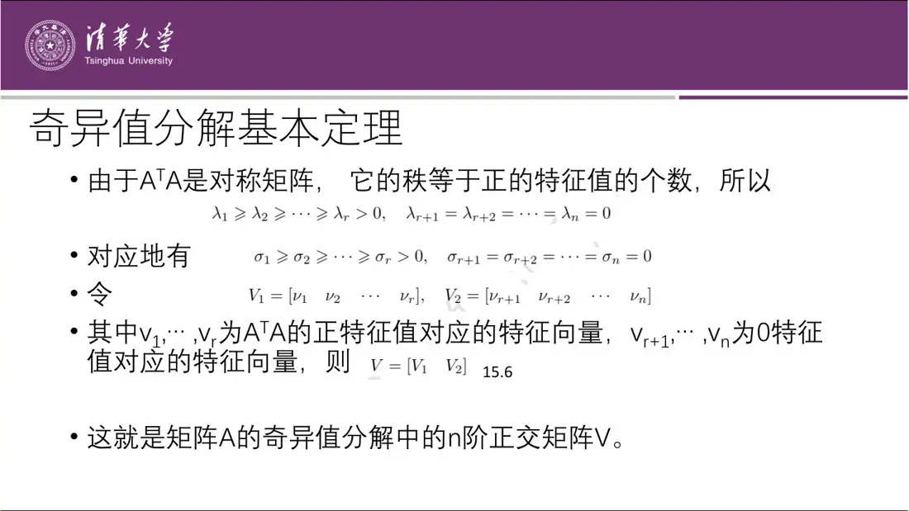

原文：

奇异值分解基本定理

\- 由于A $^{T}$ A是对称矩阵，它的秩等于正的特征值的个数，所以

$$
\lambda_ {1} \geqslant \lambda_ {2} \geqslant \dots \geqslant \lambda_ {r} > 0, \quad \lambda_ {r + 1} = \lambda_ {r + 2} = \dots = \lambda_ {n} = 0
$$

\- 对应地有 $\sigma_{1} \geqslant \sigma_{2} \geqslant \dots \geqslant \sigma_{r} > 0, \quad \sigma_{r+1} = \sigma_{r+2} = \dots = \sigma_{n} = 0$

·令

$$
V _ {1} = \left[ \begin{array}{c c c c} \nu_ {1} & \nu_ {2} & \dots & \nu_ {r} \end{array} \right], V _ {2} = \left[ \begin{array}{c c c c} \nu_ {r + 1} & \nu_ {r + 2} & \dots & \nu_ {n} \end{array} \right]
$$

\- 其中 $v_{1},\cdots,v_{r}$ 为 $A^{\top}A$ 的正特征值对应的特征向量， $v_{r+1},\cdots,v_{n}$ 为0特征值对应的特征向量，则 $V=\left[V_{1}\quad V_{2}\right]$ 15.6

\- 这就是矩阵A的奇异值分解中的n阶正交矩阵V。

Tsinghua University
清華大學

### 奇异值分解基本定理

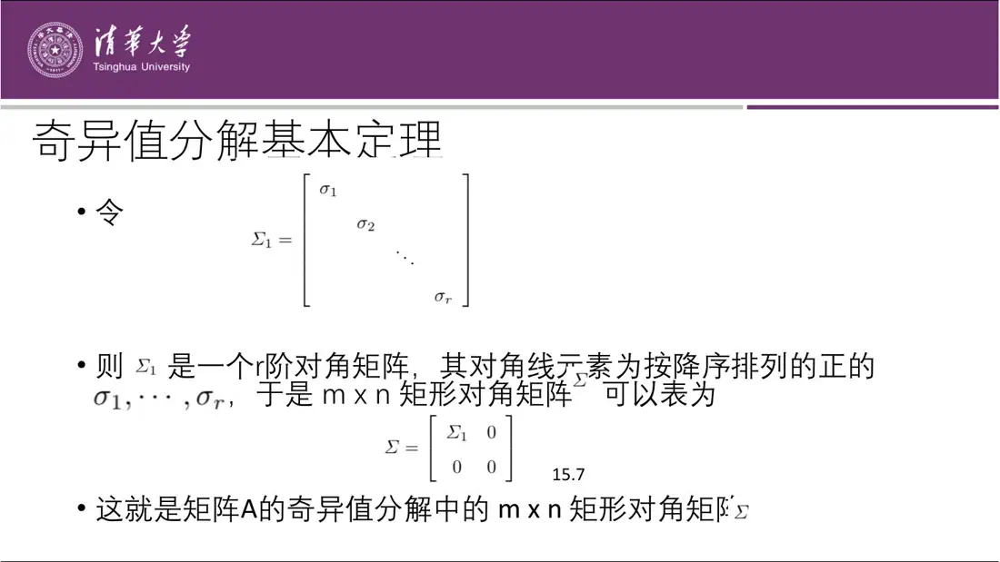

原文：

奇异值分解基本定理

·令

$$
\Sigma_ {1} = \left[ \begin{array}{c c c c} \sigma_ {1} & & & \\ & \sigma_ {2} & & \\ & & \ddots & \\ & & & \sigma_ {r} \end{array} \right]
$$

\- 则 $\Sigma_{1}$ 是一个r阶对角矩阵，其对角线元素为按降序排列的正的 $\sigma_1,\dots ,\sigma_r$ ，于是mn矩形对角矩阵可以表为

$$
\Sigma = \left[ \begin{array}{c c} \Sigma_ {1} & 0 \\ 0 & 0 \end{array} \right] \tag {15.7}
$$

\- 这就是矩阵A的奇异值分解中的 $m \times n$ 矩形对角矩 $\beta_{\Sigma}^{\prime}$

清華大學 Tsinghua University

### 奇异值分解基本定理

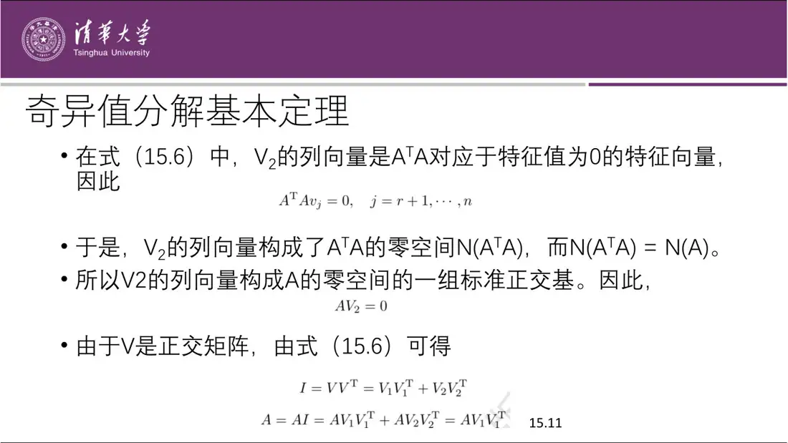

原文：

奇异值分解基本定理

\- 在式（15.6）中， $\mathrm{V}_{2}$ 的列向量是 $\mathrm{A}^{\top}\mathrm{A}$ 对应于特征值为0的特征向量，因此

$$
A ^ {\mathrm{T}} A v _ {j} = 0, \quad j = r + 1, \dots , n
$$

\- 于是， $V_{2}$ 的列向量构成了 $A^{\top}A$ 的零空间 $N(A^{\top}A)$ ，而 $N(A^{\top}A) = N(A)$ 。

\- 所以V2的列向量构成A的零空间的一组标准正交基。因此，

$$
A V _ {2} = 0
$$

\- 由于V是正交矩阵，由式（15.6）可得

$$
I = V V ^ {\mathrm{T}} = V _ {1} V _ {1} ^ {\mathrm{T}} + V _ {2} V _ {2} ^ {\mathrm{T}}
$$

$$
A = A I = A V _ {1} V _ {1} ^ {\mathrm{T}} + A V _ {2} V _ {2} ^ {\mathrm{T}} = A V _ {1} V _ {1} ^ {\mathrm{T}}
$$

$$
1 5. 1 1
$$

清華大學 Tsinghua University

### 奇异值分解基本定理

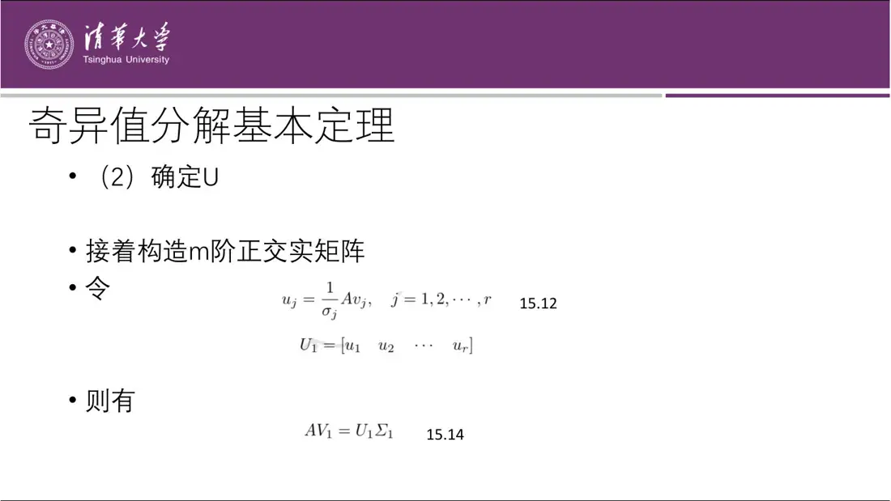

原文：

奇异值分解基本定理

(2) 确定U

\- 接着构造m阶正交实矩阵

·令

$$
u _ {j} = \frac {1}{\sigma_ {j}} A v _ {j}, \quad j = 1, 2, \dots , r \tag {15.12}
$$

$$
U _ {1} = \left[ \begin{array}{c c c c} u _ {1} & u _ {2} & \dots & u _ {r} \end{array} \right]
$$

\- 则有

$$
A V _ {1} = U _ {1} \Sigma_ {1}
$$

Tsinghua University
清華大學

### 奇异值分解基本定理

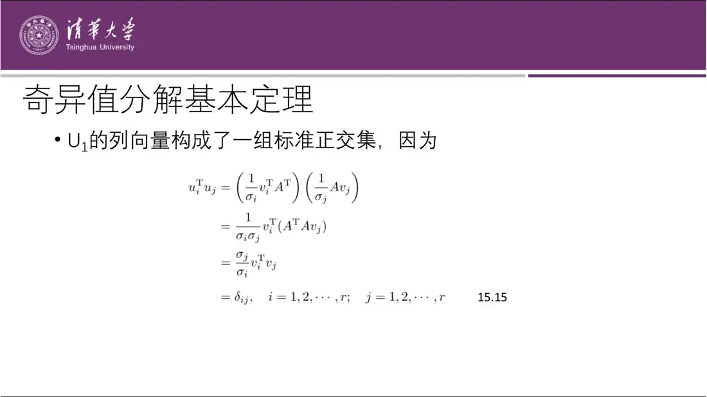

原文：

奇异值分解基本定理

\- $U_{1}$ 的列向量构成了一组标准正交集，因为

$$
\begin{array}{r l} & u _ {i} ^ {\mathrm{T}} u _ {j} = \left(\frac {1}{\sigma_ {i}} v _ {i} ^ {\mathrm{T}} A ^ {\mathrm{T}}\right) \left(\frac {1}{\sigma_ {j}} A v _ {j}\right) \\ & \qquad = \frac {1}{\sigma_ {i} \sigma_ {j}} v _ {i} ^ {\mathrm{T}} (A ^ {\mathrm{T}} A v _ {j}) \\ & \qquad = \frac {\sigma_ {j}}{\sigma_ {i}} v _ {i} ^ {\mathrm{T}} v _ {j} \\ & \qquad = \delta_ {i j}, \quad i = 1, 2, \dots , r; \quad j = 1, 2, \dots , r \end{array}\tag{15.15}
$$

Tsinghua University
清華大學

### 奇异值分解基本定理

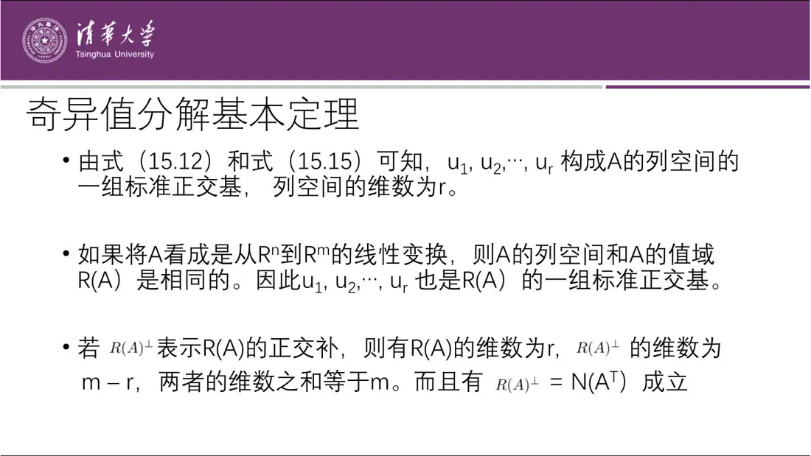

原文：

奇异值分解基本定理

\- 由式（15.12）和式（15.15）可知， $u_1, u_2, \cdots, u_r$ 构成A的列空间的一组标准正交基，列空间的维数为r。

\- 如果将A看成是从 $R^n$ 到 $R^m$ 的线性变换, 则A的列空间和A的值域 $R(A)$ 是相同的。因此 $u_1, u_2, \cdots, u_r$ 也是 $R(A)$ 的一组标准正交基。

\- 若 $R(A)^\perp$ 表示 $R(A)$ 的正交补，则有 $R(A)$ 的维数为 $r$ ， $R(A)^\perp$ 的维数为 $m - r$ ，两者的维数之和等于 $m$ 。而且有 $R(A)^\perp = N(A^\top)$ 成立

Tsinghua University
清華大學

### 奇异值分解基本定理

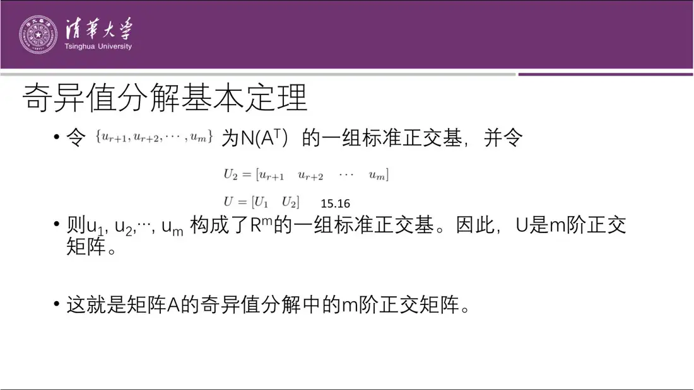

原文：

奇异值分解基本定理

\- 令 $\{u_{r+1}, u_{r+2}, \cdots, u_m\}$ 为 $N(A^{\top})$ 的一组标准正交基，并令

$$
U _ {2} = \left[ \begin{array}{c c c c} u _ {r + 1} & u _ {r + 2} & \dots & u _ {m} \end{array} \right]
$$

$$
U = \left[ \begin{array}{c c} U _ {1} & U _ {2} \end{array} \right] \quad 1 5. 1 6
$$

\- 则 $u_{1}, u_{2}, \cdots, u_{m}$ 构成了 $R^{m}$ 的一组标准正交基。因此，U是m阶正交矩阵。

\- 这就是矩阵A的奇异值分解中的m阶正交矩阵。

清華大學 Tsinghua University

### 奇异值分解基本定理

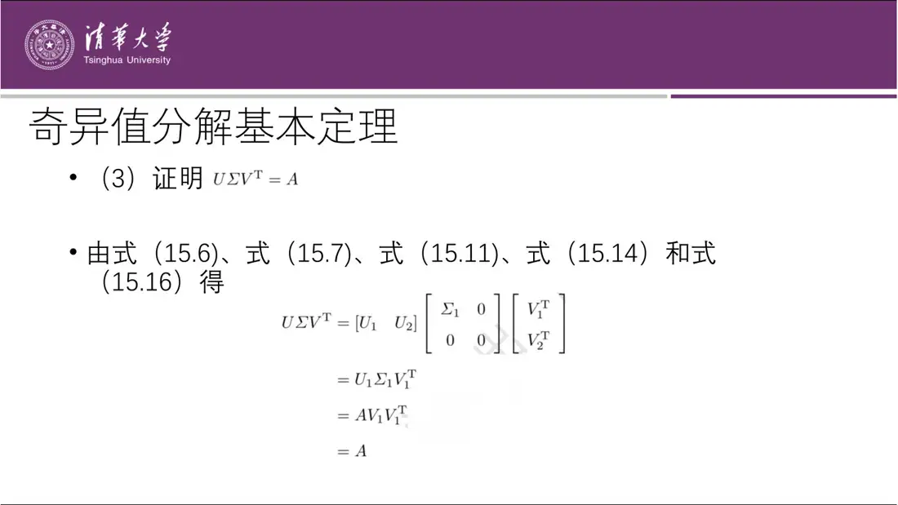

原文：

奇异值分解基本定理

(3) 证明 $U \Sigma V^{\mathrm{T}} = A$

\- 由式（15.6）、式（15.7）、式（15.11）、式（15.14）和式（15.16）得

$$
\begin{array}{r l} & U \Sigma V ^ {\mathrm{T}} = [ U _ {1} \quad U _ {2} ] \left[ \begin{array}{c c} \Sigma_ {1} & 0 \\ 0 & 0 \end{array} \right] \left[ \begin{array}{c} V _ {1} ^ {\mathrm{T}} \\ V _ {2} ^ {\mathrm{T}} \end{array} \right] \\ & \qquad = U _ {1} \Sigma_ {1} V _ {1} ^ {\mathrm{T}} \\ & \qquad = A V _ {1} V _ {1} ^ {\mathrm{T}} \\ & \qquad = A \end{array}
$$

清華大學 Tsinghua University

### 紧奇异值分解与截断奇异值分解

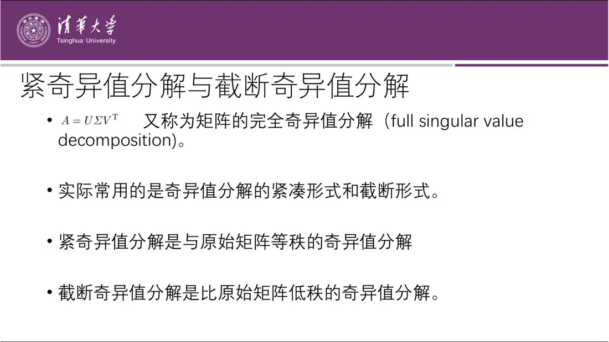

原文：

紧奇异值分解与截断奇异值分解

\- $A = U\Sigma V^{\mathrm{T}}$ 又称为矩阵的完全奇异值分解（full singular value decomposition）。

\- 实际常用的是奇异值分解的紧凑形式和截断形式。

\- 紧奇异值分解是与原始矩阵等秩的奇异值分解

\- 截断奇异值分解是比原始矩阵低秩的奇异值分解。

Tsinghua University
清華大學

### 紧奇异值分解

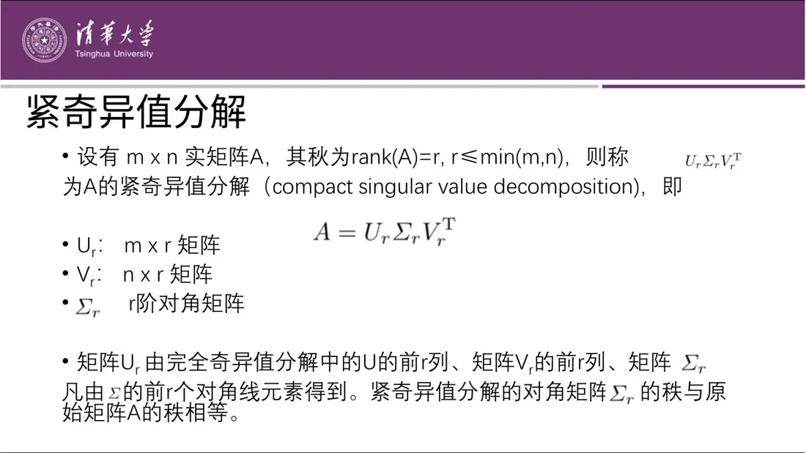

原文：

紧奇异值分解

\- 设有 $m \times n$ 实矩阵A，其秋为 $\operatorname{rank}(A) = r, r \leqslant \min(m, n)$ ，则称为A的紧奇异值分解（compact singular value decomposition），即

$$
A = U _ {r} \Sigma_ {r} V _ {r} ^ {\mathrm{T}}
$$

\- $U_{r}$ : m x r 矩阵

\- $V_{r}$ : n x r 矩阵

\- $\Sigma_{r}$ r阶对角矩阵

\- 矩阵 $U_{r}$ 由完全奇异值分解中的U的前r列、矩阵 $V_{r}$ 的前r列、矩阵 $\Sigma_{r}$ 凡由 $\Sigma$ 的前r个对角线元素得到。紧奇异值分解的对角矩阵 $\Sigma_{r}$ 的秩与原始矩阵A的秩相等。

清華大學 Tsinghua University

### \- 矩阵A的秩r = 3

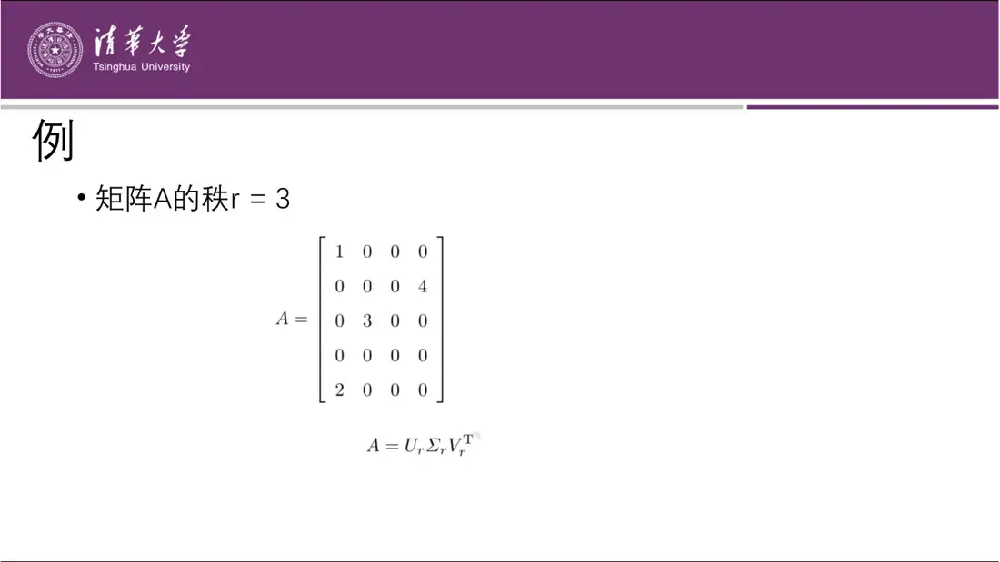

原文：

例

\- 矩阵A的秩r = 3

$$
A = \left[ \begin{array}{l l l l} 1 & 0 & 0 & 0 \\ 0 & 0 & 0 & 4 \\ 0 & 3 & 0 & 0 \\ 0 & 0 & 0 & 0 \\ 2 & 0 & 0 & 0 \end{array} \right]
$$

$$
A = U _ {r} \Sigma_ {r} V _ {r} ^ {\mathrm{T}}
$$

Tsinghua University
清華大學

### $$

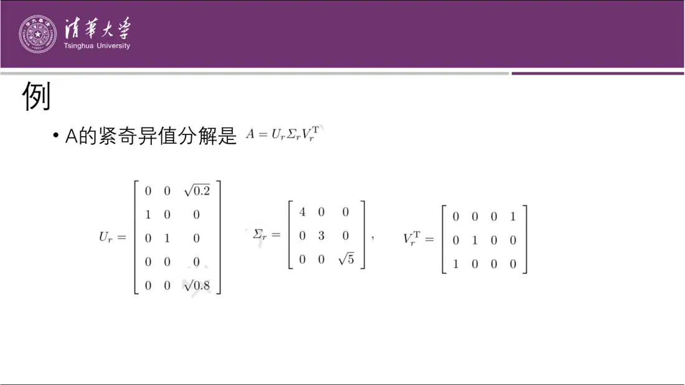

原文：

例

\- A的紧奇异值分解是 $A = U_{r}\Sigma_{r}V_{r}^{\mathrm{T}}$

$$
U _ {r} = \left[ \begin{array}{l l l} 0 & 0 & \sqrt {0 . 2} \\ 1 & 0 & 0 \\ 0 & 1 & 0 \\ 0 & 0 & 0 \\ 0 & 0 & \sqrt {0 . 8} \end{array} \right] \qquad \Sigma_ {r} = \left[ \begin{array}{l l l} 4 & 0 & 0 \\ 0 & 3 & 0 \\ 0 & 0 & \sqrt {5} \end{array} \right], \qquad V _ {r} ^ {\mathrm{T}} = \left[ \begin{array}{l l l l} 0 & 0 & 0 & 1 \\ 0 & 1 & 0 & 0 \\ 1 & 0 & 0 & 0 \end{array} \right]
$$

Tsinghua University
清華大學

### 截断奇异值分解

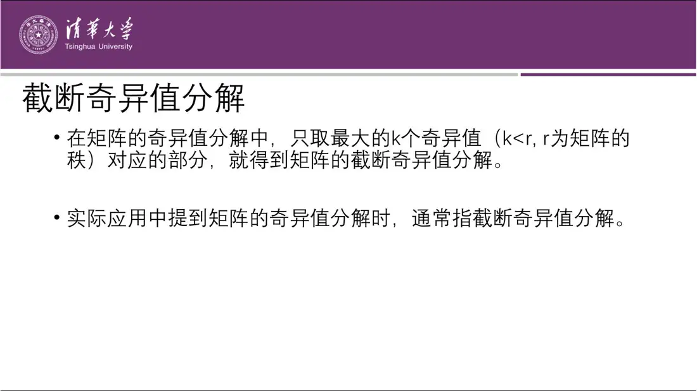

原文：

截断奇异值分解

\- 在矩阵的奇异值分解中，只取最大的k个奇异值（k<r, r为矩阵的秩）对应的部分，就得到矩阵的截断奇异值分解。

\- 实际应用中提到矩阵的奇异值分解时，通常指截断奇异值分解。

Tsinghua University
清華大學
1911-1911

### 截断奇异值分解

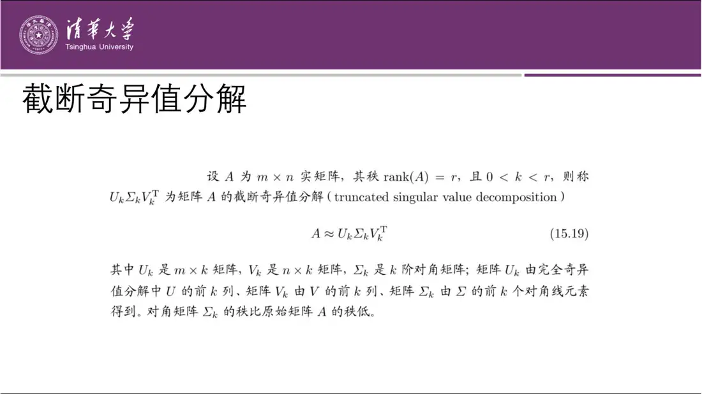

原文：

截断奇异值分解

设 A 为 $m \times n$ 实矩阵，其秩 $\operatorname{rank}(A) = r$ ，且 0 < k < r，则称 $U_{k} \Sigma_{k} V_{k}^{T}$ 为矩阵 A 的截断奇异值分解（truncated singular value decomposition）

$$
A \approx U _ {k} \Sigma_ {k} V _ {k} ^ {\mathrm{T}}\tag{15.19}
$$

其中 $U_{k}$ 是 $m \times k$ 矩阵, $V_{k}$ 是 $n \times k$ 矩阵, $\Sigma_{k}$ 是 $k$ 阶对角矩阵; 矩阵 $U_{k}$ 由完全奇异值分解中 $U$ 的前 $k$ 列、矩阵 $V_{k}$ 由 $V$ 的前 $k$ 列、矩阵 $\Sigma_{k}$ 由 $\Sigma$ 的前 $k$ 个对角线元素得到。对角矩阵 $\Sigma_{k}$ 的秩比原始矩阵 $A$ 的秩低。

Tsinghua University
清華大學

### \- 矩阵A的秩为3

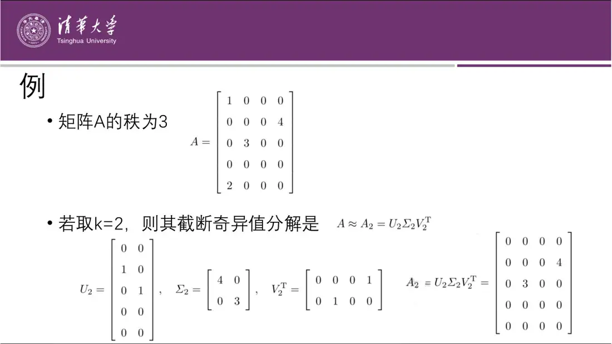

原文：

例

\- 矩阵A的秩为3

$$
A = \left[ \begin{array}{c c c c} 1 & 0 & 0 & 0 \\ 0 & 0 & 0 & 4 \\ 0 & 3 & 0 & 0 \\ 0 & 0 & 0 & 0 \\ 2 & 0 & 0 & 0 \end{array} \right]
$$

\- 若取 $k = 2$ ，则其截断奇异值分解是 $A \approx A_{2} = U_{2}\Sigma_{2}V_{2}^{\mathrm{T}}$

$$
U _ {2} = \left[ \begin{array}{l l} 0 & 0 \\ 1 & 0 \\ 0 & 1 \\ 0 & 0 \\ 0 & 0 \end{array} \right], \quad \Sigma_ {2} = \left[ \begin{array}{l l} 4 & 0 \\ 0 & 3 \end{array} \right], \quad V _ {2} ^ {\mathrm{T}} = \left[ \begin{array}{l l l l} 0 & 0 & 0 & 1 \\ 0 & 1 & 0 & 0 \end{array} \right] \qquad A _ {2} = U _ {2} \Sigma_ {2} V _ {2} ^ {\mathrm{T}} = \left[ \begin{array}{l l l l} 0 & 0 & 0 & 0 \\ 0 & 0 & 0 & 4 \\ 0 & 3 & 0 & 0 \\ 0 & 0 & 0 & 0 \\ 0 & 0 & 0 & 0 \end{array} \right]
$$

Tsinghua University
清華大學

### 几何解释

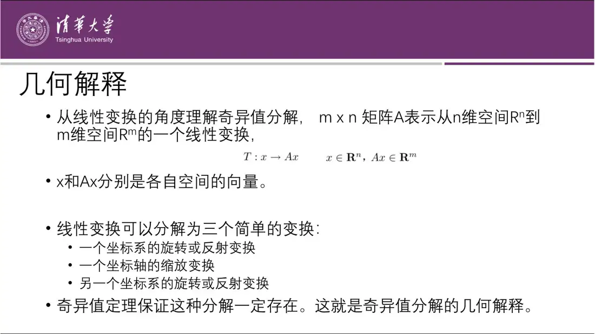

原文：

几何解释

\- 从线性变换的角度理解奇异值分解，m×n 矩阵A表示从n维空间R $^{n}$ 到m维空间R $^{m}$ 的一个线性变换，

$$
T: x \to A x \qquad x \in \mathbf {R} ^ {n}, A x \in \mathbf {R} ^ {m}
$$

\- x和Ax分别是各自空间的向量。

\- 线性变换可以分解为三个简单的变换:

\- 一个坐标系的旋转或反射变换

\- 一个坐标轴的缩放变换

\- 另一个坐标系的旋转或反射变换

\- 奇异值定理保证这种分解一定存在。这就是奇异值分解的几何解释。

Tsinghua University
清華大學

### 几何解释

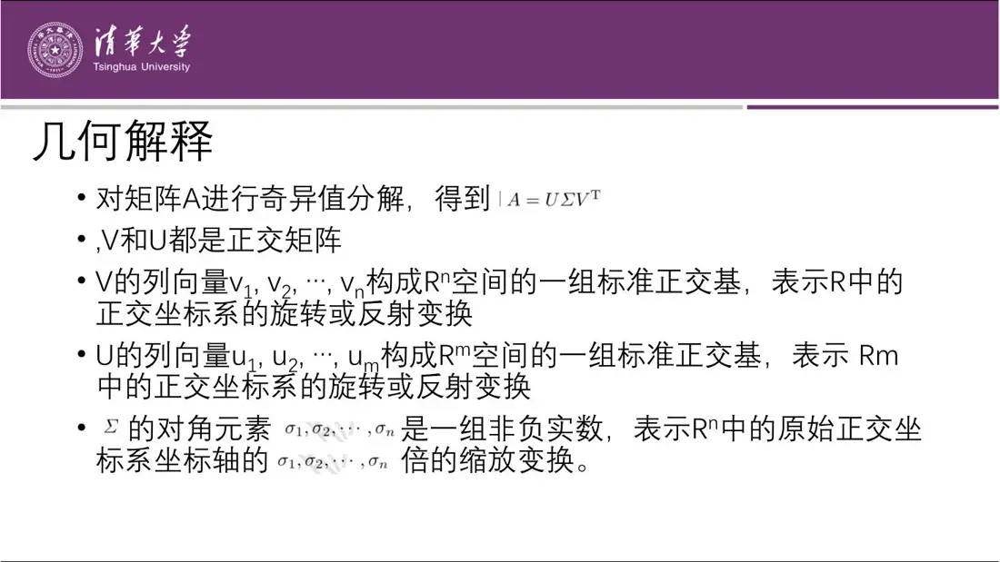

原文：

几何解释

\- 对矩阵A进行奇异值分解，得到 $|A = U\Sigma V^{\mathrm{T}}$

• ,V和U都是正交矩阵

• V的列向量 $v_{1}, v_{2}, \cdots, v_{n}$ 构成 $R^{n}$ 空间的一组标准正交基，表示R中的正交坐标系的旋转或反射变换

\- U的列向量 $u_{1}, u_{2}, \cdots, u_{m}$ 构成 $R^{m}$ 空间的一组标准正交基，表示Rm中的正交坐标系的旋转或反射变换

\- $\Sigma$ 的对角元素 $\sigma_1, \sigma_2, \cdots, \sigma_n$ 是一组非负实数，表示 $R^n$ 中的原始正交坐标系坐标轴的 $\sigma_1, \sigma_2, \cdots, \sigma_n$ 倍的缩放变换。

Tsinghua University
清華大學

### 几何解释

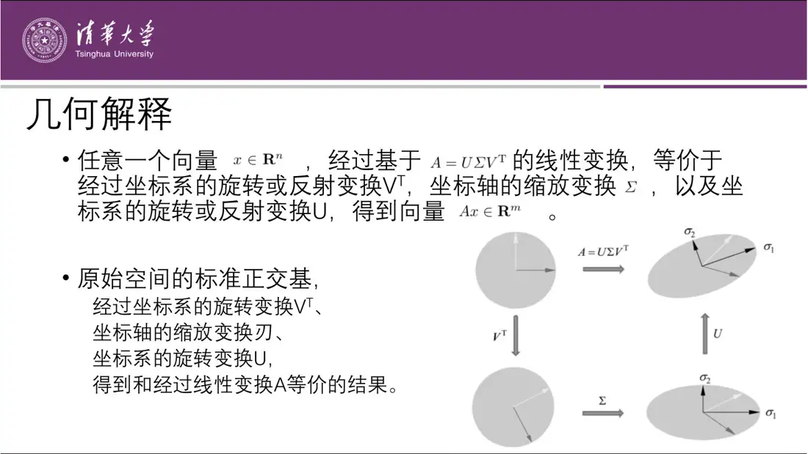

原文：

几何解释

\- 任意一个向量 $x \in \mathbf{R}^n$ ，经过基于 $A = U\Sigma V^{\mathrm{T}}$ 的线性变换，等价于经过坐标系的旋转或反射变换 $\mathsf{V}^{\top}$ ，坐标轴的缩放变换 $\Sigma$ ，以及坐标系的旋转或反射变换 $\mathsf{U}$ ，得到向量 $Ax \in \mathbf{R}^m$ 。

\- 原始空间的标准正交基，经过坐标系的旋转变换 $V^{\mathrm{T}}$ 、坐标轴的缩放变换刃、坐标系的旋转变换U，得到和经过线性变换A等价的结果。

清華大學 Tsinghua University

### \- 给定一个2阶矩阵

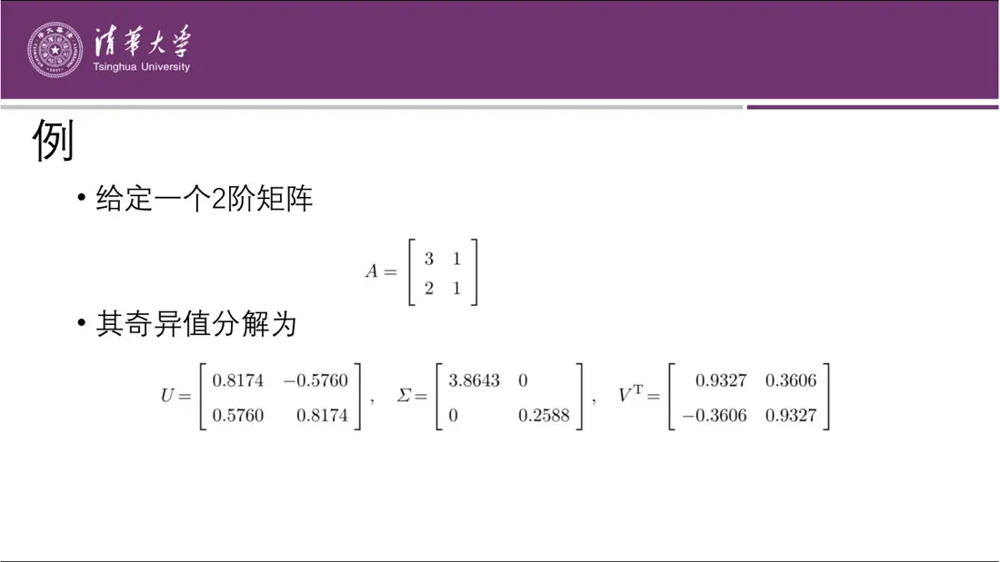

原文：

例

\- 给定一个2阶矩阵

$$
A = \left[ \begin{array}{l l} 3 & 1 \\ 2 & 1 \end{array} \right]
$$

\- 其奇异值分解为

$$
U = \left[ \begin{array}{l l} 0. 8 1 7 4 & - 0. 5 7 6 0 \\ 0. 5 7 6 0 & 0. 8 1 7 4 \end{array} \right], \quad \Sigma = \left[ \begin{array}{l l} 3. 8 6 4 3 & 0 \\ 0 & 0. 2 5 8 8 \end{array} \right], \quad V ^ {\mathrm{T}} = \left[ \begin{array}{l l} 0. 9 3 2 7 & 0. 3 6 0 6 \\ - 0. 3 6 0 6 & 0. 9 3 2 7 \end{array} \right]
$$

Tsinghua University
清華大學

### \- 观察基于矩阵A的奇异值分解将 $R^2$ 的标准正交基

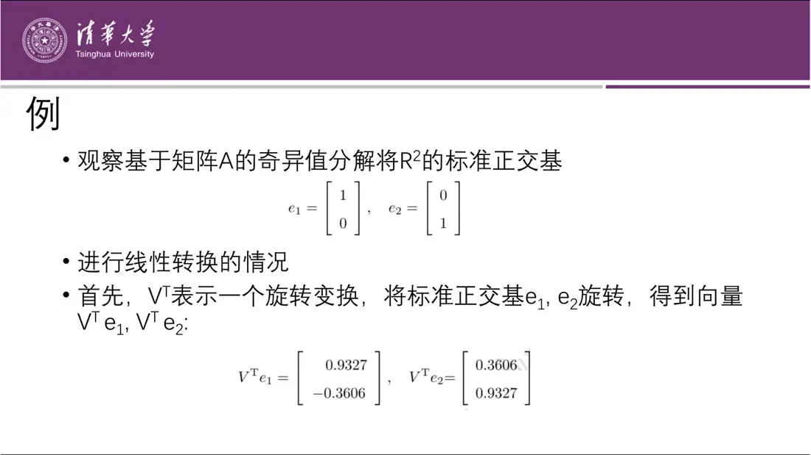

原文：

例

\- 观察基于矩阵A的奇异值分解将 $R^2$ 的标准正交基

$$
e _ {1} = \left[ \begin{array}{l} 1 \\ 0 \end{array} \right], e _ {2} = \left[ \begin{array}{l} 0 \\ 1 \end{array} \right]
$$

\- 进行线性转换的情况

\- 首先， $\mathsf{V}^{\mathsf{T}}$ 表示一个旋转变换，将标准正交基 $\mathrm{e}_1, \mathrm{e}_2$ 旋转，得到向量 $\mathsf{V}^{\mathsf{T}}\mathsf{e}_1, \mathsf{V}^{\mathsf{T}}\mathsf{e}_2$ :

$$
V ^ {\mathrm{T}} e _ {1} = \left[ \begin{array}{c} 0. 9 3 2 7 \\ - 0. 3 6 0 6 \end{array} \right], \quad V ^ {\mathrm{T}} e _ {2} = \left[ \begin{array}{c} 0. 3 6 0 6 \\ 0. 9 3 2 7 \end{array} \right]
$$

Tsinghua University
清華大學

### $$

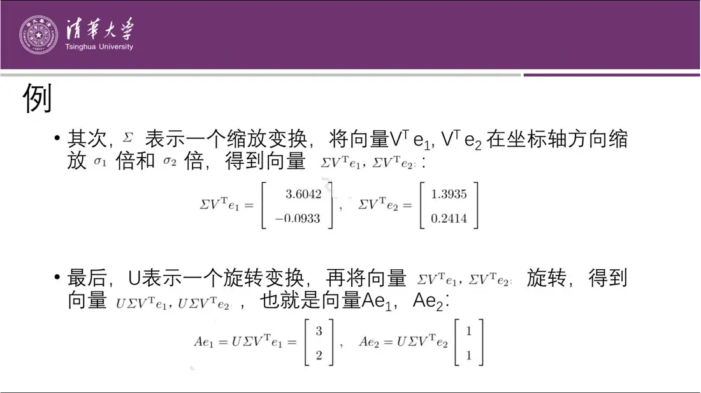

原文：

例

\- 其次， $\Sigma$ 表示一个缩放变换，将向量 $\mathsf{V}^{\mathsf{T}}\mathsf{e}_1,\mathsf{V}^{\mathsf{T}}\mathsf{e}_2$ 在坐标轴方向缩放 $\sigma_{1}$ 倍和 $\sigma_{2}$ 倍，得到向量 $\Sigma V^{\mathrm{T}}e_{1},\Sigma V^{\mathrm{T}}e_{2}$ ：

$$
\Sigma V ^ {\mathrm{T}} e _ {1} = \left[ \begin{array}{c} 3. 6 0 4 2 \\ - 0. 0 9 3 3 \end{array} \right], \quad \Sigma V ^ {\mathrm{T}} e _ {2} = \left[ \begin{array}{c} 1. 3 9 3 5 \\ 0. 2 4 1 4 \end{array} \right]
$$

\- 最后，U表示一个旋转变换，再将向量 $\Sigma V^{\mathrm{T}}e_{1}$ ， $\Sigma V^{\mathrm{T}}e_{2}$ ；旋转，得到向量 $U\Sigma V^{\mathrm{T}}e_{1}$ ， $U\Sigma V^{\mathrm{T}}e_{2}$ ，也就是向量Ae $_{1}$ ，Ae $_{2}$ :

$$
A e _ {1} = U \Sigma V ^ {\mathrm{T}} e _ {1} = \left[ \begin{array}{l} 3 \\ 2 \end{array} \right], A e _ {2} = U \Sigma V ^ {\mathrm{T}} e _ {2} \left[ \begin{array}{l} 1 \\ 1 \end{array} \right]
$$

Tsinghua University
清華大學

### 主要性质

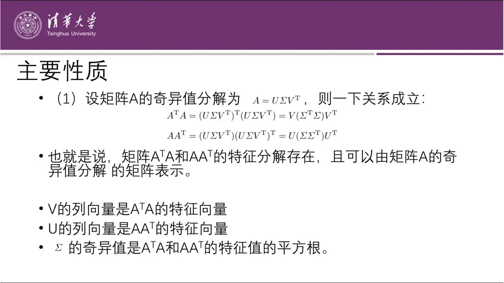

原文：

主要性质

• (1) 设矩阵A的奇异值分解为 $A = U \Sigma V^{T}$ ，则一下关系成立：

$$
A ^ {\mathrm{T}} A = (U \Sigma V ^ {\mathrm{T}}) ^ {\mathrm{T}} (U \Sigma V ^ {\mathrm{T}}) = V (\Sigma^ {\mathrm{T}} \Sigma) V ^ {\mathrm{T}}
$$

$$
A A ^ {\mathrm{T}} = (U \Sigma V ^ {\mathrm{T}}) (U \Sigma V ^ {\mathrm{T}}) ^ {\mathrm{T}} = U (\Sigma \Sigma^ {\mathrm{T}}) U ^ {\mathrm{T}}
$$

\- 也就是说，矩阵A $^{T}$ A和AA $^{T}$ 的特征分解存在，且可以由矩阵A的奇异值分解的矩阵表示。

\- V的列向量是A $^{T}$ A的特征向量

\- U的列向量是AA $^{T}$ 的特征向量

\- $\Sigma$ 的奇异值是 $\mathsf{A}^{\mathsf{T}}\mathsf{A}$ 和 $\mathsf{AA}^{\mathsf{T}}$ 的特征值的平方根。

清華大學 Tsinghua University

### 主要性质

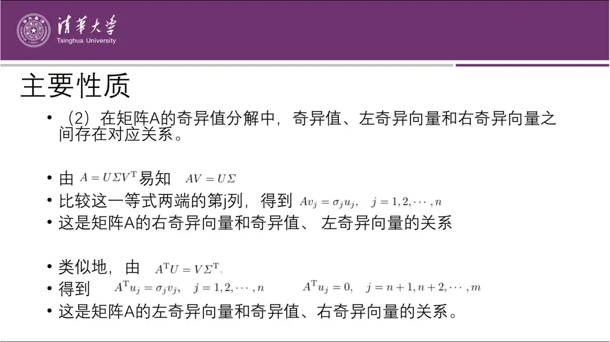

原文：

主要性质

(2) 在矩阵A的奇异值分解中，奇异值、左奇异向量和右奇异向量之间存在对应关系。

\- 由 $A = U\Sigma V^{\mathrm{T}}$ 易知 $AV = U\Sigma$

\- 比较这一等式两端的第j列，得到 $Av_{j} = \sigma_{j}u_{j}, j = 1,2,\dots ,n$

\- 这是矩阵A的右奇异向量和奇异值、左奇异向量的关系

\- 类似地，由 $A^{\mathrm{T}}U = V\Sigma^{\mathrm{T}}$

\- 得到 $A^{\mathrm{T}}u_{j} = \sigma_{j}v_{j},\quad j = 1,2,\dots ,n$ $A^{\mathrm{T}}u_{j} = 0,\quad j = n + 1,n + 2,\dots ,m$

\- 这是矩阵A的左奇异向量和奇异值、右奇异向量的关系。

Tsinghua University
清華大學

### 主要性质

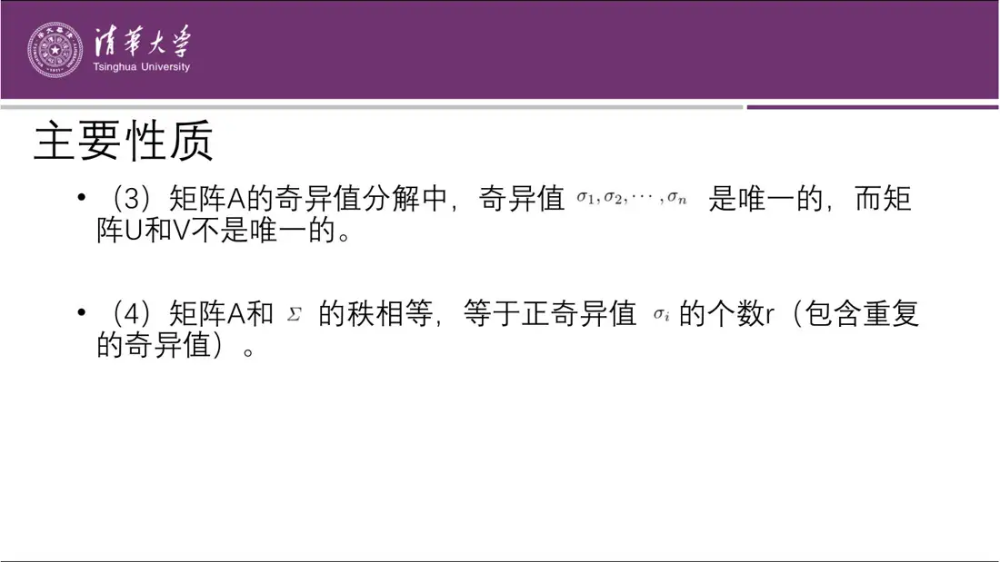

原文：

主要性质

• (3) 矩阵A的奇异值分解中, 奇异值 $\sigma_{1}, \sigma_{2}, \cdots, \sigma_{n}$ 是唯一的, 而矩阵U和V不是唯一的。

• (4) 矩阵A和 $\Sigma$ 的秩相等，等于正奇异值 $\sigma_{i}$ 的个数r（包含重复的奇异值）。

清華大學 Tsinghua University

### 主要性质

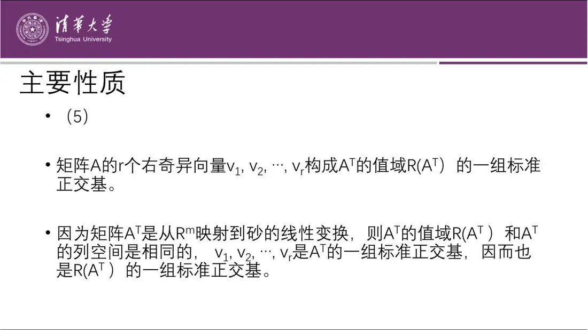

原文：

主要性质

• (5)

\- 矩阵A的r个右奇异向量 $v_{1}, v_{2}, \cdots, v_{r}$ 构成 $A^{T}$ 的值域 $R(A^{T})$ 的一组标准正交基。

\- 因为矩阵 $A^{T}$ 是从 $R^{m}$ 映射到砂的线性变换，则 $A^{T}$ 的值域 $R(A^{T})$ 和 $A^{T}$ 的列空间是相同的， $v_{1}, v_{2}, \cdots, v_{r}$ 是 $A^{T}$ 的一组标准正交基，因而也是 $R(A^{T})$ 的一组标准正交基。

清華大學 Tsinghua University

### 标准性质

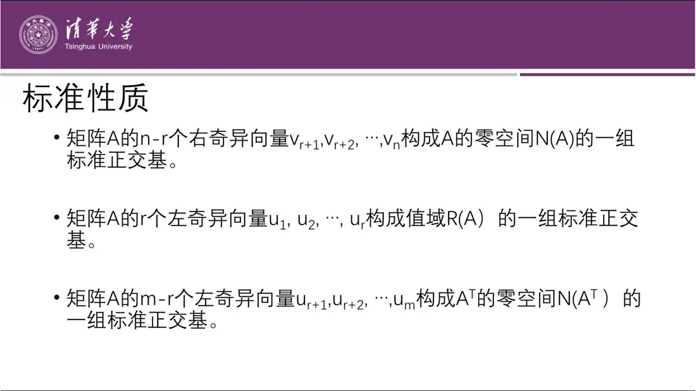

原文：

标准性质

\- 矩阵A的n-r个右奇异向量 $v_{r+1},v_{r+2},\cdots,v_{n}$ 构成A的零空间N(A)的一组标准正交基。

\- 矩阵A的r个左奇异向量 $u_{1}, u_{2}, \cdots, u_{r}$ 构成值域R(A)的一组标准正交基。

\- 矩阵A的m-r个左奇异向量 $u_{r+1}, u_{r+2}, \cdots, u_m$ 构成 $A^T$ 的零空间 $N(A^T)$ 的一组标准正交基。

清華大學 Tsinghua University

### 奇异值分解的计算

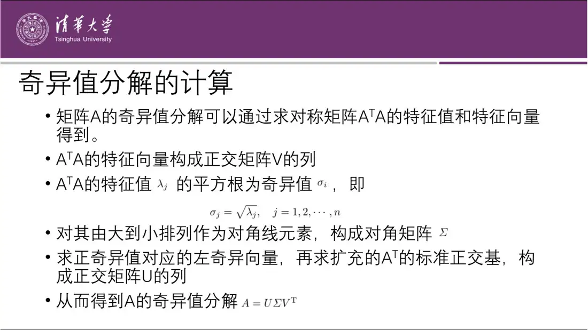

原文：

奇异值分解的计算

\- 矩阵A的奇异值分解可以通过求对称矩阵 $A^{T}A$ 的特征值和特征向量得到。

\- $\mathsf{A}^{\mathsf{T}}\mathsf{A}$ 的特征向量构成正交矩阵V的列

\- $\mathsf{A}^{\mathsf{T}}\mathsf{A}$ 的特征值 $\lambda_{j}$ 的平方根为奇异值 $\sigma_{i}$ ，即

$$
\sigma_ {j} = \sqrt {\lambda_ {j}}, \quad j = 1, 2, \dots , n
$$

\- 对其由大到小排列作为对角线元素，构成对角矩阵 $\Sigma$

\- 求正奇异值对应的左奇异向量，再求扩充的A $^{T}$ 的标准正交基，构成正交矩阵U的列

\- 从而得到A的奇异值分解 $A = U\Sigma V^{\mathrm{T}}$

Tsinghua University
清華大學

### 奇异值分解的计算

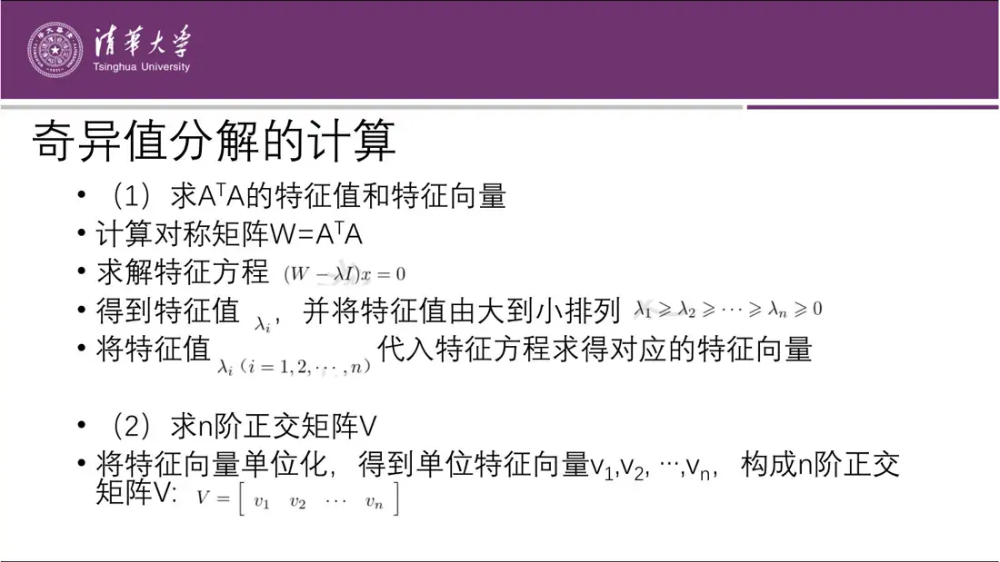

原文：

奇异值分解的计算

• (1) 求 $A^{T}A$ 的特征值和特征向量

\- 计算对称矩阵 $W = A^{\top}A$

\- 求解特征方程 $(W - \lambda I)x = 0$

\- 得到特征值 $\lambda_{i}$ ，并将特征值由大到小排列 $\lambda_{1} \geqslant \lambda_{2} \geqslant \cdots \geqslant \lambda_{n} \geqslant 0$

\- 将特征值 $\lambda_{i} (i = 1,2,\dots ,n)$ 代入特征方程求得对应的特征向量

• (2) 求n阶正交矩阵V

\- 将特征向量单位化，得到单位特征向量 $v_{1}, v_{2}, \cdots, v_{n}$ ，构成n阶正交矩阵V： $V = \left[ \begin{array}{cccc} v_{1} & v_{2} & \cdots & v_{n} \end{array} \right]$

Tsinghua University
清華大學

### 奇异值分解的计算

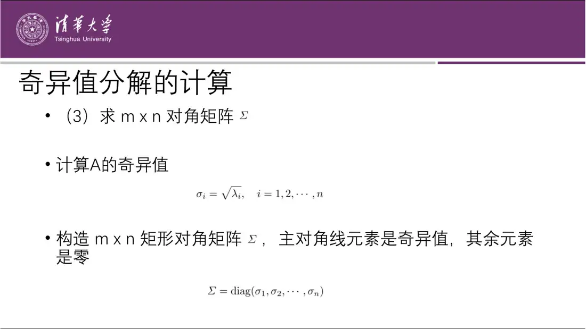

原文：

奇异值分解的计算

• (3) 求 m x n 对角矩阵 $\Sigma$

\- 计算A的奇异值

$$
\sigma_ {i} = \sqrt {\lambda_ {i}}, \quad i = 1, 2, \dots , n
$$

\- 构造 $m \times n$ 矩形对角矩阵 $\Sigma$ ，主对角线元素是奇异值，其余元素是零

$$
\Sigma = \mathrm{diag} (\sigma_ {1}, \sigma_ {2}, \dots , \sigma_ {n})
$$

Tsinghua University
清華大學

### 奇异值分解的计算

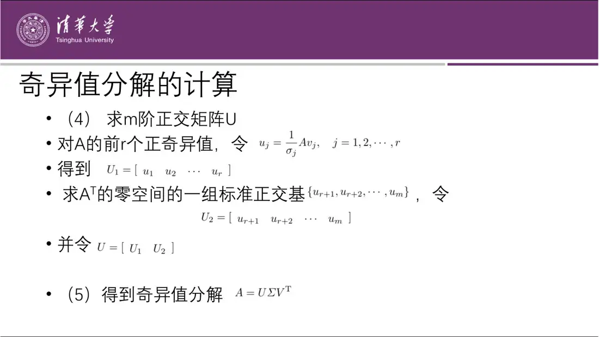

原文：

奇异值分解的计算

• (4) 求m阶正交矩阵U

\- 对A的前r个正奇异值，令 $u_{j} = \frac{1}{\sigma_{j}} Av_{j}, j = 1,2,\dots ,r$

\- 得到 $U_{1} = \left[ \begin{array}{lll}\mathcal{U}_{1} & u_{2} & \dots & u_{r} \end{array} \right]$

\- 求 $A^{T}$ 的零空间的一组标准正交基 $\{u_{r+1}, u_{r+2}, \cdots, u_{m}\}$ ，令

$$
U _ {2} = \left[ \begin{array}{c c c c} u _ {r + 1} & u _ {r + 2} & \dots & u _ {m} \end{array} \right]
$$

\- 并令 $U = \left[ \begin{array}{ll} U_1 & U_2 \end{array} \right]$

(5) 得到奇异值分解 $A = U\Sigma V^{\mathrm{T}}$

Tsinghua University
清華大學

### \- 试求矩阵

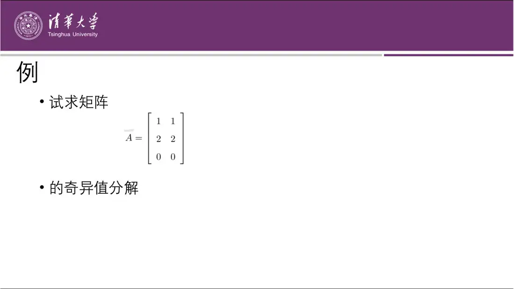

原文：

例

\- 试求矩阵

$$
A = \left[ \begin{array}{l l} 1 & 1 \\ 2 & 2 \\ 0 & 0 \end{array} \right]
$$

\- 的奇异值分解

Tsinghua University
清華大學
1911-1911

### • (1) 求 $A^{T}A$ 的特征值和特征向量

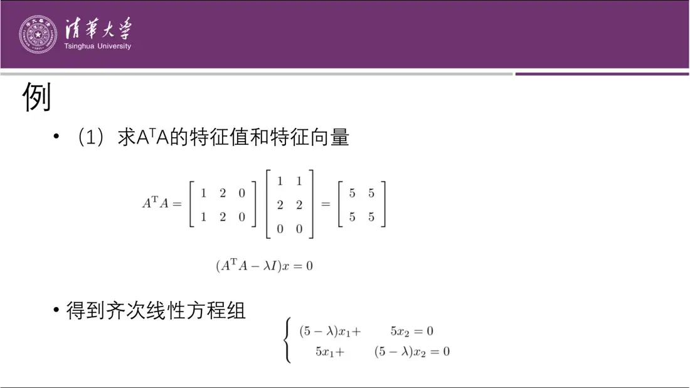

原文：

例

• (1) 求 $A^{T}A$ 的特征值和特征向量

$$
A ^ {\mathrm{T}} A = \left[ \begin{array}{l l l} 1 & 2 & 0 \\ 1 & 2 & 0 \end{array} \right] \left[ \begin{array}{l l} 1 & 1 \\ 2 & 2 \\ 0 & 0 \end{array} \right] = \left[ \begin{array}{l l} 5 & 5 \\ 5 & 5 \end{array} \right]
$$

$$
(A ^ {\mathrm{T}} A - \lambda I) x = 0
$$

\- 得到齐次线性方程组

$$
\left\{ \begin{array}{c c} (5 - \lambda) x _ {1} + & 5 x _ {2} = 0 \\ 5 x _ {1} + & (5 - \lambda) x _ {2} = 0 \end{array} \right.
$$

Tsinghua University
清華大學

### \- 该方程有非零解的充要条件是

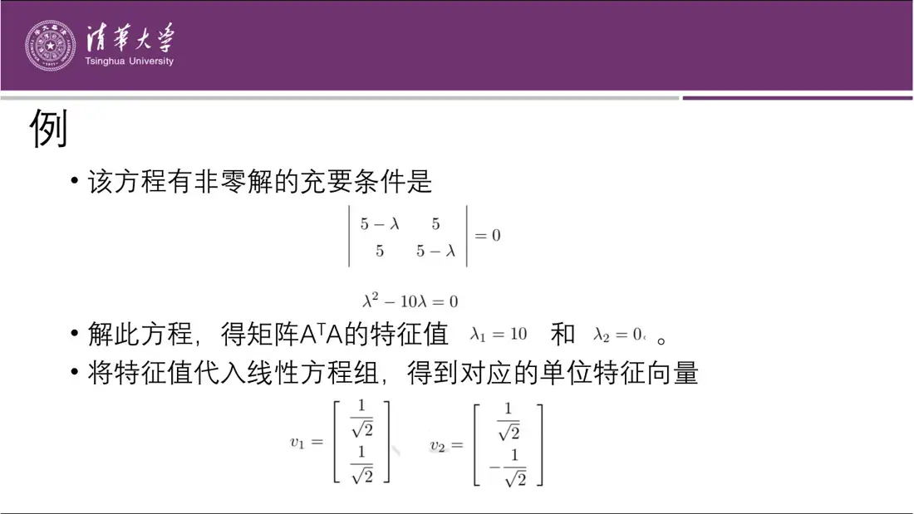

原文：

例

\- 该方程有非零解的充要条件是

$$
\left| \begin{array}{c c} 5 - \lambda & 5 \\ 5 & 5 - \lambda \end{array} \right| = 0
$$

$$
\lambda^ {2} - 1 0 \lambda = 0
$$

\- 解此方程，得矩阵 $A^{\top}A$ 的特征值 $\lambda_{1}=10$ 和 $\lambda_{2}=0$ 。

\- 将特征值代入线性方程组，得到对应的单位特征向量

$$
v _ {1} = \left[ \begin{array}{c} \frac {1}{\sqrt {2}} \\ \frac {1}{\sqrt {2}} \end{array} \right] \qquad v _ {2} = \left[ \begin{array}{c} \frac {1}{\sqrt {2}} \\ - \frac {1}{\sqrt {2}} \end{array} \right]
$$

Tsinghua University
清華大學

### • (2) 求正交矩阵V

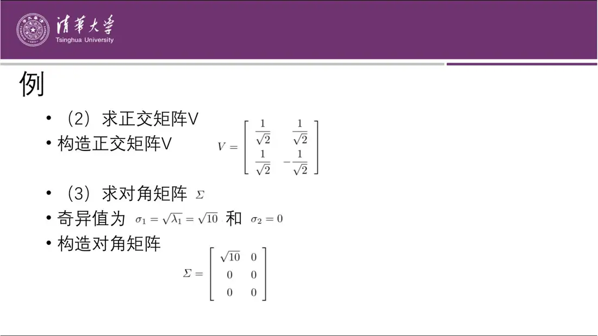

原文：

例

• (2) 求正交矩阵V

\- 构造正交矩阵V

$$
V = \left[ \begin{array}{c c} \frac {1}{\sqrt {2}} & \frac {1}{\sqrt {2}} \\ \frac {1}{\sqrt {2}} & - \frac {1}{\sqrt {2}} \end{array} \right]
$$

• (3) 求对角矩阵 $\Sigma$

\- 奇异值为 $\sigma_{1} = \sqrt{\lambda_{1}} = \sqrt{10}$ 和 $\sigma_{2} = 0$

\- 构造对角矩阵

$$
\Sigma = \left[ \begin{array}{c c} \sqrt {1 0} & 0 \\ 0 & 0 \\ 0 & 0 \end{array} \right]
$$

Tsinghua University
清華大學

### • (4) 求正交矩阵U

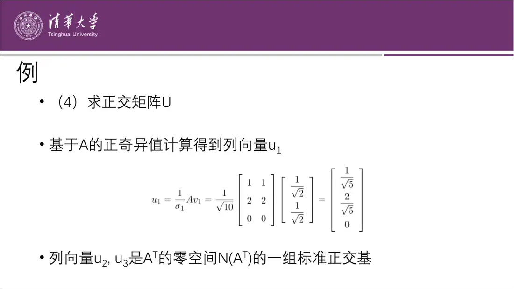

原文：

例

• (4) 求正交矩阵U

\- 基于A的正奇异值计算得到列向量 $u_{1}$

$$
u _ {1} = \frac {1}{\sigma_ {1}} A v _ {1} = \frac {1}{\sqrt {1 0}} \left[ \begin{array}{l l} 1 & 1 \\ 2 & 2 \\ 0 & 0 \end{array} \right] \left[ \begin{array}{l} \frac {1}{\sqrt {2}} \\ \frac {1}{\sqrt {2}} \end{array} \right] = \left[ \begin{array}{l} \frac {1}{\sqrt {5}} \\ \frac {2}{\sqrt {5}} \\ 0 \end{array} \right]
$$

\- 列向量 $u_{2}, u_{3}$ 是 $A^{T}$ 的零空间 $N(A^{T})$ 的一组标准正交基

Tsinghua University
清華大學

### \- 求解

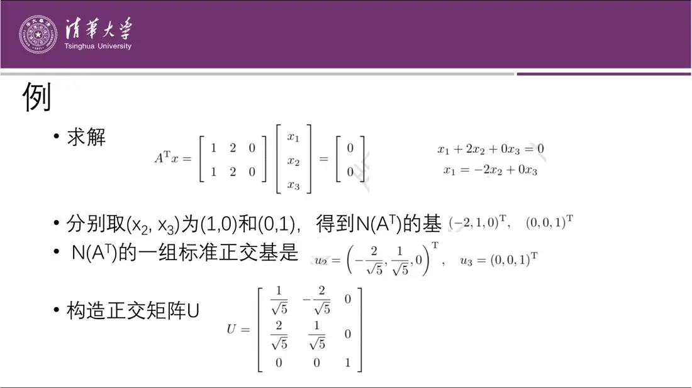

原文：

例

\- 求解

$$
A ^ {\mathrm{T}} x = \left[ \begin{array}{l l l} 1 & 2 & 0 \\ 1 & 2 & 0 \end{array} \right] \left[ \begin{array}{l} x _ {1} \\ x _ {2} \\ x _ {3} \end{array} \right] = \left[ \begin{array}{l} 0 \\ 0 \end{array} \right] \qquad \qquad \qquad \qquad \qquad x _ {1} + 2 x _ {2} + 0 x _ {3} = 0   x _ {1} = - 2 x _ {2} + 0 x _ {3}
$$

\- 分别取 $(x_{2}, x_{3})$ 为(1,0)和(0,1)，得到 $N(A^{\top})$ 的基 $(-2,1,0)^{\mathrm{T}}, (0,0,1)^{\mathrm{T}}$

\- $\mathsf{N}(\mathsf{A}^{\top})$ 的一组标准正交基是 $u_{2} = \left(-\frac{2}{\sqrt{5}},\frac{1}{\sqrt{5}},0\right)^{\mathrm{T}}, u_{3} = (0,0,1)^{\mathrm{T}}$

\- 构造正交矩阵U $U = \begin{bmatrix} \frac{1}{\sqrt{5}} & -\frac{2}{\sqrt{5}} & 0 \\ \frac{2}{\sqrt{5}} & \frac{1}{\sqrt{5}} & 0 \\ 0 & 0 & 1 \end{bmatrix}$

Tsinghua University
清華大學

### • (5) 矩阵A的奇异值分解

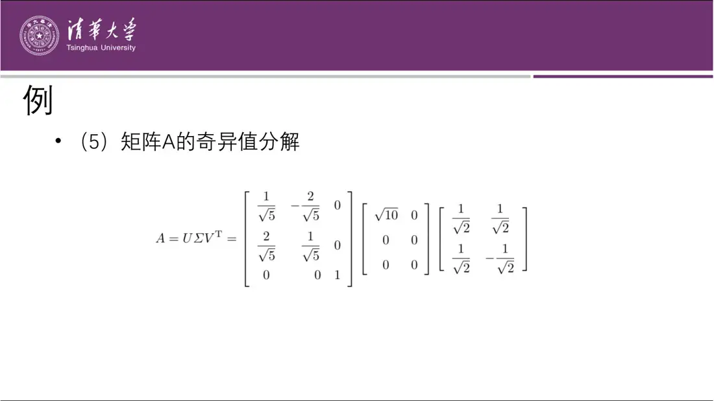

原文：

例

• (5) 矩阵A的奇异值分解

$$
A = U \Sigma V ^ {\mathrm{T}} = \left[ \begin{array}{c c c} \frac {1}{\sqrt {5}} & - \frac {2}{\sqrt {5}} & 0 \\ \frac {2}{\sqrt {5}} & \frac {1}{\sqrt {5}} & 0 \\ 0 & 0 & 1 \end{array} \right] \left[ \begin{array}{c c} \sqrt {1 0} & 0 \\ 0 & 0 \\ 0 & 0 \end{array} \right] \left[ \begin{array}{c c} \frac {1}{\sqrt {2}} & \frac {1}{\sqrt {2}} \\ \frac {1}{\sqrt {2}} & - \frac {1}{\sqrt {2}} \end{array} \right]
$$

Tsinghua University
清華大學

### 弗罗贝尼乌斯范数

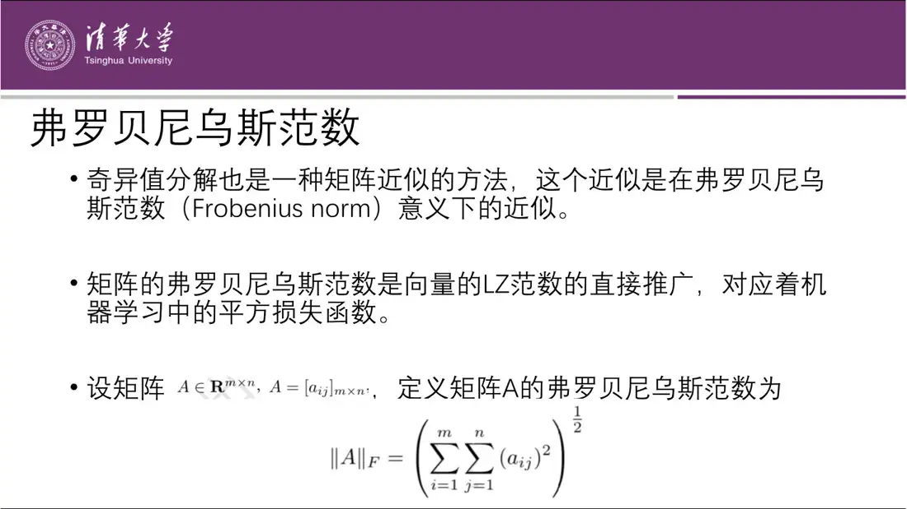

原文：

弗罗贝尼乌斯范数

\- 奇异值分解也是一种矩阵近似的方法，这个近似是在弗罗贝尼乌斯范数（Frobenius norm）意义下的近似。

\- 矩阵的弗罗贝尼乌斯范数是向量的LZ范数的直接推广，对应着机器学习中的平方损失函数。

\- 设矩阵 $A \in \mathbf{R}^{m \times n}$ , $A = [a_{ij}]_{m \times n}$ , 定义矩阵A的弗罗贝尼乌斯范数为

$$
\| A \| _ {F} = \left(\sum_ {i = 1} ^ {m} \sum_ {j = 1} ^ {n} (a _ {i j}) ^ {2}\right) ^ {\frac {1}{2}}
$$

Tsinghua University
清華大學

### 弗罗贝尼乌斯范数

原文：

弗罗贝尼乌斯范数

\- 引理15.1

设矩阵 $A \in R^{m \times n}$ ，A 的奇异值分解为 $U \Sigma V^{T}$ ，其中 $\Sigma = \text{diag}(\sigma_{1}, \cdots, \sigma_{n})$ ，则

$$
\| A \| _ {F} = (\sigma_ {1} ^ {2} + \sigma_ {2} ^ {2} + \dots + \sigma_ {n} ^ {2}) ^ {\frac {1}{2}}
$$

Tsinghua University
清華大學

### 弗罗贝尼乌斯范数

原文：

弗罗贝尼乌斯范数

\- 证明:

\- 一般地，若Q是m阶正交矩阵，则有 $\| QA\| _F = \| A\| _F$

\- 因为

$$
\begin{array}{c} \| Q A \| _ {F} ^ {2} = \| (Q a _ {1}, Q a _ {2}, \dots , Q a _ {n}) \| _ {F} ^ {2} \\ = \sum_ {i = 1} ^ {n} \| Q a _ {i} \| _ {2} ^ {2} = \sum_ {i = 1} ^ {n} \| a _ {i} \| _ {2} ^ {2} = \| A \| _ {F} ^ {2} \end{array}
$$

\- 同样，若P是n阶正交矩阵，则有 $\| AP^{\mathrm{T}}\|_{F} = \| A\|_{F}$

\- 故 $\| A \|_F = \| U \Sigma V^{\mathrm{T}} \|_F = \| \Sigma \|_F$

\- 即 $\| A\| _F = (\sigma_1^2 +\sigma_2^2 +\dots +\sigma_n^2)^{\frac{1}{2}}$

Tsinghua University
清華大學

### 矩阵的最优近似

原文：

矩阵的最优近似

\- 奇异值分解是在平方损失弗罗贝尼乌斯范数）意义下对矩阵的最优近似，即数据压缩。

设矩阵 $A \in \mathbf{R}^{m \times n}$ , 矩阵的秩 $\operatorname{rank}(A) = r$ , 并设 $\mathcal{M}$ 为 $\mathbf{R}^{m \times n}$ 中所

有秩不超过 $k$ 的矩阵集合, $0 < k < r$ , 则存在一个秩为 $k$ 的矩阵 $X \in \mathcal{M}$ , 使得

$$
\| A - X \| _ {F} = \min _ {S \in \mathcal {M}} \| A - S \| _ {F}\tag{15.31}
$$

称矩阵 $X$ 为矩阵 $A$ 在弗罗贝尼乌斯范数意义下的最优近似。

Tsinghua University
清華大學

### 矩阵的最优近似

原文：

矩阵的最优近似

设矩阵 $A \in \mathbf{R}^{m \times n}$ , 矩阵的秩 $\operatorname{rank}(A) = r$ , 有奇异值分解 $A =$

$U\Sigma V^{\mathrm{T}}$ ，并设 $\mathcal{M}$ 为 $\mathbf{R}^{m\times n}$ 中所有秩不超过 $k$ 的矩阵的集合， $0 < k < r$ ，若秩为 $k$ 的

矩阵 $X \in \mathcal{M}$ 满足 $\| A - X \|_F = \min_{S \in \mathcal{M}} \| A - S \|_F$ 15.32

则

$$
\| A - X \| _ {F} = \left(\sigma_ {k + 1} ^ {2} + \sigma_ {k + 2} ^ {2} + \dots + \sigma_ {n} ^ {2}\right) ^ {\frac {1}{2}} \quad 1 5. 3 3
$$

特别地，若 $A' = U \Sigma' V^{T}$ ，其中

$$
\Sigma^ {\prime} = \left[ \begin{array}{c c c c c c} \sigma_ {1} & & & & & \\ & \ddots & & & 0 & \\ & & \sigma_ {k} & & & \\ & & & 0 & & \\ & 0 & & & \ddots & \\ & & & & & 0 \end{array} \right] = \left[ \begin{array}{c c} \Sigma_ {k} & 0 \\ 0 & 0 \end{array} \right]
$$

则

$$
\| A - A ^ {\prime} \| _ {F} = (\sigma_ {k + 1} ^ {2} + \sigma_ {k + 2} ^ {2} + \dots + \sigma_ {n} ^ {2}) ^ {\frac {1}{2}} = \min _ {S \in \mathcal {M}} \| A - S \| _ {F}
$$

Tsinghua University
清華大學

### 矩阵的最优近似

原文：

矩阵的最优近似

\- 证明

\- 令 $X \in \mathcal{M}$ 为满足式（15.32）的一个矩阵。由于

$$
\| A - X \| _ {F} \leqslant \| A - A ^ {\prime} \| _ {F} = (\sigma_ {k + 1} ^ {2} + \sigma_ {k + 2} ^ {2} + \dots + \sigma_ {n} ^ {2}) ^ {\frac {1}{2}}
$$

\- 下面证明

$$
\| A - X \| _ {F} \geqslant (\sigma_ {k + 1} ^ {2} + \sigma_ {k + 2} ^ {2} + \dots + \sigma_ {n} ^ {2}) ^ {\frac {1}{2}}
$$

于是式（15.33）成立

Tsinghua University
清華大學

### 矩阵的最优近似

原文：

矩阵的最优近似

\- 设X的奇异值分解为 $Q\Omega P^{\mathrm{T}}$

\- 其中

$$
\Omega = \left[ \begin{array}{c c c c c} \omega_ {1} & & & & \\ & \ddots & & 0 & \\ & & \omega_ {k} & & \\ & & 0 & & \\ & 0 & & \ddots & \\ & & & & 0 \end{array} \right] = \left[ \begin{array}{c c} \Omega_ {k} & 0 \\ 0 & 0 \end{array} \right]
$$

\- 若令矩阵 $B=Q^{T}AP$ ，则 $A=QBP^{T}$ 。由此得到

$$
\| A - X \| _ {F} = \| Q (B - \Omega) P ^ {\mathrm{T}} \| _ {F} = \| B - \Omega \| _ {F}
$$

Tsinghua University
清華大學

### 矩阵的最优近似

原文：

矩阵的最优近似

\- 用 $\Omega$ 分块方法对B分块

$$
B = \left[ \begin{array}{c c} B _ {1 1} & B _ {1 2} \\ B _ {2 1} & B _ {2 2} \end{array} \right]
$$

\- 其中 $B_{11}$ 是 $k \times k$ 子矩阵， $B_{12}$ 是 $k \times (n - k)$ 的子矩阵， $B_{21}$ 是 $(m - k) \times k$ 子矩阵， $B_{22}$ 是 $(m - k) \times (n - k)$ 子矩阵。可得

$$
\begin{array}{r l} & {\| A - X \| _ {F} ^ {2} = \| B - \varOmega \| _ {F} ^ {2}} \\ & {\qquad = \| B _ {1 1} - \varOmega_ {k} \| _ {F} ^ {2} + \| B _ {1 2} \| _ {F} ^ {2} + \| B _ {2 1} \| _ {F} ^ {2} + \| B _ {2 2} \| _ {F} ^ {2}} \end{array}
$$

清華大學 Tsinghua University

### 矩阵的最优近似

原文：

矩阵的最优近似

\- 现证 $B_{12}=0,\quad B_{21}=0$ 。用反证法。若 $B_{12}\neq0$ ，令

$$
Y = Q \left[ \begin{array}{c c} B _ {1 1} & B _ {1 2} \\ 0 & 0 \end{array} \right] P ^ {\mathrm{T}}
$$

\- 则 $Y \in \mathcal{M}$ , 且 $\| A - Y \|_F^2 = \| B_{21} \|_F^2 + \| B_{22} \|_F^2 < \| A - X \|_F^2$

\- 这与X的定义式 $\| A - X\| _F\leqslant \| A - A'\| _F = (\sigma_{k + 1}^2 +\sigma_{k + 2}^2 +\dots +\sigma_n^2)^{\frac{1}{2}}$ 矛盾

\- 因此 $B_{12}=0$ ，同样可证 $B_{21}=0$ 。于是

$$
\left\| A - X \right\| _ {F} ^ {2} = \left\| B _ {1 1} - \Omega_ {k} \right\| _ {F} ^ {2} + \left\| B _ {2 2} \right\| _ {F} ^ {2}
$$

Tsinghua University
清華大學

### 矩阵的最优近似

原文：

矩阵的最优近似

\- 再证 $B_{11} = \Omega_k$ ，为此令 $Z = Q\left[ \begin{array}{cc} B_{11} & 0 \\ 0 & 0 \end{array} \right] P^{\mathrm{T}}$

\- 则 $Z \in \mathcal{M}$ ，且 $\| A - Z \|_F^2 = \| B_{22} \|_F^2 \leqslant \| B_{11} - \Omega_k \|_F^2 + \| B_{22} \|_F^2 = \| A - X \|_F^2$

\- 由 $\| A - X\| _F\leqslant \| A - A^{\prime}\| _F = (\sigma_{k + 1}^{2} + \sigma_{k + 2}^{2} + \dots +\sigma_{n}^{2})^{\frac{1}{2}}$ 知， $\| B_{11} - \Omega_k\| _F^2 = 0$ ，即 $B_{11} = \Omega_k$

\- 最后看 $\mathrm{B}_{22}$ 。若 $(m - k) \times (n - k)$ 子矩阵 $\mathrm{B}_{22}$ 有奇异值分解 $U_{1} \wedge V_{1}^{\mathrm{T}}$ ，则

$$
\left\| A - X \right\| _ {F} = \left\| B _ {2 2} \right\| _ {F} = \left\| \Lambda \right\| _ {F}
$$

Tsinghua University
清華大學

### 矩阵的最优近似

原文：

矩阵的最优近似

\- 证明 $\Lambda$ 的对角线元素为A的奇异值。为此，令

$$
U _ {2} = \left[ \begin{array}{c c} I _ {k} & 0 \\ 0 & U _ {1} \end{array} \right], \quad V _ {2} = \left[ \begin{array}{c c} I _ {k} & 0 \\ 0 & V _ {1} \end{array} \right]
$$

\- 其中 $\mathsf{I}_{\mathsf{k}}$ 是k阶单位矩阵， $\mathsf{U}_2$ ， $\mathsf{V}_2$ 的分块与B的分块一致注意到B及 $\mathsf{B}_{22}$ 的奇异值分解，即得 $U_2^{\mathrm{T}}Q^{\mathrm{T}}APV_2 = \begin{bmatrix} \Omega_k & 0 \\ 0 & \Lambda \end{bmatrix}$ $A = (QU_2)\begin{bmatrix} \Omega_k & 0 \\ 0 & \Lambda \end{bmatrix}(PV_2)^{\mathrm{T}}$

\- 由此可知 $\Lambda$ 的对角线元素为A的奇异值，故有

$$
\| A - X \| _ {F} = \| \varLambda \| _ {F} \geqslant (\sigma_ {k + 1} ^ {2} + \sigma_ {k + 2} ^ {2} + \dots + \sigma_ {n} ^ {2}) ^ {\frac {1}{2}}
$$

\- 可证

$$
\| A - X \| _ {F} = (\sigma_ {k + 1} ^ {2} + \sigma_ {k + 2} ^ {2} + \dots + \sigma_ {n} ^ {2}) ^ {\frac {1}{2}} = \| A - A ^ {\prime} \| _ {F}
$$

Tsinghua University
清華大學

### 矩阵的最优近似

原文：

矩阵的最优近似

\- 在秩不超过k的 m x n 矩阵的集合中，存在矩阵A的弗罗贝尼乌斯范数意义下的最优近似矩阵X

\- $A' = U\Sigma'V^{\mathrm{T}}$ 是达到最优值的一个矩阵

\- 紧奇异值分解是在弗罗贝尼乌斯范数意义下的无损压缩

\- 截断奇异值分解是有损压缩

\- 截断奇异值分解得到的矩阵的秩为k，通常远小于原始矩阵的秩r，所以是由低秩矩阵实现了对原始矩阵的压缩。

Tsinghua University
清華大學
1911-1911

### 矩阵的外积展开式

原文：

矩阵的外积展开式

\- 矩阵A的奇异值分解 $U\Sigma V^{\mathrm{T}}$ 也可以由外积形式表示

\- 若将A的奇异值分解看成矩阵 $U\Sigma$ 和 $\mathsf{V}^{\mathsf{T}}$ 的乘积，将 $U\Sigma$ 按列向量分块，将 $\mathsf{V}^{\mathsf{T}}$ 按行向量分块，即得

$$
\begin{array}{r l} & U \Sigma = \left[ \begin{array}{l l l l} \sigma_ {1} u _ {1} & \sigma_ {2} u _ {2} & \dots & \sigma_ {n} u _ {n} \end{array} \right] \\ & V ^ {\mathrm{T}} = \left[ \begin{array}{l} v _ {1} ^ {\mathrm{T}} \\ v _ {2} ^ {\mathrm{T}} \\ \vdots \\ v _ {n} ^ {\mathrm{T}} \end{array} \right] \end{array}
$$

Tsinghua University
清華大學

### 矩阵的外积展开式

原文：

矩阵的外积展开式

\- 则 $A = \sigma_{1}u_{1}v_{1}^{\mathrm{T}} + \sigma_{2}u_{2}v_{2}^{\mathrm{T}} + \dots +\sigma_{n}u_{n}v_{n}^{\mathrm{T}}$

A的外积展开式

• 即

$$
u _ {i} v _ {j} ^ {\mathrm{T}} = \left[ \begin{array}{c} u _ {1 i} \\ u _ {2 i} \\ \vdots \\ u _ {m i} \end{array} \right] \left[ \begin{array}{l l l l} v _ {1 j} & v _ {2 j} & \dots & v _ {n j} \end{array} \right] = \left[ \begin{array}{c c c c} u _ {1 i} v _ {1 j} & u _ {1 i} v _ {2 j} & \dots & u _ {1 i} v _ {n j} \\ u _ {2 i} v _ {1 j} & u _ {2 i} v _ {2 j} & \dots & u _ {2 i} v _ {n j} \\ \vdots & \vdots & & \vdots \\ u _ {m i} v _ {1 j} & u _ {m i} v _ {2 j} & \dots & u _ {m i} v _ {n j} \end{array} \right]
$$

\- A的外积展开式也可写为 $A = \sum_{k=1}^{n} A_k = \sum_{k=1}^{n} \sigma_k u_k v_k^{\mathrm{T}}$

清華大學 Tsinghua University

### 矩阵的外积展开式

原文：

矩阵的外积展开式

\- 由矩阵A的外积展开式知，若A的秩为n，则

$$
A = \sigma_ {1} u _ {1} v _ {1} ^ {\mathrm{T}} + \sigma_ {2} u _ {2} v _ {2} ^ {\mathrm{T}} + \dots + \sigma_ {n} u _ {n} v _ {n} ^ {\mathrm{T}}
$$

\- 设矩阵

$$
A _ {k} = \sigma_ {1} u _ {1} v _ {1} ^ {\mathrm{T}} + \sigma_ {2} u _ {2} v _ {2} ^ {\mathrm{T}} + \dots + \sigma_ {k} u _ {k} v _ {k} ^ {\mathrm{T}}
$$

\- 则 $A_{k}$ 的秩为 $k$ , 并且 $A_{k}$ 是秩为 $k$ 矩阵在弗罗贝尼乌斯范数意义 $A$ 的最优近似矩阵

\- 矩阵 $A_{k}$ 就是A的截断奇异值分解

\- 由于通常奇异值 $\sigma_{i}$ 递减很快，所以k取很小值时， $A_{k}$ 也可以对A有很好的近似。

Tsinghua University
清華大學

### \- 给出矩阵A

原文：

例

\- 给出矩阵A

$$
A = \left[ \begin{array}{c c c c} 1 & 0 & 0 & 0 \\ 0 & 0 & 0 & 4 \\ 0 & 3 & 0 & 0 \\ 0 & 0 & 0 & 0 \\ 2 & 0 & 0 & 0 \end{array} \right]
$$

\- 的秩为3，求A的秩为2的最优近似

Tsinghua University
清華大學

### \- 从前列已知

原文：

例

\- 从前列已知

\- 于是得到

$$
u _ {1} = \left[ \begin{array}{l} 0 \\ 1 \\ 0 \\ 0 \\ 0 \end{array} \right], \quad u _ {2} = \left[ \begin{array}{l} 0 \\ 0 \\ 1 \\ 0 \\ 0 \end{array} \right], \quad v _ {1} = \left[ \begin{array}{l} 0 \\ 0 \\ 0 \\ 1 \end{array} \right], \quad v _ {2} = \left[ \begin{array}{l} 0 \\ 1 \\ 0 \\ 0 \end{array} \right]
$$

$$
\sigma_ {1} = 4, \quad \sigma_ {2} = 3
$$

$A_{2} = \sigma_{1}u_{1}v_{1}^{\mathrm{T}} + \sigma_{2}u_{2}v_{2}^{\mathrm{T}} = \left[ \begin{array}{cccc}0 & 0 & 0 & 0\\ 0 & 0 & 0 & 4\\ 0 & 3 & 0 & 0\\ 0 & 0 & 0 & 0\\ 0 & 0 & 0 & 0 \end{array} \right]$ ，以此矩阵为A的最优近似

Tsinghua University
清華大學
