# 《统计学习方法》第18章 概率潜在语义分析（课件）

原件的每一页，下面附识别出的文字。

### 第十八章 概率潜在语义分析

原文：

第十八章 概率潜在语义分析

大華津
TSINGHUA UNIVERSITY
清華大學
Tsinghua University

### 概率潜在语义分析

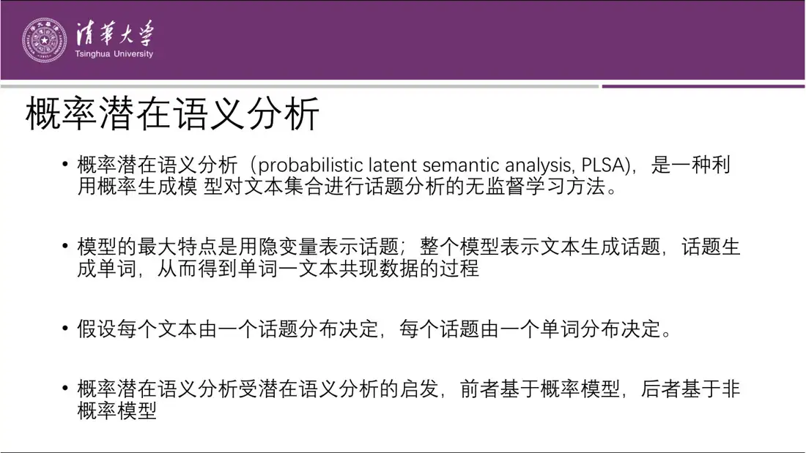

原文：

概率潜在语义分析

\- 概率潜在语义分析（probabilistic latent semantic analysis, PLSA），是一种利用概率生成模型对文本集合进行话题分析的无监督学习方法。

\- 模型的最大特点是用隐变量表示话题；整个模型表示文本生成话题，话题生成单词，从而得到单词一文本共现数据的过程

\- 假设每个文本由一个话题分布决定，每个话题由一个单词分布决定。

\- 概率潜在语义分析受潜在语义分析的启发，前者基于概率模型，后者基于非概率模型

Tsinghua University
清華大學

### 基本想法

原文：

基本想法

\- 给定一个文本集合，每个文本讨论若干个话题，每个话题由若干个单词表示。

\- 对文本集合进行概率潜在语义分析，就能够发现每个文本的话题，以及每个话题的单词。

\- 话题是不能从数据中直接观察到的，是潜在的。

清華大學 Tsinghua University

### 基本想法

原文：

基本想法

\- 文本集合转换为文本-单词共现数据，具体表现为单词-文本矩阵

\- 文本数据基于如下的概率模型产生（共现模型）：

\- 首先有话题的概率分布，然后有话题给定条件下文本的条件概率分布，以及话题给定条件下单词的条件概率分布。

\- 概率潜在语义分析就是发现由隐变量表示的话题，即潜在语义。

\- 直观上，语义相近的单词、语义相近的文本会被聚到相同的“软的类别”中，而话题所表示的就是这样的软的类别。

Tsinghua University
清華大學

### 基本想法

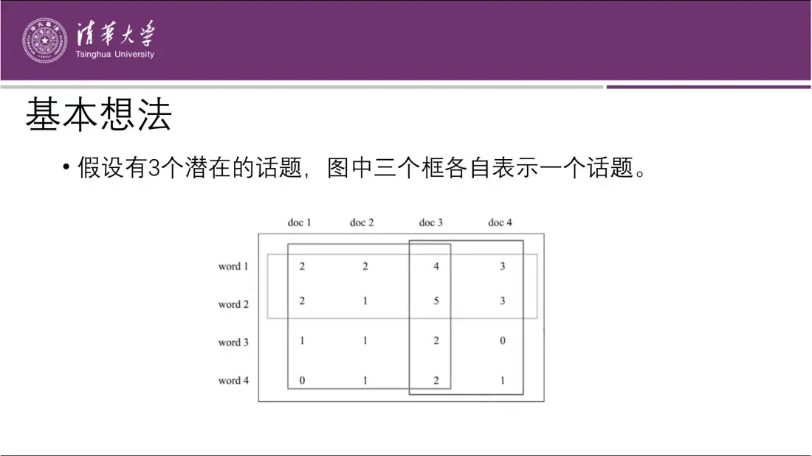

原文：

基本想法

\- 假设有3个潜在的话题，图中三个框各自表示一个话题。

清華大學 Tsinghua University

### 生成模型

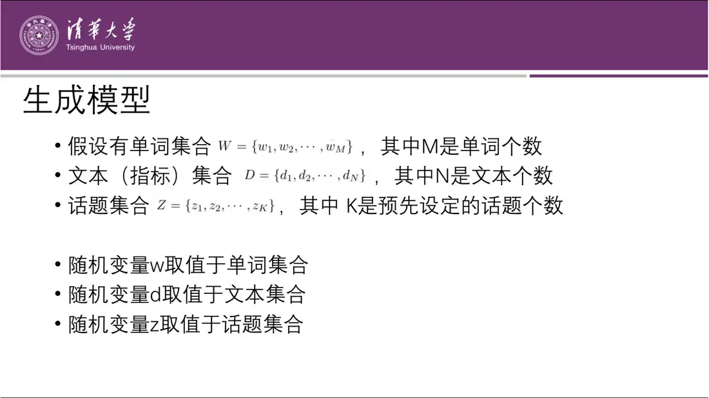

原文：

生成模型

\- 假设有单词集合 $W = \{w_{1}, w_{2}, \dots, w_{M}\}$ ，其中M是单词个数

\- 文本（指标）集合 $D = \{d_1, d_2, \cdots, d_N\}$ ，其中N是文本个数

\- 话题集合 $Z = \{z_{1}, z_{2}, \dots, z_{K}\}$ ，其中 K 是预先设定的话题个数

\- 随机变量w取值于单词集合

\- 随机变量d取值于文本集合

\- 随机变量z取值于话题集合

Tsinghua University
清華大學

### 生成模型

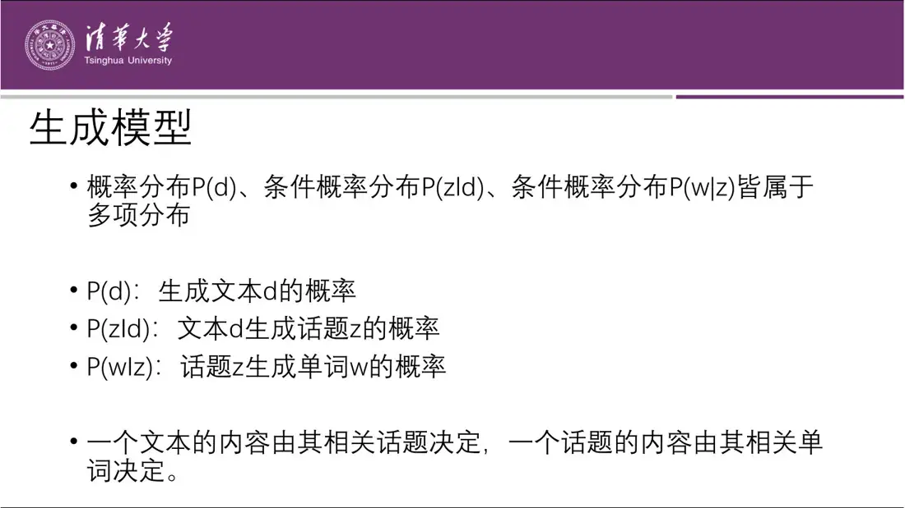

原文：

生成模型

\- 概率分布P(d)、条件概率分布P(zId)、条件概率分布P(w|z)皆属于多项分布

\- P(d): 生成文本d的概率

\- P(zId): 文本d生成话题z的概率

\- P(wlz): 话题z生成单词w的概率

\- 一个文本的内容由其相关话题决定，一个话题的内容由其相关单词决定。

清華大學 Tsinghua University

### 生成模型

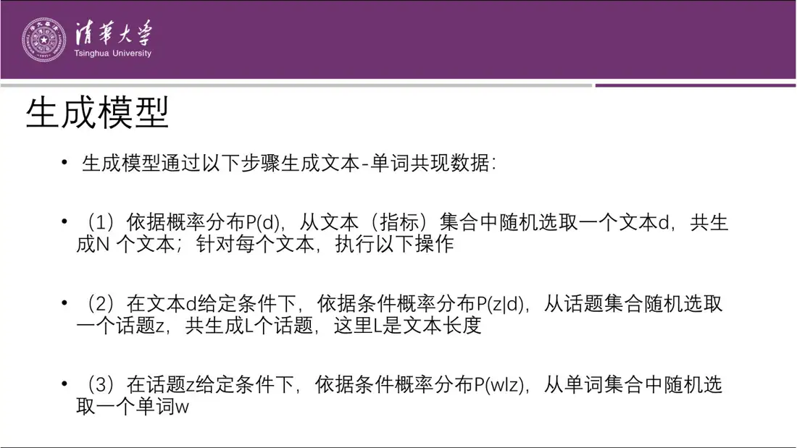

原文：

生成模型

\- 生成模型通过以下步骤生成文本-单词共现数据:

• (1) 依据概率分布P(d)，从文本（指标）集合中随机选取一个文本d，共生成N个文本；针对每个文本，执行以下操作

(2) 在文本d给定条件下, 依据条件概率分布P(z|d), 从话题集合随机选取一个话题z, 共生成L个话题, 这里L是文本长度

• (3) 在话题z给定条件下, 依据条件概率分布P(wlz), 从单词集合中随机选取一个单词w

Tsinghua University
清華大學

### 生成模型

原文：

生成模型

\- 生成模型中，单词变量w与文本变量d是观测变量，话题变量z是隐变量

\- 模型生成的是单词-话题-文本三元组(w, z, d)的集合，但观测到的是单词-文本二元组(w, d)的集合

\- 观测数据表示为单词-文本矩阵T的形式

\- 矩阵T的行表示单词，列表示文本，元素表示单词-文本对(w, d)的出现次数

清華大學 Tsinghua University

### 生成模型

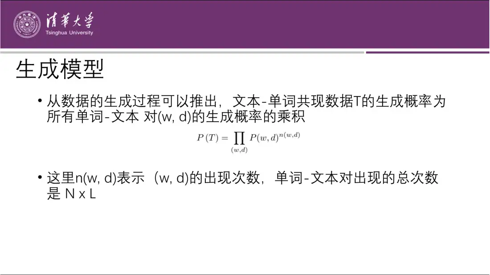

原文：

生成模型

\- 从数据的生成过程可以推出，文本-单词共现数据T的生成概率为所有单词-文本对(w, d)的生成概率的乘积

$$
P (T) = \prod_ {(w, d)} P (w, d) ^ {n (w, d)}
$$

\- 这里 $n(w, d)$ 表示 (w, d)的出现次数，单词-文本对出现的总次数是 $N \times L$

清華大學 Tsinghua University

### 生成模型

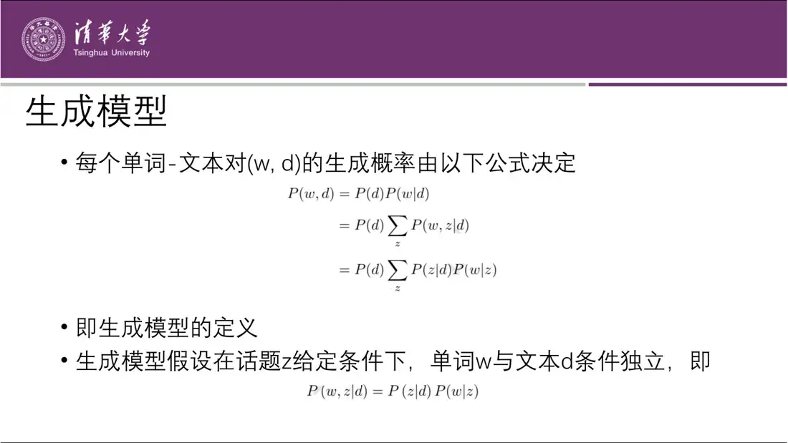

原文：

生成模型

\- 每个单词-文本对(w, d)的生成概率由以下公式决定

$$
\begin{array}{r l} & P (w, d) = P (d) P (w | d) \\ & \qquad = P (d) \sum_ {z} P (w, z | d) \\ & \qquad = P (d) \sum_ {z} P (z | d) P (w | z) \end{array}
$$

\- 即生成模型的定义

\- 生成模型假设在话题z给定条件下，单词w与文本d条件独立，即

$$
P (w, z | d) = P (z | d) P (w | z)
$$

清華大學 Tsinghua University

### 生成模型

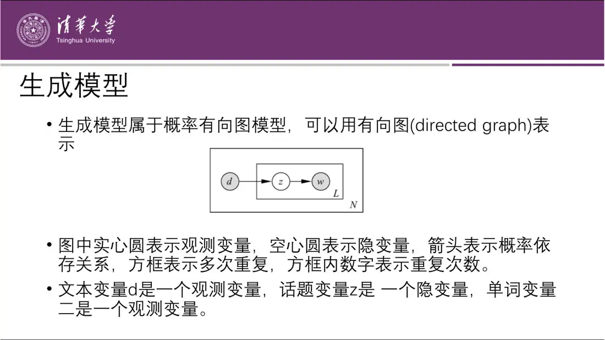

原文：

生成模型

\- 生成模型属于概率有向图模型，可以用有向图(directed graph)表示

\- 图中实心圆表示观测变量，空心圆表示隐变量，箭头表示概率依存关系，方框表示多次重复，方框内数字表示重复次数。

\- 文本变量d是一个观测变量，话题变量z是一个隐变量，单词变量二是一个观测变量。

Tsinghua University
清華大學

### 共现模型

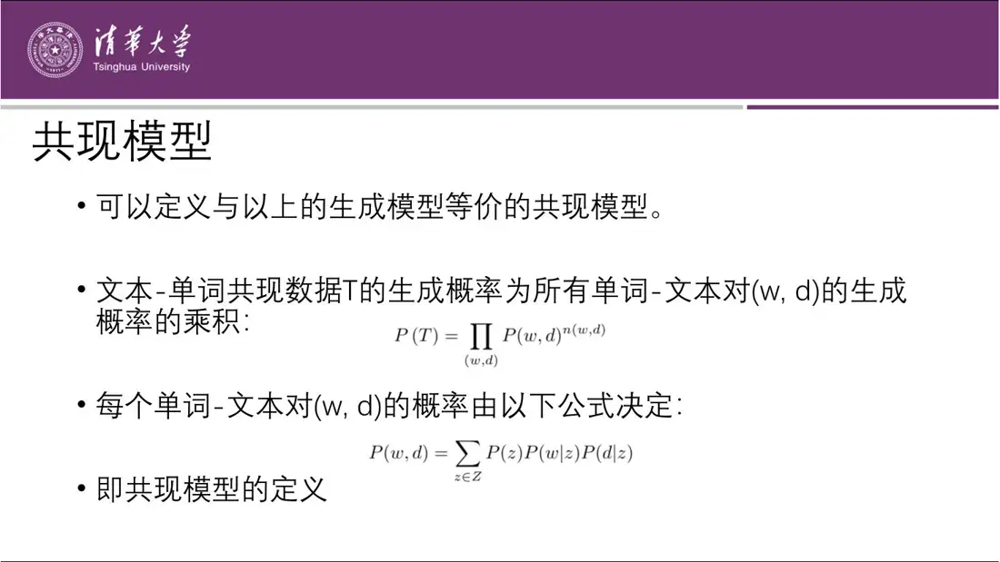

原文：

共现模型

\- 可以定义与以上的生成模型等价的共现模型。

\- 文本-单词共现数据T的生成概率为所有单词-文本对(w, d)的生成概率的乘积: $P(T) = \prod P(w, d)^{n(w, d)}$

$$
P (T) = \prod_ {(w, d)} P (w, d) ^ {n (w, d)}
$$

\- 每个单词-文本对(w, d)的概率由以下公式决定:

$$
P (w, d) = \sum_ {z \in Z} P (z) P (w | z) P (d | z)
$$

\- 即共现模型的定义

Tsinghua University
清華大學

### 共现模型

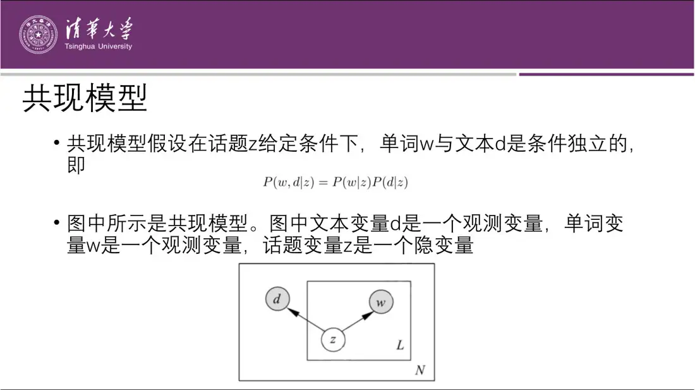

原文：

共现模型

\- 共现模型假设在话题z给定条件下，单词w与文本d是条件独立的，即

$$
P (w, d | z) = P (w | z) P (d | z)
$$

\- 图中所示是共现模型。图中文本变量d是一个观测变量，单词变量w是一个观测变量，话题变量z是一个隐变量

Tsinghua University
清華大學

### 共现模型

原文：

共现模型

\- 虽然生成模型与共现模型在概率公式意义上是等价的，但是拥有不同的性质。

\- 生成模型

\- 刻画文本-单词共现数据生成的过程

\- 单词变量w与文本变量d是非对称的

\- 非对称模型

\- 共现模型

\- 描述文本-单词共现数据拥有的模式

\- 单词变量w与文本变量d是对称的

\- 对称模型

Tsinghua University
清華大學
1911-1911

### 模型参数

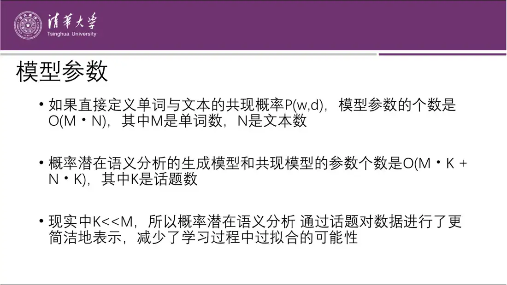

原文：

模型参数

\- 如果直接定义单词与文本的共现概率 $P(w,d)$ ，模型参数的个数是 $O(M \cdot N)$ ，其中M是单词数，N是文本数

\- 概率潜在语义分析的生成模型和共现模型的参数个数是O(M·K + N·K)，其中K是话题数

\- 现实中K<<M，所以概率潜在语义分析 通过话题对数据进行了更简洁地表示，减少了学习过程中过拟合的可能性

Tsinghua University
清華大學

### 模型参数

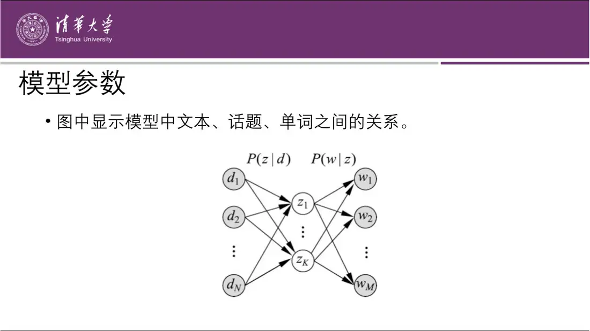

原文：

模型参数

\- 图中显示模型中文本、话题、单词之间的关系。

清華大學 Tsinghua University

### 模型的几何解释

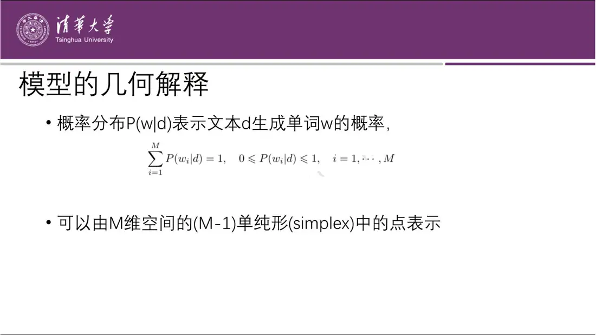

原文：

模型的几何解释

\- 概率分布P(w|d)表示文本d生成单词w的概率,

$$
\sum_ {i = 1} ^ {M} P (w _ {i} | d) = 1, \quad 0 \leqslant P (w _ {i} | d) \leqslant 1, \quad i = 1, \dots , M
$$

\- 可以由M维空间的(M-1)单纯形(simplex)中的点表示

清華大學 Tsinghua University

### 模型的几何解释

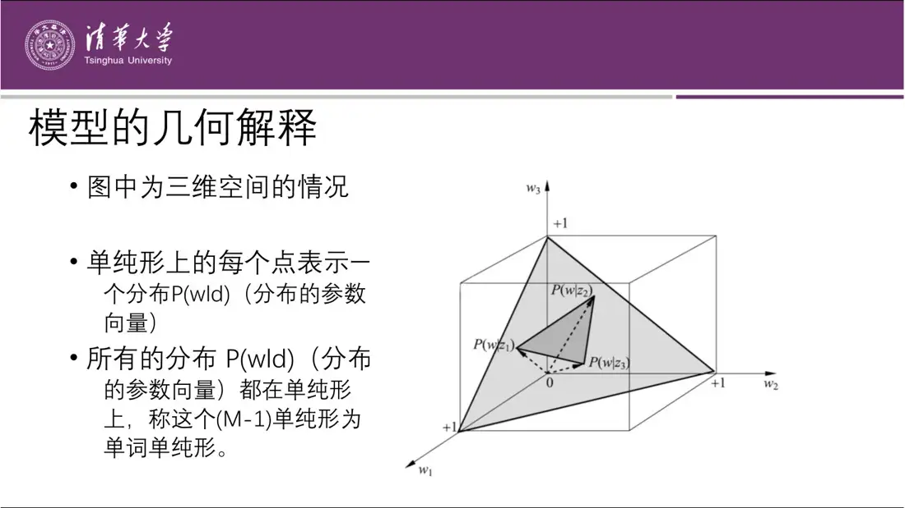

原文：

模型的几何解释

\- 图中为三维空间的情况

\- 单纯形上的每个点表示一个分布P(wId)（分布的参数向量）

\- 所有的分布 P(wld)（分布的参数向量）都在单纯形上，称这个(M-1)单纯形为单词单纯形。

Tsinghua University
清華大學
1911-

### 模型的几何解释

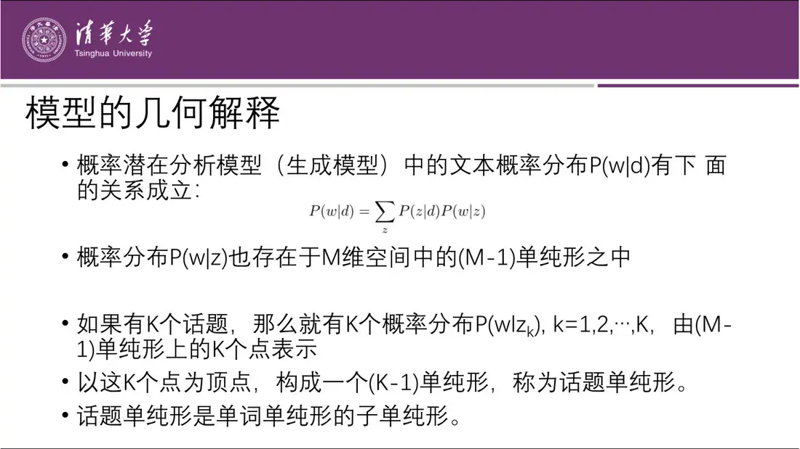

原文：

模型的几何解释

\- 概率潜在分析模型（生成模型）中的文本概率分布P(w|d)有下面的关系成立：

$$
P (w | d) = \sum_ {z} P (z | d) P (w | z)
$$

\- 概率分布P(w|z)也存在于M维空间中的(M-1)单纯形之中

\- 如果有K个话题，那么就有K个概率分布P(w|z\_k), k=1,2,…,K，由(M-1)单纯形上的K个点表示

\- 以这K个点为顶点，构成一个(K-1)单纯形，称为话题单纯形。

\- 话题单纯形是单词单纯形的子单纯形。

Tsinghua University
清華大學

### 模型的几何解释

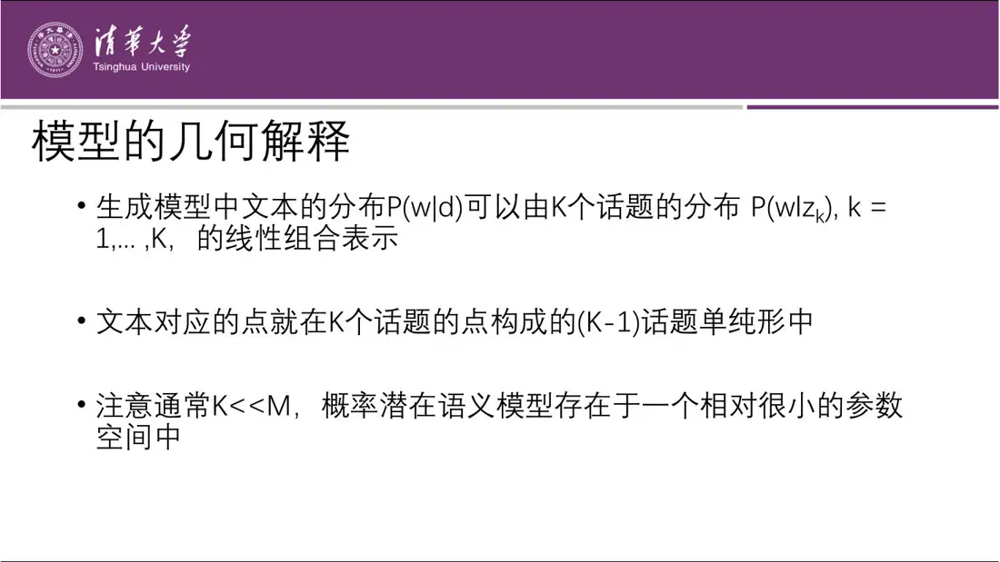

原文：

模型的几何解释

\- 生成模型中文本的分布 $P(w|d)$ 可以由K个话题的分布 $P(w|z_k), k = 1, \ldots, K$ ，的线性组合表示

\- 文本对应的点就在K个话题的点构成的(K-1)话题单纯形中

\- 注意通常K<<M，概率潜在语义模型存在于一个相对很小的参数空间中

Tsinghua University
清華大學

### 与潜在语义分析的关系

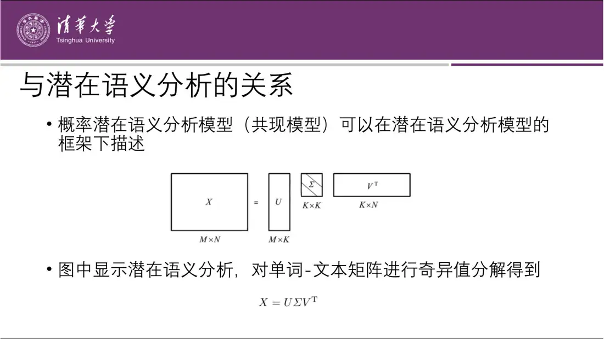

原文：

与潜在语义分析的关系

\- 概率潜在语义分析模型（共现模型）可以在潜在语义分析模型的框架下描述

$$
\begin{array}{c c c} \framebox {X} & = & \framebox {U} \\ M \times N & & M \times K \end{array} \quad \begin{array}{c c c} \framebox {\Sigma} & & V ^ {\mathrm{T}} \\ K \times K & & K \times N \end{array}
$$

\- 图中显示潜在语义分析，对单词-文本矩阵进行奇异值分解得到

$$
X = U \Sigma V ^ {\mathrm{T}}
$$

Tsinghua University
清華大學

### 与潜在语义分析的关系

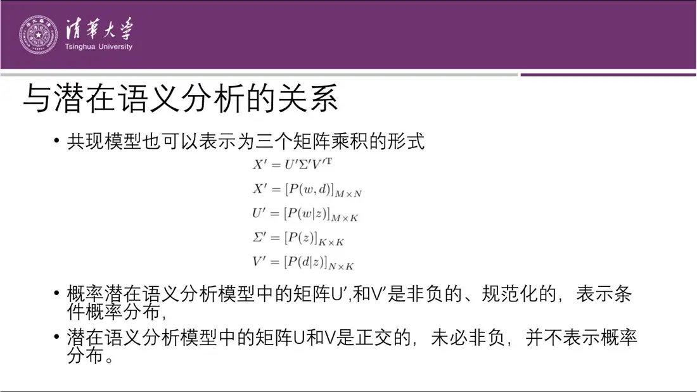

原文：

与潜在语义分析的关系

\- 共现模型也可以表示为三个矩阵乘积的形式

$$
\begin{array}{r l} & {X ^ {\prime} = U ^ {\prime} \Sigma^ {\prime} V ^ {\prime \mathrm{T}}} \\ & {X ^ {\prime} = [ P (w, d) ] _ {M \times N}} \\ & {U ^ {\prime} = [ P (w | z) ] _ {M \times K}} \\ & {\Sigma^ {\prime} = [ P (z) ] _ {K \times K}} \\ & {V ^ {\prime} = [ P (d | z) ] _ {N \times K}} \end{array}
$$

\- 概率潜在语义分析模型中的矩阵U',和V'是非负的、规范化的，表示条件概率分布，

\- 潜在语义分析模型中的矩阵U和V是正交的，未必非负，并不表示概率分布。

清華大學 Tsinghua University

### 概率潜在语义分析的算法

原文：

概率潜在语义分析的算法

\- EM算法是一种迭代算法，每次迭代包括交替的两步：

\- E步，求期望

\- M步，求极大

\- E步是计算Q函数，即完全数据的对数似然函数对不完全数据的条件分布的期望

\- M步是对Q函数极大化，更新模型参数。

Tsinghua University
清華大學
1911-

### 概率潜在语义分析的算法

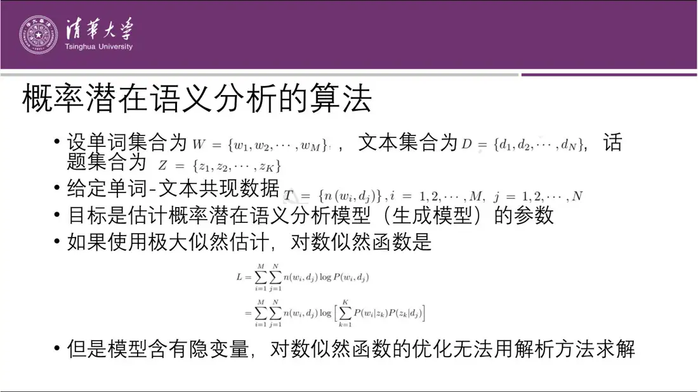

原文：

概率潜在语义分析的算法

\- 设单词集合为 $W = \{w_{1}, w_{2}, \cdots, w_{M}\}$ ，文本集合为 $D = \{d_{1}, d_{2}, \cdots, d_{N}\}$ ，话题集合为 $Z = \{z_{1}, z_{2}, \cdots, z_{K}\}$

\- 给定单词-文本共现数据 $T = \{n(w_i, d_j)\}, i = 1, 2, \cdots, M, j = 1, 2, \cdots, N$

\- 目标是估计概率潜在语义分析模型（生成模型）的参数

\- 如果使用极大似然估计，对数似然函数是

$$
\begin{array}{l} L = \sum_ {i = 1} ^ {M} \sum_ {j = 1} ^ {N} n (w _ {i}, d _ {j}) \log P (w _ {i}, d _ {j}) \\ = \sum_ {i = 1} ^ {M} \sum_ {j = 1} ^ {N} n (w _ {i}, d _ {j}) \log \left[ \sum_ {k = 1} ^ {K} P (w _ {i} | z _ {k}) P (z _ {k} | d _ {j}) \right] \end{array}
$$

\- 但是模型含有隐变量，对数似然函数的优化无法用解析方法求解

Tsinghua University
清華大學

### 概率潜在语义分析的算法

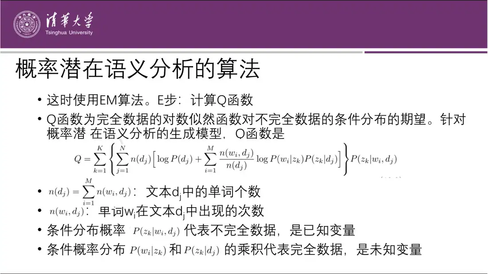

原文：

概率潜在语义分析的算法

\- 这时使用EM算法。E步：计算Q函数

\- Q函数为完全数据的对数似然函数对不完全数据的条件分布的期望。针对概率潜在语义分析的生成模型，Q函数是

$$
Q = \sum_ {k = 1} ^ {K} \left\{\sum_ {j = 1} ^ {N} n (d _ {j}) \Big [ \log P (d _ {j}) + \sum_ {i = 1} ^ {M} \frac {n (w _ {i} , d _ {j})}{n (d _ {j})} \log P (w _ {i} | z _ {k}) P (z _ {k} | d _ {j}) \Big ] \right\} P (z _ {k} | w _ {i}, d _ {j})
$$

\- $n(d_{j}) = \sum^{M} n(w_{i}, d_{j})$ ：文本 $d_{i}$ 中的单词个数

\- $n(w_{i},d_{j})^{i = 1}$ 单词 $\mathsf{w}_{\mathrm{i}}$ 在文本 $\mathsf{d}_{\mathrm{i}}$ 中出现的次数

\- 条件分布概率 $P(z_{k}|w_{i},d_{j})$ 代表不完全数据，是已知变量

\- 条件概率分布 $P(w_{i}|z_{k})$ 和 $P(z_{k}|d_{j})$ 的乘积代表完全数据，是未知变量

Tsinghua University
清華大學

### 概率潜在语义分析的算法

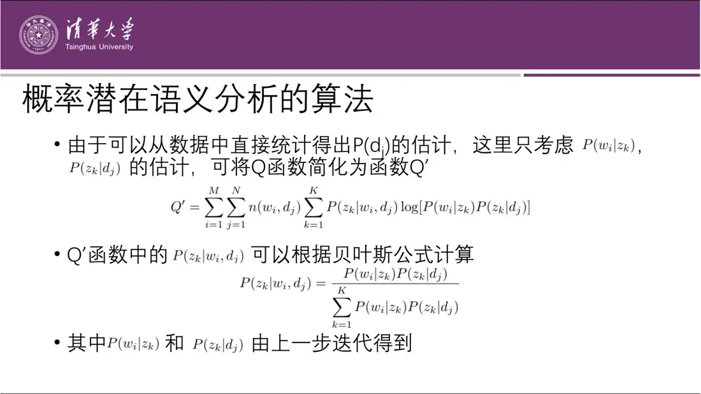

原文：

概率潜在语义分析的算法

\- 由于可以从数据中直接统计得出 $P(d_{j})$ 的估计，这里只考虑 $P(w_{i}|z_{k})$ ， $P(z_{k}|d_{j})$ 的估计，可将Q函数简化为函数 $Q'$

$$
Q ^ {\prime} = \sum_ {i = 1} ^ {M} \sum_ {j = 1} ^ {N} n (w _ {i}, d _ {j}) \sum_ {k = 1} ^ {K} P (z _ {k} | w _ {i}, d _ {j}) \log [ P (w _ {i} | z _ {k}) P (z _ {k} | d _ {j}) ]
$$

• Q'函数中的 $P(z_{k}|w_{i},d_{j})$ 可以根据贝叶斯公式计算

$$
P (z _ {k} | w _ {i}, d _ {j}) = \frac {P (w _ {i} | z _ {k}) P (z _ {k} | d _ {j})}{\sum_ {k = 1} ^ {K} P (w _ {i} | z _ {k}) P (z _ {k} | d _ {j})}
$$

\- 其中 $P(w_{i}|z_{k})$ 和 $P(z_{k}|d_{j})$ 由上一步迭代得到

Tsinghua University
清華大學

### 概率潜在语义分析的算法

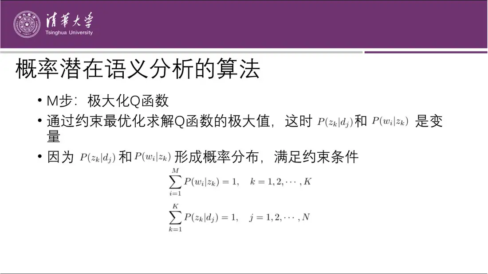

原文：

概率潜在语义分析的算法

\- M步：极大化Q函数

\- 通过约束最优化求解Q函数的极大值，这时 $P(z_{k}|d_{j})$ 和 $P(w_{i}|z_{k})$ 是变量

\- 因为 $P(z_{k}|d_{j})$ 和 $P(w_{i}|z_{k})$ 形成概率分布，满足约束条件

$$
\sum_ {i = 1} ^ {M} P (w _ {i} | z _ {k}) = 1, \quad k = 1, 2, \dots , K
$$

$$
\sum_ {k = 1} ^ {K} P (z _ {k} | d _ {j}) = 1, \quad j = 1, 2, \dots , N
$$

Tsinghua University
清華大學

### 概率潜在语义分析的算法

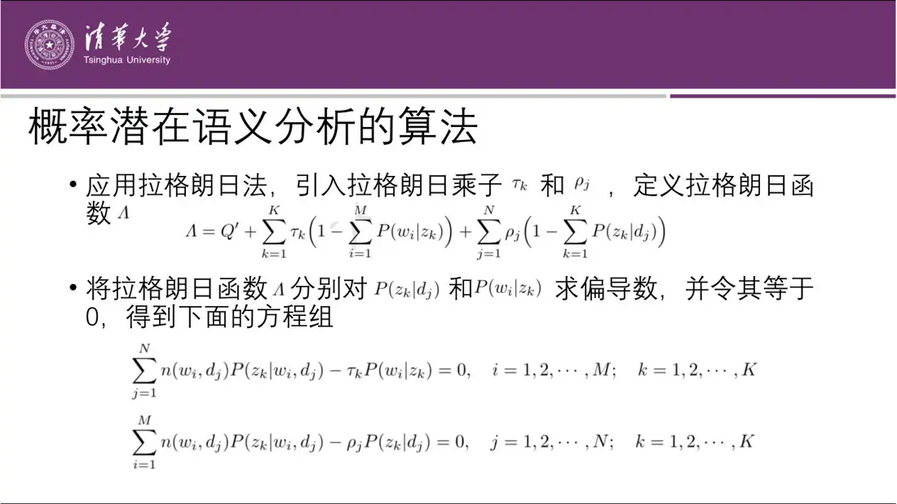

原文：

概率潜在语义分析的算法

\- 应用拉格朗日法，引入拉格朗日乘子 $\tau_{k}$ 和 $\rho_{j}$ ，定义拉格朗日函数 $\Lambda$ $A = Q' + \sum_{k=1}^{K} \tau_{k} \left(1 - \sum_{i=1}^{M} P(w_{i} | z_{k})\right) + \sum_{j=1}^{N} \rho_{j} \left(1 - \sum_{k=1}^{K} P(z_{k} | d_{j})\right)$

\- 将拉格朗日函数 $\Lambda$ 分别对 $P(z_{k}|d_{j})$ 和 $P(w_{i}|z_{k})$ 求偏导数，并令其等于0，得到下面的方程组

$$
\begin{array}{l} \sum_ {j = 1} ^ {N} n (w _ {i}, d _ {j}) P (z _ {k} | w _ {i}, d _ {j}) - \tau_ {k} P (w _ {i} | z _ {k}) = 0, \quad i = 1, 2, \dots , M; \quad k = 1, 2, \dots , K \\ \sum_ {i = 1} ^ {M} n (w _ {i}, d _ {j}) P (z _ {k} | w _ {i}, d _ {j}) - \rho_ {j} P (z _ {k} | d _ {j}) = 0, \quad j = 1, 2, \dots , N; \quad k = 1, 2, \dots , K \end{array}
$$

Tsinghua University
清華大學

### 概率潜在语义分析的算法

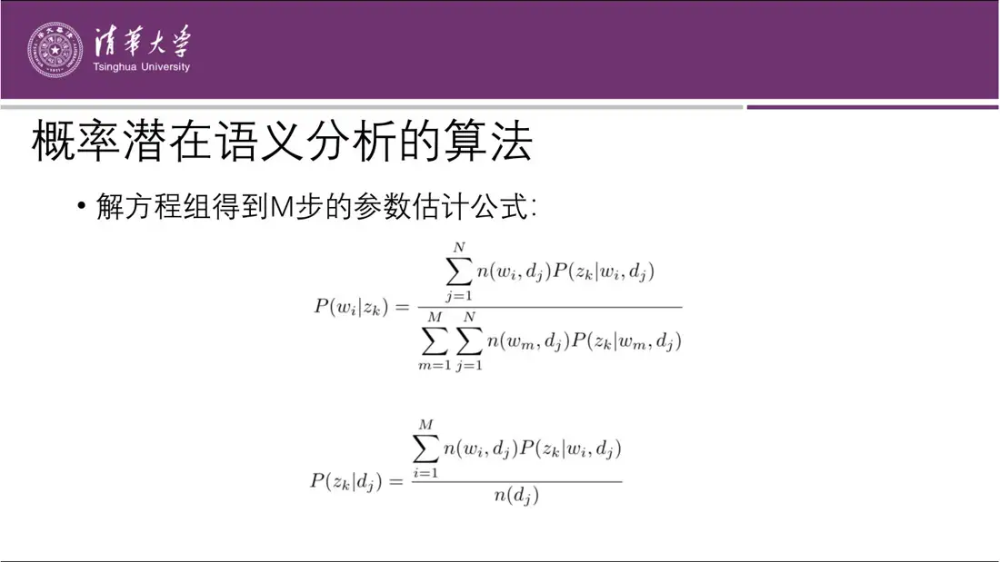

原文：

概率潜在语义分析的算法

\- 解方程组得到M步的参数估计公式:

$$
P (w _ {i} | z _ {k}) = \frac {\sum_ {j = 1} ^ {N} n (w _ {i} , d _ {j}) P (z _ {k} | w _ {i} , d _ {j})}{\sum_ {m = 1} ^ {M} \sum_ {j = 1} ^ {N} n (w _ {m} , d _ {j}) P (z _ {k} | w _ {m} , d _ {j})}
$$

$$
P (z _ {k} | d _ {j}) = \frac {\sum_ {i = 1} ^ {M} n (w _ {i} , d _ {j}) P (z _ {k} | w _ {i} , d _ {j})}{n (d _ {j})}
$$

Tsinghua University
清華大學

### 概率潜在语义模型参数估计的EM算法

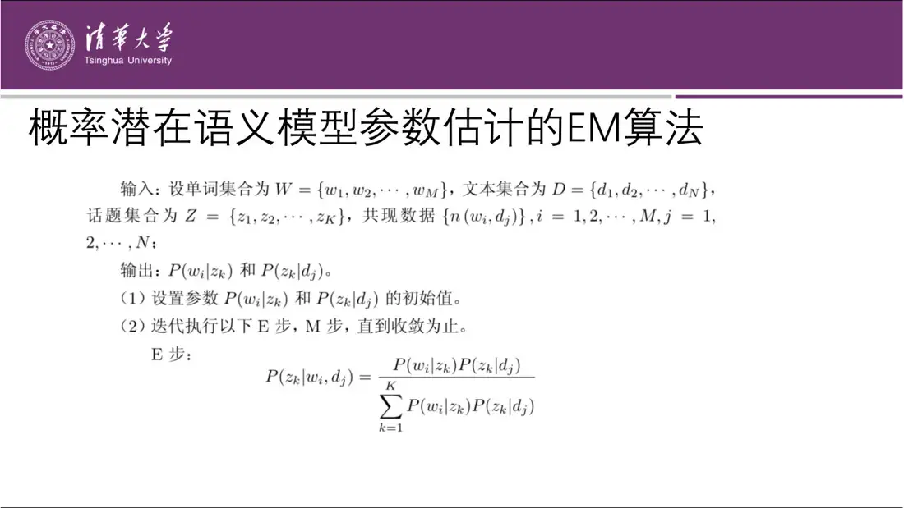

原文：

概率潜在语义模型参数估计的EM算法

输入：设单词集合为 $W = \{w_{1}, w_{2}, \cdots, w_{M}\}$ ，文本集合为 $D = \{d_{1}, d_{2}, \cdots, d_{N}\}$ ，话题集合为 $Z = \{z_{1}, z_{2}, \cdots, z_{K}\}$ ，共现数据 $\{n(w_{i}, d_{j})\}, i = 1, 2, \cdots, M, j = 1, 2, \cdots, N;$

输出： $P(w_{i}|z_{k})$ 和 $P(z_{k}|d_{j})$ 。

(1) 设置参数 $P(w_{i}|z_{k})$ 和 $P(z_{k}|d_{j})$ 的初始值。

(2) 迭代执行以下 E 步, M 步, 直到收敛为止。

E 步:

$$
P (z _ {k} | w _ {i}, d _ {j}) = \frac {P (w _ {i} | z _ {k}) P (z _ {k} | d _ {j})}{\sum_ {k = 1} ^ {K} P (w _ {i} | z _ {k}) P (z _ {k} | d _ {j})}
$$

Tsinghua University
清華大學

### 概率潜在语义模型参数估计的EM算法

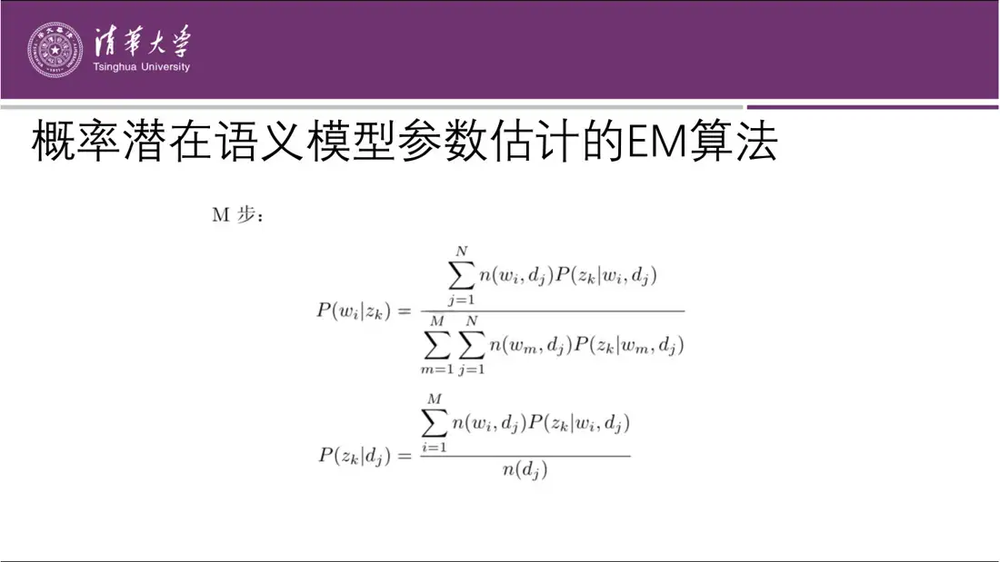

原文：

概率潜在语义模型参数估计的EM算法

M 步:

$$
P (w _ {i} | z _ {k}) = \frac {\sum_ {j = 1} ^ {N} n (w _ {i} , d _ {j}) P (z _ {k} | w _ {i} , d _ {j})}{\sum_ {m = 1} ^ {M} \sum_ {j = 1} ^ {N} n (w _ {m} , d _ {j}) P (z _ {k} | w _ {m} , d _ {j})}
$$

$$
P (z _ {k} | d _ {j}) = \frac {\sum_ {i = 1} ^ {M} n (w _ {i} , d _ {j}) P (z _ {k} | w _ {i} , d _ {j})}{n (d _ {j})}
$$

清華大學 Tsinghua University
