# 《统计学习方法》第1章 机器学习和统计学习（课件）

原件的每一页，下面附识别出的文字。

### 第一章统计学习方法概论

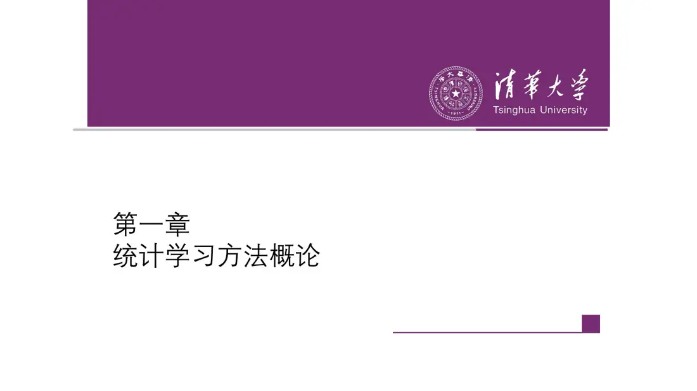

原文：

第一章统计学习方法概论

清華大學 Tsinghua University

### 机器学习

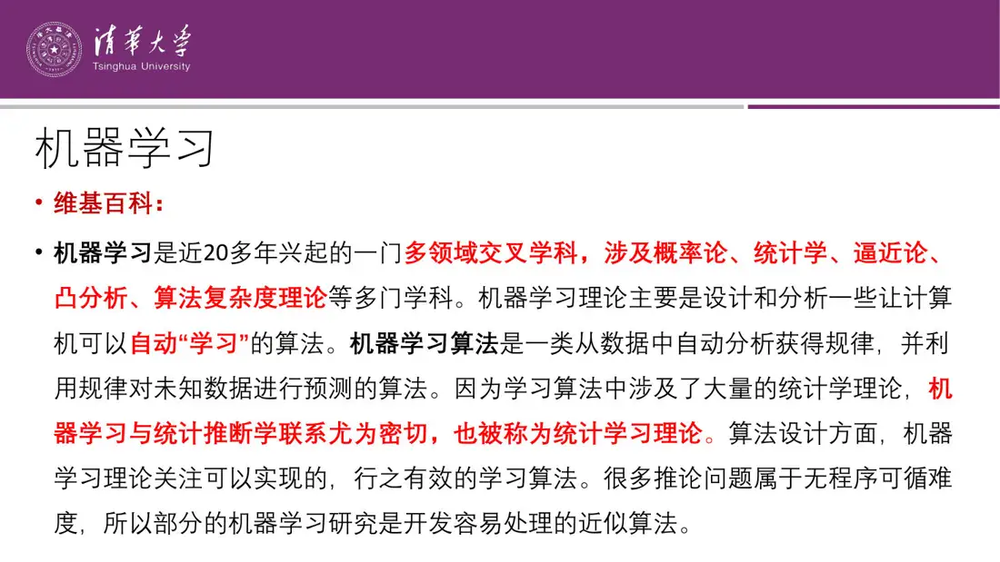

原文：

机器学习

• 维基百科：

• 机器学习是近20多年兴起的一门多领域交叉学科，涉及概率论、统计学、逼近论、凸分析、算法复杂度理论等多门学科。机器学习理论主要是设计和分析一些让计算机可以自动“学习”的算法。机器学习算法是一类从数据中自动分析获得规律，并利用规律对未知数据进行预测的算法。因为学习算法中涉及了大量的统计学理论，机器学习与统计推断学联系尤为密切，也被称为统计学习理论。算法设计方面，机器学习理论关注可以实现的，行之有效的学习算法。很多推论问题属于无程序可循难度，所以部分的机器学习研究是开发容易处理的近似算法。

提纲： Tsinghua University

### 网络教学信息

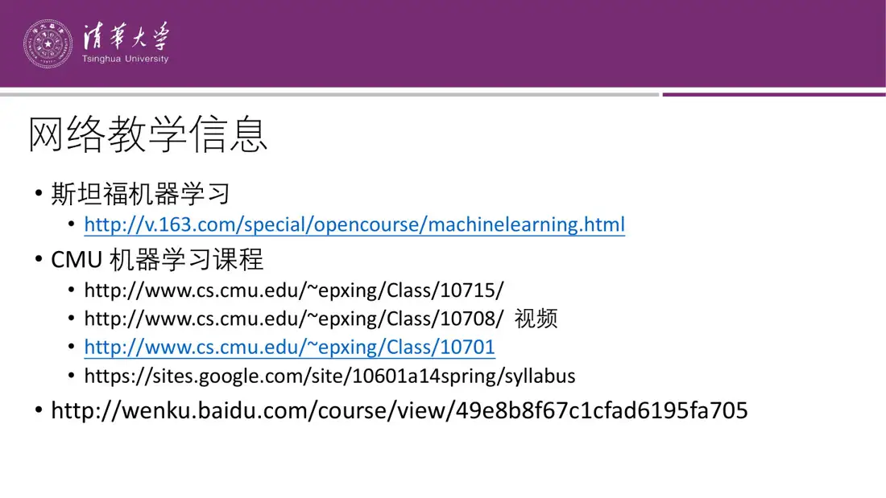

原文：

网络教学信息

• 斯坦福机器学习 • http://v.163.com/special/opencourse/machinelearning.html

• CMU 机器学习课程

• http://www.cs.cmu.edu/\~epxing/Class/10715/

• http://www.cs.cmu.edu/\~epxing/Class/10708/ 视频

• http://www.cs.cmu.edu/\~epxing/Class/10701

• https://sites.google.com/site/10601a14spring/syllabus

• http://wenku.baidu.com/course/view/49e8b8f67c1cfad6195fa705

提纲： Tsinghua University

### 相关学术文章下载资源

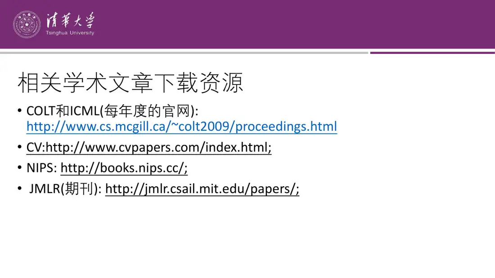

原文：

相关学术文章下载资源

• COLT和ICML(每年度的官网): http://www.cs.mcgill.ca/\~colt2009/proceedings.html

• CV:http://www.cvpapers.com/index.html;

• NIPS: http://books.nips.cc/;

• JMLR(期刊): http://jmlr.csail.mit.edu/papers/;

提纲： Tsinghua University

### 机器学习

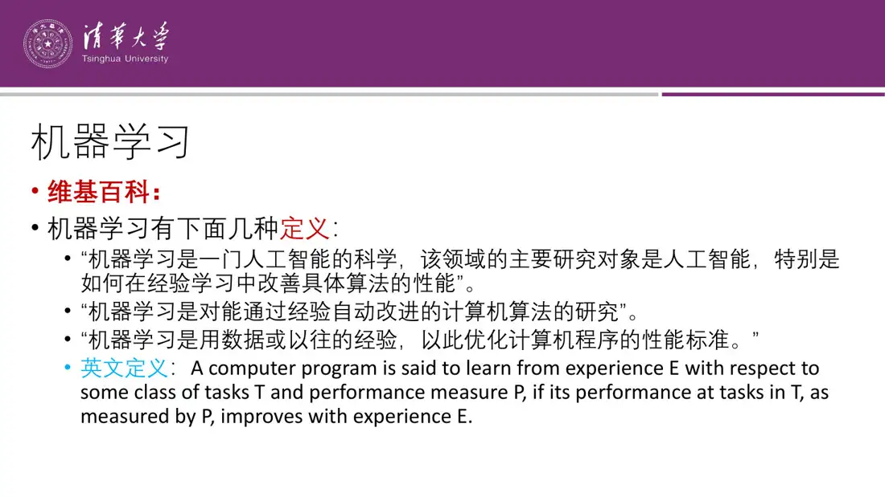

原文：

机器学习

• 维基百科：

• 机器学习有下面几种定义：

• “机器学习是一门人工智能的科学，该领域的主要研究对象是人工智能，特别是如何在经验学习中改善具体算法的性能”。

• “机器学习是对能通过经验自动改进的计算机算法的研究”。

• “机器学习是用数据或以往的经验，以此优化计算机程序的性能标准。

• 英文定义：A computer program is said to learn from experience E with respect to some class of tasks T and performance measure P, if its performance at tasks in T, as measured by P, improves with experience E.

提纲： Tsinghua University

### 机器学习应用

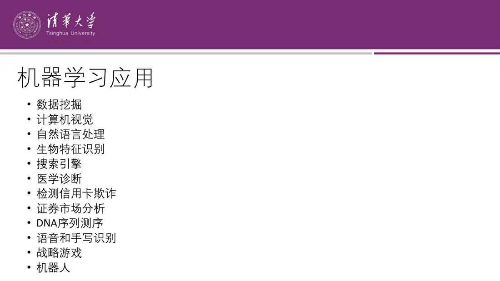

原文：

机器学习应用

• 数据挖掘

• 计算机视觉

• 自然语言处理

• 生物特征识别

• 搜索引擎

• 医学诊断

• 检测信用卡欺诈

• 证券市场分析

• DNA序列测序

• 语音和手写识别

• 战略游戏

• 机器人

提纲： Tsinghua University

### Game

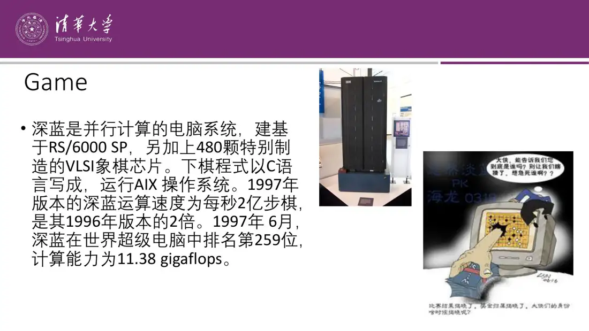

原文：

Game

• 深蓝是并行计算的电脑系统，建基于RS/6000 SP，另加上480颗特别制造的VLSI象棋芯片。下棋程式以C语言写成，运行AIX 操作系统。1997年版本的深蓝运算速度为每秒2亿步棋，是其1996年版本的2倍。1997年 6月，深蓝在世界超级电脑中排名第259位，计算能力为11.38 gigaflops。

提纲： Tsinghua University

### Text to speech and speech recognition

原文：

Text to speech and speech recognition

Siri

Hello, I'm Siri, your new personal assistant.

What can I help you with?

Restaurants

Events

Local businesses

Speak now...

Tap here when done

Cancel

Options

“郭建”

“你妈妈喊你回家吃饭”

你的信息已经更新了。现在可以发送吗

取消

发送

Safari

提纲： Tsinghua University

### Computer vision

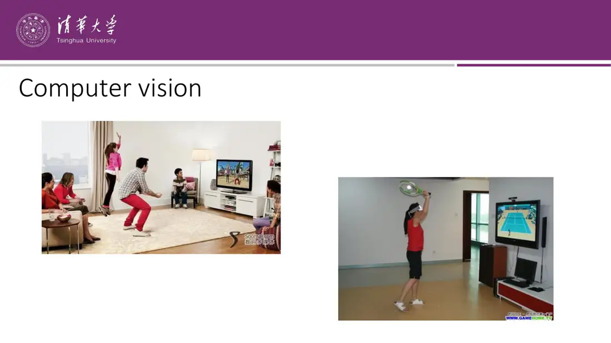

原文：

Computer vision

提纲： Tsinghua University

### bioinformatics

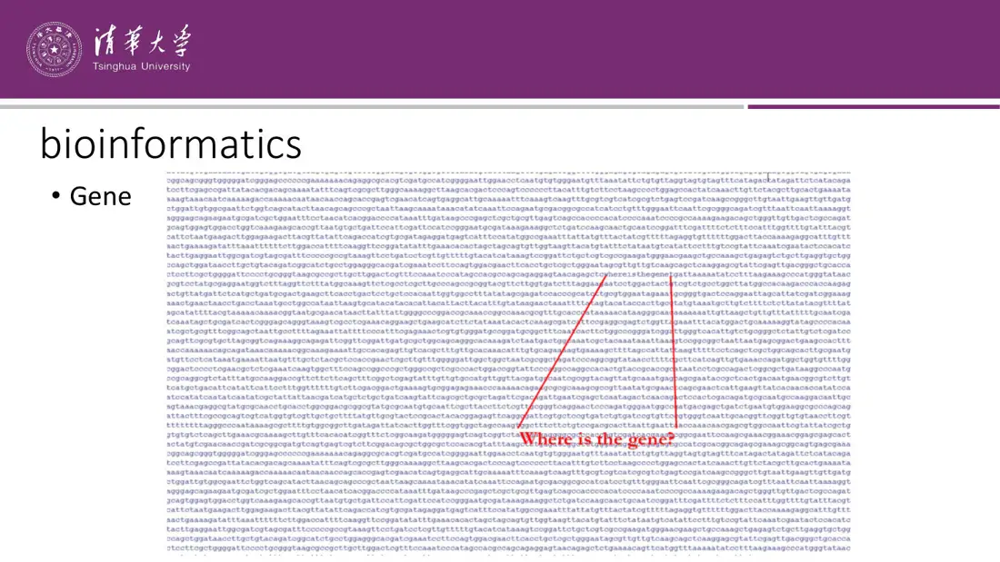

原文：

bioinformatics

• Gene

cggcagcgggtgggggatcgggagccccccgaaaaaaacagaggcgcacgtcgatgccatcggggaattggaacctcaatgtgtgggaatgtttaaatattctgtgttaggtagtgtagtttcatagactatagattctcatacaga tccttcgagccgattatacacgacagcaaaatatttcagtcgcgcttgggcaaaaggcttaagcacgactcccagtccccccttacatttgtcttcctaagcccctggagccactatcaaacttgttctacgcttgcactgaaaata aaagtaaacaatcaaaaagaccaaaaacaataacaaccagcaccgagtcgaacatcagtgaggcattgcaaaaatttcaaagtcaagtttgcgtcgtcatcgcgtctgagtccgatcaagccgggcttgtaattgaagttgttgatg ctggattgtggcgaattctggtcagcatacttaacagcagcccgctaattaagcaaaataaacatatcaaattccagaatgcgacggcgccatcatcctgtttgggaattcaattcgcgggcagatcgtttaattcaattaaaaggt agggagcagaagaatgcgatcgctggaatttcctaacatcacggaccccataaatttgataagcccgagctcgctgcgttgagtcagccaccccacatccccaaatccccgccaaaagaagacagctgggttgttgactcgccagat gcagtggagtggacctggtcaaagaagcaccgttaatgtgctgattccattcgattccatccgggaatgcgataaagaaaggctctgatccaagcaactgcaatccggatttcgattttctctttccatttggttttgtatttacgt cattctaatgaagacttggagaagacttacgttatattcagaccatcgtgcgatagaggatgagtcatttccatatggccgaaatttattatgtttactatcgtttttagaggtgttttttggacttaccaaaagaggcatttgttt aactgaaaagatatttaaattttttcttggaccattttcaaggttccggatatatttgaaacacactagctagcagtgttggtaagttacatgtatttctataatgtcatattcctttgtccgtattcaaatcgaatactccacatc tacttgaggaattggcgatcgtagcgatttcccccgccgtaaagttcctgatcctcgttgtttttgtacatcataaagtccggattctgctcgtcgccgaagatgggaacgaagctgccaaagctgagagtctgcttgaggtgctgg ccagctggataaccttgctgtacagatcgqcatctgcctggagggcacgatcgaaatccttccagtggacgaacttcacctgctcgctgggaatagcqttgttqtcaagcagctcaaggagcqtattcgagttgacgggctgcacca ctccttcgctggggattcccctgcgggtaagcgccgcttgcttggactcgtttccaaatcccatagccacgccagcagaggagtaacagagctcyhereisthegenetgattaaaaatatcctttaagaaagcccatgggtataao gcgtcctatgcgaggaatggtctttaggttctttatggcaaagttctcgcctcgcttgcccagccgcggtacgttcttggtgatctttaggaagaatcctggactactgtcgtctgcctggcttatggccacaagacccaccaagag actgttatgattctcatgctgatgcgactgaagcttcacctgactcctgctccacaattggtggcctttatatagcgagatccacccgcatcctgcgtggaatagaaatgcgggtgactccaggaattagcattatcgatcggaaag aaactgaactaacctgacctaaatgcctggccataattaagtgcatacatacacattacattacttacatttgtataagaactaaatttta tagtacataccacttgc tatgtaaatgcttgtcttttctcttatatacgttttat agcatattttacgtaaaaacaaaacggtaatgcgaacataacttatttattggggcccggaccgcaaaccggccaaacgcgtttgcaccgataaaaacataagggcaa aaaaaaattgttaagctgttgtttatttttgcaatcga tcaaatagctgcgatcactcgggagcagggtaaagtcgcctcgaaacaggaagctgaagcatcttctataaatacactcaaagcgatcattccgaggcgagtctggtta gaaatttacatggactgcaaaaaggtatagccccacaa atcgctgcgtttcggcagctaattgccttttagaaattattttcccatttcgagaaactcgtgtgggatgccggatgcggctttcaatcacttctggcccgggatcgga ttgggtcacattgtctgcgggctctattgtctcgatcc gcagttcgcgtgcttagcggtcagaaaggcagagattcggttcggattgatgcgctggcagcagggcacaaagatctaatgactgg caaatcgctacaaataaattaaa gtccggcggctaattaatgagcggactgaagccacttt aaccaaaaaacagcagataaacaaaaacggcaaagaaaattgccacagagttgtcacgctttgttgcacaaacatttgtgcagaaaagtgaaaagcttttagccattat taagtttttcctcagctcgctggcagcacttgcgaatg atgttcctcataaatgaaaattaatgtttgctctacgctccaccgaactcgcttgtttgggggattggctggctaatcgcggctagatcccaggcggtataaccttttcgcttcatcagttgtgaaaccagatggctggtgttttgg cggactcccctcgaacgctctcgaaatcaagtggctttccagccggcccgctgggccgctcgcccactggaccggtattccca ggccaggccacactgtaccgcaccgcataatcctcgccagactcggcgctgataaggcccaatg ccgcaggcgtctatttatgccaaggaccgttcttcttcagctttcggctcgagtatttgttgtgccatgttggttacgatg caatcgcggtacagttatgcaaatgagcagcgaataccgctcactgacaatgaacggcgtcttgt tcatgctgacattcatattcattcctttggttttttgtcttcgacggactgaaaagtgcggagagaaacccaaaaacaga gcgcgcaaagcgccgttaatatgcgaac ccagcgaactcattgaagttatcacaacaccatatcca atccatatcaatatcaatatcgctattattaacgatcatgctctgctgatcaagtattcagcgctgcgctagattcgao agattgaatcgagctcaatagactcaacag actccactcgacagatgcgcaatgccaaggacaattgc agtaaacgaggcgtatgcgcaacctgcacctggcggacgcggcgtatgcgcaatgtgcaattcgcttaccttctcgttgcgggtcaggaactcccagatgggaatggccgatgacgagctgatctgaatgtggaaggcgcccagcag attactttcgccgcagtcgtcatggtgtcgttgctgcttttatgttgcgtactccgcactacacggagagttcaggggattcgtgctccgtgatctgtgatccgtgttcegtgggtcaattgcacggttcggttgtgtaaccttcgt ttttttttagggcccaataaaagcgcttttgtggcggcttgatagattatcacttggtttcggtggctagccaagtggctttcttctgtccgacgcacttaattgaattaaccaaacaacgagcgtggccaattcgtattatcgctg gtgtgtctcagcttgaaacgcaaaagcttgtttcacacatcggtttctcggcaagatgggggagtcagtcggtcta aocggcgaattccaagcgaaacggaaacggagcgagcact actatgtcgaacaaccgatcgcggcgatgtcagtgagtcgtcttcggacagcgctggcgctccacacgtatttaagctety Qenegegccatcgcacggcagagcgaaagcggcagtgagcgaaa cggcagcgggtgggggatcgggagccccccgaaaaaaacagaggcgcacgtcgatgccatcggggaattggaacctcaatgtgtgggaatgtttaaatattctgtgttaggtagtgtagtttcatagactatagattctcatacaga tccttcgagccgattatacacgacagcaaaatatttcagtcgcgcttgggcaaaaggcttaagcacgactcccagtccccccttacatttgtcttcctaagcccctggagccactatcaaacttgttctacgcttgcactgaaaata aaagtaaacaatcaaaaagaccaaaaacaataacaaccagcaccgagtcgaacatcagtgaggcattgcaaaaatttcaaagtcaagtttgcgtcgtcatcgcgtctgagtccgatcaagccgggcttgtaattgaagttgttgatg ctggattgtggcgaattctggtcagcatacttaacagcagcccgctaattaagcaaaataaacatatcaaattccagaatgcgacggcgccatcatcctgtttgggaattcaattcgcgggcagatcgtttaattcaattaaaaggt agggagcagaagaatgcgatcgctggaatttcctaacatcacggaccccataaatttgataagcccgagctcgctgcgttgagtcagccaccccacatccccaaatccccgccaaaagaagacagctgggttgttgactcgccagat gcagtggagtggacctggtcaaagaagcaccgttaatgtgctgattccattcgattccatccgggaatgcgataaagaaaggctctgatccaagcaactgcaatccggatttcgattttctctttccatttggttttgtatttacgt cattctaatgaagacttggagaagacttacgttatattcagaccatcgtgcgatagaggatgagtcatttccatatggccgaaatttattatgtttactatcgtttttagaggtgttttttggacttaccaaaagaggcatttgttt aactgaaaagatatttaaattttttcttggaccattttcaaggttccggatatatttgaaacacactagctagcagtgttggtaagttacatgtatttctataatgtcatattcctttgtccgtattcaaatcgaatactccacatc tacttgaggaattggcgatcgtagcgatttcccccgccgtaaagttcctgatcctcgttgtttttgtacatcataaagtccggattctgctcgtcgccgaagatgggaacgaagctgccaaagctgagagtctgcttgaggtgctgg ccagctggataaccttgctgtacagatcggcatctgcctggagggcacgatcgaaatccttccagtggacgaacttcacctgctcgctgggaatagcgttgttgtcaagcagctcaaggagcgtattcgagttgacgggctgcacca ctccttcgctggggattcccctgcgggtaagcgccgcttgcttggactcgtttccaaatcccatagccacgccagcagaggagtaacagagctctgaaaacagttcatggtttaaaaatatcctttaagaaagcccatgggtataac

提纲： Tsinghua University

### bioinformatics

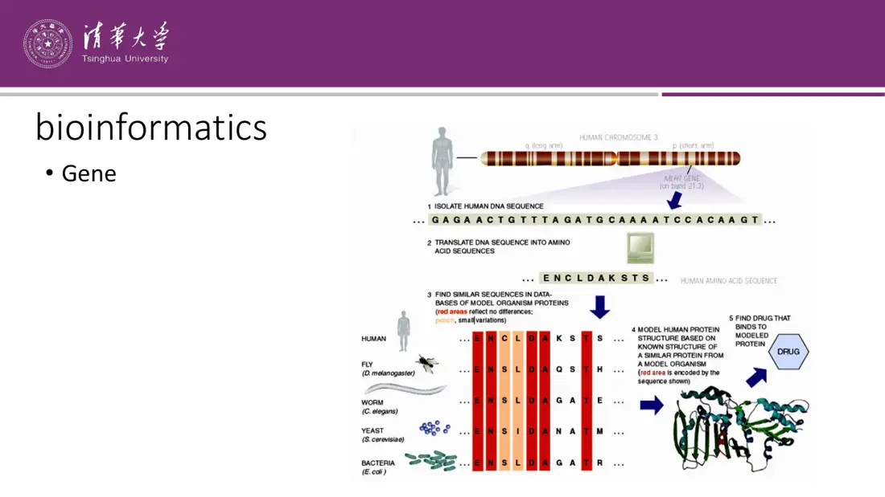

原文：

bioinformatics

• Gene

提纲： Tsinghua University

### Financial Information

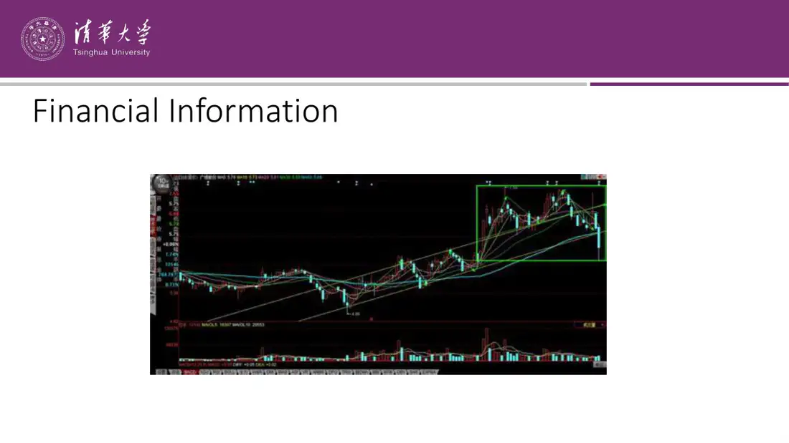

原文：

Financial Information

提纲： Tsinghua University

### Robotic Control

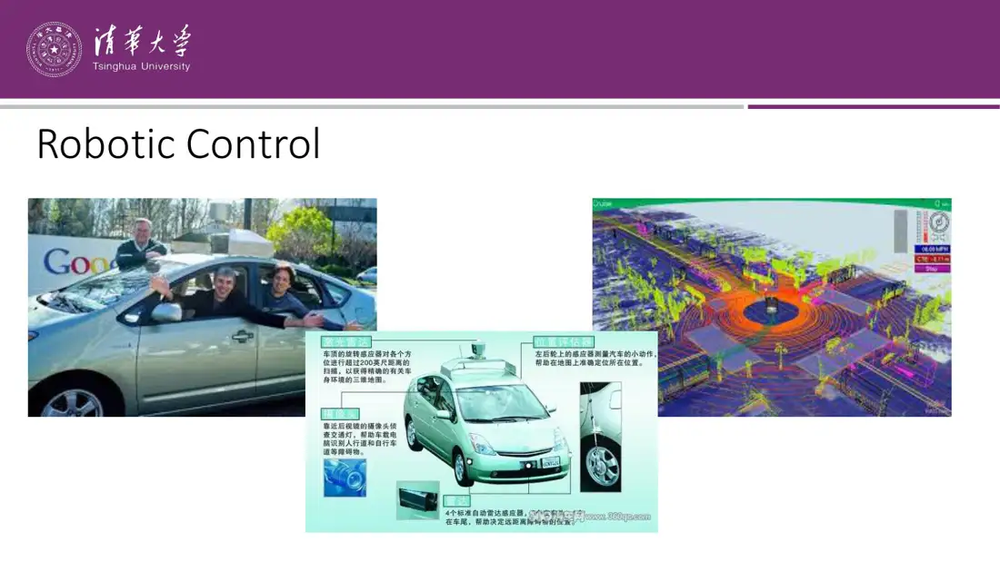

原文：

Robotic Control

激光雷达

车顶的旋转感应器对各个方位进行超过200英尺距离的扫描，以获得精确的有关车身环境的三维地图。

靠近后视镜的摄像头侦查交通灯，帮助车载电脑识别人行道和自行车道等障碍物。

左后轮上的感应器测量汽车的小动作帮助在地图上准确定位所在位置。

提纲： Tsinghua University

### Deep Learning

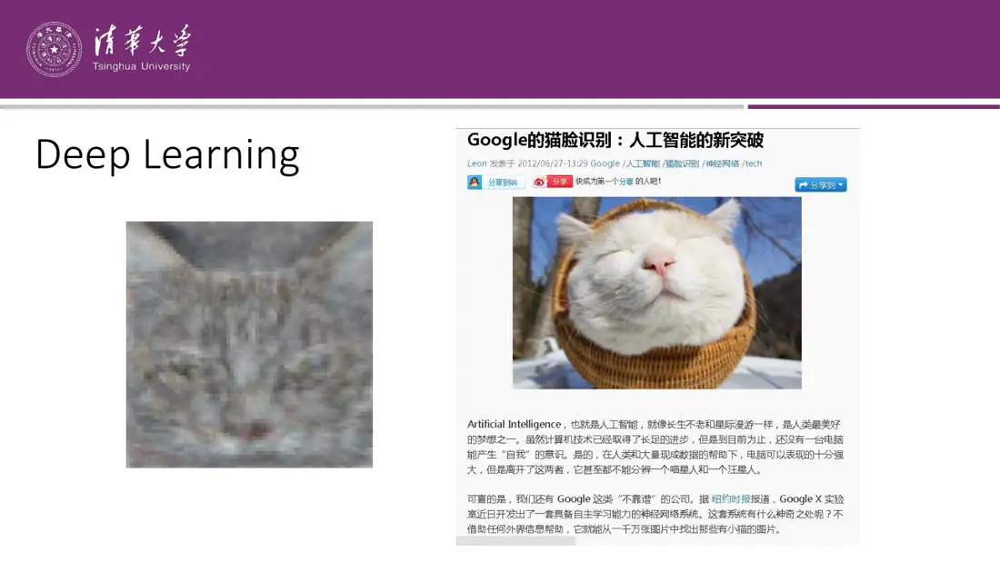

原文：

Deep Learning

Google的猫脸识别：人工智能的新突破

快成为第一个分享的人吧！

分享到

ArtificialIntelliqence，也就是人工智能，就像长生不老和星际漫游一样，是人类最美好的梦想之一。虽然计算机技术已经取得了长足的进步，但是到目前为止，还没有一台电脑能产生“自我”的意识。是的，在人类和大量现成数据的帮助下，电脑可以表现的十分强大，但是离开了这两者，它甚至都不能分辨一个喵星人和一个汪星人。

可喜的是，我们还有Google这类“不靠谱”的公司。据纽约时报报道，GoogleX实验室近日开发出了一套具备自主学习能力的神经网络系统。这套系统有什么神奇之处呢？不借助任何外界信息帮助，它就能从一千万张图片中找出那些有小猫的图片。

提纲： Tsinghua University

### aerospace

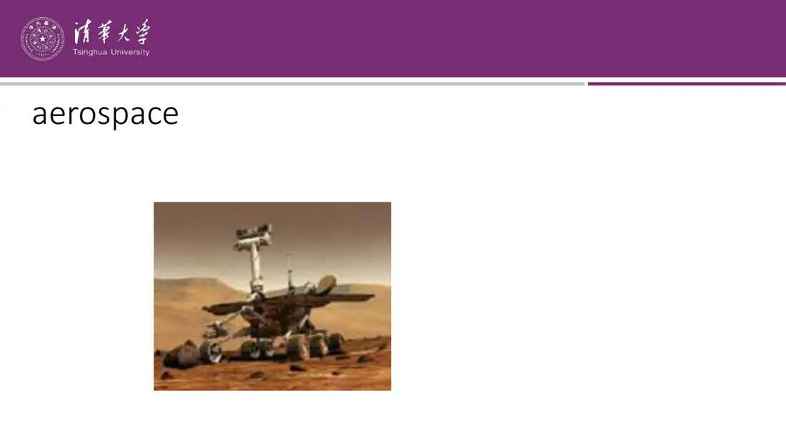

原文：

aerospace

提纲： Tsinghua University

### 机器学习的发展历程

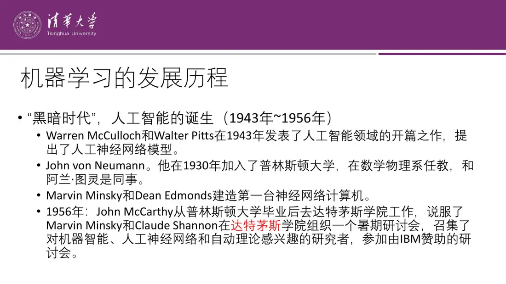

原文：

机器学习的发展历程

• “黑暗时代”，人工智能的诞生（1943年\~1956年）

• Warren McCulloch和Walter Pitts在1943年发表了人工智能领域的开篇之作，提出了人工神经网络模型。

• John von Neumann。他在1930年加入了普林斯顿大学，在数学物理系任教，和阿兰·图灵是同事。

• Marvin Minsky和Dean Edmonds建造第一台神经网络计算机。

• 1956年：John McCarthy从普林斯顿大学毕业后去达特茅斯学院工作，说服了Marvin Minsky和Claude Shannon在达特茅斯学院组织一个暑期研讨会，召集了对机器智能、人工神经网络和自动理论感兴趣的研究者，参加由IBM赞助的研讨会。

提纲： Tsinghua University

### 机器学习的发展历程

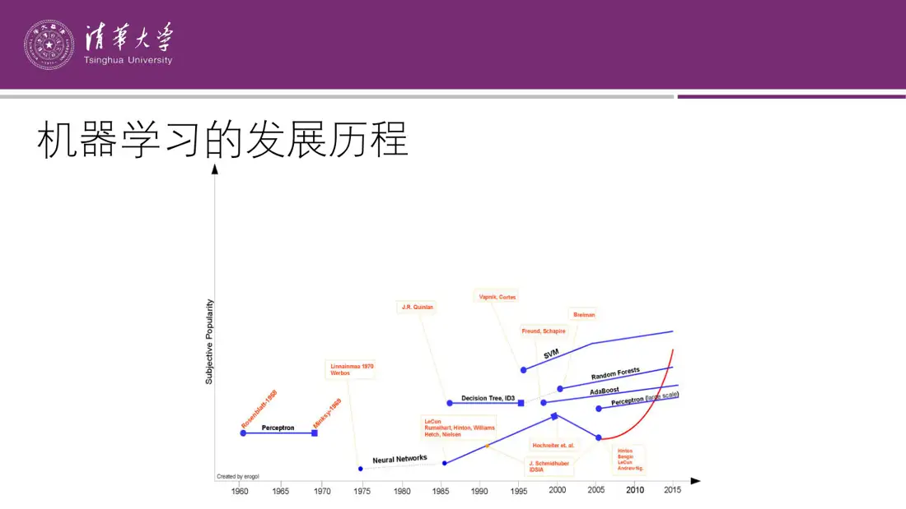

原文：

机器学习的发展历程

提纲： Tsinghua University

### 机器学习的发展历程

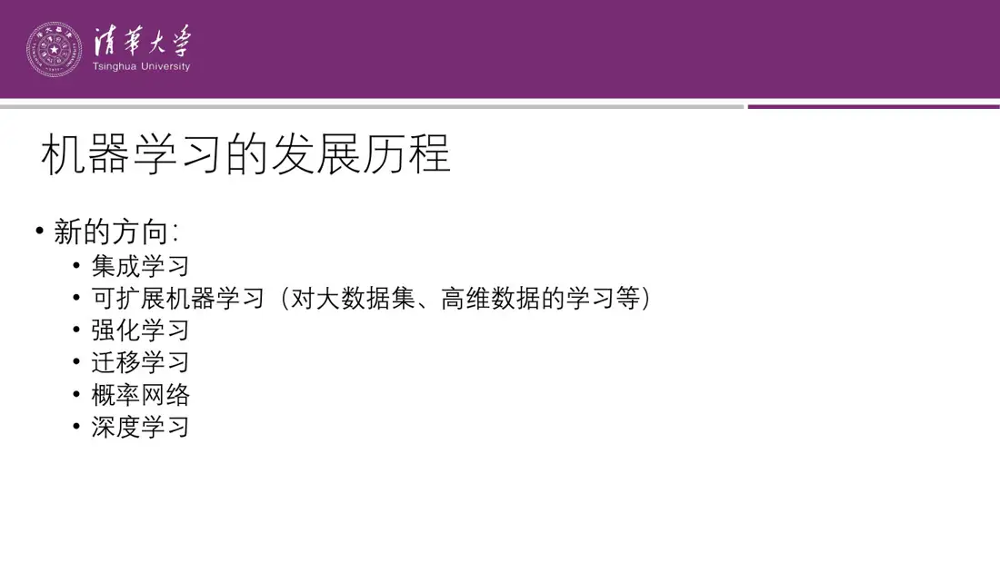

原文：

机器学习的发展历程

• 新的方向：

• 集成学习

• 可扩展机器学习（对大数据集、高维数据的学习等）

• 强化学习

• 迁移学习

• 概率网络

• 深度学习

提纲： Tsinghua University

### 国内外的研究者

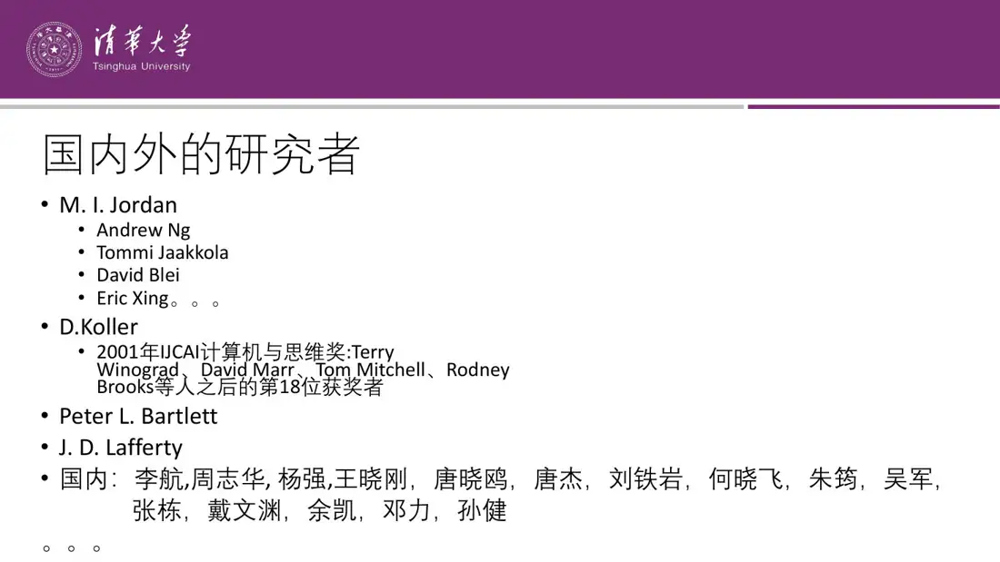

原文：

国内外的研究者

• M. I. Jordan

• Andrew Ng

• Tommi Jaakkola

• David Blei

• Eric Xing。。。

• D.Koller

• 2001年IJCAI计算机与思维奖:TerryWinograd、David Marr、Tom Mitchell、RodneyBrooks等人之后的第18位获奖者

• Peter L. Bartlett

• J. D. Lafferty

• 国内：李航,周志华, 杨强,王晓刚，唐晓鸥，唐杰，刘铁岩，何晓飞，朱筠，吴军，张栋，戴文渊，余凯，邓力，孙健

提纲： Tsinghua University

O O O

### 国内外的研究者

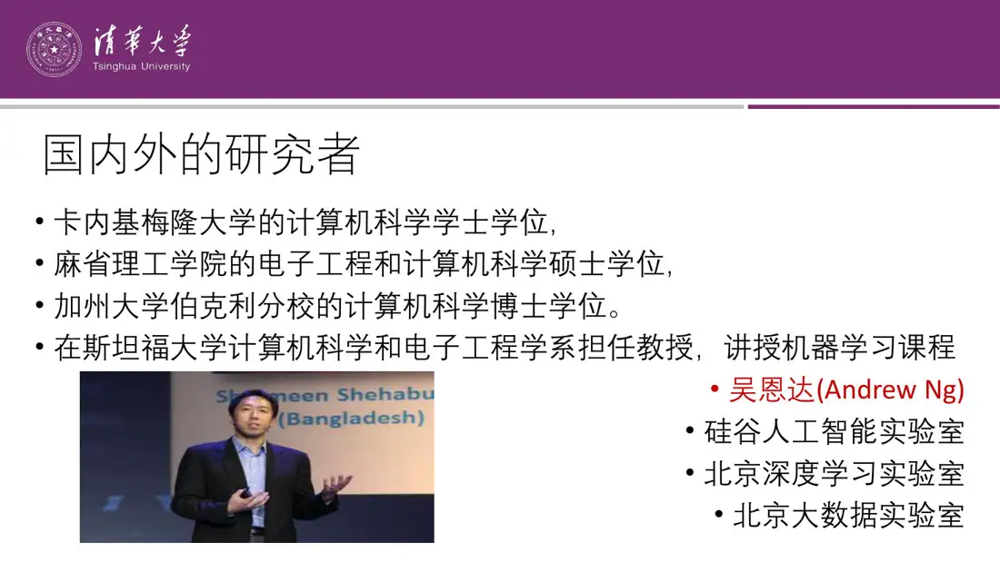

原文：

国内外的研究者

• 卡内基梅隆大学的计算机科学学士学位，

• 麻省理工学院的电子工程和计算机科学硕士学位，

• 加州大学伯克利分校的计算机科学博士学位。

• 在斯坦福大学计算机科学和电子工程学系担任教授，讲授机器学习课程

• 吴恩达(Andrew Ng)

• 硅谷人工智能实验室

• 北京深度学习实验室

• 北京大数据实验室

提纲： Tsinghua University

### 机器学习和数据挖掘的关系

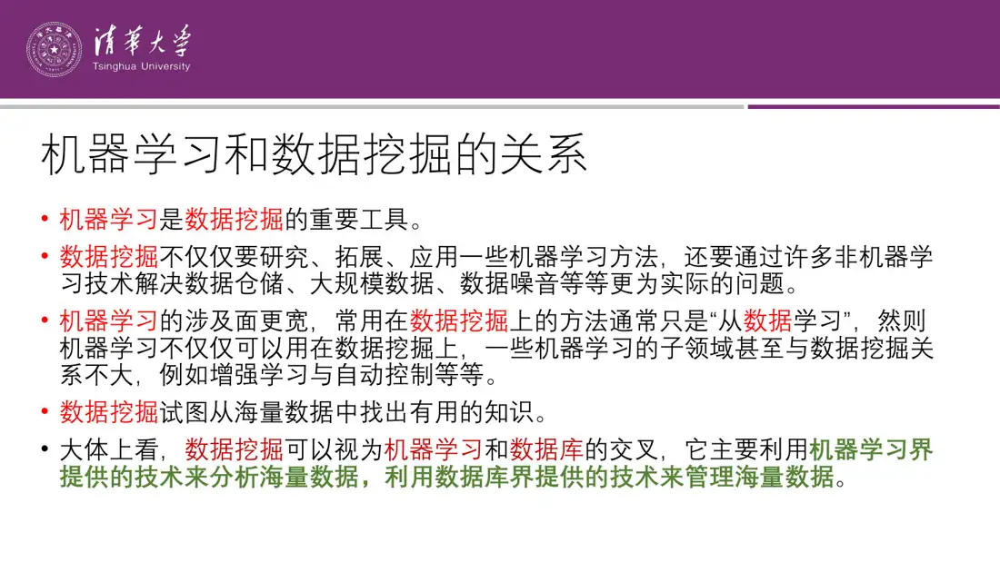

原文：

机器学习和数据挖掘的关系

• 机器学习是数据挖掘的重要工具。

• 数据挖掘不仅仅要研究、拓展、应用一些机器学习方法，还要通过许多非机器学习技术解决数据仓储、大规模数据、数据噪音等等更为实际的问题。

• 机器学习的涉及面更宽，常用在数据挖掘上的方法通常只是“从数据学习”，然则机器学习不仅仅可以用在数据挖掘上，一些机器学习的子领域甚至与数据挖掘关系不大，例如增强学习与自动控制等等。

• 数据挖掘试图从海量数据中找出有用的知识。

• 大体上看，数据挖掘可以视为机器学习和数据库的交叉，它主要利用机器学习界提供的技术来分析海量数据，利用数据库界提供的技术来管理海量数据。

提纲： Tsinghua University

### 机器学习和数据挖掘的关系

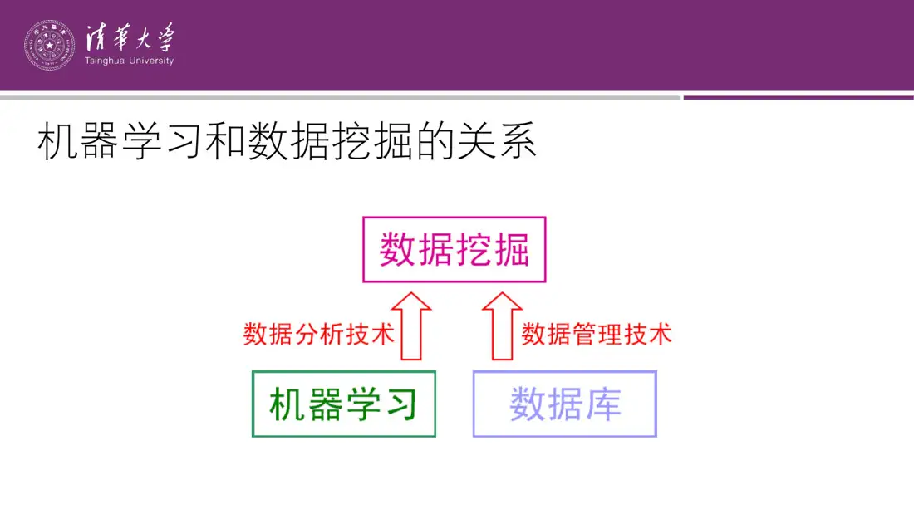

原文：

机器学习和数据挖掘的关系

数据挖掘

数据分析技术

数据管理技术

机器学习

提纲： Tsinghua University

### 机器学习的一个形象描述

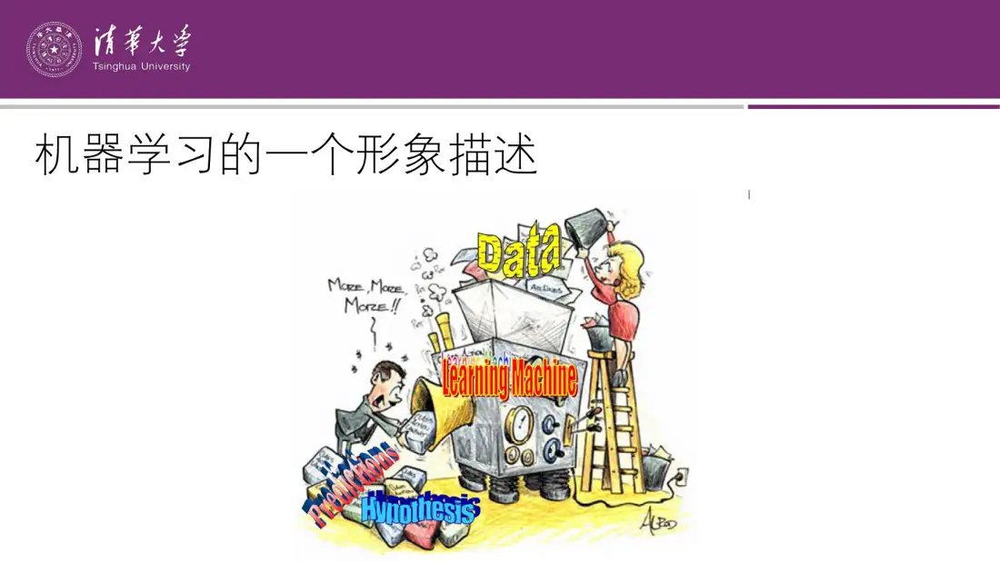

原文：

机器学习的一个形象描述

提纲： Tsinghua University

### 为什么要研究大数据机器学习？

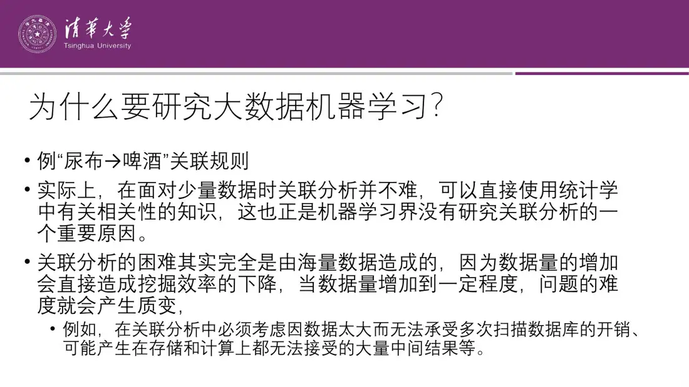

原文：

为什么要研究大数据机器学习？

• 例“尿布→啤酒”关联规则

• 实际上，在面对少量数据时关联分析并不难，可以直接使用统计学中有关相关性的知识，这也正是机器学习界没有研究关联分析的一个重要原因。

• 关联分析的困难其实完全是由海量数据造成的，因为数据量的增加会直接造成挖掘效率的下降，当数据量增加到一定程度，问题的难度就会产生质变，

• 例如，在关联分析中必须考虑因数据太大而无法承受多次扫描数据库的开销、可能产生在存储和计算上都无法接受的大量中间结果等。

提纲： Tsinghua University

### 机器学习相关学术期刊和会议

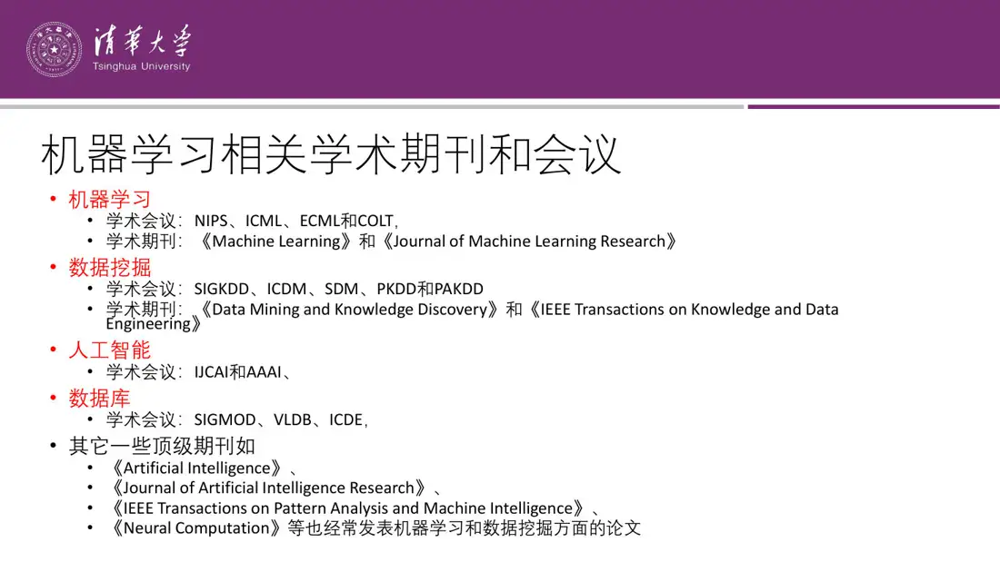

原文：

机器学习相关学术期刊和会议

• 机器学习

• 学术会议：NIPS、ICML、ECML和COLT，

• 学术期刊：《Machine Learning》和《Journal of Machine Learning Research》

• 数据挖掘

• 学术会议：SIGKDD、ICDM、SDM、PKDD和PAKDD

• 学术期刊：《Data Mining and Knowledge Discovery》和《IEEE Transactions on Knowledge and Data Engineering》

• 人工智能

• 学术会议：IJCAI和AAAI、

• 数据库

• 学术会议：SIGMOD、VLDB、ICDE，

• 其它一些顶级期刊如

• 《Artificial Intelligence》、

• 《Journal of Artificial Intelligence Research》、

• 《IEEE Transactions on Pattern Analysis and Machine Intelligence》、

• 《Neural Computation》等也经常发表机器学习和数据挖掘方面的论文

提纲： Tsinghua University

### 机器学习相关学术期刊和会议

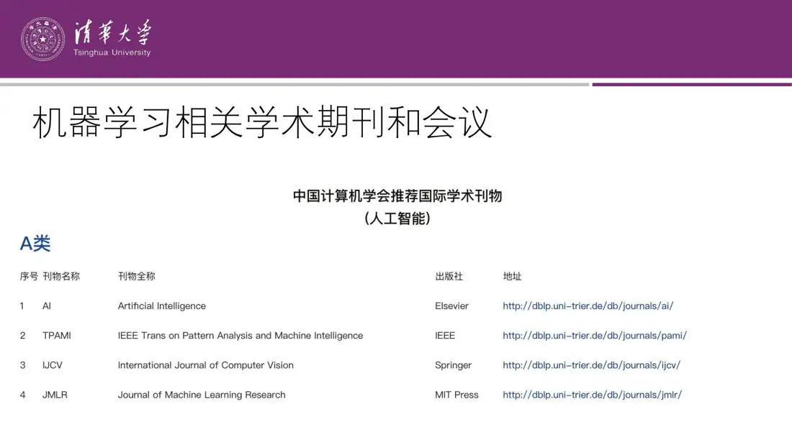

原文：

机器学习相关学术期刊和会议

中国计算机学会推荐国际学术刊物(人工智能)

A类

序号刊物名称 刊物全称

1 AI Artificial Intelligence

出版社 地址

2 TPAMI IEEE Trans on Pattern Analysis and Machine Intelligence

3 IJCV International Journal of Computer Vision

Elsevier http://dblp.uni-trier.de/db/journals/ai/

IEEE http://dblp.uni-trier.de/db/journals/pami/

Springer http://dblp.uni-trier.de/db/journals/ijcv/

4 JMLR Journal of Machine Learning Research

MIT Press http://dblp.uni-trier.de/db/journals/jmlr/

提纲： Tsinghua University

### B类

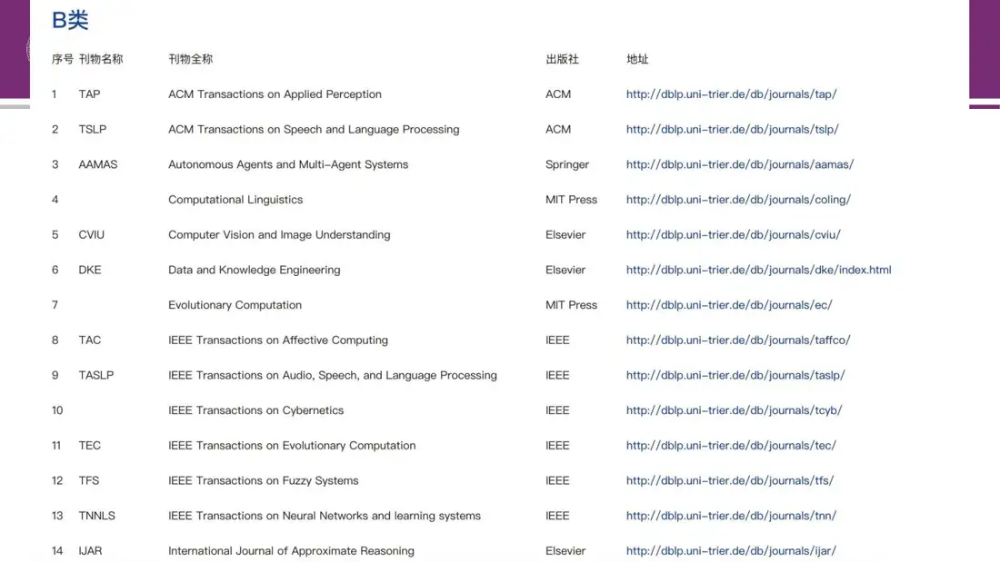

原文：

B类

序号 刊物名称 刊物全称 出版社 地址
1 TAP ACM Transactions on Applied Perception ACM http://dblp.uni-trier.de/db/journals/tap/
2 TSLP ACM Transactions on Speech and Language Processing ACM http://dblp.uni-trier.de/db/journals/tslp/
3 AAMAS Autonomous Agents and Multi-Agent Systems Springer http://dblp.uni-trier.de/db/journals/aamas/
4 Computational Linguistics MIT Press http://dblp.uni-trier.de/db/journals/coling/
5 CVIU Computer Vision and Image Understanding Elsevier http://dblp.uni-trier.de/db/journals/cviu/
6 DKE Data and Knowledge Engineering Elsevier http://dblp.uni-trier.de/db/journals/dke/index.htm
7 Evolutionary Computation MIT Press http://dblp.uni-trier.de/db/journals/ec/
8 TAC IEEE Transactions on Affective Computing IEEE http://dblp.uni-trier.de/db/journals/taffco/
9 TASLP IEEE Transactions on Audio, Speech, and Language Processing IEEE http://dblp.uni-trier.de/db/journals/taslp/
10 IEEE Transactions on Cybernetics IEEE http://dblp.uni-trier.de/db/journals/tcyb/
11 TEC IEEE Transactions on Evolutionary Computation IEEE http://dblp.uni-trier.de/db/journals/tec/
12 TFS IEEE Transactions on Fuzzy Systems IEEE http://dblp.uni-trier.de/db/journals/tfs/
13 TNNLS IEEE Transactions on Neural Networks and learning systems IEEE http://dblp.uni-trier.de/db/journals/tnn/
14 IJAR International Journal of Approximate Reasoning Elsevier http://dblp.uni-trier.de/db/journals/ijar/

### Speech-

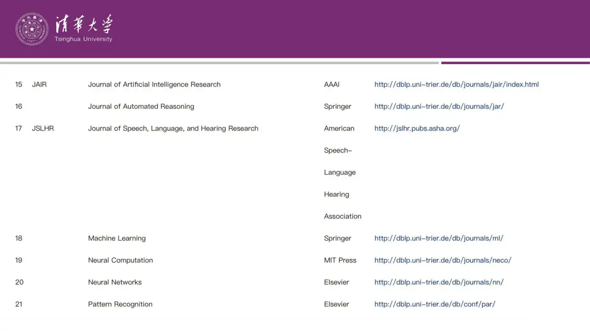

原文：

15 JAIR Journal of Artificial Intelligence Research AAAI http://dblp.uni-trier.de/db/journals/jair/index.html
16 Journal of Automated Reasoning Springer http://dblp.uni-trier.de/db/journals/jar/
17 JSLHR Journal of Speech, Language, and Hearing Research American http://jslhr.pubs.asha.org/
Speech-
Language
Hearing
Association
18 Machine Learning Springer http://dblp.uni-trier.de/db/journals/ml/
19 Neural Computation MIT Press http://dblp.uni-trier.de/db/journals/neco/
20 Neural Networks Elsevier http://dblp.uni-trier.de/db/journals/nn/
21 Pattern Recognition Elsevier http://dblp.uni-trier.de/db/conf/par/

提纲： Tsinghua University

### 中国计算机学会推荐国际学术会议

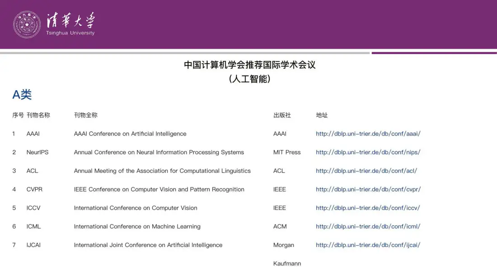

原文：

中国计算机学会推荐国际学术会议

A类

刊和

<table><tr><td>序号</td><td>刊物名称</td><td>刊物全称</td><td>出版社</td><td>地址</td></tr><tr><td>1</td><td>AAAI</td><td>AAAI Conference on Artificial Intelligence</td><td>AAAI</td><td>http://dblp.uni-trier.de/db/conf/aaai/</td></tr><tr><td>2</td><td>NeurIPS</td><td>Annual Conference on Neural Information Processing Systems</td><td>MIT Press</td><td>http://dblp.uni-trier.de/db/conf/nips/</td></tr><tr><td>3</td><td>ACL</td><td>Annual Meeting of the Association for Computational Linguistics</td><td>ACL</td><td>http://dblp.uni-trier.de/db/conf/acl/</td></tr><tr><td>4</td><td>CVPR</td><td>IEEE Conference on Computer Vision and Pattern Recognition</td><td>IEEE</td><td>http://dblp.uni-trier.de/db/conf/cvpr/</td></tr><tr><td>5</td><td>ICCV</td><td>International Conference on Computer Vision</td><td>IEEE</td><td>http://dblp.uni-trier.de/db/conf/iccv/</td></tr><tr><td>6</td><td>ICML</td><td>International Conference on Machine Learning</td><td>ACM</td><td>http://dblp.uni-trier.de/db/conf/icml/</td></tr><tr><td>7</td><td>IJCAI</td><td>International Joint Conference on Artificial Intelligence</td><td>Morgan</td><td>http://dblp.uni-trier.de/db/conf/ijcai/</td></tr></table>

提纲： Tsinghua University

### B类

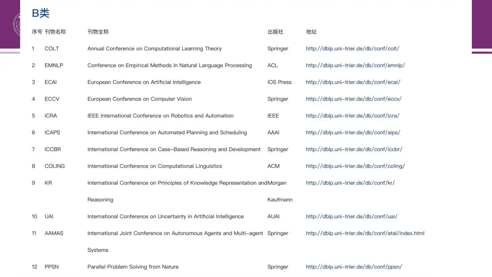

原文：

B类

序号 刊物名称 刊物全称 出版社 地址
1 COLT Annual Conference on Computational Learning Theory Springer http://dblp.uni-trier.de/db/conf/colt/
2 EMNLP Conference on Empirical Methods in Natural Language Processing ACL http://dblp.uni-trier.de/db/conf/emnlp/
3 ECAI European Conference on Artificial Intelligence IOS Press http://dblp.uni-trier.de/db/conf/ecai/
4 ECCV European Conference on Computer Vision Springer http://dblp.uni-trier.de/db/conf/eccv/
5 ICRA IEEE International Conference on Robotics and Automation IEEE http://dblp.uni-trier.de/db/conf/icra/
6 ICAPS International Conference on Automated Planning and Scheduling AAAI http://dblp.uni-trier.de/db/conf/aips/
7 ICCBR International Conference on Case-Based Reasoning and Development Springer http://dblp.uni-trier.de/db/conf/iccbr/
8 COLING International Conference on Computational Linguistics ACM http://dblp.uni-trier.de/db/conf/coling/
9 KR International Conference on Principles of Knowledge Representation and Morgan http://dblp.uni-trier.de/db/conf/kr/
Reasoning Kaufmann
10 UAI International Conference on Uncertainty in Artificial Intelligence AUAI http://dblp.uni-trier.de/db/conf/uai/
11 AAMAS International Joint Conference on Autonomous Agents and Multi-agent Springer http://dblp.uni-trier.de/db/conf/atal/index.html
Systems
12 PPSN Parallel Problem Solving from Nature Springer http://dblp.uni-trier.de/db/conf/ppsn/

TSINGHUF

### 机器学习和统计学习

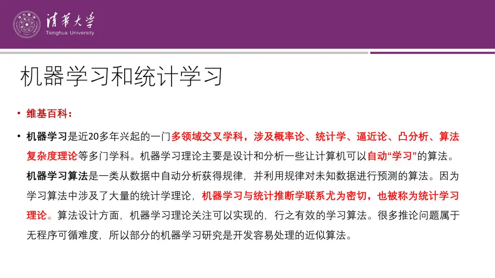

原文：

机器学习和统计学习

• 维基百科：

• 机器学习是近20多年兴起的一门多领域交叉学科，涉及概率论、统计学、逼近论、凸分析、算法复杂度理论等多门学科。机器学习理论主要是设计和分析一些让计算机可以自动“学习”的算法。机器学习算法是一类从数据中自动分析获得规律，并利用规律对未知数据进行预测的算法。因为学习算法中涉及了大量的统计学理论，机器学习与统计推断学联系尤为密切，也被称为统计学习理论。算法设计方面，机器学习理论关注可以实现的，行之有效的学习算法。很多推论问题属于无程序可循难度，所以部分的机器学习研究是开发容易处理的近似算法。

提纲： Tsinghua University

### 统计学习和机器学习

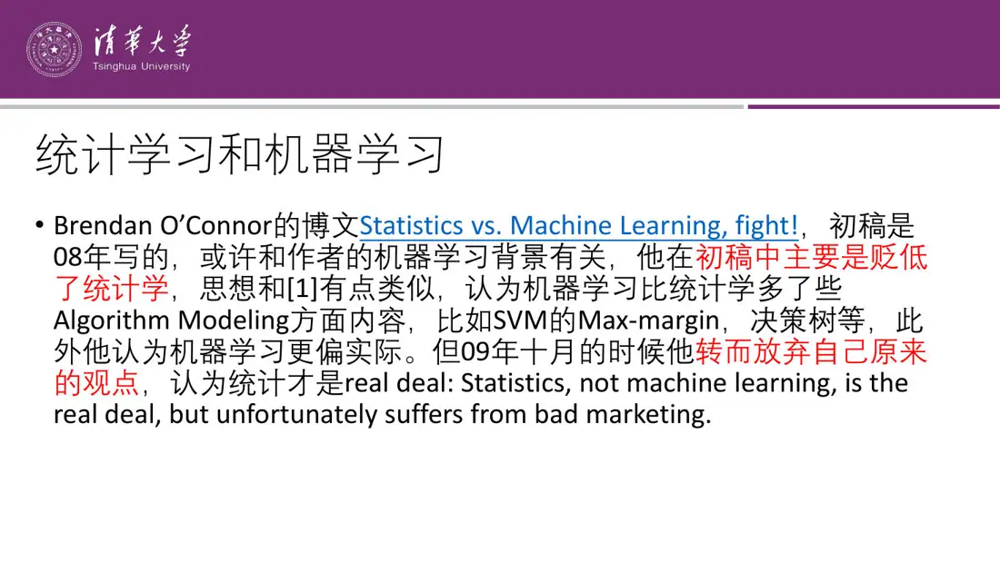

原文：

统计学习和机器学习

• Brendan O’Connor的博文Statistics vs. Machine Learning, fight!，初稿是08年写的，或许和作者的机器学习背景有关，他在初稿中主要是贬低了统计学，思想和[1]有点类似，认为机器学习比统计学多了些Algorithm Modeling方面内容，比如SVM的Max-margin，决策树等，此外他认为机器学习更偏实际。但09年十月的时候他转而放弃自己原来的观点，认为统计才是real deal: Statistics, not machine learning, is thereal deal, but unfortunately suffers from bad marketing.

提纲： Tsinghua University

### 统计学习和机器学习

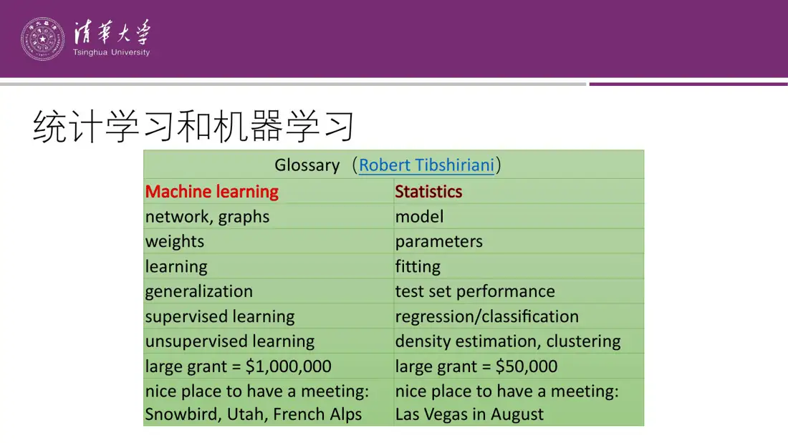

原文：

统计学习和机器学习

<table><tr><td colspan="2">Glossary (Robert Tibshiriani)</td></tr><tr><td>Machine learning</td><td>Statistics</td></tr><tr><td>network, graphs</td><td>model</td></tr><tr><td>weights</td><td>parameters</td></tr><tr><td>learning</td><td>fitting</td></tr><tr><td>generalization</td><td>test set performance</td></tr><tr><td>supervised learning</td><td>regression/classification</td></tr><tr><td>unsupervised learning</td><td>density estimation, clustering</td></tr><tr><td>large grant = $1,000,000</td><td>large grant = $50,000</td></tr><tr><td>nice place to have a meeting: Snowbird, Utah, French Alps</td><td>nice place to have a meeting: Las Vegas in August</td></tr></table>

提纲： Tsinghua University

### 统计学习和机器学习

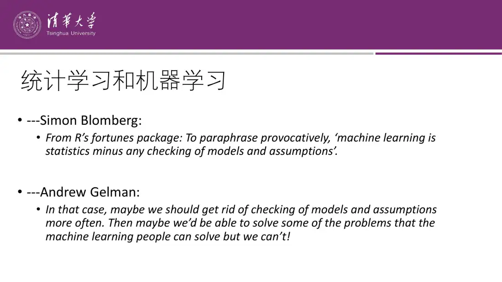

原文：

统计学习和机器学习

• ---Simon Blomberg:

• From R’s fortunes package: To paraphrase provocatively, ‘machine learning is statistics minus any checking of models and assumptions’.

• ---Andrew Gelman:

• In that case, maybe we should get rid of checking of models and assumptions more often. Then maybe we’d be able to solve some of the problems that the machine learning people can solve but we can’t!

提纲： Tsinghua University

### 统计学习和机器学习

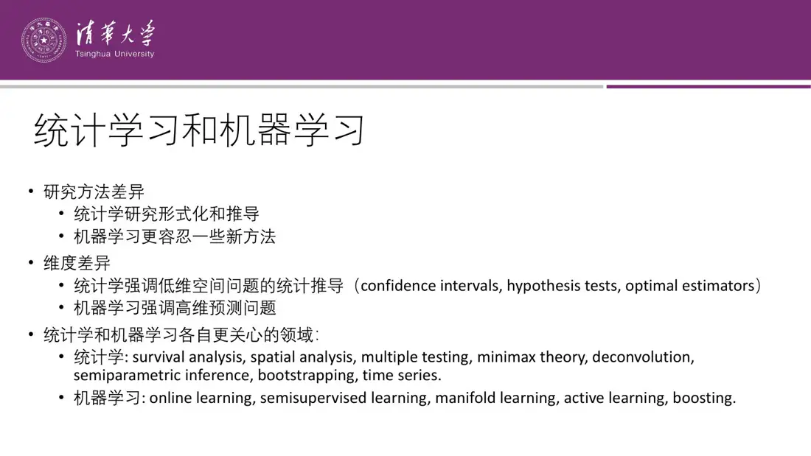

原文：

统计学习和机器学习

• 研究方法差异

• 统计学研究形式化和推导

• 机器学习更容忍一些新方法

• 维度差异

• 统计学强调低维空间问题的统计推导（confidence intervals, hypothesis tests, optimal estimators）

• 机器学习强调高维预测问题

• 统计学和机器学习各自更关心的领域：

• 统计学: survival analysis, spatial analysis, multiple testing, minimax theory, deconvolution, semiparametric inference, bootstrapping, time series.

• 机器学习: online learning, semisupervised learning, manifold learning, active learning, boosting.

提纲： Tsinghua University

### 统计学习和机器学习（专业术语）

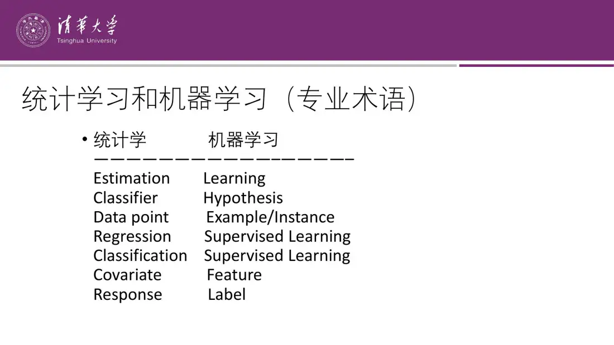

原文：

统计学习和机器学习（专业术语）

• 统计学 机器学习

Estimation Learning

Classifier Hypothesis

Data point Example/Instance

Regression Supervised Learning

Classification Supervised Learning

Covariate Feature

Response Label

提纲： Tsinghua University

### 统计学习

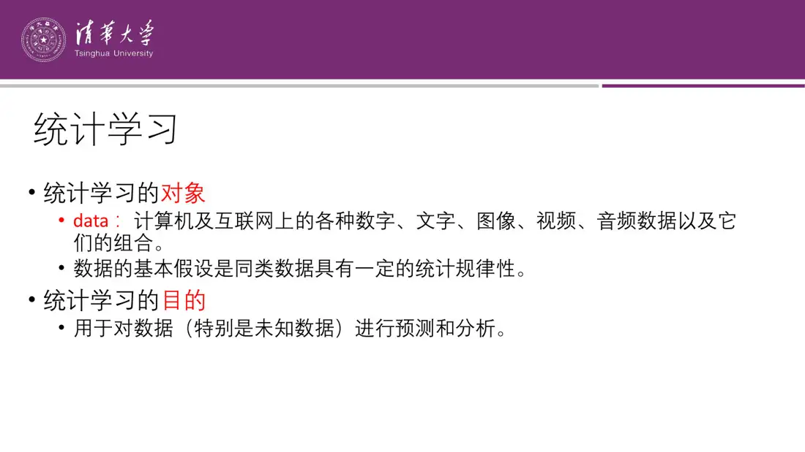

原文：

统计学习

• 统计学习的对象

• data ：计算机及互联网上的各种数字、文字、图像、视频、音频数据以及它们的组合。

• 数据的基本假设是同类数据具有一定的统计规律性。

• 统计学习的目的

• 用于对数据（特别是未知数据）进行预测和分析。

提纲： Tsinghua University

### 统计学习

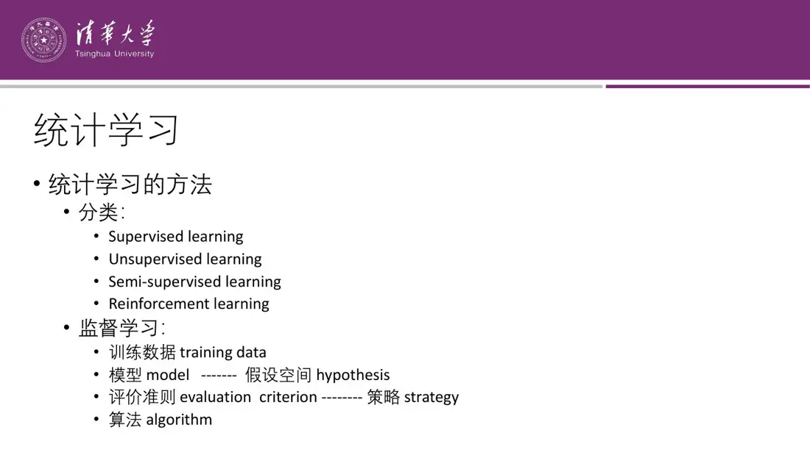

原文：

统计学习

• 统计学习的方法

• 分类：

• Supervised learning

• Unsupervised learning

• Semi-supervised learning

• Reinforcement learning

• 监督学习：

• 训练数据 training data

• 模型 model ------- 假设空间 hypothesis

• 评价准则 evaluation criterion -------- 策略 strategy

• 算法 algorithm

提纲： Tsinghua University

### 统计学习

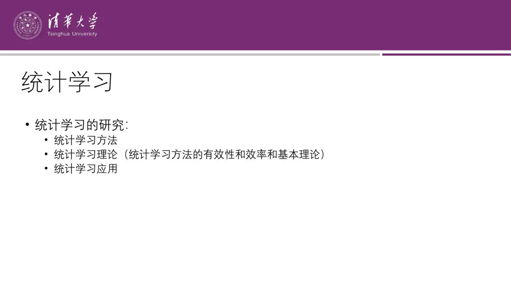

原文：

统计学习

• 统计学习的研究：

• 统计学习方法

• 统计学习理论（统计学习方法的有效性和效率和基本理论）

• 统计学习应用

提纲： Tsinghua University

### 监督学习

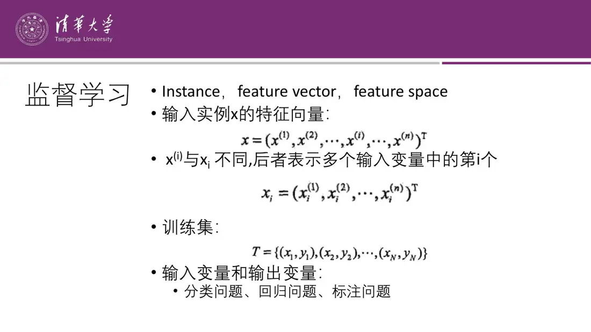

原文：

监督学习

• Instance，feature vector，feature space

• 输入实例x的特征向量：

$$
x = \left(x ^ {(1)}, x ^ {(2)}, \dots , x ^ {(i)}, \dots , x ^ {(n)}\right) ^ {T}
$$

• $\mathsf { x } ^ { ( \mathrm { i } ) }$ 与 $\mathsf { X } _ { \mathrm { i } }$ 不同,后者表示多个输入变量中的第i个

$$
x _ {i} = \left(x _ {i} ^ {(1)}, x _ {i} ^ {(2)}, \dots , x _ {i} ^ {(n)}\right) ^ {\mathrm{T}}
$$

• 训练集：

$$
T = \{(x _ {1}, y _ {1}), (x _ {2}, y _ {2}), \dots , (x _ {N}, y _ {N}) \}
$$

• 输入变量和输出变量：

• 分类问题、回归问题、标注问题

提纲： Tsinghua University

### 监督学习

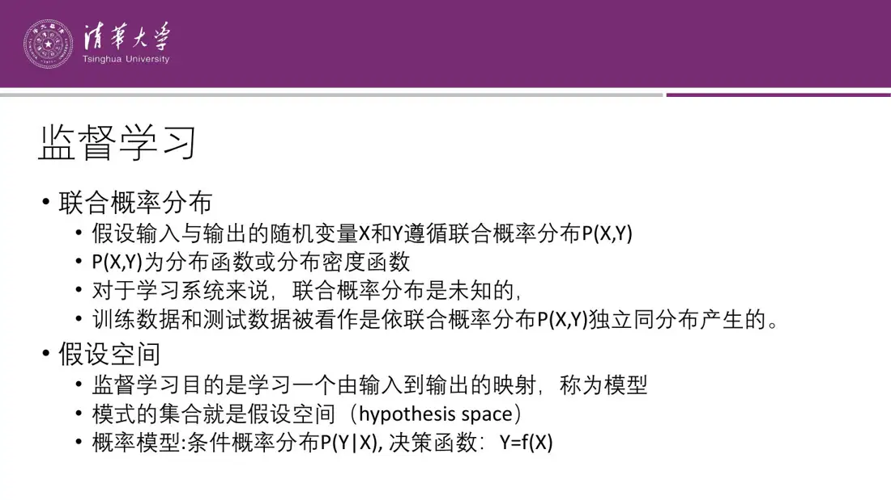

原文：

监督学习

• 联合概率分布

• 假设输入与输出的随机变量X和Y遵循联合概率分布P(X,Y)

• P(X,Y)为分布函数或分布密度函数

• 对于学习系统来说，联合概率分布是未知的，

• 训练数据和测试数据被看作是依联合概率分布P(X,Y)独立同分布产生的。

• 假设空间

• 监督学习目的是学习一个由输入到输出的映射，称为模型

• 模式的集合就是假设空间（hypothesis space）

• 概率模型:条件概率分布P(Y|X), 决策函数：Y=f(X)

提纲： Tsinghua University

### 监督学习

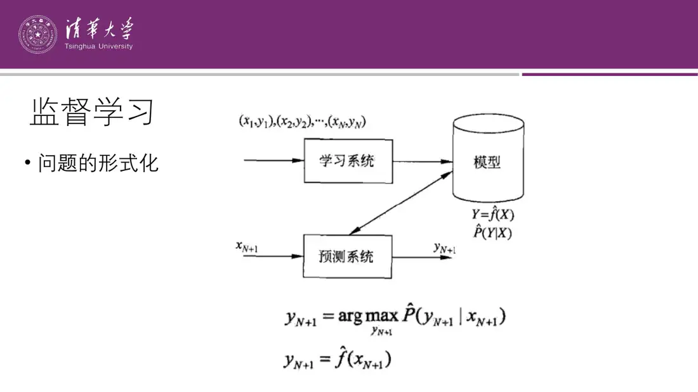

原文：

监督学习

• 问题的形式化

$$
\begin{array}{l} y _ {N + 1} = \underset {y _ {N + 1}} {\arg \max} \hat {P} (y _ {N + 1} \mid x _ {N + 1}) \\ y _ {N + 1} = \hat {f} (x _ {N + 1}) \end{array}
$$

提纲： Tsinghua University

### 无监督学习

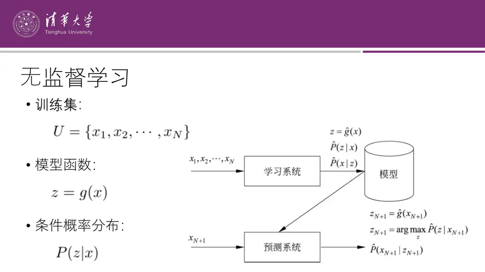

原文：

无监督学习

• 训练集：

$$
U = \{x _ {1}, x _ {2}, \dots , x _ {N} \}
$$

• 模型函数：

$$
z = g (x)
$$

• 条件概率分布：

$$
P (z | x)
$$

提纲： Tsinghua University

### 强化学习

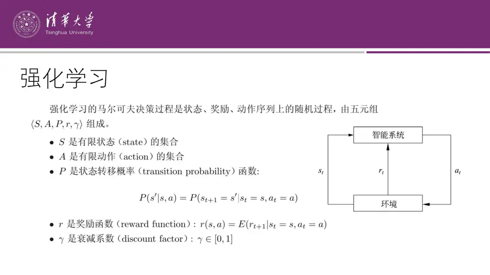

原文：

强化学习

强化学习的马尔可夫决策过程是状态、奖励、动作序列上的随机过程，由五元组$\langle S , A , P , r , \gamma \rangle$ 组成。

●S是有限状态（state）的集合

●A是有限动作（action）的集合

•P是状态转移概率（transitionprobability）函数:

$$
P (s ^ {\prime} | s, a) = P (s _ {t + 1} = s ^ {\prime} | s _ {t} = s, a _ {t} = a)
$$

• r 是奖励函数(reward function): $r ( s , a ) = E ( r _ { t + 1 } | s _ { t } = s , a _ { t } = a )$

•γ是衰减系数（discountfactor）: $\gamma \in [ 0 , 1 ]$

提纲： Tsinghua University

### 强化学习

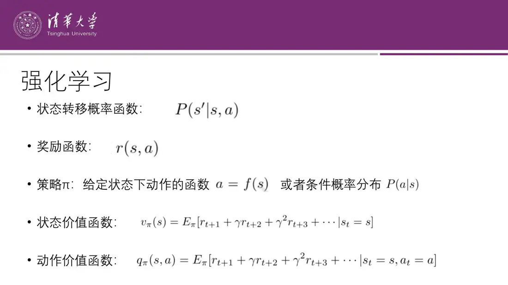

原文：

强化学习

• 状态转移概率函数： $P ( s ^ { \prime } | s , a )$

• 奖励函数： $r ( s , a )$

• 策略π：给定状态下动作的函数 $a = f ( s )$ 或者条件概率分布 $P ( \boldsymbol { a } | \boldsymbol { s } )$

• 状态价值函数： $v _ { \pi } ( s ) = E _ { \pi } [ r _ { t + 1 } + \gamma r _ { t + 2 } + \gamma ^ { 2 } r _ { t + 3 } + \cdot \cdot \cdot | s _ { t } = s ]$

• 动作价值函数： $q _ { \pi } ( s , a ) = E _ { \pi } [ r _ { t + 1 } + \gamma r _ { t + 2 } + \gamma ^ { 2 } r _ { t + 3 } + \cdot \cdot \cdot | s _ { t } = s , a _ { t } = a ]$

提纲： Tsinghua University

### 强化学习方法

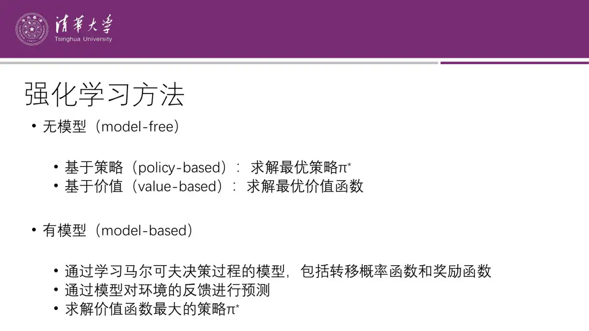

原文：

强化学习方法

• 无模型（model-free）

• 基于策略（policy-based）：求解最优策略π\*

• 基于价值（value-based）：求解最优价值函数

• 有模型（model-based）

• 通过学习马尔可夫决策过程的模型，包括转移概率函数和奖励函数

• 通过模型对环境的反馈进行预测

• 求解价值函数最大的策略π\*

提纲： Tsinghua University

### 半监督学习

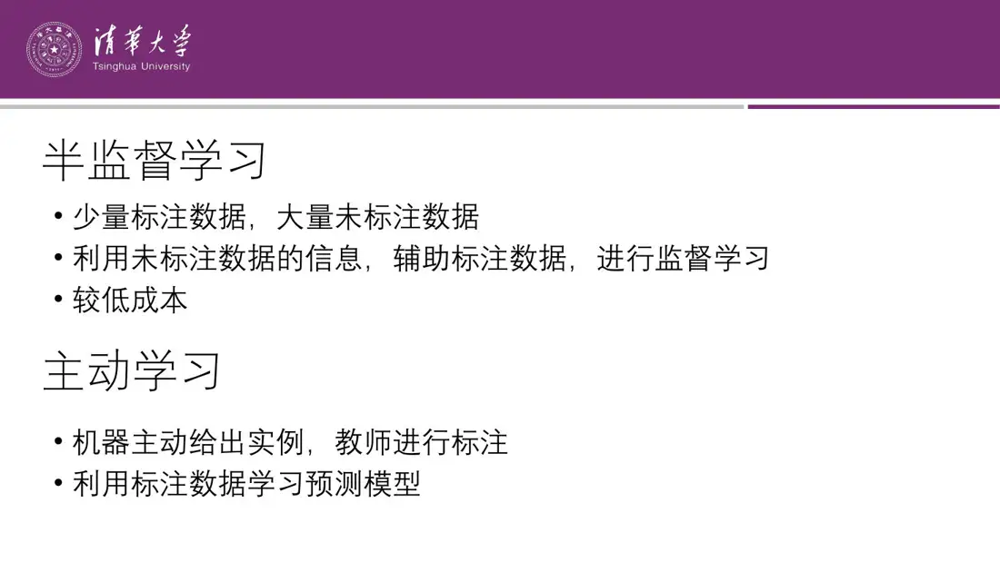

原文：

半监督学习

• 少量标注数据，大量未标注数据

• 利用未标注数据的信息，辅助标注数据，进行监督学习

• 较低成本

主动学习

• 机器主动给出实例，教师进行标注

• 利用标注数据学习预测模型

提纲： Tsinghua University

### 统计学习

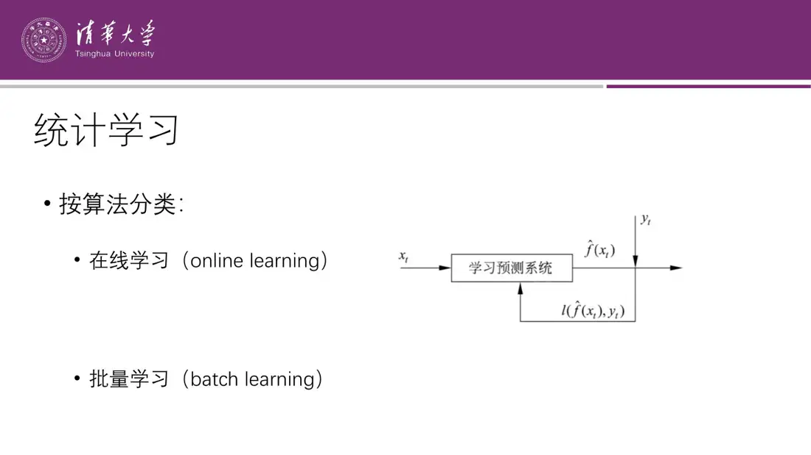

原文：

统计学习

• 按算法分类：

• 在线学习（online learning）

• 批量学习（batch learning）

提纲： Tsinghua University

### 统计学习

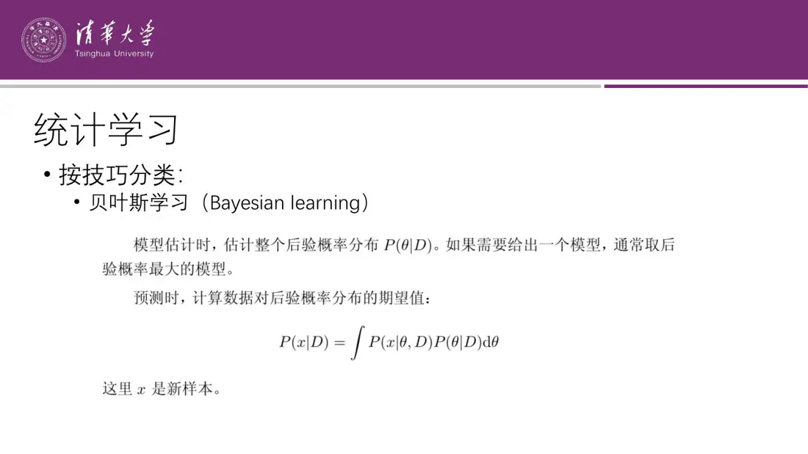

原文：

统计学习

• 按技巧分类：

• 贝叶斯学习（Bayesian learning）

模型估计时，估计整个后验概率分布 $P ( \theta | D )$ 。如果需要给出一个模型，通常取后验概率最大的模型。

预测时，计算数据对后验概率分布的期望值：

$$
P (x | D) = \int P (x | \theta , D) P (\theta | D) \mathrm{d} \theta
$$

这里x是新样本。

提纲： Tsinghua University

### 统计学习

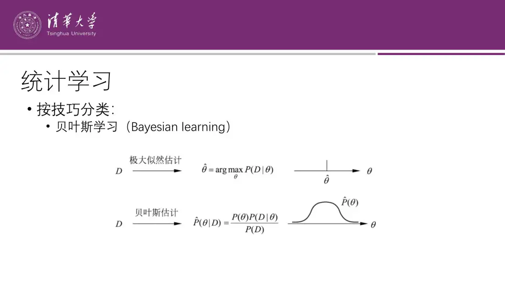

原文：

统计学习

• 按技巧分类：

• 贝叶斯学习（Bayesian learning）

$$
D \xrightarrow {\text {极大似然估计}} \hat {\theta} = \arg \max _ {\theta} P (D | \theta) \qquad \xrightarrow [ \hat {\theta} ]{\mid} \theta
$$

$$
D \xrightarrow {\text {贝叶斯估计}} \hat {P} (\theta | D) = \frac {P (\theta) P (D | \theta)}{P (D)} \xrightarrow {\hat {P} (\theta)} \theta
$$

提纲： Tsinghua University

### 统计学习

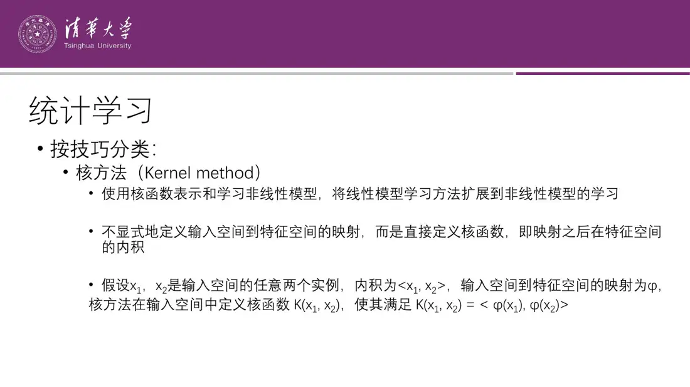

原文：

统计学习

• 按技巧分类：

• 核方法（Kernel method）

• 使用核函数表示和学习非线性模型，将线性模型学习方法扩展到非线性模型的学习

• 不显式地定义输入空间到特征空间的映射，而是直接定义核函数，即映射之后在特征空间的内积

• 假设 $\mathsf { x } _ { 1 }$ ， $\mathsf { X } _ { 2 }$ 是输入空间的任意两个实例，内积为 $< \mathsf { X } _ { 1 } , \mathsf { X } _ { 2 } >$ ，输入空间到特征空间的映射为φ，核方法在输入空间中定义核函数 ${ \sf K } ( { \sf x } _ { 1 } , { \sf x } _ { 2 } )$ ，使其满足 ${ \sf K } ( { \sf x } _ { 1 } , { \sf x } _ { 2 } ) = < \varphi ( { \sf x } _ { 1 } ) , \varphi ( { \sf x } _ { 2 } ) >$

提纲： Tsinghua University

### 统计学习三要素

原文：

统计学习三要素

$$
\text {   方法   } = \text {   模型   } + \text {   策略   } + \text {   算法   }
$$

• 模型：

• 决策函数的集合： ${ \mathcal { F } } = \{ f | Y = f ( X ) \}$

• 参数空间

$$
\mathcal {F} = \{f \mid Y = f _ {\theta} (X), \theta \in \mathbf {R} ^ {n} \}
$$

• 条件概率的集合：

$$
\mathcal {F} = \{P \mid P (Y \mid X) \}
$$

• 参数空间

$$
\mathcal {F} = \{P \mid P _ {\theta} (Y \mid X), \theta \in \mathbf {R} ^ {n} \}
$$

提纲： Tsinghua University

### 统计学习三要素

原文：

统计学习三要素

• 策略

• 损失函数：一次预测的好坏

• 风险函数：平均意义下模型预测的好坏

• 0-1损失函数 0-1 loss function

$$
L (Y, f (X)) = \left\{ \begin{array}{l l} 1, & Y \neq f (X) \\ 0, & Y = f (X) \end{array} \right.
$$

• 平方损失函数 quadratic loss function

$$
L (Y, f (X)) = (Y - f (X)) ^ {2}
$$

• 绝对损失函数 absolute loss function

$$
L (Y, f (X)) = | Y - f (X) |
$$

提纲： Tsinghua University

### 统计学习三要素

原文：

统计学习三要素

• 策略

• 对数损失函数 logarithmic loss function 或对数似然损失函数 loglikelihood lossfunction

$$
L (Y, P (Y \mid X)) = - \log P (Y \mid X)
$$

• 损失函数的期望 $R _ { \mathrm { e x p } } ( f ) = E _ { P } [ L ( Y , f ( X ) ) ] = \int _ { x \times y } L ( y , f ( x ) ) P ( x , y ) \mathrm { d } x \mathrm { d } y$

• 风险函数 risk function 期望损失 expected loss

• 由 $\mathsf { P } ( \mathsf { x } , \mathsf { y } )$ 可以直接求出 $\mathsf { P } ( \mathsf { x } | \mathsf { y } )$ ,但不知道，

$$
T = \{(x _ {1}, y _ {1}), (x _ {2}, y _ {2}), \dots , (x _ {N}, y _ {N}) \}
$$

• 经验风险 empirical risk ，经验损失 empirical loss

$$
R _ {\mathrm{emp}} (f) = \frac {1}{N} \sum_ {i = 1} ^ {N} L (y _ {i}, f (x _ {i}))
$$

提纲： Tsinghua University

### 统计学习三要素

原文：

统计学习三要素

• 策略：经验风险最小化与结构风险最小化

• 经验风险最小化最优模型

$$
\min _ {f \in \mathcal {F}} \frac {1}{N} \sum_ {i = 1} ^ {N} L (y _ {i}, f (x _ {i}))
$$

• 当样本容量很小时，经验风险最小化学习的效果未必很好，会产生“过拟合over-fitting”

• 结构风险最小化 structure risk minimization，为防止过拟合提出的策略，等价于正则化（regularization），加入正则化项regularizer，或罚项 penalty term：

$$
R _ {\text { 一}} (f) = \frac {1}{N} \sum_ {i = 1} ^ {N} L \left(y _ {i}, f \left(x _ {i}\right)\right) + \lambda J (f)
$$

提纲： Tsinghua University

### 统计学习三要素

原文：

统计学习三要素

• 求最优模型就是求解最优化问题：

$$
\min _ {f \in \mathcal {F}} \frac {1}{N} \sum_ {i = 1} ^ {N} L (y _ {i}, f (x _ {i})) + \lambda J (f)
$$

提纲： Tsinghua University

### 统计学习三要素

原文：

统计学习三要素

• 算法：

• 如果最优化问题有显式的解析式，算法比较简单

• 但通常解析式不存在，就需要数值计算的方法

提纲： Tsinghua University

### 模型评估与模型选择

原文：

模型评估与模型选择

• 训练误差，训练数据集的平均损失

• 测试误差，测试数据集的平均损失

• 损失函数是0-1 损失时：

• 测试数据集的准确率：

$$
R _ {\mathrm{emp}} (\hat {f}) = \frac {1}{N} \sum_ {i = 1} ^ {N} L (y _ {i}, \hat {f} (x _ {i}))
$$

$$
e _ {\text { test }} = \frac {1}{N ^ {\prime}} \sum_ {i = 1} ^ {N ^ {\prime}} L (y _ {i}, \hat {f} (x _ {i}))
$$

$$
e _ {\text { test }} = \frac {1}{N ^ {\prime}} \sum_ {i = 1} ^ {N ^ {\prime}} I (y _ {i} \neq \hat {f} (x _ {i}))
$$

$$
r _ {\text { test }} = \frac {1}{N ^ {2}} \sum_ {i = 1} ^ {N ^ {2}} I (y _ {i} = \hat {f} (x _ {i}))
$$

提纲： Tsinghua University

### 模型评估与模型选择

原文：

模型评估与模型选择

• 过拟合与模型选择

• 假设给定训练数据集 $T = \{ ( x _ { 1 } , y _ { 1 } ) , ( x _ { 2 } , y _ { 2 } ) , \cdots , ( x _ { N } , y _ { N } ) \}$

$$
f _ {M} (x, w) = w _ {0} + w _ {1} x + w _ {2} x ^ {2} + \dots + w _ {M} x ^ {M} = \sum_ {j = 0} ^ {M} w _ {j} x ^ {j}
$$

• 经验风险最小：

$$
L (w) = \frac {1}{2} \sum_ {i = 1} ^ {N} \left(f \left(x _ {i}, w\right) - y _ {i}\right) ^ {2} \quad L (w) = \frac {1}{2} \sum_ {i = 1} ^ {N} \left(\sum_ {j = 0} ^ {M} w _ {j} x _ {i} ^ {\prime} - y _ {i}\right) ^ {2} \quad w _ {j} = \frac {\sum_ {i = 1} ^ {N} x _ {i} y _ {i}}{\sum_ {i = 1} ^ {N} x _ {i} ^ {j + 1}}, \quad j = 0, 1, 2, \dots , M
$$

提纲： Tsinghua University

### 模型评估与模型选择

原文：

模型评估与模型选择

提纲： Tsinghua University

### 模型评估与模型选择

原文：

模型评估与模型选择

提纲： Tsinghua University

### 正则化与交叉验证

原文：

正则化与交叉验证

• 正则化一般形式：

$$
\min _ {f \in \mathcal {F}} \frac {1}{N} \sum_ {i = 1} ^ {N} L (y _ {i}, f (x _ {i})) + \lambda J (f)
$$

• 回归问题中：

$$
L (w) = \frac {1}{N} \sum_ {i = 1} ^ {N} \left(f (x _ {i}; w) - y _ {i}\right) ^ {2} + \frac {\lambda}{2} \| w \| ^ {2}
$$

$$
L (w) = \frac {1}{N} \sum_ {i = 1} ^ {N} \left(f \left(x _ {i}; w\right) - y _ {i}\right) ^ {2} + \lambda \| w \| _ {1}
$$

提纲： Tsinghua University

### 正则化与交叉验证

原文：

正则化与交叉验证

• 交叉验证：

• 训练集 training set： 用于训练模型

• 验证集 validation set：用于模型选择

• 测试集 test set： 用于最终对学习方法的评估

• 简单交叉验证

• S折交叉验证

• 留一交叉验证

提纲： Tsinghua University

### 泛化能力 generalization ability

原文：

泛化能力 generalization ability

• 泛化误差 generalization error $R _ { \mathrm { e x p } } ( { \hat { f } } ) = E _ { P } [ L ( Y , { \hat { f } } ( X ) ) ] = \int _ { \ast \times \times \mathcal { Y } } L ( y , { \hat { f } } ( x ) ) P ( x , y ) \mathrm { d } x \mathrm { d } y$

• 泛化误差上界

• 比较学习方法的泛化能力------比较泛化误差上界

• 性质：样本容量增加，泛化误差趋于0，假设空间容量越大， 泛化误差越大

• 二分类问题 $X \in \mathbb { R } ^ { n } , \quad Y \in \{ - 1 , + 1 \}$

• 期望风险和经验风险

$$
R (f) = E [ L (Y, f (X)) ] \quad \hat {R} (f) = \frac {1}{N} \sum_ {i = 1} ^ {N} L (y _ {i}, f (x _ {i}))
$$

提纲： Tsinghua University

### 泛化能力 generalization ability

原文：

泛化能力 generalization ability

• 经验风险最小化函数： $f _ { N } = \mathrm { a r g m i n } \hat { R } ( f )$

• 泛化能力： $\begin{array} { r } { R ( f _ { N } ) = E [ { \cal L } ( Y , f _ { N } ( X ) ) ] } \end{array}$

• 定理：泛化误差上界，二分类问题，

当假设空间是有限个函数的结合 $\mathcal { F } = \{ f _ { 1 } , f _ { 2 } , \cdots , f _ { d } \}$

对任意一个函数f，至少以概率1-δ，以下不等式成立：

$$
R (f) \leqslant \hat {R} (f) + \varepsilon (d, N, \delta)
$$

$$
\varepsilon (d, N, \delta) = \sqrt {\frac {1}{2 N} \left(\log d + \log \frac {1}{\delta}\right)}
$$

提纲： Tsinghua University

### 生成模型与判别模型

原文：

生成模型与判别模型

• 监督学习的目的就是学习一个模型：

• 决策函数： $Y = f ( X )$

• 条件概率分布： $P ( Y \mid X )$

• 生成方法Generative approach 对应生成模型：generative model，

$$
P (Y \mid X) = \frac {P (X , Y)}{P (X)}
$$

• 朴素贝叶斯法和隐马尔科夫模型

提纲： Tsinghua University

### 生成模型与判别模型

原文：

生成模型与判别模型

• 判别方法由数据直接学习决策函数f(X)或条件概率分布P(Y|X)作为预测的模型，即判别模型

• Discriminative approach对应discriminative model

$$
Y = f (X)
$$

$$
P (Y \mid X)
$$

• K近邻法、感知机、决策树、logistic回归模型、最大熵模型、支持向量机、提升方法和条件随机场。

提纲： Tsinghua University

### 生成模型与判别模型

原文：

生成模型与判别模型

• 各自优缺点：

• 生成方法：可还原出联合概率分布P(X,Y), 而判别方法不能。生成方法的收敛速度更快，当样本容量增加的时候，学到的模型可以更快地收敛于真实模型；当存在隐变量时，仍可以使用生成方法，而判别方法则不能用。

• 判别方法：直接学习到条件概率或决策函数，直接进行预测，往往学习的准确率更高；由于直接学习Y=f(X)或P(Y|X),可对数据进行各种程度上的抽象、定义特征并使用特征，因此可以简化学习过程。

提纲： Tsinghua University

### 分类问题

原文：

分类问题

提纲： Tsinghua University

### 分类问题

原文：

分类问题

• 二分类评价指标

• TP true positive

• FN false negative

• FP false positive

• TN true negative

• 精确率

• 召回率

$$
R = \frac {T P}{T P + F N}
$$

$$
P = \frac {T P}{T P + F P}
$$

• $\mathsf { F } _ { 1 }$ 值

$$
\frac {2}{F _ {1}} = \frac {1}{P} + \frac {1}{R}
$$

$$
F _ {1} = \frac {2 T P}{2 T P + F P + F N}
$$

提纲： Tsinghua University

### 标注问题

原文：

标注问题

• 标注：tagging， 结构预测：structure prediction

• 输入：观测序列， 输出：标记序列或状态序列

• 学习和标注两个过程

• 训练集： $T = \{ ( x _ { 1 } , y _ { 1 } ) , ( x _ { 2 } , y _ { 2 } ) , \cdots , ( x _ { N } , y _ { N } ) \}$

• 观测序列： $\boldsymbol { x } _ { i } = ( \boldsymbol { x } _ { i } ^ { ( 1 ) } , \boldsymbol { x } _ { i } ^ { ( 2 ) } , \cdots , \boldsymbol { x } _ { i } ^ { ( n ) } ) ^ { \top } , \ i = 1 , 2 , \cdots , N$

• 输出标记序列： $y _ { i } = ( y _ { i } ^ { \mathrm { ( 1 ) } } , y _ { i } ^ { \mathrm { ( 2 ) } } , \cdots , y _ { i } ^ { \mathrm { ( n ) } } ) ^ { \mathrm { T } }$

• 模型：条件概率分布 $P ( Y ^ { ( 1 ) } , Y ^ { ( 2 ) } , \cdots , Y ^ { ( n ) } \mid X ^ { ( 1 ) } , X ^ { ( 2 ) } , \cdots , X ^ { ( n ) } )$

提纲： Tsinghua University

### 回归问题

原文：

回归问题

• 回归模型是表示从输入变量到输出变量之间映射的函数.回归问题的学习等价于函数拟合。

• 学习和预测两个阶段

• 训练集：

$$
T = \{(x _ {1}, y _ {1}), (x _ {2}, y _ {2}), \dots , (x _ {N}, y _ {N}) \}
$$

提纲： Tsinghua University

### 回归问题

原文：

回归问题

• 例子：

• 标记表示名词短语的“开始”、“结束”或“其他”（分别以B, E, O表示)

• 输入：At Microsoft Research, we have an insatiable curiosity and the desire to create new technology that will help define the computing experience.

• 输出：At/O Microsoft/B Research/E, we/O have/O an/O insatiable/6 curiosity/E and/O the/O desire/BE to/O create/O new/B technology/E that/O will/O help/O define/O the/O computing/B experience/E.

提纲： Tsinghua University

### 回归问题

原文：

回归问题

• 回归学习最常用的损失函数是平方损失函数，在此情况下，回归问题可以由 著名的最小二乘法(least squares)求解。

• 股价预测

提纲： Tsinghua University

### • Q&A？

原文：

• Q&A？

提纲： Tsinghua University
