# 《统计学习方法》第21章 PageRank算法（课件）

原件的每一页，下面附识别出的文字。

### 第二十一章 PageRank算法

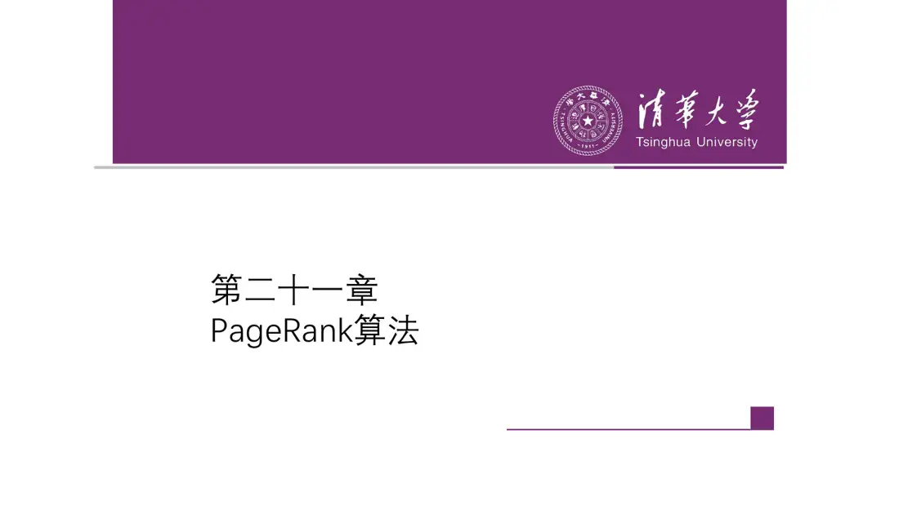

原文：

第二十一章 PageRank算法

大華洋
TSINGHUA UNIVERSITY
清華大學
Tsinghua University

### PageRank算法

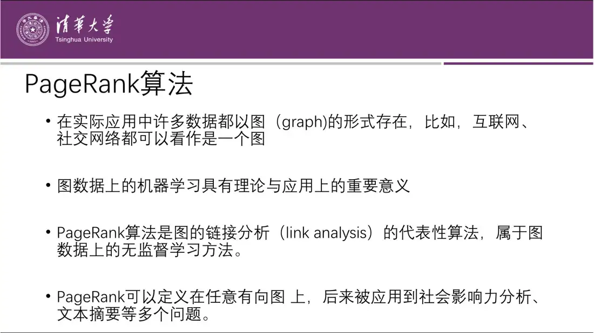

原文：

PageRank算法

\- 在实际应用中许多数据都以图（graph）的形式存在，比如，互联网、社交网络都可以看作是一个图

\- 图数据上的机器学习具有理论与应用上的重要意义

\- PageRank算法是图的链接分析（link analysis）的代表性算法，属于图数据上的无监督学习方法。

\- PageRank可以定义在任意有向图上，后来被应用到社会影响力分析、文本摘要等多个问题。

Tsinghua University
清華大學

### PageRank算法

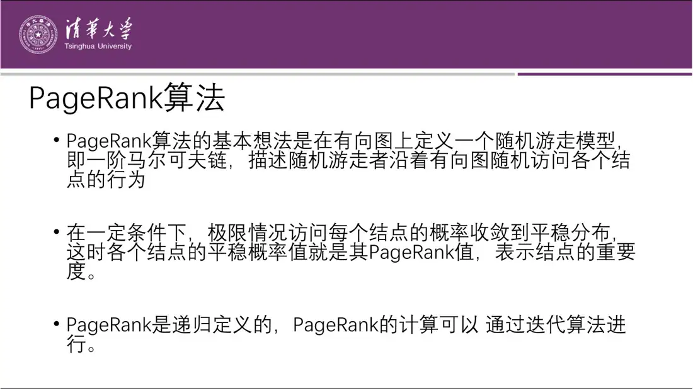

原文：

PageRank算法

\- PageRank算法的基本想法是在有向图上定义一个随机游走模型，即一阶马尔可夫链，描述随机游走者沿着有向图随机访问各个结点的行为

\- 在一定条件下，极限情况访问每个结点的概率收敛到平稳分布，这时各个结点的平稳概率值就是其PageRank值，表示结点的重要度。

\- PageRank是递归定义的，PageRank的计算可以通过迭代算法进行。

Tsinghua University
清華大學

### PageRank的定义

原文：

PageRank的定义

Tsinghua University
清華大學

### 基本想法

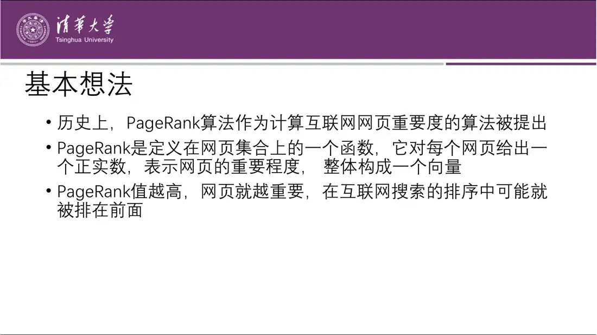

原文：

基本想法

\- 历史上，PageRank算法作为计算互联网网页重要度的算法被提出

\- PageRank是定义在网页集合上的一个函数，它对每个网页给出一个正实数，表示网页的重要程度，整体构成一个向量

\- PageRank值越高，网页就越重要，在互联网搜索的排序中可能就被排在前面

Tsinghua University
清華大學

### 基本想法

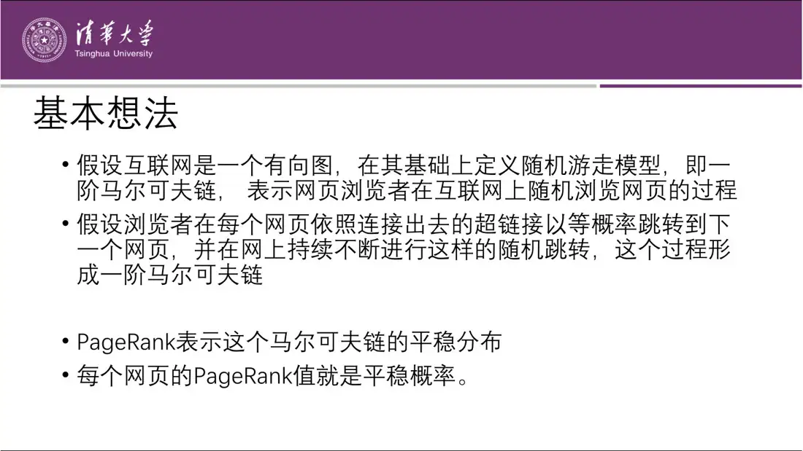

原文：

基本想法

\- 假设互联网是一个有向图，在其基础上定义随机游走模型，即一阶马尔可夫链，表示网页浏览者在互联网上随机浏览网页的过程

\- 假设浏览者在每个网页依照连接出去的超链接以等概率跳转到下一个网页，并在网上持续不断进行这样的随机跳转，这个过程形成一阶马尔可夫链

\- PageRank表示这个马尔可夫链的平稳分布

\- 每个网页的PageRank值就是平稳概率。

Tsinghua University
清華大學

### 基本想法

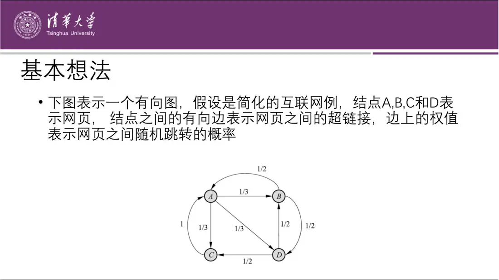

原文：

基本想法

\- 下图表示一个有向图，假设是简化的互联网例，结点A,B,C和D表示网页，结点之间的有向边表示网页之间的超链接，边上的权值表示网页之间随机跳转的概率

清華大學 Tsinghua University

### 基本想法

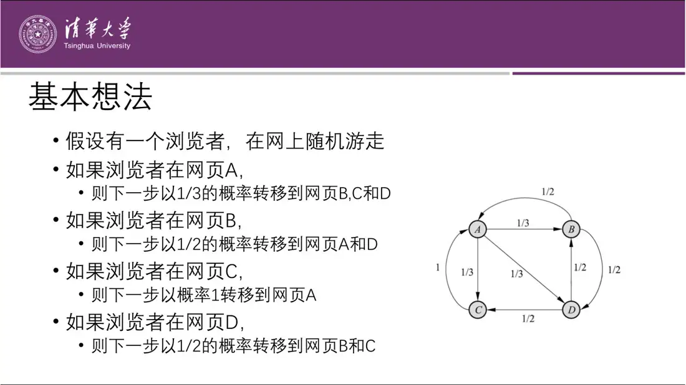

原文：

基本想法

\- 假设有一个浏览者，在网上随机游走

\- 如果浏览者在网页A,
- 则下一步以1/3的概率转移到网页B,C和D

\- 如果浏览者在网页B, 
- 则下一步以1/2的概率转移到网页A和D

\- 如果浏览者在网页C,
- 则下一步以概率1转移到网页A

\- 如果浏览者在网页D,

\- 则下一步以1/2的概率转移到网页B和C

Tsinghua University
清華大學
1911-

### 基本想法

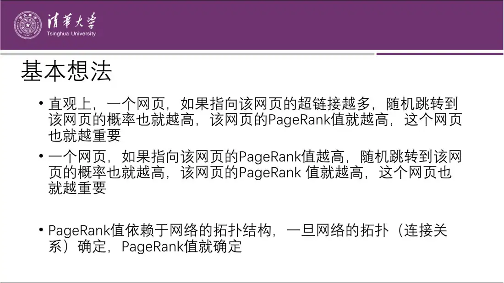

原文：

基本想法

\- 直观上，一个网页，如果指向该网页的超链接越多，随机跳转到该网页的概率也就越高，该网页的PageRank值就越高，这个网页也就越重要

\- 一个网页，如果指向该网页的PageRank值越高，随机跳转到该网页的概率也就越高，该网页的PageRank值就越高，这个网页也就越重要

\- PageRank值依赖于网络的拓扑结构，一旦网络的拓扑（连接关系）确定，PageRank值就确定

Tsinghua University
清華大學
Tsinghua University

### 基本想法

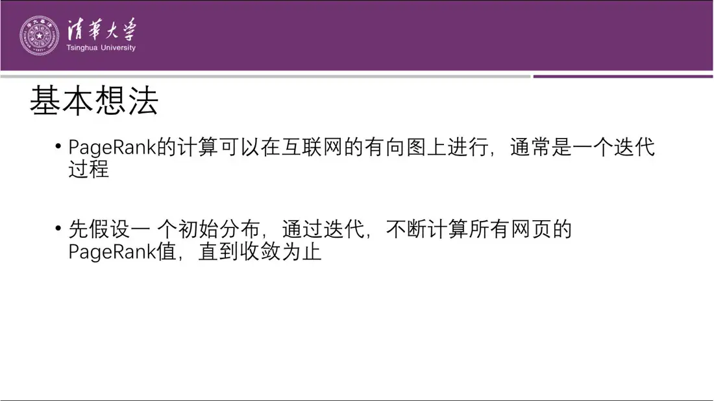

原文：

基本想法

\- PageRank的计算可以在互联网的有向图上进行，通常是一个迭代过程

\- 先假设一个初始分布，通过迭代，不断计算所有网页的PageRank值，直到收敛为止

清華大學 Tsinghua University

### 有向图

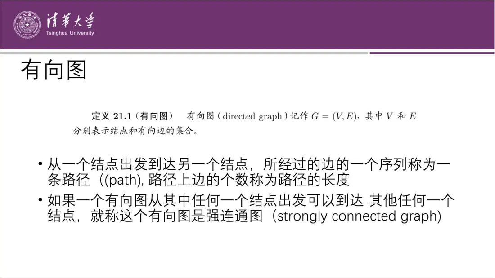

原文：

有向图

定义 21.1（有向图）有向图（directed graph）记作 $G = (V, E)$ ，其中 V 和 E 分别表示结点和有向边的集合。

\- 从一个结点出发到达另一个结点，所经过的边的一个序列称为一条路径（(path)，路径上边的个数称为路径的长度

\- 如果一个有向图从其中任何一个结点出发可以到达 其他任何一个结点，就称这个有向图是强连通图（strongly connected graph）

Tsinghua University
清華大學
TSINGHUA UNIVERSITY
1911
清華大學
TSINGHUA UNIVERSITY

### 有向图

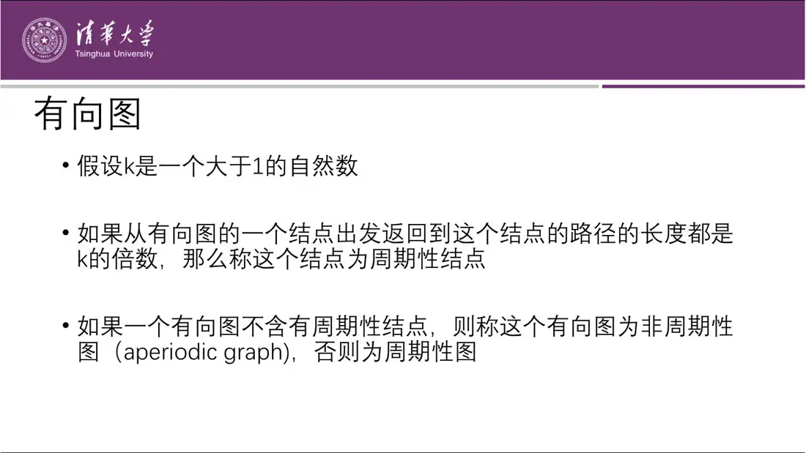

原文：

有向图

\- 假设k是一个大于1的自然数

\- 如果从有向图的一个结点出发返回到这个结点的路径的长度都是k的倍数，那么称这个结点为周期性结点

\- 如果一个有向图不含有周期性结点，则称这个有向图为非周期性图（aperiodic graph），否则为周期性图

清華大學 Tsinghua University

### 有向图

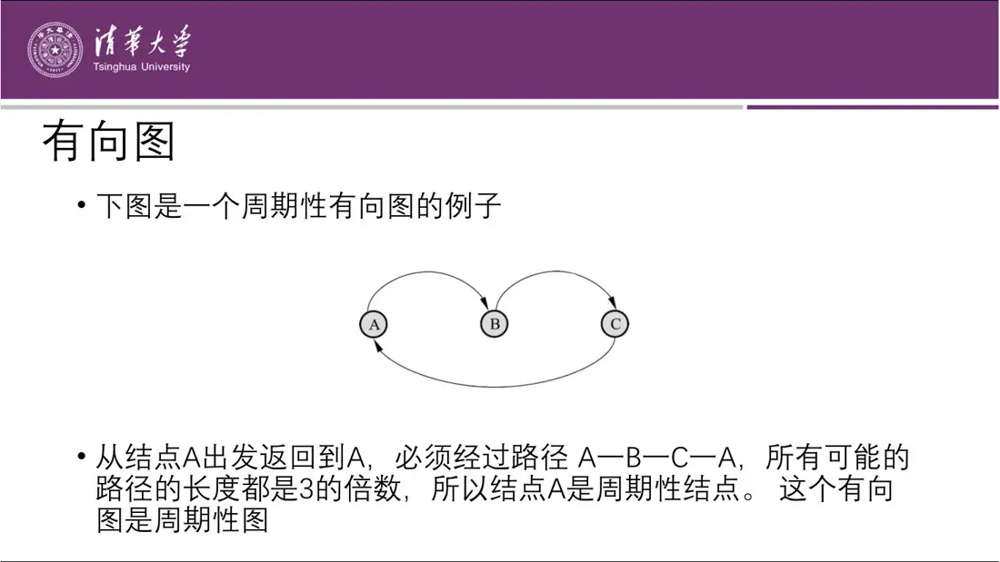

原文：

有向图

\- 下图是一个周期性有向图的例子

\- 从结点A出发返回到A，必须经过路径 A—B—C—A，所有可能的路径的长度都是3的倍数，所以结点A是周期性结点。这个有向图是周期性图

清華大學 Tsinghua University

### 随机游走模型

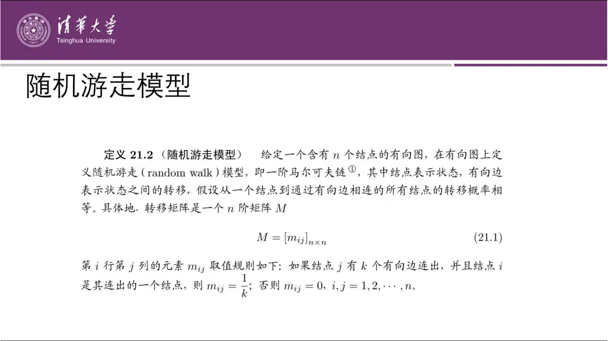

原文：

随机游走模型

定义 21.2（随机游走模型） 给定一个含有 n 个结点的有向图，在有向图上定义随机游走（random walk）模型，即一阶马尔可夫链 $^{①}$ ，其中结点表示状态，有向边表示状态之间的转移，假设从一个结点到通过有向边相连的所有结点的转移概率相等。具体地．转移矩阵是一个 n 阶矩阵 M

$$
M = [ m _ {i j} ] _ {n \times n}\tag{21.1}
$$

第 i 行第 j 列的元素 $m_{ij}$ 取值规则如下：如果结点 j 有 k 个有向边连出，并且结点 i 是其连出的一个结点，则 $m_{ij} = \frac{1}{k}$ ; 否则 $m_{ij} = 0, i, j = 1, 2, \cdots, n$ 。

Tsinghua University
清華大學

### 随机游走模型

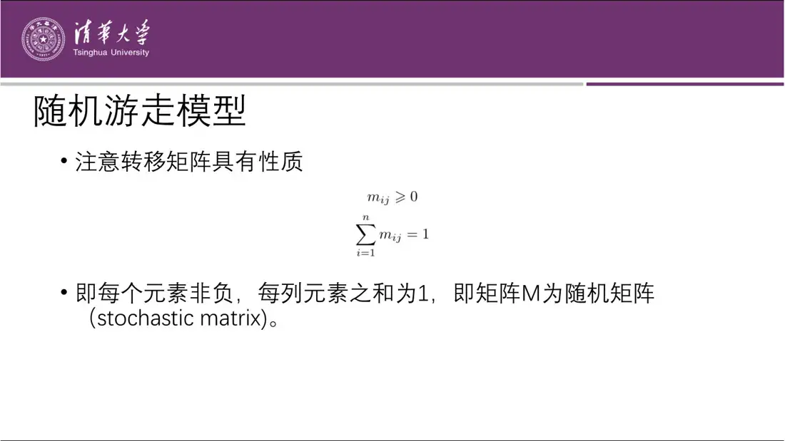

原文：

随机游走模型

\- 注意转移矩阵具有性质

$$
\begin{array}{c} m _ {i j} \geqslant 0 \\ \sum_ {i = 1} ^ {n} m _ {i j} = 1 \end{array}
$$

\- 即每个元素非负，每列元素之和为1，即矩阵M为随机矩阵(stochastic matrix)。

清華大學 Tsinghua University

### 随机游走模型

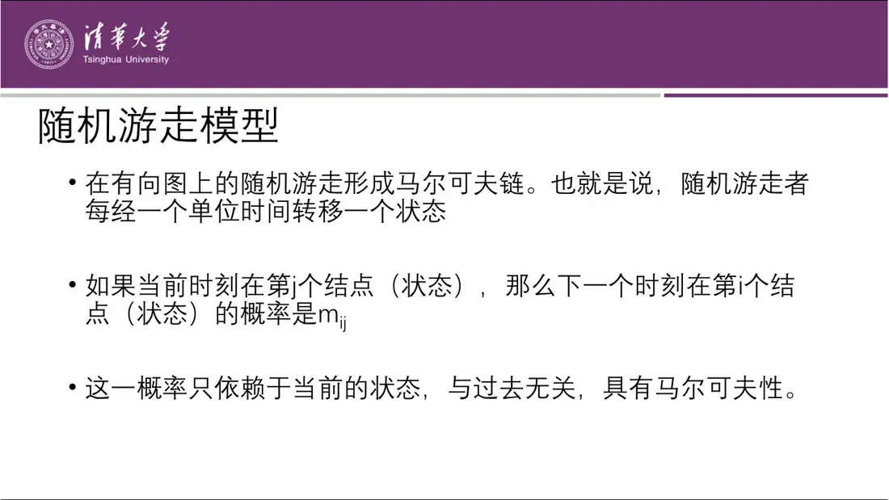

原文：

随机游走模型

\- 在有向图上的随机游走形成马尔可夫链。也就是说，随机游走者每经一个单位时间转移一个状态

\- 如果当前时刻在第j个结点（状态），那么下一个时刻在第i个结点（状态）的概率是 $m_{ij}$

\- 这一概率只依赖于当前的状态，与过去无关，具有马尔可夫性。

清華大學 Tsinghua University

### 随机游走模型

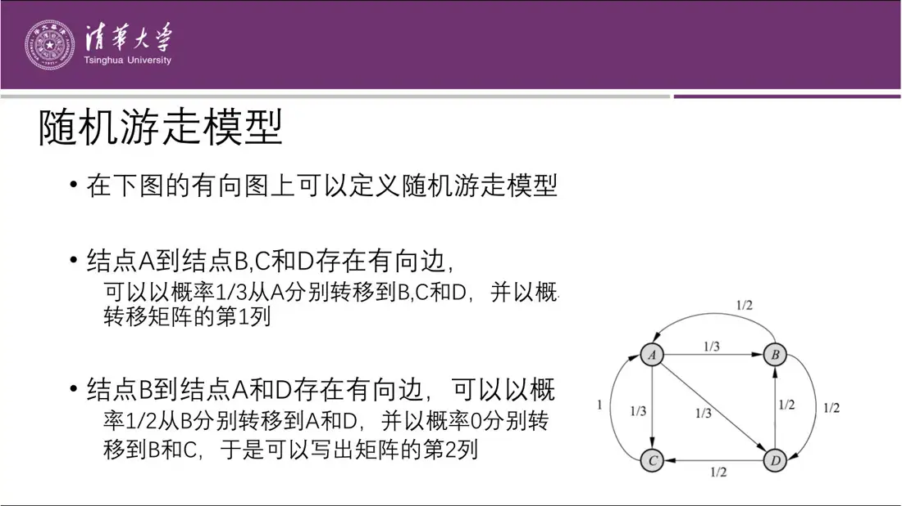

原文：

随机游走模型

\- 在下图的有向图上可以定义随机游走模型

\- 结点A到结点B,C和D存在有向边，

可以以概率1/3从A分别转移到B,C和D，并以概率转移矩阵的第1列

\- 结点B到结点A和D存在有向边，可以以概率1/2从B分别转移到A和D，并以概率0分别转移到B和C，于是可以写出矩阵的第2列

Tsinghua University
清華大學
1911-

### 随机游走模型

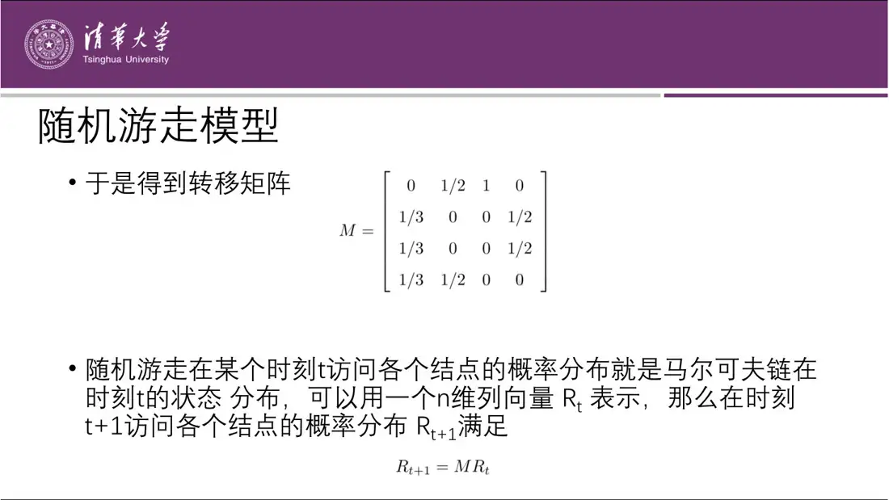

原文：

随机游走模型

\- 于是得到转移矩阵

$$
M = \left[ \begin{array}{c c c c} 0 & 1 / 2 & 1 & 0 \\ 1 / 3 & 0 & 0 & 1 / 2 \\ 1 / 3 & 0 & 0 & 1 / 2 \\ 1 / 3 & 1 / 2 & 0 & 0 \end{array} \right]
$$

\- 随机游走在某个时刻t访问各个结点的概率分布就是马尔可夫链在时刻t的状态分布，可以用一个n维列向量 $R_{t}$ 表示，那么在时刻 $t + 1$ 访问各个结点的概率分布 $R_{t + 1}$ 满足

$$
R _ {t + 1} = M R _ {t}
$$

Tsinghua University
清華大學

### PageRank的基本定义

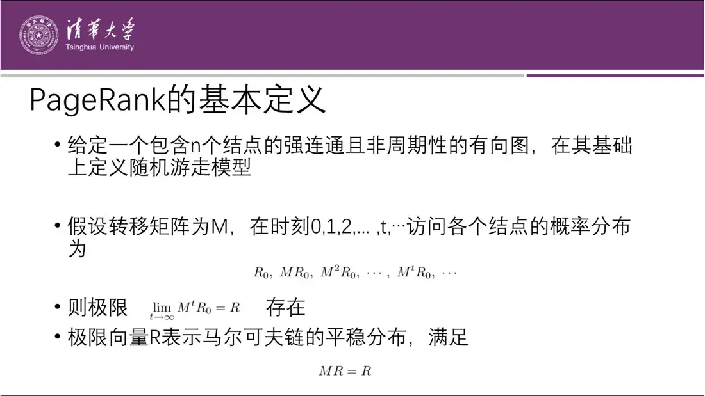

原文：

PageRank的基本定义

\- 给定一个包含n个结点的强连通且非周期性的有向图，在其基础上定义随机游走模型

\- 假设转移矩阵为M，在时刻0,1,2,…,t,…访问各个结点的概率分布为

$$
R _ {0}, M R _ {0}, M ^ {2} R _ {0}, \dots , M ^ {t} R _ {0}, \dots
$$

\- 则极限 $\lim_{t\to \infty}M^t R_0 = R$ 存在

\- 极限向量R表示马尔可夫链的平稳分布，满足

$$
M R = R
$$

Tsinghua University
清華大學

### PageRank的基本定义

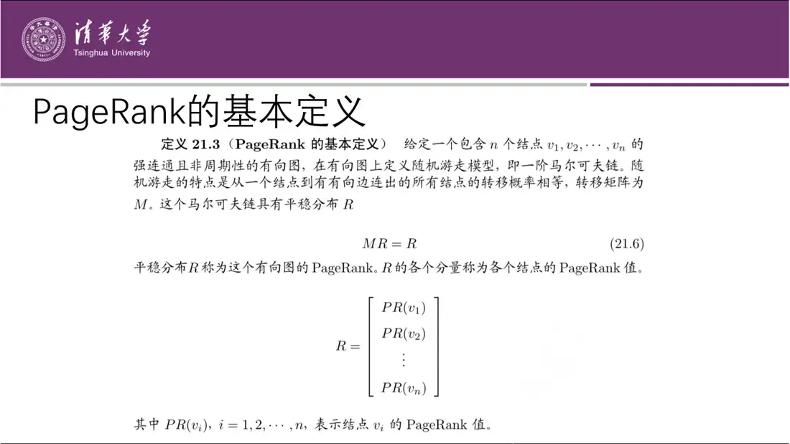

原文：

PageRank的基本定义

定义 21.3（PageRank 的基本定义） 给定一个包含 n 个结点 $v_{1}, v_{2}, \cdots, v_{n}$ 的强连通且非周期性的有向图，在有向图上定义随机游走模型，即一阶马尔可夫链。随机游走的特点是从一个结点到有向边连出的所有结点的转移概率相等，转移矩阵为 M。这个马尔可夫链具有平稳分布 R

$$
M R = R\tag{21.6}
$$

平稳分布 $R$ 称为这个有向图的PageRank。 $R$ 的各个分量称为各个结点的PageRank值。

$$
R = \left[ \begin{array}{c} P R (v _ {1}) \\ P R (v _ {2}) \\ \vdots \\ P R (v _ {n}) \end{array} \right]
$$

其中 $PR(v_{i}), i=1,2,\cdots,n$ ，表示结点 $v_{i}$ 的 PageRank 值。

Tsinghua University
清華大學

### PageRank的基本定义

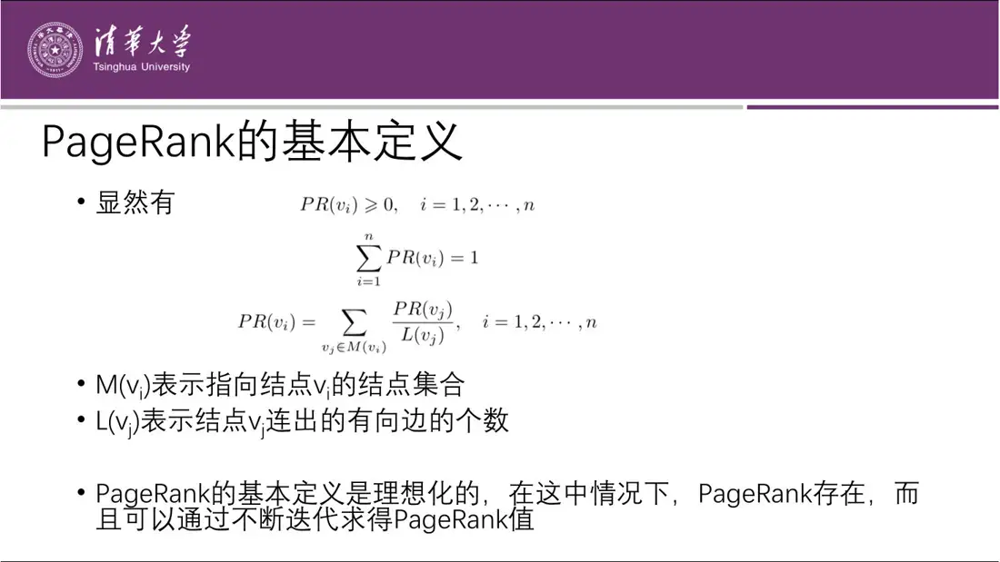

原文：

PageRank的基本定义

\- 显然有

$$
P R (v _ {i}) \geqslant 0, \quad i = 1, 2, \dots , n
$$

$$
\sum_ {i = 1} ^ {n} P R (v _ {i}) = 1
$$

$$
P R (v _ {i}) = \sum_ {v _ {j} \in M (v _ {i})} \frac {P R (v _ {j})}{L (v _ {j})}, \quad i = 1, 2, \dots , n
$$

\- $M(v_{i})$ 表示指向结点 $v_{i}$ 的结点集合

\- $L(v_{j})$ 表示结点 $v_{j}$ 连出的有向边的个数

\- PageRank的基本定义是理想化的，在这中情况下，PageRank存在，而且可以通过不断迭代求得PageRank值

Tsinghua University
清華大學
Tsinghua University

### PageRank的基本定义

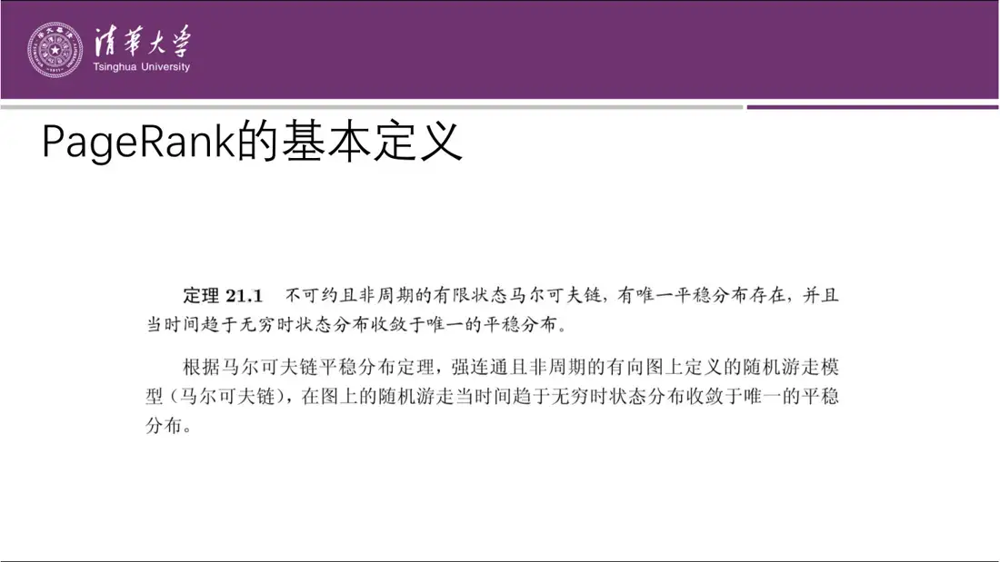

原文：

PageRank的基本定义

定理 21.1 不可约且非周期的有限状态马尔可夫链，有唯一平稳分布存在，并且当时间趋于无穷时状态分布收敛于唯一的平稳分布。

根据马尔可夫链平稳分布定理，强连通且非周期的有向图上定义的随机游走模型（马尔可夫链），在图上的随机游走当时间趋于无穷时状态分布收敛于唯一的平稳分布。

清華大學 Tsinghua University

### \- 求下图的PageRank

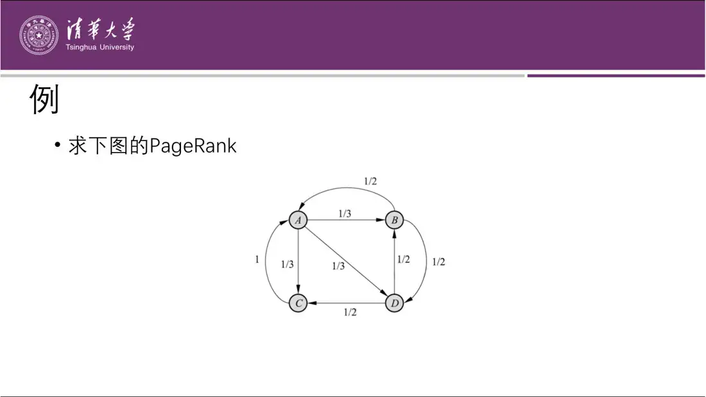

原文：

例

\- 求下图的PageRank

Tsinghua University
清華大學
1911-1911

### \- 转移矩阵

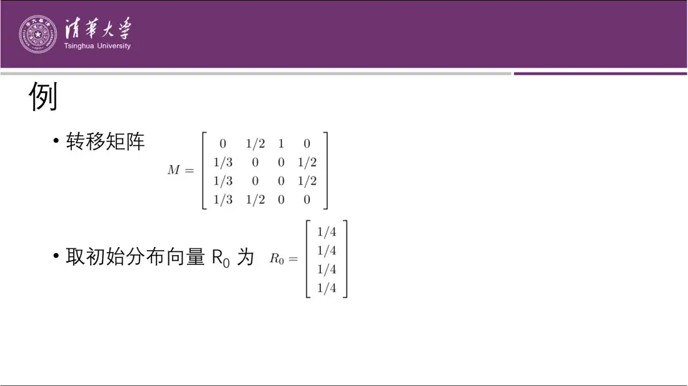

原文：

例

\- 转移矩阵

$$
M = \left[ \begin{array}{c c c c} 0 & 1 / 2 & 1 & 0 \\ 1 / 3 & 0 & 0 & 1 / 2 \\ 1 / 3 & 0 & 0 & 1 / 2 \\ 1 / 3 & 1 / 2 & 0 & 0 \end{array} \right]
$$

\- 取初始分布向量 $R_0$ 为 $R_0 = \left[ \begin{array}{l}1 / 4\\ 1 / 4\\ 1 / 4\\ 1 / 4 \end{array} \right]$

Tsinghua University
清華大學

### \- 以转移矩阵M连乘初始向量 $R_{0}$ 得到向量序列

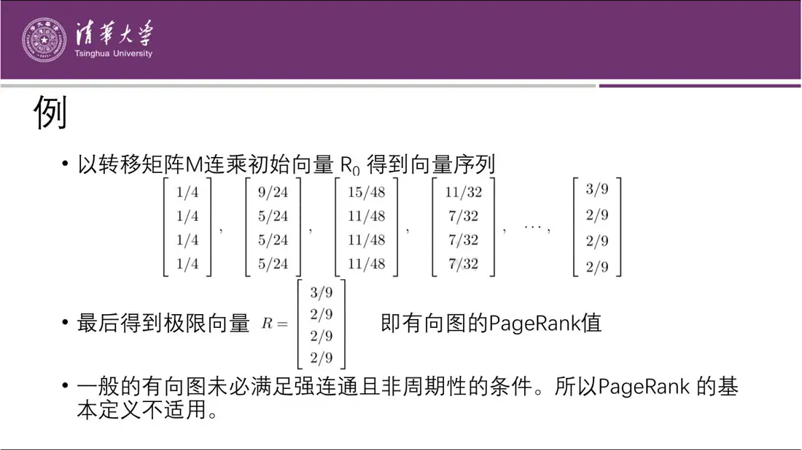

原文：

例

\- 以转移矩阵M连乘初始向量 $R_{0}$ 得到向量序列

$$
\left[ \begin{array}{l} 1 / 4 \\ 1 / 4 \\ 1 / 4 \\ 1 / 4 \end{array} \right], \quad \left[ \begin{array}{l} 9 / 2 4 \\ 5 / 2 4 \\ 5 / 2 4 \\ 5 / 2 4 \end{array} \right], \quad \left[ \begin{array}{l} 1 5 / 4 8 \\ 1 1 / 4 8 \\ 1 1 / 4 8 \\ 1 1 / 4 8 \end{array} \right], \quad \left[ \begin{array}{l} 1 1 / 3 2 \\ 7 / 3 2 \\ 7 / 3 2 \\ 7 / 3 2 \end{array} \right], \dots , \quad \left[ \begin{array}{l} 3 / 9 \\ 2 / 9 \\ 2 / 9 \\ 2 / 9 \end{array} \right]
$$

\- 最后得到极限向量 $R = \begin{bmatrix} 3 / 9 \\ 2 / 9 \\ 2 / 9 \\ 2 / 9 \end{bmatrix}$ 即有向图的PageRank值

\- 一般的有向图未必满足强连通且非周期性的条件。所以PageRank的基本定义不适用。

Tsinghua University
清華大學

### \- 下图的有向图的转移矩阵M是

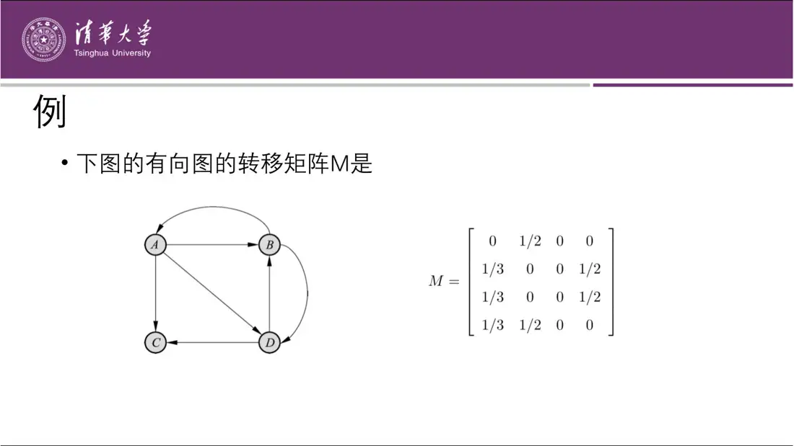

原文：

例

\- 下图的有向图的转移矩阵M是

$$
M = \left[ \begin{array}{c c c c} 0 & 1 / 2 & 0 & 0 \\ 1 / 3 & 0 & 0 & 1 / 2 \\ 1 / 3 & 0 & 0 & 1 / 2 \\ 1 / 3 & 1 / 2 & 0 & 0 \end{array} \right]
$$

Tsinghua University
清華大學

### \- 如果仍然计算在各个时刻的各个结点的概率分布，就会得到如下结果

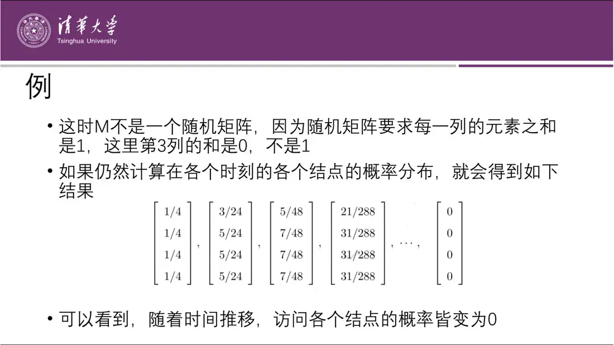

原文：

例

\- 这时M不是一个随机矩阵，因为随机矩阵要求每一列的元素之和是1，这里第3列的和是0，不是1

\- 如果仍然计算在各个时刻的各个结点的概率分布，就会得到如下结果

$$
\left[ \begin{array}{l} 1 / 4 \\ 1 / 4 \\ 1 / 4 \\ 1 / 4 \end{array} \right], \left[ \begin{array}{l} 3 / 2 4 \\ 5 / 2 4 \\ 5 / 2 4 \\ 5 / 2 4 \end{array} \right], \left[ \begin{array}{l} 5 / 4 8 \\ 7 / 4 8 \\ 7 / 4 8 \\ 7 / 4 8 \end{array} \right], \left[ \begin{array}{l} 2 1 / 2 8 8 \\ 3 1 / 2 8 8 \\ 3 1 / 2 8 8 \\ 3 1 / 2 8 8 \end{array} \right], \dots , \left[ \begin{array}{l} 0 \\ 0 \\ 0 \\ 0 \end{array} \right]
$$

\- 可以看到，随着时间推移，访问各个结点的概率皆变为0

Tsinghua University
清華大學

### PageRank的一般定义

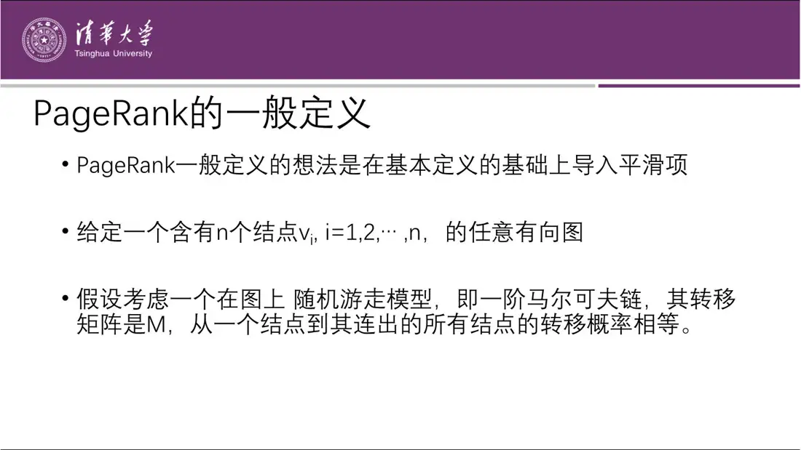

原文：

PageRank的一般定义

\- PageRank一般定义的想法是在基本定义的基础上导入平滑项

\- 给定一个含有n个结点 $v_{i}, i=1,2,\cdots,n$ ，的任意有向图

\- 假设考虑一个在图上随机游走模型，即一阶马尔可夫链，其转移矩阵是M，从一个结点到其连出的所有结点的转移概率相等。

Tsinghua University
清華大學
1911-

### PageRank的一般定义

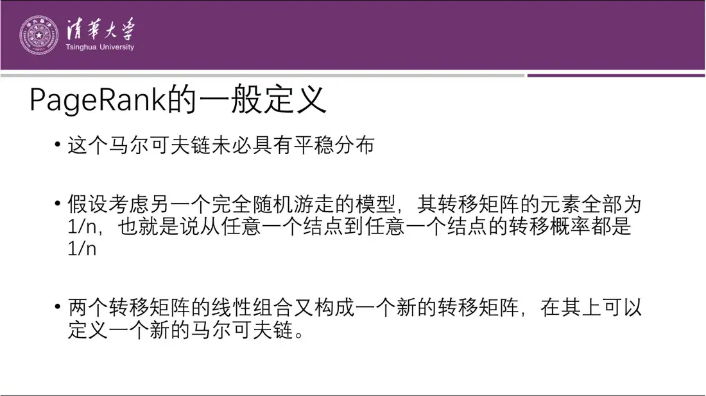

原文：

PageRank的一般定义

\- 这个马尔可夫链未必具有平稳分布

\- 假设考虑另一个完全随机游走的模型，其转移矩阵的元素全部为 $1 / n$ ，也就是说从任意一个结点到任意一个结点的转移概率都是 $1 / n$

\- 两个转移矩阵的线性组合又构成一个新的转移矩阵，在其上可以定义一个新的马尔可夫链。

Tsinghua University
清華大學
1911-

### PageRank的一般定义

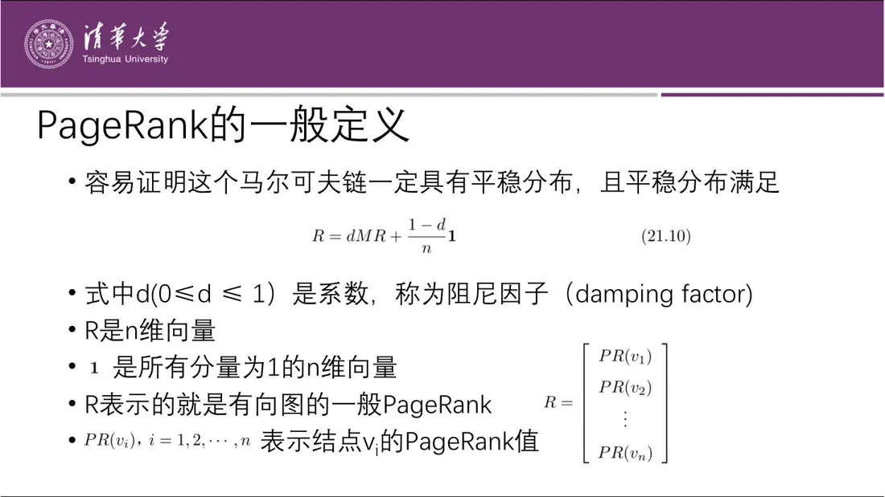

原文：

PageRank的一般定义

\- 容易证明这个马尔可夫链一定具有平稳分布，且平稳分布满足

$$
R = d M R + \frac {1 - d}{n} {\bf 1}\tag{21.10}
$$

\- 式中 $d(0 \leqslant d \leqslant 1)$ 是系数，称为阻尼因子（damping factor）

\- R是n维向量

\- 1 是所有分量为1的n维向量

\- R表示的就是有向图的一般PageRank

\- $PR(v_{i}), i = 1,2,\dots ,n$ 表示结点 $v_{i}$ 的PageRank值

$$
R = \left[ \begin{array}{c} P R (v _ {1}) \\ P R (v _ {2}) \\ \vdots \\ P R (v _ {n}) \end{array} \right]
$$

Tsinghua University
清華大學

### PageRank的一般定义

原文：

PageRank的一般定义

\- 式（21.10）中第一项表示（状态分布是平稳分布时）依照转移矩阵M访问各个结点的概率，第二项表示完全随机访问各个结点的概率

\- 阻尼因子d取值由经验决定

\- 例如d=0.85。当d接近1时，随机游走主要依照转移矩阵M进行

\- 当d接近0时，随机游走主要以等概率随机访问各个结点。

Tsinghua University
清華大學
1911-

### PageRank的一般定义

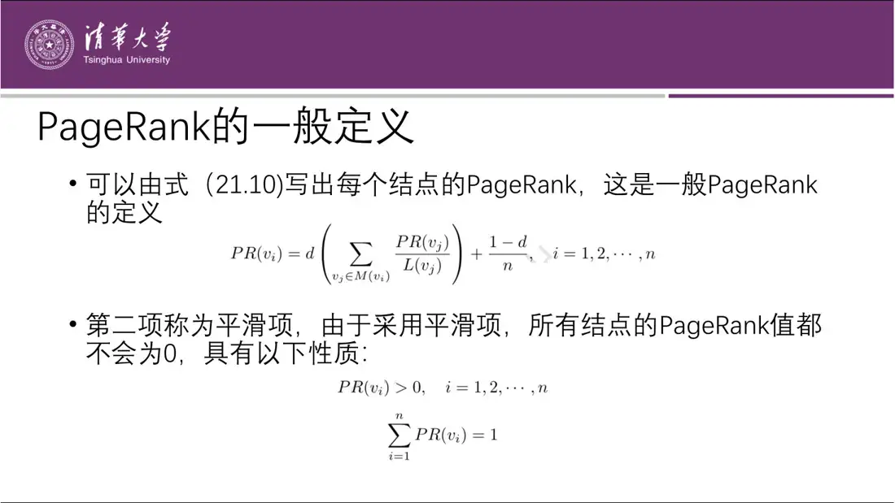

原文：

PageRank的一般定义

\- 可以由式 (21.10)写出每个结点的PageRank，这是一般PageRank的定义

$$
P R (v _ {i}) = d \left(\sum_ {v _ {j} \in M (v _ {i})} \frac {P R (v _ {j})}{L (v _ {j})}\right) + \frac {1 - d}{n}, i = 1, 2, \dots , n
$$

\- 第二项称为平滑项，由于采用平滑项，所有结点的PageRank值都不会为0，具有以下性质：

$$
\begin{array}{c} P R (v _ {i}) > 0, \quad i = 1, 2, \dots , n \\ \sum_ {i = 1} ^ {n} P R (v _ {i}) = 1 \end{array}
$$

清華大學 Tsinghua University

### PageRank的一般定义

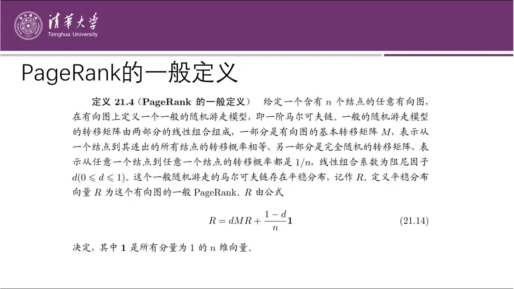

原文：

PageRank的一般定义

定义 21.4 (PageRank 的一般定义) 给定一个含有 n 个结点的任意有向图，在有向图上定义一个一般的随机游走模型，即一阶马尔可夫链。一般的随机游走模型的转移矩阵由两部分的线性组合组成，一部分是有向图的基本转移矩阵 M，表示从一个结点到其连出的所有结点的转移概率相等，另一部分是完全随机的转移矩阵，表示从任意一个结点到任意一个结点的转移概率都是 1/n，线性组合系数为阻尼因子 $d(0 \leqslant d \leqslant 1)$ 。这个一般随机游走的马尔可夫链存在平稳分布，记作 R。定义平稳分布向量 R 为这个有向图的一般 PageRank。R 由公式

$$
R = d M R + \frac {1 - d}{n} {\bf 1}\tag{21.14}
$$

决定，其中 1 是所有分量为 1 的 n 维向量。

清華大學 Tsinghua University

### PageRank的一般定义

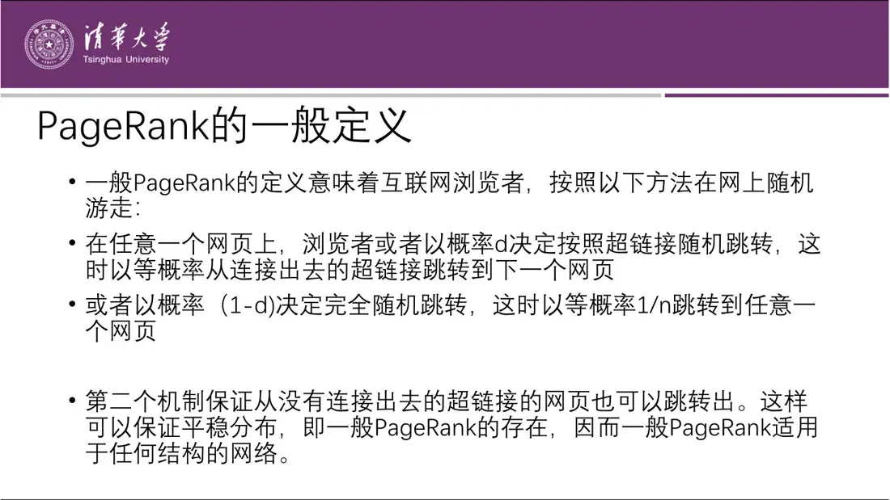

原文：

PageRank的一般定义

\- 一般PageRank的定义意味着互联网浏览者，按照以下方法在网上随机游走：

\- 在任意一个网页上，浏览者或者以概率d决定按照超链接随机跳转，这时以等概率从连接出去的超链接跳转到下一个网页

\- 或者以概率 (1-d)决定完全随机跳转，这时以等概率1/n跳转到任意一个网页

\- 第二个机制保证从没有连接出去的超链接的网页也可以跳转出。这样可以保证平稳分布，即一般PageRank的存在，因而一般PageRank适用于任何结构的网络。

Tsinghua University
清華大學

### PageRank的计算

原文：

PageRank的计算

Tsinghua University
清華大學

### 迭代算法

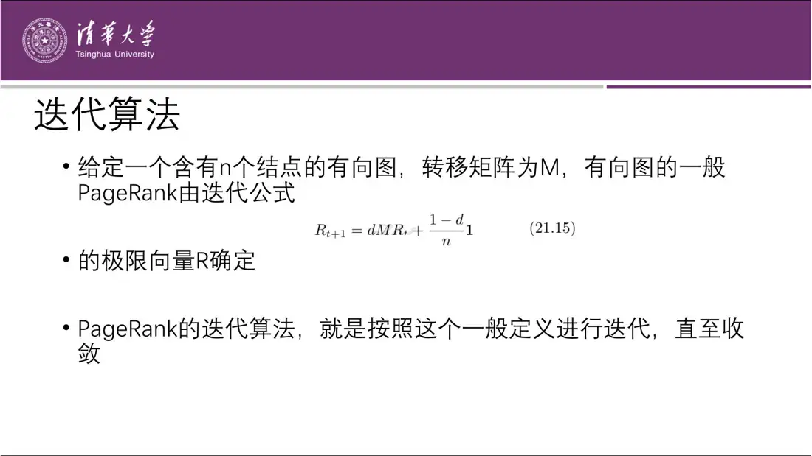

原文：

迭代算法

\- 给定一个含有n个结点的有向图，转移矩阵为M，有向图的一般PageRank由迭代公式

$$
R _ {t + 1} = d M R _ {t} + \frac {1 - d}{n} {\bf 1}\tag{21.15}
$$

\- 的极限向量R确定

\- PageRank的迭代算法，就是按照这个一般定义进行迭代，直至收敛

清華大學 Tsinghua University

### PageRank的迭代算法

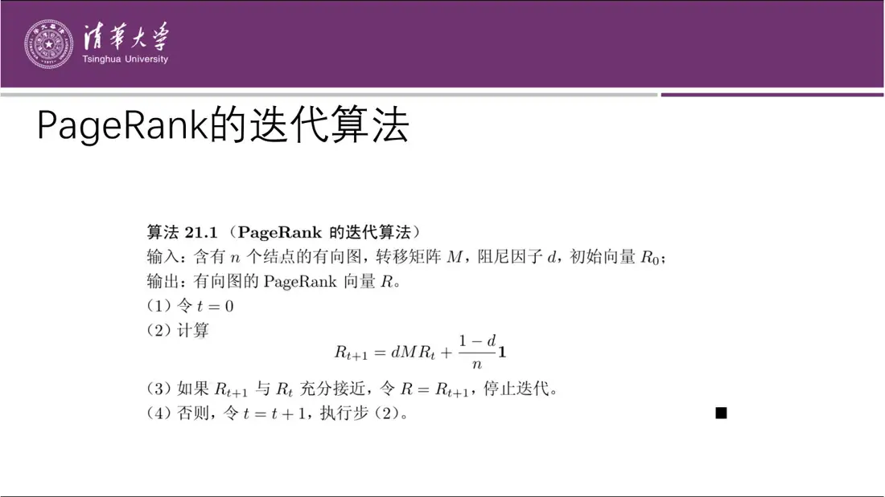

原文：

PageRank的迭代算法

算法 21.1（PageRank 的迭代算法）

输入: 含有 $n$ 个结点的有向图, 转移矩阵 $M$ , 阻尼因子 $d$ , 初始向量 $R_0$ ;

输出: 有向图的 PageRank 向量 R。

(1) 令 $t = 0$

(2) 计算

$$
R _ {t + 1} = d M R _ {t} + \frac {1 - d}{n} {\bf 1}
$$

(3) 如果 $R_{t+1}$ 与 $R_{t}$ 充分接近，令 $R = R_{t+1}$ ，停止迭代。

(4) 否则，令 $t = t + 1$ ，执行步（2）。

Tsinghua University
清華大學

### \- 图中所示的有向图，取d = 0.8，求图的PageRank

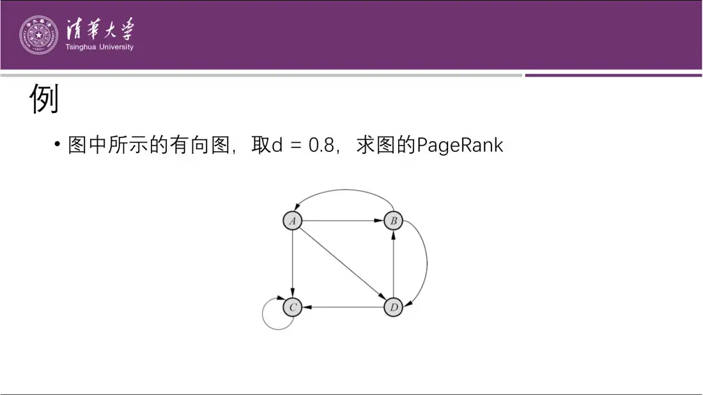

原文：

例

\- 图中所示的有向图，取d = 0.8，求图的PageRank

清華大學 Tsinghua University

### \- 可得转移矩阵为

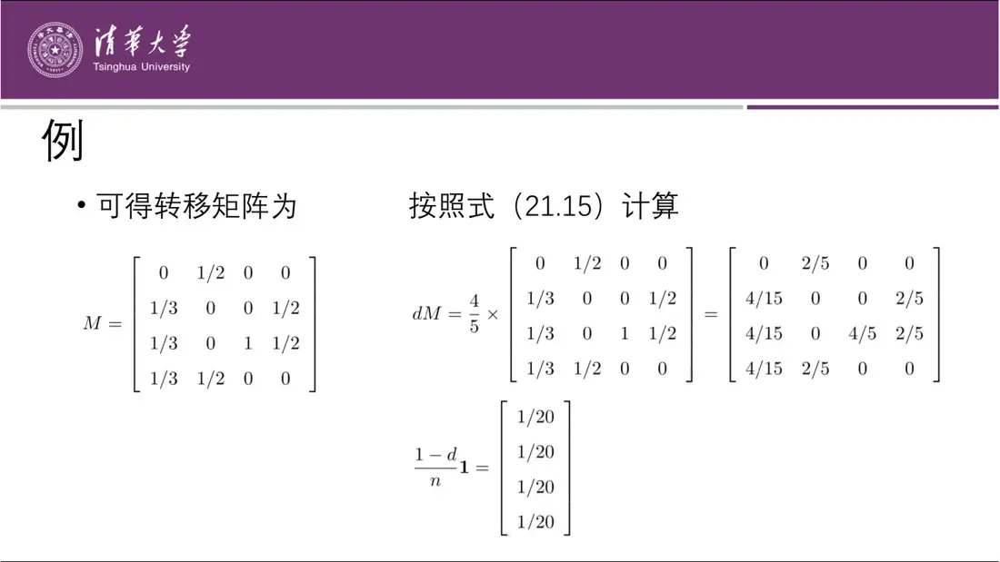

原文：

例

\- 可得转移矩阵为

$$
M = \left[ \begin{array}{c c c c} 0 & 1 / 2 & 0 & 0 \\ 1 / 3 & 0 & 0 & 1 / 2 \\ 1 / 3 & 0 & 1 & 1 / 2 \\ 1 / 3 & 1 / 2 & 0 & 0 \end{array} \right]
$$

按照式（21.15）计算

$$
d M = \frac {4}{5} \times \left[ \begin{array}{c c c c} 0 & 1 / 2 & 0 & 0 \\ 1 / 3 & 0 & 0 & 1 / 2 \\ 1 / 3 & 0 & 1 & 1 / 2 \\ 1 / 3 & 1 / 2 & 0 & 0 \end{array} \right] = \left[ \begin{array}{c c c c} 0 & 2 / 5 & 0 & 0 \\ 4 / 1 5 & 0 & 0 & 2 / 5 \\ 4 / 1 5 & 0 & 4 / 5 & 2 / 5 \\ 4 / 1 5 & 2 / 5 & 0 & 0 \end{array} \right]
$$

$$
\frac {1 - d}{n} \mathbf {1} = \left[ \begin{array}{l} 1 / 2 0 \\ 1 / 2 0 \\ 1 / 2 0 \\ 1 / 2 0 \end{array} \right]
$$

Tsinghua University
清華大學

### \- 迭代公式为

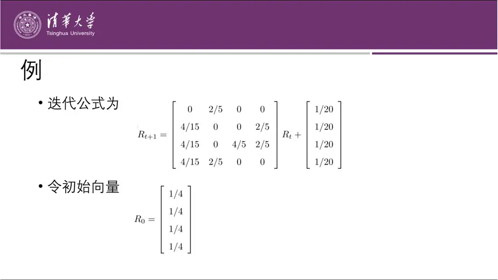

原文：

例

\- 迭代公式为

\- 令初始向量

$$
R _ {t + 1} = \left[ \begin{array}{c c c c} 0 & 2 / 5 & 0 & 0 \\ 4 / 1 5 & 0 & 0 & 2 / 5 \\ 4 / 1 5 & 0 & 4 / 5 & 2 / 5 \\ 4 / 1 5 & 2 / 5 & 0 & 0 \end{array} \right] R _ {t} + \left[ \begin{array}{c} 1 / 2 0 \\ 1 / 2 0 \\ 1 / 2 0 \\ 1 / 2 0 \end{array} \right]
$$

$$
R _ {0} = \left[ \begin{array}{l} 1 / 4 \\ 1 / 4 \\ 1 / 4 \\ 1 / 4 \end{array} \right]
$$

Tsinghua University
清華大學

### \- 进行迭代

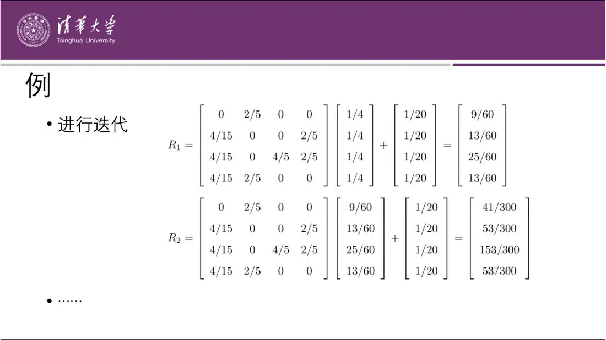

原文：

例

\- 进行迭代

$$
R _ {1} = \left[ \begin{array}{c c c c} 0 & 2 / 5 & 0 & 0 \\ 4 / 1 5 & 0 & 0 & 2 / 5 \\ 4 / 1 5 & 0 & 4 / 5 & 2 / 5 \\ 4 / 1 5 & 2 / 5 & 0 & 0 \end{array} \right] \left[ \begin{array}{l} 1 / 4 \\ 1 / 4 \\ 1 / 4 \\ 1 / 4 \end{array} \right] + \left[ \begin{array}{l} 1 / 2 0 \\ 1 / 2 0 \\ 1 / 2 0 \\ 1 / 2 0 \end{array} \right] = \left[ \begin{array}{l} 9 / 6 0 \\ 1 3 / 6 0 \\ 2 5 / 6 0 \\ 1 3 / 6 0 \end{array} \right]
$$

$$
R _ {2} = \left[ \begin{array}{c c c c} 0 & 2 / 5 & 0 & 0 \\ 4 / 1 5 & 0 & 0 & 2 / 5 \\ 4 / 1 5 & 0 & 4 / 5 & 2 / 5 \\ 4 / 1 5 & 2 / 5 & 0 & 0 \end{array} \right] \left[ \begin{array}{l} 9 / 6 0 \\ 1 3 / 6 0 \\ 2 5 / 6 0 \\ 1 3 / 6 0 \end{array} \right] + \left[ \begin{array}{l} 1 / 2 0 \\ 1 / 2 0 \\ 1 / 2 0 \\ 1 / 2 0 \end{array} \right] = \left[ \begin{array}{l} 4 1 / 3 0 0 \\ 5 3 / 3 0 0 \\ 1 5 3 / 3 0 0 \\ 5 3 / 3 0 0 \end{array} \right]
$$

Tsinghua University
清華大學

### \- 最后得到

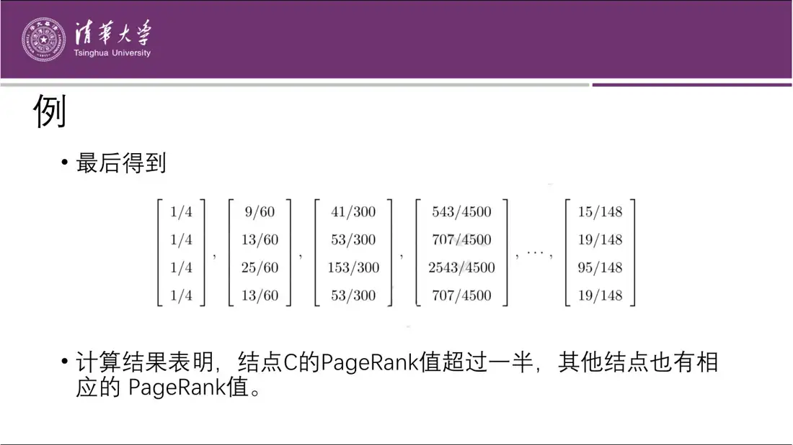

原文：

例

\- 最后得到

$$
\left[ \begin{array}{l} 1 / 4 \\ 1 / 4 \\ 1 / 4 \\ 1 / 4 \end{array} \right], \quad \left[ \begin{array}{l} 9 / 6 0 \\ 1 3 / 6 0 \\ 2 5 / 6 0 \\ 1 3 / 6 0 \end{array} \right], \quad \left[ \begin{array}{l} 4 1 / 3 0 0 \\ 5 3 / 3 0 0 \\ 1 5 3 / 3 0 0 \\ 5 3 / 3 0 0 \end{array} \right], \quad \left[ \begin{array}{l} 5 4 3 / 4 5 0 0 \\ 7 0 7 / 4 5 0 0 \\ 2 5 4 3 / 4 5 0 0 \\ 7 0 7 / 4 5 0 0 \end{array} \right], \dots , \quad \left[ \begin{array}{l} 1 5 / 1 4 8 \\ 1 9 / 1 4 8 \\ 9 5 / 1 4 8 \\ 1 9 / 1 4 8 \end{array} \right]
$$

\- 计算结果表明，结点C的PageRank值超过一半，其他结点也有相应的 PageRank值。

Tsinghua University
清華大學

### 幂法

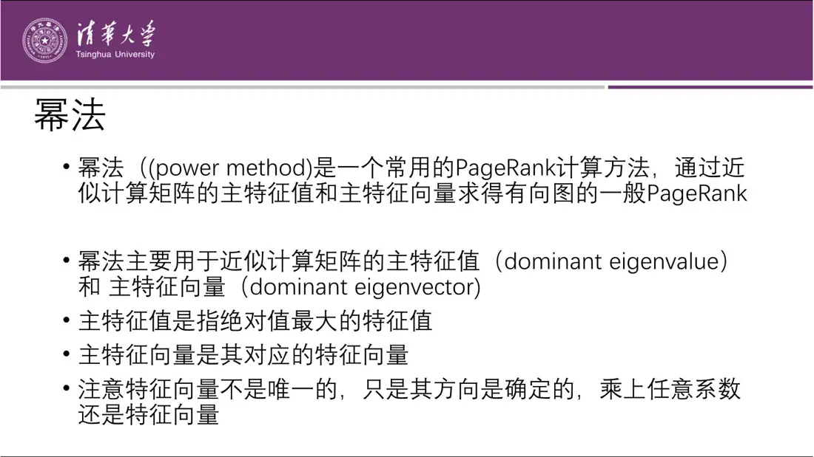

原文：

幂法

\- 幂法 ((power method) 是一个常用的 PageRank 计算方法，通过近似计算矩阵的主特征值和主特征向量求得有向图的一般 PageRank

\- 幂法主要用于近似计算矩阵的主特征值（dominant eigenvalue）和主特征向量（dominant eigenvector）

\- 主特征值是指绝对值最大的特征值

\- 主特征向量是其对应的特征向量

\- 注意特征向量不是唯一的，只是其方向是确定的，乘上任意系数还是特征向量

清華大學 Tsinghua University

### 幂法

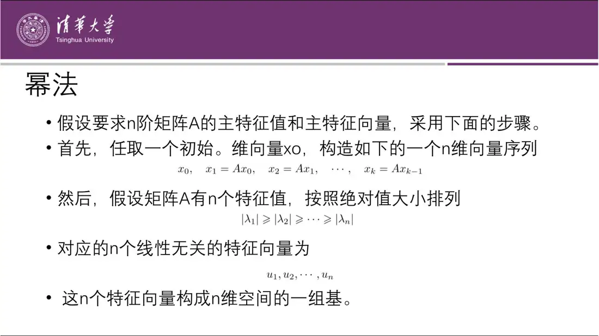

原文：

幂法

\- 假设要求n阶矩阵A的主特征值和主特征向量，采用下面的步骤。

\- 首先，任取一个初始。维向量xo，构造如下的一个n维向量序列

$$
x _ {0}, \quad x _ {1} = A x _ {0}, \quad x _ {2} = A x _ {1}, \quad \dots , \quad x _ {k} = A x _ {k - 1}
$$

\- 然后，假设矩阵A有n个特征值，按照绝对值大小排列

$$
\left| \lambda_ {1} \right| \geqslant \left| \lambda_ {2} \right| \geqslant \dots \geqslant \left| \lambda_ {n} \right|
$$

\- 对应的n个线性无关的特征向量为

$$
u _ {1}, u _ {2}, \dots , u _ {n}
$$

\- 这n个特征向量构成n维空间的一组基。

Tsinghua University
清華大學

### 幂法

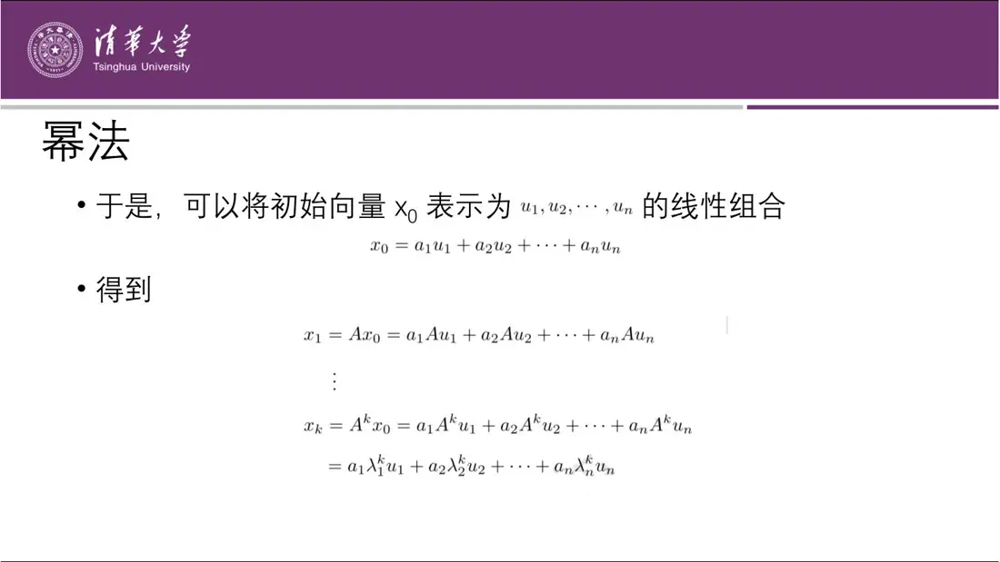

原文：

幂法

\- 于是，可以将初始向量 $x_0$ 表示为 $u_1, u_2, \dots, u_n$ 的线性组合

$$
x _ {0} = a _ {1} u _ {1} + a _ {2} u _ {2} + \dots + a _ {n} u _ {n}
$$

\- 得到

$$
\begin{array}{r l} & {x _ {1} = A x _ {0} = a _ {1} A u _ {1} + a _ {2} A u _ {2} + \dots + a _ {n} A u _ {n}} \\ & {\quad \vdots} \\ & {x _ {k} = A ^ {k} x _ {0} = a _ {1} A ^ {k} u _ {1} + a _ {2} A ^ {k} u _ {2} + \dots + a _ {n} A ^ {k} u _ {n}} \\ & {\quad = a _ {1} \lambda_ {1} ^ {k} u _ {1} + a _ {2} \lambda_ {2} ^ {k} u _ {2} + \dots + a _ {n} \lambda_ {n} ^ {k} u _ {n}} \end{array}
$$

Tsinghua University
清華大學

### 幂法

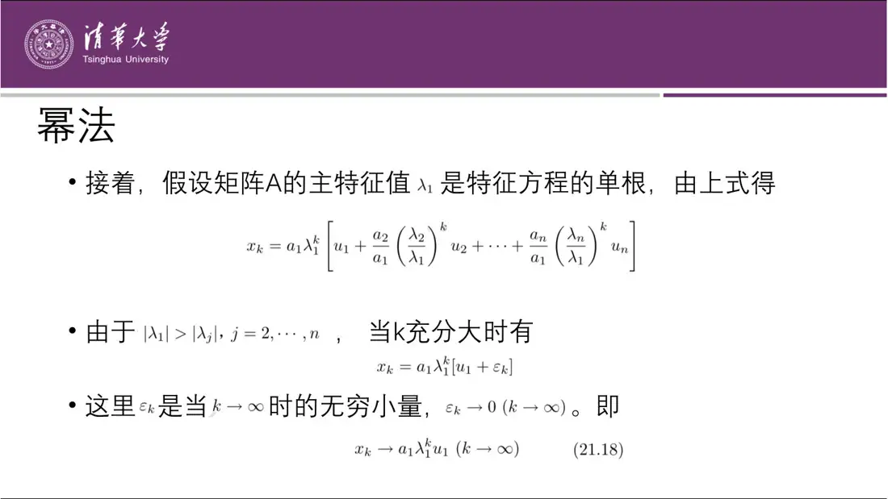

原文：

幂法

\- 接着，假设矩阵A的主特征值 $\lambda_{1}$ 是特征方程的单根，由上式得

$$
x _ {k} = a _ {1} \lambda_ {1} ^ {k} \left[ u _ {1} + \frac {a _ {2}}{a _ {1}} \left(\frac {\lambda_ {2}}{\lambda_ {1}}\right) ^ {k} u _ {2} + \dots + \frac {a _ {n}}{a _ {1}} \left(\frac {\lambda_ {n}}{\lambda_ {1}}\right) ^ {k} u _ {n} \right]
$$

\- 由于 $|\lambda_1| > |\lambda_j|$ , $j = 2, \cdots, n$ ，当k充分大时有

$$
x _ {k} = a _ {1} \lambda_ {1} ^ {k} [ u _ {1} + \varepsilon_ {k} ]
$$

\- 这里 $\varepsilon_{k}$ 是当 $k\to \infty$ 时的无穷小量， $\varepsilon_{k}\rightarrow 0(k\rightarrow \infty)$ 。即

$$
x _ {k} \rightarrow a _ {1} \lambda_ {1} ^ {k} u _ {1} (k \rightarrow \infty)\tag{21.18}
$$

Tsinghua University
清華大學

### 幂法

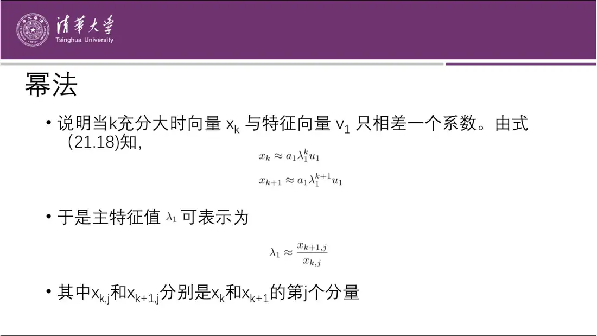

原文：

幂法

\- 说明当k充分大时向量 $x_{k}$ 与特征向量 $v_{1}$ 只相差一个系数。由式(21.18)知，

$$
x _ {k} \approx a _ {1} \lambda_ {1} ^ {k} u _ {1}
$$

$$
x _ {k + 1} \approx a _ {1} \lambda_ {1} ^ {k + 1} u _ {1}
$$

\- 于是主特征值 $\lambda_{1}$ 可表示为

$$
\lambda_ {1} \approx \frac {x _ {k + 1 , j}}{x _ {k , j}}
$$

\- 其中 $x_{k,j}$ 和 $x_{k + 1,j}$ 分别是 $x_{k}$ 和 $x_{k + 1}$ 的第j个分量

Tsinghua University
清華大學

### 幂法

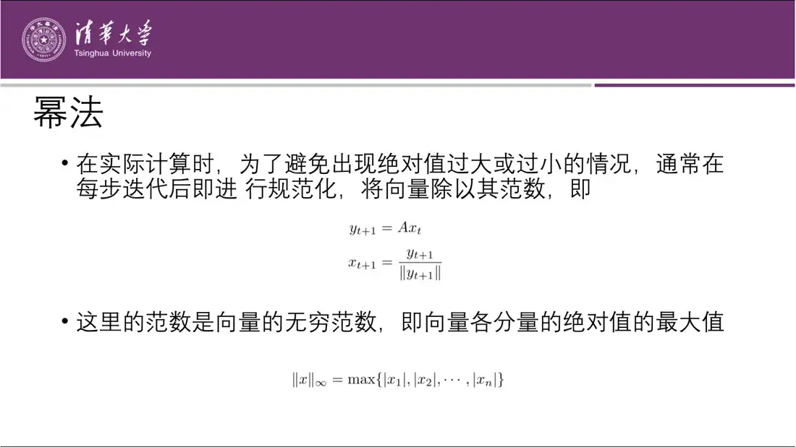

原文：

幂法

\- 在实际计算时，为了避免出现绝对值过大或过小的情况，通常在每步迭代后即进行规范化，将向量除以其范数，即

$$
\begin{array}{l} y _ {t + 1} = A x _ {t} \\ x _ {t + 1} = \frac {y _ {t + 1}}{\| y _ {t + 1} \|} \end{array}
$$

\- 这里的范数是向量的无穷范数，即向量各分量的绝对值的最大值

$$
\| x \| _ {\infty} = \max \{| x _ {1} |, | x _ {2} |, \dots , | x _ {n} | \}
$$

清華大學 Tsinghua University

### 幂法

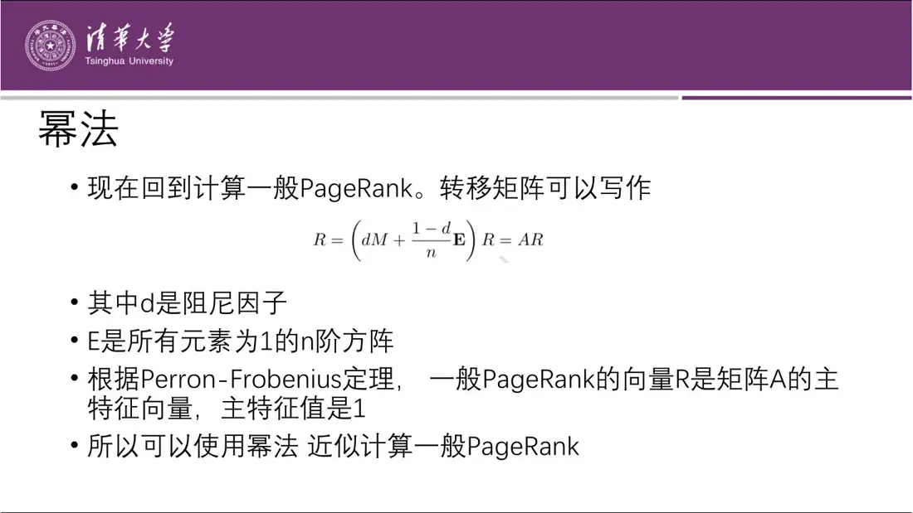

原文：

幂法

\- 现在回到计算一般PageRank。转移矩阵可以写作

$$
R = \left(d M + \frac {1 - d}{n} \mathbf {E}\right) R = A R
$$

\- 其中d是阻尼因子

\- E是所有元素为1的n阶方阵

\- 根据Perron-Frobenius定理，一般PageRank的向量R是矩阵A的主特征向量，主特征值是1

\- 所以可以使用幂法 近似计算一般PageRank

Tsinghua University
清華大學

### 计算一般PageRank的幂法

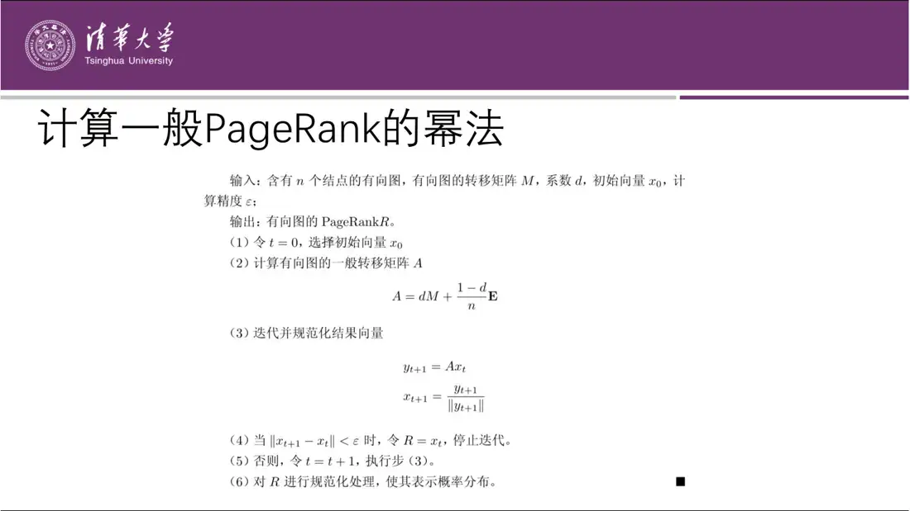

原文：

计算一般PageRank的幂法

输入：含有 $n$ 个结点的有向图，有向图的转移矩阵 $M$ ，系数 $d$ ，初始向量 $x_0$ ，计算精度 $\varepsilon$

输出：有向图的 PageRankR。

(1) 令 t = 0，选择初始向量 $x_{0}$

(2) 计算有向图的一般转移矩阵 A

$$
A = d M + \frac {1 - d}{n} \mathbf {E}
$$

(3) 迭代并规范化结果向量

$$
y _ {t + 1} = A x _ {t}
$$

$$
x _ {t + 1} = \frac {y _ {t + 1}}{\| y _ {t + 1} \|}
$$

(4) 当 $\|x_{t+1}-x_{t}\|<\varepsilon$ 时，令 $R=x_{t}$ ，停止迭代。

(5) 否则，令 $t = t + 1$ ，执行步（3）。

(6) 对 R 进行规范化处理，使其表示概率分布。

Tsinghua University
清華大學

### \- 给定一个如图所示的有向图，取 $d = 0.85$ ，求有向图的一般

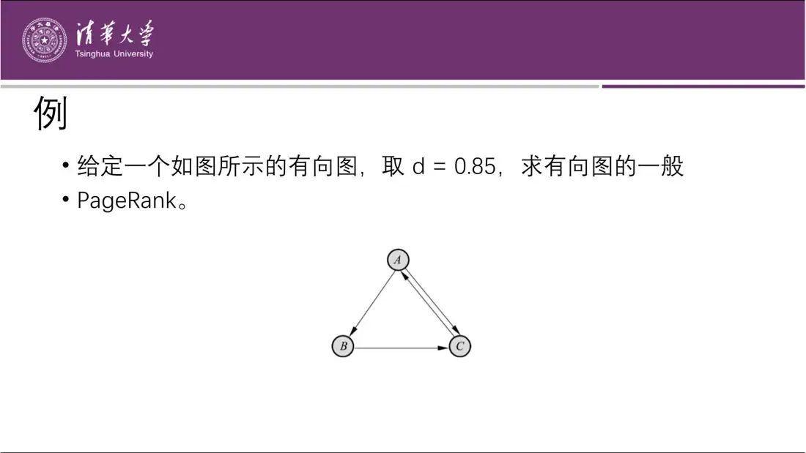

原文：

例

\- 给定一个如图所示的有向图，取 $d = 0.85$ ，求有向图的一般
- PageRank。

Tsinghua University
清華大學

### \- 利用幂法，按照算法 21.2，计算有向图的一般 PageRank

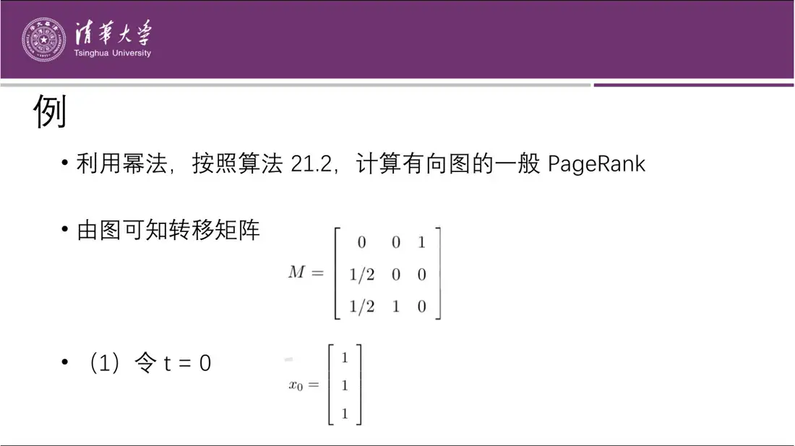

原文：

例

\- 利用幂法，按照算法 21.2，计算有向图的一般 PageRank

\- 由图可知转移矩阵

$$
M = \left[ \begin{array}{c c c} 0 & 0 & 1 \\ 1 / 2 & 0 & 0 \\ 1 / 2 & 1 & 0 \end{array} \right]
$$

(1) 令 $t = 0$

$$
x _ {0} = \left[ \begin{array}{l} 1 \\ 1 \\ 1 \end{array} \right]
$$

Tsinghua University
清華大學

### (2) 计算有向图的一般转移矩阵 A

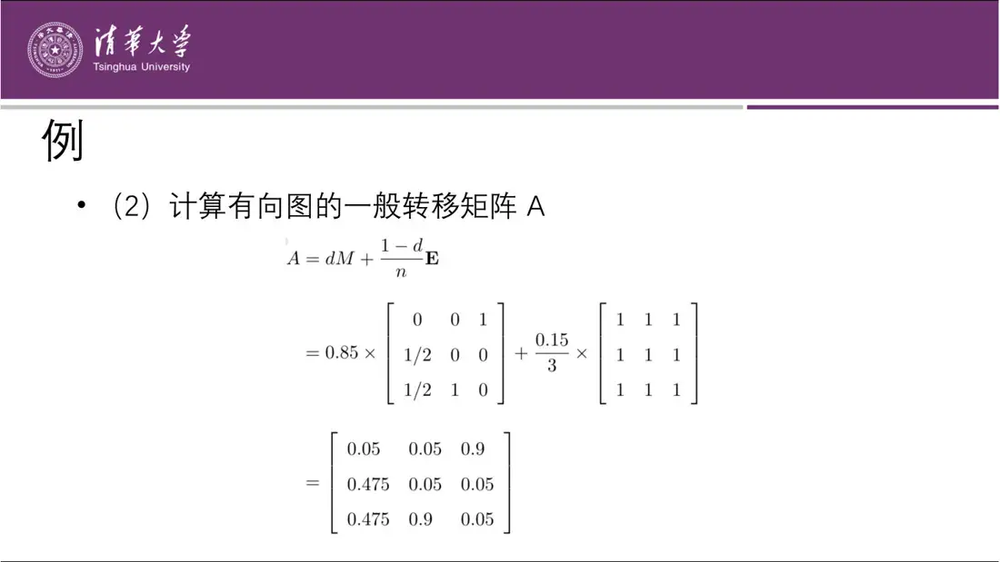

原文：

例

(2) 计算有向图的一般转移矩阵 A

$$
A = d M + \frac {1 - d}{n} \mathbf {E}
$$

$$
= 0. 8 5 \times \left[ \begin{array}{c c c} 0 & 0 & 1 \\ 1 / 2 & 0 & 0 \\ 1 / 2 & 1 & 0 \end{array} \right] + \frac {0 . 1 5}{3} \times \left[ \begin{array}{c c c} 1 & 1 & 1 \\ 1 & 1 & 1 \\ 1 & 1 & 1 \end{array} \right]
$$

$$
= \left[ \begin{array}{l l l} 0. 0 5 & 0. 0 5 & 0. 9 \\ 0. 4 7 5 & 0. 0 5 & 0. 0 5 \\ 0. 4 7 5 & 0. 9 & 0. 0 5 \end{array} \right]
$$

Tsinghua University
清華大學

### • (3)

原文：

例

• (3)

(3) 迭代并规范化

$$
y _ {1} = A x _ {0} = \left[ \begin{array}{l} 1 \\ 0. 5 7 5 \\ 1. 4 2 5 \end{array} \right]
$$

$$
x _ {1} = \frac {1}{1 . 4 2 5} \left[ \begin{array}{l} 1 \\ 0. 5 7 5 \\ 1. 4 2 5 \end{array} \right] = \left[ \begin{array}{l} 0. 7 0 1 8 \\ 0. 4 0 3 5 \\ 1 \end{array} \right]
$$

$$
y _ {2} = A x _ {1} = \left[ \begin{array}{l l l} 0. 0 5 & 0. 0 5 & 0. 9 \\ 0. 4 7 5 & 0. 0 5 & 0. 0 5 \\ 0. 4 7 5 & 0. 9 & 0. 0 5 \end{array} \right] \left[ \begin{array}{l} 0. 7 0 1 8 \\ 0. 4 0 3 5 \\ 1 \end{array} \right] = \left[ \begin{array}{l} 0. 9 5 5 3 \\ 0. 4 0 3 5 \\ 0. 7 4 6 5 \end{array} \right]
$$

$$
x _ {2} = \frac {1}{0 . 9 5 5 3} \left[ \begin{array}{l} 0. 9 5 5 3 \\ 0. 4 0 3 5 \\ 0. 7 4 6 5 \end{array} \right] = \left[ \begin{array}{l} 1 \\ 0. 4 2 2 4 \\ 0. 7 8 1 4 \end{array} \right]
$$

Tsinghua University
清華大學

### $$

原文：

例

如此继续迭代规范化，得到 $x_{t}, t = 0, 1, 2, \cdots, 21, 22$ ，的向量序列

$$
\left[ \begin{array}{l} 1 \\ 1 \\ 1 \end{array} \right], \left[ \begin{array}{l} 0. 7 0 1 8 \\ 0. 4 0 3 5 \\ 1 \end{array} \right], \left[ \begin{array}{l} 1 \\ 0. 4 2 2 4 \\ 0. 7 8 1 4 \end{array} \right], \left[ \begin{array}{l} 0. 8 6 5 9 \\ 0. 5 9 8 5 \\ 1 \end{array} \right], \left[ \begin{array}{l} 0. 9 7 3 2 \\ 0. 4 9 1 2 \\ 1 \end{array} \right], \left[ \begin{array}{l} 1 \\ 0. 5 5 1 6 \\ 0. 9 8 0 7 \end{array} \right],
$$

$$
\left[ \begin{array}{l} 0. 9 4 0 9 \\ 0. 5 4 0 5 \\ 1 \end{array} \right], \dots , \left[ \begin{array}{l} 0. 9 7 6 0 \\ 0. 5 4 0 8 \\ 1 \end{array} \right], \left[ \begin{array}{l} 0. 9 7 5 5 \\ 0. 5 4 0 4 \\ 1 \end{array} \right], \left[ \begin{array}{l} 0. 9 7 6 1 \\ 0. 5 4 0 6 \\ 1 \end{array} \right], \left[ \begin{array}{l} 0. 9 7 5 6 \\ 0. 5 4 0 6 \\ 1 \end{array} \right], \left[ \begin{array}{l} 0. 9 7 5 8 \\ 0. 5 4 0 4 \\ 1 \end{array} \right]
$$

Tsinghua University
清華大學

### 假设后面得到的两个向量已满足计算精度要求，那么取

原文：

例

假设后面得到的两个向量已满足计算精度要求，那么取

$$
R = \left[ \begin{array}{l} 0. 9 7 5 6 \\ 0. 5 4 0 6 \\ 1 \end{array} \right]
$$

即得所求的一般 PageRank。如果将一般 PageRank 作为一个概率分布，进行规范化，使各分量之和为 1，那么相应的一般 PageRank 可以写作

$$
R = \left[ \begin{array}{l} 0. 3 8 7 7 \\ 0. 2 1 4 9 \\ 0. 3 9 7 4 \end{array} \right]
$$

Tsinghua University
清華大學

### 代数算法

原文：

代数算法

\- 代数算法通过一般转移矩阵的逆矩阵计算求有向图的一般PageRank

\- 按照一般PageRank的定义式 (21.14)

$$
R = d M R + \frac {1 - d}{n} {\bf 1}
$$

\- 于是

$$
(I - d M) R = \frac {1 - d}{n} {\bf 1}\tag{21.23}
$$

$$
R = (I - d M) ^ {- 1} \frac {1 - d}{n} \mathbf {1}\tag{21.24}
$$

\- 这里I是单位矩阵。当 $0 < d < 1$ 时，线性方程组（21.23）的解存在且唯一

\- 这样，可以通过求逆矩阵 $(\mathrm{I - dM})^{-1}$ 得到有向图的一般PageRank

清華大學 Tsinghua University
