# 《统计学习方法》第2版 第16章 主成分分析（课件）

原件的每一页，下面附识别出的文字。

### 第十六章 主成分分析

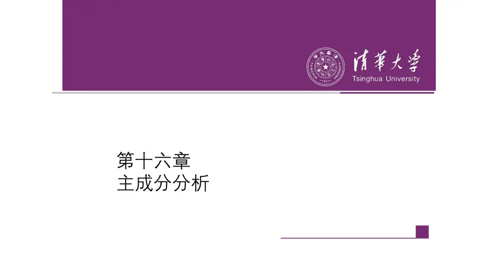

原文：

第十六章 主成分分析

大華洋
TSINGHUA UNIVERSITY
清華大學
Tsinghua University

### 主成分分析

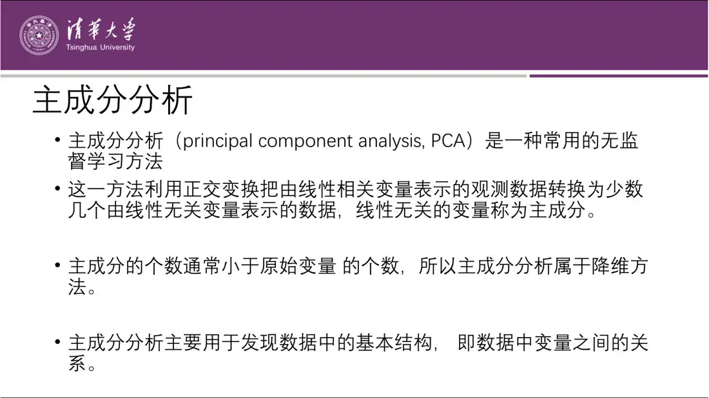

原文：

主成分分析

\- 主成分分析（principal component analysis, PCA）是一种常用的无监督学习方法

\- 这一方法利用正交变换把由线性相关变量表示的观测数据转换为少数几个由线性无关变量表示的数据，线性无关的变量称为主成分。

\- 主成分的个数通常小于原始变量的个数，所以主成分分析属于降维方法。

\- 主成分分析主要用于发现数据中的基本结构，即数据中变量之间的关系。

Tsinghua University
清華大學

### 基本想法

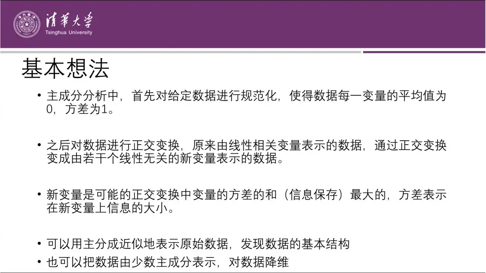

原文：

基本想法

\- 主成分分析中，首先对给定数据进行规范化，使得数据每一变量的平均值为0，方差为1。

\- 之后对数据进行正交变换，原来由线性相关变量表示的数据，通过正交变换变成由若干个线性无关的新变量表示的数据。

\- 新变量是可能的正交变换中变量的方差的和（信息保存）最大的，方差表示在新变量上信息的大小。

\- 可以用主分成近似地表示原始数据，发现数据的基本结构

\- 也可以把数据由少数主成分表示，对数据降维

Tsinghua University
清華大學

### 基本想法

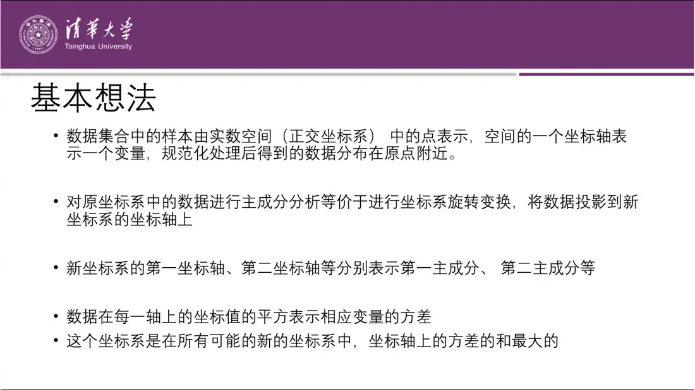

原文：

基本想法

\- 数据集合中的样本由实数空间（正交坐标系）中的点表示，空间的一个坐标轴表示一个变量，规范化处理后得到的数据分布在原点附近。

\- 对原坐标系中的数据进行主成分分析等价于进行坐标系旋转变换，将数据投影到新坐标系的坐标轴上

\- 新坐标系的第一坐标轴、第二坐标轴等分别表示第一主成分、第二主成分等

\- 数据在每一轴上的坐标值的平方表示相应变量的方差

\- 这个坐标系是在所有可能的新的坐标系中，坐标轴上的方差的和最大的

Tsinghua University
清華大學
1911-1911

### \- 数据由线性相关的两个变量 $x_{1}$ 和 $x_{2}$ 表示

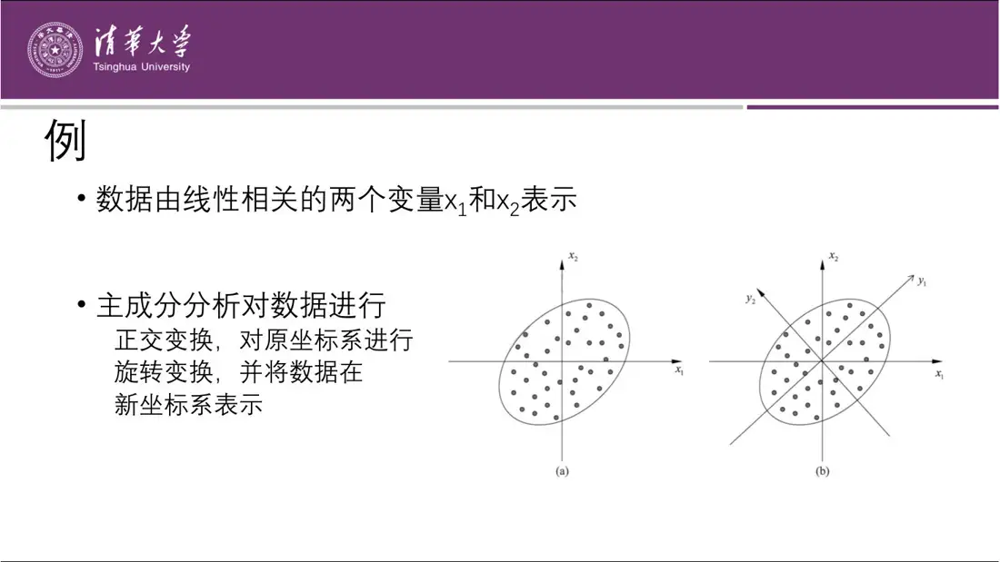

原文：

例

\- 数据由线性相关的两个变量 $x_{1}$ 和 $x_{2}$ 表示

\- 主成分分析对数据进行正交变换，对原坐标系进行旋转变换，并将数据在新坐标系表示

Tsinghua University
清華大學

### Tsinghua University

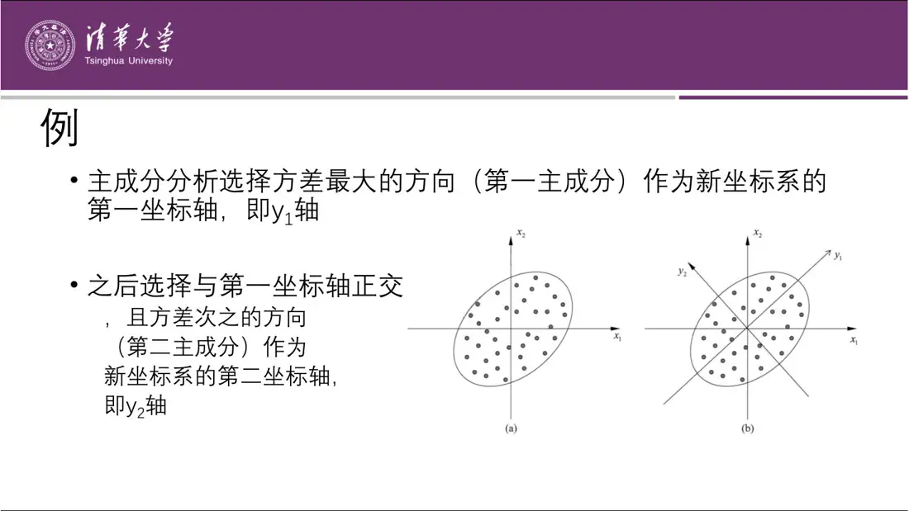

原文：

例

\- 主成分分析选择方差最大的方向（第一主成分）作为新坐标系的第一坐标轴，即 $y_{1}$ 轴

\- 之后选择与第一坐标轴正交，且方差次之的方向（第二主成分）作为新坐标系的第二坐标轴，即 $y_{2}$ 轴

Tsinghua University
清華大學

### Tsinghua University

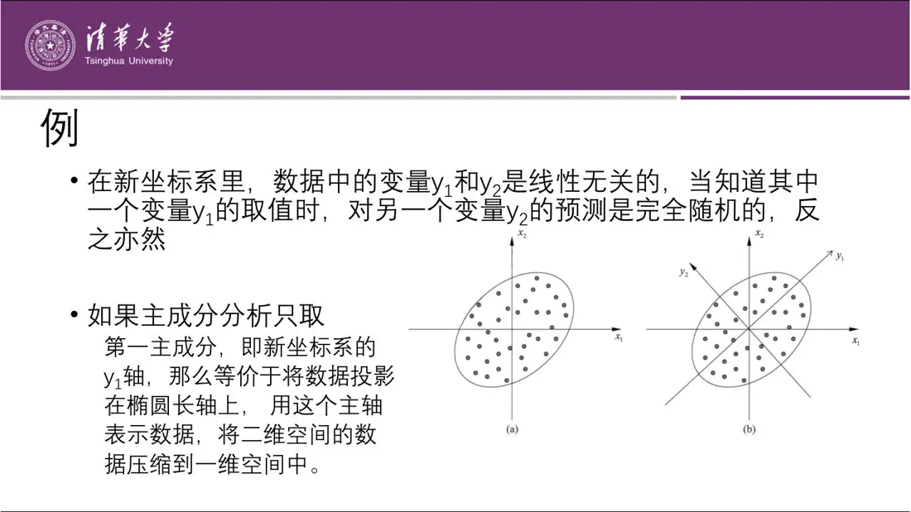

原文：

例

\- 在新坐标系里，数据中的变量 $y_{1}$ 和 $y_{2}$ 是线性无关的，当知道其中一个变量 $y_{1}$ 的取值时，对另一个变量 $y_{2}$ 的预测是完全随机的，反

\- 如果主成分分析只取第一主成分，即新坐标系的 $y_{1}$ 轴，那么等价于将数据投影在椭圆长轴上，用这个主轴表示数据，将二维空间的数据压缩到一维空间中。

Tsinghua University
清華大學

### Tsinghua University

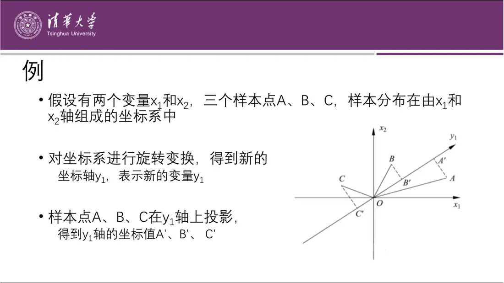

原文：

例

\- 假设有两个变量 $x_{1}$ 和 $x_{2}$ , 三个样本点A、B、C, 样本分布在由 $x_{1}$ 和 $x_{2}$ 轴组成的坐标系中

\- 对坐标系进行旋转变换，得到新的坐标轴 $y_{1}$ ，表示新的变量 $y_{1}$

\- 样本点A、B、C在 $y_{1}$ 轴上投影，得到 $y_{1}$ 轴的坐标值 $A'$ 、 $B'$ 、 $C'$

Tsinghua University
清華大學

### Tsinghua University

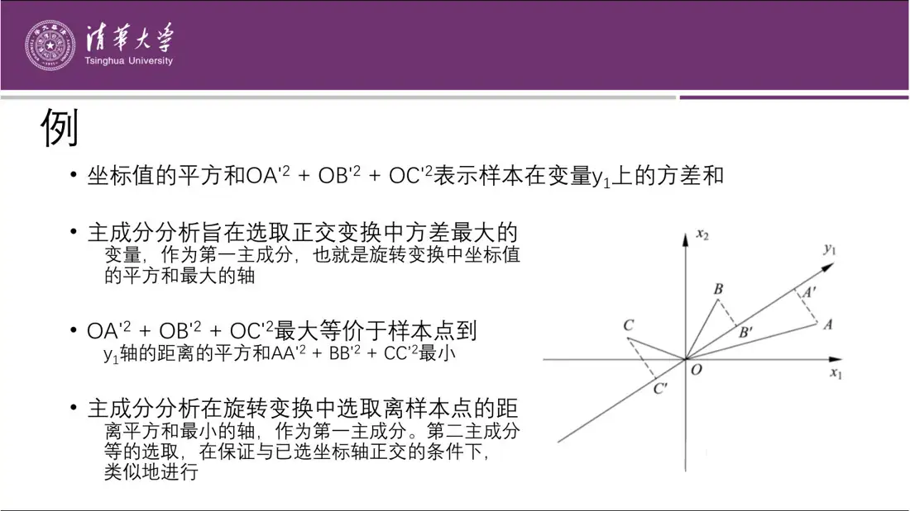

原文：

例

\- 坐标值的平方和 $OA^2 + OB^2 + OC^2$ 表示样本在变量 $y_1$ 上的方差和

\- 主成分分析旨在选取正交变换中方差最大的变量，作为第一主成分，也就是旋转变换中坐标值的平方和最大的轴

\- $OA'^2 + OB'^2 + OC'^2$ 最大等价于样本点到 $y_1$ 轴的距离的平方和 $AA'^2 + BB'^2 + CC'^2$ 最小

\- 主成分分析在旋转变换中选取离样本点的距离平方和最小的轴，作为第一主成分。第二主成分等的选取，在保证与已选坐标轴正交的条件下，类似地进行

Tsinghua University
清華大學

### 主成分分析

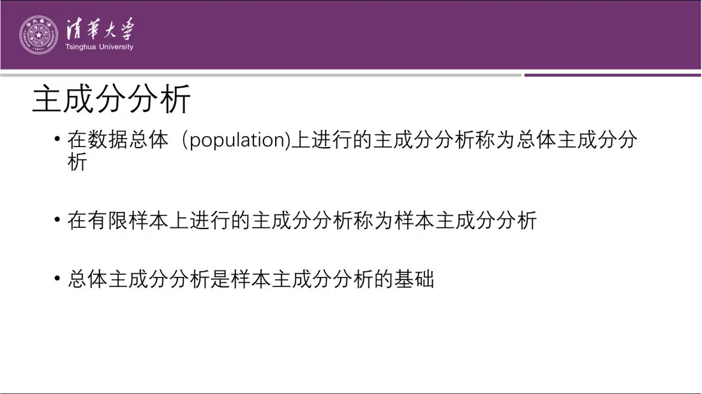

原文：

主成分分析

\- 在数据总体（population）上进行的主成分分析称为总体主成分分析

\- 在有限样本上进行的主成分分析称为样本主成分分析

\- 总体主成分分析是样本主成分分析的基础

Tsinghua University
清華大學
1911-

### 定义和导出

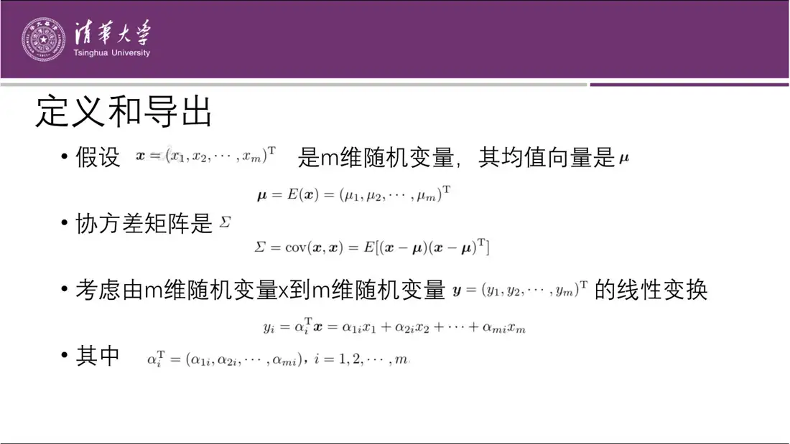

原文：

定义和导出

\- 假设 $x = (x_{1}, x_{2}, \dots, x_{m})^{\mathrm{T}}$ 是m维随机变量，其均值向量是 $\mu$

$$
\boldsymbol {\mu} = E (\boldsymbol {x}) = \left(\mu_ {1}, \mu_ {2}, \dots , \mu_ {m}\right) ^ {\mathrm{T}}
$$

\- 协方差矩阵是 $\Sigma$

$$
\Sigma = \operatorname{cov} (\boldsymbol {x}, \boldsymbol {x}) = E [ (\boldsymbol {x} - \boldsymbol {\mu}) (\boldsymbol {x} - \boldsymbol {\mu}) ^ {\mathrm{T}} ]
$$

\- 考虑由m维随机变量x到m维随机变量 $y = (y_1, y_2, \cdots, y_m)^T$ 的线性变换

$$
y _ {i} = \alpha_ {i} ^ {\mathrm{T}} \pmb {x} = \alpha_ {1 i} x _ {1} + \alpha_ {2 i} x _ {2} + \dots + \alpha_ {m i} x _ {m}
$$

\- 其中 $\alpha_{i}^{\mathrm{T}} = (\alpha_{1i},\alpha_{2i},\dots ,\alpha_{mi}), i = 1,2,\dots ,m,$

Tsinghua University
清華大學

### 定义和导出

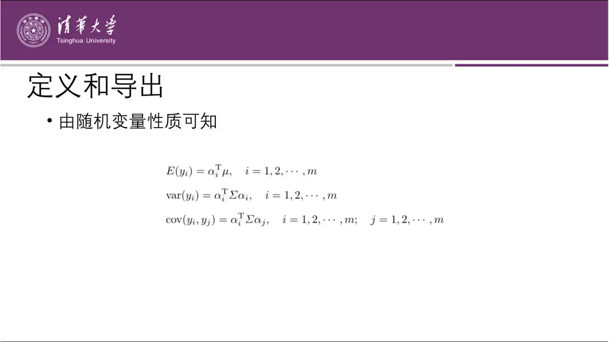

原文：

定义和导出

\- 由随机变量性质可知

$$
E (y _ {i}) = \alpha_ {i} ^ {\mathrm{T}} \mu , \quad i = 1, 2, \dots , m
$$

$$
\operatorname{var} (y _ {i}) = \alpha_ {i} ^ {\mathrm{T}} \Sigma \alpha_ {i}, \quad i = 1, 2, \dots , m
$$

$$
\operatorname{cov} (y _ {i}, y _ {j}) = \alpha_ {i} ^ {\mathrm{T}} \Sigma \alpha_ {j}, \quad i = 1, 2, \dots , m; \quad j = 1, 2, \dots , m
$$

Tsinghua University
清華大學

### 定义和导出

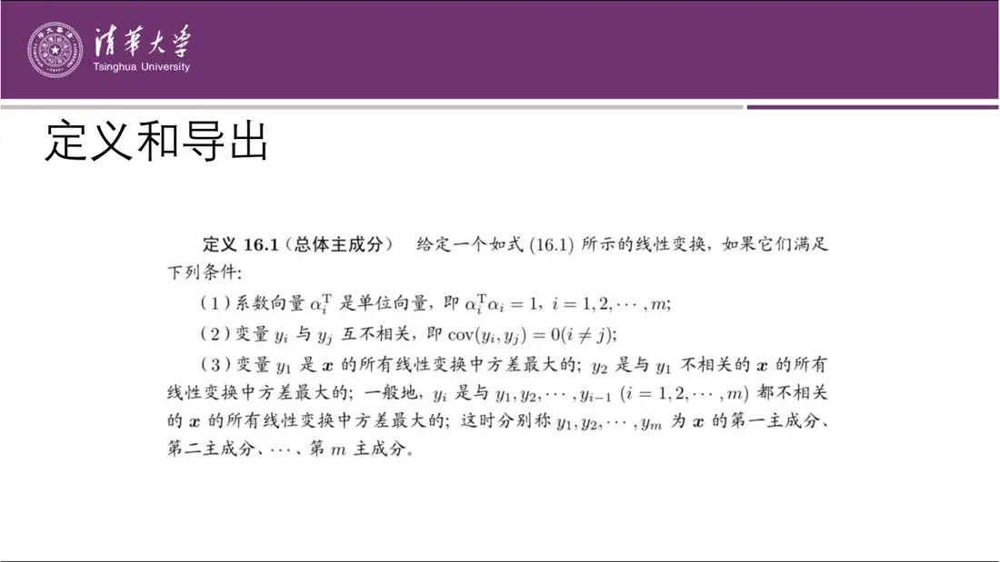

原文：

定义和导出

定义 16.1（总体主成分） 给定一个如式 (16.1) 所示的线性变换，如果它们满足下列条件:

(1) 系数向量 $\alpha_{i}^{T}$ 是单位向量，即 $\alpha_{i}^{T}\alpha_{i}=1, i=1,2,\cdots,m;$

(2) 变量 $y_{i}$ 与 $y_{j}$ 互不相关，即 $\mathrm{cov}(y_{i}, y_{j}) = 0 (i \neq j)$ ;

(3) 变量 $y_{1}$ 是 x 的所有线性变换中方差最大的; $y_{2}$ 是与 $y_{1}$ 不相关的 x 的所有线性变换中方差最大的; 一般地, $y_{i}$ 是与 $y_{1}, y_{2}, \cdots, y_{i-1} (i = 1, 2, \cdots, m)$ 都不相关的 x 的所有线性变换中方差最大的; 这时分别称 $y_{1}, y_{2}, \cdots, y_{m}$ 为 x 的第一主成分、第二主成分、…、第 m 主成分。

Tsinghua University
清華大學

### 定义和导出

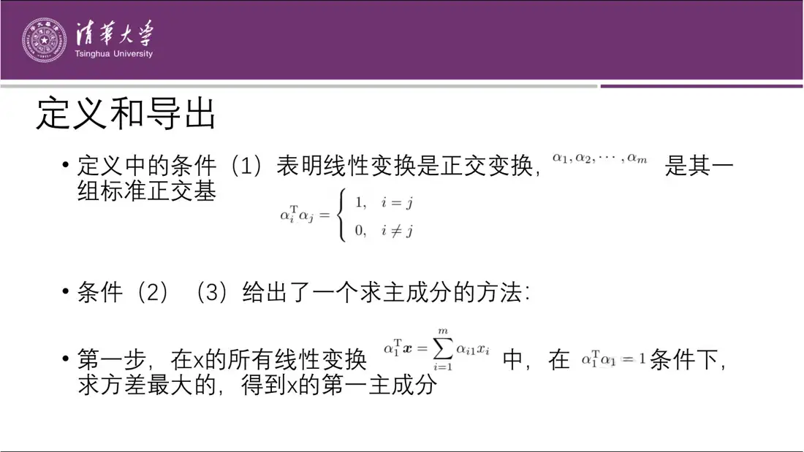

原文：

定义和导出

\- 定义中的条件（1）表明线性变换是正交变换， $\alpha_{1},\alpha_{2},\cdots,\alpha_{m}$ 是其一组标准正交基 $\alpha_{i}^{T}\alpha_{j}=\left\{\begin{array}{ll}1,&i=j\\0,&i\neq j\end{array}\right.$

\- 条件 (2) (3) 给出了一个求主成分的方法:

\- 第一步，在x的所有线性变换 $\alpha_{1}^{\mathrm{T}}\pmb{x} = \sum_{i=1}^{m}\alpha_{i1}x_{i}$ 中，在 $\alpha_{1}^{\mathrm{T}}\alpha_{1} = 1$ 条件下，求方差最大的，得到x的第一主成分

清華大學 Tsinghua University

### 定义和导出

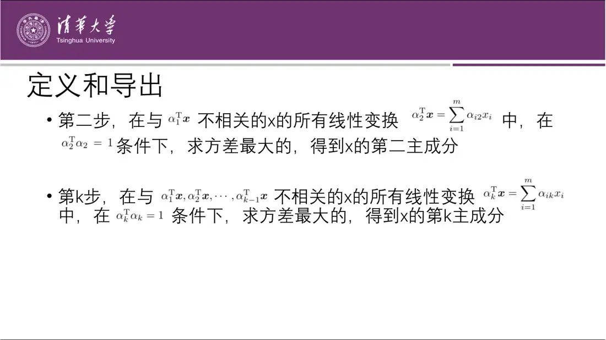

原文：

定义和导出

\- 第二步，在与 $\alpha_{1}^{\mathrm{T}}\pmb{x}$ 不相关的x的所有线性变换 $\alpha_{2}^{\mathrm{T}}\pmb{x} = \sum_{i=1}^{m}\alpha_{i2}x_{i}$ 中，在 $\alpha_{2}^{\mathrm{T}}\alpha_{2} = 1$ 条件下，求方差最大的，得到x的第二主成分

\- 第k步，在与 $\alpha_{1}^{\mathrm{T}}\pmb{x},\alpha_{2}^{\mathrm{T}}\pmb{x},\dots ,\alpha_{k - 1}^{\mathrm{T}}\pmb{x}$ 不相关的x的所有线性变换 $\alpha_{k}^{\mathrm{T}}\pmb{x} = \sum_{i = 1}^{m}\alpha_{ik}x_{i}$ 中，在 $\alpha_{k}^{\mathrm{T}}\alpha_{k} = 1$ 条件下，求方差最大的，得到x的第k主成分

Tsinghua University
清華大學

### 主要性质

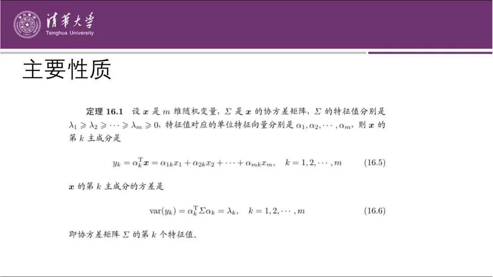

原文：

主要性质

定理 16.1 设 x 是 m 维随机变量， $\Sigma$ 是 x 的协方差矩阵， $\Sigma$ 的特征值分别是 $\lambda_{1} \geqslant \lambda_{2} \geqslant \cdots \geqslant \lambda_{m} \geqslant 0$ ，特征值对应的单位特征向量分别是 $\alpha_{1}, \alpha_{2}, \cdots, \alpha_{m}$ ，则 x 的第 k 主成分是

$$
y _ {k} = \alpha_ {k} ^ {\mathrm{T}} \boldsymbol {x} = \alpha_ {1 k} x _ {1} + \alpha_ {2 k} x _ {2} + \dots + \alpha_ {m k} x _ {m}, \quad k = 1, 2, \dots , m\tag{16.5}
$$

x 的第 k 主成分的方差是

$$
\operatorname{var} \left(y _ {k}\right) = \alpha_ {k} ^ {\mathrm{T}} \Sigma \alpha_ {k} = \lambda_ {k}, \quad k = 1, 2, \dots , m\tag{16.6}
$$

即协方差矩阵 $\Sigma$ 的第 k 个特征值。

Tsinghua University
清華大學

### 主要性质

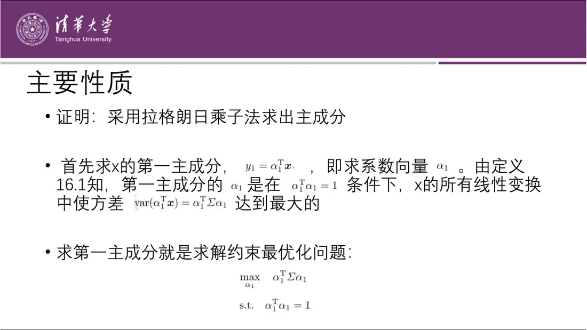

原文：

主要性质

\- 证明：采用拉格朗日乘子法求出主成分

\- 首先求x的第一主成分， $y_{1}=\alpha_{1}^{\mathrm{T}}x$ ，即求系数向量 $\alpha_{1}$ 。由定义16.1知，第一主成分的 $\alpha_{1}$ 是在 $\alpha_{1}^{\mathrm{T}}\alpha_{1}=1$ 条件下，x的所有线性变换中使方差 $\mathrm{var}(\alpha_{1}^{\mathrm{T}}x)=\alpha_{1}^{\mathrm{T}}\Sigma\alpha_{1}$ 达到最大的

\- 求第一主成分就是求解约束最优化问题:

$$
\begin{array}{l l} \max _ {\alpha_ {1}} & \alpha_ {1} ^ {\mathrm{T}} \Sigma \alpha_ {1} \\ \mathrm{s.t.} & \alpha_ {1} ^ {\mathrm{T}} \alpha_ {1} = 1 \end{array}
$$

Tsinghua University
清華大學

### 主要性质

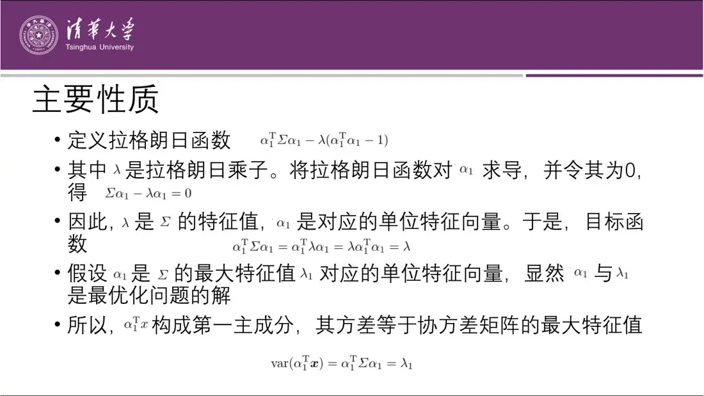

原文：

主要性质

\- 定义拉格朗日函数 $\alpha_{1}^{\mathrm{T}}\Sigma \alpha_{1} - \lambda (\alpha_{1}^{\mathrm{T}}\alpha_{1} - 1)$

\- 其中 $\lambda$ 是拉格朗日乘子。将拉格朗日函数对 $\alpha_{1}$ 求导，并令其为0，得 $\Sigma \alpha_{1} - \lambda \alpha_{1} = 0$

\- 因此， $\lambda$ 是 $\Sigma$ 的特征值， $\alpha_{1}$ 是对应的单位特征向量。于是，目标函数 $\alpha_{1}^{\mathrm{T}} \Sigma \alpha_{1} = \alpha_{1}^{\mathrm{T}} \lambda \alpha_{1} = \lambda \alpha_{1}^{\mathrm{T}} \alpha_{1} = \lambda$

\- 假设 $\alpha_{1}$ 是 $\Sigma$ 的最大特征值 $\lambda_{1}$ 对应的单位特征向量，显然 $\alpha_{1}$ 与 $\lambda_{1}$ 是最优化问题的解

\- 所以， $\alpha_{1}^{\mathrm{T}}x$ 构成第一主成分，其方差等于协方差矩阵的最大特征值

$$
\operatorname{var} (\boldsymbol {\alpha} _ {1} ^ {\mathrm{T}} \pmb {x}) = \boldsymbol {\alpha} _ {1} ^ {\mathrm{T}} \Sigma \alpha_ {1} = \lambda_ {1}
$$

Tsinghua University
清華大學

### 主要性质

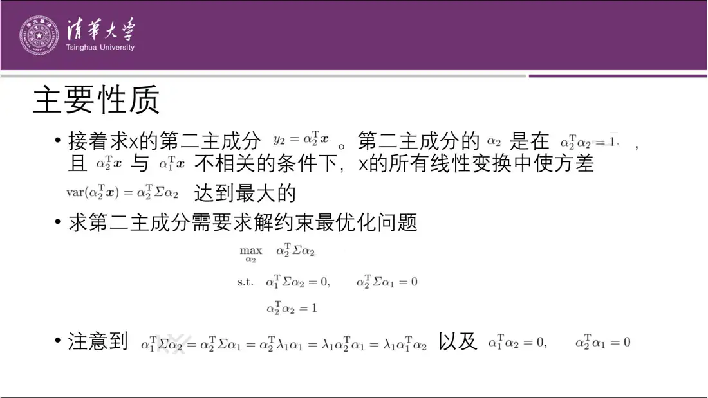

原文：

主要性质

\- 接着求x的第二主成分 $y_2 = \alpha_2^{\mathrm{T}} x$ 。第二主成分的 $\alpha_2$ 是在 $\alpha_2^{\mathrm{T}} \alpha_2 = 1$ ，且 $\alpha_2^{\mathrm{T}} x$ 与 $\alpha_1^{\mathrm{T}} x$ 不相关的条件下，x的所有线性变换中使方差 $\text{var}(\alpha_2^{\mathrm{T}} x) = \alpha_2^{\mathrm{T}} \Sigma \alpha_2$ 达到最大的

\- 求第二主成分需要求解约束最优化问题

$$
\begin{array}{r l} & {\underset {\alpha_ {2}} {\max} \quad \alpha_ {2} ^ {\mathrm{T}} \Sigma \alpha_ {2}} \\ & {\mathrm{s.t.} \quad \alpha_ {1} ^ {\mathrm{T}} \Sigma \alpha_ {2} = 0, \qquad \alpha_ {2} ^ {\mathrm{T}} \Sigma \alpha_ {1} = 0} \\ & {\alpha_ {2} ^ {\mathrm{T}} \alpha_ {2} = 1} \end{array}
$$

\- 注意到 $\alpha_{1}^{\mathrm{T}}\Sigma \alpha_{2} = \alpha_{2}^{\mathrm{T}}\Sigma \alpha_{1} = \alpha_{2}^{\mathrm{T}}\lambda_{1}\alpha_{1} = \lambda_{1}\alpha_{2}^{\mathrm{T}}\alpha_{1} = \lambda_{1}\alpha_{1}^{\mathrm{T}}\alpha_{2}$ 以及 $\alpha_{1}^{\mathrm{T}}\alpha_{2} = 0,$ $\alpha_{2}^{\mathrm{T}}\alpha_{1} = 0$

Tsinghua University
清華大學

### 主要性质

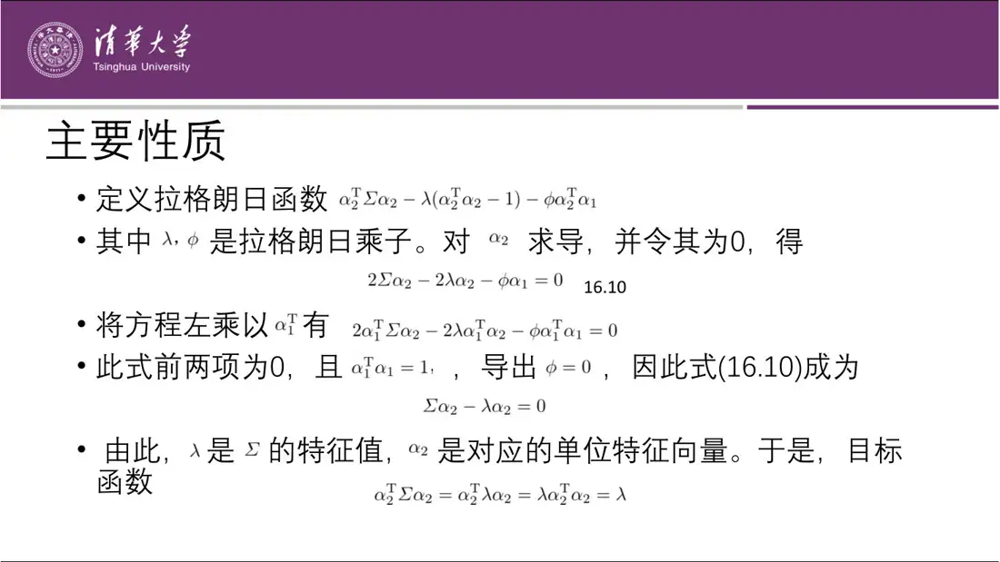

原文：

主要性质

\- 定义拉格朗日函数 $\alpha_{2}^{\mathrm{T}}\Sigma \alpha_{2} - \lambda (\alpha_{2}^{\mathrm{T}}\alpha_{2} - 1) - \phi \alpha_{2}^{\mathrm{T}}\alpha_{1}$

\- 其中 $\lambda, \phi$ 是拉格朗日乘子。对 $\alpha_{2}$ 求导，并令其为0，得

$$
2 \Sigma \alpha_ {2} - 2 \lambda \alpha_ {2} - \phi \alpha_ {1} = 0 \quad 1 6. 1 0
$$

\- 将方程左乘以 $\alpha_{1}^{\mathrm{T}}$ 有 $2\alpha_{1}^{\mathrm{T}}\Sigma \alpha_{2} - 2\lambda \alpha_{1}^{\mathrm{T}}\alpha_{2} - \phi \alpha_{1}^{\mathrm{T}}\alpha_{1} = 0$

\- 此式前两项为0，且 $\alpha_{1}^{\mathrm{T}}\alpha_{1} = 1$ ，导出 $\phi = 0$ ，因此式(16.10)成为

$$
\Sigma \alpha_ {2} - \lambda \alpha_ {2} = 0
$$

\- 由此， $\lambda$ 是 $\Sigma$ 的特征值， $\alpha_{2}$ 是对应的单位特征向量。于是，目标函数 $\alpha_{2}^{\mathrm{T}} \Sigma \alpha_{2} = \alpha_{2}^{\mathrm{T}} \lambda \alpha_{2} = \lambda \alpha_{2}^{\mathrm{T}} \alpha_{2} = \lambda$

Tsinghua University
清華大學

### 主要性质

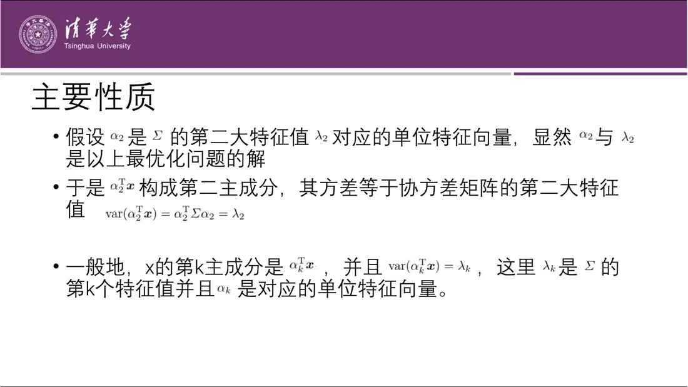

原文：

主要性质

\- 假设 $\alpha_{2}$ 是 $\Sigma$ 的第二大特征值 $\lambda_{2}$ 对应的单位特征向量，显然 $\alpha_{2}$ 与 $\lambda_{2}$ 是以上最优化问题的解

\- 于是 $\alpha_{2}^{\mathrm{T}}\pmb{x}$ 构成第二主成分，其方差等于协方差矩阵的第二大特征值 $\operatorname{var}(\alpha_2^{\mathrm{T}}\pmb{x}) = \alpha_2^{\mathrm{T}}\Sigma \alpha_2 = \lambda_2$

\- 一般地，x的第k主成分是 $\alpha_{k}^{\mathrm{T}}\pmb{x}$ ，并且 $\operatorname{var}(\alpha_{k}^{\mathrm{T}}\pmb{x}) = \lambda_{k}$ ，这里 $\lambda_{k}$ 是 $\Sigma$ 的第k个特征值并且 $\alpha_{k}$ 是对应的单位特征向量。

Tsinghua University
清華大學

### 主要性质

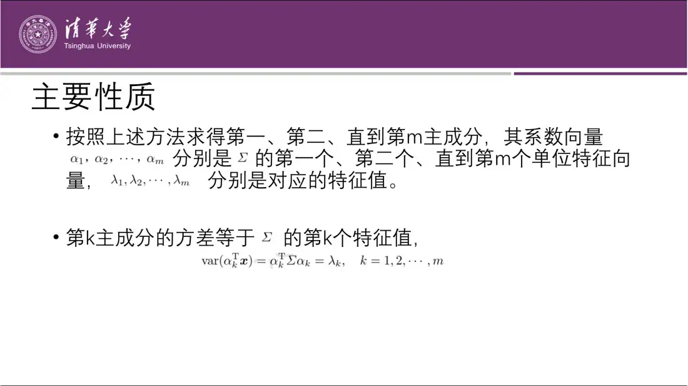

原文：

主要性质

\- 按照上述方法求得第一、第二、直到第m主成分，其系数向量 $\alpha_{1}, \alpha_{2}, \cdots, \alpha_{m}$ 分别是 $\Sigma$ 的第一个、第二个、直到第m个单位特征向量， $\lambda_{1}, \lambda_{2}, \cdots, \lambda_{m}$ 分别是对应的特征值。

\- 第k主成分的方差等于 $\Sigma$ 的第k个特征值，

$$
\operatorname{var} (\alpha_ {k} ^ {\mathrm{T}} \pmb {x}) = \alpha_ {k} ^ {\mathrm{T}} \Sigma \alpha_ {k} = \lambda_ {k}, \quad k = 1, 2, \dots , m
$$

Tsinghua University
清華大學

### 主要性质

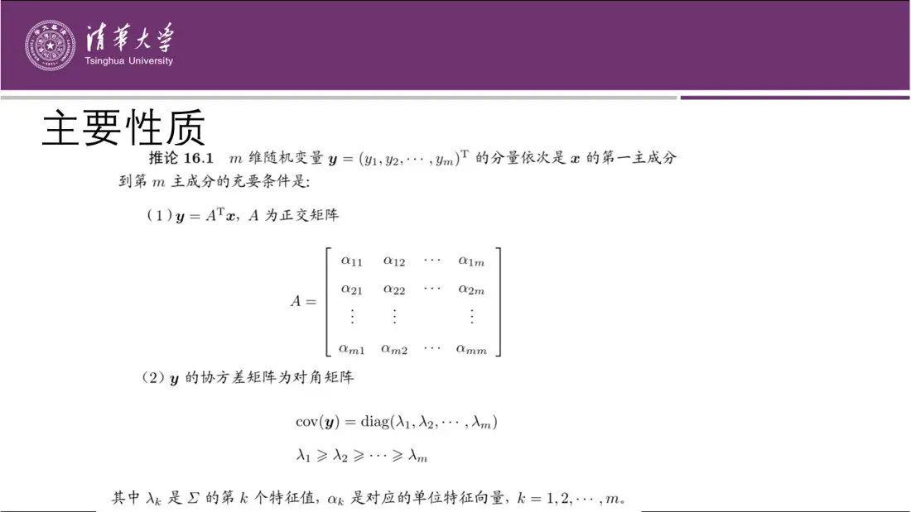

原文：

主要性质

推论 16.1 m 维随机变量 $\boldsymbol{y}=(y_{1},y_{2},\cdots,y_{m})^{\mathrm{T}}$ 的分量依次是 x 的第一主成分到第 m 主成分的充要条件是:

(1) $y=A^{T}x$ , A 为正交矩阵

$$
A = \left[ \begin{array}{c c c c} \alpha_ {1 1} & \alpha_ {1 2} & \dots & \alpha_ {1 m} \\ \alpha_ {2 1} & \alpha_ {2 2} & \dots & \alpha_ {2 m} \\ \vdots & \vdots & & \vdots \\ \alpha_ {m 1} & \alpha_ {m 2} & \dots & \alpha_ {m m} \end{array} \right]
$$

(2) y 的协方差矩阵为对角矩阵

$$
\begin{array}{l} \operatorname{cov} (\boldsymbol {y}) = \operatorname{diag} (\lambda_ {1}, \lambda_ {2}, \dots , \lambda_ {m}) \\ \lambda_ {1} \geqslant \lambda_ {2} \geqslant \dots \geqslant \lambda_ {m} \end{array}
$$

其中 $\lambda_{k}$ 是 $\Sigma$ 的第 k 个特征值， $\alpha_{k}$ 是对应的单位特征向量， $k=1,2,\cdots,m$ 。

Tsinghua University
清華大學

### 主要性质

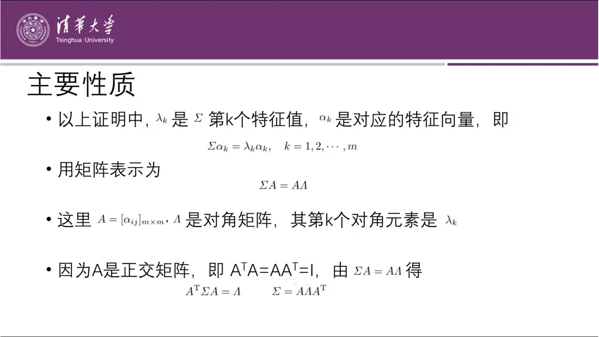

原文：

主要性质

\- 以上证明中， $\lambda_{k}$ 是 $\Sigma$ 第k个特征值， $\alpha_{k}$ 是对应的特征向量，即

$$
\Sigma \alpha_ {k} = \lambda_ {k} \alpha_ {k}, \quad k = 1, 2, \dots , m
$$

\- 用矩阵表示为

$$
\Sigma A = A \Lambda
$$

\- 这里 $A = [\alpha_{ij}]_{m\times m},\Lambda$ 是对角矩阵，其第k个对角元素是 $\lambda_{k}$

\- 因为A是正交矩阵，即 $A^{\top}A = AA^{\top} = 1$ ，由 $\Sigma A = AA$ 得

$$
A ^ {\mathrm{T}} \Sigma A = \Lambda \qquad \Sigma = A \Lambda A ^ {\mathrm{T}}
$$

Tsinghua University
清華大學

### 总体主成分的性质

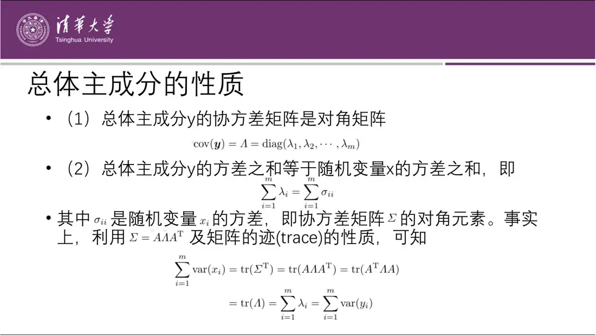

原文：

总体主成分的性质

• (1) 总体主成分y的协方差矩阵是对角矩阵

$$
\operatorname{cov} (\boldsymbol {y}) = \Lambda = \operatorname{diag} \left(\lambda_ {1}, \lambda_ {2}, \dots , \lambda_ {m}\right)
$$

• (2) 总体主成分y的方差之和等于随机变量x的方差之和, 即 $\sum_{i=1}^{m} \lambda_i = \sum_{i=1}^{m} \sigma_{ii}$

\- 其中 $\sigma_{ii}$ 是随机变量 $x_{i}$ 的方差，即协方差矩阵 $\Sigma$ 的对角元素。事实上，利用 $\Sigma = A\Lambda A^{\mathrm{T}}$ 及矩阵的迹(trace)的性质，可知

$$
\begin{array}{r l} & {\sum_ {i = 1} ^ {m} \mathrm{var} (x _ {i}) = \mathrm{tr} (\Sigma^ {\mathrm{T}}) = \mathrm{tr} (A \Lambda A ^ {\mathrm{T}}) = \mathrm{tr} (A ^ {\mathrm{T}} \Lambda A)} \\ & {\qquad = \mathrm{tr} (\Lambda) = \sum_ {i = 1} ^ {m} \lambda_ {i} = \sum_ {i = 1} ^ {m} \mathrm{var} (y _ {i})} \end{array}
$$

清華大學 Tsinghua University

### 总体主成分的性质

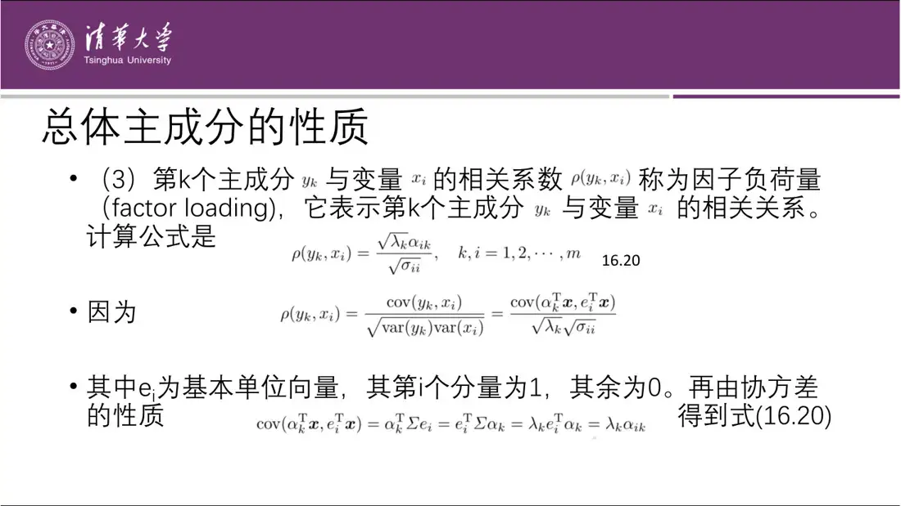

原文：

总体主成分的性质

(3) 第k个主成分 $y_{k}$ 与变量 $x_{i}$ 的相关系数 $\rho(y_{k}, x_{i})$ 称为因子负荷量 (factor loading)，它表示第k个主成分 $y_{k}$ 与变量 $x_{i}$ 的相关关系。

$$
\rho (y _ {k}, x _ {i}) = \frac {\sqrt {\lambda_ {k}} \alpha_ {i k}}{\sqrt {\sigma_ {i i}}}, \quad k, i = 1, 2, \dots , m \tag {16.20}
$$

\- 因为

$$
\rho (y _ {k}, x _ {i}) = \frac {\operatorname{cov} (y _ {k} , x _ {i})}{\sqrt {\operatorname{var} (y _ {k}) \operatorname{var} (x _ {i})}} = \frac {\operatorname{cov} (\alpha_ {k} ^ {\mathrm{T}} \pmb {x} , e _ {i} ^ {\mathrm{T}} \pmb {x})}{\sqrt {\lambda_ {k}} \sqrt {\sigma_ {i i}}}
$$

\- 其中 $e_{i}$ 为基本单位向量，其第i个分量为1，其余为0。再由协方差的性质 $\text{cov}(\alpha_k^{\text{T}}\boldsymbol{x},e_i^{\text{T}}\boldsymbol{x}) = \alpha_k^{\text{T}}\Sigma e_i = e_i^{\text{T}}\Sigma \alpha_k = \lambda_ke_i^{\text{T}}\alpha_k = \lambda_ke_{ik}$ 得到式(16.20)

清華大學 Tsinghua University

### 总体主成分的性质

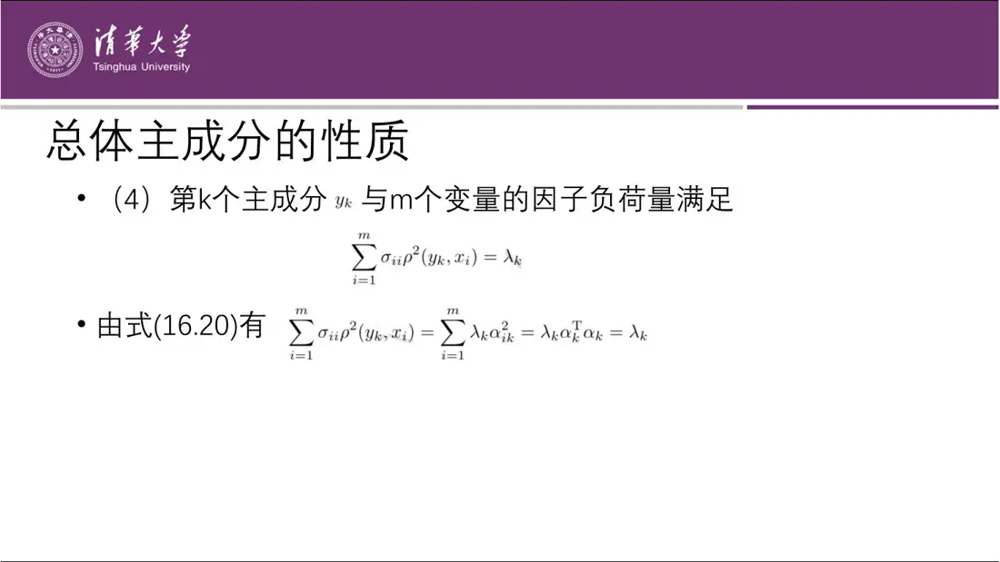

原文：

总体主成分的性质

• (4) 第k个主成分 $y_{k}$ 与m个变量的因子负荷量满足

$$
\sum_ {i = 1} ^ {m} \sigma_ {i i} \rho^ {2} (y _ {k}, x _ {i}) = \lambda_ {k}
$$

\- 由式(16.20)有 $\sum_{i=1}^{m}\sigma_{ii}\rho^{2}(y_{k},x_{i})=\sum_{i=1}^{m}\lambda_{k}\alpha_{ik}^{2}=\lambda_{k}\alpha_{k}^{\mathrm{T}}\alpha_{k}=\lambda_{k}$

Tsinghua University
清華大學
1911-UNIVERSITY

### 总体主成分的性质

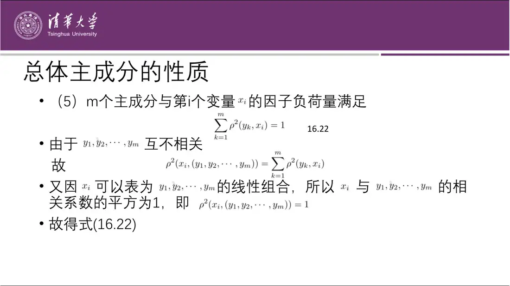

原文：

总体主成分的性质

• (5) m个主成分与第i个变量 $x_{i}$ 的因子负荷量满足

$$
\sum_ {k = 1} ^ {m} \rho^ {2} (y _ {k}, x _ {i}) = 1 \tag {16.22}
$$

\- 由于 $y_{1}, y_{2}, \cdots, y_{m}$ 互不相关

$$
\rho^ {2} (x _ {i}, (y _ {1}, y _ {2}, \dots , y _ {m})) = \sum_ {k = 1} ^ {m} \rho^ {2} (y _ {k}, x _ {i})
$$

\- 又因 $x_{i}$ 可以表为 $y_{1}, y_{2}, \cdots, y_{m}$ 的线性组合，所以 $x_{i}$ 与 $y_{1}, y_{2}, \cdots, y_{m}$ 的相关系数的平方为1，即 $\rho^{2}(x_{i}, (y_{1}, y_{2}, \cdots, y_{m})) = 1$

\- 故得式(16.22)

清華大學 Tsinghua University

### 主成分的个数

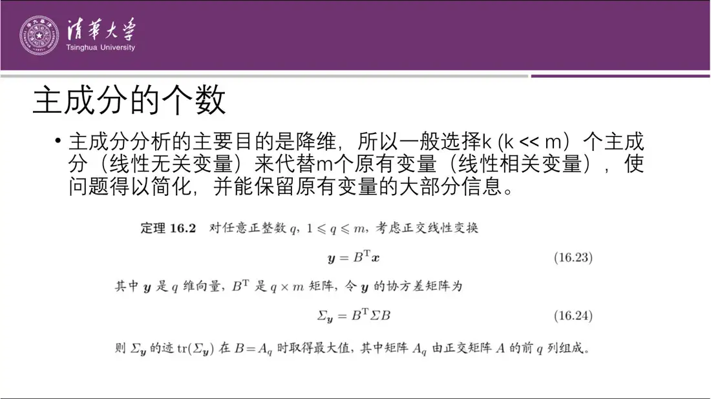

原文：

主成分的个数

\- 主成分分析的主要目的是降维，所以一般选择 $k (k << m)$ 个主成分（线性无关变量）来代替m个原有变量（线性相关变量），使问题得以简化，并能保留原有变量的大部分信息。

定理16.2 对任意正整数 $q, 1 \leqslant q \leqslant m$ ，考虑正交线性变换

$$
\pmb {y} = B ^ {\mathrm{T}} \pmb {x}\tag{16.23}
$$

其中 y 是 q 维向量， $B^{T}$ 是 $q \times m$ 矩阵，令 y 的协方差矩阵为

$$
\boldsymbol {\Sigma} _ {\boldsymbol {y}} = \boldsymbol {B} ^ {\mathrm{T}} \boldsymbol {\Sigma} \boldsymbol {B}\tag{16.24}
$$

则 $\Sigma_{\pmb{y}}$ 的迹 $\operatorname{tr}(\Sigma_{\pmb{y}})$ 在 $B = A_{q}$ 时取得最大值，其中矩阵 $A_{q}$ 由正交矩阵 $A$ 的前 $q$ 列组成。

Tsinghua University
清華大學

### 主成分的个数

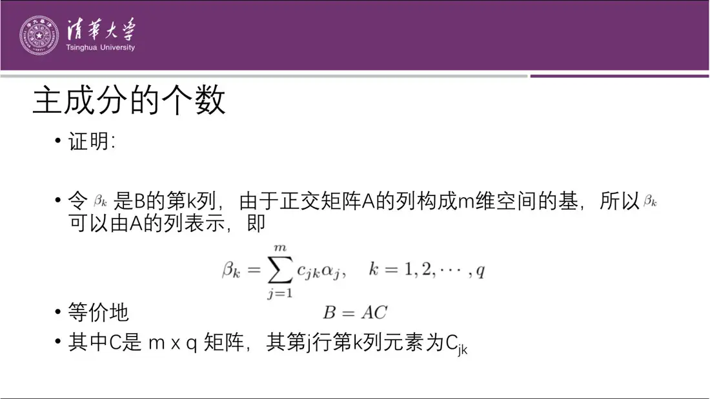

原文：

主成分的个数

\- 证明:

\- 令 $\beta_{k}$ 是B的第k列，由于正交矩阵A的列构成m维空间的基，所以 $\beta_{k}$ 可以由A的列表示，即

$$
\begin{array}{c} \beta_ {k} = \sum_ {j = 1} ^ {m} c _ {j k} \alpha_ {j}, \quad k = 1, 2, \dots , q \\ B = A C \end{array}
$$

\- 等价地

\- 其中C是 $m \times q$ 矩阵，其第j行第k列元素为 $C_{jk}$

清華大學 Tsinghua University

### 主成分的个数

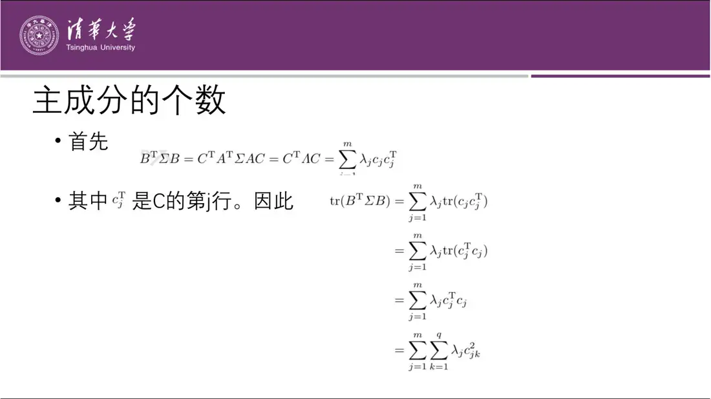

原文：

主成分的个数

· 首先

$$
B ^ {\mathrm{T}} \Sigma B = C ^ {\mathrm{T}} A ^ {\mathrm{T}} \Sigma A C = C ^ {\mathrm{T}} \Lambda C = \sum_ {j = 1} ^ {m} \lambda_ {j} c _ {j} c _ {j} ^ {\mathrm{T}}
$$

\- 其中 $c_{j}^{\mathrm{T}}$ 是C的第j行。因此 $\operatorname{tr}(B^{\mathrm{T}}\Sigma B) = \sum_{j=1}^{m}\lambda_{j}\operatorname{tr}(c_{j}c_{j}^{\mathrm{T}})$ $= \sum_{j=1}^{m}\lambda_{j}\operatorname{tr}(c_{j}^{\mathrm{T}}c_{j})$ $= \sum_{j=1}^{m}\lambda_{j}c_{j}^{\mathrm{T}}c_{j}$ $= \sum_{j=1}^{m}\sum_{k=1}^{q}\lambda_{j}c_{jk}^{2}$

清華大學 Tsinghua University

### 主成分的个数

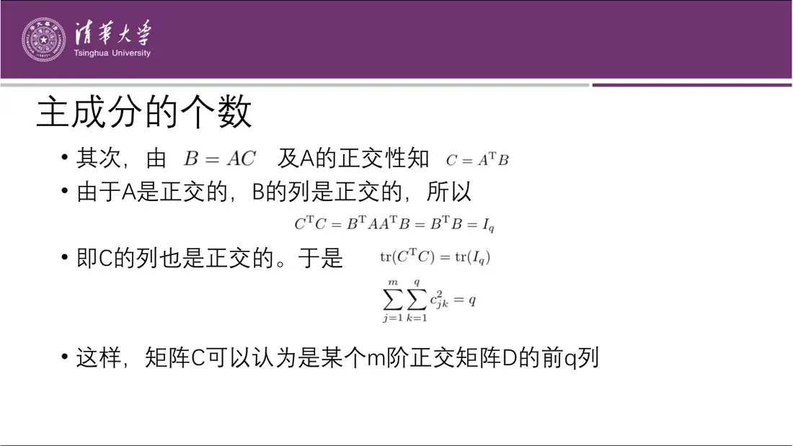

原文：

主成分的个数

\- 其次，由 $B = AC$ 及A的正交性知 $C = A^{\mathrm{T}}B$

\- 由于A是正交的，B的列是正交的，所以

$$
C ^ {\mathrm{T}} C = B ^ {\mathrm{T}} A A ^ {\mathrm{T}} B = B ^ {\mathrm{T}} B = I _ {q}
$$

\- 即C的列也是正交的。于是 $\mathrm{tr}(C^{\mathrm{T}}C) = \mathrm{tr}(I_q)$

$$
\sum_ {j = 1} ^ {m} \sum_ {k = 1} ^ {q} c _ {j k} ^ {2} = q
$$

\- 这样，矩阵C可以认为是某个m阶正交矩阵D的前q列

Tsinghua University
清華大學

### 主成分的个数

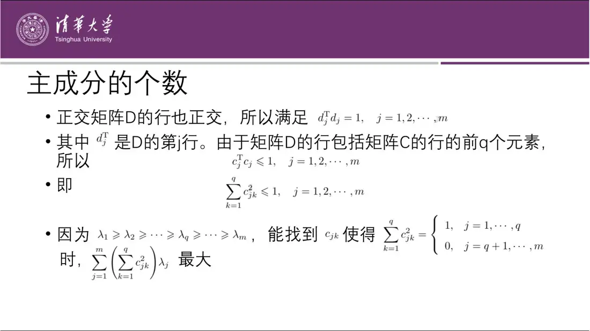

原文：

主成分的个数

\- 正交矩阵D的行也正交，所以满足 $d_{j}^{\mathrm{T}}d_{j} = 1, j = 1,2,\dots ,m$

\- 其中 $d_{j}^{\mathrm{T}}$ 是D的第j行。由于矩阵D的行包括矩阵C的行的前q个元素，所以 $c_{j}^{\mathrm{T}} c_{j} \leqslant 1, j = 1,2,\dots ,m$

• 即

$$
\sum_ {k = 1} ^ {q} c _ {j k} ^ {2} \leqslant 1, \quad j = 1, 2, \dots , m
$$

\- 因为 $\lambda_1 \geqslant \lambda_2 \geqslant \dots \geqslant \lambda_q \geqslant \dots \geqslant \lambda_m$ ，能找到 $c_{jk}$ 使得 $\sum_{k=1}^{q} c_{jk}^2 = \left\{ \begin{array}{ll} 1, & j = 1, \dots, q \\ 0, & j = q + 1, \dots, m \end{array} \right.$ 时， $\sum_{j=1}^{m} \left( \sum_{k=1}^{q} c_{jk}^2 \right) \lambda_j$ 最大

Tsinghua University
清華大學

### 主成分的个数

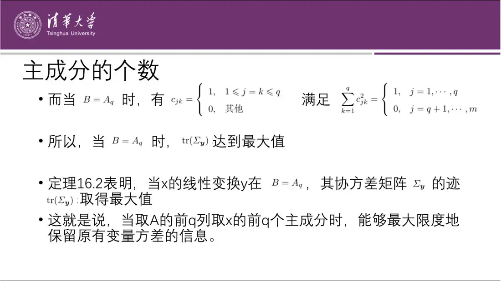

原文：

主成分的个数

\- 而当 $B = A_{q}$ 时，有 $c_{jk} = \left\{ \begin{array}{ll}1, & 1\leqslant j = k\leqslant q\\ 0, & \text{其他} \end{array} \right.$ 满足 $\sum_{k = 1}^{q}c_{jk}^{2} = \left\{ \begin{array}{ll}1, & j = 1,\dots ,q\\ 0, & j = q + 1,\dots ,m \end{array} \right.$

\- 所以，当 $B = A_{q}$ 时， $\operatorname{tr}(\Sigma_y)$ 达到最大值

\- 定理16.2表明，当x的线性变换y在 $B = A_{q}$ ，其协方差矩阵 $\Sigma_y$ 的迹 $\mathrm{tr}(\Sigma_y)$ 取得最大值

\- 这就是说，当取A的前q列取x的前q个主成分时，能够最大限度地保留原有变量方差的信息。

Tsinghua University
清華大學

### 主成分的个数

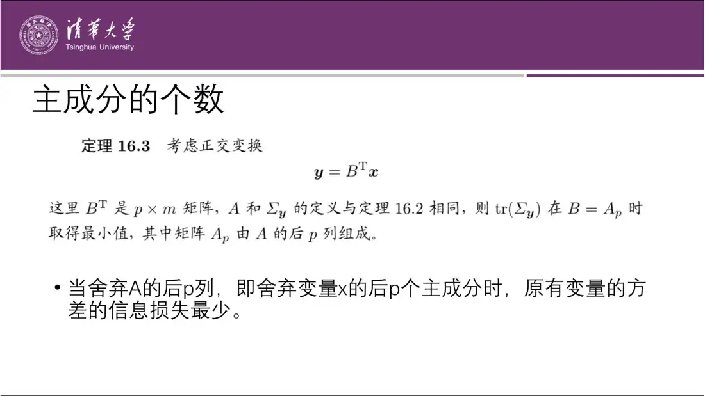

原文：

主成分的个数

定理 16.3 考虑正交变换

$$
\pmb {y} = B ^ {\mathrm{T}} \pmb {x}
$$

这里 $B^{\mathrm{T}}$ 是 $p \times m$ 矩阵, $A$ 和 $\Sigma_{\mathbf{y}}$ 的定义与定理 16.2 相同, 则 $\operatorname{tr}(\Sigma_{\mathbf{y}})$ 在 $B = A_{p}$ 时取得最小值, 其中矩阵 $A_{p}$ 由 $A$ 的后 $p$ 列组成。

\- 当舍弃A的后p列，即舍弃变量x的后p个主成分时，原有变量的方差的信息损失最少。

清華大學 Tsinghua University

### 主成分的个数

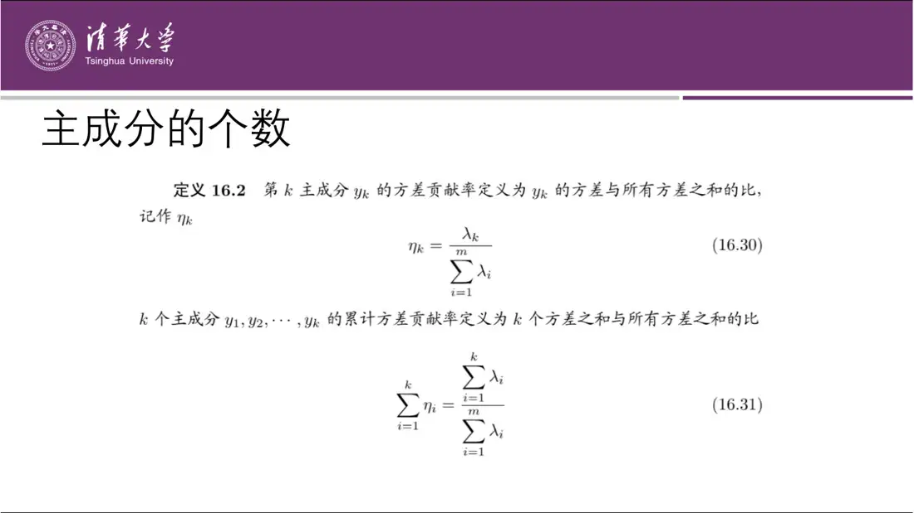

原文：

主成分的个数

定义16.2 第 $k$ 主成分 $y_{k}$ 的方差贡献率定义为 $y_{k}$ 的方差与所有方差之和的比，记作 $\eta_{k}$

$$
\eta_ {k} = \frac {\lambda_ {k}}{\sum_ {i = 1} ^ {m} \lambda_ {i}}\tag{16.30}
$$

k 个主成分 $y_{1}, y_{2}, \cdots, y_{k}$ 的累计方差贡献率定义为 k 个方差之和与所有方差之和的比

$$
\sum_ {i = 1} ^ {k} \eta_ {i} = \frac {\sum_ {i = 1} ^ {k} \lambda_ {i}}{\sum_ {i = 1} ^ {m} \lambda_ {i}}\tag{16.31}
$$

清華大學 Tsinghua University

### 主成分的个数

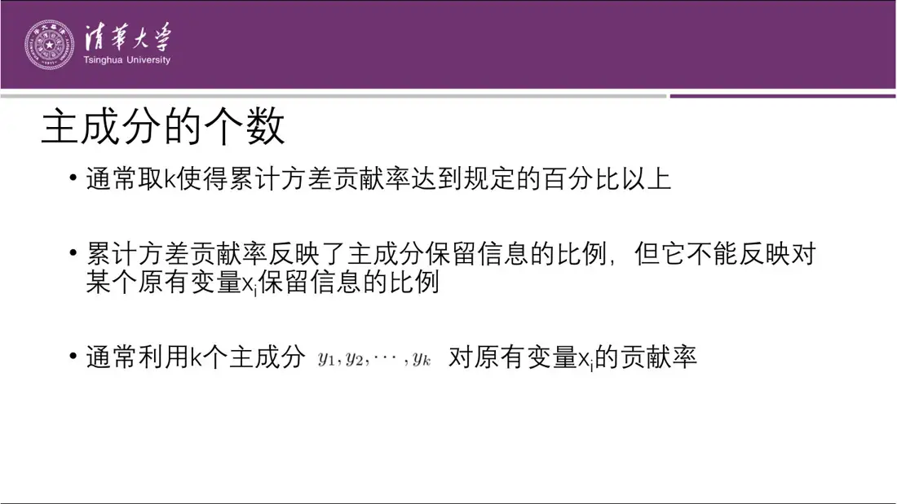

原文：

主成分的个数

\- 通常取k使得累计方差贡献率达到规定的百分比以上

\- 累计方差贡献率反映了主成分保留信息的比例，但它不能反映对某个原有变量 $x_{i}$ 保留信息的比例

\- 通常利用k个主成分 $y_{1}, y_{2}, \cdots, y_{k}$ 对原有变量 $x_{i}$ 的贡献率

Tsinghua University
清華大學
1911-1911

### 主成分的个数

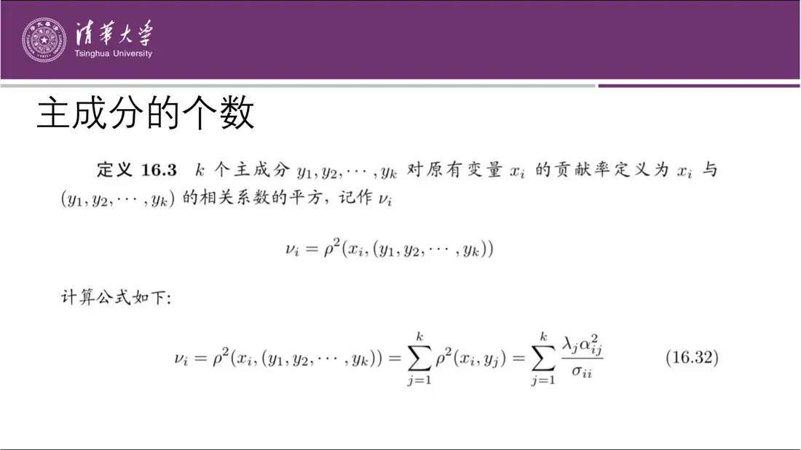

原文：

主成分的个数

定义 16.3 k 个主成分 $y_{1}, y_{2}, \cdots, y_{k}$ 对原有变量 $x_{i}$ 的贡献率定义为 $x_{i}$ 与 $(y_{1}, y_{2}, \cdots, y_{k})$ 的相关系数的平方，记作 $\nu_{i}$

$$
\nu_ {i} = \rho^ {2} (x _ {i}, (y _ {1}, y _ {2}, \dots , y _ {k}))
$$

计算公式如下:

$$
\nu_ {i} = \rho^ {2} (x _ {i}, (y _ {1}, y _ {2}, \dots , y _ {k})) = \sum_ {j = 1} ^ {k} \rho^ {2} (x _ {i}, y _ {j}) = \sum_ {j = 1} ^ {k} \frac {\lambda_ {j} \alpha_ {i j} ^ {2}}{\sigma_ {i i}}\tag{16.32}
$$

清華大學 Tsinghua University

### 规范化变量的总体主成分

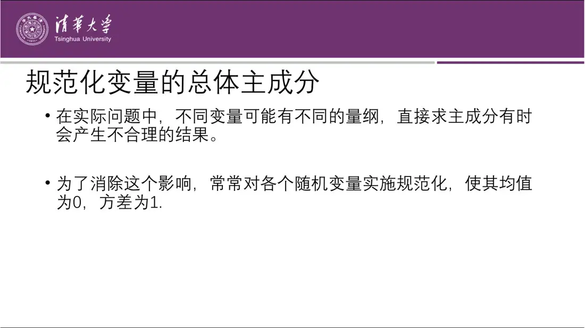

原文：

规范化变量的总体主成分

\- 在实际问题中，不同变量可能有不同的量纲，直接求主成分有时会产生不合理的结果。

\- 为了消除这个影响，常常对各个随机变量实施规范化，使其均值为0，方差为1.

Tsinghua University
清華大學
1911-1911

### 规范化变量的总体主成分

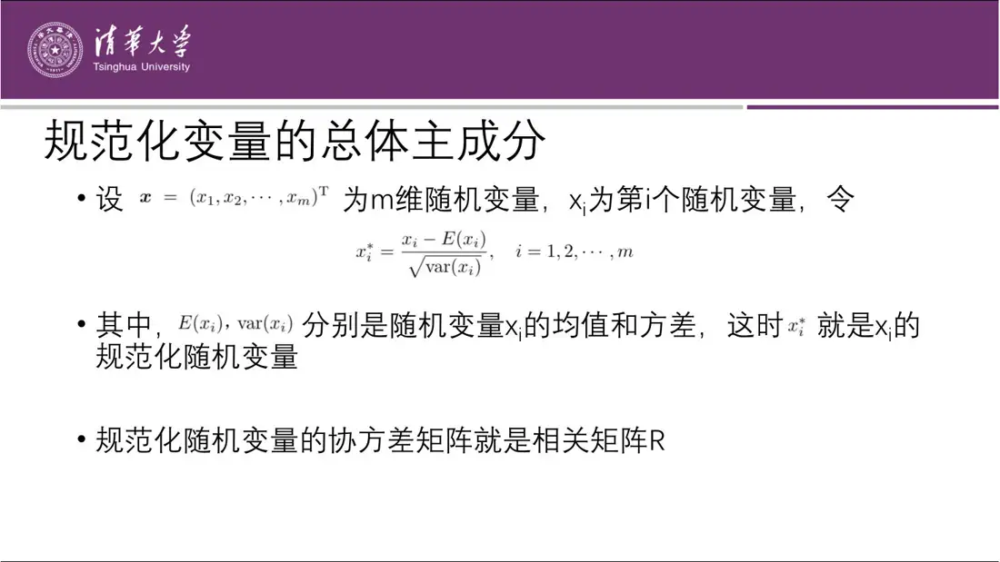

原文：

规范化变量的总体主成分

\- 设 $x = (x_{1}, x_{2}, \cdots, x_{m})^{\mathrm{T}}$ 为 m 维随机变量， $x_{i}$ 为第 i 个随机变量，令

$$
x _ {i} ^ {*} = \frac {x _ {i} - E (x _ {i})}{\sqrt {\operatorname{var} (x _ {i})}}, \quad i = 1, 2, \dots , m
$$

\- 其中， $E(x_{i}), \mathrm{var}(x_{i})$ 分别是随机变量 $x_{i}$ 的均值和方差，这时 $x_{i}^{*}$ 就是 $x_{i}$ 的规范化随机变量

\- 规范化随机变量的协方差矩阵就是相关矩阵R

Tsinghua University
清華大學

### 规范化变量的总体主成分

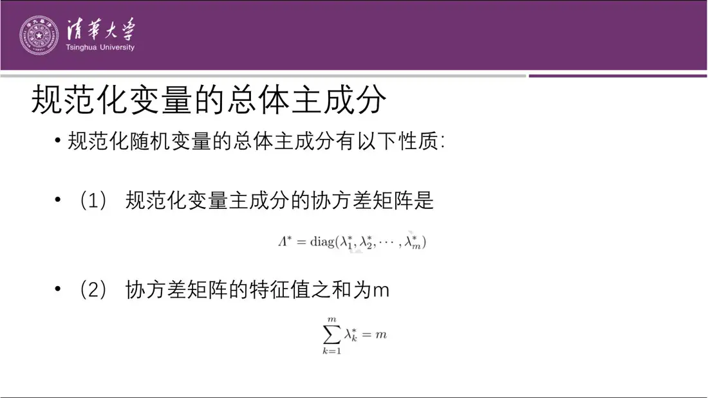

原文：

规范化变量的总体主成分

\- 规范化随机变量的总体主成分有以下性质:

• (1) 规范化变量主成分的协方差矩阵是

$$
\varLambda^ {*} = \mathrm{diag} (\lambda_ {1} ^ {*}, \lambda_ {2} ^ {*}, \dots , \lambda_ {m} ^ {*})
$$

(2) 协方差矩阵的特征值之和为m

$$
\sum_ {k = 1} ^ {m} \lambda_ {k} ^ {*} = m
$$

Tsinghua University
清華大學

### 规范化变量的总体主成分

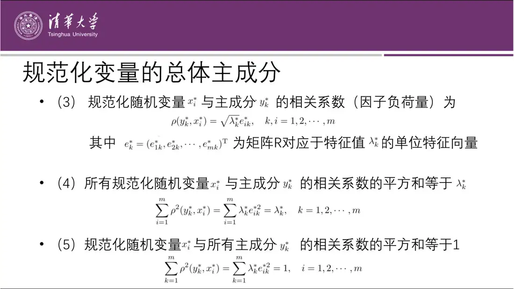

原文：

规范化变量的总体主成分

• (3) 规范化随机变量 $x_{i}^{*}$ 与主成分 $y_{k}^{*}$ 的相关系数（因子负荷量）为

$$
\rho (y _ {k} ^ {*}, x _ {i} ^ {*}) = \sqrt {\lambda_ {k} ^ {*}} e _ {i k} ^ {*}, \quad k, i = 1, 2, \dots , m
$$

其中 $e_k^* = (e_{1k}^*, e_{2k}^*, \dots, e_{mk}^*)^{\mathrm{T}}$ 为矩阵R对应于特征值 $\lambda_k^*$ 的单位特征向量

• (4) 所有规范化随机变量 $x_{i}^{*}$ 与主成分 $y_{k}^{*}$ 的相关系数的平方和等于 $\lambda_{k}^{*}$

$$
\sum_ {i = 1} ^ {m} \rho^ {2} (y _ {k} ^ {*}, x _ {i} ^ {*}) = \sum_ {i = 1} ^ {m} \lambda_ {k} ^ {*} e _ {i k} ^ {* 2} = \lambda_ {k} ^ {*}, \quad k = 1, 2, \dots , m
$$

• (5) 规范化随机变量 $x_{i}^{*}$ 与所有主成分 $\cdot y_{k}^{*}$ 的相关系数的平方和等于1

$$
\sum_ {k = 1} ^ {m} \rho^ {2} (y _ {k} ^ {*}, x _ {i} ^ {*}) = \sum_ {k = 1} ^ {m} \lambda_ {k} ^ {*} e _ {i k} ^ {* 2} = 1, i = 1, 2, \dots , m
$$

清華大學 Tsinghua University

### 样本主成分分析

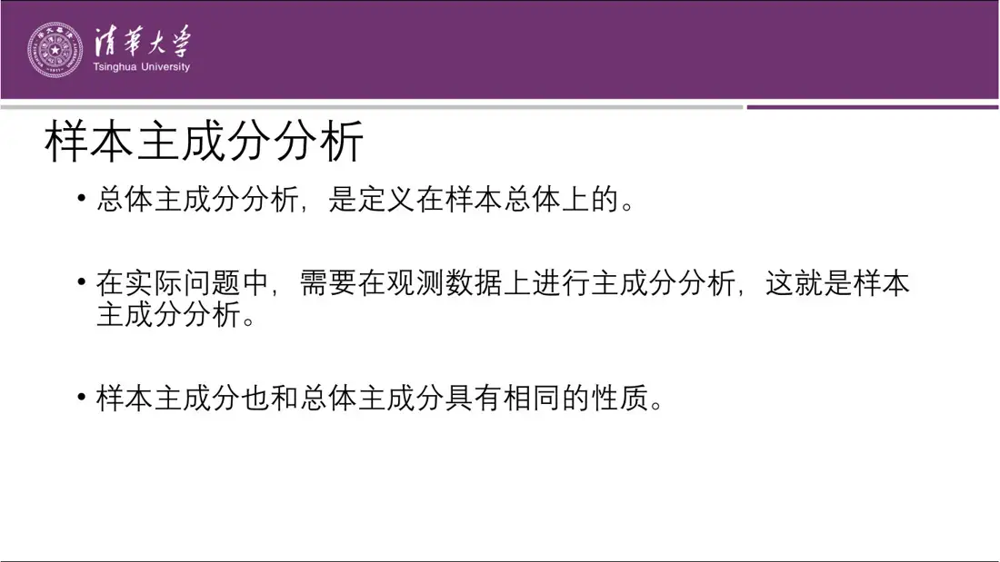

原文：

样本主成分分析

\- 总体主成分分析，是定义在样本总体上的。

\- 在实际问题中，需要在观测数据上进行主成分分析，这就是样本主成分分析。

\- 样本主成分也和总体主成分具有相同的性质。

Tsinghua University
清華大學

### 样本主成分的定义和性质

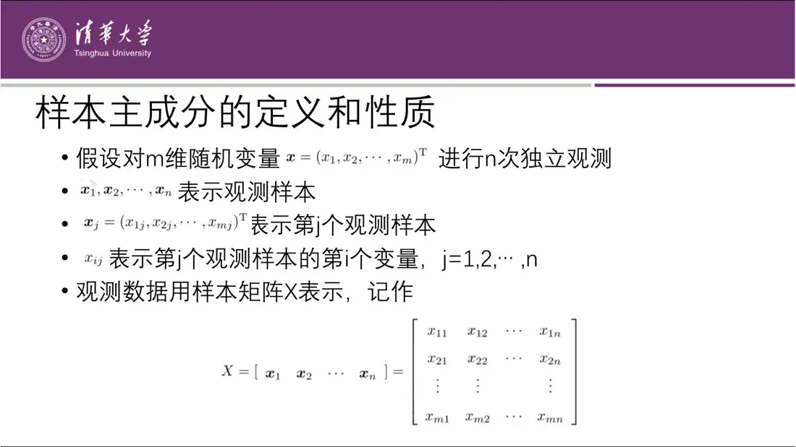

原文：

样本主成分的定义和性质

\- 假设对m维随机变量 $x = (x_{1}, x_{2}, \cdots, x_{m})^{\mathrm{T}}$ 进行n次独立观测

\- $x_{1}, x_{2}, \cdots, x_{n}$ 表示观测样本

• $\boldsymbol{x}_{j}=(x_{1j},x_{2j},\cdots,x_{mj})^{\mathrm{T}}$ 表示第j个观测样本

\- $x_{ij}$ 表示第j个观测样本的第i个变量， $j=1,2,\cdots,n$

\- 观测数据用样本矩阵X表示，记作

$$
X = \left[ \begin{array}{l l l l} \boldsymbol {x} _ {1} & \boldsymbol {x} _ {2} & \dots & \boldsymbol {x} _ {n} \end{array} \right] = \left[ \begin{array}{c c c c} x _ {1 1} & x _ {1 2} & \dots & x _ {1 n} \\ x _ {2 1} & x _ {2 2} & \dots & x _ {2 n} \\ \vdots & \vdots & & \vdots \\ x _ {m 1} & x _ {m 2} & \dots & x _ {m n} \end{array} \right]
$$

Tsinghua University
清華大學

### 样本主成分的定义和性质

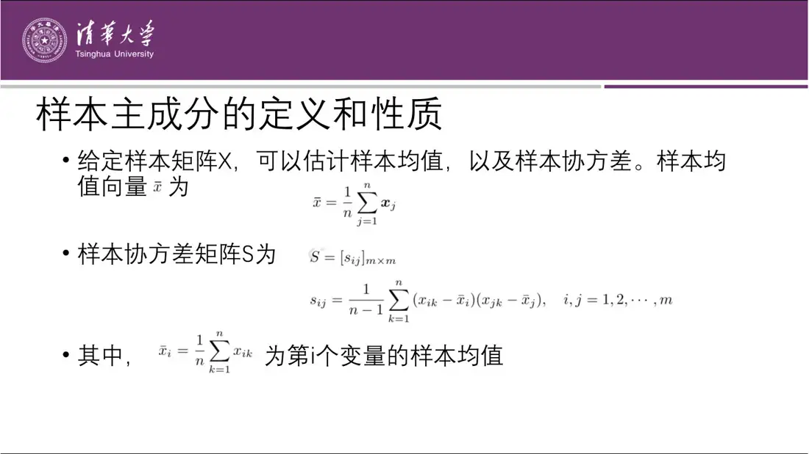

原文：

样本主成分的定义和性质

\- 给定样本矩阵X，可以估计样本均值，以及样本协方差。样本均值向量 $\bar{x}$ 为 $\bar{x} = \frac{1}{n}\sum_{j=1}^{n}x_j$

\- 样本协方差矩阵S为 $S = [s_{ij}]_{m \times m}$

$$
s _ {i j} = \frac {1}{n - 1} \sum_ {k = 1} ^ {n} (x _ {i k} - \bar {x} _ {i}) (x _ {j k} - \bar {x} _ {j}), \quad i, j = 1, 2, \dots , m
$$

\- 其中， $\bar{x}_i = \frac{1}{n} \sum_{k=1}^{n} x_{ik}$ 为第i个变量的样本均值

Tsinghua University
清華大學

### 样本主成分的定义和性质

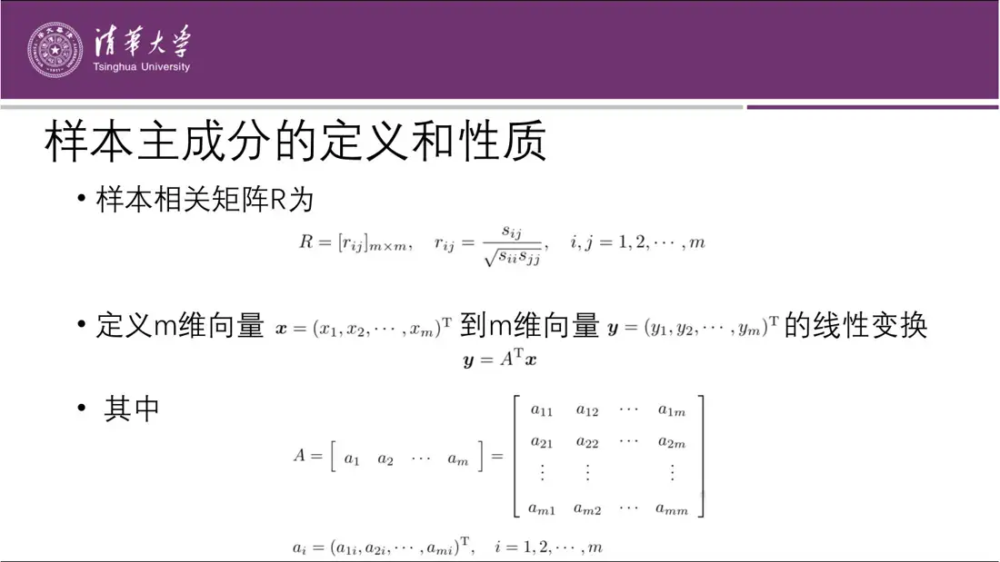

原文：

样本主成分的定义和性质

\- 样本相关矩阵R为

$$
R = [ r _ {i j} ] _ {m \times m}, \quad r _ {i j} = \frac {s _ {i j}}{\sqrt {s _ {i i} s _ {j j}}}, \quad i, j = 1, 2, \dots , m
$$

\- 定义m维向量 $x = (x_{1}, x_{2}, \cdots, x_{m})^{\mathrm{T}}$ 到m维向量 $y = (y_{1}, y_{2}, \cdots, y_{m})^{\mathrm{T}}$ 的线性变换

$$
\pmb {y} = A ^ {\mathrm{T}} \pmb {x}
$$

\- 其中

$$
A = \left[ \begin{array}{l l l l} a _ {1} & a _ {2} & \dots & a _ {m} \end{array} \right] = \left[ \begin{array}{c c c c} a _ {1 1} & a _ {1 2} & \dots & a _ {1 m} \\ a _ {2 1} & a _ {2 2} & \dots & a _ {2 m} \\ \vdots & \vdots & & \vdots \\ a _ {m 1} & a _ {m 2} & \dots & a _ {m m} \end{array} \right]
$$

$$
a _ {i} = (a _ {1 i}, a _ {2 i}, \dots , a _ {m i}) ^ {\mathrm{T}}, \quad i = 1, 2, \dots , m
$$

Tsinghua University
清華大學

### 样本主成分的定义和性质

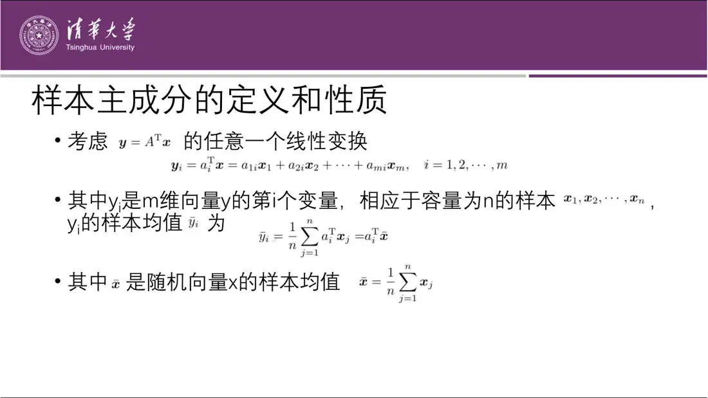

原文：

样本主成分的定义和性质

\- 考虑 $y = A^{\mathrm{T}}x$ 的任意一个线性变换

$$
\boldsymbol {y} _ {i} = a _ {i} ^ {\mathrm{T}} \boldsymbol {x} = a _ {1 i} \boldsymbol {x} _ {1} + a _ {2 i} \boldsymbol {x} _ {2} + \dots + a _ {m i} \boldsymbol {x} _ {m}, \quad i = 1, 2, \dots , m
$$

\- 其中 $y_i$ 是 $m$ 维向量 $y$ 的第 $i$ 个变量，相应于容量为 $n$ 的样本 $x_1, x_2, \cdots, x_n$ ， $y_i$ 的样本均值 $\bar{y}_i$ 为 $\bar{y}_i = \frac{1}{n} \sum_{j=1}^{n} a_i^T x_j = a_i^T \bar{x}$

\- 其中 $\bar{x}$ 是随机向量x的样本均值 $\bar{x} = \frac{1}{n}\sum_{j=1}^{n}x_j$

Tsinghua University
清華大學

### 样本主成分的定义和性质

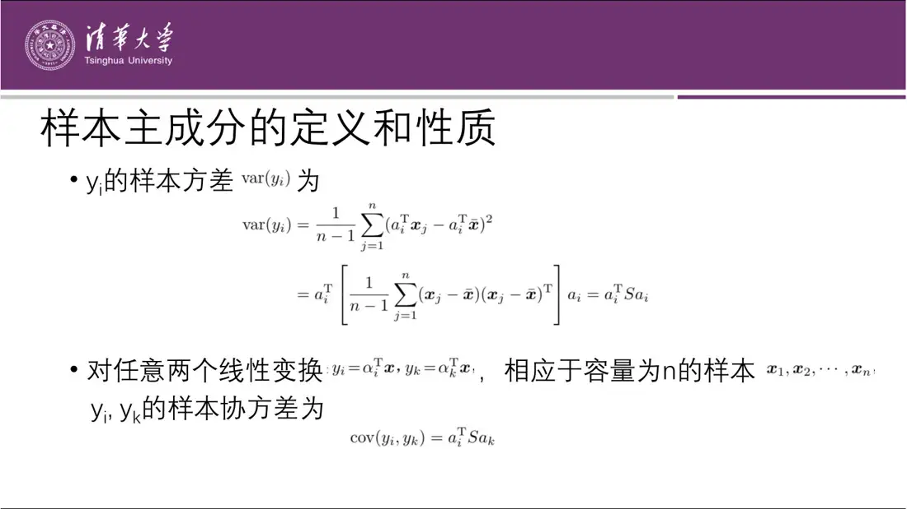

原文：

样本主成分的定义和性质

\- $y_{i}$ 的样本方差 $\operatorname{var}(y_i)$ 为

$$
\begin{array}{r l} & {\mathrm{var} (y _ {i}) = \frac {1}{n - 1} \sum_ {j = 1} ^ {n} (a _ {i} ^ {\mathrm{T}} \pmb {x} _ {j} - a _ {i} ^ {\mathrm{T}} \bar {\pmb {x}}) ^ {2}} \\ & {\qquad = a _ {i} ^ {\mathrm{T}} \left[ \frac {1}{n - 1} \sum_ {j = 1} ^ {n} (\pmb {x} _ {j} - \bar {\pmb {x}}) (\pmb {x} _ {j} - \bar {\pmb {x}}) ^ {\mathrm{T}} \right] a _ {i} = a _ {i} ^ {\mathrm{T}} S a _ {i}} \end{array}
$$

\- 对任意两个线性变换: $y_i = \alpha_i^{\mathrm{T}} x, y_k = \alpha_k^{\mathrm{T}} x$ ，相应于容量为n的样本 $x_1, x_2, \cdots, x_n$ ； $y_i, y_k$ 的样本协方差为

$$
\operatorname{cov} (y _ {i}, y _ {k}) = a _ {i} ^ {\mathrm{T}} S a _ {k}
$$

Tsinghua University
清華大學

### 样本主成分的定义和性质

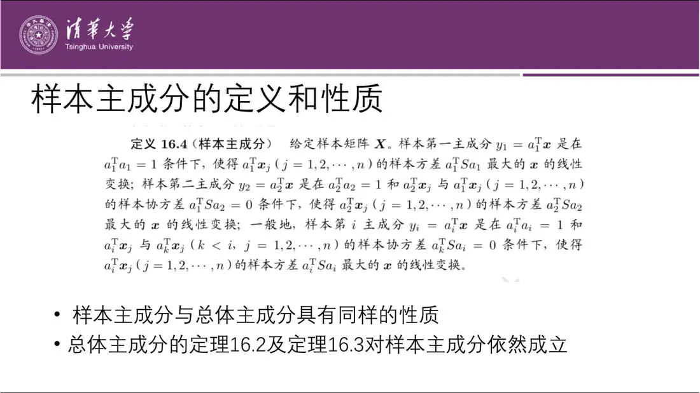

原文：

样本主成分的定义和性质

定义 16.4（样本主成分） 给定样本矩阵 X。样本第一主成分 $y_{1}=a_{1}^{T}x$ 是在 $a_{1}^{T}a_{1}=1$ 条件下，使得 $a_{1}^{T}x_{j}(j=1,2,\cdots,n)$ 的样本方差 $a_{1}^{T}Sa_{1}$ 最大的 x 的线性变换；样本第二主成分 $y_{2}=a_{2}^{T}x$ 是在 $a_{2}^{T}a_{2}=1$ 和 $a_{2}^{T}x_{j}$ 与 $a_{1}^{T}x_{j}(j=1,2,\cdots,n)$ 的样本协方差 $a_{1}^{T}Sa_{2}=0$ 条件下，使得 $a_{2}^{T}x_{j}(j=1,2,\cdots,n)$ 的样本方差 $a_{2}^{T}Sa_{2}$ 最大的 x 的线性变换；一般地，样本第 i 主成分 $y_{i}=a_{i}^{T}x$ 是在 $a_{i}^{T}a_{i}=1$ 和 $a_{i}^{T}x_{j}$ 与 $a_{k}^{T}x_{j}(k<i,j=1,2,\cdots,n)$ 的样本协方差 $a_{k}^{T}Sa_{i}=0$ 条件下，使得 $a_{i}^{T}x_{j}(j=1,2,\cdots,n)$ 的样本方差 $a_{i}^{T}Sa_{i}$ 最大的 x 的线性变换。

\- 样本主成分与总体主成分具有同样的性质

\- 总体主成分的定理16.2及定理16.3对样本主成分依然成立

Tsinghua University
清華大學

### 样本主成分的定义和性质

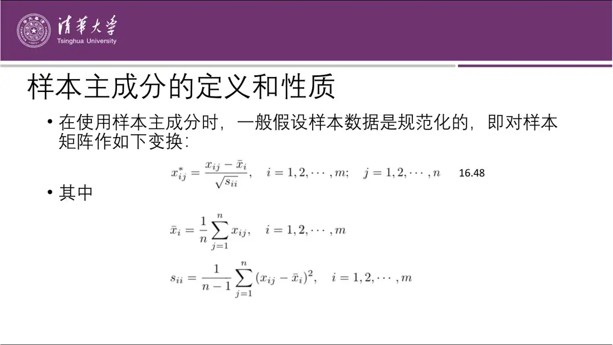

原文：

样本主成分的定义和性质

\- 在使用样本主成分时，一般假设样本数据是规范化的，即对样本矩阵作如下变换：

$$
x _ {i j} ^ {*} = \frac {x _ {i j} - \bar {x} _ {i}}{\sqrt {s _ {i i}}}, \quad i = 1, 2, \dots , m; \quad j = 1, 2, \dots , n \tag {16.48}
$$

\- 其中

$$
\bar {x} _ {i} = \frac {1}{n} \sum_ {j = 1} ^ {n} x _ {i j}, \quad i = 1, 2, \dots , m
$$

$$
s _ {i i} = \frac {1}{n - 1} \sum_ {j = 1} ^ {n} (x _ {i j} - \bar {x} _ {i}) ^ {2}, \quad i = 1, 2, \dots , m
$$

清華大學 Tsinghua University

### 样本主成分的定义和性质

原文：

样本主成分的定义和性质

\- 为了方便，以下将规范化变量 $x_{ij}^{*}$ 每仍记作 $x_{ij}$ ，规范化的样本矩阵仍记作X。这时，样本协方差矩阵S就是样本相关矩阵R

$$
R = \frac {1}{n - 1} X X ^ {\mathrm{T}}
$$

\- 样本协方差矩阵S是总体协方差矩阵 $\Sigma$ 的无偏估计

\- 样本相关矩阵R是总体相关矩阵的无偏估计

\- S的特征值和特征向量是 $\Sigma$ 的特征值和特征向量的极大似然估计。

Tsinghua University
清華大學

### 相关矩阵的特征值分解算法

原文：

相关矩阵的特征值分解算法

\- 给定样本矩阵X，利用数据的样本协方差矩阵或者样本相关矩阵的特征值分解进行主成分分析。具体步骤如下：

• (1) 对观测数据按式(16.48)进行规范化处理，得到规范化数据矩阵，仍以X表示

Tsinghua University
清華大學
1911-1911

### 相关矩阵的特征值分解算法

原文：

相关矩阵的特征值分解算法

• (2) 依据规范化数据矩阵，计算样本相关矩阵R

$$
R = [ r _ {i j} ] _ {m \times m} = \frac {1}{n - 1} X X ^ {\mathrm{T}}
$$

\- 其中

$$
r _ {i j} = \frac {1}{n - 1} \sum_ {l = 1} ^ {n} x _ {i l} x _ {l j}, i, j = 1, 2, \dots , m
$$

清華大學 Tsinghua University

### 相关矩阵的特征值分解算法

原文：

相关矩阵的特征值分解算法

(3) 求样本相关矩阵R的k个特征值和对应的k个单位特征向量

\- 求解R的特征方程 $|R - \lambda I| = 0$

\- 得R的m个特征值 $\lambda_{1} \geqslant \lambda_{2} \geqslant \dots \geqslant \lambda_{m}$

\- 求方差贡献率 $\sum_{i=1}^{k} \eta_i$ 达到预定值的主成分个数 $k$

\- 求前k个特征值对应的单位特征向量 $a_{i} = (a_{1i}, a_{2i}, \dots, a_{mi})^{\mathrm{T}}, i = 1, 2, \dots, k$

Tsinghua University
清華大學

### 相关矩阵的特征值分解算法

原文：

相关矩阵的特征值分解算法

• (4) 求k个样本主成分

\- 以k个单位特征向量为系数进行线性变换，求出k个样本主成分

$$
y _ {i} = a _ {i} ^ {\mathrm{T}} \boldsymbol {x}, \quad i = 1, 2, \dots , k
$$

• (5) 计算k个主成分 $y_{i}$ 与原变量 $x_{i}$ 的相关系数 $\rho(x_{i}, y_{j})$ ，以及k个主成分对原变量 $x_{i}$ 的贡献率 $v_{i}$ 。

清華大學 Tsinghua University

### 相关矩阵的特征值分解算法

原文：

相关矩阵的特征值分解算法

• (6) 计算n个样本的k个主成分值

\- 将规范化样本数据代入k个主成分式 $y_{i} = a_{i}^{\mathrm{T}}\boldsymbol{x},\quad i = 1,2,\dots ,k$

\- 得到n个样本的主成分值

\- 第j个样本 $x_{j} = (x_{1j}, x_{2j}, \cdots, x_{mj})^{\mathrm{T}}$ 的第i主成分值是

$$
\begin{array}{c} {y _ {i j} = (a _ {1 i}, a _ {2 i}, \dots , a _ {m i}) (x _ {1 j}, x _ {2 j}, \dots , x _ {m j}) ^ {\mathrm{T}} =  \sum_ {l = 1} ^ {m} a _ {l i} x _ {l j}} \\ {i = 1, 2, \dots , m, \quad j = 1, 2, \dots , n} \end{array}
$$

Tsinghua University
清華大學

### \- 试对数据进行主成分分析

原文：

例

\- 假设有n个学生参加四门课程的考试，将学生们的考试成绩看作随机变量的取值，对考试成绩数据进行标准化处理，得到样本相关矩阵R

<table><tr><td>课程</td><td>语文</td><td>外语</td><td>数学</td><td>物理</td></tr><tr><td>语文</td><td>1</td><td>0.44</td><td>0.29</td><td>0.33</td></tr><tr><td>外语</td><td>0.44</td><td>1</td><td>0.35</td><td>0.32</td></tr><tr><td>数学</td><td>0.29</td><td>0.35</td><td>1</td><td>0.60</td></tr><tr><td>物理</td><td>0.33</td><td>0.32</td><td>0.60</td><td>1</td></tr></table>

\- 试对数据进行主成分分析

Tsinghua University
清華大學
1911-UNIVERSITY

### $$

原文：

例

\- 设变量 $x_{1}, x_{2}, x_{3}, x_{4}$ 分别表示语文、外语、数学、物理的成绩。对样本相关矩阵进行特征值分解，得到相关矩阵的特征值，并按大小排序，

$$
\lambda_ {1} = 2. 1 7, \quad \lambda_ {2} = 0. 8 7, \quad \lambda_ {3} = 0. 5 7, \quad \lambda_ {4} = 0. 3 9
$$

\- 这些特征值就是各主成分的方差贡献率。假设要求主成分的累计方差贡献率大于 $75\%$ ，那么只需取前两个主成分即可，即 $k = 2$ ，因为

$$
\frac {\lambda_ {1} + \lambda_ {2}}{\sum_ {i = 1} ^ {4} \lambda_ {i}} = 0. 7 6
$$

Tsinghua University
清華大學

### $$

原文：

例

\- 求出对应于特征值 $\lambda_1, \lambda_2$ 的单位特征向量

<table><tr><td>项目</td><td> $x_1$ </td><td> $x_2$ </td><td> $x_3$ </td><td> $x_4$ </td><td>方差贡献率</td></tr><tr><td> $y_1$ </td><td>0.460</td><td>0.476</td><td>0.523</td><td>0.537</td><td>0.543</td></tr><tr><td> $y_2$ </td><td>0.574</td><td>0.486</td><td>-0.476</td><td>-0.456</td><td>0.218</td></tr></table>

\- 由 $y_{i} = a_{i}^{\mathrm{T}}\pmb{x}, i = 1,2,\dots ,k$ 可得第一主成分 $\mathsf{y}_1$ 、第二主成分 $\mathsf{y}_2$

$$
y _ {1} = 0. 4 6 0 x _ {1} + 0. 4 7 6 x _ {2} + 0. 5 2 3 x _ {3} + 0. 5 3 7 x _ {4}
$$

$$
y _ {2} = 0. 5 7 4 x _ {1} + 0. 4 8 6 x _ {2} - 0. 4 7 6 x _ {3} - 0. 4 5 6 x _ {4}
$$

清華大學 Tsinghua University

### 清華大學 Tsinghua University

原文：

例

\- 接下来由特征值和单位特征向量求出第一、第二主成分的因子负荷量，以及第一、第二主成分对变量 $x_{i}$ 的贡献率

<table><tr><td>项目</td><td> $x_1$ </td><td> $x_2$ </td><td> $x_3$ </td><td> $x_4$ </td></tr><tr><td> $y_1$ </td><td>0.678</td><td>0.701</td><td>0.770</td><td>0.791</td></tr><tr><td> $y_2$ </td><td>0.536</td><td>0.453</td><td>-0.444</td><td>-0.425</td></tr><tr><td> $y_{1},y_{2}$ 对 $x_i$ 的贡献率</td><td>0.747</td><td>0.697</td><td>0.790</td><td>0.806</td></tr></table>

清華大學 Tsinghua University

### \- 也就是说，第一主成分 $y_1$ 反映了学生的整体成绩

原文：

例

\- 第一主成分 $y_1$ 对应的因子负荷量 $\rho(y_1, x_i), i = 1, 2, 3, 4$ ，均为正数，表明各门课程成绩提高都可使 $y_1$ 提高

\- 也就是说，第一主成分 $y_1$ 反映了学生的整体成绩

\- 因子负荷量的数值相近，且 $\rho(y_1, x_4)$ 的数值最大，这表明物理成绩在整体成绩中占最重要位置

<table><tr><td>项目</td><td> $x_1$ </td><td> $x_2$ </td><td> $x_3$ </td><td> $x_4$ </td></tr><tr><td> $y_1$ </td><td>0.678</td><td>0.701</td><td>0.770</td><td>0.791</td></tr><tr><td> $y_2$ </td><td>0.536</td><td>0.453</td><td>-0.444</td><td>-0.425</td></tr><tr><td> $y_{1},y_{2}$ 对 $x_i$ 的贡献率</td><td>0.747</td><td>0.697</td><td>0.790</td><td>0.806</td></tr></table>

Tsinghua University
清華大學

### \- 正的是语文和外语，负的是数学和物理

原文：

例

\- 第二主成分 $y_2$ 对应的因子负荷量 $\rho(y_2, x_i), i = 1, 2, 3, 4$ ，有正有负

\- 正的是语文和外语，负的是数学和物理

\- 表明文科成绩提高都可使 $y_2$ 提高，理科成绩提高都可使 $y_2$ 降低

\- 也就是说，第二主成分 $y_2$ 反映了学生的文科成绩与理科成绩的关系。

<table><tr><td>项目</td><td> $x_1$ </td><td> $x_2$ </td><td> $x_3$ </td><td> $x_4$ </td></tr><tr><td> $y_1$ </td><td>0.678</td><td>0.701</td><td>0.770</td><td>0.791</td></tr><tr><td> $y_2$ </td><td>0.536</td><td>0.453</td><td>-0.444</td><td>-0.425</td></tr><tr><td> $y_{1},y_{2}$ 对 $x_i$ 的贡献率</td><td>0.747</td><td>0.697</td><td>0.790</td><td>0.806</td></tr></table>

Tsinghua University
清華大學

### Tsinghua University

原文：

例

\- 将原变量 $x_{1}, x_{2}, x_{3}, x_{4}$ （语文、外语、数学、物理）和主成分 $y_{1}, y_{2}$ （整体成绩、文科对理科成绩）的因子负荷量在平面坐标系中表示。

\- 4个原变量聚成了两类因子负荷量相近的语文、外语为一类，数学、物理为一类，前者反映文科课程成绩，后者反映理科课程成绩。

Tsinghua University
清華大學

### 数据矩阵的奇异值分解算法

原文：

数据矩阵的奇异值分解算法

\- 假设有k个主成分，给定样本矩阵x，利用数据矩阵奇异值分解进行主成分分析

\- 对于 $m \times n$ 实矩阵A，假设其秩为r， $0 < k < r$ ，则可以将矩阵A进行截断奇异值分解

$$
A \approx U _ {k} \Sigma_ {k} V _ {k} ^ {\mathrm{T}}
$$

Tsinghua University
清華大學

### 数据矩阵的奇异值分解算法

原文：

数据矩阵的奇异值分解算法

\- 定义一个新的 n×m 矩阵X' $X^{\prime} = \frac{1}{\sqrt{n - 1}} X^{\mathrm{T}}$

\- $X'$ 的每一列均值为0，得

$$
\begin{array}{r l} & X ^ {\mathrm{T}} X ^ {\prime} = \left(\frac {1}{\sqrt {n - 1}} X ^ {\mathrm{T}}\right) ^ {\mathrm{T}} \left(\frac {1}{\sqrt {n - 1}} X ^ {\mathrm{T}}\right) \\ & \qquad = \frac {1}{n - 1} X X ^ {\mathbf {T}} \end{array}
$$

\- 即 $X^{\prime \top} X^{\prime}$ 等于 $X$ 的协方差矩阵 $S_{X}$

$$
S _ {X} = X ^ {\prime \mathbf {T}} X ^ {\prime}
$$

Tsinghua University
清華大學

### 数据矩阵的奇异值分解算法

原文：

数据矩阵的奇异值分解算法

\- 主成分分析归结于求协方差矩阵 $S_{X}$ 的特征值和对应的单位特征向量

\- 问题转化为求矩阵 $X^{\prime \mathrm{T}} X^{\prime}$ 的特征值和对应的单位特征向量

\- 假设 $X'$ 的截断奇异值分解为 $X' = U\Sigma V^{\mathrm{T}}$ ，那么V的列向量就是 $S_X = X'^{\mathrm{T}}X'$ 的单位特征向量

\- 因此，V的列向量就是X的主成分

\- 于是，求X主成分可以通过求X'的奇异值分解来实现。

Tsinghua University
清華大學

### 主要成分分析算法

原文：

主要成分分析算法

输入： $m \times n$ 样本矩阵 X，其每一行元素的均值为零；

输出： $k \times n$ 样本主成分矩阵 Y。

参数：主成分个数 $k$

(1) 构造新的 $n \times m$ 矩阵

$$
X ^ {\prime} = \frac {1}{\sqrt {n - 1}} X ^ {\mathbf {T}}
$$

$X'$ 每一列的均值为零。

(2) 对矩阵 $X'$ 进行截断奇异值分解, 得到

$$
X ^ {\prime} = U \Sigma V ^ {\mathrm{T}}
$$

有 k 个奇异值、奇异向量。矩阵 V 的前 k 列构成 k 个样本主成分。

(3) 求 $k \times n$ 样本主成分矩阵

$$
Y = V ^ {\mathrm{T}} X
$$

清華大學 Tsinghua University
