# 《统计学习方法》第2版 第17章 潜在语义分析（课件）

原件的每一页，下面附识别出的文字。

### 第十七章 潜在语义分析

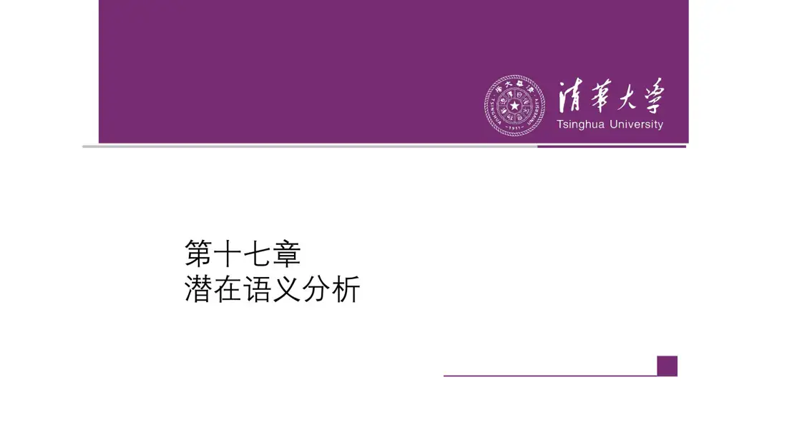

原文：

第十七章 潜在语义分析

大華洋
TSINGHUA UNIVERSITY
清華大學
Tsinghua University

### 潜在语义分析

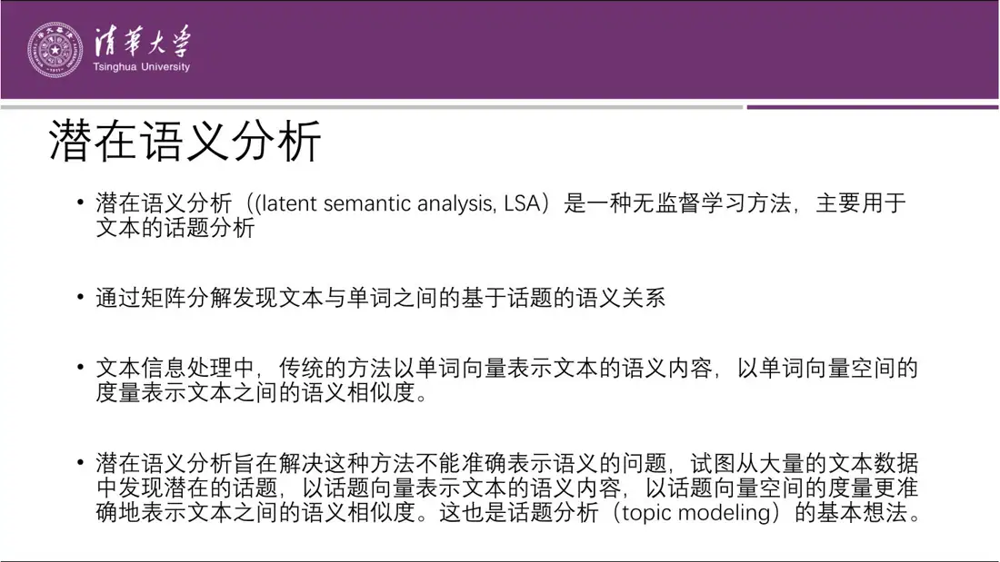

原文：

潜在语义分析

\- 潜在语义分析（(latent semantic analysis, LSA）是一种无监督学习方法，主要用于文本的话题分析

\- 通过矩阵分解发现文本与单词之间的基于话题的语义关系

\- 文本信息处理中，传统的方法以单词向量表示文本的语义内容，以单词向量空间的度量表示文本之间的语义相似度。

\- 潜在语义分析旨在解决这种方法不能准确表示语义的问题，试图从大量的文本数据中发现潜在的话题，以话题向量表示文本的语义内容，以话题向量空间的度量更准确地表示文本之间的语义相似度。这也是话题分析（topic modeling）的基本想法。

Tsinghua University
清華大學

### 潜在语义分析

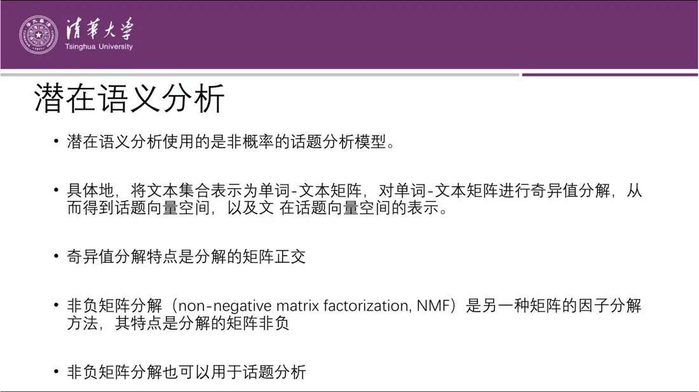

原文：

潜在语义分析

\- 潜在语义分析使用的是非概率的话题分析模型。

\- 具体地，将文本集合表示为单词-文本矩阵，对单词-文本矩阵进行奇异值分解，从而得到话题向量空间，以及文在话题向量空间的表示。

\- 奇异值分解特点是分解的矩阵正交

\- 非负矩阵分解（non-negative matrix factorization, NMF）是另一种矩阵的因子分解方法，其特点是分解的矩阵非负

\- 非负矩阵分解也可以用于话题分析

Tsinghua University
清華大學

### 单词向量空间

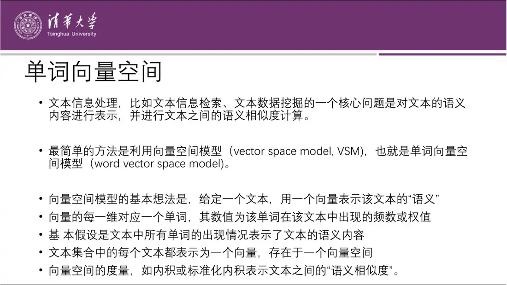

原文：

单词向量空间

\- 文本信息处理，比如文本信息检索、文本数据挖掘的一个核心问题是对文本的语义内容进行表示，并进行文本之间的语义相似度计算。

\- 最简单的方法是利用向量空间模型（vector space model, VSM），也就是单词向量空间模型（word vector space model）。

\- 向量空间模型的基本想法是，给定一个文本，用一个向量表示该文本的“语义”

\- 向量的每一维对应一个单词，其数值为该单词在该文本中出现的频数或权值

\- 基本假设是文本中所有单词的出现情况表示了文本的语义内容

\- 文本集合中的每个文本都表示为一个向量，存在于一个向量空间

\- 向量空间的度量，如内积或标准化内积表示文本之间的“语义相似度”。

Tsinghua University
清華大學
1911-1911

### 单词向量空间

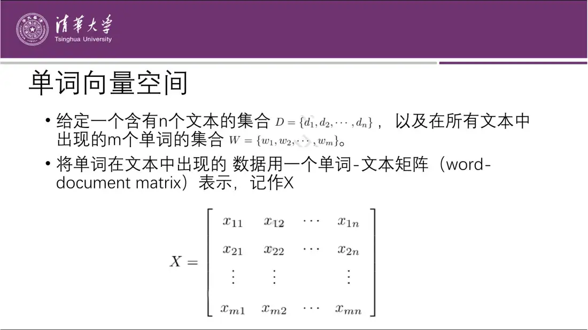

原文：

单词向量空间

\- 给定一个含有n个文本的集合 $D = \{d_1, d_2, \cdots, d_n\}$ ，以及在所有文本中出现的m个单词的集合 $W = \{w_1, w_2, \cdots, w_m\}$ 。

\- 将单词在文本中出现的数据用一个单词-文本矩阵（word-document matrix）表示，记作X

$$
X = \left[ \begin{array}{c c c c} x _ {1 1} & x _ {1 2} & \dots & x _ {1 n} \\ x _ {2 1} & x _ {2 2} & \dots & x _ {2 n} \\ \vdots & \vdots & & \vdots \\ x _ {m 1} & x _ {m 2} & \dots & x _ {m n} \end{array} \right]
$$

Tsinghua University
清華大學

### 单词向量空间

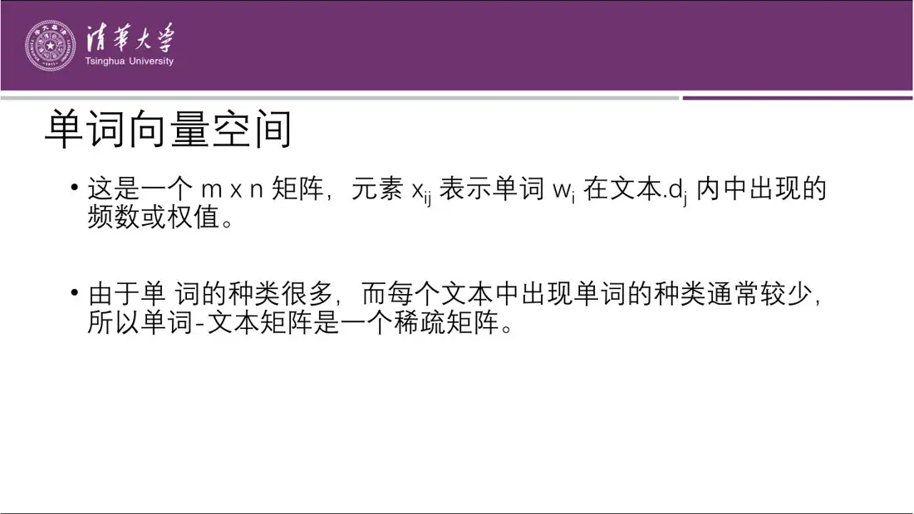

原文：

单词向量空间

\- 这是一个 $m \times n$ 矩阵，元素 $x_{ij}$ 表示单词 $w_i$ 在文本. $d_j$ 内中出现的频数或权值。

\- 由于单词的种类很多，而每个文本中出现单词的种类通常较少，所以单词-文本矩阵是一个稀疏矩阵。

清華大學 Tsinghua University

### 单词向量空间

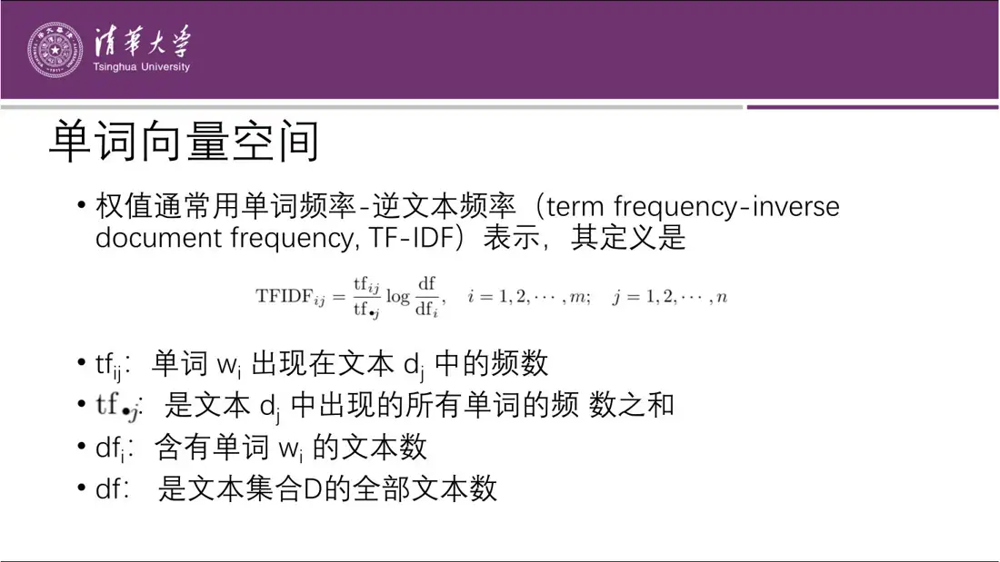

原文：

单词向量空间

\- 权值通常用单词频率-逆文本频率（term frequency-inverse document frequency, TF-IDF）表示，其定义是

$$
\mathrm{TFIDF} _ {i j} = \frac {\mathrm{tf} _ {i j}}{\mathrm{tf} _ {\bullet j}} \log \frac {\mathrm{df}}{\mathrm{df} _ {i}}, \quad i = 1, 2, \dots , m; \quad j = 1, 2, \dots , n
$$

\- $tf_{ij}$ : 单词 $w_i$ 出现在文本 $d_j$ 中的频数

\- tf $_{j}$ : 是文本 d $_{i}$ 中出现的所有单词的频数之和

\- df $_i$ : 含有单词 w $_i$ 的文本数

\- df: 是文本集合D的全部文本数

Tsinghua University
清華大學

### 单词向量空间

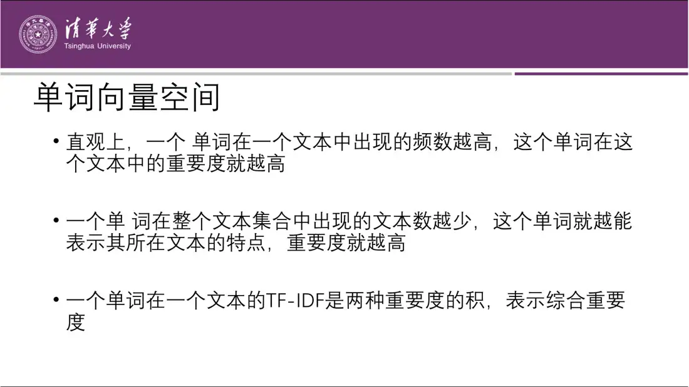

原文：

单词向量空间

\- 直观上，一个单词在一个文本中出现的频数越高，这个单词在这个文本中的重要度就越高

\- 一个单词在整个文本集合中出现的文本数越少，这个单词就越能表示其所在文本的特点，重要度就越高

\- 一个单词在一个文本的TF-IDF是两种重要度的积，表示综合重要度

清華大學 Tsinghua University

### 单词向量空间

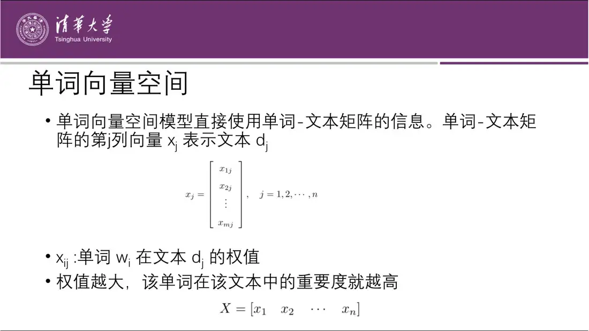

原文：

单词向量空间

\- 单词向量空间模型直接使用单词-文本矩阵的信息。单词-文本矩阵的第j列向量 $x_{j}$ 表示文本 $d_{j}$

$$
x _ {j} = \left[ \begin{array}{c} x _ {1 j} \\ x _ {2 j} \\ \vdots \\ x _ {m j} \end{array} \right], \quad j = 1, 2, \dots , n
$$

\- $x_{ij}$ : 单词 $w_i$ 在文本 $d_j$ 的权值

\- 权值越大，该单词在该文本中的重要度就越高

$$
X = \left[ \begin{array}{c c c c} x _ {1} & x _ {2} & \dots & x _ {n} \end{array} \right]
$$

Tsinghua University
清華大學

### 单词向量空间

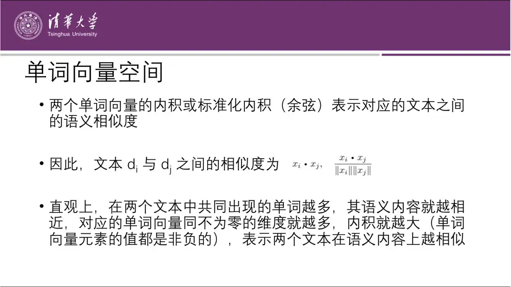

原文：

单词向量空间

\- 两个单词向量的内积或标准化内积（余弦）表示对应的文本之间的语义相似度

\- 因此，文本 $d_{i}$ 与 $d_{j}$ 之间的相似度为 $x_{i} \cdot x_{j}, \frac{x_{i} \cdot x_{j}}{\|x_{i}\|\|x_{j}\|}$

\- 直观上，在两个文本中共同出现的单词越多，其语义内容就越相近，对应的单词向量同不为零的维度就越多，内积就越大（单词向量元素的值都是非负的），表示两个文本在语义内容上越相似

Tsinghua University
清華大學

### 单词向量空间

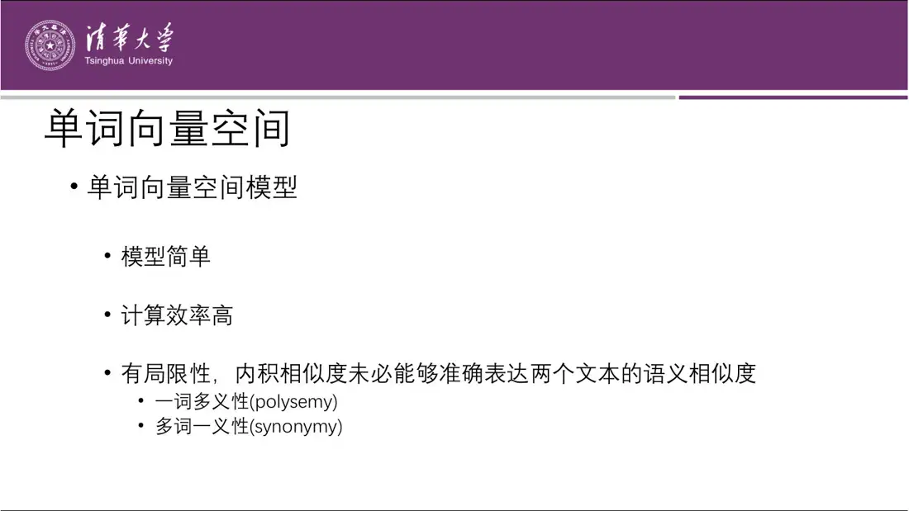

原文：

单词向量空间

\- 单词向量空间模型

\- 模型简单

\- 计算效率高

\- 有局限性，内积相似度未必能够准确表达两个文本的语义相似度
- 一词多义性(polysemy)
- 多词一义性(synonymy)

Tsinghua University
清華大學
1911-1911

### Tsinghua University

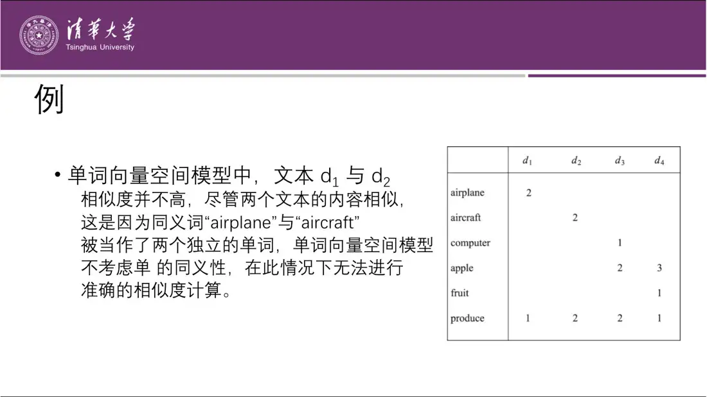

原文：

例

\- 单词向量空间模型中，文本 $d_{1}$ 与 $d_{2}$ 相似度并不高，尽管两个文本的内容相似，这是因为同义词“airplane”与“aircraft”被当作了两个独立的单词，单词向量空间模型不考虑单的同义性，在此情况下无法进行准确的相似度计算。

<table><tr><td></td><td> $d_{1}$ </td><td> $d_{2}$ </td><td> $d_{3}$ </td><td> $d_{4}$ </td></tr><tr><td>airplane</td><td>2</td><td></td><td></td><td></td></tr><tr><td>aircraft</td><td></td><td>2</td><td></td><td></td></tr><tr><td>computer</td><td></td><td></td><td>1</td><td></td></tr><tr><td>apple</td><td></td><td></td><td>2</td><td>3</td></tr><tr><td>fruit</td><td></td><td></td><td></td><td>1</td></tr><tr><td>produce</td><td>1</td><td>2</td><td>2</td><td>1</td></tr></table>

Tsinghua University
清華大學

### Tsinghua University

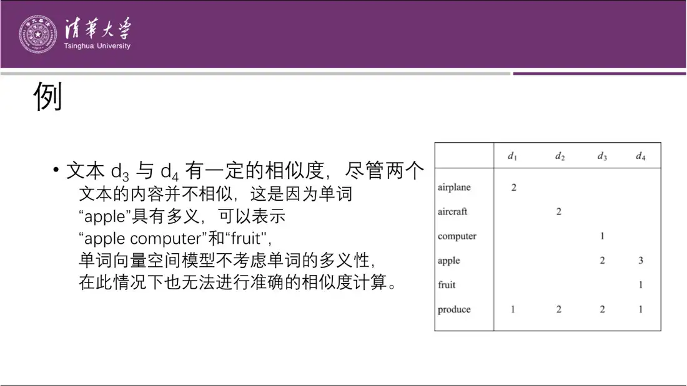

原文：

例

\- 文本 $d_{3}$ 与 $d_{4}$ 有一定的相似度，尽管两个文本的内容并不相似，这是因为单词“apple”具有多义，可以表示“apple computer”和“fruit”，单词向量空间模型不考虑单词的多义性，在此情况下也无法进行准确的相似度计算。

<table><tr><td></td><td> $d_{1}$ </td><td> $d_{2}$ </td><td> $d_{3}$ </td><td> $d_{4}$ </td></tr><tr><td>airplane</td><td>2</td><td></td><td></td><td></td></tr><tr><td>aircraft</td><td></td><td>2</td><td></td><td></td></tr><tr><td>computer</td><td></td><td></td><td>1</td><td></td></tr><tr><td>apple</td><td></td><td></td><td>2</td><td>3</td></tr><tr><td>fruit</td><td></td><td></td><td></td><td>1</td></tr><tr><td>produce</td><td>1</td><td>2</td><td>2</td><td>1</td></tr></table>

Tsinghua University
清華大學

### 话题向量空间

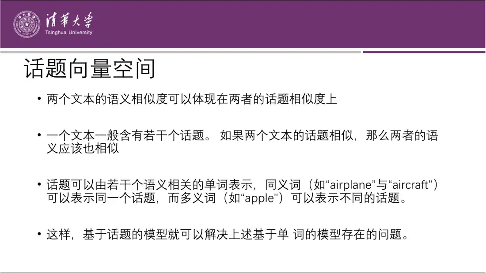

原文：

话题向量空间

\- 两个文本的语义相似度可以体现在两者的话题相似度上

\- 一个文本一般含有若干个话题。如果两个文本的话题相似，那么两者的语义应该也相似

\- 话题可以由若干个语义相关的单词表示，同义词（如“airplane”与“aircraft”）可以表示同一个话题，而多义词（如“apple”）可以表示不同的话题。

\- 这样，基于话题的模型就可以解决上述基于单词的模型存在的问题。

Tsinghua University
清華大學
1911-

### 话题向量空间

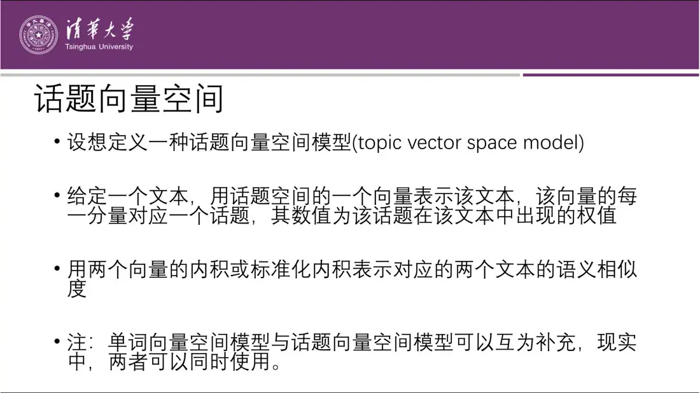

原文：

话题向量空间

\- 设想定义一种话题向量空间模型(topic vector space model)

\- 给定一个文本，用话题空间的一个向量表示该文本，该向量的每一分量对应一个话题，其数值为该话题在该文本中出现的权值

\- 用两个向量的内积或标准化内积表示对应的两个文本的语义相似度

\- 注：单词向量空间模型与话题向量空间模型可以互为补充，现实中，两者可以同时使用。

Tsinghua University
清華大學

### 话题向量空间

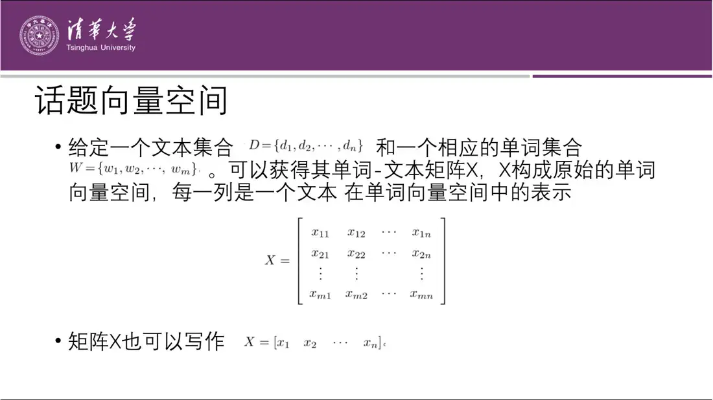

原文：

话题向量空间

\- 给定一个文本集合 $D = \{d_1, d_2, \cdots, d_n\}$ 和一个相应的单词集合 $W = \{w_1, w_2, \cdots, w_m\}$ 。可以获得其单词-文本矩阵X，X构成原始的单词向量空间，每一列是一个文本在单词向量空间中的表示

$$
X = \left[ \begin{array}{c c c c} x _ {1 1} & x _ {1 2} & \dots & x _ {1 n} \\ x _ {2 1} & x _ {2 2} & \dots & x _ {2 n} \\ \vdots & \vdots & & \vdots \\ x _ {m 1} & x _ {m 2} & \dots & x _ {m n} \end{array} \right]
$$

\- 矩阵X也可以写作 $X = [x_{1} x_{2} \cdots x_{n}]$ 。

Tsinghua University
清華大學

### 话题向量空间

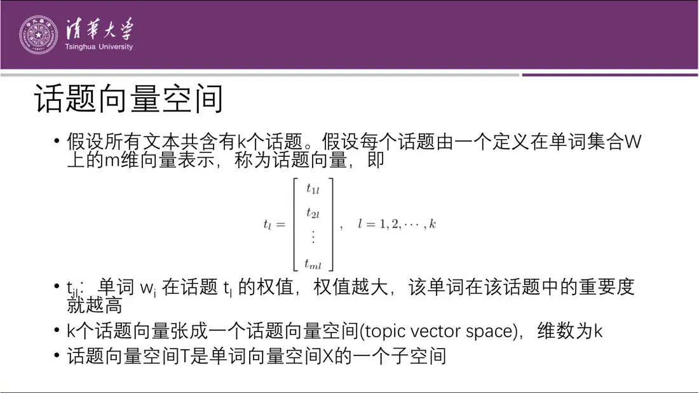

原文：

话题向量空间

\- 假设所有文本共含有k个话题。假设每个话题由一个定义在单词集合W上的m维向量表示，称为话题向量，即

$$
t _ {l} = \left[ \begin{array}{c} t _ {1 l} \\ t _ {2 l} \\ \vdots \\ t _ {m l} \end{array} \right], \quad l = 1, 2, \dots , k
$$

\- $t_{i|}$ : 单词 $w_i$ 在话题 $t_1$ 的权值，权值越大，该单词在该话题中的重要度就越高

\- k个话题向量张成一个话题向量空间(topic vector space)，维数为k

\- 话题向量空间T是单词向量空间X的一个子空间

Tsinghua University
清華大學

### 话题向量空间

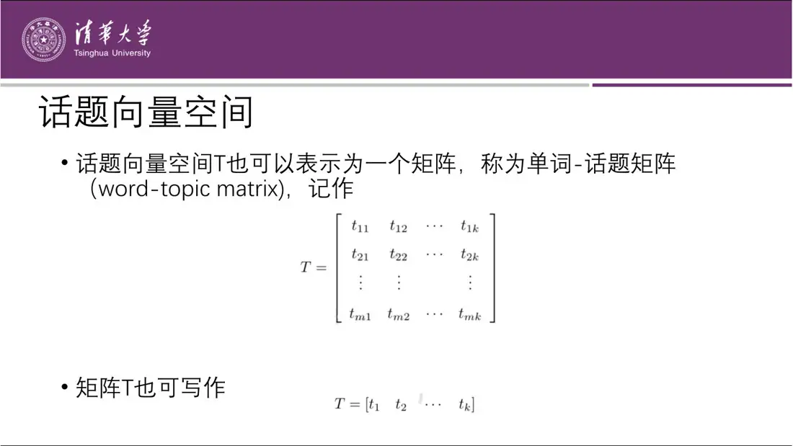

原文：

话题向量空间

\- 话题向量空间T也可以表示为一个矩阵，称为单词-话题矩阵(word-topic matrix)，记作

$$
T = \left[ \begin{array}{c c c c} t _ {1 1} & t _ {1 2} & \dots & t _ {1 k} \\ t _ {2 1} & t _ {2 2} & \dots & t _ {2 k} \\ \vdots & \vdots & & \vdots \\ t _ {m 1} & t _ {m 2} & \dots & t _ {m k} \end{array} \right]
$$

\- 矩阵T也可写作

$$
T = \left[ \begin{array}{c c c c} t _ {1} & t _ {2} & \dots & t _ {k} \end{array} \right].
$$

清華大學 Tsinghua University

### 文本在话题向量空间的表示

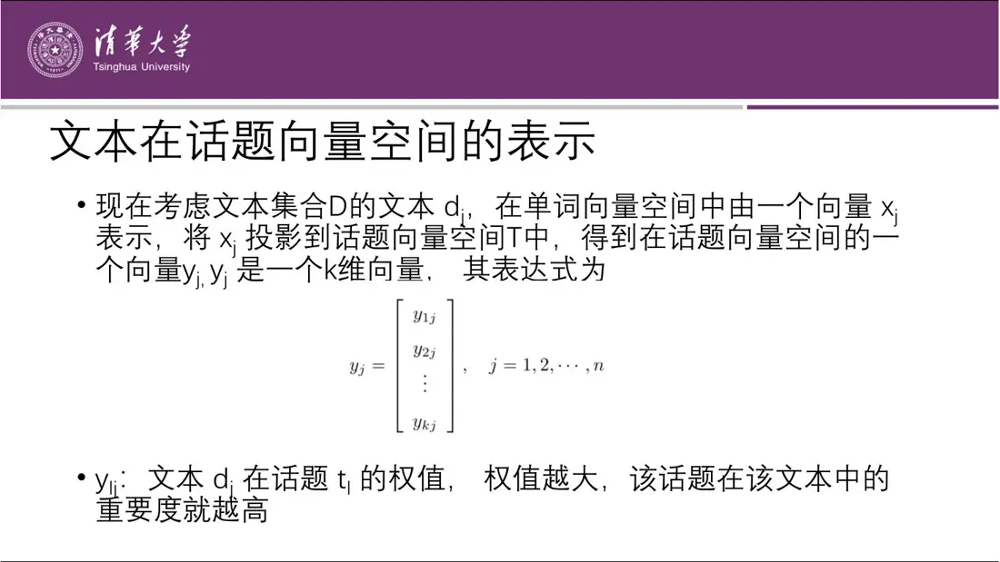

原文：

文本在话题向量空间的表示

\- 现在考虑文本集合D的文本 $d_{j}$ , 在单词向量空间中由一个向量 $x_{j}$ 表示, 将 $x_{j}$ 投影到话题向量空间T中, 得到在话题向量空间的一个向量 $y_{j}, y_{j}$ 是一个k维向量, 其表达式为

$$
y _ {j} = \left[ \begin{array}{c} y _ {1 j} \\ y _ {2 j} \\ \vdots \\ y _ {k j} \end{array} \right], \quad j = 1, 2, \dots , n
$$

\- $y_{\text{lj}}$ : 文本 $d_j$ 在话题 $t_l$ 的权值，权值越大，该话题在该文本中的重要度就越高

清華大學 Tsinghua University

### 文本在话题向量空间的表示

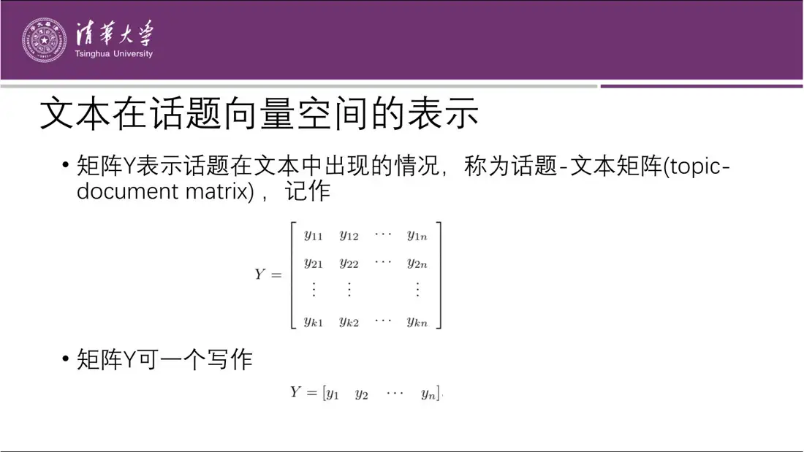

原文：

文本在话题向量空间的表示

\- 矩阵Y表示话题在文本中出现的情况，称为话题-文本矩阵(topic-document matrix)，记作

$$
Y = \left[ \begin{array}{c c c c} y _ {1 1} & y _ {1 2} & \dots & y _ {1 n} \\ y _ {2 1} & y _ {2 2} & \dots & y _ {2 n} \\ \vdots & \vdots & & \vdots \\ y _ {k 1} & y _ {k 2} & \dots & y _ {k n} \end{array} \right]
$$

\- 矩阵Y可一个写作

$$
Y = \left[ \begin{array}{c c c c} y _ {1} & y _ {2} & \dots & y _ {n} \end{array} \right].
$$

Tsinghua University
清華大學

### 从单词向量空间到话题向量空间的线性变换

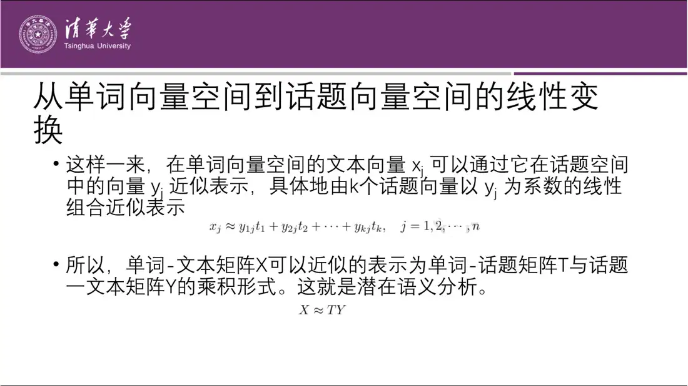

原文：

从单词向量空间到话题向量空间的线性变换

\- 这样一来，在单词向量空间的文本向量 $x_{j}$ 可以通过它在话题空间中的向量 $y_{j}$ 近似表示，具体地由k个话题向量以 $y_{j}$ 为系数的线性组合近似表示

$$
x _ {j} \approx y _ {1 j} t _ {1} + y _ {2 j} t _ {2} + \dots + y _ {k j} t _ {k}, \quad j = 1, 2, \dots , n
$$

\- 所以，单词-文本矩阵X可以近似的表示为单词-话题矩阵T与话题一文本矩阵Y的乘积形式。这就是潜在语义分析。

$$
X \approx T Y
$$

清華大學 Tsinghua University

### 单词向量空间

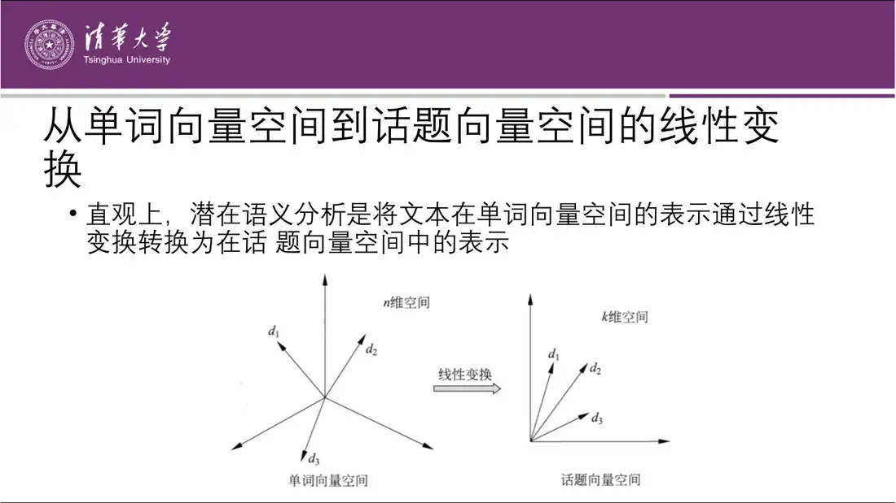

原文：

单词向量空间

话题向量空间

从单词向量空间到话题向量空间的线性变换

\- 直观上，潜在语义分析是将文本在单词向量空间的表示通过线性变换转换为在话题向量空间中的表示

清華大學 Tsinghua University

### 从单词向量空间到话题向量空间的线性变换

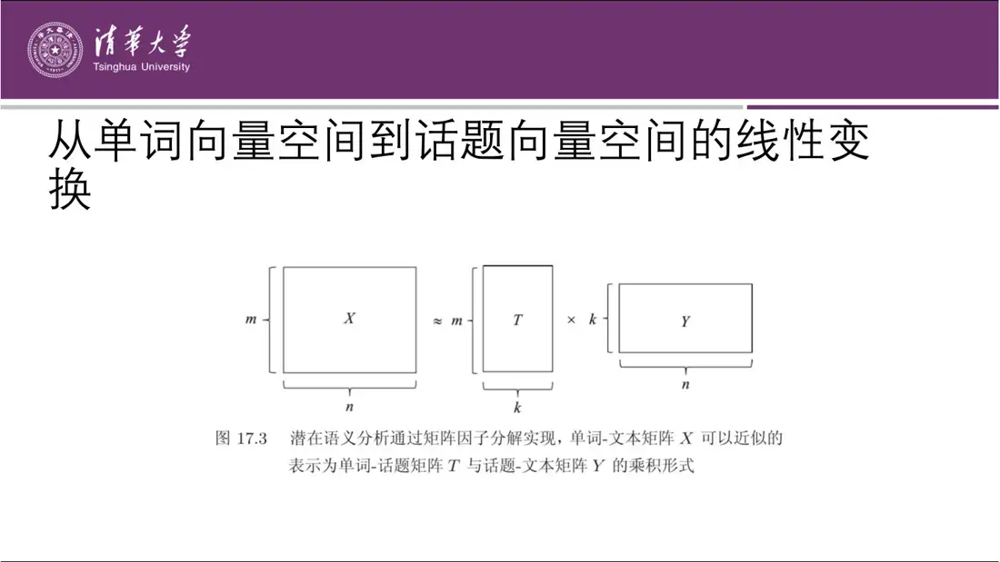

原文：

从单词向量空间到话题向量空间的线性变换

清華大學 Tsinghua University

### 从单词向量空间到话题向量空间的线性变换

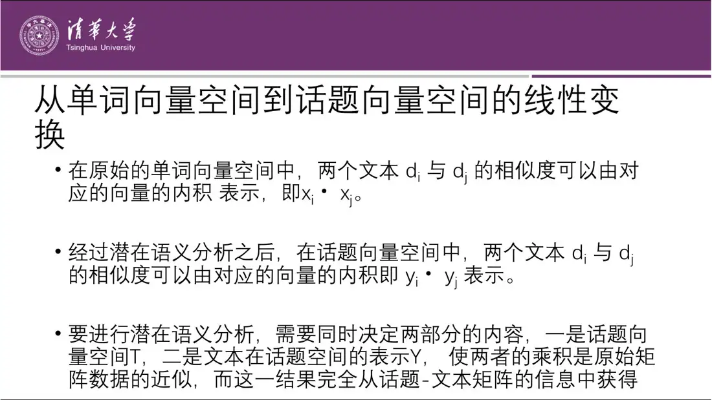

原文：

从单词向量空间到话题向量空间的线性变换

\- 在原始的单词向量空间中，两个文本 $d_{i}$ 与 $d_{j}$ 的相似度可以由对应的向量的内积表示，即 $x_{i} \cdot x_{j}$ 。

\- 经过潜在语义分析之后，在话题向量空间中，两个文本 $d_{i}$ 与 $d_{j}$ 的相似度可以由对应的向量的内积即 $y_{i} \cdot y_{j}$ 表示。

\- 要进行潜在语义分析，需要同时决定两部分的内容，一是话题向量空间T，二是文本在话题空间的表示Y，使两者的乘积是原始矩阵数据的近似，而这一结果完全从话题-文本矩阵的信息中获得

清華大學 Tsinghua University

### 潜在语义分析算法

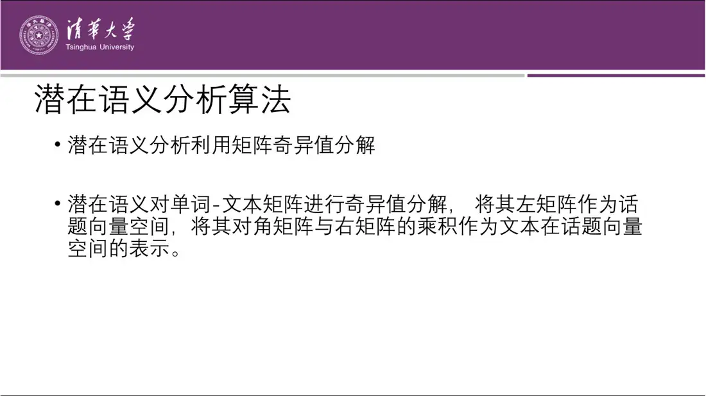

原文：

潜在语义分析算法

\- 潜在语义分析利用矩阵奇异值分解

\- 潜在语义对单词-文本矩阵进行奇异值分解，将其左矩阵作为话题向量空间，将其对角矩阵与右矩阵的乘积作为文本在话题向量空间的表示。

Tsinghua University
清華大學
1911-1911

### 矩阵奇异值分解算法

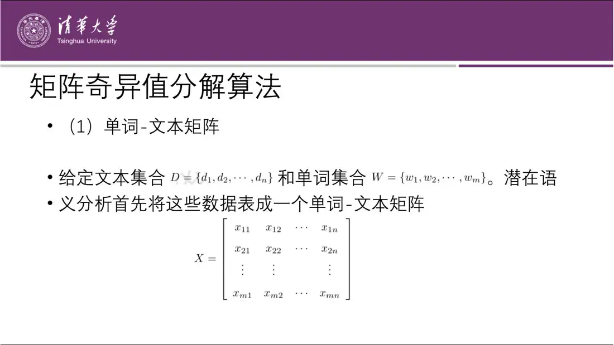

原文：

矩阵奇异值分解算法

• (1) 单词-文本矩阵

\- 给定文本集合 $D = \{d_1, d_2, \cdots, d_n\}$ 和单词集合 $W = \{w_1, w_2, \cdots, w_m\}$ 。潜在语

\- 义分析首先将这些数据表成一个单词-文本矩阵

$$
X = \left[ \begin{array}{c c c c} x _ {1 1} & x _ {1 2} & \dots & x _ {1 n} \\ x _ {2 1} & x _ {2 2} & \dots & x _ {2 n} \\ \vdots & \vdots & & \vdots \\ x _ {m 1} & x _ {m 2} & \dots & x _ {m n} \end{array} \right]
$$

Tsinghua University
清華大學

### 矩阵奇异值分解算法

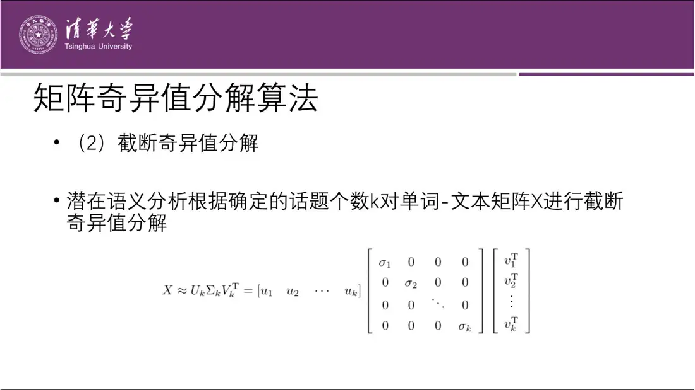

原文：

矩阵奇异值分解算法

• (2) 截断奇异值分解

\- 潜在语义分析根据确定的话题个数k对单词-文本矩阵X进行截断奇异值分解

$$
X \approx U _ {k} \Sigma_ {k} V _ {k} ^ {\mathrm{T}} = [ u _ {1} \quad u _ {2} \quad \dots \quad u _ {k} ] \left[ \begin{array}{c c c c} \sigma_ {1} & 0 & 0 & 0 \\ 0 & \sigma_ {2} & 0 & 0 \\ 0 & 0 & \ddots & 0 \\ 0 & 0 & 0 & \sigma_ {k} \end{array} \right] \left[ \begin{array}{c} v _ {1} ^ {\mathrm{T}} \\ v _ {2} ^ {\mathrm{T}} \\ \vdots \\ v _ {k} ^ {\mathrm{T}} \end{array} \right]
$$

Tsinghua University
清華大學

### 矩阵奇异值分解算法

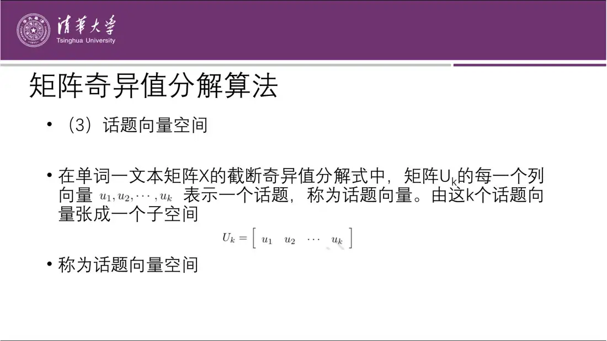

原文：

矩阵奇异值分解算法

(3) 话题向量空间

\- 在单词一文本矩阵X的截断奇异值分解式中，矩阵 $U_{k}$ 的每一个列向量 $u_{1}, u_{2}, \cdots, u_{k}$ 表示一个话题，称为话题向量。由这k个话题向量张成一个子空间

$$
U _ {k} = \left[ \begin{array}{l l l l} u _ {1} & u _ {2} & \dots & u _ {k} \end{array} \right]
$$

\- 称为话题向量空间

Tsinghua University
清華大學

### 矩阵奇异值分解算法

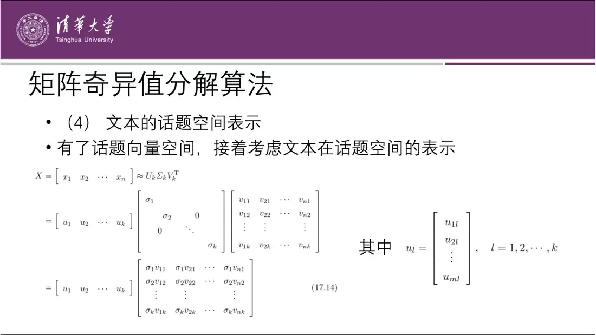

原文：

矩阵奇异值分解算法

• (4) 文本的话题空间表示

\- 有了话题向量空间，接着考虑文本在话题空间的表示

$$
X = \left[ \begin{array}{l l l l} x _ {1} & x _ {2} & \dots & x _ {n} \end{array} \right] \approx U _ {k} \Sigma_ {k} V _ {k} ^ {\mathrm{T}}
$$

$$
= \left[ \begin{array}{l l l l} u _ {1} & u _ {2} & \dots & u _ {k} \end{array} \right] \left[ \begin{array}{c c c c} \sigma_ {1} & & & \\ & \sigma_ {2} & 0 & \\ & 0 & \ddots & \\ & & & \sigma_ {k} \end{array} \right] \left[ \begin{array}{c c c c} v _ {1 1} & v _ {2 1} & \dots & v _ {n 1} \\ v _ {1 2} & v _ {2 2} & \dots & v _ {n 2} \\ \vdots & \vdots & & \vdots \\ v _ {1 k} & v _ {2 k} & \dots & v _ {n k} \end{array} \right]
$$

其中

$$
= \left[ \begin{array}{c c c c} u _ {1} & u _ {2} & \dots & u _ {k} \end{array} \right] \left[ \begin{array}{c c c c} \sigma_ {1} v _ {1 1} & \sigma_ {1} v _ {2 1} & \dots & \sigma_ {1} v _ {n 1} \\ \sigma_ {2} v _ {1 2} & \sigma_ {2} v _ {2 2} & \dots & \sigma_ {2} v _ {n 2} \\ \vdots & \vdots & & \vdots \\ \sigma_ {k} v _ {1 k} & \sigma_ {k} v _ {2 k} & \dots & \sigma_ {k} v _ {n k} \end{array} \right]\tag{17.14}
$$

$$
u _ {l} = \left[ \begin{array}{c} u _ {1 l} \\ u _ {2 l} \\ \vdots \\ u _ {m l} \end{array} \right], \quad l = 1, 2, \dots , k
$$

Tsinghua University
清華大學

### 矩阵奇异值分解算法

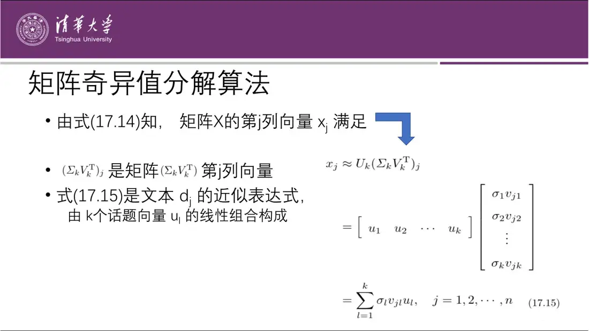

原文：

矩阵奇异值分解算法

\- 由式(17.14)知，矩阵X的第j列向量 $x_{j}$ 满足

\- $(\Sigma_{k}V_{k}^{\mathrm{T}})_{j}$ 是矩阵 $(\Sigma_{k}V_{k}^{\mathrm{T}})$ 第j列向量

\- 式(17.15)是文本 $d_{j}$ 的近似表达式, 由 k个话题向量 $u_{l}$ 的线性组合构成

$$
x _ {j} \approx U _ {k} (\Sigma_ {k} V _ {k} ^ {\mathrm{T}}) _ {j}
$$

$$
= \left[ \begin{array}{c c c c} u _ {1} & u _ {2} & \dots & u _ {k} \end{array} \right] \left[ \begin{array}{c} \sigma_ {1} v _ {j 1} \\ \sigma_ {2} v _ {j 2} \\ \vdots \\ \sigma_ {k} v _ {j k} \end{array} \right]
$$

$$
= \sum_ {l = 1} ^ {k} \sigma_ {l} v _ {j l} u _ {l}, \quad j = 1, 2, \dots , n\tag{17.15}
$$

Tsinghua University
清華大學

### 矩阵奇异值分解算法

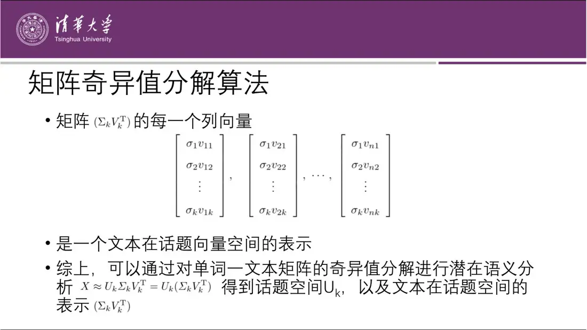

原文：

矩阵奇异值分解算法

\- 矩阵 $(\Sigma_{k}V_{k}^{\mathrm{T}})$ 的每一个列向量

$$
\left[ \begin{array}{c} {\sigma_ {1} v _ {1 1}} \\ {\sigma_ {2} v _ {1 2}} \\ {\vdots} \\ {\sigma_ {k} v _ {1 k}} \end{array} \right], \quad \left[ \begin{array}{c} {\sigma_ {1} v _ {2 1}} \\ {\sigma_ {2} v _ {2 2}} \\ {\vdots} \\ {\sigma_ {k} v _ {2 k}} \end{array} \right], \dots , \left[ \begin{array}{c} {\sigma_ {1} v _ {n 1}} \\ {\sigma_ {2} v _ {n 2}} \\ {\vdots} \\ {\sigma_ {k} v _ {n k}} \end{array} \right]
$$

\- 是一个文本在话题向量空间的表示

\- 综上，可以通过对单词一文本矩阵的奇异值分解进行潜在语义分析 $X \approx U_k \Sigma_k V_k^{\mathrm{T}} = U_k (\Sigma_k V_k^{\mathrm{T}})$ 得到话题空间 $\mathsf{U}_k$ ，以及文本在话题空间的表示 $(\Sigma_k V_k^{\mathrm{T}})$

Tsinghua University
清華大學

### \- 进行潜在语义分析。

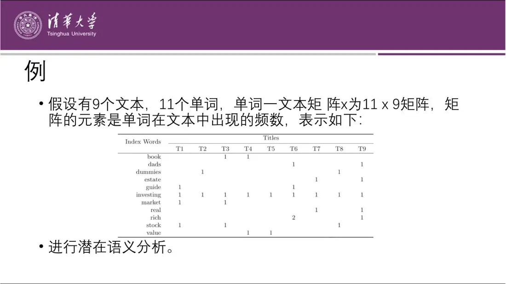

原文：

例

\- 假设有9个文本，11个单词，单词一文本矩阵x为 $11 \times 9$ 矩阵，矩阵的元素是单词在文本中出现的频数，表示如下：

<table><tr><td rowspan="2">Index Words</td><td colspan="9">Titles</td></tr><tr><td>T1</td><td>T2</td><td>T3</td><td>T4</td><td>T5</td><td>T6</td><td>T7</td><td>T8</td><td>T9</td></tr><tr><td>book</td><td></td><td></td><td>1</td><td>1</td><td></td><td></td><td></td><td></td><td></td></tr><tr><td>dads</td><td></td><td></td><td></td><td></td><td></td><td>1</td><td></td><td></td><td>1</td></tr><tr><td>dummies</td><td></td><td>1</td><td></td><td></td><td></td><td></td><td></td><td>1</td><td></td></tr><tr><td>estate</td><td></td><td></td><td></td><td></td><td></td><td></td><td>1</td><td></td><td>1</td></tr><tr><td>guide</td><td>1</td><td></td><td></td><td></td><td></td><td>1</td><td></td><td></td><td></td></tr><tr><td>investing</td><td>1</td><td>1</td><td>1</td><td>1</td><td>1</td><td>1</td><td>1</td><td>1</td><td>1</td></tr><tr><td>market</td><td>1</td><td></td><td>1</td><td></td><td></td><td></td><td></td><td></td><td></td></tr><tr><td>real</td><td></td><td></td><td></td><td></td><td></td><td></td><td>1</td><td></td><td>1</td></tr><tr><td>rich</td><td></td><td></td><td></td><td></td><td></td><td>2</td><td></td><td></td><td>1</td></tr><tr><td>stock</td><td>1</td><td></td><td>1</td><td></td><td></td><td></td><td></td><td>1</td><td></td></tr><tr><td>value</td><td></td><td></td><td></td><td>1</td><td>1</td><td></td><td></td><td></td><td></td></tr></table>

\- 进行潜在语义分析。

清華大學 Tsinghua University

### \- 实施对矩阵的截断奇异值分解，假设话题的个数是3，截断奇异值分解结果为

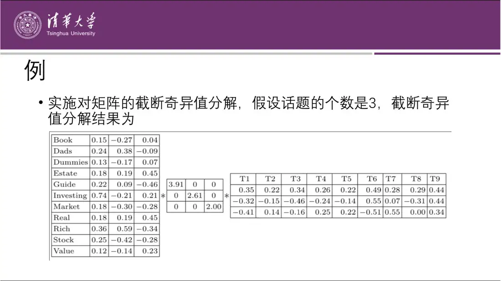

原文：

例

\- 实施对矩阵的截断奇异值分解，假设话题的个数是3，截断奇异值分解结果为

<table><tr><td>Book</td><td>0.15</td><td>-0.27</td><td>0.04</td></tr><tr><td>Dads</td><td>0.24</td><td>0.38</td><td>-0.09</td></tr><tr><td>Dummies</td><td>0.13</td><td>-0.17</td><td>0.07</td></tr><tr><td>Estate</td><td>0.18</td><td>0.19</td><td>0.45</td></tr><tr><td>Guide</td><td>0.22</td><td>0.09</td><td>-0.46</td></tr><tr><td>Investing</td><td>0.74</td><td>-0.21</td><td>0.21</td></tr><tr><td>Market</td><td>0.18</td><td>-0.30</td><td>-0.28</td></tr><tr><td>Real</td><td>0.18</td><td>0.19</td><td>0.45</td></tr><tr><td>Rich</td><td>0.36</td><td>0.59</td><td>-0.34</td></tr><tr><td>Stock</td><td>0.25</td><td>-0.42</td><td>-0.28</td></tr><tr><td>Value</td><td>0.12</td><td>-0.14</td><td>0.23</td></tr></table>

<table><tr><td>3.91</td><td>0</td><td>0</td></tr><tr><td>0</td><td>2.61</td><td>0</td></tr><tr><td>0</td><td>0</td><td>2.00</td></tr></table>

<table><tr><td>T1</td><td>T2</td><td>T3</td><td>T4</td><td>T5</td><td>T6</td><td>T7</td><td>T8</td><td>T9</td></tr><tr><td>0.35</td><td>0.22</td><td>0.34</td><td>0.26</td><td>0.22</td><td>0.49</td><td>0.28</td><td>0.29</td><td>0.44</td></tr><tr><td>-0.32</td><td>-0.15</td><td>-0.46</td><td>-0.24</td><td>-0.14</td><td>0.55</td><td>0.07</td><td>-0.31</td><td>0.44</td></tr><tr><td>-0.41</td><td>0.14</td><td>-0.16</td><td>0.25</td><td>0.22</td><td>-0.51</td><td>0.55</td><td>0.00</td><td>0.34</td></tr></table>

Tsinghua University
清華大學

### Tsinghua University

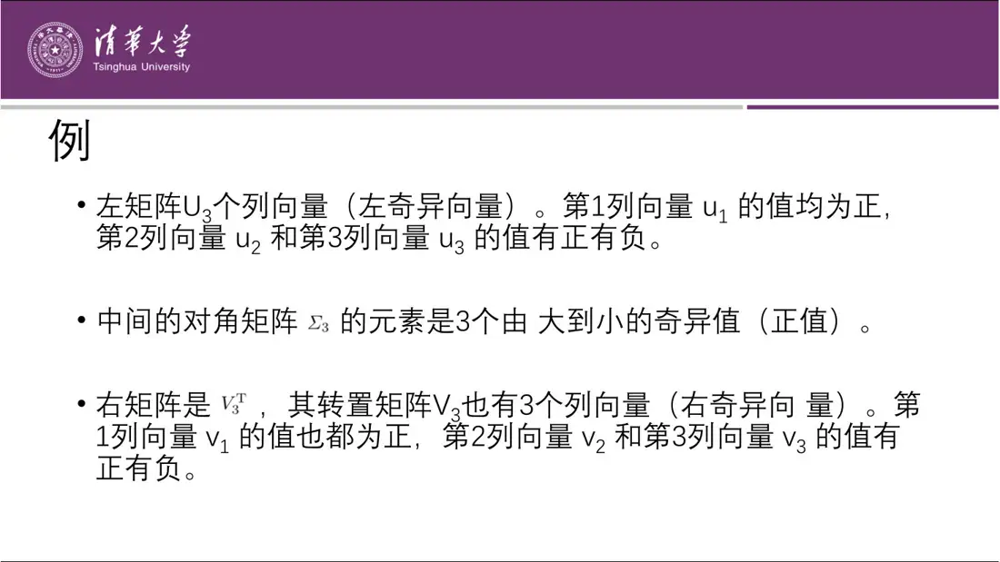

原文：

例

\- 左矩阵 $U_{3}$ 个列向量（左奇异向量）。第1列向量 $u_{1}$ 的值均为正，第2列向量 $u_{2}$ 和第3列向量 $u_{3}$ 的值有正有负。

\- 中间的对角矩阵 $\Sigma_{3}$ 的元素是3个由大到小的奇异值（正值）。

\- 右矩阵是 $V_{3}^{\mathrm{T}}$ ，其转置矩阵 $\mathsf{V}_3$ 也有3个列向量（右奇异向量）。第1列向量 $\mathsf{v}_1$ 的值也都为正，第2列向量 $\mathsf{v}_2$ 和第3列向量 $\mathsf{v}_3$ 的值有正有负。

Tsinghua University
清華大學

### $$

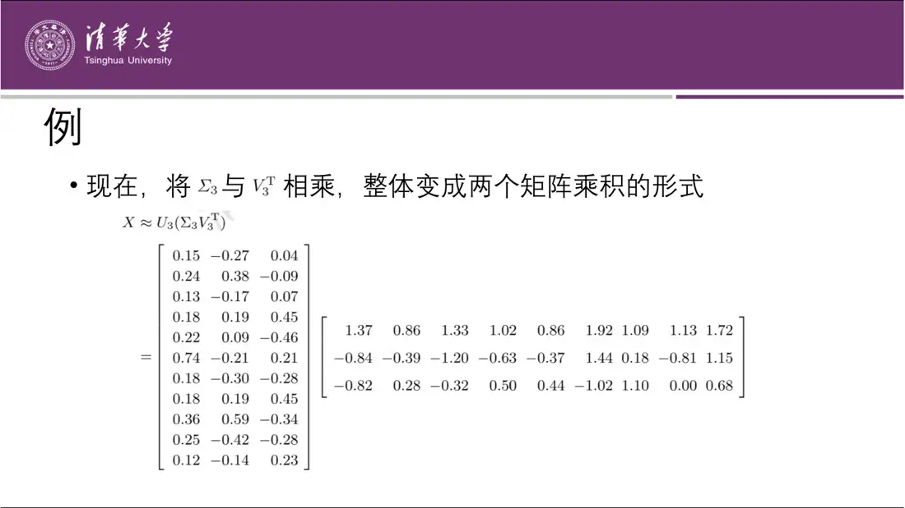

原文：

例

\- 现在，将 $\Sigma_{3}$ 与 $V_{3}^{\mathrm{T}}$ 相乘，整体变成两个矩阵乘积的形式

$$
X \approx U _ {3} (\Sigma_ {3} V _ {3} ^ {\mathrm{T}})
$$

$$
= \left[ \begin{array}{r r r} 0. 1 5 & - 0. 2 7 & 0. 0 4 \\ 0. 2 4 & 0. 3 8 & - 0. 0 9 \\ 0. 1 3 & - 0. 1 7 & 0. 0 7 \\ 0. 1 8 & 0. 1 9 & 0. 4 5 \\ 0. 2 2 & 0. 0 9 & - 0. 4 6 \\ 0. 7 4 & - 0. 2 1 & 0. 2 1 \\ 0. 1 8 & - 0. 3 0 & - 0. 2 8 \\ 0. 1 8 & 0. 1 9 & 0. 4 5 \\ 0. 3 6 & 0. 5 9 & - 0. 3 4 \\ 0. 2 5 & - 0. 4 2 & - 0. 2 8 \\ 0. 1 2 & - 0. 1 4 & 0. 2 3 \end{array} \right] \left[ \begin{array}{r r r r r r r r r} {1. 3 7} & {0. 8 6} & {1. 3 3} & {1. 0 2} & {0. 8 6} & {1. 9 2} & {1. 0 9} & {1. 1 3} & {1. 7 2} \\ {- 0. 8 4} & {- 0. 3 9} & {- 1. 2 0} & {- 0. 6 3} & {- 0. 3 7} & {1. 4 4} & {0. 1 8} & {- 0. 8 1} & {1. 1 5} \\ {- 0. 8 2} & {0. 2 8} & {- 0. 3 2} & {0. 5} {0} & {0. {4}} {4} & {- {1}. {0}} {2} & {1. {1}} {0} & {0. {0}} {0} & {0. {6}} {8} \end{array} \right]
$$

清華大學 Tsinghua University

### Tsinghua University

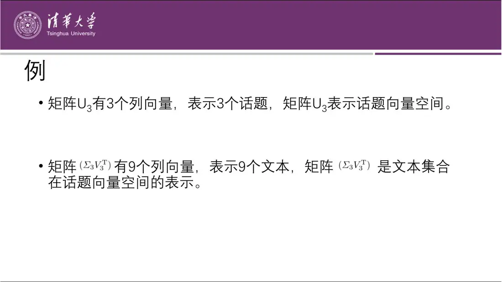

原文：

例

\- 矩阵 $U_{3}$ 有3个列向量，表示3个话题，矩阵 $U_{3}$ 表示话题向量空间。

\- 矩阵 $(\Sigma_3V_3^{\mathrm{T}})$ 有9个列向量，表示9个文本，矩阵 $(\Sigma_3V_3^{\mathrm{T}})$ 是文本集合在话题向量空间的表示。

Tsinghua University
清華大學

### 非负矩阵分解算法

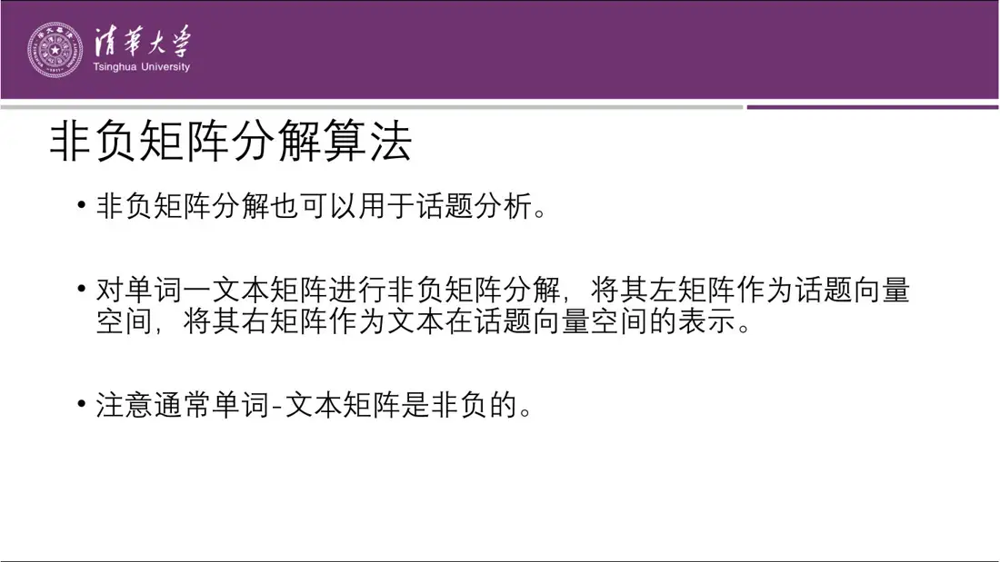

原文：

非负矩阵分解算法

\- 非负矩阵分解也可以用于话题分析。

\- 对单词一文本矩阵进行非负矩阵分解，将其左矩阵作为话题向量空间，将其右矩阵作为文本在话题向量空间的表示。

\- 注意通常单词-文本矩阵是非负的。

Tsinghua University
清華大學
1911-1911

### 非负矩阵分解

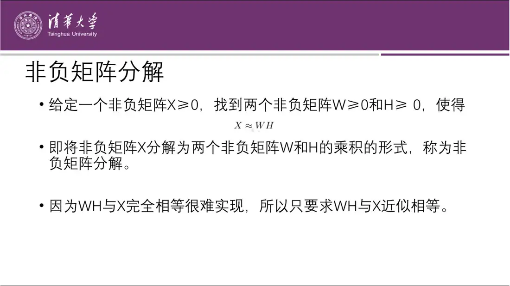

原文：

非负矩阵分解

\- 给定一个非负矩阵 $X \geqslant 0$ ，找到两个非负矩阵 $W \geqslant 0$ 和 $H \geqslant 0$ ，使得 $X \approx WH$

\- 即将非负矩阵X分解为两个非负矩阵W和H的乘积的形式，称为非负矩阵分解。

\- 因为WH与X完全相等很难实现，所以只要求WH与X近似相等。

Tsinghua University
清華大學

### 非负矩阵分解

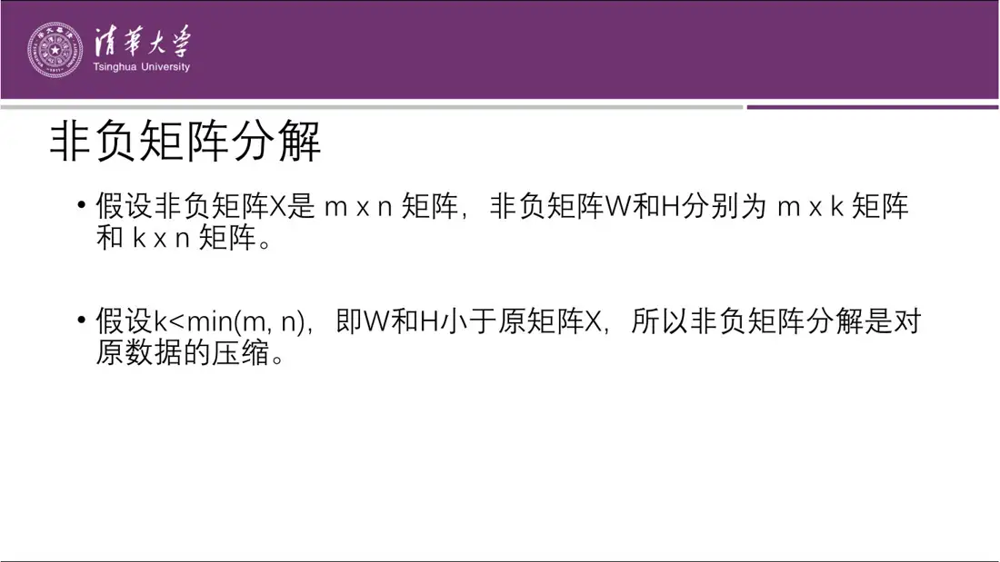

原文：

非负矩阵分解

\- 假设非负矩阵X是 m x n 矩阵，非负矩阵W和H分别为 m x k 矩阵和 k x n 矩阵。

\- 假设 $k < \min(m, n)$ ，即W和H小于原矩阵X，所以非负矩阵分解是对原数据的压缩。

Tsinghua University
清華大學

### 非负矩阵分解

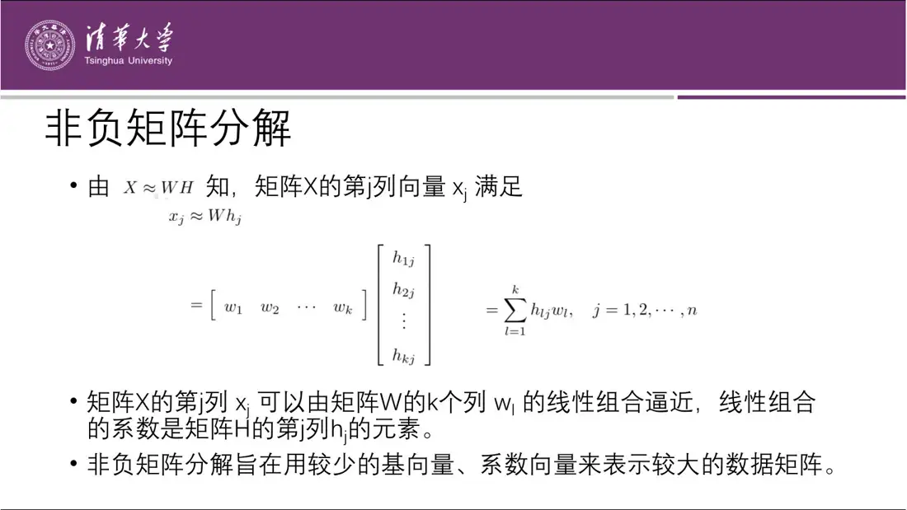

原文：

非负矩阵分解

\- 由 $X \approx WH$ 知，矩阵X的第j列向量 $x_{j}$ 满足

$$
x _ {j} \approx W h _ {j}
$$

$$
= \left[ \begin{array}{l l l l} w _ {1} & w _ {2} & \dots & w _ {k} \end{array} \right] \left[ \begin{array}{c} h _ {1 j} \\ h _ {2 j} \\ \vdots \\ h _ {k j} \end{array} \right] = \sum_ {l = 1} ^ {k} h _ {l j} w _ {l}, \quad j = 1, 2, \dots , n
$$

\- 矩阵X的第j列 $x_{j}$ 可以由矩阵W的k个列 $w_{l}$ 的线性组合逼近，线性组合的系数是矩阵H的第j列 $h_{i}$ 的元素。

\- 非负矩阵分解旨在用较少的基向量、系数向量来表示较大的数据矩阵。

清華大學 Tsinghua University

### 潜在语义分析模型

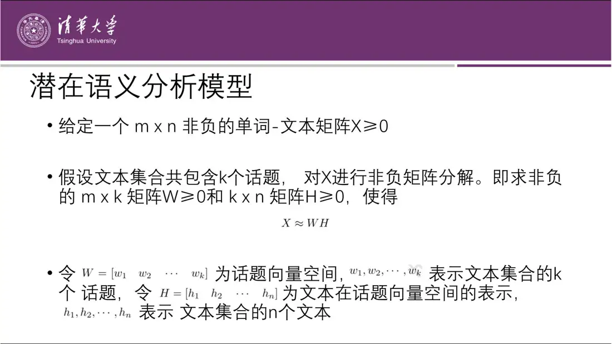

原文：

潜在语义分析模型

\- 给定一个 $m \times n$ 非负的单词-文本矩阵 $X \geqslant 0$

\- 假设文本集合共包含k个话题，对X进行非负矩阵分解。即求非负的 m x k 矩阵W≥0和 k x n 矩阵H≥0，使得

$$
X \approx W H
$$

\- 令 $W = [w_1, w_2, \cdots, w_k]$ 为话题向量空间， $w_1, w_2, \cdots, w_k$ 表示文本集合的k个话题，令 $H = [h_1, h_2, \cdots, h_n]$ 为文本在话题向量空间的表示， $h_1, h_2, \cdots, h_n$ 表示文本集合的n个文本

Tsinghua University
清華大學

### 非负矩阵分解的形式化

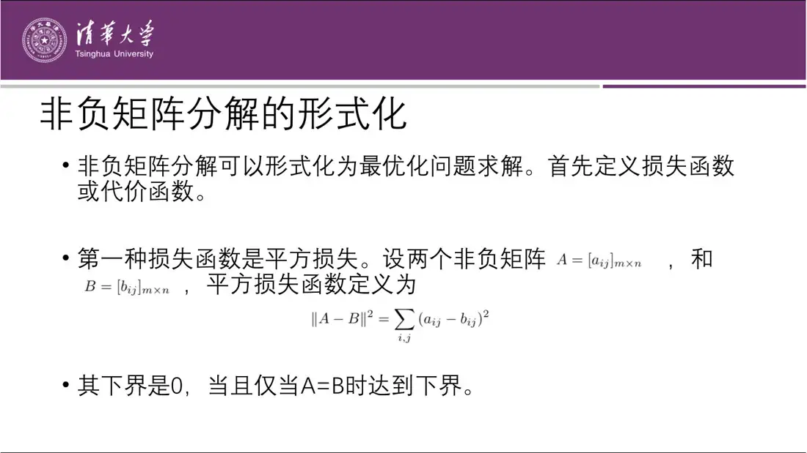

原文：

非负矩阵分解的形式化

\- 非负矩阵分解可以形式化为最优化问题求解。首先定义损失函数或代价函数。

\- 第一种损失函数是平方损失。设两个非负矩阵 $A = [a_{ij}]_{m \times n}$ ，和 $B = [b_{ij}]_{m \times n}$ ，平方损失函数定义为

$$
\left\| A - B \right\| ^ {2} = \sum_ {i, j} \left(a _ {i j} - b _ {i j}\right) ^ {2}
$$

\- 其下界是0，当且仅当 $A = B$ 时达到下界。

Tsinghua University
清華大學

### 非负矩阵分解的形式化

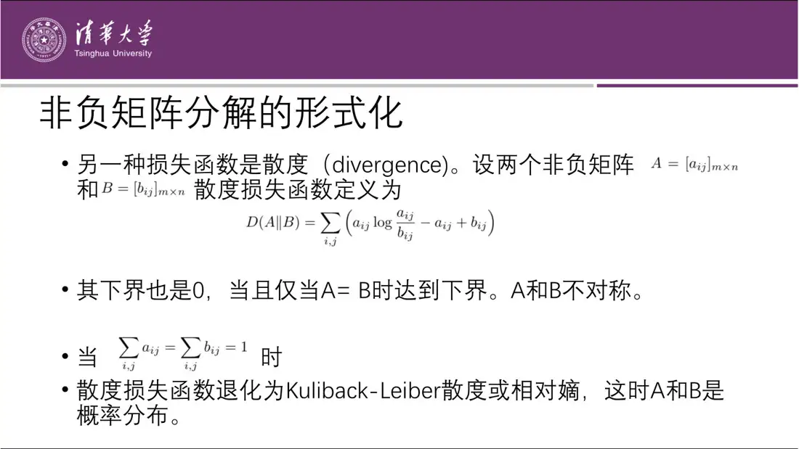

原文：

非负矩阵分解的形式化

\- 另一种损失函数是散度（divergence）。设两个非负矩阵和 $B = [b_{ij}]_{m \times n}$ 散度损失函数定义为 $A = [a_{ij}]_{m \times n}$

$$
D (A \| B) = \sum_ {i, j} \left(a _ {i j} \log \frac {a _ {i j}}{b _ {i j}} - a _ {i j} + b _ {i j}\right)
$$

\- 其下界也是0，当且仅当A = B时达到下界。A和B不对称。

\- 当 $\sum_{i,j}a_{ij} = \sum_{i,j}b_{ij} = 1$ 时

\- 散度损失函数退化为Kuliback-Leiber散度或相对熵，这时A和B是概率分布。

Tsinghua University
清華大學

### 非负矩阵分解的形式化

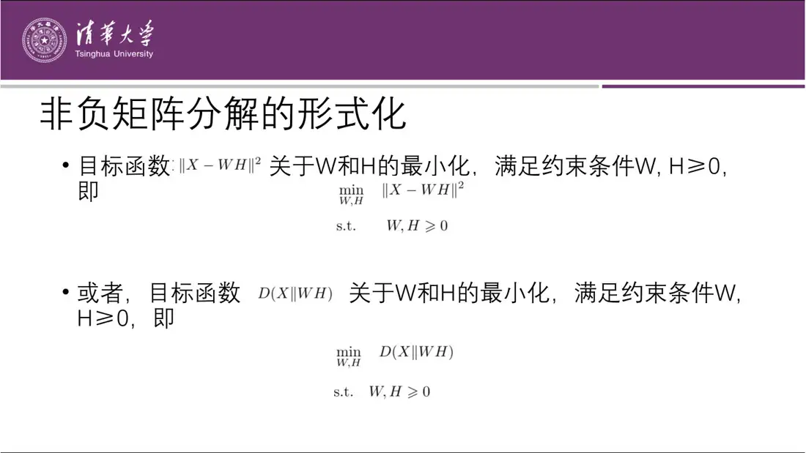

原文：

非负矩阵分解的形式化

\- 目标函数: $\| X - WH\|^2$ 关于W和H的最小化, 满足约束条件W, H≥0, 即 $\min_{W,H} \|X - WH\|^2$ s.t. $W, H \geqslant 0$

\- 或者，目标函数 $D(X \| WH)$ 关于W和H的最小化，满足约束条件W， $H \geqslant 0$ ，即

$$
\begin{array}{l l} \min _ {W, H} & D (X \| W H) \\ \text {s.t.} & W, H \geqslant 0 \end{array}
$$

清華大學 Tsinghua University

### 算法

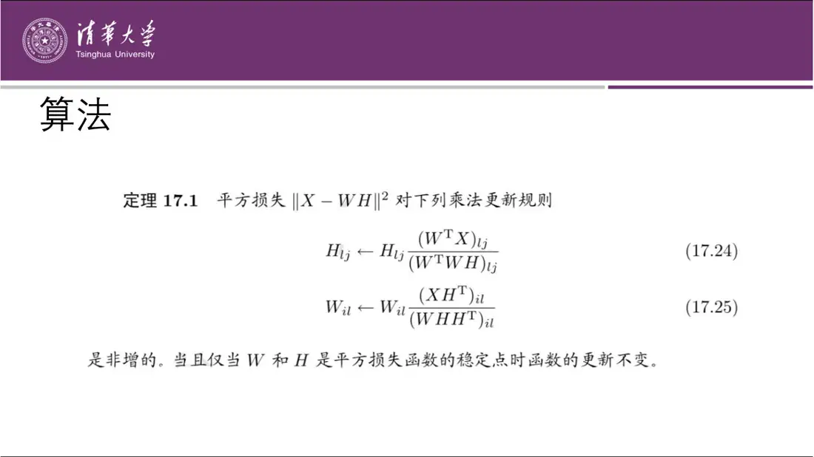

原文：

算法

定理 17.1 平方损失 $\|X-WH\|^{2}$ 对下列乘法更新规则

$$
H _ {l j} \leftarrow H _ {l j} \frac {(W ^ {\mathrm{T}} X) _ {l j}}{(W ^ {\mathrm{T}} W H) _ {l j}}\tag{17.24}
$$

$$
W _ {i l} \leftarrow W _ {i l} \frac {(X H ^ {\mathrm{T}}) _ {i l}}{(W H H ^ {\mathrm{T}}) _ {i l}}\tag{17.25}
$$

是非增的。当且仅当 $W$ 和 $H$ 是平方损失函数的稳定点时函数的更新不变。

清華大學 Tsinghua University

### 算法

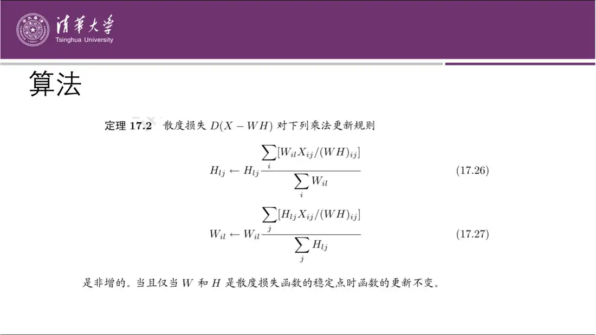

原文：

算法

定理 17.2 散度损失 $D(X - WH)$ 对下列乘法更新规则

$$
H _ {l j} \leftarrow H _ {l j} \frac {\sum_ {i} [ W _ {i l} X _ {i j} / (W H) _ {i j} ]}{\sum_ {i} W _ {i l}}\tag{17.26}
$$

$$
W _ {i l} \leftarrow W _ {i l} \frac {\sum_ {j} [ H _ {l j} X _ {i j} / (W H) _ {i j} ]}{\sum_ {j} H _ {l j}}\tag{17.27}
$$

是非增的。当且仅当 W 和 H 是散度损失函数的稳定点时函数的更新不变。

清華大學 Tsinghua University

### 算法

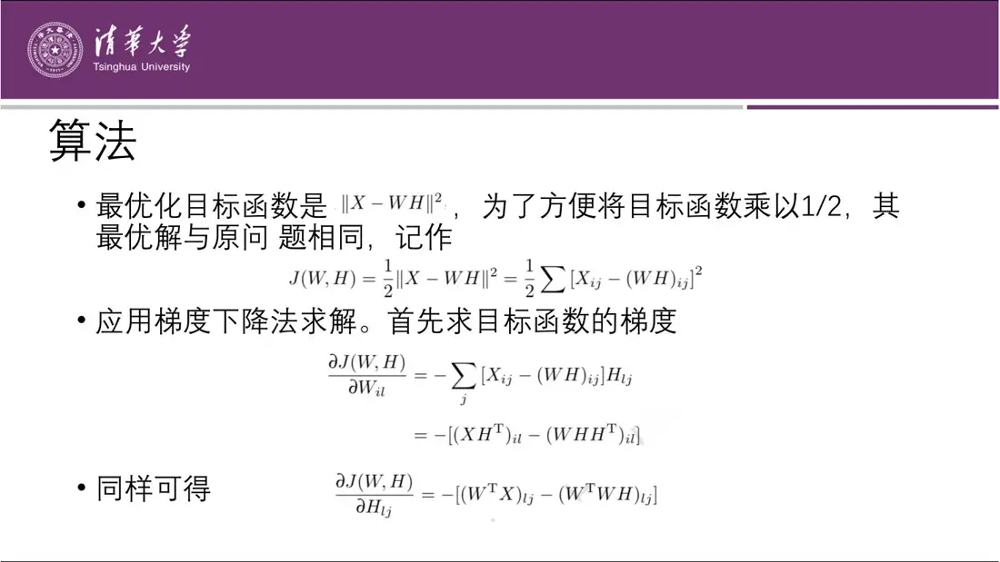

原文：

算法

\- 最优化目标函数是 $\| X - WH\|^2$ ，为了方便将目标函数乘以 $1/2$ ，其最优解与原问题相同，记作

$$
J (W, H) = \frac {1}{2} \| X - W H \| ^ {2} = \frac {1}{2} \sum [ X _ {i j} - (W H) _ {i j} ] ^ {2}
$$

\- 应用梯度下降法求解。首先求目标函数的梯度

$$
\begin{array}{r l} \frac {\partial J (W , H)}{\partial W _ {i l}} & = - \sum_ {j} [ X _ {i j} - (W H) _ {i j} ] H _ {l j} \\ & = - [ (X H ^ {\mathrm{T}}) _ {i l} - (W H H ^ {\mathrm{T}}) _ {i l} ] \end{array}
$$

\- 同样可得

$$
\frac {\partial J (W , H)}{\partial H _ {l j}} = - [ (W ^ {\mathrm{T}} X) _ {l j} - (W ^ {\mathrm{T}} W H) _ {l j} ]
$$

Tsinghua University
清華大學

### 算法

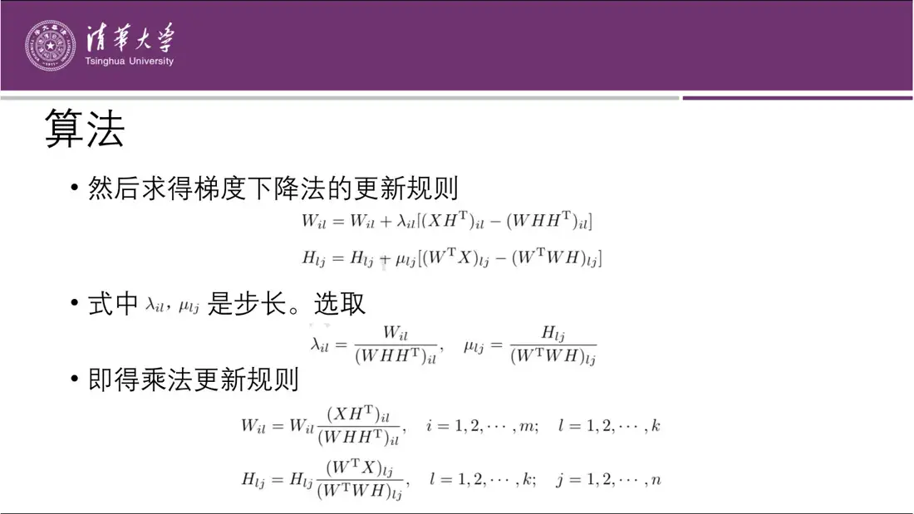

原文：

算法

\- 然后求得梯度下降法的更新规则

$$
W _ {i l} = W _ {i l} + \lambda_ {i l} [ (X H ^ {\mathrm{T}}) _ {i l} - (W H H ^ {\mathrm{T}}) _ {i l} ]
$$

$$
H _ {l j} = H _ {l j} + \mu_ {l j} [ (W ^ {\mathrm{T}} X) _ {l j} - (W ^ {\mathrm{T}} W H) _ {l j} ]
$$

\- 式中 $\lambda_{il}, \mu_{lj}$ 是步长。选取

$$
\lambda_ {i l} = \frac {W _ {i l}}{(W H H ^ {\mathrm{T}}) _ {i l}}, \quad \mu_ {l j} = \frac {H _ {l j}}{(W ^ {\mathrm{T}} W H) _ {l j}}
$$

\- 即得乘法更新规则

$$
W _ {i l} = W _ {i l} \frac {(X H ^ {\mathrm{T}}) _ {i l}}{(W H H ^ {\mathrm{T}}) _ {i l}}, \quad i = 1, 2, \dots , m; \quad l = 1, 2, \dots , k
$$

$$
H _ {l j} = H _ {l j} \frac {(W ^ {\mathrm{T}} X) _ {l j}}{(W ^ {\mathrm{T}} W H) _ {l j}}, \quad l = 1, 2, \dots , k; \quad j = 1, 2, \dots , n
$$

Tsinghua University
清華大學

### 非负矩阵分解的迭代算法

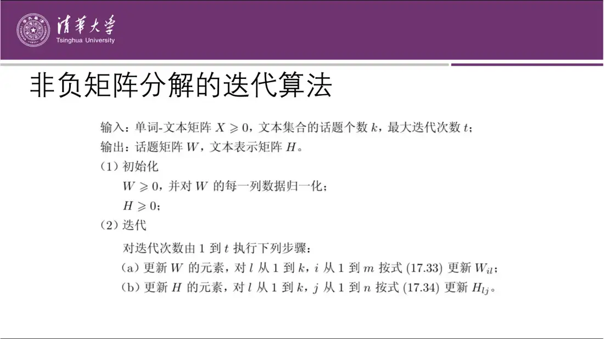

原文：

非负矩阵分解的迭代算法

输入: 单词-文本矩阵 $X \geqslant 0$ , 文本集合的话题个数 $k$ , 最大迭代次数 $t$ ;

输出：话题矩阵 W，文本表示矩阵 H。

(1) 初始化

$W \geqslant 0$ ，并对 W 的每一列数据归一化；

$H \geqslant 0$ ;

(2) 迭代

对迭代次数由 1 到 t 执行下列步骤:

(a) 更新 $W$ 的元素, 对 $l$ 从 1 到 $k$ , $i$ 从 1 到 $m$ 按式 (17.33) 更新 $W_{il}$ ;

(b) 更新 H 的元素，对 l 从 1 到 k，j 从 1 到 n 按式 (17.34) 更新 $H_{lj}$ 。

清華大學 Tsinghua University
