# 《统计学习方法》第2版 第22章 无监督学习方法总结（课件）

原件的每一页，下面附识别出的文字。

### 第二十二章 无监督学习方法总结

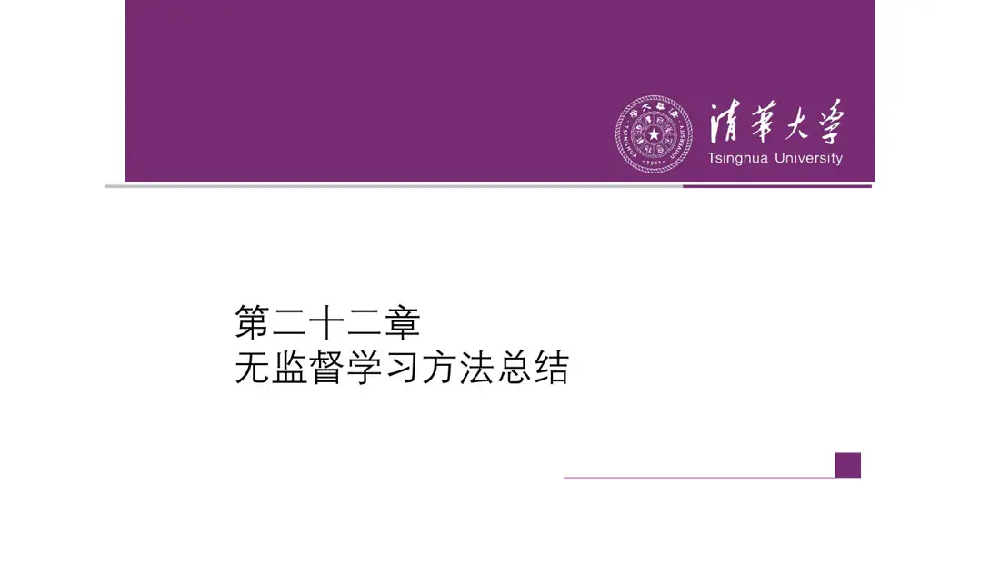

原文：

第二十二章 无监督学习方法总结

大華津
TSINGHUA UNIVERSITY
清華大學
Tsinghua University

### 各种方法之间的关系

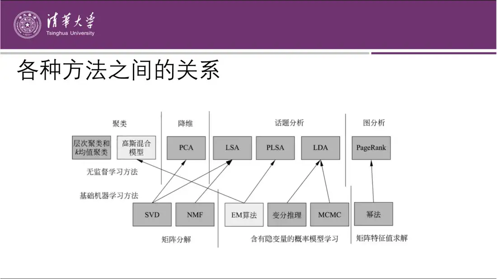

原文：

各种方法之间的关系

Tsinghua University
清華大學
1911-1911

### 各种方法之间的关系

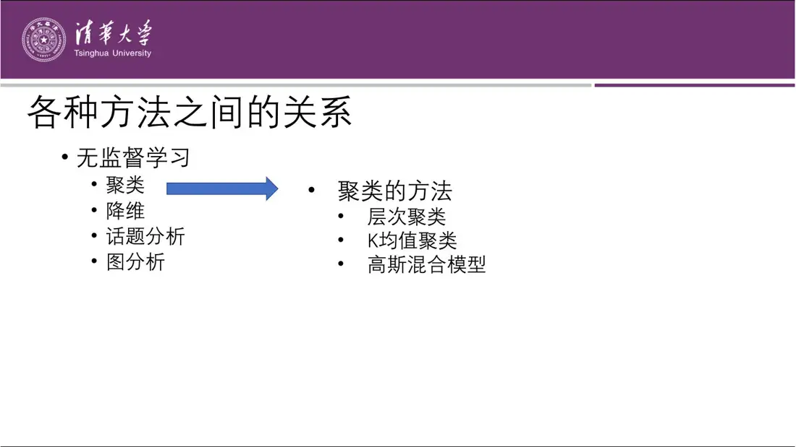

原文：

各种方法之间的关系

\- 无监督学习

\- 聚类

\- 降维

\- 聚类的方法

\- 话题分析

\- 层次聚类

\- 图分析

\- K均值聚类

\- 高斯混合模型

Tsinghua University
清華大學
1911-1911

### 各种方法之间的关系

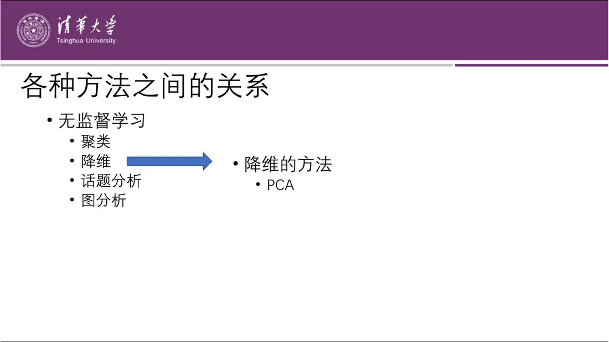

原文：

各种方法之间的关系

\- 无监督学习

\- 聚类

\- 降维

\- 话题分析

\- 降维的方法

\- 图分析

\- PCA

Tsinghua University
清華大學
1911-1911

### 各种方法之间的关系

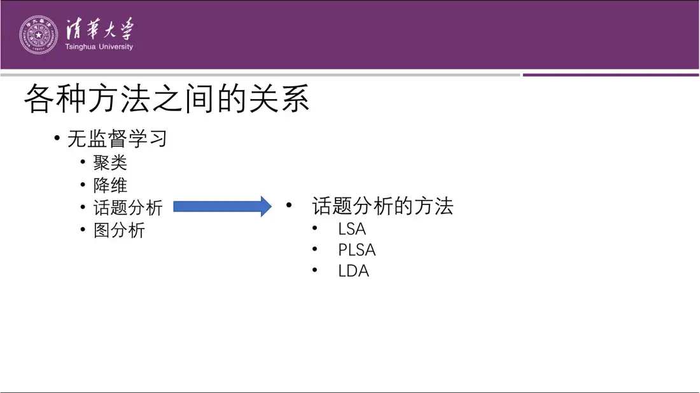

原文：

各种方法之间的关系

\- 无监督学习

\- 聚类

\- 降维

\- 话题分析

\- 话题分析的方法

\- 图分析

• LSA

\- PLSA

• LDA

Tsinghua University
清華大學
1911-1911

### 各种方法之间的关系

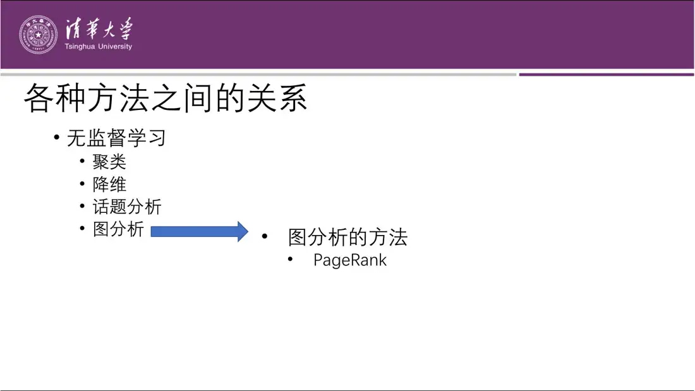

原文：

各种方法之间的关系

\- 无监督学习

\- 聚类

\- 降维

\- 话题分析

\- 图分析

\- 图分析的方法

\- PageRank

Tsinghua University
清華大學
1911-1911

### 各种方法之间的关系

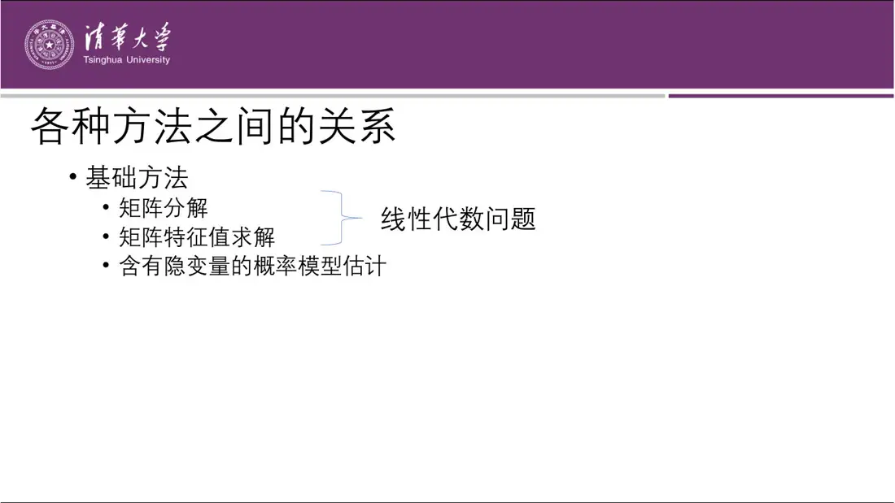

原文：

各种方法之间的关系

\- 基础方法

\- 矩阵分解

\- 矩阵特征值求解

线性代数问题

\- 含有隐变量的概率模型估计

Tsinghua University
清華大學
1911-

### 各种方法之间的关系

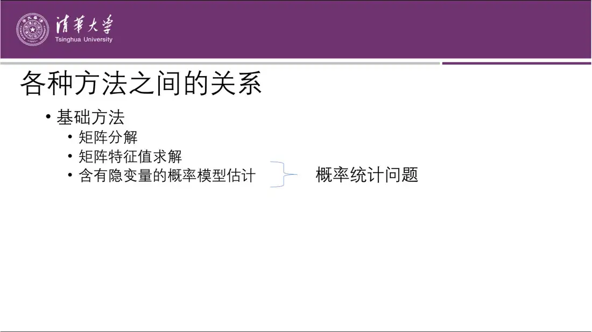

原文：

各种方法之间的关系

\- 基础方法

\- 矩阵分解

\- 矩阵特征值求解

\- 含有隐变量的概率模型估计

概率统计问题

Tsinghua University
清華大學
1911-

### 各种方法之间的关系

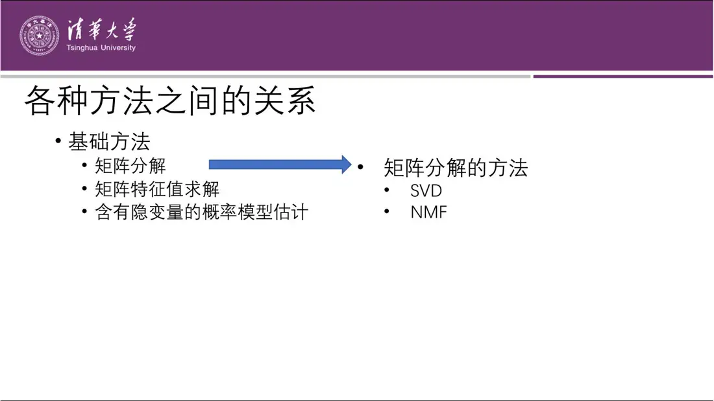

原文：

各种方法之间的关系

\- 基础方法

\- 矩阵分解

\- 矩阵特征值求解

\- 含有隐变量的概率模型估计

\- 矩阵分解的方法

• SVD

• NMF

Tsinghua University
清華大學
1911-1911

### 各种方法之间的关系

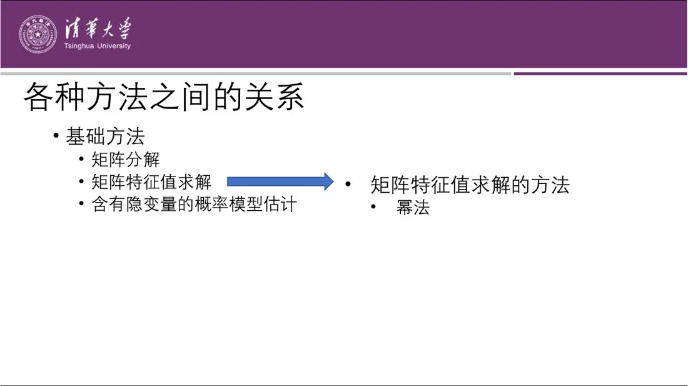

原文：

各种方法之间的关系

\- 基础方法

\- 矩阵分解

\- 矩阵特征值求解

\- 含有隐变量的概率模型估计

\- 矩阵特征值求解的方法

\- 幂法

Tsinghua University
清華大學
1911-1911

### 各种方法之间的关系

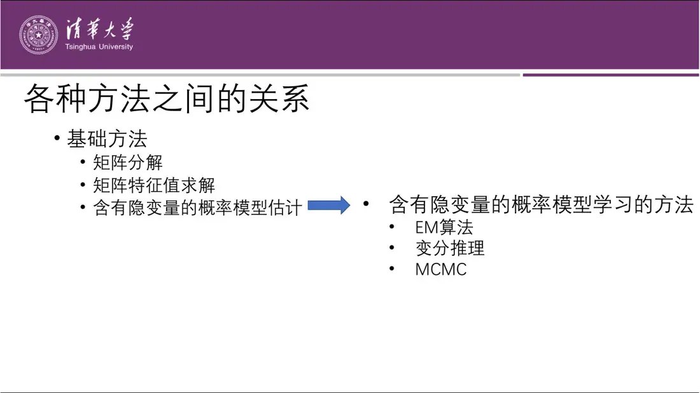

原文：

各种方法之间的关系

\- 基础方法

\- 矩阵分解

\- 矩阵特征值求解

\- 含有隐变量的概率模型估计

\- 含有隐变量的概率模型学习的方法

\- EM算法

\- 变分推理

• MCMC

Tsinghua University
清華大學
1911-1911

### 无监督学习方法

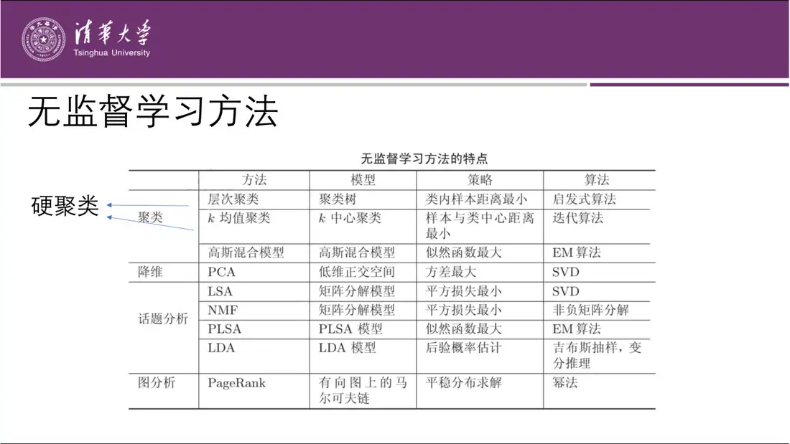

原文：

无监督学习方法

无监督学习方法的特点
<table><tr><td></td><td>方法</td><td>模型</td><td>策略</td><td>算法</td></tr><tr><td rowspan="3">聚类\硬聚类</td><td>层次聚类</td><td>聚类树</td><td>类内样本距离最小</td><td>启发式算法</td></tr><tr><td>k 均值聚类</td><td>k 中心聚类</td><td>样本与类中心距离最小</td><td>迭代算法</td></tr><tr><td>高斯混合模型</td><td>高斯混合模型</td><td>似然函数最大</td><td>EM 算法</td></tr><tr><td>降维</td><td>PCA</td><td>低维正交空间</td><td>方差最大</td><td>SVD</td></tr><tr><td rowspan="4">话题分析</td><td>LSA</td><td>矩阵分解模型</td><td>平方损失最小</td><td>SVD</td></tr><tr><td>NMF</td><td>矩阵分解模型</td><td>平方损失最小</td><td>非负矩阵分解</td></tr><tr><td>PLSA</td><td>PLSA 模型</td><td>似然函数最大</td><td>EM 算法</td></tr><tr><td>LDA</td><td>LDA 模型</td><td>后验概率估计</td><td>吉布斯抽样,变分推理</td></tr><tr><td>图分析</td><td>PageRank</td><td>有向图上的马尔可夫链</td><td>平稳分布求解</td><td>幂法</td></tr></table>

清華大學 Tsinghua University

### 无监督学习方法

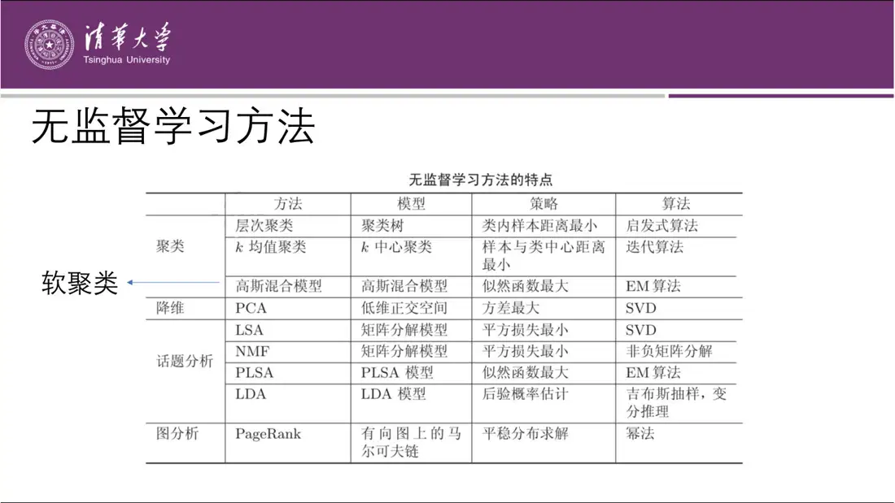

原文：

无监督学习方法

软聚类

无监督学习方法的特点
<table><tr><td></td><td>方法</td><td>模型</td><td>策略</td><td>算法</td></tr><tr><td rowspan="3">聚类</td><td>层次聚类</td><td>聚类树</td><td>类内样本距离最小</td><td>启发式算法</td></tr><tr><td>k 均值聚类</td><td>k 中心聚类</td><td>样本与类中心距离最小</td><td>迭代算法</td></tr><tr><td>高斯混合模型</td><td>高斯混合模型</td><td>似然函数最大</td><td>EM 算法</td></tr><tr><td>降维</td><td>PCA</td><td>低维正交空间</td><td>方差最大</td><td>SVD</td></tr><tr><td rowspan="4">话题分析</td><td>LSA</td><td>矩阵分解模型</td><td>平方损失最小</td><td>SVD</td></tr><tr><td>NMF</td><td>矩阵分解模型</td><td>平方损失最小</td><td>非负矩阵分解</td></tr><tr><td>PLSA</td><td>PLSA 模型</td><td>似然函数最大</td><td>EM 算法</td></tr><tr><td>LDA</td><td>LDA 模型</td><td>后验概率估计</td><td>吉布斯抽样,变分推理</td></tr><tr><td>图分析</td><td>PageRank</td><td>有向图上的马尔可夫链</td><td>平稳分布求解</td><td>幂法</td></tr></table>

清華大學 Tsinghua University

### 无监督学习方法

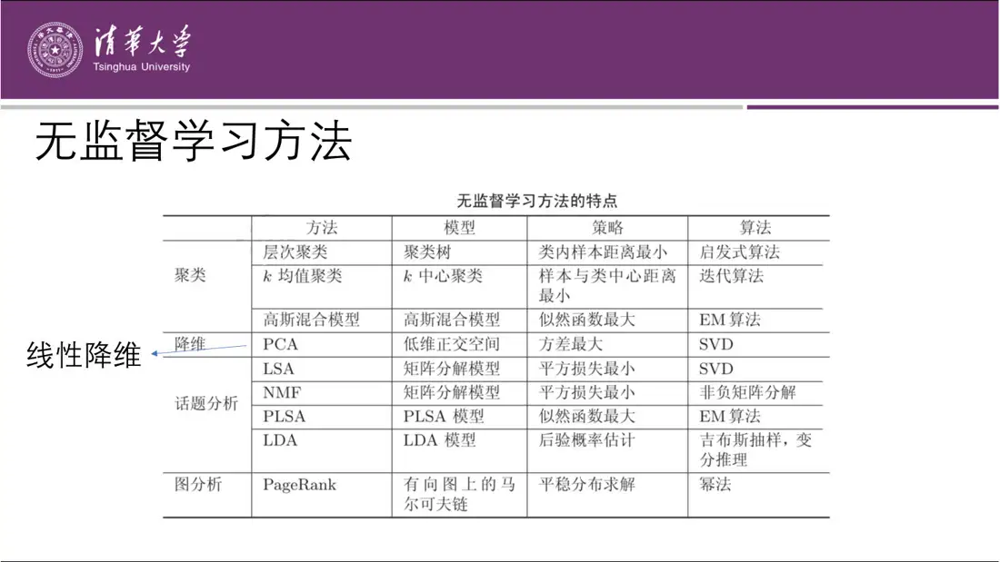

原文：

无监督学习方法

无监督学习方法的特点
<table><tr><td></td><td>方法</td><td>模型</td><td>策略</td><td>算法</td></tr><tr><td rowspan="3">聚类</td><td>层次聚类</td><td>聚类树</td><td>类内样本距离最小</td><td>启发式算法</td></tr><tr><td>k均值聚类</td><td>k中心聚类</td><td>样本与类中心距离最小</td><td>迭代算法</td></tr><tr><td>高斯混合模型</td><td>高斯混合模型</td><td>似然函数最大</td><td>EM算法</td></tr><tr><td>降维</td><td>PCA</td><td>低维正交空间</td><td>方差最大</td><td>SVD</td></tr><tr><td rowspan="4">话题分析</td><td>LSA</td><td>矩阵分解模型</td><td>平方损失最小</td><td>SVD</td></tr><tr><td>NMF</td><td>矩阵分解模型</td><td>平方损失最小</td><td>非负矩阵分解</td></tr><tr><td>PLSA</td><td>PLSA模型</td><td>似然函数最大</td><td>EM算法</td></tr><tr><td>LDA</td><td>LDA模型</td><td>后验概率估计</td><td>吉布斯抽样,变分推理</td></tr><tr><td>图分析</td><td>PageRank</td><td>有向图上的马尔可夫链</td><td>平稳分布求解</td><td>幂法</td></tr></table>

清華大學 Tsinghua University

### 无监督学习方法

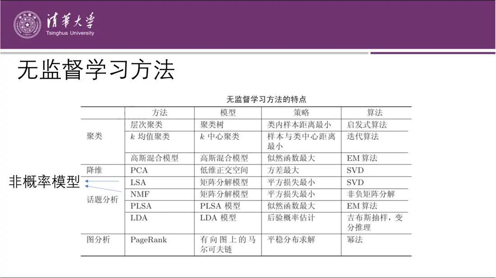

原文：

无监督学习方法

非概率模型

无监督学习方法的特点
<table><tr><td></td><td>方法</td><td>模型</td><td>策略</td><td>算法</td></tr><tr><td rowspan="3">聚类</td><td>层次聚类</td><td>聚类树</td><td>类内样本距离最小</td><td>启发式算法</td></tr><tr><td>k 均值聚类</td><td>k 中心聚类</td><td>样本与类中心距离最小</td><td>迭代算法</td></tr><tr><td>高斯混合模型</td><td>高斯混合模型</td><td>似然函数最大</td><td>EM 算法</td></tr><tr><td>降维</td><td>PCA</td><td>低维正交空间</td><td>方差最大</td><td>SVD</td></tr><tr><td rowspan="4">话题分析</td><td>LSA</td><td>矩阵分解模型</td><td>平方损失最小</td><td>SVD</td></tr><tr><td>NMF</td><td>矩阵分解模型</td><td>平方损失最小</td><td>非负矩阵分解</td></tr><tr><td>PLSA</td><td>PLSA 模型</td><td>似然函数最大</td><td>EM 算法</td></tr><tr><td>LDA</td><td>LDA 模型</td><td>后验概率估计</td><td>吉布斯抽样,变分推理</td></tr><tr><td>图分析</td><td>PageRank</td><td>有向图上的马尔可夫链</td><td>平稳分布求解</td><td>幂法</td></tr></table>

清華大學 Tsinghua University

### 无监督学习方法

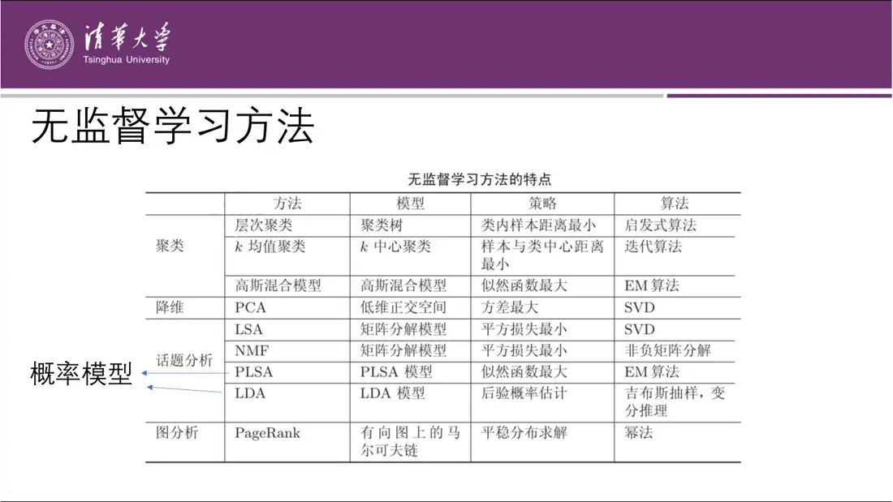

原文：

无监督学习方法

无监督学习方法的特点
<table><tr><td></td><td>方法</td><td>模型</td><td>策略</td><td>算法</td></tr><tr><td rowspan="3">聚类</td><td>层次聚类</td><td>聚类树</td><td>类内样本距离最小</td><td>启发式算法</td></tr><tr><td>k 均值聚类</td><td>k 中心聚类</td><td>样本与类中心距离最小</td><td>迭代算法</td></tr><tr><td>高斯混合模型</td><td>高斯混合模型</td><td>似然函数最大</td><td>EM 算法</td></tr><tr><td>降维</td><td>PCA</td><td>低维正交空间</td><td>方差最大</td><td>SVD</td></tr><tr><td rowspan="4">话题分析</td><td>LSA</td><td>矩阵分解模型</td><td>平方损失最小</td><td>SVD</td></tr><tr><td>NMF</td><td>矩阵分解模型</td><td>平方损失最小</td><td>非负矩阵分解</td></tr><tr><td>PLSA</td><td>PLSA 模型</td><td>似然函数最大</td><td>EM 算法</td></tr><tr><td>LDA</td><td>LDA 模型</td><td>后验概率估计</td><td>吉布斯抽样,变分推理</td></tr><tr><td>图分析</td><td>PageRank</td><td>有向图上的马尔可夫链</td><td>平稳分布求解</td><td>幂法</td></tr></table>

清華大學 Tsinghua University

### 基础机器学习方法

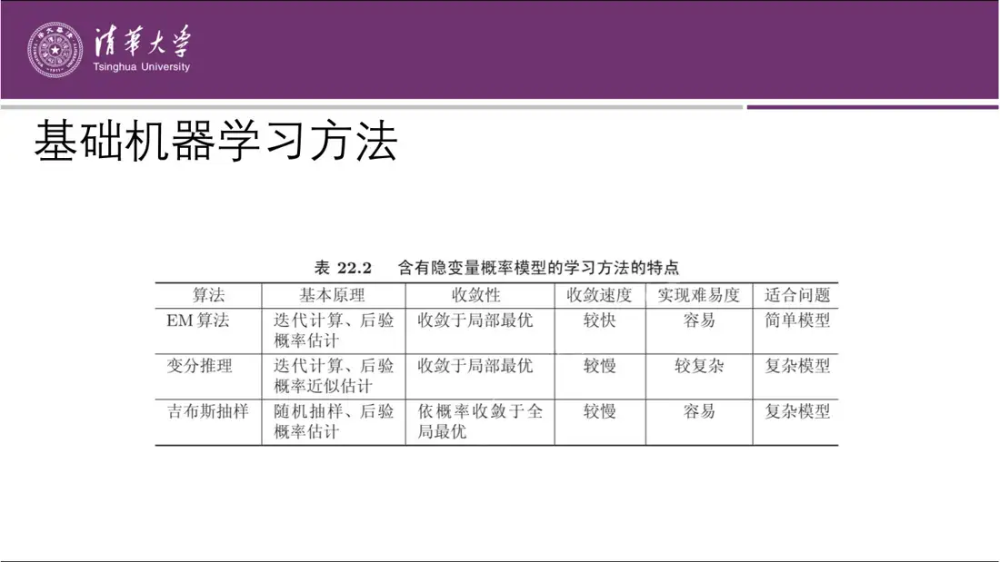

原文：

基础机器学习方法

表 22.2 含有隐变量概率模型的学习方法的特点
<table><tr><td>算法</td><td>基本原理</td><td>收敛性</td><td>收敛速度</td><td>实现难易度</td><td>适合问题</td></tr><tr><td>EM算法</td><td>迭代计算、后验概率估计</td><td>收敛于局部最优</td><td>较快</td><td>容易</td><td>简单模型</td></tr><tr><td>变分推理</td><td>迭代计算、后验概率近似估计</td><td>收敛于局部最优</td><td>较慢</td><td>较复杂</td><td>复杂模型</td></tr><tr><td>吉布斯抽样</td><td>随机抽样、后验概率估计</td><td>依概率收敛于全局最优</td><td>较慢</td><td>容易</td><td>复杂模型</td></tr></table>

清華大學 Tsinghua University

### 话题模型

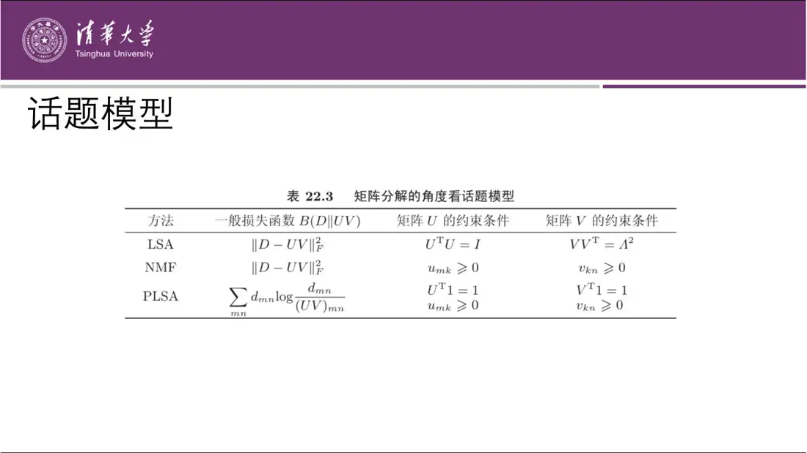

原文：

话题模型

表 22.3 矩阵分解的角度看话题模型
<table><tr><td>方法</td><td>一般损失函数  $B(D\|UV)$ </td><td>矩阵  $U$  的约束条件</td><td>矩阵  $V$  的约束条件</td></tr><tr><td>LSA</td><td> $\|D - UV\|_{F}^{2}$ </td><td> $U^{\mathrm{T}}U = I$ </td><td> $VV^{\mathrm{T}} = \Lambda^{2}$ </td></tr><tr><td>NMF</td><td> $\|D - UV\|_{F}^{2}$ </td><td> $u_{mk} \geqslant 0$ </td><td> $v_{kn} \geqslant 0$ </td></tr><tr><td>PLSA</td><td> $\sum_{mn} d_{mn} \log \frac{d_{mn}}{(UV)_{mn}}$ </td><td> $U^{\mathrm{T}}1 = 1$  $u_{mk} \geqslant 0$ </td><td> $V^{\mathrm{T}}1 = 1$  $v_{kn} \geqslant 0$ </td></tr></table>

清華大學 Tsinghua University

### 话题模型

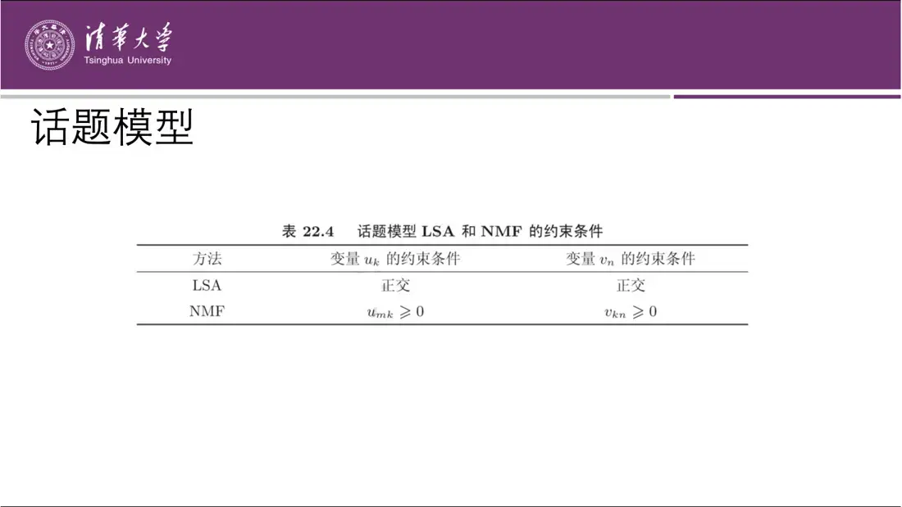

原文：

话题模型

表 22.4 话题模型 LSA 和 NMF 的约束条件
<table><tr><td>方法</td><td>变量  $u_k$  的约束条件</td><td>变量  $v_n$  的约束条件</td></tr><tr><td>LSA</td><td>正交</td><td>正交</td></tr><tr><td>NMF</td><td> $u_{mk} \geqslant 0$ </td><td> $v_{kn} \geqslant 0$ </td></tr></table>

清華大學 Tsinghua University
