# 《统计学习方法》第2版 第2章 感知机和总结（课件）

原件的每一页，下面附识别出的文字。

### 感知机和统计学习方法总结

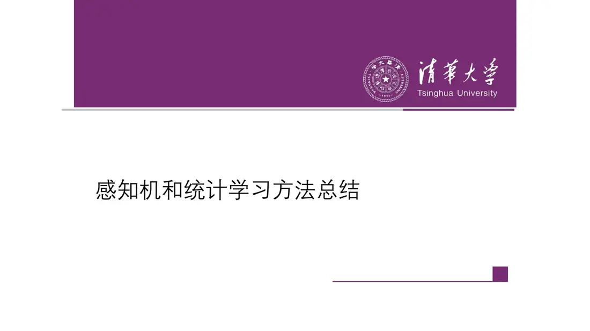

原文：

感知机和统计学习方法总结

大華津
TSINGHUA UNIVERSITY
清華大學
Tsinghua University

### 感知机(Perceptron)

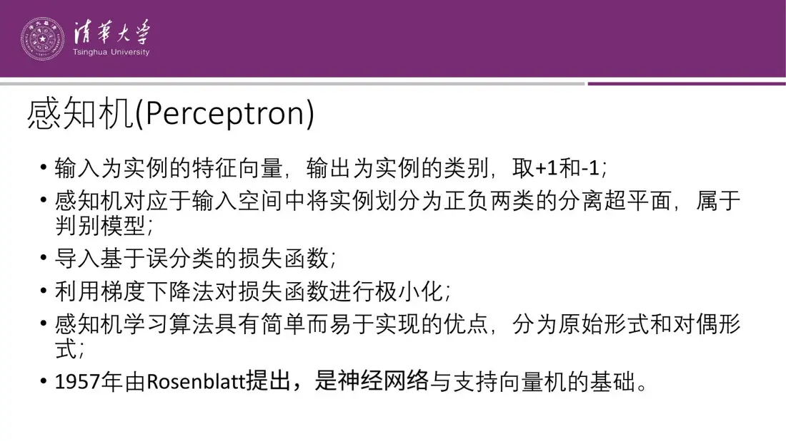

原文：

感知机(Perceptron)

\- 输入为实例的特征向量，输出为实例的类别，取+1和-1；

\- 感知机对应于输入空间中将实例划分为正负两类的分离超平面，属于判别模型；

\- 导入基于误分类的损失函数；

\- 利用梯度下降法对损失函数进行极小化;

\- 感知机学习算法具有简单而易于实现的优点，分为原始形式和对偶形式；

\- 1957年由Rosenblatt提出，是神经网络与支持向量机的基础。

Tsinghua University
清華大學
TSINGHUA UNIVERSITY
1911-

### 感知机模型

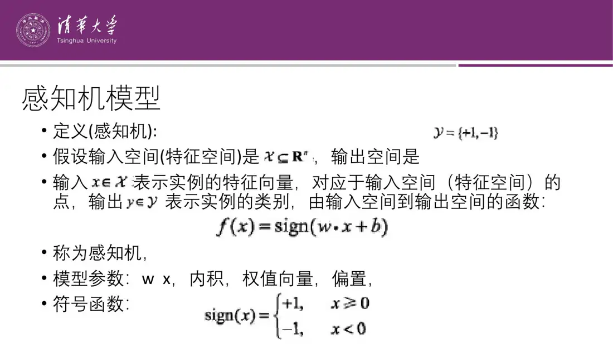

原文：

感知机模型

\- 定义(感知机):

$$
\mathcal {Y} = \{+ 1, - 1 \}
$$

\- 假设输入空间(特征空间)是 $\mathcal{X} \subseteq \mathbb{R}^n$ ，输出空间是

\- 输入 $x \in \mathcal{X}$ 表示实例的特征向量，对应于输入空间（特征空间）的点，输出 $y \in \mathcal{Y}$ 表示实例的类别，由输入空间到输出空间的函数：

$$
f (x) = \operatorname{sign} (w \cdot x + b)
$$

\- 称为感知机，

\- 模型参数：w x，内积，权值向量，偏置，

\- 符号函数:

$$
\operatorname{sign} (x) = \left\{ \begin{array}{l l} + 1, & x \geqslant 0 \\ - 1, & x <   0 \end{array} \right.
$$

Tsinghua University
清华大学

### 感知机模型

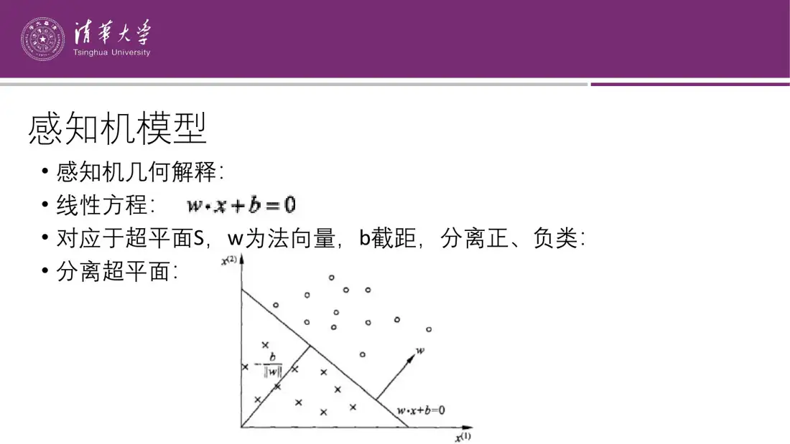

原文：

感知机模型

\- 感知机几何解释:

\- 线性方程: $w \cdot x + b = 0$

\- 对应于超平面S，w为法向量，b截距，分离正、负类：

\- 分离超平面:

Tsinghua University
清華大學
TSINGHUA UNIVERSITY
1911-

### 感知机学习策略

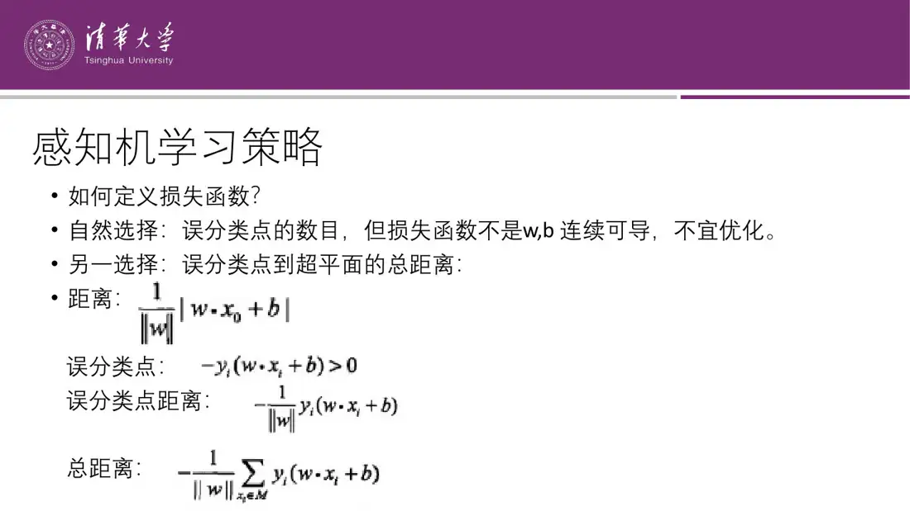

原文：

感知机学习策略

\- 如何定义损失函数？

\- 自然选择：误分类点的数目，但损失函数不是w,b连续可导，不宜优化。

\- 另一选择：误分类点到超平面的总距离：

\- 距离: $\frac{1}{\|w\|} |w - x_0 + b|$

误分类点: $-y_{i}(w \cdot x_{i} + b) > 0$

误分类点距离： $-\frac{1}{\|w\|} y_i(w \cdot x_i + b)$

总距离: $-\frac{1}{||w||}\sum_{x_i \in M} y_i (w \cdot x_i + b)$

Tsinghua University
清华大学

### 感知机学习策略

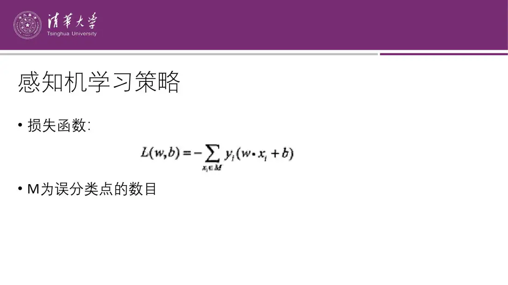

原文：

感知机学习策略

\- 损失函数:

$$
L (w, b) = - \sum_ {x _ {i} \in M} y _ {i} (w \cdot x _ {i} + b)
$$

\- M为误分类点的数目

Tsinghua University
清華大學
TSINGHUA UNIVERSITY
1911-

### 感知机学习算法

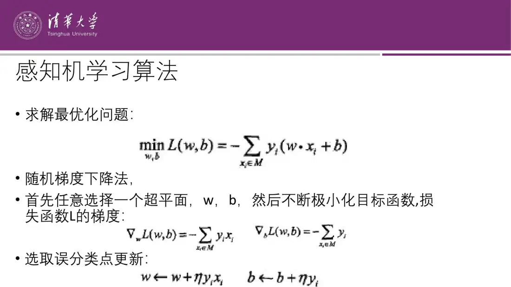

原文：

感知机学习算法

\- 求解最优化问题:

$$
\min _ {w, b} L (w, b) = - \sum_ {x _ {i} \in M} y _ {i} (w \cdot x _ {i} + b)
$$

\- 随机梯度下降法，

\- 首先任意选择一个超平面，w，b，然后不断极小化目标函数,损失函数L的梯度：

$$
\nabla_ {w} L (w, b) = - \sum_ {x _ {i} \in M} y _ {i} x _ {j} \quad \nabla_ {b} L (w, b) = - \sum_ {x _ {i} \in M} y _ {i}
$$

\- 选取误分类点更新:

$$
w \leftarrow w + \eta y _ {i} x _ {i} \quad b \leftarrow b + \eta y _ {i}
$$

Tsinghua University
清华大学

### 感知机学习算法

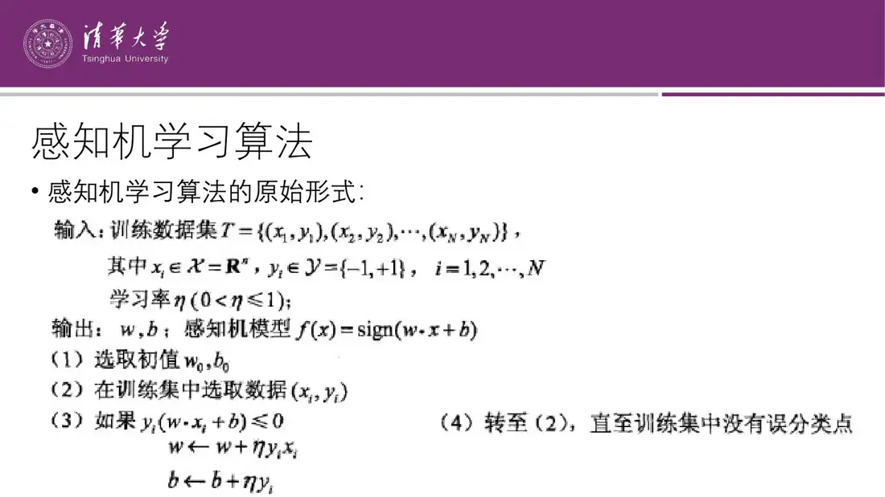

原文：

感知机学习算法

\- 感知机学习算法的原始形式:

输入：训练数据集 $T=\{(x_{1},y_{1}),(x_{2},y_{2}),\cdots,(x_{N},y_{N})\}$ ，

其中 $x_{i}\in \mathcal{X} = \mathbb{R}^{n},y_{i}\in \mathcal{Y} = \{-1, + 1\} ,i = 1,2,\dots ,N$

学习率 $\eta (0 < \eta \leqslant 1)$ ;

输出： $w,b$ ；感知机模型 $f(x) = \mathrm{sign}(w\cdot x + b)$

(1) 选取初值 $w_{0}, b_{0}$

(2) 在训练集中选取数据 $(x_{i}, y_{i})$

(3) 如果 $y_{i}(w \cdot x_{i} + b) \leqslant 0$ $w \leftarrow w + \eta y_{i} x_{i}$ $b \leftarrow b + \eta y_{i}$ (4) 转至 (2)，直至训练集中没有误分类点

Tsinghua University
清華大學
1911-

### 感知机学习算法

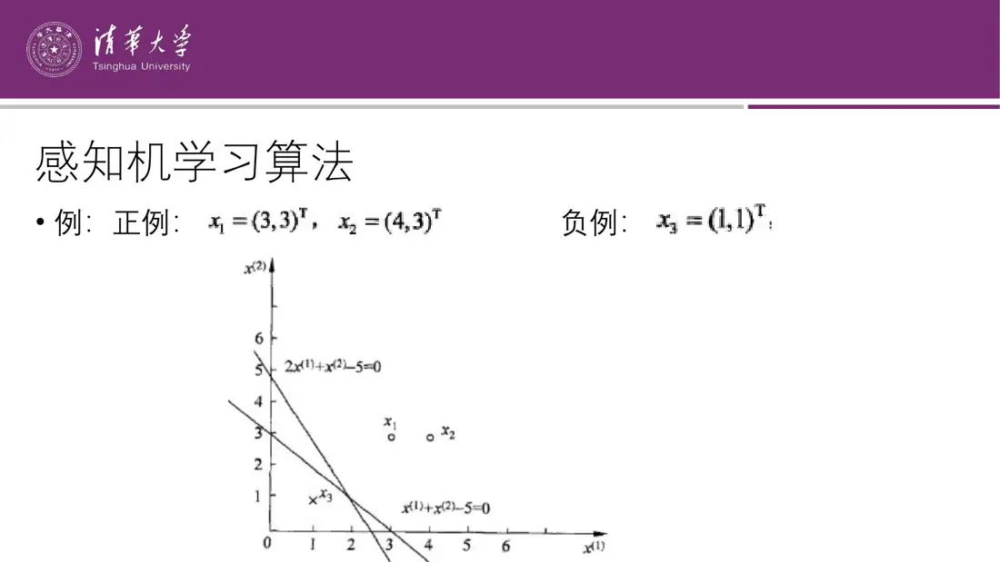

原文：

感知机学习算法

• 例：正例： $x_{1}=(3,3)^{\mathrm{T}}$ ， $x_{2}=(4,3)^{\mathrm{T}}$

负例： $x_{3} = (1,1)^{\mathrm{T}}$

Tsinghua University
清华大学

### 感知机学习算法

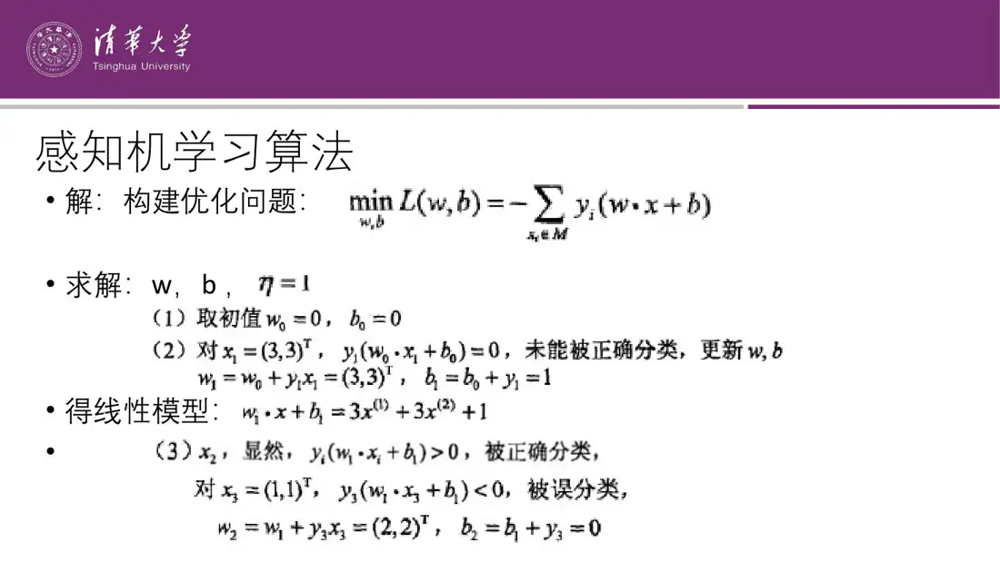

原文：

感知机学习算法

\- 解: 构建优化问题: $\min_{w,b} L(w, b) = -\sum_{x_i \in M} y_j (w \cdot x + b)$

\- 求解：w，b， $\eta = 1$

(1) 取初值 $w_{0}=0,\quad b_{0}=0$

(2) 对 $x_{1} = (3,3)^{\mathrm{T}}$ ， $y_{1}(w_{0}\cdot x_{1} + b_{0}) = 0$ ，未能被正确分类，更新 $w,b$

$$
w _ {1} = w _ {0} + y _ {1} x _ {1} = (3, 3) ^ {\mathrm{T}}, \quad b _ {1} = b _ {0} + y _ {1} = 1
$$

\- 得线性模型: $w_{1} \cdot x + b_{1} = 3x^{(1)} + 3x^{(2)} + 1$

(3) $x_{2}$ ，显然， $y_{i}(w_{1}\cdot x_{i}+b_{1})>0$ ，被正确分类，

对 $x_{3} = (1,1)^{\mathrm{T}},\quad y_{3}(w_{1}\cdot x_{3} + b_{1}) <   0$ ，被误分类，

$$
w _ {2} = w _ {1} + y _ {3} x _ {3} = (2, 2) ^ {T}, \quad b _ {2} = b _ {1} + y _ {3} = 0
$$

Tsinghua University
清华大学

### 感知机学习算法

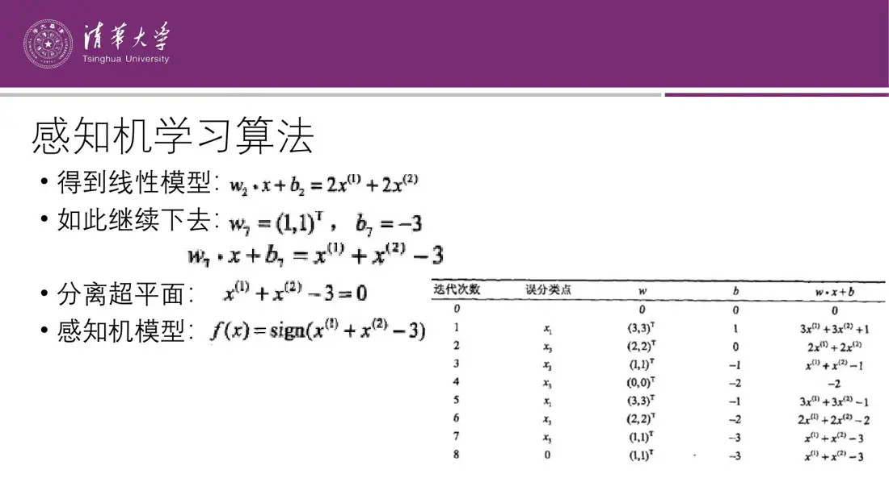

原文：

感知机学习算法

\- 得到线性模型: $w_{2} \cdot x + b_{2} = 2x^{(1)} + 2x^{(2)}$

\- 如此继续下去: $w_{7} = (1, 1)^{\mathrm{T}}$ , $b_{7} = -3$

$$
w _ {7} \cdot x + b _ {7} = x ^ {(1)} + x ^ {(2)} - 3
$$

\- 分离超平面: $x^{(1)} + x^{(2)} - 3 = 0$

\- 感知机模型: $f(x) = \mathrm{sign}(x^{(1)} + x^{(2)} - 3)$

<table><tr><td>迭代次数</td><td>误分类点</td><td>w</td><td>b</td><td> $w \cdot x + b$ </td></tr><tr><td>0</td><td></td><td>0</td><td>0</td><td>0</td></tr><tr><td>1</td><td> $x_1$ </td><td> $(3,3)^{\mathrm{T}}$ </td><td>1</td><td> $3x^{(1)}+3x^{(2)}+1$ </td></tr><tr><td>2</td><td> $x_3$ </td><td> $(2,2)^{\mathrm{T}}$ </td><td>0</td><td> $2x^{(1)}+2x^{(2)}$ </td></tr><tr><td>3</td><td> $x_3$ </td><td> $(1,1)^{\mathrm{T}}$ </td><td>-1</td><td> $x^{(1)}+x^{(2)}-1$ </td></tr><tr><td>4</td><td> $x_3$ </td><td> $(0,0)^{\mathrm{T}}$ </td><td>-2</td><td>-2</td></tr><tr><td>5</td><td> $x_1$ </td><td> $(3,3)^{\mathrm{T}}$ </td><td>-1</td><td> $3x^{(1)}+3x^{(2)}-1$ </td></tr><tr><td>6</td><td> $x_3$ </td><td> $(2,2)^{\mathrm{T}}$ </td><td>-2</td><td> $2x^{(1)}+2x^{(2)}-2$ </td></tr><tr><td>7</td><td> $x_3$ </td><td> $(1,1)^{\mathrm{T}}$ </td><td>-3</td><td> $x^{(1)}+x^{(2)}-3$ </td></tr><tr><td>8</td><td>0</td><td> $(1,1)^{\mathrm{T}}$ </td><td>-3</td><td> $x^{(1)}+x^{(2)}-3$ </td></tr></table>

Tsinghua University
清华大学

### 感知机学习算法

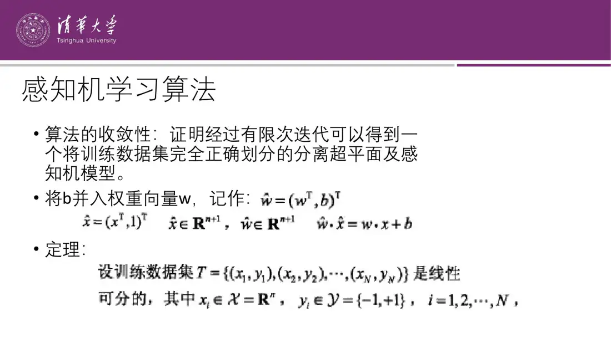

原文：

感知机学习算法

\- 算法的收敛性：证明经过有限次迭代可以得到一个将训练数据集完全正确划分的分离超平面及感知机模型。

\- 将b并入权重向量w，记作： $\hat{w} = (w^{\mathrm{T}}, b)^{\mathrm{T}}$

$$
\hat {x} = \left(x ^ {\mathrm{T}}, 1\right) ^ {\mathrm{T}} \quad \hat {x} \in \mathbf {R} ^ {n + 1}, \quad \hat {w} \in \mathbf {R} ^ {n + 1} \quad \hat {w} \cdot \hat {x} = w \cdot x + b
$$

\- 定理:

设训练数据集 $T=\{(x_{1},y_{1}),(x_{2},y_{2}),\cdots,(x_{N},y_{N})\}$ 是线性

可分的，其中 $x_{i}\in \mathcal{X} = \mathbb{R}^{n}$ ， $y_{i}\in \mathcal{Y} = \{-1, + 1\}$ ， $i = 1,2,\dots ,N$

Tsinghua University
清华大学

### 感知机学习算法

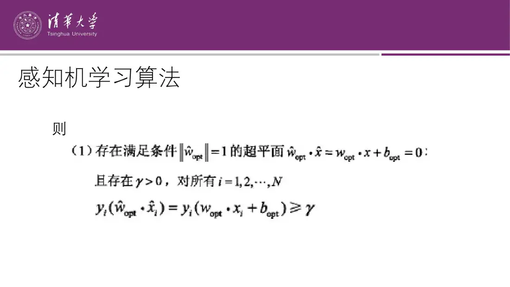

原文：

感知机学习算法

则

(1) 存在满足条件 $\left\|\hat{w}_{opt}\right\|=1$ 的超平面 $\hat{w}_{opt} \cdot \hat{x} = w_{opt} \cdot x + b_{opt} = 0$ 且存在 $\gamma > 0$ ，对所有 $i = 1, 2, \cdots, N$ $y_{i}(\hat{w}_{opt} \cdot \hat{x}_{i}) = y_{i}(w_{opt} \cdot x_{i} + b_{opt}) \geqslant \gamma$

Tsinghua University
清华大学

### 感知机学习算法

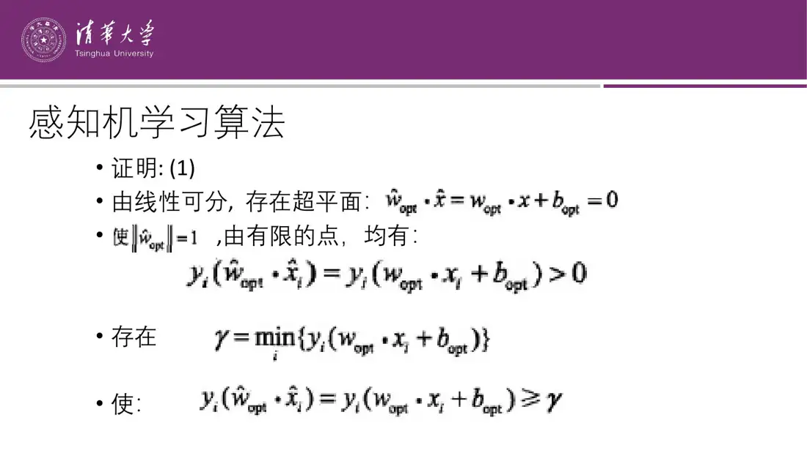

原文：

感知机学习算法

\- 证明: (1)

\- 由线性可分，存在超平面： $\hat{w}_{\text {opt}} \cdot \hat{x} = w_{\text {opt}} \cdot x + b_{\text {opt}} = 0$

\- 使 $\left\| \hat{w}_{\mathrm{opt}} \right\| = 1$ ，由有限的点，均有：

$$
y _ {i} \left(\hat {w} _ {\text { opt }} \cdot \hat {x} _ {i}\right) = y _ {i} \left(w _ {\text { opt }} \cdot x _ {i} + b _ {\text { opt }}\right) > 0
$$

\- 存在 $\gamma = \min_{i}\{y_{i}(w_{opt} \cdot x_{j} + b_{opt})\}$

\- 使: $y_{i}(\hat{w}_{\mathrm{opt}} \cdot \hat{x}_{j}) = y_{i}(w_{\mathrm{opt}} \cdot x_{j} + b_{\mathrm{opt}}) \geqslant \gamma$

Tsinghua University
清华大学

### 感知机学习算法

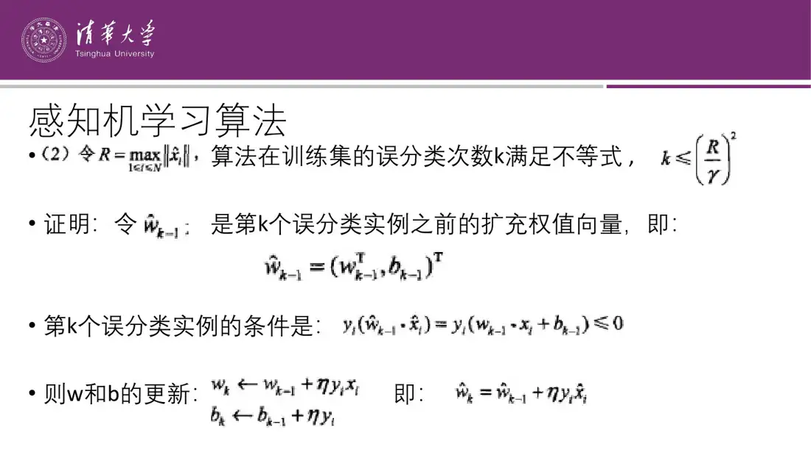

原文：

感知机学习算法

• (2) 令 $R = \max_{1 \leqslant i \leqslant N} \| \hat{x}_i \|$ ，算法在训练集的误分类次数k满足不等式， $k \leqslant \left( \frac{R}{\gamma} \right)^2$

\- 证明：令 $\hat{w}_{k-1}$ ；是第k个误分类实例之前的扩充权值向量，即：

$$
\hat {w} _ {k - 1} = (w _ {k - 1} ^ {\mathrm{T}}, b _ {k - 1}) ^ {\mathrm{T}}
$$

\- 第k个误分类实例的条件是： $y_{i}(\hat{w}_{k-1} \cdot \hat{x}_{i}) = y_{i}(w_{k-1} \cdot x_{i} + b_{k-1}) \leqslant 0$

\- 则w和b的更新: $w_k \leftarrow w_{k-1} + \eta y_i x_i$ 即: $\hat{w}_k = \hat{w}_{k-1} + \eta y_i \hat{x}_i$

Tsinghua University
清华大学

### 感知机学习算法

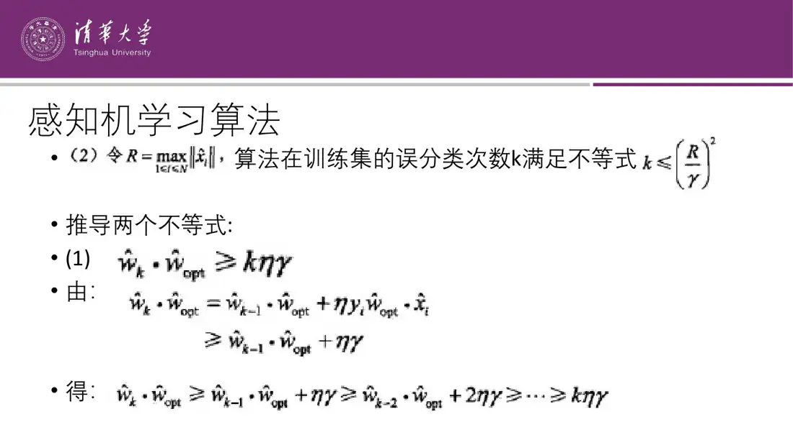

原文：

感知机学习算法

• (2) 令 $R = \max_{1 \leqslant i \leqslant N} \left\| \hat{x}_i \right\|$ ，算法在训练集的误分类次数 k 满足不等式 $k \leqslant \left( \frac{R}{\gamma} \right)^2$

\- 推导两个不等式:

• (1) $\hat{w}_{k} \cdot \hat{w}_{opt} \geq k\eta\gamma$

· 由：

$$
\begin{array}{r l} \hat {w} _ {k} \cdot \hat {w} _ {\text { opt }} & = \hat {w} _ {k - 1} \cdot \hat {w} _ {\text { opt }} + \eta y _ {i} \hat {w} _ {\text { opt }} \cdot \hat {x} _ {i} \\ & \geqslant \hat {w} _ {k - 1} \cdot \hat {w} _ {\text { opt }} + \eta \gamma \end{array}
$$

\- 得: $\hat{w}_k \cdot \hat{w}_{\mathrm{opt}} \geqslant \hat{w}_{k-1} \cdot \hat{w}_{\mathrm{opt}} + \eta \gamma \geqslant \hat{w}_{k-2} \cdot \hat{w}_{\mathrm{opt}} + 2 \eta \gamma \geqslant \cdots \geqslant k \eta \gamma$

Tsinghua University
清华大学

### 感知机学习算法

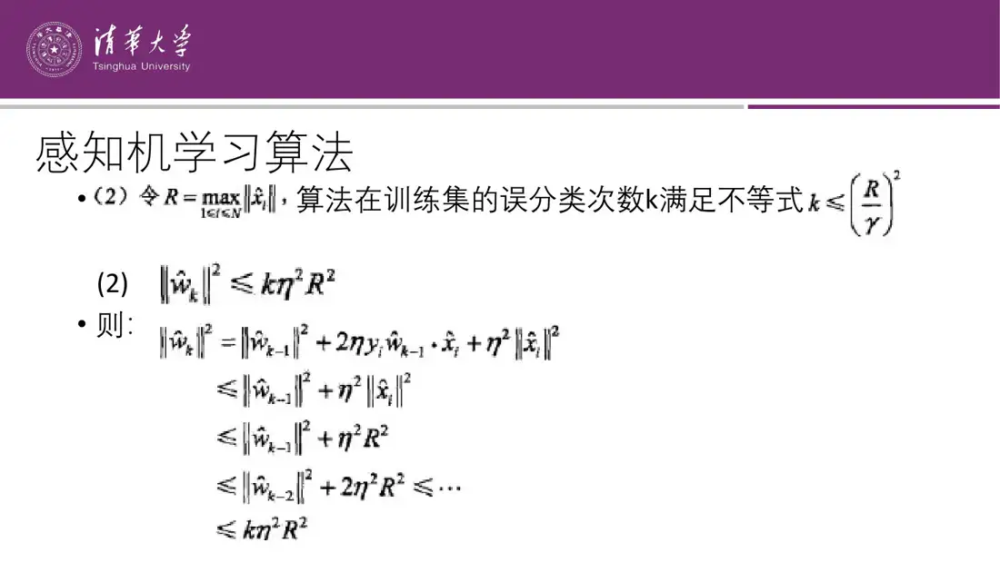

原文：

感知机学习算法

• (2) 令 $R = \max_{1 \leqslant i \leqslant N} \| \hat{x}_i \|$ ，算法在训练集的误分类次数k满足不等式 $k \leqslant \left( \frac{R}{\gamma} \right)^2$ (2) $\| \hat{w}_k \|^2 \leqslant k \eta^2 R^2$ • 则: $\| \hat{w}_k \|^2 = \| \hat{w}_{k-1} \|^2 + 2 \eta y_i \hat{w}_{k-1} \cdot \hat{x}_i + \eta^2 \| \hat{x}_i \|^2$ $\leqslant \| \hat{w}_{k-1} \|^2 + \eta^2 \| \hat{x}_i \|^2$ $\leqslant \| \hat{w}_{k-1} \|^2 + \eta^2 R^2$ $\leqslant \| \hat{w}_{k-2} \|^2 + 2 \eta^2 R^2 \leqslant \dots$ $\leqslant k \eta^2 R^2$

Tsinghua University
清华大学

### 感知机学习算法

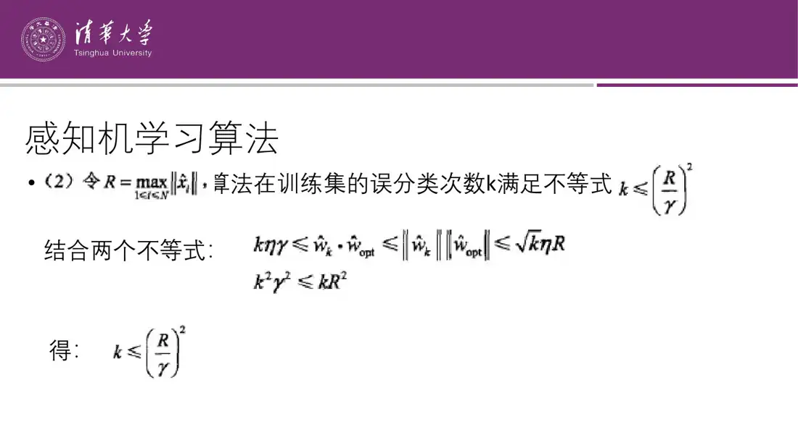

原文：

感知机学习算法

• (2) 令 $R = \max_{1 \leqslant i \leqslant N} \left\| \hat{x}_i \right\|$ ，算法在训练集的误分类次数 k 满足不等式 $k \leqslant \left( \frac{R}{\gamma} \right)^2$ 结合两个不等式： $k\eta\gamma\leqslant\hat{w}_{k}\cdot\hat{w}_{opt}\leqslant\left\|\hat{w}_{k}\right\|\left\|\hat{w}_{opt}\right\|\leqslant\sqrt{k}\eta R$ $k^{2}\gamma^{2}\leqslant kR^{2}$ 得： $k \leqslant \left(\frac{R}{\gamma}\right)^{2}$

Tsinghua University
清华大学

### 感知机学习算法

原文：

感知机学习算法

\- 定理表明:

\- 误分类的次数k是有上界的，当训练数据集线性可分时，感知机学习算法原始形式迭代是收敛的。

\- 感知机算法存在许多解，既依赖于初值，也依赖迭代过程中误分类点的选择顺序。

\- 为得到唯一分离超平面，需要增加约束，如SVM。

\- 线性不可分数据集，迭代震荡。

Tsinghua University
清華大學
TSINGHUA UNIVERSITY
1911-

### 感知机学习算法

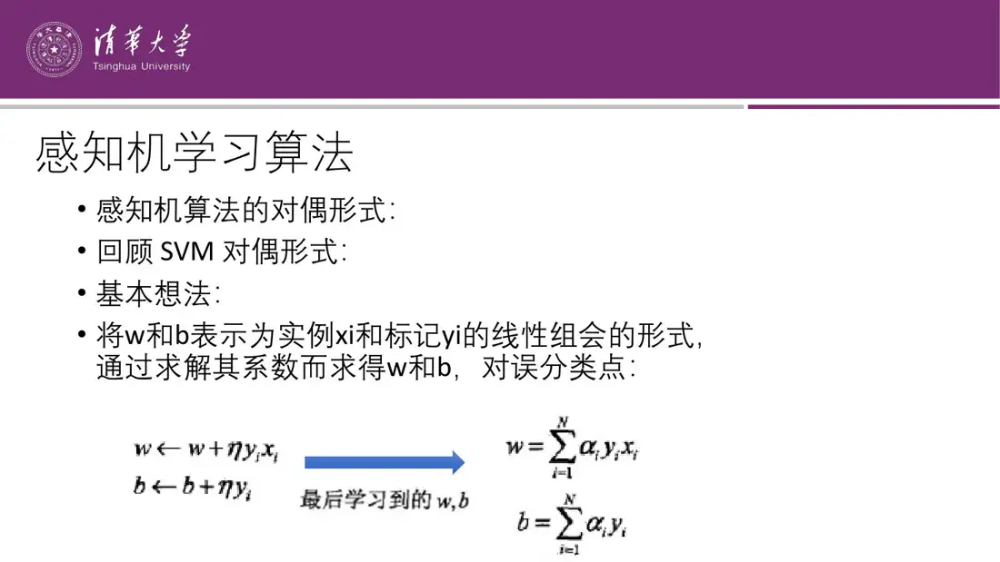

原文：

感知机学习算法

\- 感知机算法的对偶形式:

\- 回顾 SVM 对偶形式:

\- 基本想法:

\- 将w和b表示为实例xi和标记yi的线性组会的形式,通过求解其系数而求得w和b,对误分类点:

$$
\begin{array}{r l r} {w \leftarrow w + \eta y _ {i} x _ {i}} & {\longrightarrow} & {w =  \sum_ {i = 1} ^ {N} \alpha_ {i} y _ {i} x _ {i}} \\ {b \leftarrow b + \eta y _ {i}} & {\text {最后学习到的} w, b} & {b =  \sum_ {i = 1} ^ {N} \alpha_ {i} y _ {i}} \end{array}
$$

Tsinghua University
清华大学

### 感知机学习算法

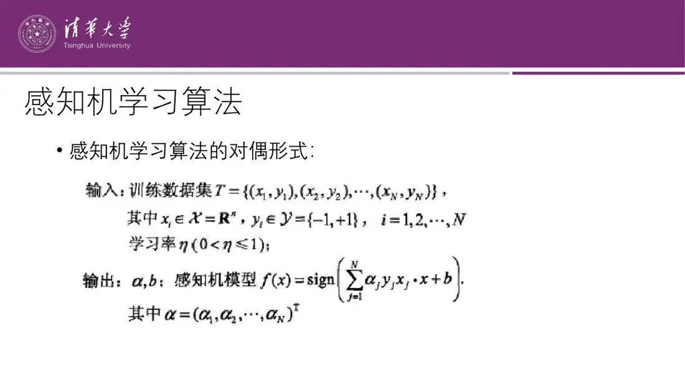

原文：

感知机学习算法

\- 感知机学习算法的对偶形式:

输入：训练数据集 $T=\{(x_{1},y_{1}),(x_{2},y_{2}),\cdots,(x_{N},y_{N})\}$ ，
其中 $x_{i}\in X=R^{n}, y_{i}\in Y=\{-1,+1\}, i=1,2,\cdots,N$ 学习率 $\eta(0<\eta\leqslant1)$ ;

输出： $\alpha,b$ ；感知机模型 $f(x)=\mathrm{sign}\left(\sum_{j=1}^{N}\alpha_{j}y_{j}x_{j}\cdot x+b\right)$ 其中 $\alpha=(\alpha_{1},\alpha_{2},\cdots,\alpha_{N})^{\mathrm{T}}$

Tsinghua University
清華大學
TSINGHUA UNIVERSITY
1911-

### 感知机学习算法

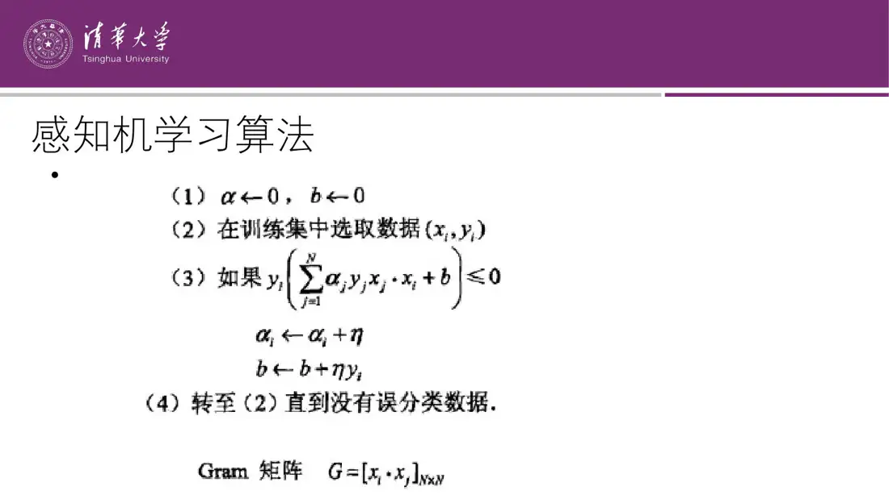

原文：

感知机学习算法

(1) $\alpha \leftarrow 0, b \leftarrow 0$

(2) 在训练集中选取数据 $(x_{i}, y_{i})$

(3) 如果 $y_{j}\left(\sum_{j=1}^{N}\alpha_{j}y_{j}x_{j}\cdot x_{i}+b\right)\leqslant0$

$$
\alpha_ {i} \leftarrow \alpha_ {i} + \eta
$$

$$
b \leftarrow b + \eta y _ {i}
$$

(4) 转至 (2) 直到没有误分类数据.

Gram 矩阵

$$
G = \left[ x _ {i} \cdot x _ {j} \right] _ {N \times Y}
$$

Tsinghua University
清华大学

### 感知机学习算法

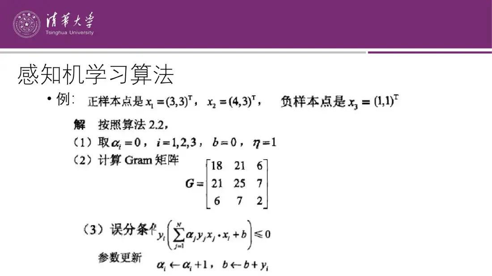

原文：

感知机学习算法

• 例: 正样本点是 $x_{1} = (3,3)^{\mathrm{T}}$ , $x_{2} = (4,3)^{\mathrm{T}}$ , 负样本点是 $x_{3} = (1,1)^{\mathrm{T}}$

解 按照算法2.2，

(1) 取 $\alpha_{i}=0,\quad i=1,2,3,\quad b=0,\quad \eta=1$

(2) 计算 Gram 矩阵

$$
\boldsymbol {G} = \left[ \begin{array}{l l l} 1 8 & 2 1 & 6 \\ 2 1 & 2 5 & 7 \\ 6 & 7 & 2 \end{array} \right]
$$

(3) 误分条件 $y_{i}\left(\sum_{j=1}^{N}\alpha_{j}y_{j}x_{j}\cdot x_{j}+b\right)\leqslant0$ 参数更新 $\alpha_{i}\leftarrow\alpha_{i}+1,\quad b\leftarrow b+y_{i}$

Tsinghua University
清华大学

### 感知机学习算法

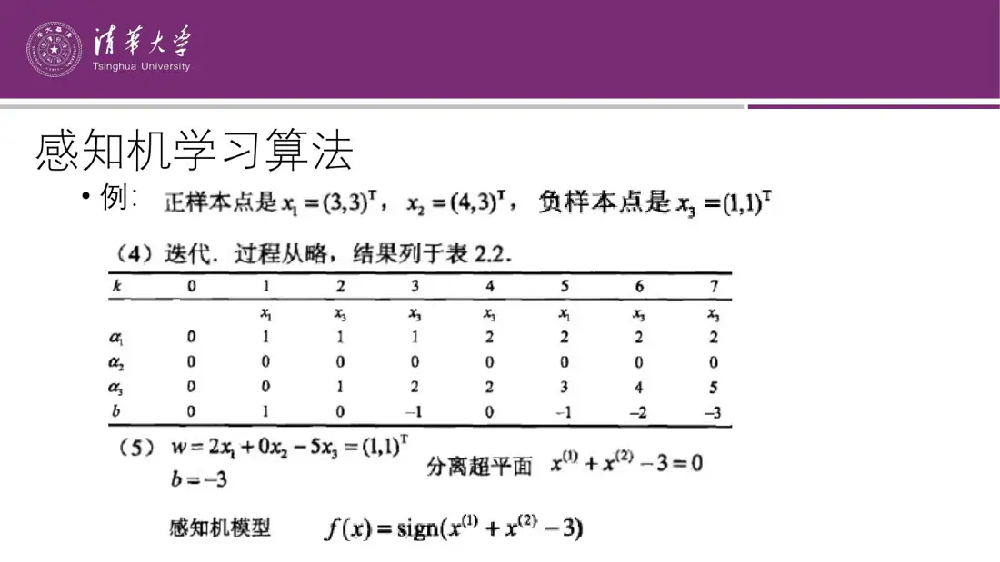

原文：

感知机学习算法

• 例：正样本点是 $x_{1} = (3,3)^{\mathrm{T}}$ ， $x_{2} = (4,3)^{\mathrm{T}}$ ，负样本点是 $x_{3} = (1,1)^{\mathrm{T}}$

(4) 迭代. 过程从略, 结果列于表 2.2.

<table><tr><td>k</td><td>0</td><td>1</td><td>2</td><td>3</td><td>4</td><td>5</td><td>6</td><td>7</td></tr><tr><td></td><td></td><td> $x_1$ </td><td> $x_3$ </td><td> $x_3$ </td><td> $x_3$ </td><td> $x_1$ </td><td> $x_3$ </td><td> $x_3$ </td></tr><tr><td> $α_1$ </td><td>0</td><td>1</td><td>1</td><td>1</td><td>2</td><td>2</td><td>2</td><td>2</td></tr><tr><td> $α_2$ </td><td>0</td><td>0</td><td>0</td><td>0</td><td>0</td><td>0</td><td>0</td><td>0</td></tr><tr><td> $α_3$ </td><td>0</td><td>0</td><td>1</td><td>2</td><td>2</td><td>3</td><td>4</td><td>5</td></tr><tr><td>b</td><td>0</td><td>1</td><td>0</td><td>-1</td><td>0</td><td>-1</td><td>-2</td><td>-3</td></tr></table>

(5) $w = 2x_{1} + 0x_{2} - 5x_{3} = (1,1)^{\mathrm{T}}$ $b = -3$

分离超平面 $x^{(1)} + x^{(2)} - 3 = 0$

感知机模型

$$
f (x) = \operatorname{sign} \left(x ^ {(1)} + x ^ {(2)} - 3\right)
$$

Tsinghua University
清华大学

### 统计学习方法总结

原文：

统计学习方法总结

\- 感知机

\- K近邻法

\- 朴素贝叶斯

\- 决策树

\- 逻辑斯蒂回归与最大熵模型

\- 支持向量机

\- 提升方法

\- EM算法

\- 隐马尔科夫模型

\- 条件随机场

Tsinghua University
清華大學
TSINGHUA UNIVERSITY
1911-

### 表 12.1 10 种统计学习方法特点的概括总结

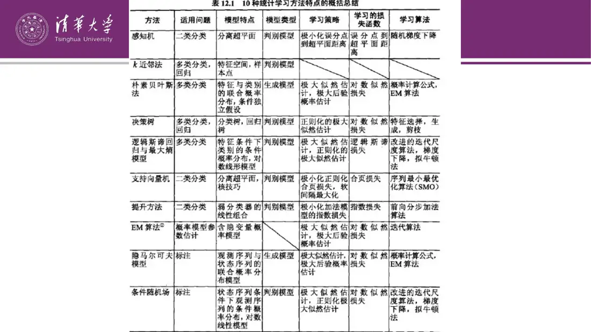

原文：

<table><tr><td>方法</td><td>适用问题</td><td>模型特点</td><td>模型类型</td><td>学习策略</td><td>学习的损失函数</td><td>学习算法</td></tr><tr><td>感知机</td><td>二类分类</td><td>分离超平面</td><td>判别模型</td><td>极小化误分点到超平面距离</td><td>误分点到超平面距离</td><td>随机梯度下降</td></tr><tr><td>k近邻法</td><td>多类分类,回归</td><td>特征空间,样本点</td><td>判别模型</td><td></td><td></td><td></td></tr><tr><td>朴素贝叶斯法</td><td>多类分类</td><td>特征与类别的联合概率分布,条件独立假设</td><td>生成模型</td><td>极大似然估计,极大后验概率估计</td><td>对数似然损失</td><td>概率计算公式,EM算法</td></tr><tr><td>决策树</td><td>多类分类,回归</td><td>分类树,回归树</td><td>判别模型</td><td>正则化的极大似然估计</td><td>对数似然损失</td><td>特征选择,生成,剪枝</td></tr><tr><td>逻辑斯谛回归与最大熵模型</td><td>多类分类</td><td>特征条件下类别的条件概率分布,对数线形模型</td><td>判别模型</td><td>极大似然估计,正则化的极大似然估计</td><td>逻辑斯谛损失</td><td>改进的迭代尺度算法,梯度下降,拟牛顿法</td></tr><tr><td>支持向量机</td><td>二类分类</td><td>分离超平面,核技巧</td><td>判别模型</td><td>极小化正则化合页损失,软间隔最大化</td><td>合页损失</td><td>序列最小最优化算法(SMO)</td></tr><tr><td>提升方法</td><td>二类分类</td><td>弱分类器的线性组合</td><td>判别模型</td><td>极小化加法模型的指数损失</td><td>指数损失</td><td>前向分步加法算法</td></tr><tr><td>EM算法 $^{\text{2}}$ </td><td>概率模型参数估计</td><td>含隐变量概率模型</td><td></td><td>极大似然估计,极大后验概率估计</td><td>对数似然损失</td><td>迭代算法</td></tr><tr><td>隐马尔可夫模型</td><td>标注</td><td>观测序列与状态序列的联合概率分布模型</td><td>生成模型</td><td>极大似然估计,极大后验概率估计</td><td>对数似然损失</td><td>概率计算公式,EM算法</td></tr><tr><td>条件随机场</td><td>标注</td><td>状态序列条件下观测序列的条件概率分布,对数线性模型</td><td>判别模型</td><td>极大似然估计,正则化极大似然估计</td><td>对数似然损失</td><td>改进的迭代尺度算法,梯度下降,拟牛顿法</td></tr></table>

表 12.1 10 种统计学习方法特点的概括总结

Tsinghua University
清華大學
TSINGHUA UNIVERSITY
1911-

### • END

原文：

• END

• Q&R

Tsinghua University
清華大學
TSINGHUA UNIVERSITY
1911-
