# 《统计学习方法》第2版 第8章 Adaboost（课件）

原件的每一页，下面附识别出的文字。

### 第八章 Adaboost

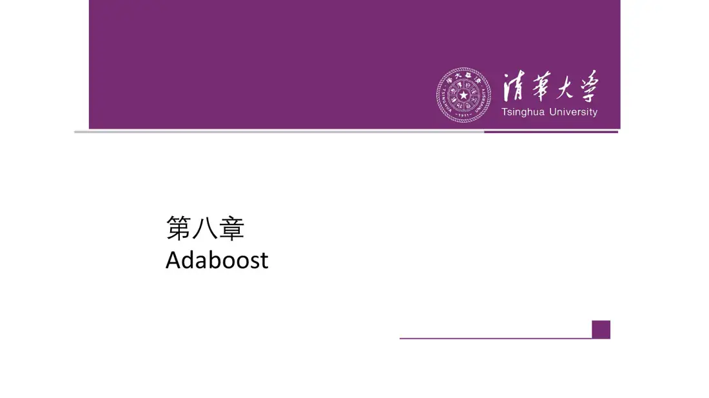

原文：

第八章 Adaboost

大華洋
TSINGHUA UNIVERSITY
清華大學
Tsinghua University

### 提纲

原文：

提纲

\- AdaBoost的起源和基本概念

\- AdaBoost算法

\- 前向分步训练算法

\- AdaBoost 编程

\- AdaBoost实时人脸检测算法

Tsinghua University
清華大學
1911-

### Adaboost的起源

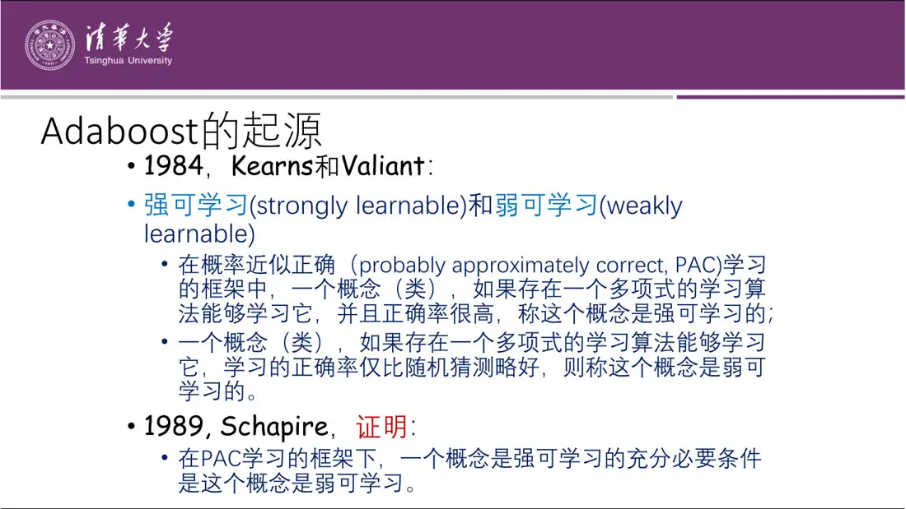

原文：

Adaboost的起源

• 1984, Kearns和Valiant:

\- 强可学习(strongly learnable)和弱可学习(weakly learnable)

\- 在概率近似正确（probably approximately correct, PAC)学习的框架中，一个概念（类），如果存在一个多项式的学习算法能够学习它，并且正确率很高，称这个概念是强可学习的；

\- 一个概念（类），如果存在一个多项式的学习算法能够学习它，学习的正确率仅比随机猜测略好，则称这个概念是弱可学习的。

• 1989, Schapire, 证明:

\- 在PAC学习的框架下，一个概念是强可学习的充分必要条件是这个概念是弱可学习。

清華大學 Tsinghua University

### Adaboost的起源

原文：

Adaboost的起源

\- 问题的提出:

\- 只要找到一个比随机猜测略好的弱学习算法就可以直接将其提升为强学习算法，而不必直接去找很难获得的强学习算法。

Tsinghua University
清華大學
1911-1911

### 怎样实现弱学习转为强学习

原文：

怎样实现弱学习转为强学习

例如：学习算法A在a情况下失效，学习算法B在b情况下失效，那么在a情况下可以用B算法，在b情况下可以用A算法解决。这说明通过某种合适的方式把各种算法组合起来，可以提高准确率。

为实现弱学习互补，面临两个问题：

(1) 怎样获得不同的弱分类器?

(2) 怎样组合弱分类器?

清華大學 Tsinghua University

### 怎样获得不同的弱分类器

原文：

怎样获得不同的弱分类器

◆ 使用不同的弱学习算法得到不同基本学习器

◆ 参数估计、非参数估计…

◆ 使用相同的弱学习算法，但用不同的参数

◆K-Mean不同的K，神经网络不同的隐含层…

◆相同输入对象的不同表示凸显事物不同的特征

◆ 使用不同的训练集

装袋（bagging）

提升（boosting）

Tsinghua University
清華大學
1911-

### Bagging

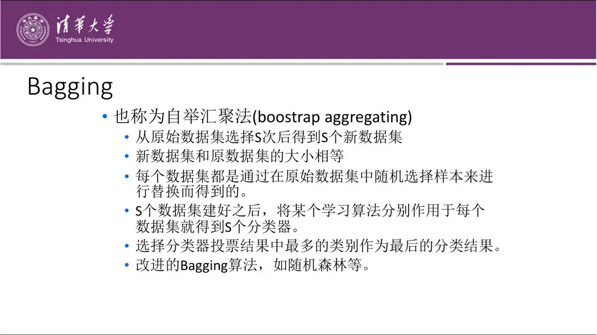

原文：

Bagging

\- 也称为自举汇聚法(bootstrap aggregating)

\- 从原始数据集选择S次后得到S个新数据集

\- 新数据集和原数据集的大小相等

\- 每个数据集都是通过在原始数据集中随机选择样本来进行替换而得到的。

\- S个数据集建好之后，将某个学习算法分别作用于每个数据集就得到S个分类器。

\- 选择分类器投票结果中最多的类别作为最后的分类结果。

\- 改进的Bagging算法，如随机森林等。

Tsinghua University
清華大學

### 怎样组合弱分类器

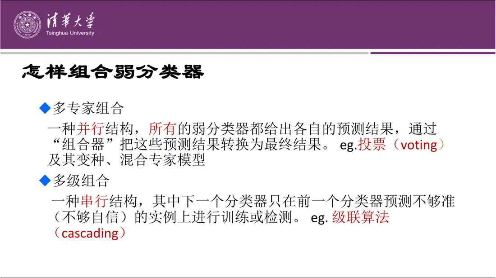

原文：

怎样组合弱分类器

◆ 多专家组合

一种并行结构，所有的弱分类器都给出各自的预测结果，通过“组合器”把这些预测结果转换为最终结果。eg.投票（voting）及其变种、混合专家模型

◆ 多级组合

一种串行结构，其中下一个分类器只在前一个分类器预测不够准（不够自信）的实例上进行训练或检测。eg. 级联算法
(cascading)

清華大學 Tsinghua University

### Adaboost的提出

原文：

Adaboost的提出

\- 1990年，Schapire最先构造出一种多项式级的算法，即最初的Boost算法；

\- 1993年，Drunker和Schapire第一次将神经网络作为弱学习器，应用Boosting算法解决OCR问题；

\- 1995年，Freund和Schapire提出了Adaboost(Adaptive Boosting)算法，效率和原来Boosting算法一样，但是不需要任何关于弱学习器性能的先验知识，可以非常容易地应用到实际问题中。

Tsinghua University
清華大學
1911-

### Adaboost基本概念

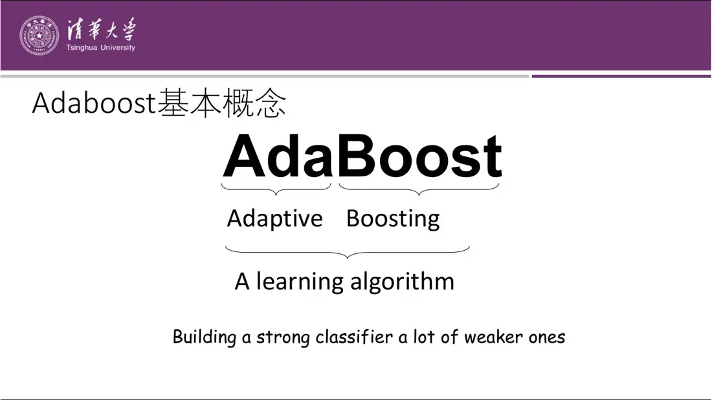

原文：

Adaboost基本概念

AdaBoost

Adaptive Boosting

A learning algorithm

Building a strong classifier a lot of weaker ones

Tsinghua University
清華大學
TSINGHUA UNIVERSITY
1911
清華大學
TSINGHUA UNIVERSITY

### Adaboost基本概念

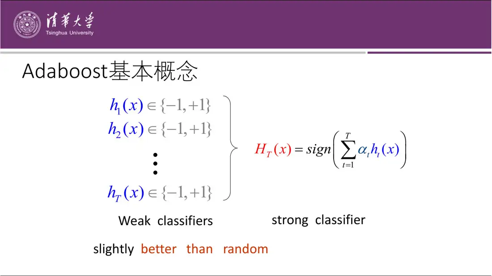

原文：

Adaboost基本概念

$$
\left. \begin{array}{c} h _ {1} (x) \in \{- 1, + 1 \} \\ h _ {2} (x) \in \{- 1, + 1 \} \\ \vdots \\ h _ {T} (x) \in \{- 1, + 1 \} \end{array} \right\} H _ {T} (x) = s i g n \Bigg (\sum_ {t = 1} ^ {T} \alpha_ {t} h _ {t} (x) \Bigg)
$$

Weak classifiers

strong classifier

slightly better than random

清華大學 Tsinghua University

### Adaboost基本概念

原文：

Adaboost基本概念

\- 两个问题如何解决：

\- 每一轮如何改变训练数据的权值或概率分布？

\- AdaBoost：提高那些被前一轮弱分类器错误分类样本的权值，降低那些被正确分类样本的权值

\- 如何将弱分类器组合成一个强分类器？

\- AdaBoost：加权多数表决，加大分类误差率小的弱分类器的权值，使其在表决中起较大的作用，减小分类误差率大的弱分类器的权值，使其在表决中起较小的作用。

Tsinghua University
清華大學
1911-1911

### Adaboost基本概念

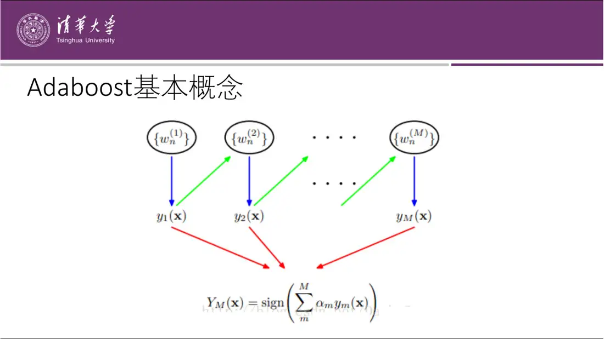

原文：

Adaboost基本概念

$$
Y _ {M} (\mathbf {x}) = \mathrm{sign} \left(\sum_ {m} ^ {M} \alpha_ {m} y _ {m} (\mathbf {x})\right)
$$

清華大學 Tsinghua University

### AdaBoost算法

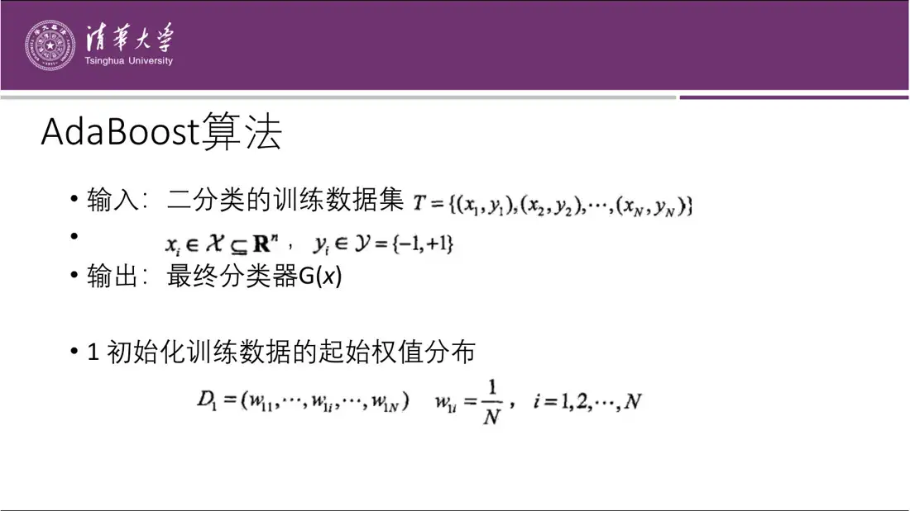

原文：

AdaBoost算法

\- 输入：二分类的训练数据集 $T = \{(x_{1},y_{1}),(x_{2},y_{2}),\dots ,(x_{N},y_{N})\}$

$x_{i}\in \mathcal{X}\subseteq \mathbf{R}^{n},\quad y_{i}\in \mathcal{Y} = \{-1, + 1\}$

\- 输出：最终分类器G(x)

\- 1 初始化训练数据的起始权值分布

$$
D _ {1} = (w _ {1 1}, \dots , w _ {1 i}, \dots , w _ {1 N}) \quad w _ {1 i} = \frac {1}{N}, \quad i = 1, 2, \dots , N
$$

Tsinghua University
清華大學

### AdaBoost算法

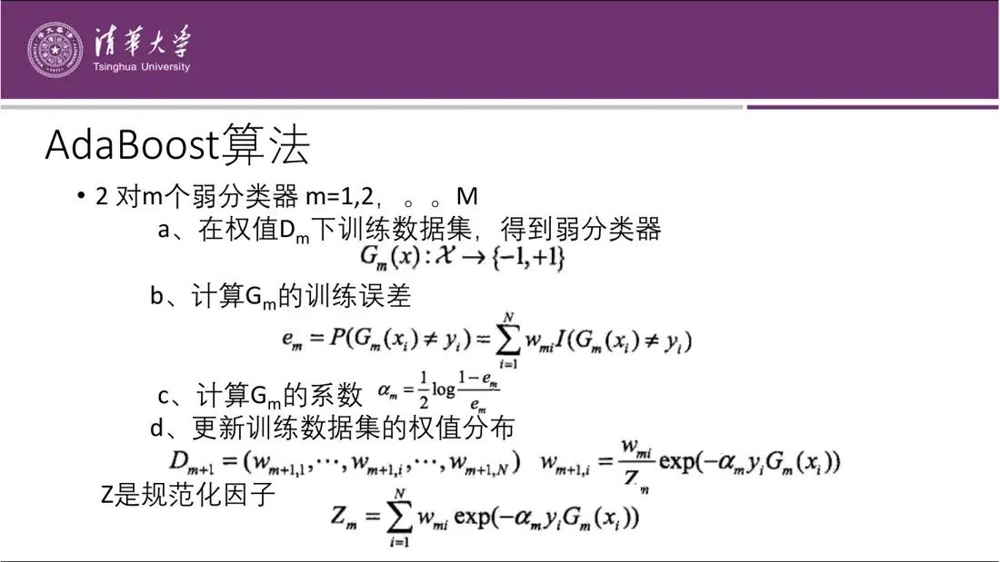

原文：

AdaBoost算法

\- 2 对m个弱分类器 m=1,2，。。。M

a、在权值 $D_{m}$ 下训练数据集，得到弱分类器

$$
G _ {m} (x): \mathcal {X} \rightarrow \{- 1, + 1 \}
$$

b、计算 $G_{m}$ 的训练误差

$$
e _ {m} = P (G _ {m} (x _ {i}) \neq y _ {i}) = \sum_ {i = 1} ^ {N} w _ {m i} I (G _ {m} (x _ {i}) \neq y _ {i})
$$

c、计算 $G_{m}$ 的系数 $\alpha_{m}=\frac{1}{2}\log\frac{1-e_{m}}{e_{m}}$

d、更新训练数据集的权值分布

$$
\begin{array}{r l} {D _ {m + 1} = (w _ {m + 1, 1}, \dots , w _ {m + 1, i}, \dots , w _ {m + 1, N})} & {w _ {m + 1, i} = \frac {W _ {m i}}{Z _ {m}} \exp (- \alpha_ {m} y _ {i} G _ {m} (x _ {i}))} \\ {\text { 范化因子 }} \end{array}
$$

Z是规范化因子

$$
Z _ {m} = \sum_ {i = 1} ^ {N} w _ {m i} \exp (- \alpha_ {m} y _ {i} G _ {m} (x _ {i}))
$$

Tsinghua University
清華大學

### AdaBoost算法

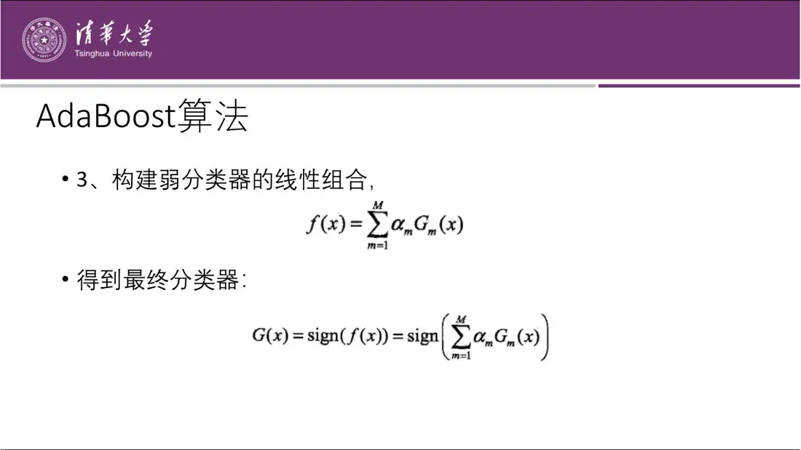

原文：

AdaBoost算法

• 3、构建弱分类器的线性组合，

$$
f (x) = \sum_ {m = 1} ^ {M} \alpha_ {m} G _ {m} (x)
$$

\- 得到最终分类器:

$$
G (x) = \operatorname{sign} (f (x)) = \operatorname{sign} \left(\sum_ {m = 1} ^ {M} \alpha_ {m} G _ {m} (x)\right)
$$

Tsinghua University
清華大學
1911-1911

### AdaBoost算法说明

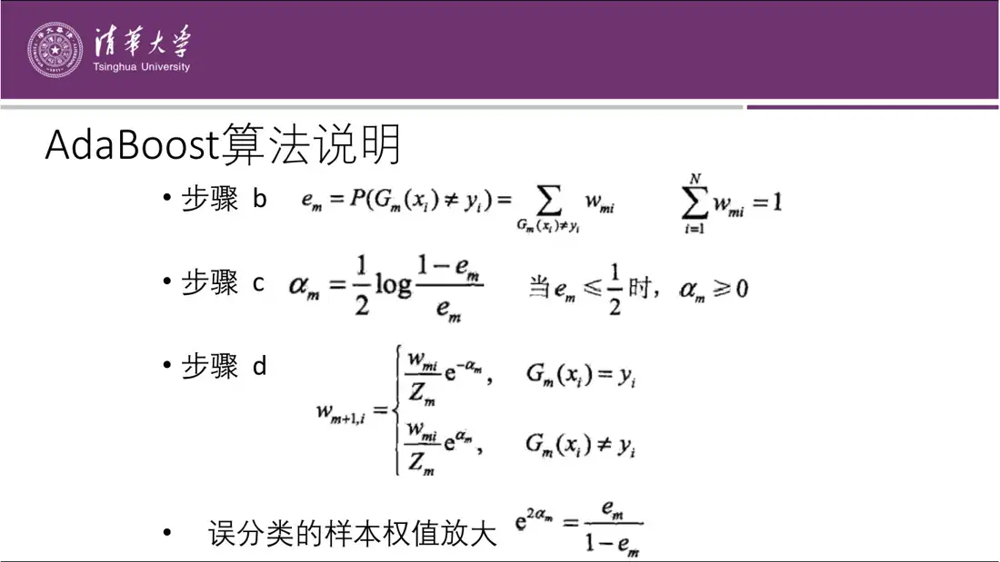

原文：

AdaBoost算法说明

\- 步骤 b $e_{m} = P(G_{m}(x_{i}) \neq y_{i}) = \sum_{G_{m}(x_{i}) \neq y_{i}} w_{mi}$ $\sum_{i=1}^{N} w_{mi} = 1$

\- 步骤 c $\alpha_{m} = \frac{1}{2}\log \frac{1 - e_{m}}{e_{m}}$ 当 $e_m \leqslant \frac{1}{2}$ 时， $\alpha_{m} \geqslant 0$

\- 步骤 d

$$
w _ {m + 1, i} = \left\{ \begin{array}{l l} \frac {w _ {m i}}{Z _ {m}} \mathrm{e} ^ {- \alpha_ {m}}, & G _ {m} (x _ {i}) = y _ {i} \\ \frac {w _ {m i}}{Z _ {m}} \mathrm{e} ^ {\alpha_ {m}}, & G _ {m} (x _ {i}) \neq y _ {i} \end{array} \right.
$$

\- 误分类的样本权值放大 $e^{2\alpha_m} = \frac{e_m}{1 - e_m}$

清華大學 Tsinghua University

### 例子:

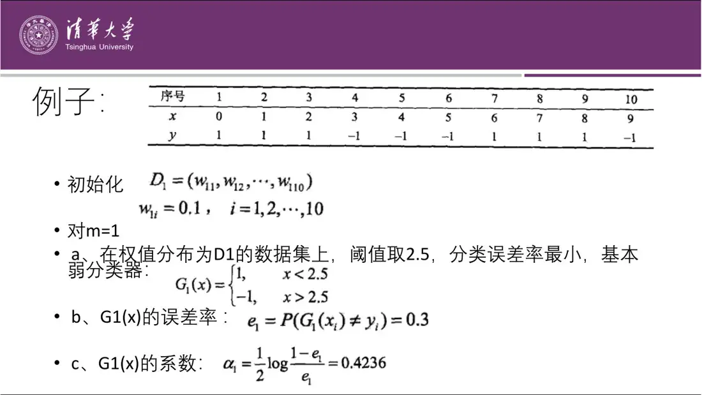

原文：

例子:

<table><tr><td>序号</td><td>1</td><td>2</td><td>3</td><td>4</td><td>5</td><td>6</td><td>7</td><td>8</td><td>9</td><td>10</td></tr><tr><td>x</td><td>0</td><td>1</td><td>2</td><td>3</td><td>4</td><td>5</td><td>6</td><td>7</td><td>8</td><td>9</td></tr><tr><td>y</td><td>1</td><td>1</td><td>1</td><td>-1</td><td>-1</td><td>-1</td><td>1</td><td>1</td><td>1</td><td>-1</td></tr></table>

\- 初始化 $D_{1} = (w_{11}, w_{12}, \dots, w_{110})$

$$
w _ {1 i} = 0, 1, \quad i = 1, 2, \dots , 1 0
$$

\- 对 $m = 1$

• a、在权值分布为D1的数据集上，阈值取2.5，分类误差率最小，基本弱分类器： $G_{1}(x)=\left\{\begin{aligned}&1,&x<2.5\\&-1,&x>2.5\end{aligned}\right.$

• b、G1(x)的误差率： $e_{1}=P(G_{1}(x_{i})\neq y_{i})=0.3$

• c、G1(x)的系数： $\alpha_{1}=\frac{1}{2}\log\frac{1-e_{1}}{e_{1}}=0.4236$

Tsinghua University
清華大學

### 例子:

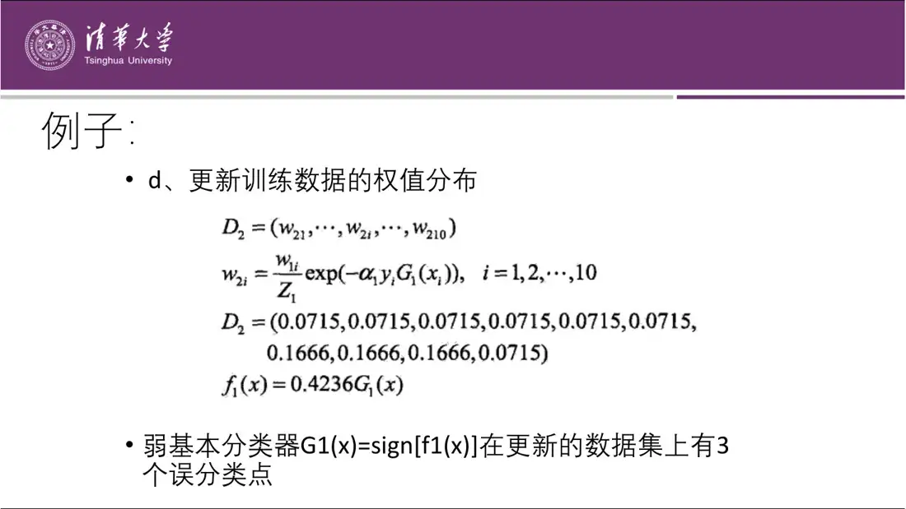

原文：

例子:

\- d、更新训练数据的权值分布

$$
D _ {2} = (w _ {2 1}, \dots , w _ {2 i}, \dots , w _ {2 1 0})
$$

$$
w _ {2 i} = \frac {w _ {1 i}}{Z _ {1}} \exp (- \alpha_ {1} y _ {i} G _ {1} (x _ {i})), \quad i = 1, 2, \dots , 1 0
$$

$$
\begin{array}{r l} D _ {2} & = (0. 0 7 1 5, 0. 0 7 1 5, 0. 0 7 1 5, 0. 0 7 1 5, 0. 0 7 1 5, 0. 0 7 1 5, \\ & \quad 0. 1 6 6 6, 0. 1 6 6 6, 0. 1 6 6 6, 0. 0 7 1 5) \end{array}
$$

\- 弱基本分类器G1(x)=sign[f1(x)]在更新的数据集上有3个误分类点

Tsinghua University
清華大學
TSINGHUA UNIVERSITY
1911
清華大學
TSINGHUA UNIVERSITY

### 例子:

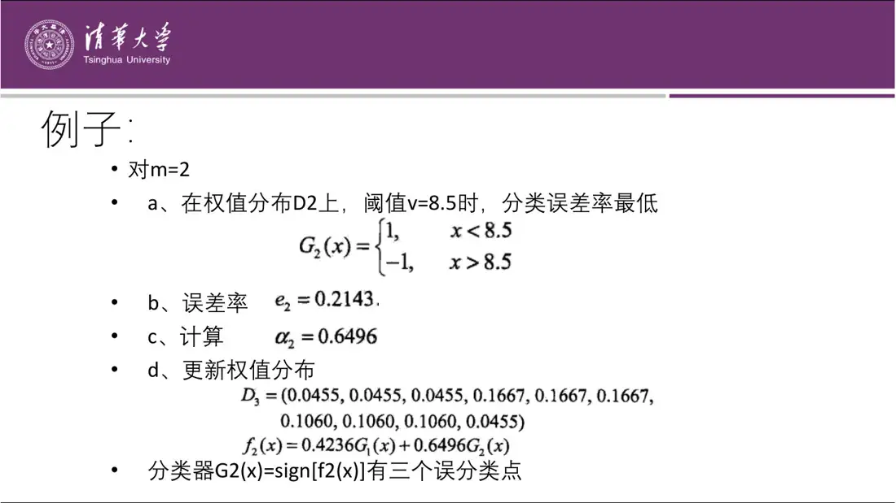

原文：

例子:

\- 对 $m = 2$

• a、在权值分布D2上，阈值v=8.5时，分类误差率最低

$$
G _ {2} (x) = \left\{ \begin{array}{l l} 1, & x <   8. 5 \\ - 1, & x > 8. 5 \end{array} \right.
$$

• b、误差率 $e_{2}=0.2143$ .

c、计算 $\alpha_{2} = 0.6496$

\- d、更新权值分布

$$
D _ {3} = (0. 0 4 5 5, 0. 0 4 5 5, 0. 0 4 5 5, 0. 1 6 6 7, 0. 1 6 6 7, 0. 1 6 6 7,
$$

$$
0. 1 0 6 0, 0. 1 0 6 0, 0. 1 0 6 0, 0. 0 4 5 5)
$$

$$
f _ {2} (x) = 0. 4 2 3 6 G _ {1} (x) + 0. 6 4 9 6 G _ {2} (x)
$$

\- 分类器G2(x)=sign[f2(x)]有三个误分类点

清華大學 Tsinghua University

### 例子:

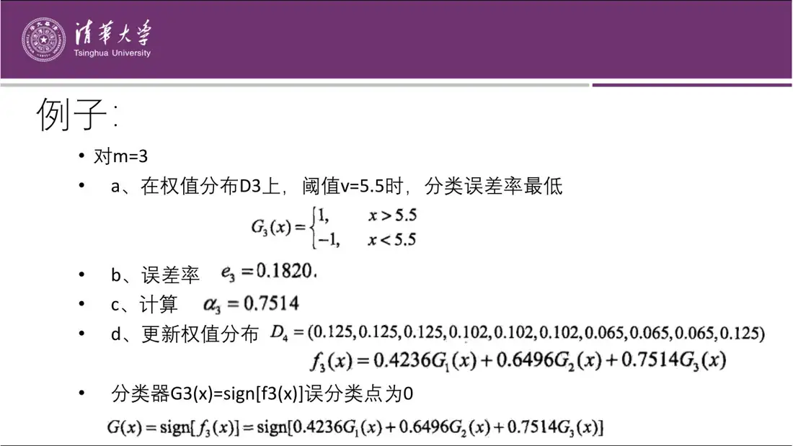

原文：

例子:

\- 对 $m = 3$

• a、在权值分布D3上，阈值v=5.5时，分类误差率最低

$$
G _ {3} (x) = \left\{ \begin{array}{l l} 1, & x > 5. 5 \\ - 1, & x <   5. 5 \end{array} \right.
$$

• b、误差率 $e_{3}=0.1820$ .

c、计算 $\alpha_{3} = 0.7514$

• d、更新权值分布 $D_{4}=(0.125,0.125,0.125,0.102,0.102,0.102,0.065,0.065,0.065,0.125)$

$$
f _ {3} (x) = 0. 4 2 3 6 G _ {1} (x) + 0. 6 4 9 6 G _ {2} (x) + 0. 7 5 1 4 G _ {3} (x)
$$

\- 分类器G3(x)=sign[f3(x)]误分类点为0

$$
G (x) = \operatorname{sign} [ f _ {3} (x) ] = \operatorname{sign} [ 0. 4 2 3 6 G _ {1} (x) + 0. 6 4 9 6 G _ {2} (x) + 0. 7 5 1 4 G _ {3} (x) ]
$$

清華大學 Tsinghua University

### Boosting illustration

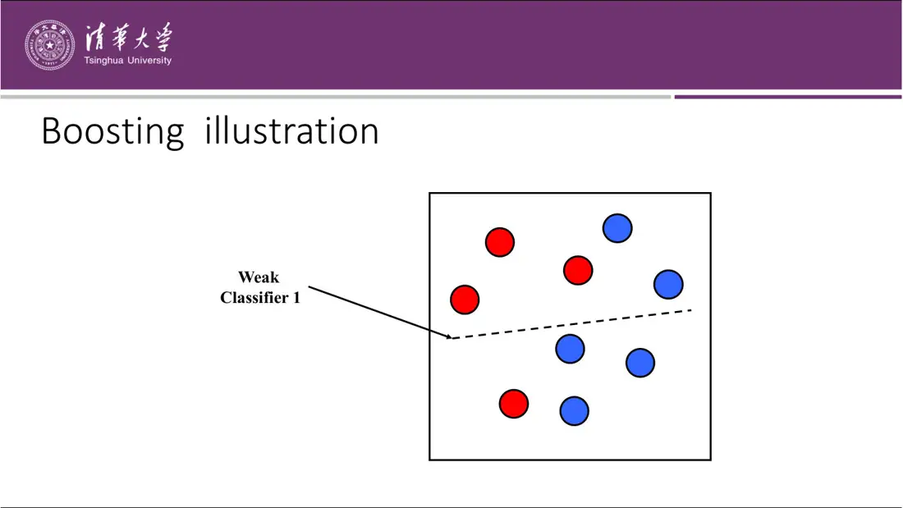

原文：

Boosting illustration

Weak
Classifier 1

Tsinghua University
清華大學

### Boosting illustration

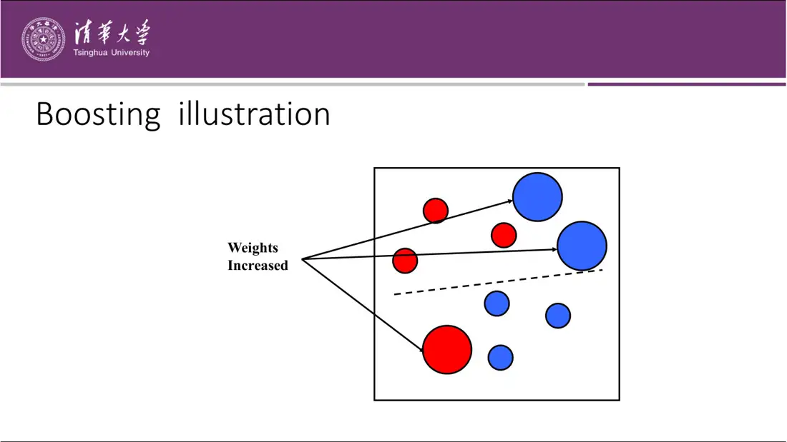

原文：

Boosting illustration

Weights
Increased

Tsinghua University
清華大學

### Boosting illustration

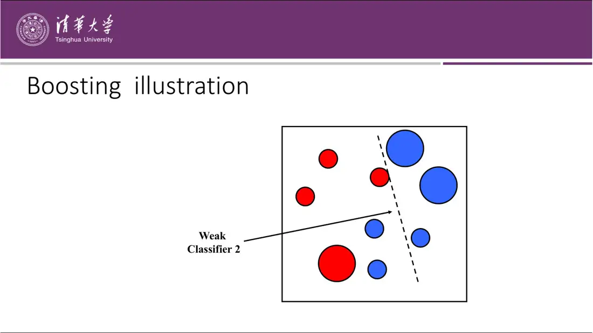

原文：

Boosting illustration

Weak
Classifier 2

Tsinghua University
清華大學

### Boosting illustration

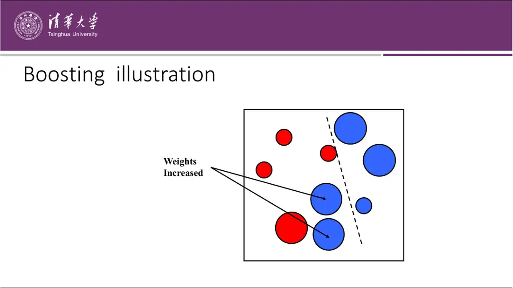

原文：

Boosting illustration

Weights
Increased

Tsinghua University
清華大學

### Boosting illustration

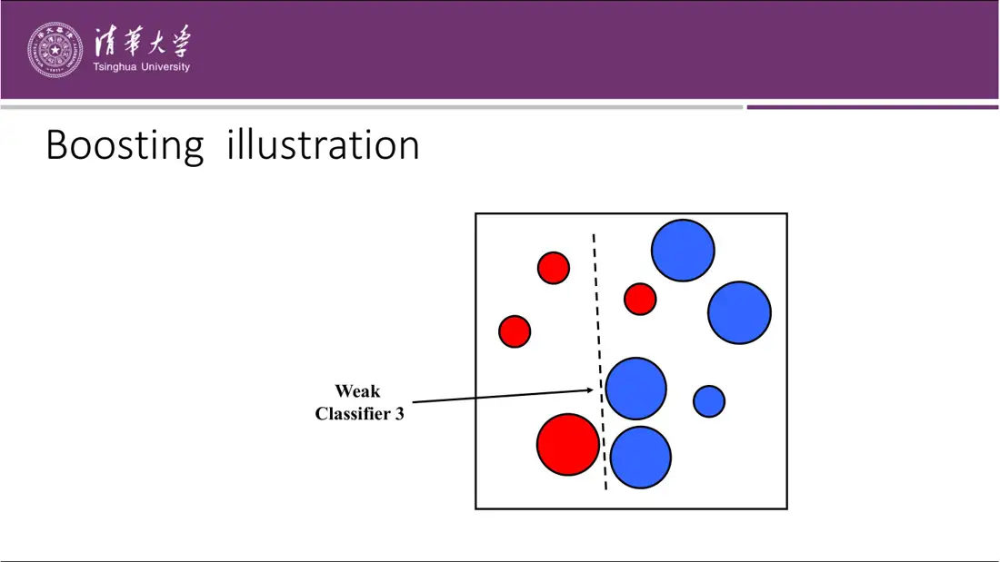

原文：

Boosting illustration

Weak
Classifier 3

Tsinghua University
清華大學

### Boosting illustration

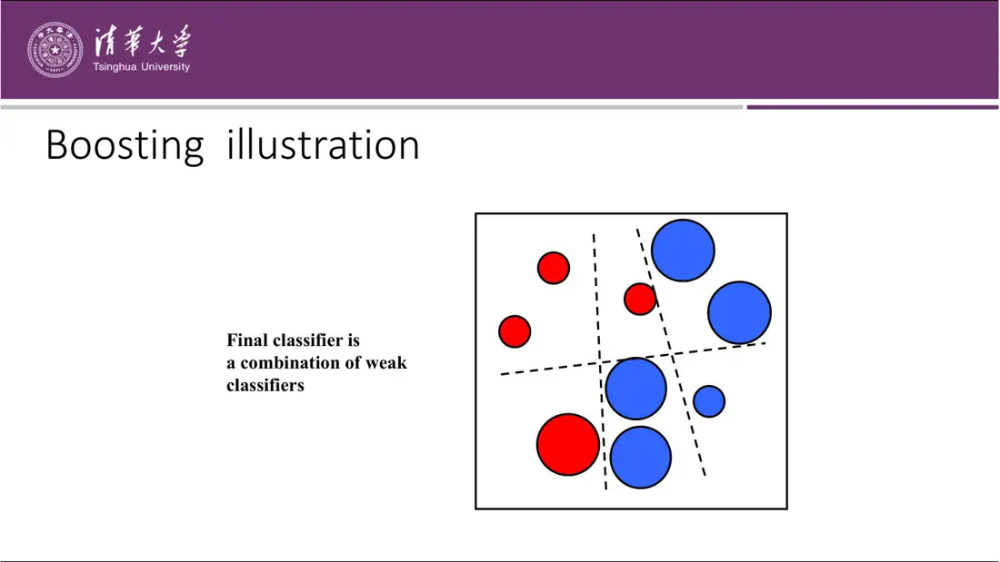

原文：

Boosting illustration

Final classifier is
a combination of weak
classifiers

Tsinghua University
清華大學

### AdaBoost的训练误差分析

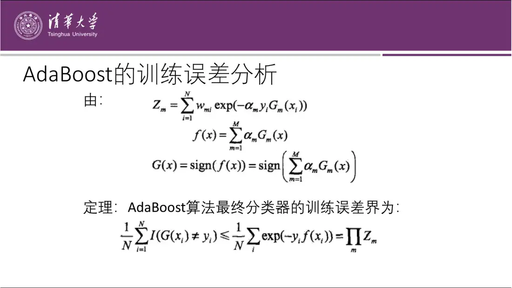

原文：

AdaBoost的训练误差分析

由：

$$
Z _ {m} = \sum_ {i = 1} ^ {N} w _ {m i} \exp (- \alpha_ {m} y _ {i} G _ {m} (x _ {i}))
$$

$$
f (x) = \sum_ {m = 1} ^ {M} \alpha_ {m} G _ {m} (x)
$$

$$
G (x) = \operatorname{sign} (f (x)) = \operatorname{sign} \left(\sum_ {m = 1} ^ {M} \alpha_ {m} G _ {m} (x)\right)
$$

定理：AdaBoost算法最终分类器的训练误差界为：

$$
\frac {1}{N} \sum_ {i = 1} ^ {N} I (G (x _ {i}) \neq y _ {i}) \leqslant \frac {1}{N} \sum_ {i} \exp (- y _ {i} f (x _ {i})) = \prod_ {m} Z _ {m}
$$

清華大學 Tsinghua University

### AdaBoost的训练误差分析

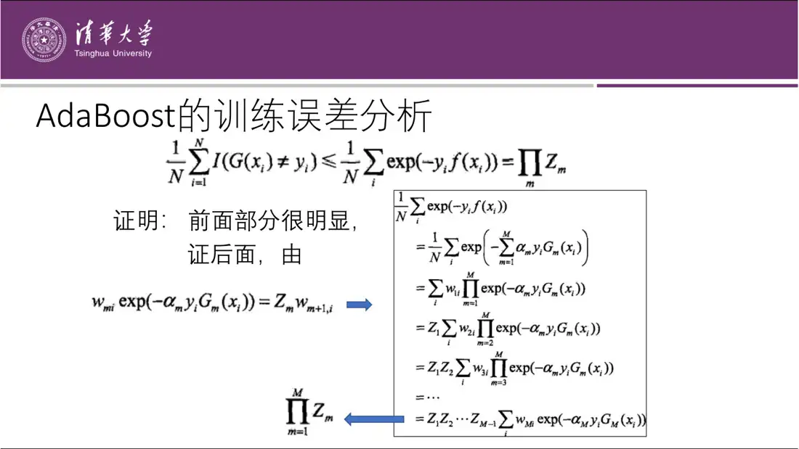

原文：

AdaBoost的训练误差分析

$$
\frac {1}{N} \sum_ {i = 1} ^ {N} I (G (x _ {i}) \neq y _ {i}) \leqslant \frac {1}{N} \sum_ {i} \exp (- y _ {i} f (x _ {i})) = \prod_ {m} Z _ {m}
$$

$$
\begin{array}{r l} & {\text {证明：前面部分很明显，}} \\ & {\text {证后面，由}} \\ & {w _ {m i} \exp (- \alpha_ {m} y _ {i} G _ {m} (x _ {i})) = Z _ {m} w _ {m + 1, i} \quad \Longrightarrow \quad \left[ \begin{array}{l} {\frac {1}{N} \sum_ {i} \exp (- y _ {i} f (x _ {i}))} \\ {= \frac {1}{N} \sum_ {i} \exp \left(- \sum_ {m = 1} ^ {M} \alpha_ {m} y _ {i} G _ {m} (x _ {i})\right)} \\ {= \sum_ {i} w _ {1 i} \prod_ {m = 1} ^ {M} \exp (- \alpha_ {m} y _ {i} G _ {m} (x _ {i}))} \\ {= Z _ {1} \sum_ {i} w _ {2 i} \prod_ {m = 2} ^ {M} \exp (- \alpha_ {m} y _ {i} G _ {m} (x _ {i}))} \\ {= Z _ {1} Z _ {2} \sum_ {i} w _ {3 i} \prod_ {m = 3} ^ {M} \exp (- \alpha_ {m} y _ {i} G _ {m} (x _ {i}))} \\ {= \dots} \\ {= Z _ {1} Z _ {2} \dots Z _ {M - 1} \sum_ {i} w _ {M i} \exp (- \alpha_ {M} y _ {i} G _ {M} (x _ {i}))} \end{array} \right]} \\ & {\prod_ {m = 1} ^ {M} Z _ {m}} \end{array}
$$

清華大學 Tsinghua University

### AdaBoost的训练误差分析

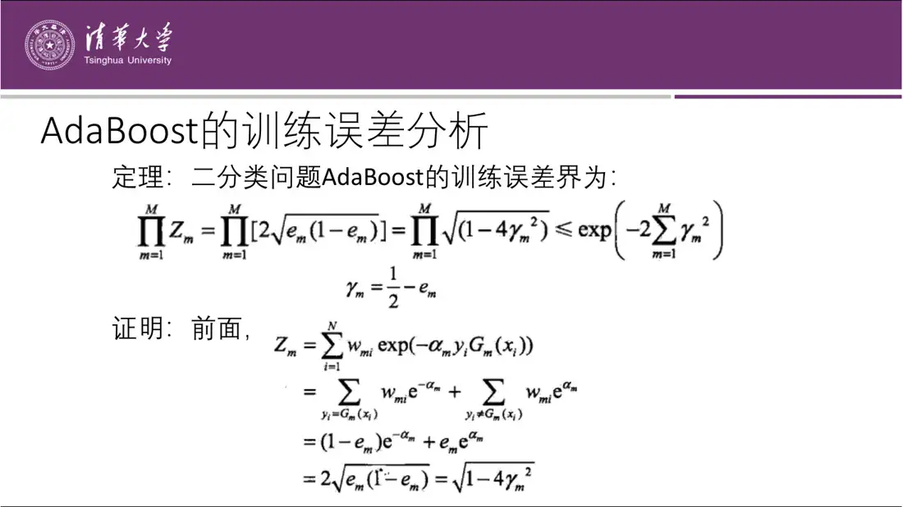

原文：

AdaBoost的训练误差分析

定理：二分类问题AdaBoost的训练误差界为：

$$
\prod_ {m = 1} ^ {M} Z _ {m} = \prod_ {m = 1} ^ {M} [ 2 \sqrt {e _ {m} (1 - e _ {m})} ] = \prod_ {m = 1} ^ {M} \sqrt {(1 - 4 \gamma_ {m} ^ {2})} \leqslant \exp \left(- 2 \sum_ {m = 1} ^ {M} \gamma_ {m} ^ {2}\right)   \gamma_ {m} = \frac {1}{2} - e _ {m}
$$

证明：前面，

$$
\begin{array}{r l} Z _ {m} & = \sum_ {i = 1} ^ {N} w _ {m i} \exp (- \alpha_ {m} y _ {i} G _ {m} (x _ {i})) \\ & = \sum_ {y _ {i} = G _ {m} (x _ {i})} w _ {m i} \mathrm{e} ^ {- \alpha_ {m}} + \sum_ {y _ {i} \neq G _ {m} (x _ {i})} w _ {m i} \mathrm{e} ^ {\alpha_ {m}} \\ & = (1 - e _ {m}) \mathrm{e} ^ {- \alpha_ {m}} + e _ {m} \mathrm{e} ^ {\alpha_ {m}} \\ & = 2 \sqrt {e _ {m} (1 - e _ {m})} = \sqrt {1 - 4 \gamma_ {m} ^ {2}} \end{array}
$$

清華大學 Tsinghua University

### AdaBoost的训练误差分析

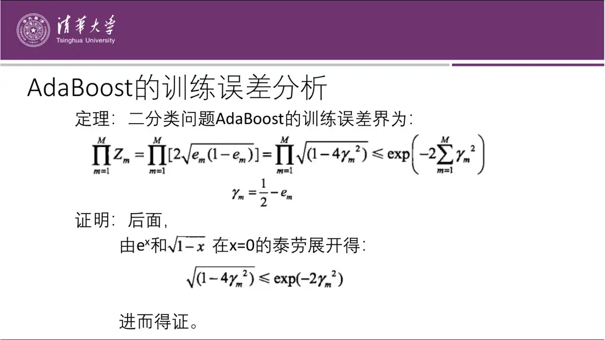

原文：

AdaBoost的训练误差分析

定理：二分类问题AdaBoost的训练误差界为：

$$
\prod_ {m = 1} ^ {M} Z _ {m} = \prod_ {m = 1} ^ {M} [ 2 \sqrt {e _ {m} (1 - e _ {m})} ] = \prod_ {m = 1} ^ {M} \sqrt {(1 - 4 \gamma_ {m} ^ {2})} \leqslant \exp \left(- 2 \sum_ {m = 1} ^ {M} \gamma_ {m} ^ {2}\right)   \gamma_ {m} = \frac {1}{2} - e _ {m}
$$

证明：后面，

由 $e^{x}$ 和 $\sqrt{1-x}$ 在x=0的泰劳展开得：

$$
\sqrt {(1 - 4 \gamma_ {m} ^ {2})} \leqslant \exp (- 2 \gamma_ {m} ^ {2})
$$

进而得证。

清華大學 Tsinghua University

### AdaBoost的训练误差分析

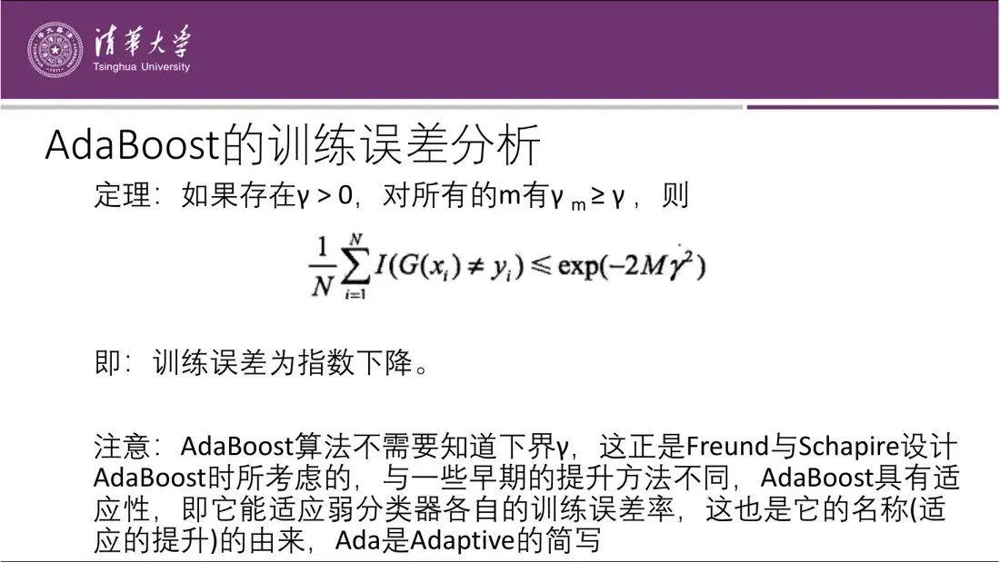

原文：

AdaBoost的训练误差分析

定理：如果存在 $\gamma > 0$ ，对所有的 $m$ 有 $\gamma_m \geq \gamma$ ，则

$$
\frac {1}{N} \sum_ {i = 1} ^ {N} I (G (x _ {i}) \neq y _ {i}) \leqslant \exp (- 2 M \gamma^ {2})
$$

即：训练误差为指数下降。

注意：AdaBoost算法不需要知道下界γ，这正是Freund与Schapire设计AdaBoost时所考虑的，与一些早期的提升方法不同，AdaBoost具有适应性，即它能适应弱分类器各自的训练误差率，这也是它的名称(适应的提升)的由来，Ada是Adaptive的简写

清華大學 Tsinghua University

### AdaBoost算法的解释

原文：

AdaBoost算法的解释

\- AdaBoost

\- 模型：加法模型

\- 损失函数：指数函数

\- 学习算法：前向分步算法的二分类学习算法

Tsinghua University
清華大學
1911-1911

### 前向分步算法

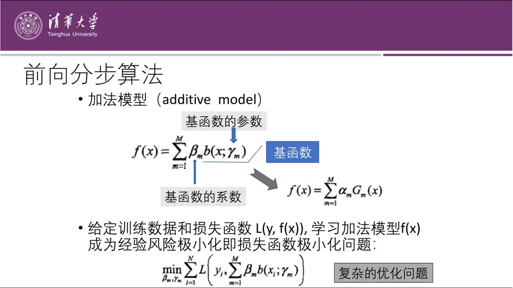

原文：

前向分步算法

\- 加法模型 (additive model)

$$
\begin{array}{r l} & {\text {基函数的参数}} \\ & {f (x) = \sum_ {m = 1} ^ {M} \beta_ {m} b (x; \gamma_ {m})} \\ & {\text {基函数的系数}} \\ & {f (x) = \sum_ {m = 1} ^ {M} \alpha_ {m} G _ {m} (x)} \end{array}
$$

\- 给定训练数据和损失函数 $L(y, f(x))$ , 学习加法模型 $f(x)$ 成为经验风险极小化即损失函数极小化问题:

$$
\min _ {\beta_ {m}, \gamma_ {m}} \sum_ {i = 1} ^ {N} L \left(y _ {i}, \sum_ {m = 1} ^ {M} \beta_ {m} b (x _ {i}; \gamma_ {m})\right)
$$

复杂的优化问题

清華大學 Tsinghua University

### 前向分步算法

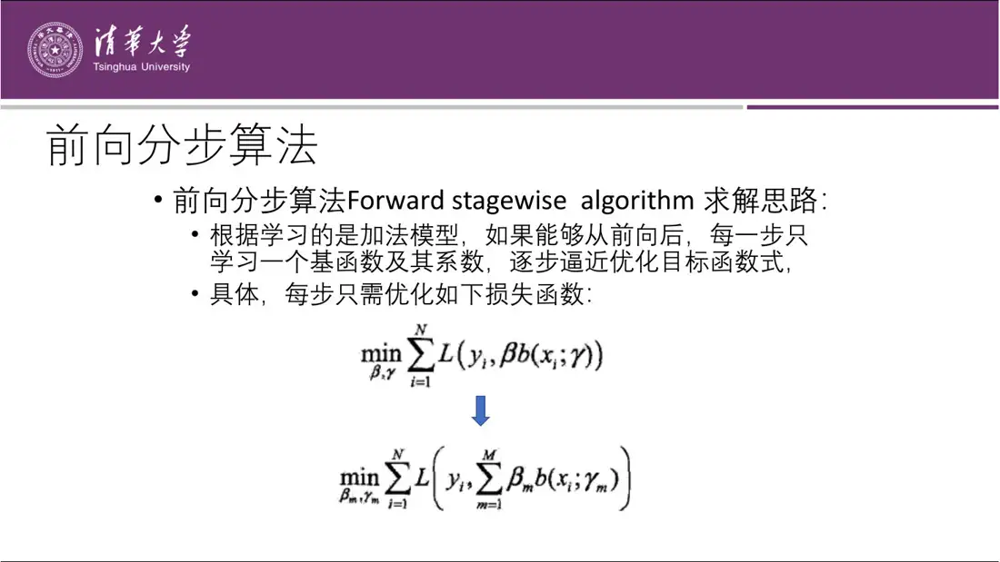

原文：

前向分步算法

\- 前向分步算法Forward stagewise algorithm 求解思路:

\- 根据学习的是加法模型，如果能够从前向后，每一步只学习一个基函数及其系数，逐步逼近优化目标函数式，

\- 具体，每步只需优化如下损失函数：

$$
\min _ {\beta , \gamma} \sum_ {i = 1} ^ {N} L \left(y _ {i}, \beta b (x _ {i}; \gamma)\right) \Bigg \downarrow
$$

$$
\min _ {\beta_ {m}, \gamma_ {m}} \sum_ {i = 1} ^ {N} L \left(y _ {i}, \sum_ {m = 1} ^ {M} \beta_ {m} b (x _ {i}; \gamma_ {m})\right)
$$

Tsinghua University
清華大學

### 前向分步算法

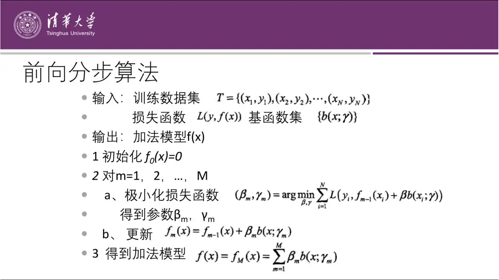

原文：

前向分步算法

\- 输入：训练数据集 $T = \{(x_{1},y_{1}),(x_{2},y_{2}),\dots ,(x_{N},y_{N})\}$

\- 损失函数 $L(y, f(x))$ 基函数集 $\{b(x; \gamma)\}$

\- 输出：加法模型f(x)

\- 1 初始化 $f_{0}(x) = 0$

\- 2 对 $m = 1, 2, \ldots, M$

a、极小化损失函数 $(\beta_{m},\gamma_{m}) = \arg \min_{\beta ,\gamma}\sum_{i = 1}^{N}L(y_{i},f_{m - 1}(x_{i}) + \beta b(x_{i};\gamma))$

得到参数 $\beta_{\mathrm{m}}$ ， $\gamma_{\mathrm{m}}$

b、更新 $f_{m}(x) = f_{m - 1}(x) + \beta_{m}b(x;\gamma_{m})$

\- 3 得到加法模型 $f(x) = f_{M}(x) = \sum_{m=1}^{M}\beta_{m}b(x;\gamma_{m})$

Tsinghua University
清華大學

### 前向分步算法

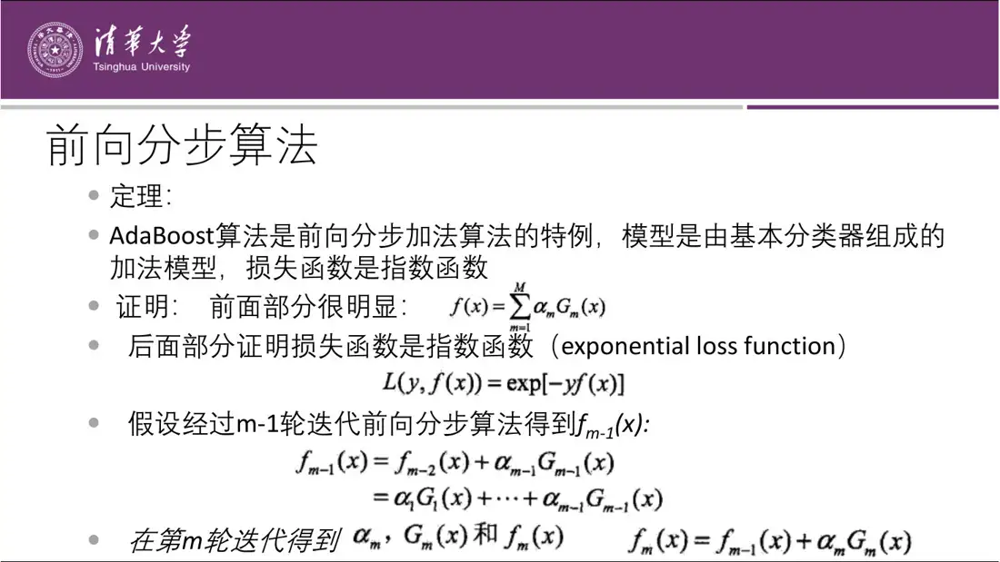

原文：

前向分步算法

定理:

\- AdaBoost算法是前向分步加法算法的特例，模型是由基本分类器组成的加法模型，损失函数是指数函数

\- 证明：前面部分很明显： $f(x) = \sum_{m}^{M}\alpha_{m}G_{m}(x)$

\- 后面部分证明损失函数是指数函数（exponential loss function）

$$
L (y, f (x)) = \exp [ - y f (x) ]
$$

\- 假设经过m-1轮迭代前向分步算法得到 $f_{m-1}(x)$ :

$$
\begin{array}{r l} f _ {m - 1} (x) & = f _ {m - 2} (x) + \alpha_ {m - 1} G _ {m - 1} (x) \\ & = \alpha_ {1} G _ {1} (x) + \dots + \alpha_ {m - 1} G _ {m - 1} (x) \end{array}
$$

在第 $m$ 轮迭代得到 $\alpha_{m}, G_{m}(x)$ 和 $f_{m}(x)$ $f_{m}(x) = f_{m-1}(x) + \alpha_{m}G_{m}(x)$

Tsinghua University
清華大學

### 前向分步算法

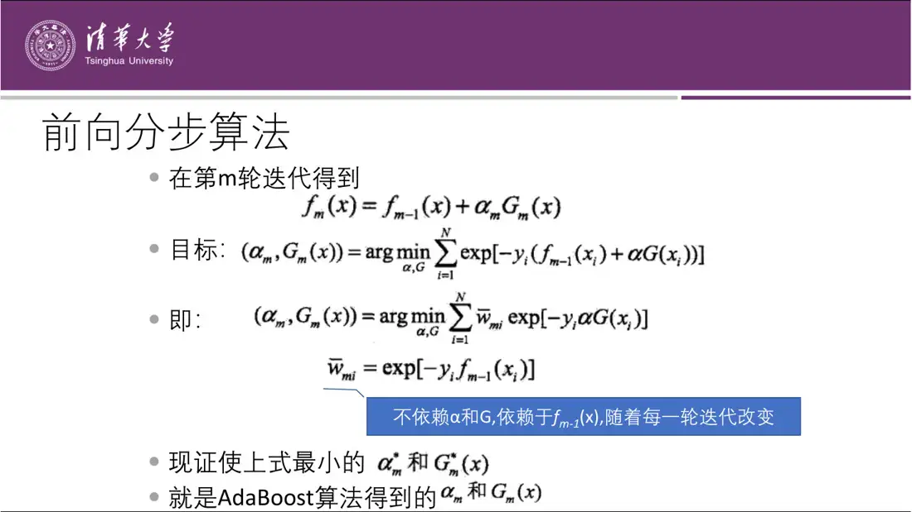

原文：

前向分步算法

\- 在第m轮迭代得到

$$
f _ {m} (x) = f _ {m - 1} (x) + \alpha_ {m} G _ {m} (x)
$$

\- 目标： $(\alpha_{m}, G_{m}(x)) = \arg \min_{\alpha, G} \sum_{i=1}^{N} \exp[-y_{i}(f_{m-1}(x_{i}) + \alpha G(x_{i}))]$

\- 即： $(\alpha_{m}, G_{m}(x)) = \arg \min_{\alpha, G} \sum_{i=1}^{N} \overline{w}_{mi} \exp[-y_{i} \alpha G(x_{i})]$

$$
\overline {{{w}}} _ {m i} = \exp [ - y _ {i} f _ {m - 1} (x _ {i}) ]
$$

不依赖α和G,依赖于 $f_{m-1}(x)$ ,随着每一轮迭代改变

\- 现证使上式最小的 $\alpha_{m}^{*}$ 和 $G_{m}^{*}(x)$

\- 就是AdaBoost算法得到的 $\alpha_{m}$ 和 $G_{m}(x)$

Tsinghua University
清華大學

### 前向分步算法

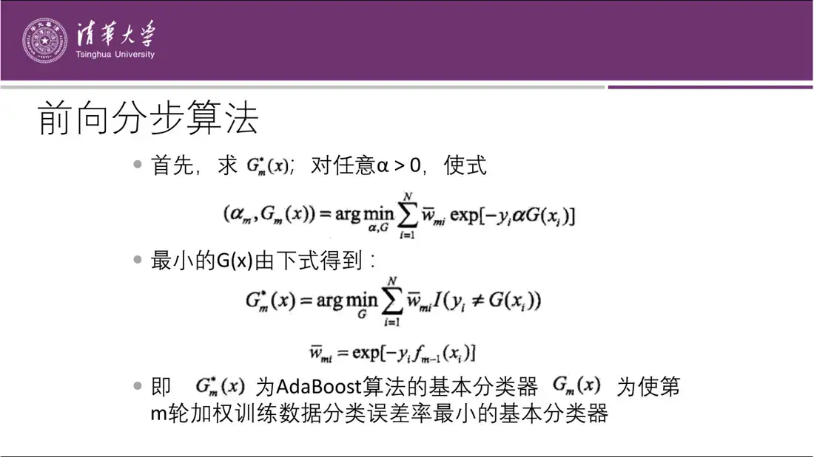

原文：

前向分步算法

\- 首先，求 $G_{m}^{*}(x)$ ；对任意 $\alpha > 0$ ，使式

$$
\left(\alpha_ {m}, G _ {m} (x)\right) = \arg \min _ {\alpha , G} \sum_ {i = 1} ^ {N} \overline {{w}} _ {m i} \exp \left[ - y _ {i} \alpha G \left(x _ {i}\right) \right]
$$

\- 最小的G(x)由下式得到：

$$
G _ {m} ^ {*} (x) = \arg \min _ {G} \sum_ {i = 1} ^ {N} \overline {{w}} _ {m i} I (y _ {i} \neq G (x _ {i}))
$$

$$
\overline {{{w}}} _ {m i} = \exp [ - y _ {i} f _ {m - 1} (x _ {i}) ]
$$

\- 即 $G_{m}^{*}(x)$ 为AdaBoost算法的基本分类器 $G_{m}(x)$ 为使第m轮加权训练数据分类误差率最小的基本分类器

清華大學 Tsinghua University

### 前向分步算法

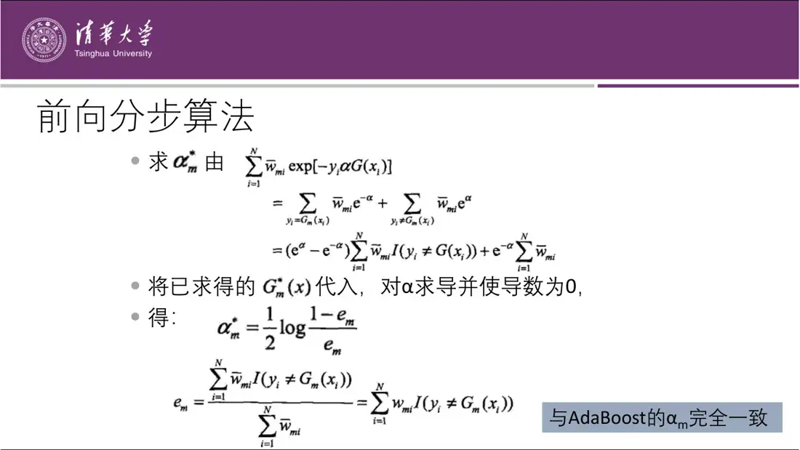

原文：

前向分步算法

$$
\begin{array}{r l} {\bullet \text {求} \alpha_ {m} ^ {*} \text {由}} & {\sum_ {i = 1} ^ {N} \overline {{{w}}} _ {m i} \exp [ - y _ {i} \alpha G (x _ {i}) ]} \\ & {\qquad = \sum_ {y _ {i} = G _ {m} (x _ {i})} \overline {{{w}}} _ {m i} \mathrm{e} ^ {- \alpha} + \sum_ {y _ {i} \neq G _ {m} (x _ {i})} \overline {{{w}}} _ {m i} \mathrm{e} ^ {\alpha}} \\ & {\qquad = (\mathrm{e} ^ {\alpha} - \mathrm{e} ^ {- \alpha}) \sum_ {i = 1} ^ {N} \overline {{{w}}} _ {m i} I (y _ {i} \neq G (x _ {i})) + \mathrm{e} ^ {- \alpha} \sum_ {i = 1} ^ {N} \overline {{{w}}} _ {m i}} \end{array}
$$

\- 将已求得的 $G_{m}^{*}(x)$ 代入，对 $\alpha$ 求导并使导数为0，

• 得:

$$
\begin{array}{r l} & \therefore \alpha_ {m} ^ {*} = \frac {1}{2} \log \frac {1 - e _ {m}}{e _ {m}} \\ & e _ {m} = \frac {\sum_ {i = 1} ^ {N} \overline {{w}} _ {m i} I (y _ {i} \neq G _ {m} (x _ {i}))}{\sum_ {i = 1} ^ {N} \overline {{w}} _ {m i}} = \sum_ {i = 1} ^ {N} w _ {m i} I (y _ {i} \neq G _ {m} (x _ {i})) \end{array}
$$

与AdaBoost的 $\alpha_{\mathrm{m}}$ 完全一致

清華大學 Tsinghua University

### 前向分步算法

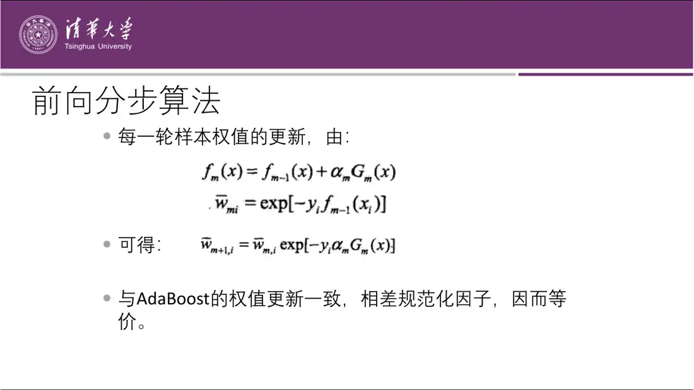

原文：

前向分步算法

\- 每一轮样本权值的更新，由：

$$
f _ {m} (x) = f _ {m - 1} (x) + \alpha_ {m} G _ {m} (x)
$$

$$
\overline {{{w}}} _ {m i} = \exp \left[ - y _ {i} f _ {m - 1} \left(x _ {i}\right) \right]
$$

\- 可得:

$$
\overline {{{w}}} _ {m + 1, i} = \overline {{{w}}} _ {m, i} \exp [ - y _ {i} \alpha_ {m} G _ {m} (x) ]
$$

\- 与AdaBoost的权值更新一致，相差规范化因子，因而等价。

清華大學 Tsinghua University

### 提升树

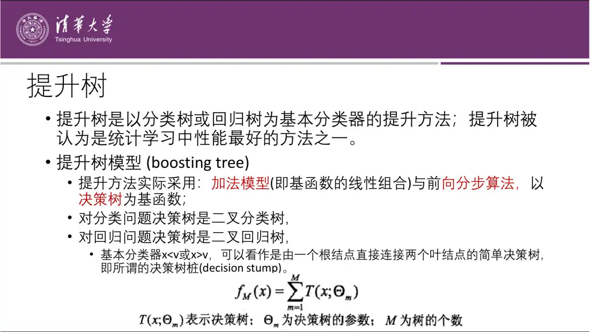

原文：

提升树

\- 提升树是以分类树或回归树为基本分类器的提升方法；提升树被认为是统计学习中性能最好的方法之一。

\- 提升树模型 (boosting tree)

\- 提升方法实际采用：加法模型(即基函数的线性组合)与前向分步算法，以决策树为基函数；

\- 对分类问题决策树是二叉分类树，

\- 对回归问题决策树是二叉回归树，

\- 基本分类器x<v或x>v，可以看作是由一个根结点直接连接两个叶结点的简单决策树，即所谓的决策树桩(decision stump)。

$$
f _ {M} (x) = \sum_ {m = 1} ^ {M} T (x; \Theta_ {m})
$$

$T(x;\Theta_{m})$ 表示决策树； $\Theta_{m}$ 为决策树的参数；M 为树的个数

Tsinghua University
清華大學

### 提升树算法

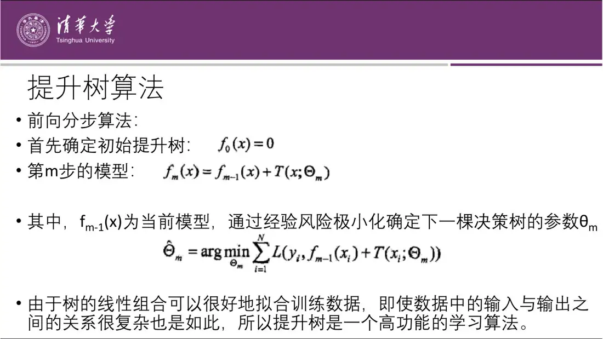

原文：

提升树算法

\- 前向分步算法:

\- 首先确定初始提升树: $f_{0}(x) = 0$

\- 第m步的模型: $f_{m}(x) = f_{m - 1}(x) + T(x;\Theta_{m})$

\- 其中， $f_{m-1}(x)$ 为当前模型，通过经验风险极小化确定下一棵决策树的参数 $\theta_m$

$$
\hat {\Theta} _ {m} = \arg \min _ {\Theta_ {m}} \sum_ {i = 1} ^ {N} L (y _ {i}, f _ {m - 1} (x _ {i}) + T (x _ {i}; \Theta_ {m}))
$$

\- 由于树的线性组合可以很好地拟合训练数据，即使数据中的输入与输出之间的关系很复杂也是如此，所以提升树是一个高功能的学习算法。

Tsinghua University
清華大學

### 提升树算法

原文：

提升树算法

\- 针对不同问题的提升树学习算法，使用的损失函数不同：

\- 用平方误差损失函数的回归问题，

\- 用指数损失函数的分类问题，

\- 用一般损失函数的一般决策问题。

\- 对二类分类问题：提升树算法只需将AdaBoost算法中的基本分类器限制为二类分类树即可，这时的提升树算法是AdaBoost算法的特殊情况。

\- 讨论回归问题提升树:

Tsinghua University
清華大學

### 提升树算法

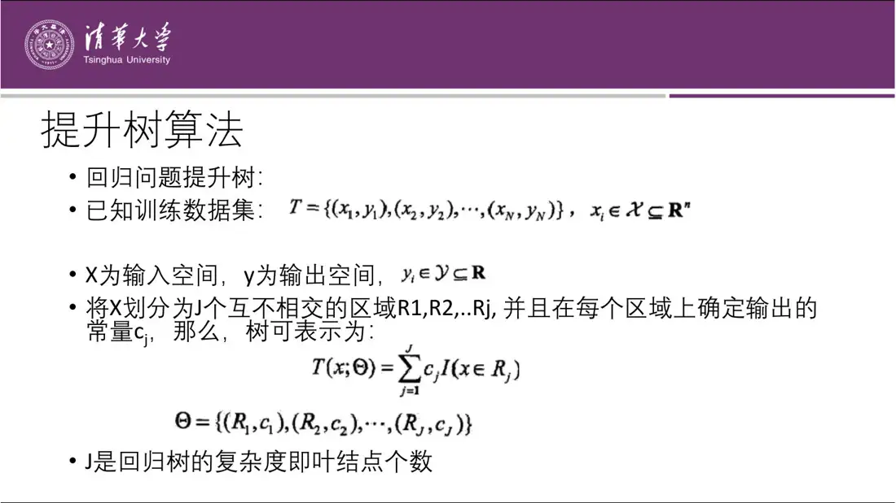

原文：

提升树算法

\- 回归问题提升树:

\- 已知训练数据集： $T = \{(x_{1}, y_{1}), (x_{2}, y_{2}), \cdots, (x_{N}, y_{N})\}$ ， $x_{i} \in \mathcal{X} \subseteq \mathbb{R}^{n}$

\- X为输入空间，y为输出空间， $y_{i}\in\mathcal{Y}\subseteq\mathbf{R}$

\- 将X划分为J个互不相交的区域R1,R2,..Rj,并且在每个区域上确定输出的常量c $_{i}$ ,那么,树可表示为:

$$
T (x; \Theta) = \sum_ {j = 1} ^ {J} c _ {j} I (x \in R _ {j})
$$

$$
\Theta = \{(R _ {1}, c _ {1}), (R _ {2}, c _ {2}), \dots , (R _ {J}, c _ {J}) \}
$$

\- J是回归树的复杂度即叶结点个数

Tsinghua University
清華大學

### 提升树算法

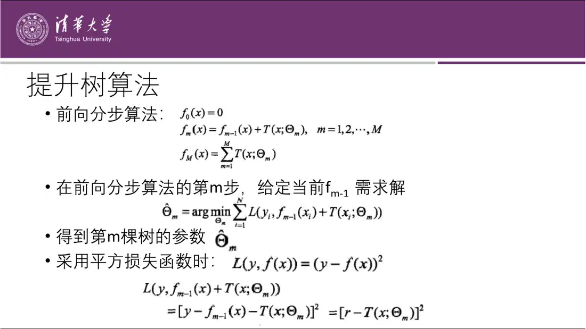

原文：

提升树算法

\- 前向分步算法： $f_{0}(x) = 0$

$$
f _ {m} (x) = f _ {m - 1} (x) + T (x; \Theta_ {m}), \quad m = 1, 2, \dots , M
$$

$$
f _ {M} (x) = \sum_ {m = 1} ^ {M} T (x; \Theta_ {m})
$$

\- 在前向分步算法的第m步，给定当前 $f_{m-1}$ 需求解

$$
\hat {\Theta} _ {m} = \arg \min _ {\Theta_ {m}} \sum_ {i = 1} ^ {N} L (y _ {i}, f _ {m - 1} (x _ {i}) + T (x _ {i}; \Theta_ {m}))
$$

\- 得到第m棵树的参数 $\hat{\Theta}_{m}$

\- 采用平方损失函数时： $L(y, f(x)) = (y - f(x))^2$

$$
\begin{array}{r l} L (y, f _ {m - 1} (x) + T (x; \Theta_ {m})) & \\ = [ y - f _ {m - 1} (x) - T (x; \Theta_ {m}) ] ^ {2} & = [ r - T (x; \Theta_ {m}) ] ^ {2} \end{array}
$$

清華大學 Tsinghua University

### 回归问题的提升树算法

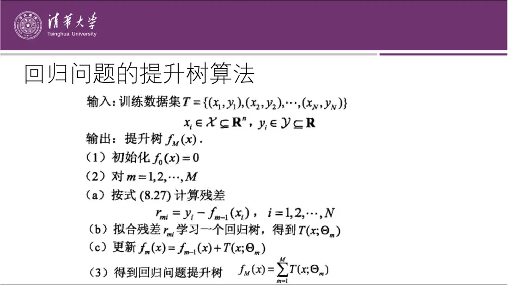

原文：

回归问题的提升树算法

输入：训练数据集 $T=\{(x_{1},y_{1}),(x_{2},y_{2}),\cdots,(x_{N},y_{N})\}$

$$
x _ {i} \in \mathcal {X} \subseteq \mathbf {R} ^ {n}, y _ {i} \in \mathcal {Y} \subseteq \mathbf {R}
$$

输出：提升树 $f_{M}(x)$

(1) 初始化 $f_{0}(x)=0$

(2) 对 $m=1,2,\cdots,M$

(a) 按式 (8.27) 计算残差

$$
r _ {m i} = y _ {i} - f _ {m - 1} \left(x _ {i}\right), \quad i = 1, 2, \dots , N
$$

(b) 拟合残差 $r_{mi}$ 学习一个回归树，得到 $T(x; \Theta_{m})$

(c) 更新 $f_{m}(x) = f_{m - 1}(x) + T(x;\Theta_{m})$

(3) 得到回归问题提升树 $f_{M}(x)=\sum_{m=1}^{M}T(x;\Theta_{m})$

Tsinghua University
清華大學

### 例：

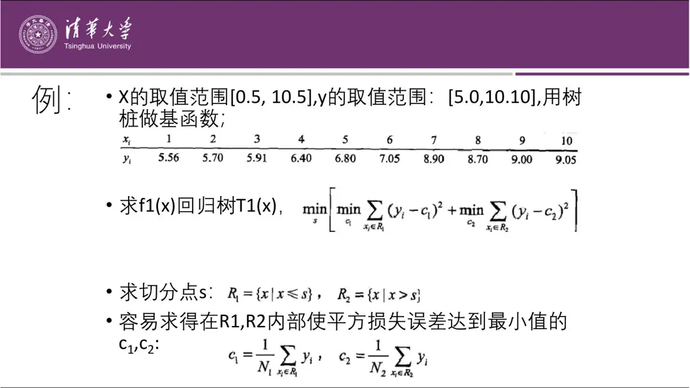

原文：

例：

• X的取值范围[0.5, 10.5], y的取值范围：[5.0,10.10], 用树桩做基函数；

<table><tr><td> $x_{i}$ </td><td>1</td><td>2</td><td>3</td><td>4</td><td>5</td><td>6</td><td>7</td><td>8</td><td>9</td><td>10</td></tr><tr><td> $y_{i}$ </td><td>5.56</td><td>5.70</td><td>5.91</td><td>6.40</td><td>6.80</td><td>7.05</td><td>8.90</td><td>8.70</td><td>9.00</td><td>9.05</td></tr></table>

\- 求f1(x)回归树T1(x), $\min_{s}\left[\min_{c_1}\sum_{x_i\in R_1}(y_i - c_1)^2 +\min_{c_2}\sum_{x_i\in R_2}(y_i - c_2)^2\right]$

\- 求切分点s: $R_{1} = \{x \mid x \leqslant s\}$ , $R_{2} = \{x \mid x > s\}$

\- 容易求得在R1,R2内部使平方损失误差达到最小值的

$$
\mathsf {c} _ {1}, \mathsf {c} _ {2}:
$$

$$
c _ {1} = \frac {1}{N _ {1}} \sum_ {x _ {i} \in R _ {1}} y _ {i}, \quad c _ {2} = \frac {1}{N _ {2}} \sum_ {x _ {i} \in R _ {2}} y _ {i}
$$

Tsinghua University
清華大學

### 例：• 各切分点：

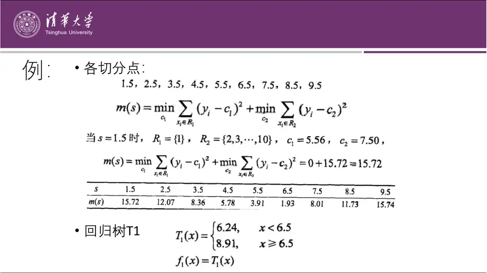

原文：

例：• 各切分点：

1.5, 2.5, 3.5, 4.5, 5.5, 6.5, 7.5, 8.5, 9.5

$$
m (s) = \min _ {c _ {1}} \sum_ {x _ {i} \in R _ {1}} \left(y _ {i} - c _ {1}\right) ^ {2} + \min _ {c _ {2}} \sum_ {x _ {i} \in R _ {2}} \left(y _ {i} - c _ {2}\right) ^ {2}
$$

当 $s = 1.5$ 时， $R_{1} = \{1\}$ ， $R_{2} = \{2,3,\dots ,10\}$ ， $c_{1} = 5.56$ ， $c_{2} = 7.50$ ，

$$
m (s) = \min _ {c _ {1}} \sum_ {x _ {i} \in R _ {1}} \left(y _ {i} - c _ {1}\right) ^ {2} + \min _ {c _ {2}} \sum_ {x _ {i} \in R _ {2}} \left(y _ {i} - c _ {2}\right) ^ {2} = 0 + 1 5. 7 2 = 1 5. 7 2
$$

<table><tr><td>s</td><td>1.5</td><td>2.5</td><td>3.5</td><td>4.5</td><td>5.5</td><td>6.5</td><td>7.5</td><td>8.5</td><td>9.5</td></tr><tr><td>m(s)</td><td>15.72</td><td>12.07</td><td>8.36</td><td>5.78</td><td>3.91</td><td>1.93</td><td>8.01</td><td>11.73</td><td>15.74</td></tr></table>

\- 回归树T1

$$
\begin{array}{l} T _ {1} (x) = \left\{ \begin{array}{l l} 6. 2 4, & x <   6. 5 \\ 8. 9 1, & x \geqslant 6. 5 \end{array} \right. \\ f _ {1} (x) = T _ {1} (x) \end{array}
$$

清華大學 Tsinghua University

### 例：

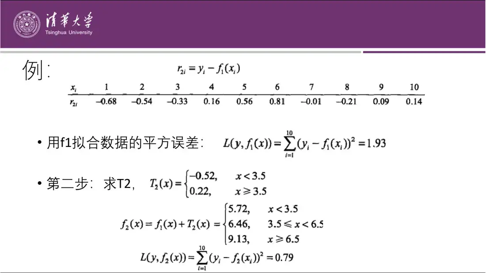

原文：

<table><tr><td colspan="11"> $r_{2i} = y_i - f_1(x_i)$ </td></tr><tr><td> $x_i$ </td><td>1</td><td>2</td><td>3</td><td>4</td><td>5</td><td>6</td><td>7</td><td>8</td><td>9</td><td>10</td></tr><tr><td> $r_{2i}$ </td><td>-0.68</td><td>-0.54</td><td>-0.33</td><td>0.16</td><td>0.56</td><td>0.81</td><td>-0.01</td><td>-0.21</td><td>0.09</td><td>0.14</td></tr></table>

例：

\- 用f1拟合数据的平方误差： $L(y, f_{1}(x)) = \sum_{i=1}^{10} (y_{i} - f_{1}(x_{i}))^{2} = 1.93$

\- 第二步：求T2， $T_{2}(x)=\left\{\begin{aligned}-0.52,&\quad x<3.5\\0.22,&\quad x\geqslant3.5\end{aligned}\right.$

$$
\begin{array}{r l} f _ {2} (x) & = f _ {1} (x) + T _ {2} (x) = \left\{ \begin{array}{l l} 5. 7 2, & x <   3. 5 \\ 6. 4 6, & 3. 5 \leqslant x <   6. 5 \\ 9. 1 3, & x \geqslant 6. 5 \end{array} \right. \\ L (y, f _ {2} (x)) & = \sum_ {i = 1} ^ {1 0} (y _ {i} - f _ {2} (x _ {i})) ^ {2} = 0. 7 9 \end{array}
$$

清華大學 Tsinghua University

### 例:

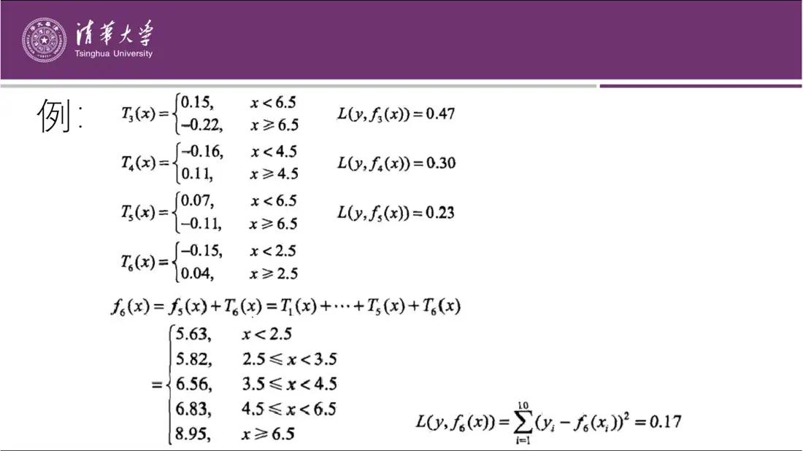

原文：

例:

$$
T _ {3} (x) = \left\{ \begin{array}{l l} 0. 1 5, & x <   6. 5 \\ - 0. 2 2, & x \geqslant 6. 5 \end{array} \right.
$$

$$
L (y, f _ {3} (x)) = 0. 4 7
$$

$$
T _ {4} (x) = \left\{ \begin{array}{l l} - 0. 1 6, & x <   4. 5 \\ 0. 1 1, & x \geqslant 4. 5 \end{array} \right.
$$

$$
L (y, f _ {4} (x)) = 0. 3 0
$$

$$
T _ {s} (x) = \left\{ \begin{array}{l l} 0. 0 7, & x <   6. 5 \\ - 0. 1 1, & x \geqslant 6. 5 \end{array} \right. \quad L (y, f _ {s} (x)) = 0. 2 3
$$

$$
T _ {6} (x) = \left\{ \begin{array}{l l} - 0. 1 5, & x <   2. 5 \\ 0. 0 4, & x \geqslant 2. 5 \end{array} \right.
$$

$$
\begin{array}{r l} & f _ {6} (x) = f _ {5} (x) + T _ {6} (x) = T _ {1} (x) + \dots + T _ {5} (x) + T _ {6} (x) \\ & = \left\{ \begin{array}{l l} 5. 6 3, & x <   2. 5 \\ 5. 8 2, & 2. 5 \leqslant x <   3. 5 \\ 6. 5 6, & 3. 5 \leqslant x <   4. 5 \\ 6. 8 3, & 4. 5 \leqslant x <   6. 5 \\ 8. 9 5, & x \geqslant 6. 5 \end{array} \right. L (y, f _ {6} (x)) = \sum_ {i = 1} ^ {1 0} (y _ {i} - f _ {6} (x _ {i})) ^ {2} = 0. 1 7 \end{array}
$$

清华大学 Tsinghua University

### 梯度提升

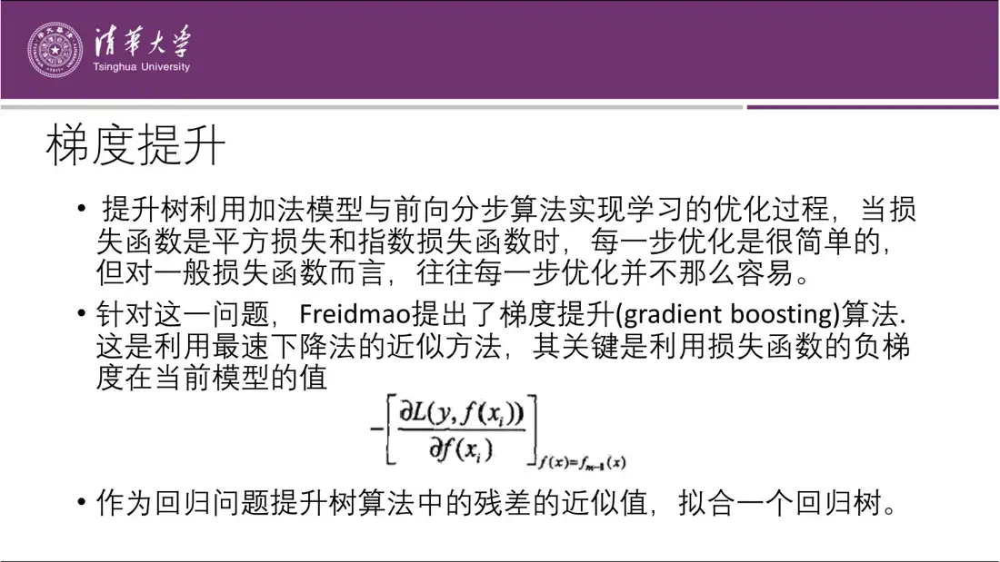

原文：

梯度提升

\- 提升树利用加法模型与前向分步算法实现学习的优化过程，当损失函数是平方损失和指数损失函数时，每一步优化是很简单的，但对一般损失函数而言，往往每一步优化并不那么容易。

\- 针对这一问题，Freidmao提出了梯度提升(gradient boosting)算法.这是利用最速下降法的近似方法，其关键是利用损失函数的负梯度在当前模型的值

$$
- \left[ \frac {\partial L (y , f (x _ {i}))}{\partial f (x _ {i})} \right] _ {f (x) = f _ {m - 1} (x)}
$$

\- 作为回归问题提升树算法中的残差的近似值，拟合一个回归树。

Tsinghua University
清華大學

### 梯度提升算法

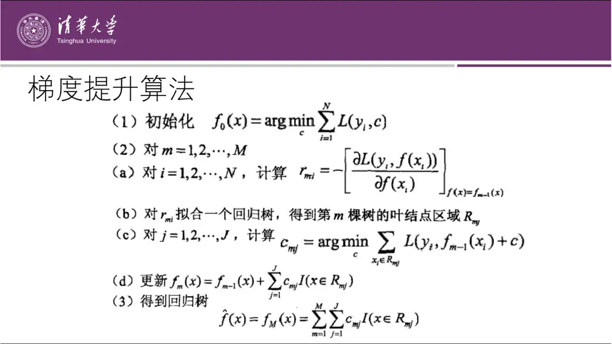

原文：

梯度提升算法

(1) 初始化 $f_{0}(x) = \arg \min_{c}\sum_{i = 1}^{N}L(y_{i},c)$

(2) 对 $m=1,2,\cdots,M$ (a) 对 $i=1,2,\cdots,N$ ，计算 $r_{m,i}=-\left[\frac{\partial L(y_{i},f(x_{i}))}{\partial f(x_{i})}\right]_{f(x)=f_{m-1}(x)}$

(b) 对 $r_{mi}$ 拟合一个回归树，得到第 $m$ 棵树的叶结点区域 $R_{my}$

(c) 对 $j=1,2,\cdots,J$ ，计算 $c_{mj}=\arg\min_{c}\sum_{x_{i}\in R_{mj}}L(y_{i},f_{m-1}(x_{i})+c)$

(d) 更新 $f_{m}(x) = f_{m - 1}(x) + \sum_{j}c_{mj}I(x\in R_{mj})$

(3) 得到回归树

$$
\hat {f} (x) = f _ {M} (x) = \sum_ {m = 1} ^ {M} \sum_ {j = 1} ^ {J} c _ {m j} I (x \in R _ {m j})
$$

清華大學 Tsinghua University

### Adaboost的实现

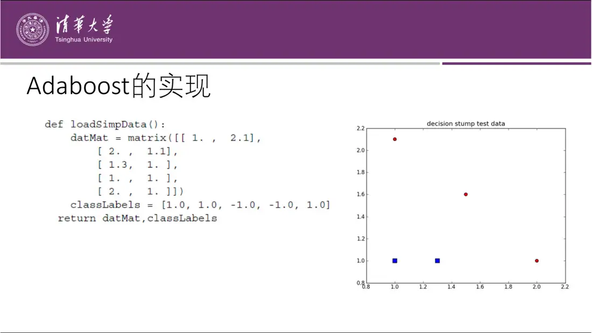

原文：

Adaboost的实现

清華大學 Tsinghua University

### 单层决策树生成函数

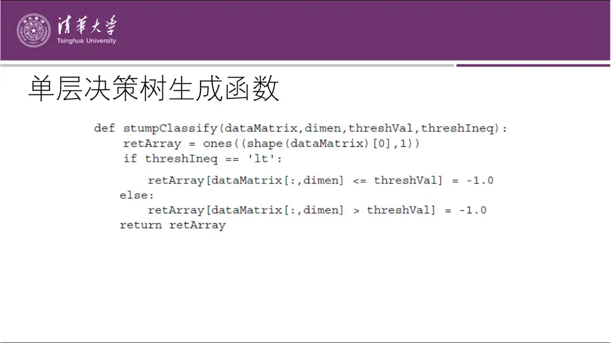

原文：

单层决策树生成函数

清華大學 Tsinghua University

### 单层决策树生成函数

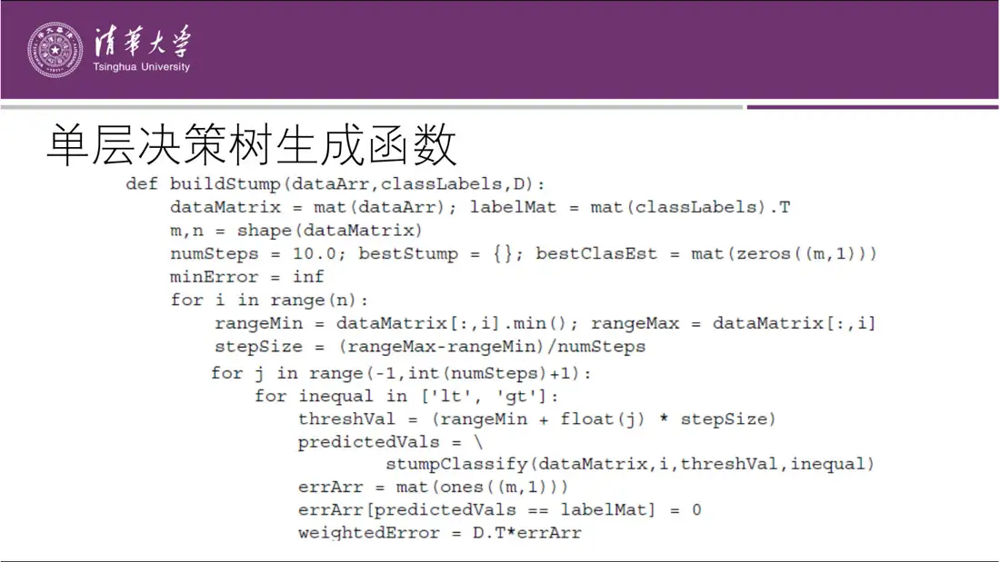

原文：

单层决策树生成函数

清華大學 Tsinghua University

### 单层决策树生成函数

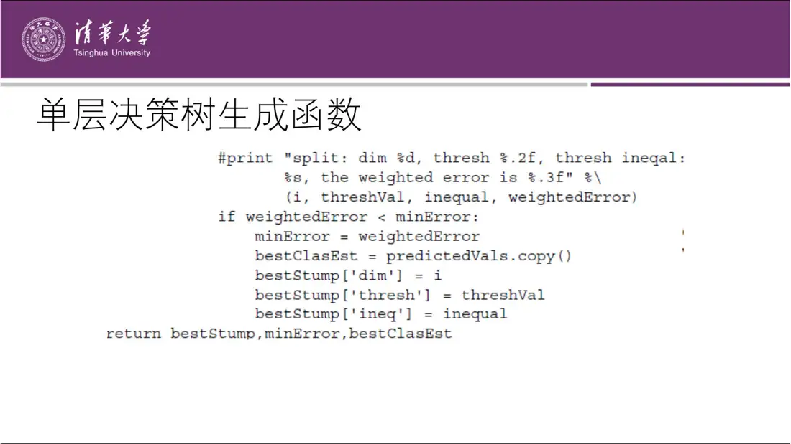

原文：

单层决策树生成函数

清華大學 Tsinghua University

### 单层决策树生成函数

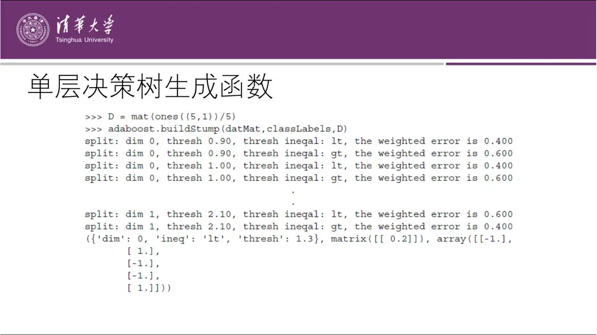

原文：

单层决策树生成函数

清華大學 Tsinghua University

### 完整AdaBoost算法的实现

原文：

完整AdaBoost算法的实现

清華大學 Tsinghua University

### 完整AdaBoost算法的实现

原文：

完整AdaBoost算法的实现

清華大學 Tsinghua University

### 完整AdaBoost算法的实现

原文：

完整AdaBoost算法的实现

D: [[0.28571429 0.07142857 0.07142857 0.07142857 0.5

classEst: [[1. 1. 1. 1. 1.]]

aggClassEst: [[1.17568763 2.56198199 -0.77022252 -0.77022252 0.61607184]]

total error: 0.0

清華大學 Tsinghua University

### 完整AdaBoost算法的实现

原文：

完整AdaBoost算法的实现

清華大學 Tsinghua University

### 测试算法

原文：

测试算法

- 基于AdaBoost的分类函数

清華大學 Tsinghua University

### 测试算法

原文：

测试算法

- 基于AdaBoost的分类函数

清華大學 Tsinghua University

### 在马疝病数据集上应用Adaboost

原文：

在马疝病数据集上应用Adaboost

\- 加载数据

清華大學 Tsinghua University

### 在马疝病数据集上应用Adaboost

原文：

在马疝病数据集上应用Adaboost

清華大學 Tsinghua University

### 在马疝病数据集上应用Adaboost

原文：

在马疝病数据集上应用Adaboost

<table><tr><td>Number of Classifiers</td><td>Training Error</td><td>Test Error</td></tr><tr><td>1</td><td>0.28</td><td>0.27</td></tr><tr><td>10</td><td>0.23</td><td>0.24</td></tr><tr><td>50</td><td>0.19</td><td>0.21</td></tr><tr><td>100</td><td>0.19</td><td>0.22</td></tr><tr><td>500</td><td>0.16</td><td>0.25</td></tr><tr><td>1000</td><td>0.14</td><td>0.31</td></tr><tr><td>10000</td><td>0.11</td><td>0.33</td></tr></table>

Tsinghua University
清華大學
TSINGHUA UNIVERSITY
1911
清華大學
TSINGHUA UNIVERSITY

### SVM和AdaBoost的关系

原文：

SVM和AdaBoost的关系

\- 相似之处

\- 把弱分类器看成SVM的核函数。

\- 按照最大化某个最小间隔的方式重写AdaBoost算法。

\- 不同

\- 二者所定义的间隔计算方式有所不同，导致结果不同。

\- 高维空间下，二者间差异会更加明显。

Tsinghua University
清華大學
1911-

### 非均衡分类问题

原文：

非均衡分类问题

• 1、马疝病

\- 2、垃圾邮件

• 3、癌症检测

\- 分类性能度量指标：正确率、召回率、ROC曲线

\- 混淆矩阵 Confus

<table><tr><td rowspan="2" colspan="2"></td><td colspan="3">Predicted</td></tr><tr><td>Dog</td><td>Cat</td><td>Rat</td></tr><tr><td rowspan="3">Actual</td><td>Dog</td><td>24</td><td>2</td><td>5</td></tr><tr><td>Cat</td><td>2</td><td>27</td><td>0</td></tr><tr><td>Rat</td><td>4</td><td>2</td><td>30</td></tr></table>

Tsinghua University
清華大學

### 非均匀分类问题

原文：

非均匀分类问题

\- 二分类问题的混淆矩阵

<table><tr><td rowspan="2" colspan="2"></td><td colspan="2">predicted</td></tr><tr><td>+1</td><td>-1</td></tr><tr><td rowspan="2">Actual</td><td>+1</td><td>True Positive (TP)</td><td>False Negative (FN)</td></tr><tr><td>-1</td><td>False Positive (FP)</td><td>True Negative (TN)</td></tr></table>

\- Precision 正确率=TP/(TP+FP)

\- Recall 召回率=TP/(TP+FN)

\- 假阳率=FP/(FP+TN)

\- 真阳率=TP/(TP+FN)

Tsinghua University
清華大學

### 非均匀分类问题

原文：

非均匀分类问题

清華大學 Tsinghua University

### 非均匀分类问题

原文：

非均匀分类问题

\- 接收者操作特性（receiver operating Characteristic）

\- 成本效益（cost-versus-benefit）

\- 曲线下面积（Area Unser theCurve, AUC）

Tsinghua University
清華大學

### 基于代价函数的分类器决策控制

原文：

基于代价函数的分类器决策控制

<table><tr><td rowspan="2" colspan="2"></td><td colspan="2">Predicted</td></tr><tr><td>+1</td><td>-1</td></tr><tr><td rowspan="2">Actual</td><td>+1</td><td>0</td><td>1</td></tr><tr><td>-1</td><td>1</td><td>0</td></tr></table>

<table><tr><td rowspan="2" colspan="2"></td><td colspan="2">Predicted</td></tr><tr><td>+1</td><td>-1</td></tr><tr><td rowspan="2">Actual</td><td>+1</td><td>-5</td><td>1</td></tr><tr><td>-1</td><td>50</td><td>0</td></tr></table>

清華大學 Tsinghua University

### 处理非均衡问题的数据抽样方法

原文：

处理非均衡问题的数据抽样方法

\- 欠抽样 (undersampling)

\- 过抽样 (oversampling)

Tsinghua University
清華大學
1911-

### • END

原文：

• END

Tsinghua University
清華大學
