# 《统计学习方法》第2版 第9章 EM算法（课件）

原件的每一页，下面附识别出的文字。

### 第九章 EM期望极大算法

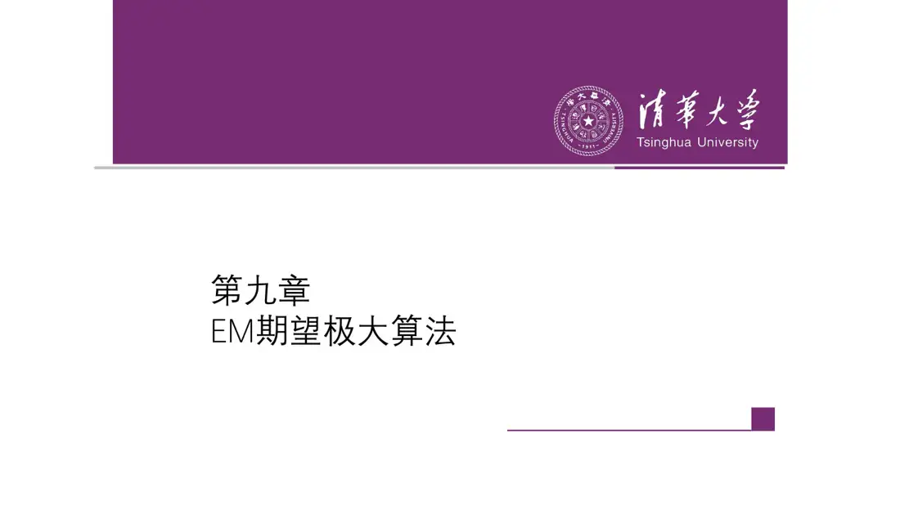

原文：

第九章 EM期望极大算法

大華津
TSINGHUA UNIVERSITY
清華大學
Tsinghua University

### 问题提出

原文：

问题提出

Tsinghua University
清華大學
1911-

### 问题提出

原文：

问题提出

\- 绿地、水体、道路、裸地、居民建筑用地等；

\- 采用的遥感影像是Quickbird 数据，

\- 图像大小为317行x315列，

\- 空间分辨率为2.44m,

\- 4个波段(蓝光波段、绿光波段、红光波段和近红外波段)。

Tsinghua University
清華大學

### 问题提出

原文：

问题提出

Tsinghua University
清華大學
1911-1911

### 问题提出

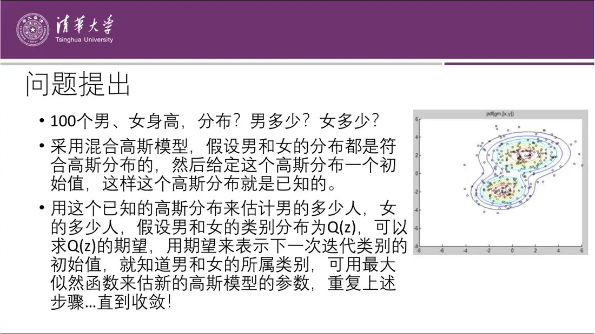

原文：

问题提出

• 100个男、女身高，分布？男多少？女多少？

\- 采用混合高斯模型，假设男和女的分布都是符合高斯分布的，然后给定这个高斯分布一个初始值，这样这个高斯分布就是已知的。

\- 用这个已知的高斯分布来估计男的多少人，女的多少人，假设男和女的类别分布为 $Q(z)$ ，可以求 $Q(z)$ 的期望，用期望来表示下一次迭代类别的初始值，就知道男和女的所属类别，可用最大似然函数来估新的高斯模型的参数，重复上述步骤...直到收敛！

Tsinghua University
清華大學

### 三硬币模型

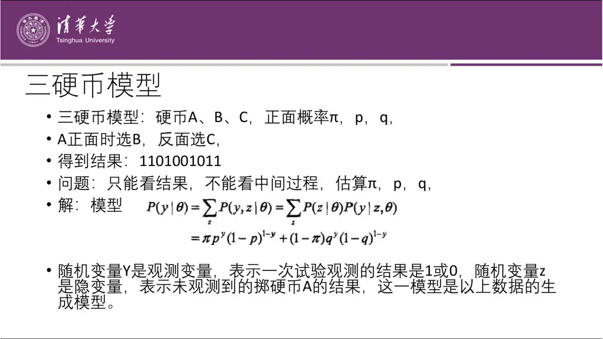

原文：

三硬币模型

\- 三硬币模型：硬币A、B、C，正面概率π，p，q，

\- A正面时选B，反面选C，

\- 得到结果：1101001011

\- 问题：只能看结果，不能看中间过程，估算 $\pi, p, q,$

\- 解：模型 $P(y\mid \theta) = \sum_{z}P(y,z\mid \theta) = \sum_{z}P(z\mid \theta)P(y\mid z,\theta)$ $= \pi p^{y}(1 - p)^{1 - y} + (1 - \pi)q^{y}(1 - q)^{1 - y}$

\- 随机变量Y是观测变量，表示一次试验观测的结果是1或0，随机变量z是隐变量，表示未观测到的掷硬币A的结果，这一模型是以上数据的生成模型。

Tsinghua University
清華大學

### 三硬币模型

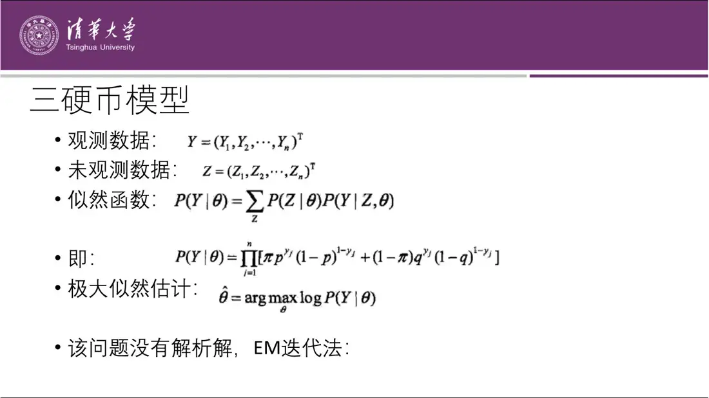

原文：

三硬币模型

\- 观测数据: $Y = (Y_{1}, Y_{2}, \cdots, Y_{n})^{\mathrm{T}}$

\- 未观测数据： $Z = (Z_{1}, Z_{2}, \dots, Z_{n})^{\mathrm{T}}$

\- 似然函数： $P(Y \mid \theta) = \sum_{Z} P(Z \mid \theta) P(Y \mid Z, \theta)$

\- 即:

$$
P (Y \mid \theta) = \prod_ {j = 1} ^ {n} [ \pi p ^ {y _ {j}} (1 - p) ^ {1 - y _ {j}} + (1 - \pi) q ^ {y _ {j}} (1 - q) ^ {1 - y _ {j}} ]
$$

\- 极大似然估计: $\hat{\theta} = \arg \max_{\theta} \log P(Y | \theta)$

\- 该问题没有解析解，EM迭代法：

Tsinghua University
清華大學

### EM方法

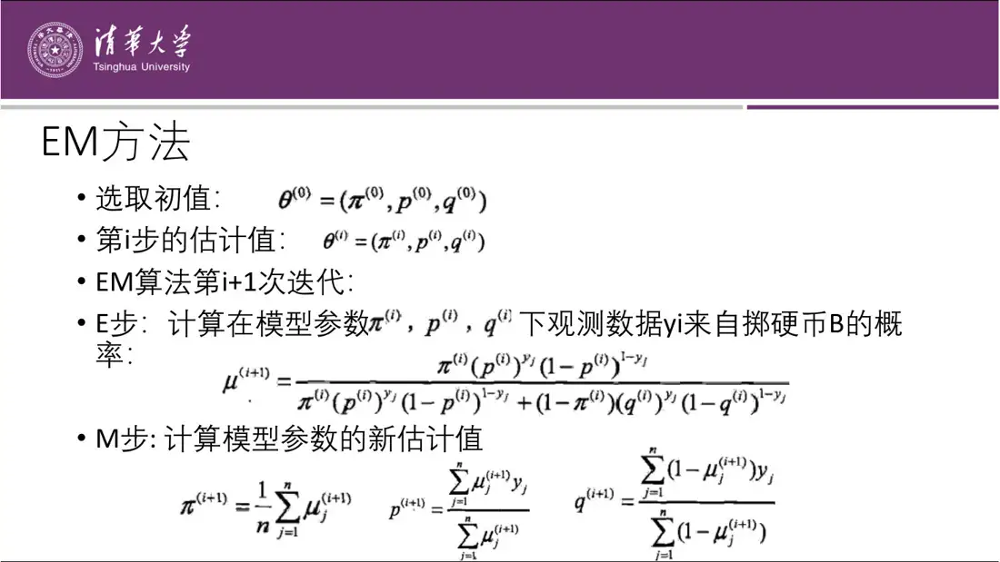

原文：

EM方法

\- 选取初值: $\theta^{(0)} = (\pi^{(0)}, p^{(0)}, q^{(0)})$

\- 第i步的估计值： $\theta^{(i)} = (\pi^{(i)}, p^{(i)}, q^{(i)})$

\- EM算法第i+1次迭代:

• E步：计算在模型参数 $\pi^{(i)}$ ， $p^{(i)}$ ， $q^{(i)}$ 下观测数据yi来自掷硬币B的概

$$
\mu^ {(i + 1)} = \frac {\pi^ {(i)} (p ^ {(i)}) ^ {y _ {j}} (1 - p ^ {(i)}) ^ {1 - y _ {j}}}{\pi^ {(i)} (p ^ {(i)}) ^ {y _ {j}} (1 - p ^ {(i)}) ^ {1 - y _ {j}} + (1 - \pi^ {(i)}) (q ^ {(i)}) ^ {y _ {j}} (1 - q ^ {(i)}) ^ {1 - y _ {j}}}
$$

\- M步: 计算模型参数的新估计值

$$
\pi^ {(i + 1)} = \frac {1}{n} \sum_ {j = 1} ^ {n} \mu_ {j} ^ {(i + 1)} \quad p ^ {(i + 1)} = \frac {\sum_ {j = 1} ^ {n} \mu_ {j} ^ {(i + 1)} y _ {j}}{\sum_ {j = 1} ^ {n} \mu_ {j} ^ {(i + 1)}} \quad q ^ {(i + 1)} = \frac {\sum_ {j = 1} ^ {n} (1 - \mu_ {j} ^ {(i + 1)}) y _ {j}}{\sum_ {j = 1} ^ {n} (1 - \mu_ {j} ^ {(i + 1)})}
$$

Tsinghua University
清華大學

### EM方法

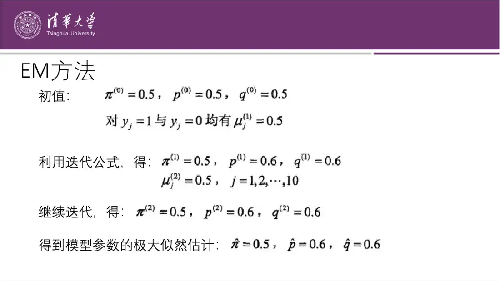

原文：

EM方法

初值： $\pi^{(0)} = 0.5$ ， $p^{(0)} = 0.5$ ， $q^{(0)} = 0.5$

对 $y_{j} = 1$ 与 $y_{j} = 0$ 均有 $\mu_j^{(1)} = 0.5$

利用迭代公式，得： $\pi^{(1)}=0.5,\quad p^{(1)}=0.6,\quad q^{(1)}=0.6$

$$
\mu_ {j} ^ {(2)} = 0. 5, \quad j = 1, 2, \dots , 1 0
$$

继续迭代，得： $\pi^{(2)}=0.5,\quad p^{(2)}=0.6,\quad q^{(2)}=0.6$

得到模型参数的极大似然估计： $\hat{\pi} = 0.5$ ， $\hat{p} = 0.6$ ， $\hat{q} = 0.6$

清華大學 Tsinghua University

### EM方法

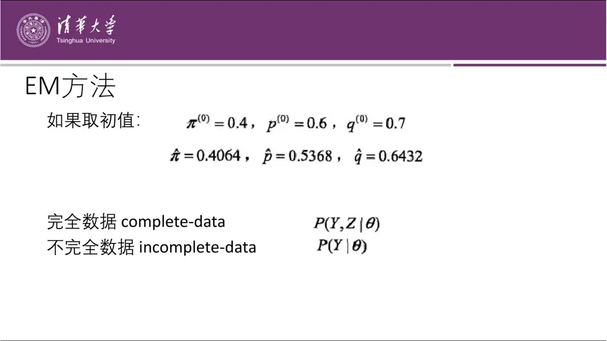

原文：

EM方法

如果取初值： $\pi^{(0)} = 0.4$ ， $p^{(0)} = 0.6$ ， $q^{(0)} = 0.7$

$\hat{\pi} = 0.4064$ ， $\hat{p} = 0.5368$ ， $\hat{q} = 0.6432$

完全数据 complete-data

不完全数据 incomplete-data

Tsinghua University
清華大學
TSINGHUA UNIVERSITY
1911
清華大學
TSINGHUA UNIVERSITY

### EM方法

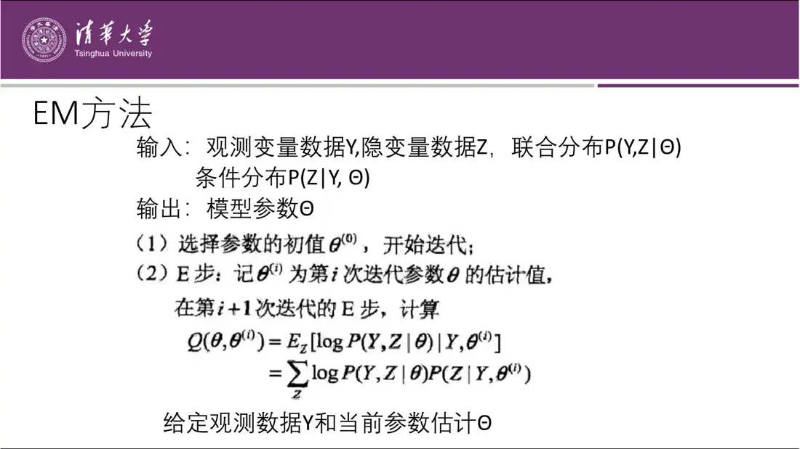

原文：

EM方法

输入：观测变量数据Y,隐变量数据Z，联合分布P(Y,Z|Θ)条件分布P(Z|Y, Θ)

输出：模型参数Θ

(1) 选择参数的初值 $\theta^{(0)}$ ，开始迭代；

(2) E 步: 记 $\theta^{(i)}$ 为第 i 次迭代参数 $\theta$ 的估计值,

在第 $i + 1$ 次迭代的E步，计算

$$
\begin{array}{r l} Q (\theta , \theta^ {(i)}) & = E _ {Z} [ \log P (Y, Z | \theta) | Y, \theta^ {(i)} ] \\ & = \sum_ {Z} \log P (Y, Z | \theta) P (Z | Y, \theta^ {(i)}) \end{array}
$$

给定观测数据Y和当前参数估计Θ

Tsinghua University
清華大學
TSINGHUA UNIVERSITY
1911
清華大學
TSINGHUA UNIVERSITY

### EM方法

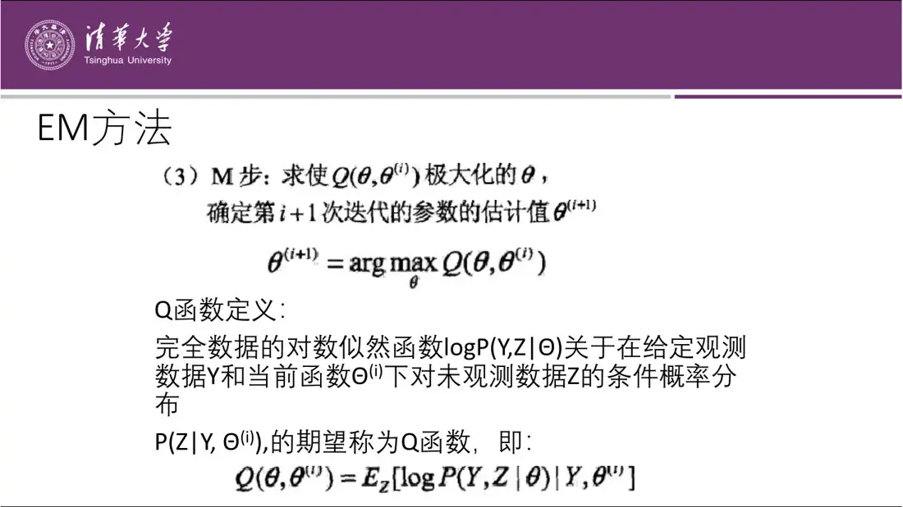

原文：

EM方法

(3) M 步: 求使 $Q(\theta, \theta^{(i)})$ 极大化的 $\theta$ ,

确定第 $i + 1$ 次迭代的参数的估计值 $\theta^{(i + 1)}$

$$
\theta^ {(i + 1)} = \arg \max _ {\theta} Q (\theta , \theta^ {(i)})
$$

Q函数定义:

完全数据的对数似然函数 $\log P(Y,Z|\Theta)$ 关于在给定观测数据Y和当前函数 $\Theta^{(i)}$ 下对未观测数据Z的条件概率分布

$P(Z|Y,\Theta^{(i)}),$ 的期望称为Q函数，即：

$$
Q (\theta , \theta^ {(1)}) = E _ {Z} [ \log P (Y, Z | \theta) | Y, \theta^ {(1)} ]
$$

清華大學 Tsinghua University

### EM方法

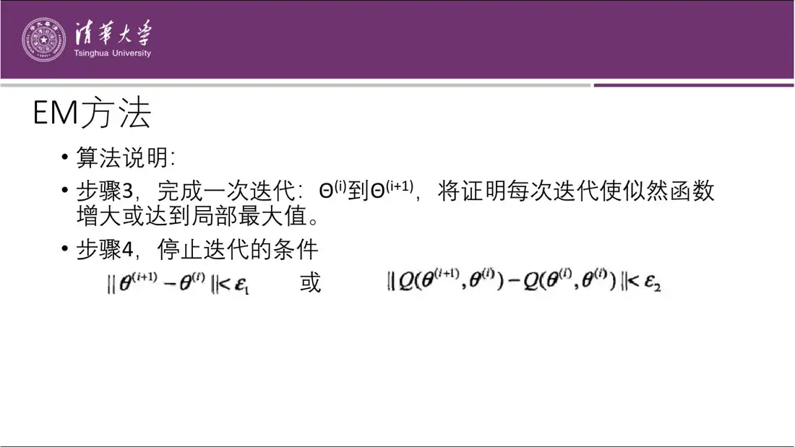

原文：

EM方法

\- 算法说明:

\- 步骤3，完成一次迭代： $\Theta^{(i)}$ 到 $\Theta^{(i+1)}$ ，将证明每次迭代使似然函数增大或达到局部最大值。

\- 步骤4，停止迭代的条件

$$
\| \theta^ {(i + 1)} - \theta^ {(i)} \| <   \varepsilon_ {1} \qquad \text {或} \qquad \| Q (\theta^ {(i + 1)}, \theta^ {(i)}) - Q (\theta^ {(i)}, \theta^ {(i)}) \| <   \varepsilon_ {2}
$$

清華大學 Tsinghua University

### EM算法的导出

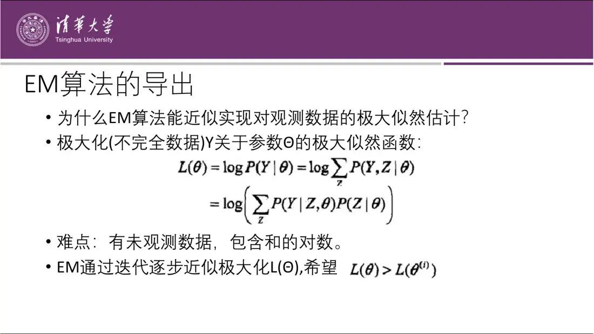

原文：

EM算法的导出

\- 为什么EM算法能近似实现对观测数据的极大似然估计？

\- 极大化(不完全数据)Y关于参数Θ的极大似然函数:

$$
\begin{array}{r l} L (\theta) & = \log P (Y \mid \theta) = \log \sum_ {Z} P (Y, Z \mid \theta) \\ & = \log \left(\sum_ {Z} P (Y \mid Z, \theta) P (Z \mid \theta)\right) \end{array}
$$

\- 难点：有未观测数据，包含和的对数。

\- EM通过迭代逐步近似极大化L(Θ),希望 $L(\theta) > L(\theta^{(i)})$

Tsinghua University
清華大學

### EM算法的导出

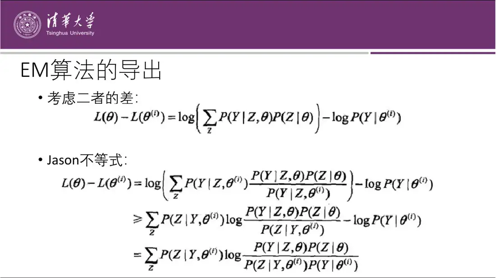

原文：

EM算法的导出

\- 考虑二者的差:

$$
L (\theta) - L \left(\theta^ {(i)}\right) = \log \left(\sum_ {Z} P (Y \mid Z, \theta) P (Z \mid \theta)\right) - \log P (Y \mid \theta^ {(i)})
$$

\- Jason不等式:

$$
\begin{array}{r l} L (\theta) - L (\theta^ {(i)}) & = \log \left(\sum_ {z} P (Y | Z, \theta^ {(i)}) \frac {P (Y | Z , \theta) P (Z | \theta)}{P (Y | Z , \theta^ {(i)})}\right) - \log P (Y | \theta^ {(i)}) \\ & \geqslant \sum_ {z} P (Z | Y, \theta^ {(i)}) \log \frac {P (Y | Z , \theta) P (Z | \theta)}{P (Z | Y , \theta^ {(i)})} - \log P (Y | \theta^ {(i)}) \\ & = \sum_ {z} P (Z | Y, \theta^ {(i)}) \log \frac {P (Y | Z , \theta) P (Z | \theta)}{P (Z | Y , \theta^ {(i)}) P (Y | \theta^ {(i)})} \end{array}
$$

Tsinghua University
清華大學

### EM算法的导出

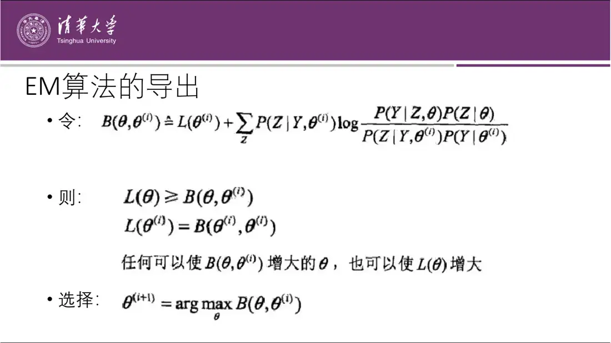

原文：

EM算法的导出

\- 令: $B(\theta, \theta^{(i)}) \triangleq L(\theta^{(i)}) + \sum_{Z} P(Z \mid Y, \theta^{(i)}) \log \frac{P(Y \mid Z, \theta) P(Z \mid \theta)}{P(Z \mid Y, \theta^{(i)}) P(Y \mid \theta^{(i)})}$ .

\- 则: $L(\theta) \geqslant B(\theta, \theta^{(i)})$

$$
L (\theta^ {(i)}) = B (\theta^ {(i)}, \theta^ {(i)})
$$

任何可以使 $B(\theta, \theta^{(i)})$ 增大的 $\theta$ ，也可以使 $L(\theta)$ 增大

\- 选择: $\theta^{(i+1)} = \arg \max_{\theta} B(\theta, \theta^{(i)})$

Tsinghua University
清華大學

### EM算法的导出

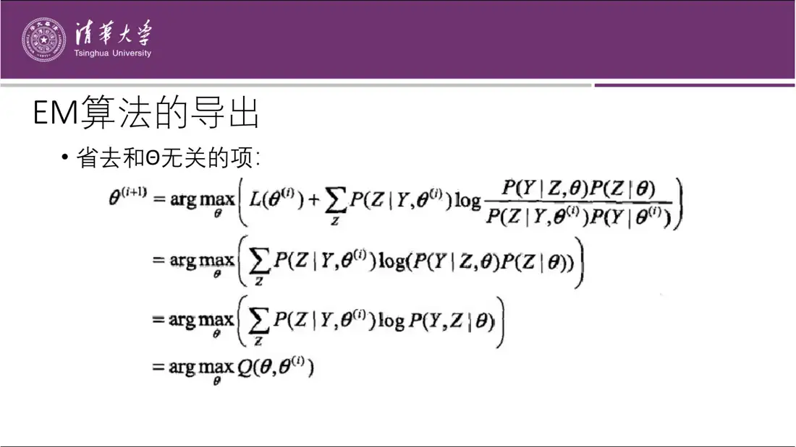

原文：

EM算法的导出

\- 省去和 $\Theta$ 无关的项:

$$
\begin{array}{r l} \theta^ {(i + 1)} & = \arg \max _ {\theta} \left(L (\theta^ {(i)}) + \sum_ {Z} P (Z | Y, \theta^ {(i)}) \log \frac {P (Y | Z , \theta) P (Z | \theta)}{P (Z | Y , \theta^ {(i)}) P (Y | \theta^ {(i)})}\right) \\ & = \arg \max _ {\theta} \left(\sum_ {Z} P (Z | Y, \theta^ {(i)}) \log (P (Y | Z, \theta) P (Z | \theta))\right) \\ & = \arg \max _ {\theta} \left(\sum_ {Z} P (Z | Y, \theta^ {(i)}) \log P (Y, Z | \theta)\right) \\ & = \arg \max _ {\theta} Q (\theta , \theta^ {(i)}) \end{array}
$$

Tsinghua University
清華大學
1911-

### EM算法的解释

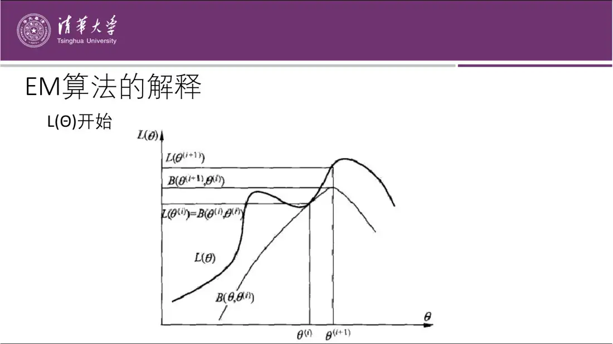

原文：

EM算法的解释

L(θ)开始

清華大學 Tsinghua University

### EM在非监督学习中的应用

原文：

EM在非监督学习中的应用

\- 生成模型由联合概率分布P(X,Y)表示，可以认为非监督学习训练数据是联合概率分布产生的数据，X为观测数据，Y为未观测数据。

Tsinghua University
清華大學
1911-1911

### EM算法的收敛性

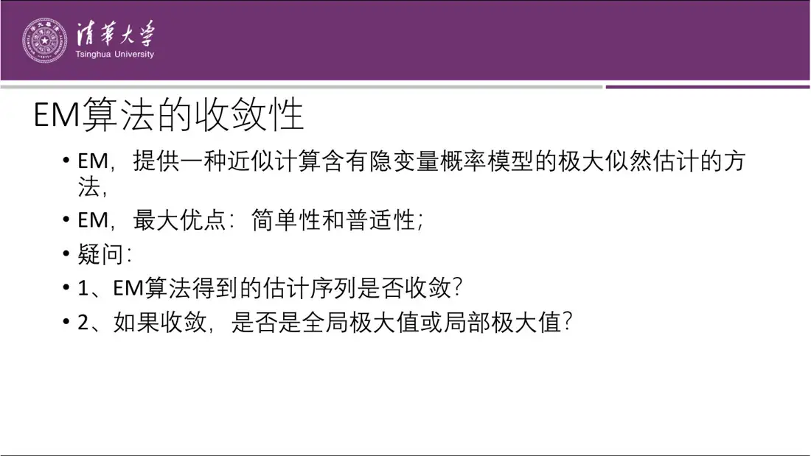

原文：

EM算法的收敛性

\- EM，提供一种近似计算含有隐变量概率模型的极大似然估计的方法，

\- EM，最大优点：简单性和普适性；

\- 疑问：

• 1、EM算法得到的估计序列是否收敛？

• 2、如果收敛，是否是全局极大值或局部极大值？

Tsinghua University
清華大學
1911-

### EM算法的收敛性

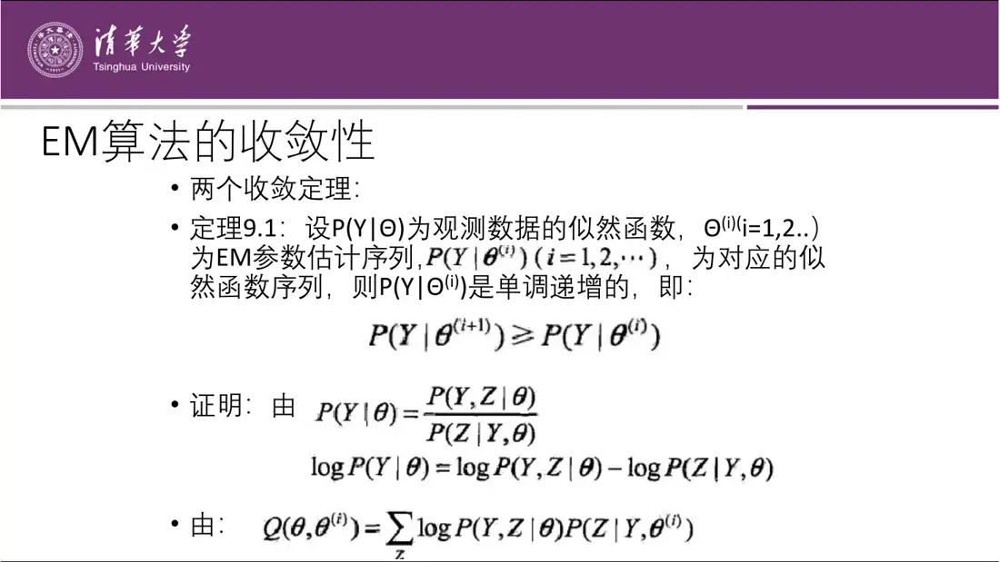

原文：

EM算法的收敛性

\- 两个收敛定理:

\- 定理9.1: 设 $P(Y|\Theta)$ 为观测数据的似然函数， $\Theta^{(i)}(i=1,2..)$ 为EM参数估计序列， $P(Y|\theta^{(i)}) (i=1,2,\cdots)$ ，为对应的似然函数序列，则 $P(Y|\Theta^{(i)})$ 是单调递增的，即：

$$
P (Y \mid \theta^ {(i + 1)}) \geqslant P (Y \mid \theta^ {(i)})
$$

\- 证明：由 $P(Y|\theta) = \frac{P(Y,Z|\theta)}{P(Z|Y,\theta)}$

$$
\log P (Y \mid \theta) = \log P (Y, Z \mid \theta) - \log P (Z \mid Y, \theta)
$$

\- 由: $Q(\theta, \theta^{(i)}) = \sum_{z} \log P(Y, Z \mid \theta) P(Z \mid Y, \theta^{(i)})$

Tsinghua University
清華大學

### EM算法的收敛性

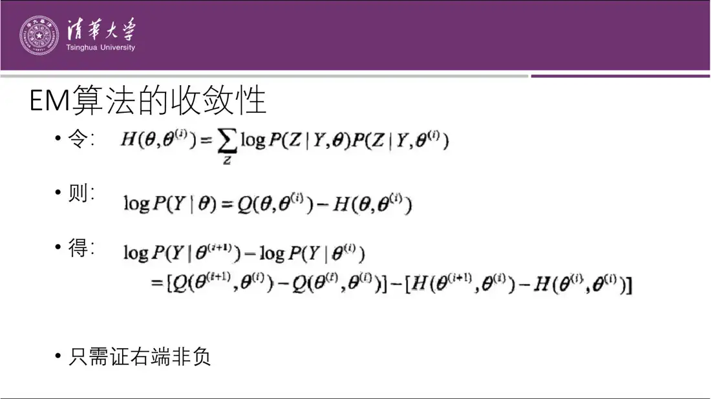

原文：

EM算法的收敛性

\- 令: $H(\theta, \theta^{(i)}) = \sum_{\mathbb{Z}} \log P(Z \mid Y, \theta)P(Z \mid Y, \theta^{(i)})$

\- 则: $\log P(Y|\theta) = Q(\theta, \theta^{(i)}) - H(\theta, \theta^{(i)})$

\- 得: $\log P(Y|\theta^{(i+1)}) - \log P(Y|\theta^{(i)})$ $= [Q(\theta^{(i+1)},\theta^{(i)}) - Q(\theta^{(i)},\theta^{(i)})] - [H(\theta^{(i+1)},\theta^{(i)}) - H(\theta^{(i)},\theta^{(i)})]$

- 只需证右端非负

Tsinghua University
清華大學

### EM算法的收敛性

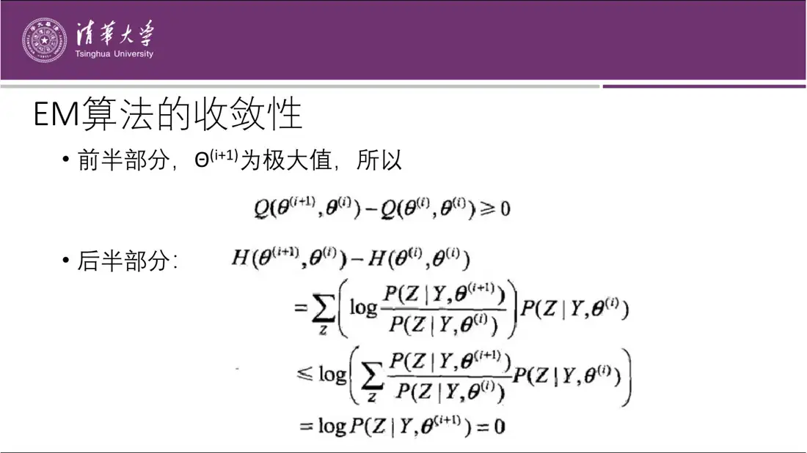

原文：

EM算法的收敛性

\- 前半部分， $\Theta^{(i+1)}$ 为极大值，所以

$$
Q (\theta^ {(i + 1)}, \theta^ {(i)}) - Q (\theta^ {(i)}, \theta^ {(i)}) \geqslant 0
$$

\- 后半部分:

$$
\begin{array}{r l} & H (\theta^ {(i + 1)}, \theta^ {(i)}) - H (\theta^ {(i)}, \theta^ {(i)}) \\ & = \sum_ {Z} \left(\log \frac {P (Z \mid Y , \theta^ {(i + 1)})}{P (Z \mid Y , \theta^ {(i)})}\right) P (Z \mid Y, \theta^ {(i)}) \\ & \leqslant \log \left(\sum_ {Z} \frac {P (Z \mid Y , \theta^ {(i + 1)})}{P (Z \mid Y , \theta^ {(i)})} P (Z \mid Y, \theta^ {(i)})\right) \\ & = \log P (Z \mid Y, \theta^ {(i + 1)}) = 0 \end{array}
$$

Tsinghua University
清華大學

### EM算法的收敛性

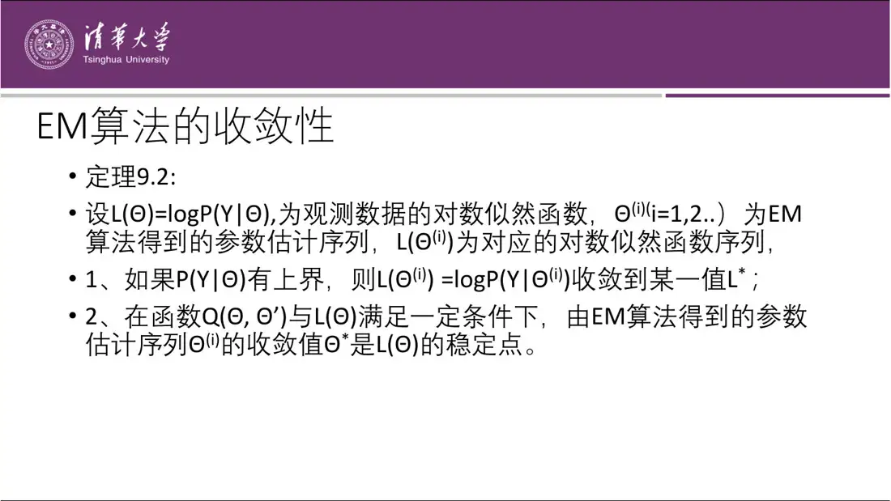

原文：

EM算法的收敛性

\- 定理9.2:

\- 设 $L(\Theta)=\log P(Y|\Theta)$ ，为观测数据的对数似然函数， $\Theta^{(i)}(i=1,2..)$ 为EM算法得到的参数估计序列， $L(\Theta^{(i)})$ 为对应的对数似然函数序列，

• 1、如果 $P(Y|\Theta)$ 有上界，则 $L(\Theta^{(i)})=\log P(Y|\Theta^{(i)})$ 收敛到某一值 $L^{*}$ ;

• 2、在函数 $Q(\Theta, \Theta')$ 与 $L(\Theta)$ 满足一定条件下，由EM算法得到的参数估计序列 $\Theta^{(i)}$ 的收敛值 $\Theta^{*}$ 是 $L(\Theta)$ 的稳定点。

Tsinghua University
清華大學

### EM算法在高斯混合模型学习中的应用

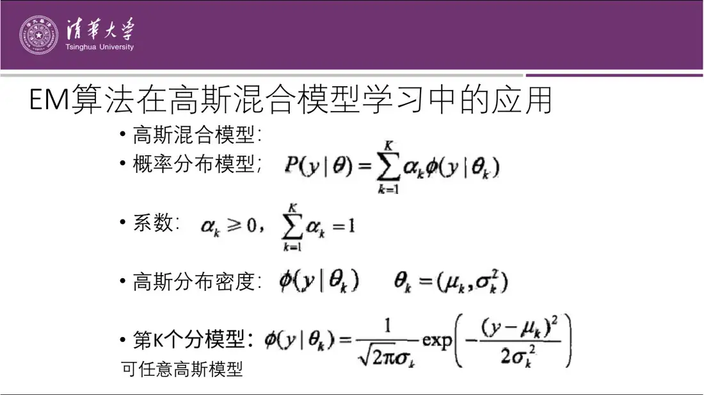

原文：

EM算法在高斯混合模型学习中的应用

\- 高斯混合模型:

\- 概率分布模型； $P(y \mid \theta) = \sum_{k=1}^{K} \alpha_k \phi(y \mid \theta_k)$

\- 系数: $\alpha_{k} \geqslant 0, \sum_{k=1}^{K} \alpha_{k} = 1$

\- 高斯分布密度: $\phi(y \mid \theta_k)$ $\theta_k = (\mu_k, \sigma_k^2)$

\- 第K个分模型： $\phi(y \mid \theta_k) = \frac{1}{\sqrt{2\pi}\sigma_k} \exp\left(-\frac{(y - \mu_k)^2}{2\sigma_k^2}\right)$ 可任意高斯模型

清華大學 Tsinghua University

### 高斯混合模型参数估计的EM算法

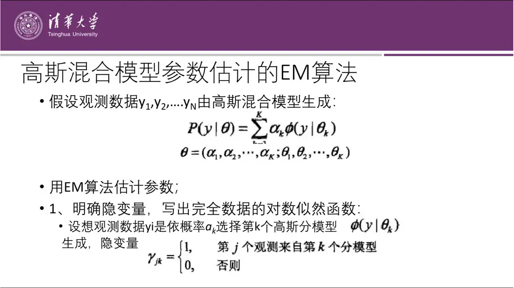

原文：

高斯混合模型参数估计的EM算法

\- 假设观测数据 $y_1, y_2, \ldots, y_N$ 由高斯混合模型生成：

$$
\begin{array}{c} P (y \mid \theta) = \sum_ {k = 1} ^ {K} \alpha_ {k} \phi (y \mid \theta_ {k}) \\ \theta = (\alpha_ {1}, \alpha_ {2}, \dots , \alpha_ {K}; \theta_ {1}, \theta_ {2}, \dots , \theta_ {K}) \end{array}
$$

\- 用EM算法估计参数;

• 1、明确隐变量，写出完全数据的对数似然函数：

\- 设想观测数据yi是依概率 $a_{k}$ 选择第k个高斯分模型 $\phi(y|\theta_{k})$

生成，隐变量 $\gamma_{jk} = \left\{ \begin{array}{ll}1, & \text{第 } j \text{ 个观测来自第 } k \text{ 个分模型}\\ 0, & \text{否则} \end{array} \right.$

Tsinghua University
清華大學

### EM算法在高斯混合模型学习中的应用

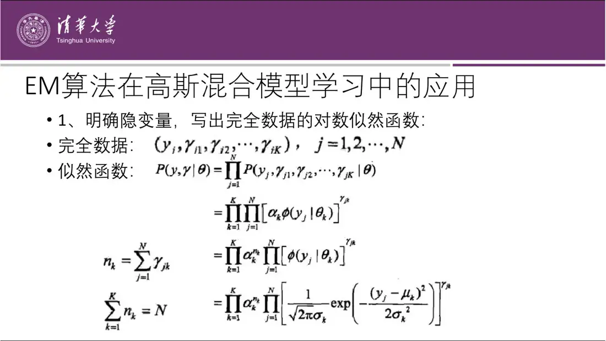

原文：

EM算法在高斯混合模型学习中的应用

• 1、明确隐变量，写出完全数据的对数似然函数：

\- 完全数据: $(y_{i},\gamma_{i1},\gamma_{i2},\cdots,\gamma_{iK})$ ， $j = 1,2,\dots,N$

\- 似然函数:

$$
\begin{array}{r l} {\text {函数:}} & {P (y, \gamma | \theta) =  \prod_ {j = 1} ^ {N} P (y _ {j}, \gamma_ {j 1}, \gamma_ {j 2}, \dots , \gamma_ {j K} | \theta)} \\ & {\qquad =  \prod_ {k = 1} ^ {K} \prod_ {j = 1} ^ {N} \left[ \alpha_ {k} \phi (y _ {j} | \theta_ {k}) \right] ^ {\gamma_ {j k}}} \\ {n _ {k} =  \sum_ {j = 1} ^ {N} \gamma_ {j k}} & {\qquad =  \prod_ {k = 1} ^ {K} \alpha_ {k} ^ {n _ {k}} \prod_ {j = 1} ^ {N} \left[ \phi (y _ {j} | \theta_ {k}) \right] ^ {\gamma_ {j k}}} \\ { \sum_ {k = 1} ^ {K} n _ {k} = N} & {\qquad =  \prod_ {k = 1} ^ {K} \alpha_ {k} ^ {n _ {k}} \prod_ {j = 1} ^ {N} \left[ \frac {1}{\sqrt {2 \pi} \sigma_ {k}} \exp \left(- \frac {(y _ {j} - \mu_ {k}) ^ {2}}{2 \sigma_ {k} ^ {2}}\right) \right] ^ {\gamma_ {j k}}} \end{array}
$$

Tsinghua University
清華大學

### EM算法在高斯混合模型学习中的应用

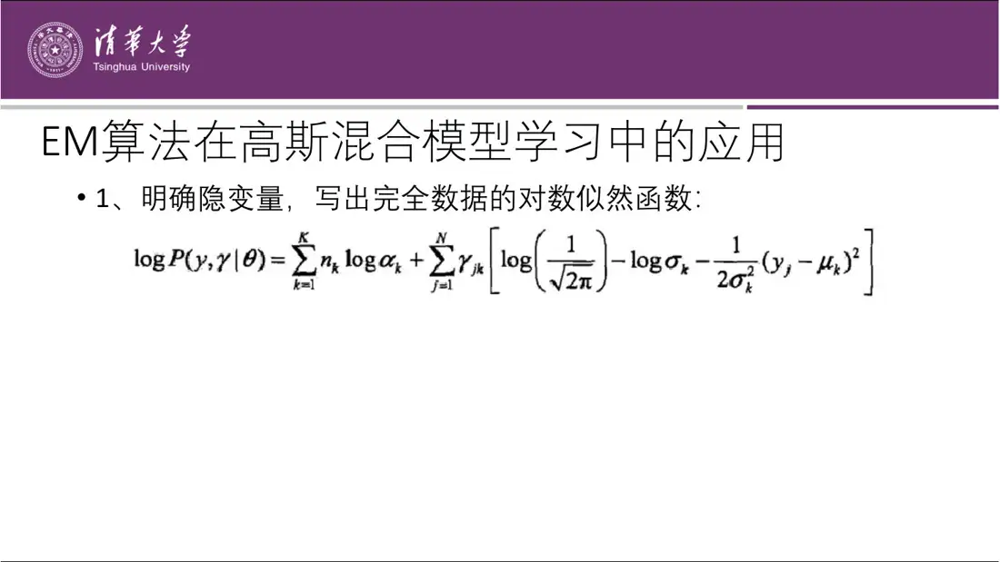

原文：

EM算法在高斯混合模型学习中的应用

• 1、明确隐变量，写出完全数据的对数似然函数：

$$
\log P (y, \gamma | \theta) = \sum_ {k = 1} ^ {K} n _ {k} \log \alpha_ {k} + \sum_ {j = 1} ^ {N} \gamma_ {j k} \left[ \log \left(\frac {1}{\sqrt {2 \pi}}\right) - \log \sigma_ {k} - \frac {1}{2 \sigma_ {k} ^ {2}} \left(y _ {j} - \mu_ {k}\right) ^ {2} \right]
$$

Tsinghua University
清華大學

### EM算法在高斯混合模型学习中的应用

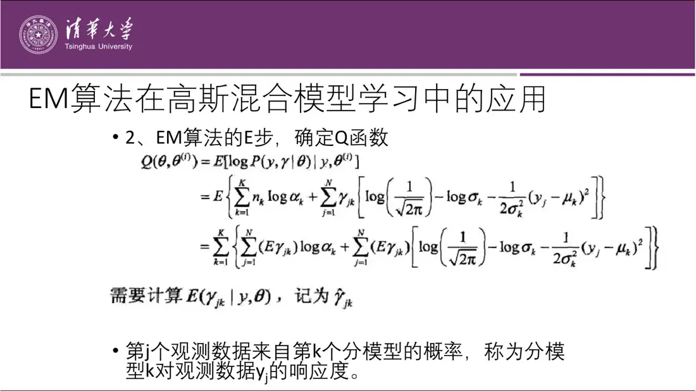

原文：

EM算法在高斯混合模型学习中的应用

\- 2、EM算法的E步，确定Q函数

$$
\begin{array}{r l} Q (\theta , \theta^ {(i)}) & = E [ \log P (y, \gamma | \theta) | y, \theta^ {(i)} ] \\ & = E \left\{\sum_ {k = 1} ^ {K} n _ {k} \log \alpha_ {k} + \sum_ {j = 1} ^ {N} \gamma_ {j k} \left[ \log \left(\frac {1}{\sqrt {2 \pi}}\right) - \log \sigma_ {k} - \frac {1}{2 \sigma_ {k} ^ {2}} (y _ {j} - \mu_ {k}) ^ {2} \right] \right\} \\ & = \sum_ {k = 1} ^ {K} \left\{\sum_ {j = 1} ^ {N} (E \gamma_ {j k}) \log \alpha_ {k} + \sum_ {j = 1} ^ {N} (E \gamma_ {j k}) \left[ \log \left(\frac {1}{\sqrt {2 \pi}}\right) - \log \sigma_ {k} - \frac {1}{2 \sigma_ {k} ^ {2}} (y _ {j} - \mu_ {k}) ^ {2} \right] \right\} \end{array}
$$

需要计算 $E(\gamma_{jk}|y,\theta)$ ，记为 $\hat{\gamma}_{jk}$

\- 第j个观测数据来自第k个分模型的概率，称为分模型k对观测数据 $y_{j}$ 的响应度。

清華大學 Tsinghua University

### EM算法在高斯混合模型学习中的应用

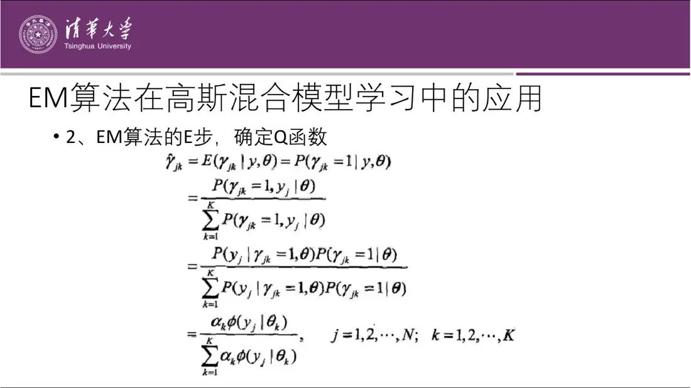

原文：

EM算法在高斯混合模型学习中的应用

\- 2、EM算法的E步，确定Q函数

$$
\begin{array}{r l} & {\hat {\gamma} _ {j k} = E (\gamma_ {j k} \mid y, \theta) = P (\gamma_ {j k} = 1 \mid y, \theta)} \\ & {= \frac {P (\gamma_ {j k} = 1 , y _ {j} \mid \theta)}{\sum_ {k = 1} ^ {K} P (\gamma_ {j k} = 1 , y _ {j} \mid \theta)}} \\ & {= \frac {P (y _ {j} \mid \gamma_ {j k} = 1 , \theta) P (\gamma_ {j k} = 1 \mid \theta)}{\sum_ {k = 1} ^ {K} P (y _ {j} \mid \gamma_ {j k} = 1 , \theta) P (\gamma_ {j k} = 1 \mid \theta)}} \\ & {= \frac {\alpha_ {k} \phi (y _ {j} \mid \theta_ {k})}{\sum_ {k = 1} ^ {K} \alpha_ {k} \phi (y _ {j} \mid \theta_ {k})}, \quad j = 1, 2, \dots , N; \quad k = 1, 2, \dots , K} \end{array}
$$

清華大學 Tsinghua University

### EM算法在高斯混合模型学习中的应用

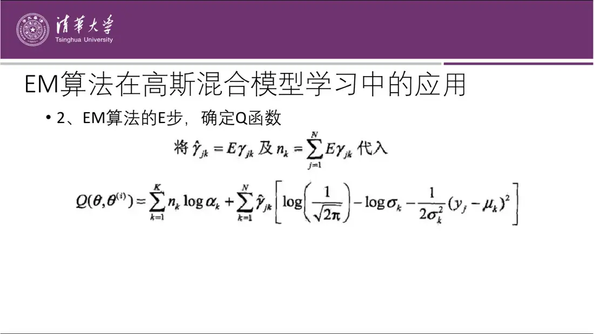

原文：

EM算法在高斯混合模型学习中的应用

\- 2、EM算法的E步，确定Q函数

$$
\text {将} \hat {\gamma} _ {j k} = E \gamma_ {j k} \text {及} n _ {k} = \sum_ {j = 1} ^ {N} E \gamma_ {j k} \text {代入}
$$

$$
Q (\theta , \theta^ {(i)}) = \sum_ {k = 1} ^ {K} n _ {k} \log \alpha_ {k} + \sum_ {k = 1} ^ {N} \hat {\gamma} _ {j k} \left[ \log \left(\frac {1}{\sqrt {2 \pi}}\right) - \log \sigma_ {k} - \frac {1}{2 \sigma_ {k} ^ {2}} (y _ {j} - \mu_ {k}) ^ {2} \right]
$$

Tsinghua University
清華大學

### EM算法在高斯混合模型学习中的应用

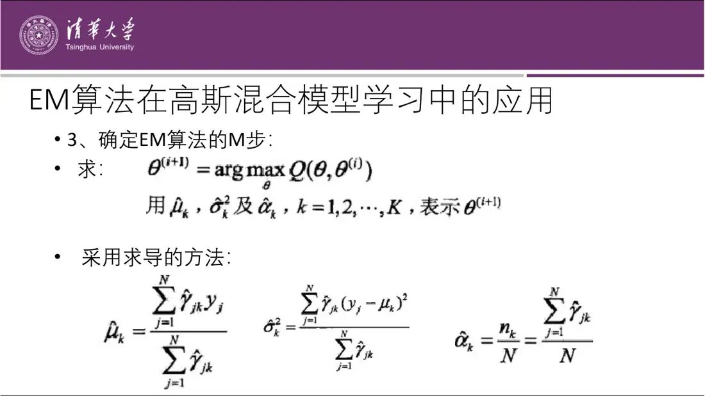

原文：

EM算法在高斯混合模型学习中的应用

• 3、确定EM算法的M步:

\- 求: $\theta^{(i+1)} = \arg \max_{\theta} Q(\theta, \theta^{(i)})$

用 $\hat{\mu}_{k}$ ， $\hat{\sigma}_{k}^{2}$ 及 $\hat{\alpha}_{k}$ ， $k=1,2,\cdots,K$ ，表示 $\theta^{(i+1)}$

\- 采用求导的方法:

$$
\hat {\mu} _ {k} = \frac {\sum_ {j = 1} ^ {N} \hat {\gamma} _ {j k} y _ {j}}{\sum_ {j = 1} ^ {N} \hat {\gamma} _ {j k}} \quad \hat {\sigma} _ {k} ^ {2} = \frac {\sum_ {j = 1} ^ {N} \hat {\gamma} _ {j k} (y _ {j} - \mu_ {k}) ^ {2}}{\sum_ {j = 1} ^ {N} \hat {\gamma} _ {j k}} \quad \hat {\alpha} _ {k} = \frac {n _ {k}}{N} = \frac {\sum_ {j = 1} ^ {N} \hat {\gamma} _ {j k}}{N}
$$

清華大學 Tsinghua University

### 高斯混合模型参数估计的EM算法

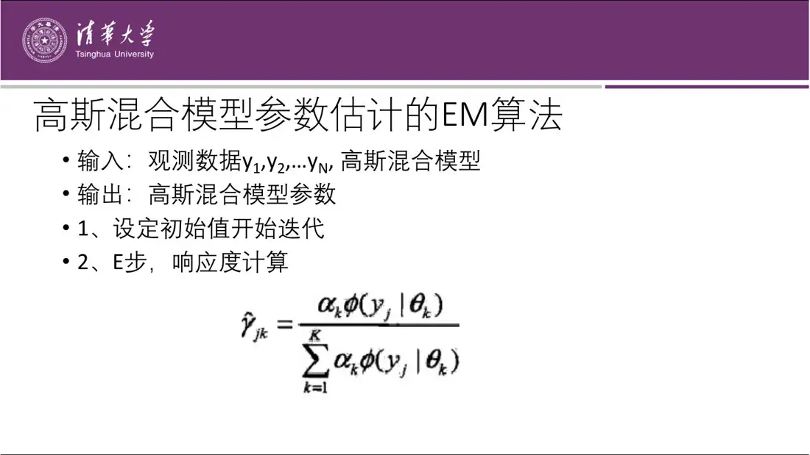

原文：

高斯混合模型参数估计的EM算法

\- 输入：观测数据 $y_{1},y_{2},\ldots,y_{N}$ ，高斯混合模型

\- 输出：高斯混合模型参数

• 1、设定初始值开始迭代

• 2、E步，响应度计算

$$
\hat {\gamma} _ {j k} = \frac {\alpha_ {k} \phi (y _ {j} \mid \theta_ {k})}{\sum_ {k = 1} ^ {K} \alpha_ {k} \phi (y _ {j} \mid \theta_ {k})}
$$

Tsinghua University
清華大學
1911-1911

### 高斯混合模型参数估计的EM算法

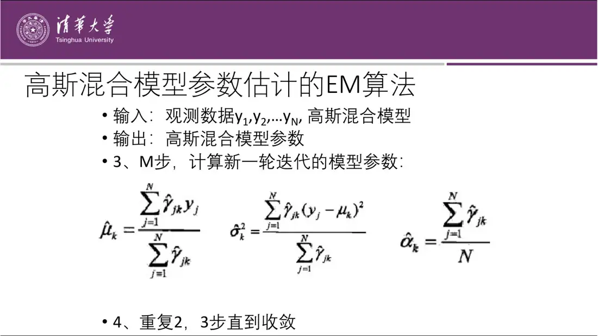

原文：

高斯混合模型参数估计的EM算法

\- 输入：观测数据 $y_{1},y_{2},\ldots,y_{N}$ ，高斯混合模型

\- 输出：高斯混合模型参数

• 3、M步，计算新一轮迭代的模型参数：

$$
\hat {\mu} _ {k} = \frac {\sum_ {j = 1} ^ {N} \hat {\gamma} _ {j k} y _ {j}}{\sum_ {j = 1} ^ {N} \hat {\gamma} _ {j k}} \quad \hat {\sigma} _ {k} ^ {2} = \frac {\sum_ {j = 1} ^ {N} \hat {\gamma} _ {j k} (y _ {j} - \mu_ {k}) ^ {2}}{\sum_ {j = 1} ^ {N} \hat {\gamma} _ {j k}} \quad \hat {\alpha} _ {k} = \frac {\sum_ {j = 1} ^ {N} \hat {\gamma} _ {j k}}{N}
$$

• 4、重复2，3步直到收敛

清華大學 Tsinghua University

### EM算法的推广

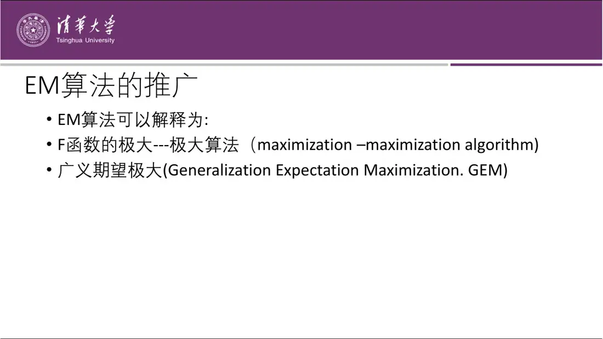

原文：

EM算法的推广

\- EM算法可以解释为:

\- F函数的极大---极大算法（maximization -maximization algorithm）

\- 广义期望极大(Generalization Expectation Maximization. GEM)

Tsinghua University
清華大學
1911-

### F函数的极大—极大算法

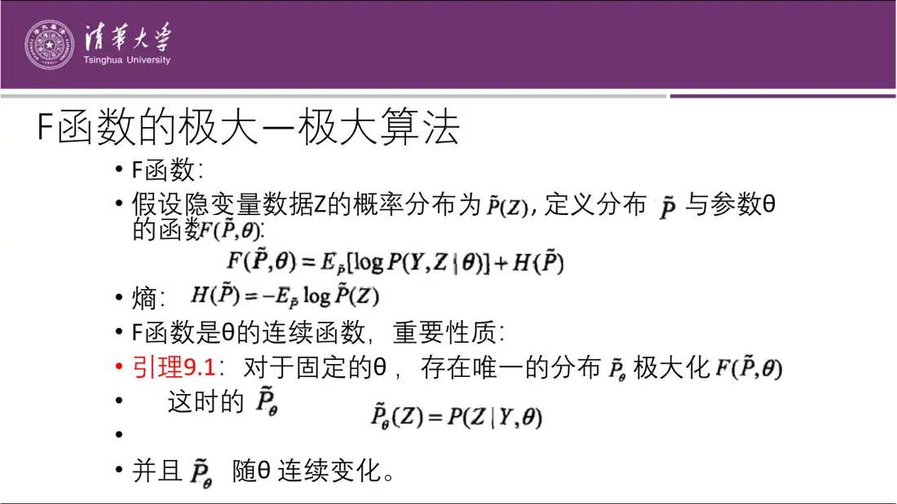

原文：

F函数的极大—极大算法

\- F函数:

\- 假设隐变量数据Z的概率分布为 $\tilde{P}(Z)$ , 定义分布 $\tilde{\pmb{P}}$ 与参数θ的函数 $F(\tilde{P},\theta)$ :

$$
F (\tilde {P}, \theta) = E _ {\tilde {P}} [ \log P (Y, Z | \theta) ] + H (\tilde {P})
$$

\- 熵： $H(\tilde{P}) = -E_{\tilde{P}}\log \tilde{P}(Z)$

\- F函数是θ的连续函数，重要性质：

\- 引理9.1：对于固定的 $\theta$ ，存在唯一的分布 $\tilde{P}_{\theta}$ 极大化 $F(\tilde{P},\theta)$

这时的 $\tilde{P}_{\theta}$

$$
\tilde {P} _ {\theta} (Z) = P (Z \mid Y, \theta)
$$

\- 并且 $\tilde{P}_{\theta}$ 随 $\theta$ 连续变化。

Tsinghua University
清華大學

### F函数的极大—极大算法

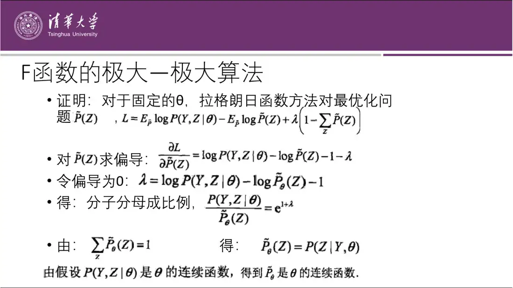

原文：

F函数的极大—极大算法

\- 证明：对于固定的 $\theta$ ，拉格朗日函数方法对最优化问题 $\tilde{P}(Z)$ ， $L = E_{\tilde{P}} \log P(Y, Z | \theta) - E_{\tilde{P}} \log \tilde{P}(Z) + \lambda \left(1 - \sum_{z} \tilde{P}(Z)\right)$

\- 对 $\tilde{P}(Z)$ 求偏导: $\frac{\partial L}{\partial \tilde{P}(Z)} = \log P(Y, Z \mid \theta) - \log \tilde{P}(Z) - 1 - \lambda$

\- 令偏导为0: $\lambda = \log P(Y, Z \mid \theta) - \log \tilde{P}_{\theta}(Z) - 1$

\- 得：分子分母成比例， $\frac{P(Y,Z|\theta)}{\tilde{P}_{\theta}(Z)} = \mathbf{e}^{1 + \lambda}$

\- 由： $\sum_{Z} \tilde{P}_{\theta}(Z) = 1$ 得： $\tilde{P}_{\theta}(Z) = P(Z \mid Y, \theta)$

由假设 $P(Y,Z|\theta)$ 是 $\pmb{\theta}$ 的连续函数，得到 $\tilde{P}_{\theta}$ 是 $\pmb{\theta}$ 的连续函数.

Tsinghua University
清華大學

### F函数的极大—极大算法

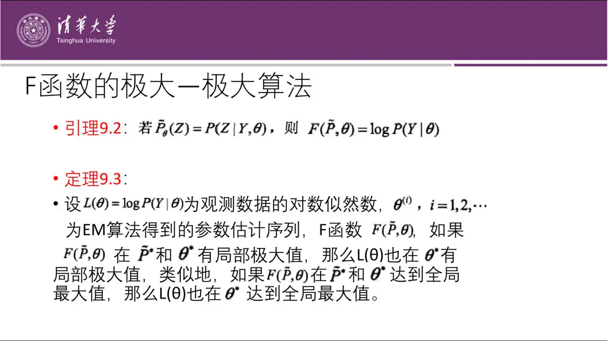

原文：

F函数的极大—极大算法

\- 引理9.2：若 $\tilde{P}_{\theta}(Z) = P(Z|Y,\theta)$ ，则 $F(\tilde{P},\theta) = \log P(Y|\theta)$

\- 定理9.3:

\- 设 $L(\theta) = \log P(Y|\theta)$ 为观测数据的对数似然数， $\theta^{(i)}$ ， $i = 1,2,\cdots$ 为EM算法得到的参数估计序列，F函数 $F(\tilde{P},\theta)$ ，如果 $F(\tilde{P},\theta)$ 在 $\tilde{P}^*$ 和 $\theta^*$ 有局部极大值，那么L(θ)也在 $\theta^*$ 有局部极大值，类似地，如果 $F(\tilde{P},\theta)$ 在 $\tilde{P}^*$ 和 $\theta^*$ 达到全局最大值，那么L(θ)也在 $\theta^*$ 达到全局最大值。

Tsinghua University
清華大學

### F函数的极大—极大算法

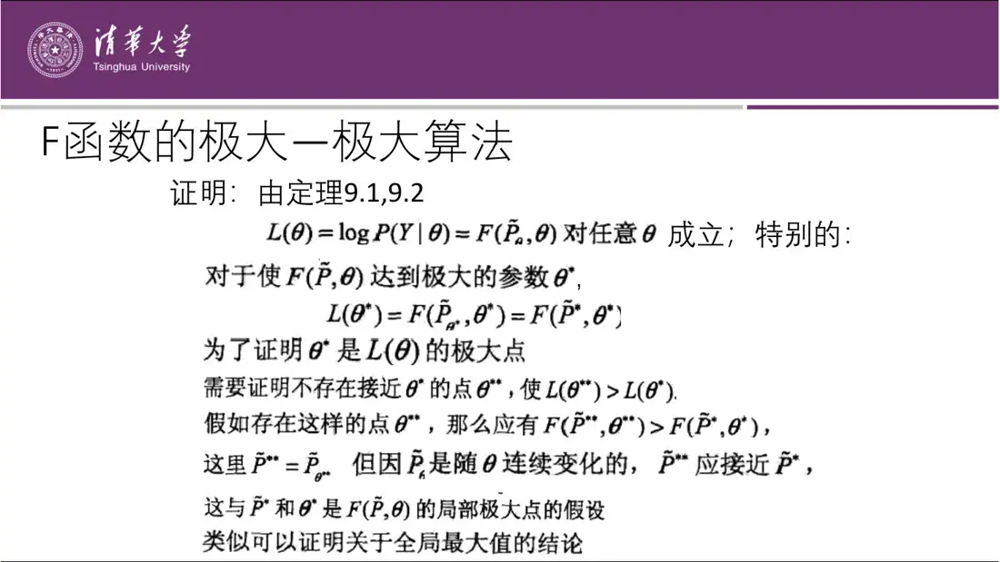

原文：

F函数的极大—极大算法

证明：由定理9.1,9.2

$L(\theta) = \log P(Y|\theta) = F(\tilde{P}_{a},\theta)$ 对任意 $\theta$ 成立；特别的：

对于使 $F(\tilde{P},\theta)$ 达到极大的参数 $\theta^{*}$

$$
L (\theta^ {*}) = F (\tilde {P} _ {\theta^ {*}}, \theta^ {*}) = F (\tilde {P} ^ {*}, \theta^ {*})
$$

为了证明 $\theta^{*}$ 是 $L(\theta)$ 的极大点

需要证明不存在接近 $\theta^{*}$ 的点 $\theta^{**}$ ，使 $L(\theta^{**}) > L(\theta^{*})$ .

假如存在这样的点 $\theta^{**}$ ，那么应有 $F(\tilde{P}^{**},\theta^{**}) > F(\tilde{P}^{*},\theta^{*})$

这里 $\tilde{P}^{**} = \tilde{P}_{\theta^{**}}$ 但因 $\tilde{P}_6$ 是随 $\theta$ 连续变化的， $\tilde{P}^{**}$ 应接近 $\tilde{P}^*$ ，

这与 $\tilde{P}^*$ 和 $\theta^{*}$ 是 $F(\tilde{P},\theta)$ 的局部极大点的假设

类似可以证明关于全局最大值的结论

Tsinghua University
清華大學

### F函数的极大—极大算法

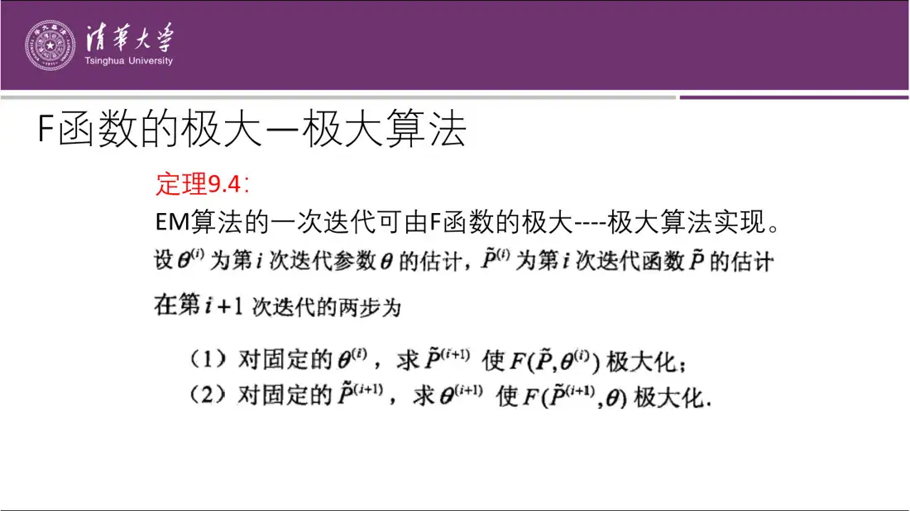

原文：

F函数的极大—极大算法

定理9.4:

EM算法的一次迭代可由F函数的极大----极大算法实现。设 $\theta^{(i)}$ 为第 $i$ 次迭代参数 $\theta$ 的估计， $\tilde{P}^{(i)}$ 为第 $i$ 次迭代函数 $\tilde{P}$ 的估计在第 $i + 1$ 次迭代的两步为

(1) 对固定的 $\theta^{(i)}$ ，求 $\tilde{P}^{(i+1)}$ 使 $F(\tilde{P},\theta^{(i)})$ 极大化；

(2) 对固定的 $\tilde{P}^{(i+1)}$ ，求 $\theta^{(i+1)}$ 使 $F(\tilde{P}^{(i+1)},\theta)$ 极大化.

清華大學 Tsinghua University

### F函数的极大—极大算法

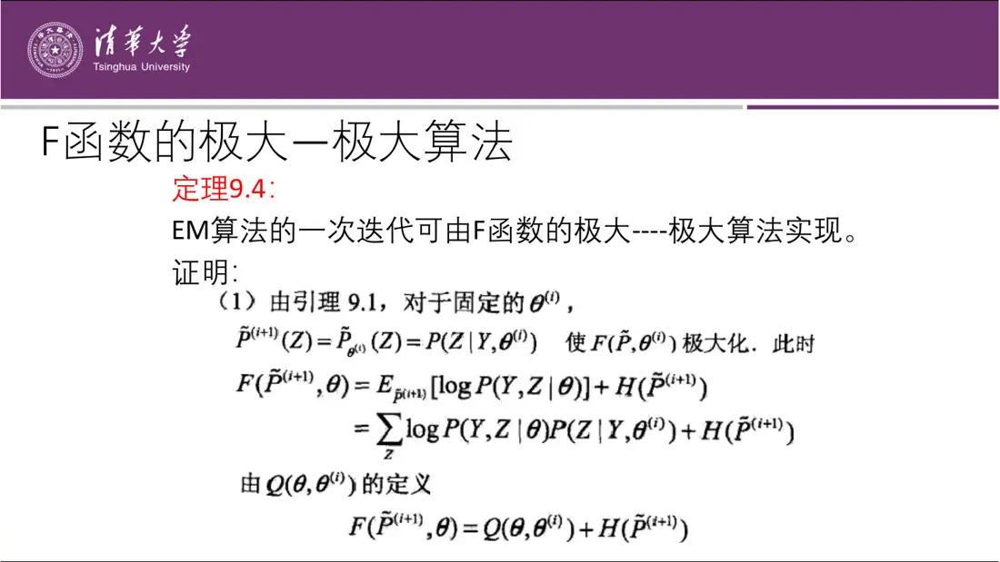

原文：

F函数的极大—极大算法

定理9.4:

EM算法的一次迭代可由F函数的极大----极大算法实现。

证明：

(1) 由引理 9.1，对于固定的 $\theta^{(i)}$

$\tilde{P}^{(i + 1)}(Z) = \tilde{P}_{\theta^{(i)}}(Z) = P(Z|Y,\theta^{(i)})$ 使 $F(\tilde{P},\theta^{(i)})$ 极大化．此时

$$
\begin{array}{r l} F (\tilde {P} ^ {(i + 1)}, \theta) & = E _ {\tilde {p} ^ {(i + 1)}} [ \log P (Y, Z | \theta) ] + H (\tilde {P} ^ {(i + 1)}) \\ & = \sum_ {Z} \log P (Y, Z | \theta) P (Z | Y, \theta^ {(i)}) + H (\tilde {P} ^ {(i + 1)}) \end{array}
$$

由 $Q(\theta, \theta^{(i)})$ 的定义

$$
F (\tilde {P} ^ {(i + 1)}, \theta) = Q (\theta , \theta^ {(i)}) + H (\tilde {P} ^ {(i + 1)})
$$

Tsinghua University
清華大學

### F函数的极大—极大算法

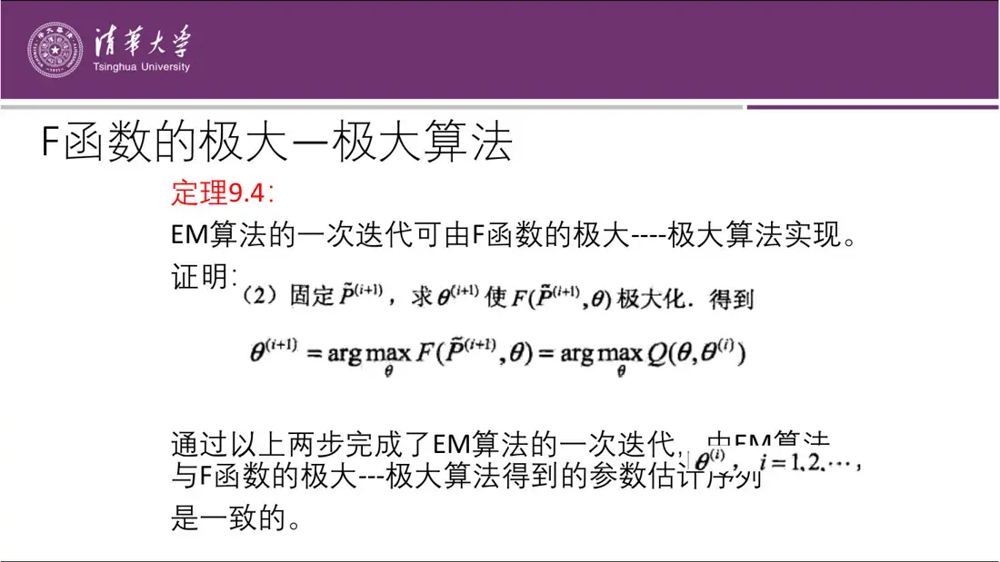

原文：

F函数的极大—极大算法

定理9.4:

EM算法的一次迭代可由F函数的极大----极大算法实现。

证明：(2) 固定 $\tilde{P}^{(i + 1)}$ ，求 $\theta^{(i + 1)}$ 使 $F(\tilde{P}^{(i + 1)},\theta)$ 极大化．得到

$$
\theta^ {(i + 1)} = \arg \max _ {\theta} F (\tilde {P} ^ {(i + 1)}, \theta) = \arg \max _ {\theta} Q (\theta , \theta^ {(i)})
$$

通过以上两步完成了EM算法的一次迭代，由EM管法与F函数的极大---极大算法得到的参数估计序列是一致的。

清華大學 Tsinghua University

### F函数的极大—极大算法

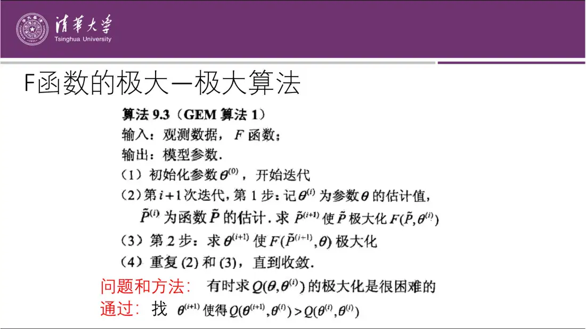

原文：

F函数的极大—极大算法

算法9.3（GEM算法1）

输入：观测数据，F 函数；

输出：模型参数.

(1) 初始化参数 $\theta^{(0)}$ ，开始迭代

(2) 第 $i + 1$ 次迭代, 第1步: 记 $\theta^{(i)}$ 为参数 $\theta$ 的估计值, $\tilde{P}^{(i)}$ 为函数 $\tilde{P}$ 的估计. 求 $\tilde{P}^{(i+1)}$ 使 $\tilde{P}$ 极大化 $F(\tilde{P}, \theta^{(i)})$

(3) 第2步：求 $\theta^{(i+1)}$ 使 $F(\tilde{P}^{(i+1)},\theta)$ 极大化

(4) 重复 (2) 和 (3)，直到收敛.

问题和方法：有时求 $Q(\theta, \theta^{(i)})$ 的极大化是很困难的

通过：找 $\theta^{(i+1)}$ 使得 $Q(\theta^{(i+1)},\theta^{(i)})>Q(\theta^{(i)},\theta^{(i)})$

清華大學 Tsinghua University

### F函数的极大—极大算法

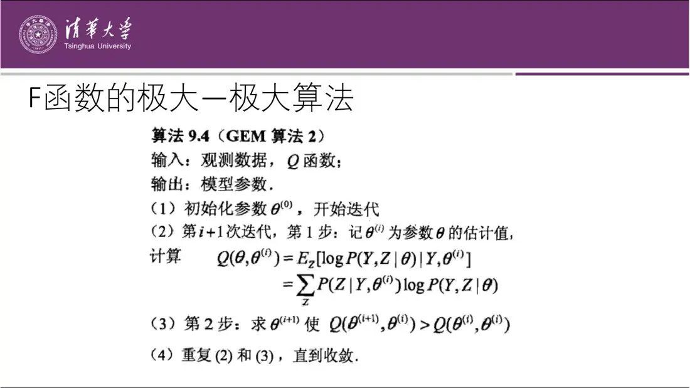

原文：

F函数的极大—极大算法

算法9.4（GEM算法2）

输入：观测数据，Q 函数；

输出：模型参数.

(1) 初始化参数 $\theta^{(0)}$ ，开始迭代

(2) 第 $i+1$ 次迭代，第 1 步：记 $\theta^{(i)}$ 为参数 $\theta$ 的估计值，

$$
\begin{array}{r l} Q (\theta , \theta^ {(i)}) & = E _ {Z} [ \log P (Y, Z | \theta) | Y, \theta^ {(i)} ] \\ & = \sum_ {Z} P (Z | Y, \theta^ {(i)}) \log P (Y, Z | \theta) \end{array}
$$

(3) 第2步：求 $\theta^{(i+1)}$ 使 $Q(\theta^{(i+1)},\theta^{(i)})>Q(\theta^{(i)},\theta^{(i)})$

(4) 重复 (2) 和 (3)，直到收敛.

清華大學 Tsinghua University

### F函数的极大—极大算法

原文：

F函数的极大—极大算法

\- 当参数θ的维数为d大于等于2时，可采用一种特殊的GEM算法，算法的M步分解为d次条件极大化，每次只改变参数向量的一个分量，其余分量不改变。

Tsinghua University
清華大學

### F函数的极大—极大算法

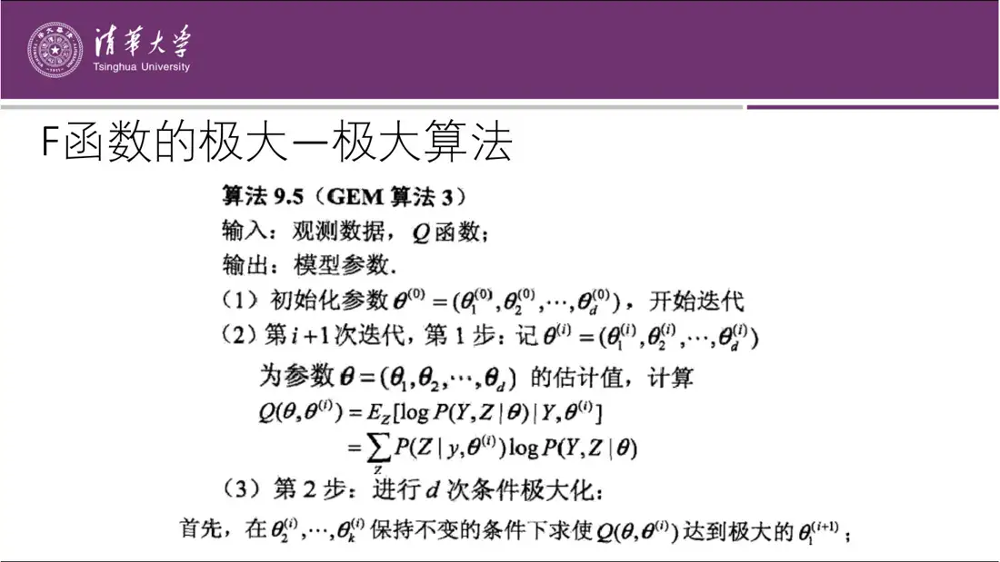

原文：

F函数的极大—极大算法

算法 9.5（GEM 算法 3）

输入：观测数据，Q函数；

输出：模型参数.

(1) 初始化参数 $\boldsymbol{\theta}^{(0)}=(\boldsymbol{\theta}_{1}^{(0)},\boldsymbol{\theta}_{2}^{(0)},\cdots,\boldsymbol{\theta}_{d}^{(0)})$ ，开始迭代

(2) 第 $i + 1$ 次迭代，第1步：记 $\theta^{(i)} = (\theta_1^{(i)},\theta_2^{(i)},\dots ,\theta_d^{(i)})$

为参数 $\theta=(\theta_{1},\theta_{2},\cdots,\theta_{d})$ 的估计值，计算

$$
\begin{array}{r l} Q (\theta , \theta^ {(i)}) & = E _ {Z} [ \log P (Y, Z | \theta) | Y, \theta^ {(i)} ] \\ & = \sum_ {Z} P (Z | y, \theta^ {(i)}) \log P (Y, Z | \theta) \end{array}
$$

(3) 第2步：进行d次条件极大化：

首先，在 $\theta_2^{(i)},\dots ,\theta_k^{(i)}$ 保持不变的条件下求使 $Q(\theta ,\theta^{(i)})$ 达到极大的 $\theta_{1}^{(i + 1)}$

Tsinghua University
清華大學

### F函数的极大—极大算法

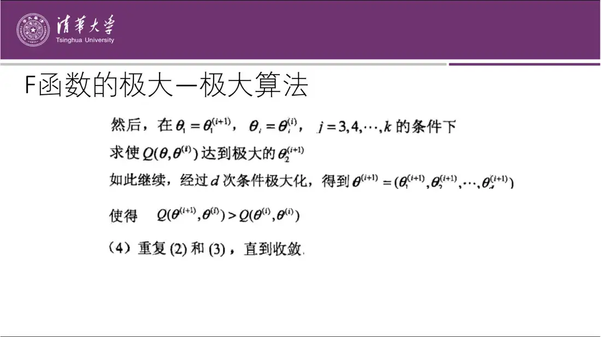

原文：

F函数的极大—极大算法

然后，在 $\theta_{1}=\theta_{1}^{(i+1)}$ ， $\theta_{j}=\theta_{j}^{(i)}$ ， $j=3,4,\cdots,k$ 的条件下

求使 $Q(\theta, \theta^{(i)})$ 达到极大的 $\theta_2^{(i+1)}$

如此继续，经过 $d$ 次条件极大化，得到 $\pmb{\theta}^{(i + 1)} = (\pmb{\theta}_1^{(i + 1)},\pmb{\theta}_2^{(i + 1)},\dots ,\pmb{\theta}_s^{(i + 1)})$

使得 $Q(\theta^{(i + 1)},\theta^{(i)}) > Q(\theta^{(i)},\theta^{(i)})$

(4) 重复 (2) 和 (3)，直到收敛.

Tsinghua University
清華大學

### • END • Q&R

原文：

• END • Q&R

Tsinghua University
清華大學
1911-1911
