# 《统计学习方法》第3章 k-近邻算法（课件）

原件的每一页，下面附识别出的文字。

### 第三章k-近邻算法

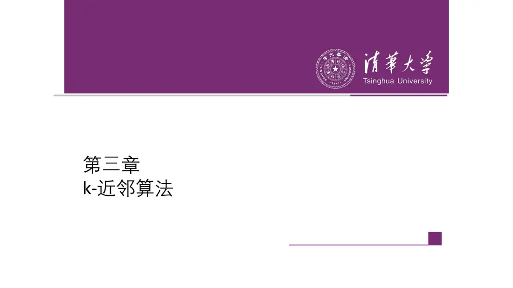

原文：

第三章k-近邻算法

清華大學 Tsinghua University

### 分类问题

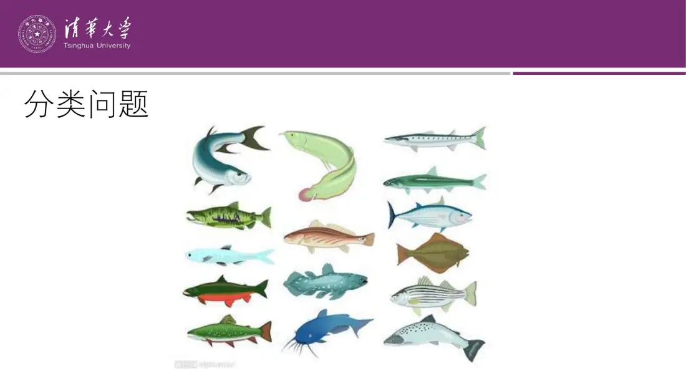

原文：

分类问题

清華大學 Tsinghua University

### 分类问题

原文：

分类问题

清華大學 Tsinghua University

### 清華大學 Tsinghua University

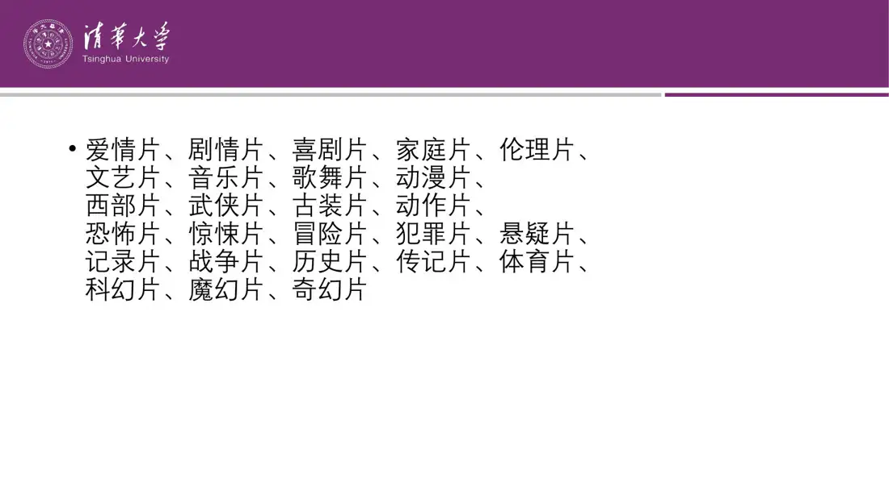

原文：

• 爱情片、剧情片、喜剧片、家庭片、伦理片、文艺片、音乐片、歌舞片、动漫片、西部片、武侠片、古装片、动作片、恐怖片、惊悚片、冒险片、犯罪片、悬疑片、记录片、战争片、历史片、传记片、体育片、科幻片、魔幻片、奇幻片

清華大學 Tsinghua University

### Supervised learning

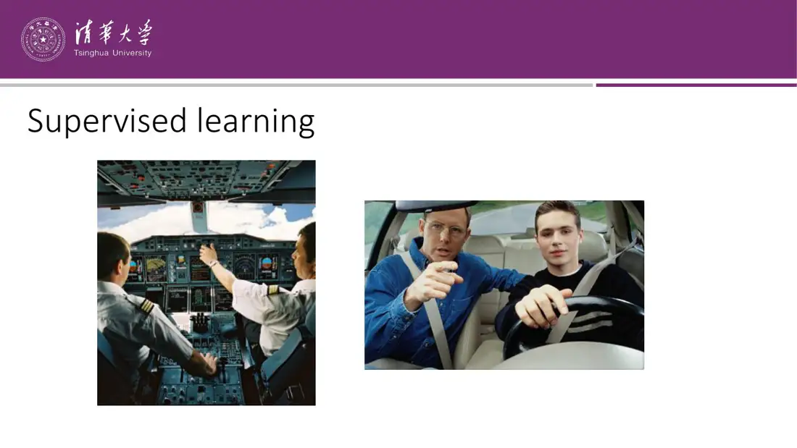

原文：

Supervised learning

清華大學 Tsinghua University

### 提纲

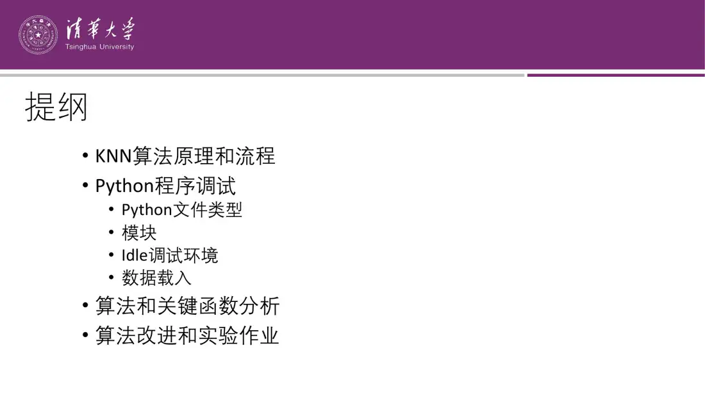

原文：

提纲

\- KNN算法原理和流程
- Python程序调试
  - Python文件类型
  - 模块
  - Idle调试环境
  - 数据载入
- 算法和关键函数分析
- 算法改进和实验作业

清華大學 Tsinghua University

### K-Nearest Neighbors算法原理

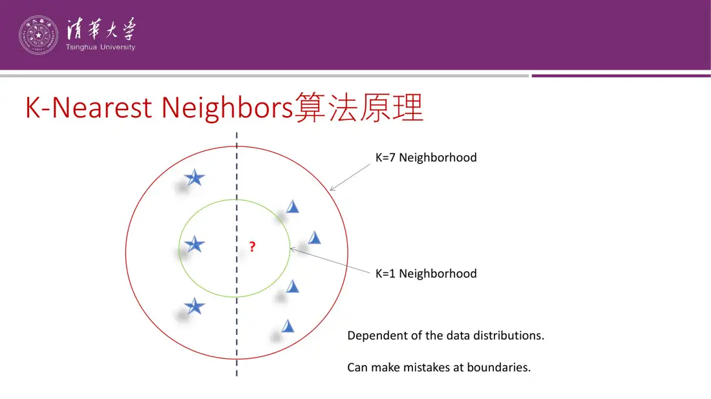

原文：

K-Nearest Neighbors算法原理

K=7 Neighborhood

K=1 Neighborhood

Dependent of the data distributions.

Can make mistakes at boundaries.

清華大學 Tsinghua University

### K-Nearest Neighbors算法特点

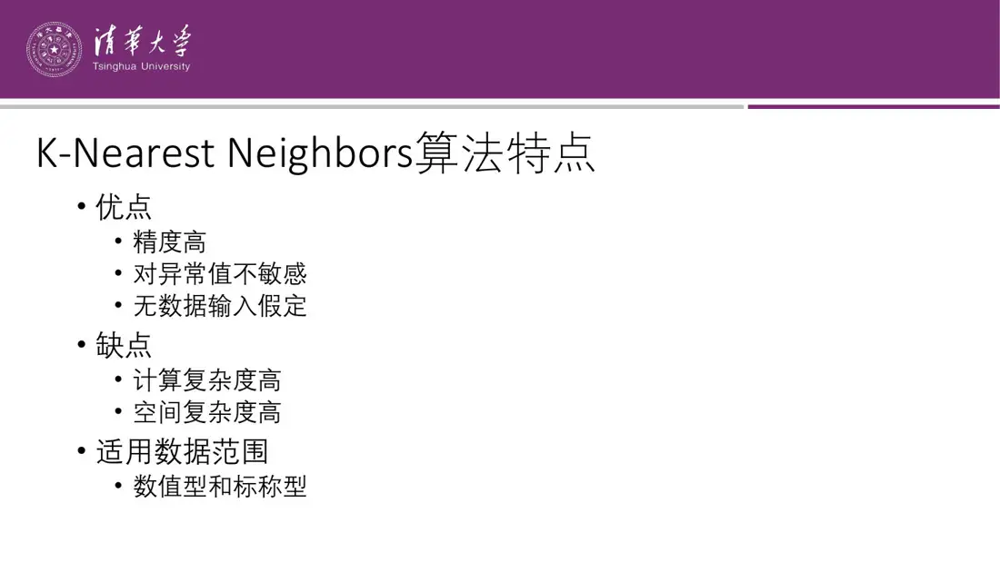

原文：

K-Nearest Neighbors算法特点

• 优点

• 精度高

• 对异常值不敏感

• 无数据输入假定

• 缺点

• 计算复杂度高

• 空间复杂度高

• 适用数据范围

• 数值型和标称型

清華大學 Tsinghua University

### K-Nearest Neighbors Algorithm

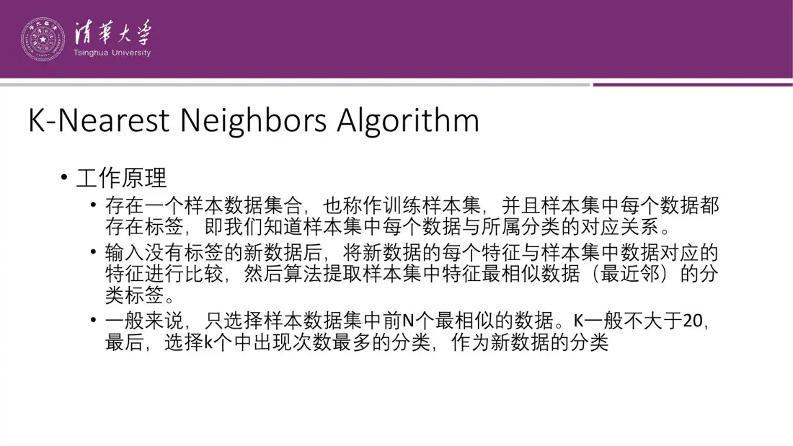

原文：

K-Nearest Neighbors Algorithm

• 工作原理

• 存在一个样本数据集合，也称作训练样本集，并且样本集中每个数据都存在标签，即我们知道样本集中每个数据与所属分类的对应关系。

• 输入没有标签的新数据后，将新数据的每个特征与样本集中数据对应的特征进行比较，然后算法提取样本集中特征最相似数据（最近邻）的分类标签。

• 一般来说，只选择样本数据集中前N个最相似的数据。K一般不大于20，最后，选择k个中出现次数最多的分类，作为新数据的分类

清華大學 Tsinghua University

### K近邻算法的一般流程

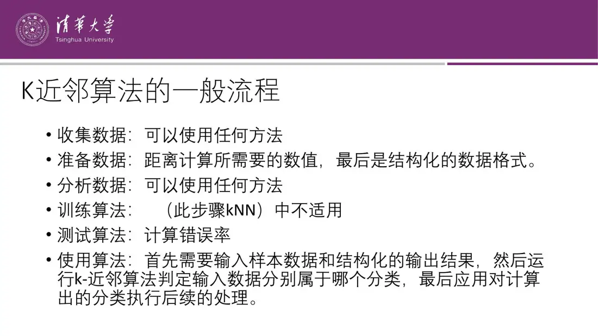

原文：

K近邻算法的一般流程

• 收集数据：可以使用任何方法

• 准备数据：距离计算所需要的数值，最后是结构化的数据格式。

• 分析数据：可以使用任何方法

• 训练算法： （此步骤kNN）中不适用

• 测试算法：计算错误率

• 使用算法：首先需要输入样本数据和结构化的输出结果，然后运行k-近邻算法判定输入数据分别属于哪个分类，最后应用对计算出的分类执行后续的处理。

清華大學 Tsinghua University

### 距离度量

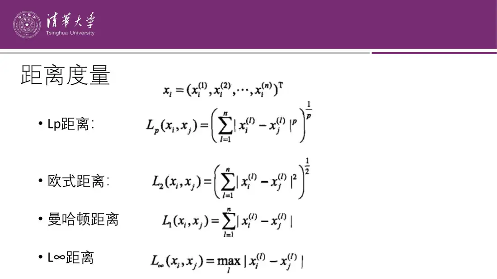

原文：

距离度量

$L p$ 距离：

• 欧式距离：

• 曼哈顿距离

• $L \infty$ 距离

$$
x _ {i} = \left(x _ {i} ^ {(1)}, x _ {i} ^ {(2)}, \dots , x _ {i} ^ {(n)}\right) ^ {\mathrm{T}}
$$

$$
L _ {p} (x _ {i}, x _ {j}) = \left(\sum_ {l = 1} ^ {n} | x _ {i} ^ {(l)} - x _ {j} ^ {(l)} | ^ {p}\right) ^ {\frac {1}{p}}
$$

$$
L _ {2} \left(x _ {i}, x _ {j}\right) = \left(\sum_ {l = 1} ^ {n} \left| x _ {i} ^ {(l)} - x _ {j} ^ {(l)} \right| ^ {2}\right) ^ {\frac {1}{2}}
$$

$$
L _ {1} (x _ {i}, x _ {j}) = \sum_ {l = 1} ^ {n} | x _ {i} ^ {(l)} - x _ {j} ^ {(l)} |
$$

$$
L _ {\infty} \left(x _ {i}, x _ {j}\right) = \max _ {l} \mid x _ {i} ^ {(l)} - x _ {j} ^ {(l)} \mid
$$

清華大學 Tsinghua University

### 距离度量

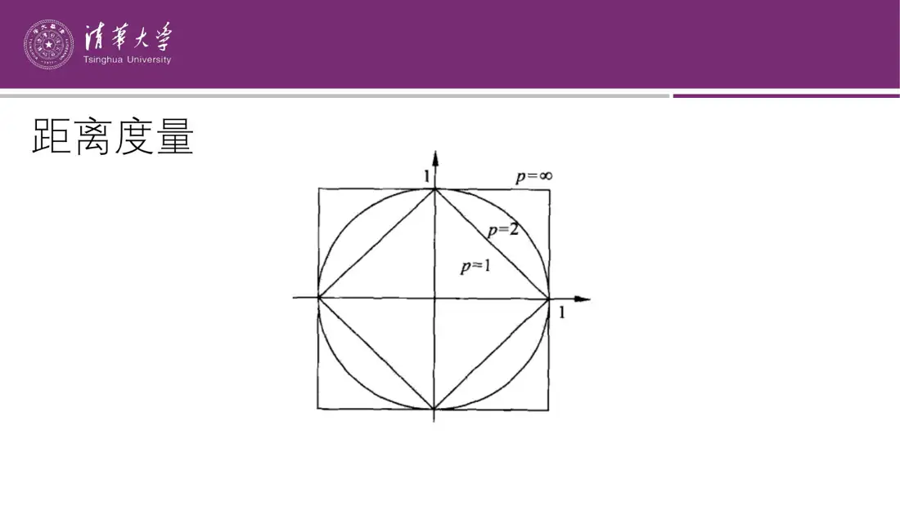

原文：

距离度量

清華大學 Tsinghua University

### K值的选择

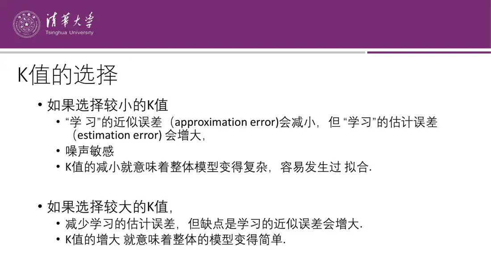

原文：

K值的选择

• 如果选择较小的K值

• “学 习”的近似误差（approximation error)会减小，但 “学习”的估计误差（estimation error) 会增大，

• 噪声敏感

• K值的减小就意味着整体模型变得复杂，容易发生过 拟合.

• 如果选择较大的K值，

• 减少学习的估计误差，但缺点是学习的近似误差会增大.

• K值的增大就意味着整体的模型变得简单.

清華大學 Tsinghua University

### Python程序调试

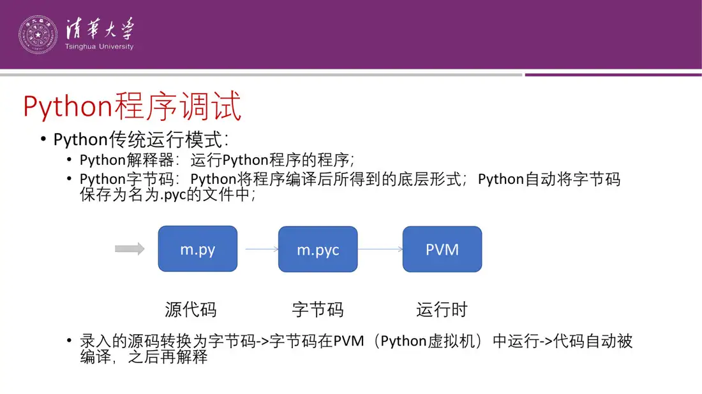

原文：

Python程序调试

• Python传统运行模式：

• Python解释器：运行Python程序的程序；

• Python字节码：Python将程序编译后所得到的底层形式；Python自动将字节码保存为名为.pyc的文件中；

m.py

m.pyc

PVM

源代码

字节码

运行时

• 录入的源码转换为字节码->字节码在PVM（Python虚拟机）中运行->代码自动被编译，之后再解释

清華大學 Tsinghua University

### Python程序调试

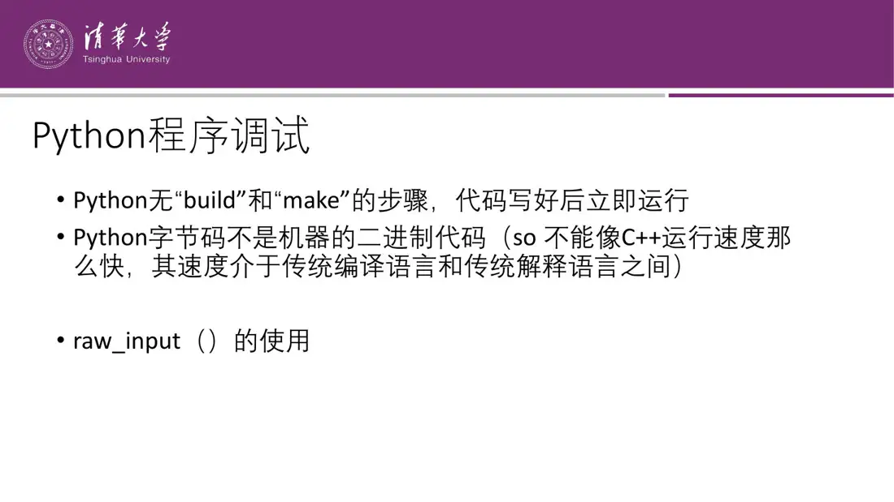

原文：

Python程序调试

• Python无“build”和“make”的步骤，代码写好后立即运行

• Python字节码不是机器的二进制代码（so 不能像C++运行速度那么快，其速度介于传统编译语言和传统解释语言之间）

• raw\_input（）的使用

清華大學 Tsinghua University

### Python模块

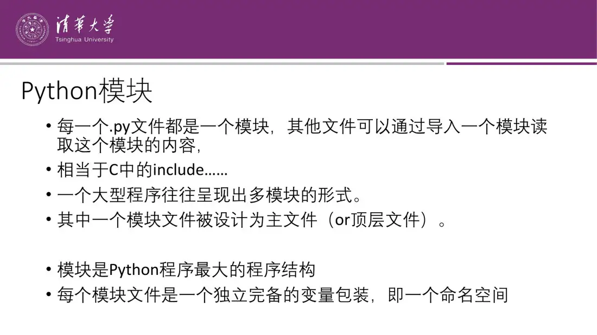

原文：

Python模块

• 每一个.py文件都是一个模块，其他文件可以通过导入一个模块读取这个模块的内容，

• 相当于C中的include……

• 一个大型程序往往呈现出多模块的形式。

• 其中一个模块文件被设计为主文件（or顶层文件）。

• 模块是Python程序最大的程序结构

• 每个模块文件是一个独立完备的变量包装，即一个命名空间

清華大學 Tsinghua University

### 模块的导入

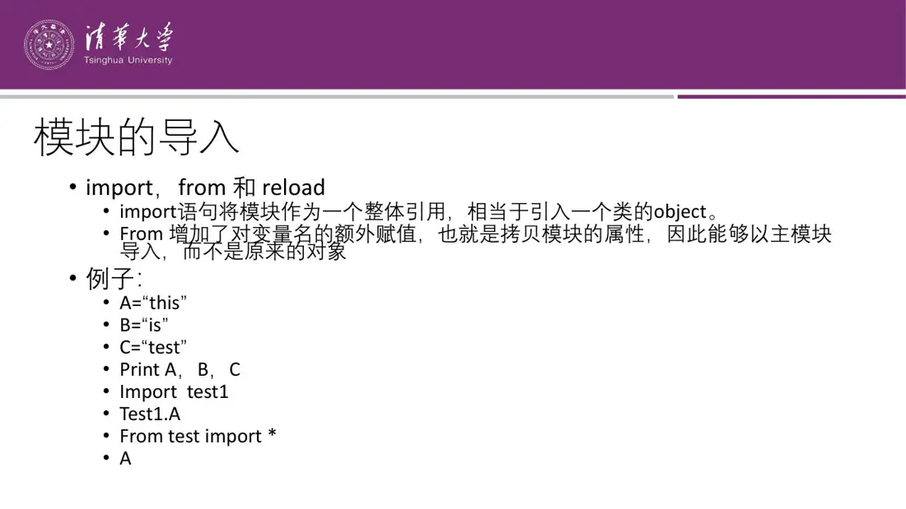

原文：

模块的导入

• import，from 和 reload

• import语句将模块作为一个整体引用，相当于引入一个类的object。

• From 增加了对变量名的额外赋值，也就是拷贝模块的属性，因此能够以主模块导入，而不是原来的对象

• 例子：

$A = ^ { \prime \prime } \pm h i s ^ { \prime \prime }$

$\mathsf { B } = ^ { \ast } \mathrm { i } \mathsf { S } ^ { \prime \prime }$

${ \mathsf { C } } { = } ^ { \prime \prime } { \mathsf { t e s t } } ^ { \prime \prime }$

• Print A，B，C

• Import test1

• Test1.A

• From test import \*

• A

清華大學 Tsinghua University

### Reload和重编译

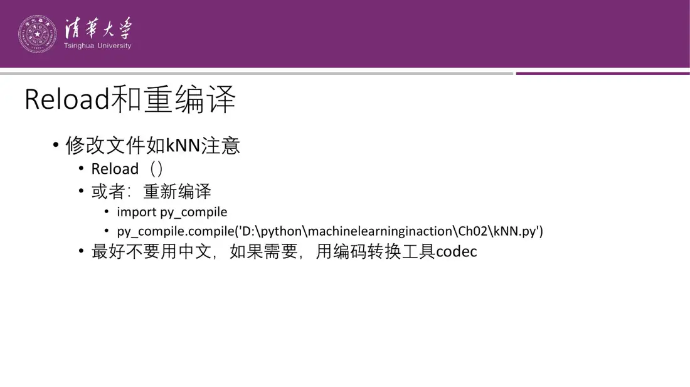

原文：

Reload和重编译

• 修改文件如kNN注意

• Reload（）

• 或者：重新编译

• import py\_compile

• py\_compile.compile('D:\python\machinelearninginaction\Ch02\kNN.py')

• 最好不要用中文，如果需要，用编码转换工具codec

清華大學 Tsinghua University

### Idle调试环境

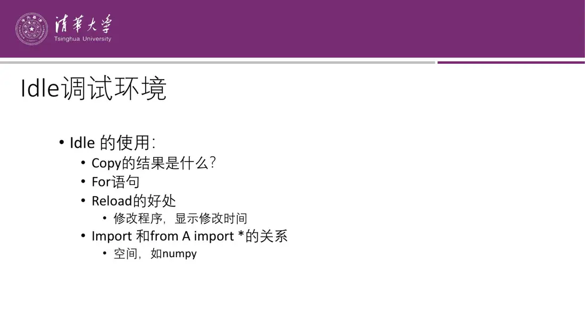

原文：

Idle调试环境

• Idle 的使用：

• Copy的结果是什么？

• For语句

• Reload的好处• 修改程序，显示修改时间

• Import 和from A import \*的关系• 空间，如numpy

清華大學 Tsinghua University

### Python导入数据

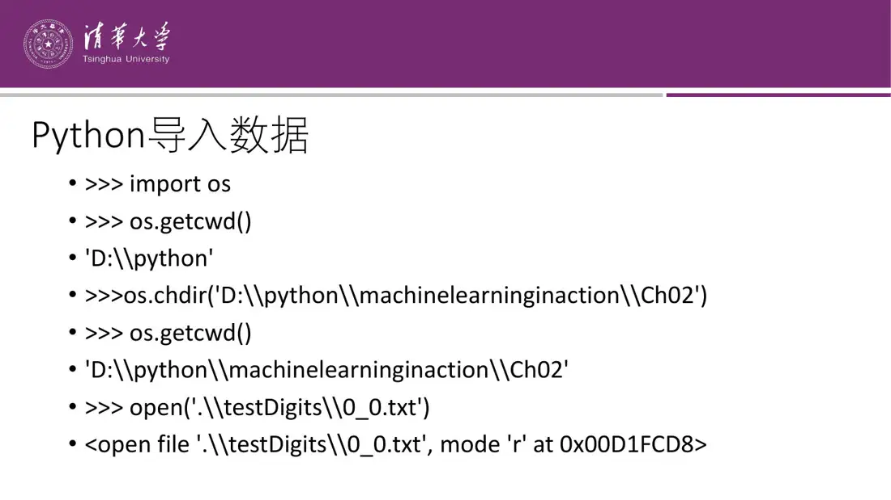

原文：

Python导入数据

• >>> import os

• >>> os.getcwd()

• 'D:\\python'

• >>>os.chdir('D:\\python\\machinelearninginaction\\Ch02')

• >>> os.getcwd()

• 'D:\\python\\machinelearninginaction\\Ch02'

• >>> open('.\\testDigits\\0\_0.txt')

• <open file '.\\testDigits\\0\_0.txt', mode 'r' at 0x00D1FCD8>

清華大學 Tsinghua University

### Python导入数据

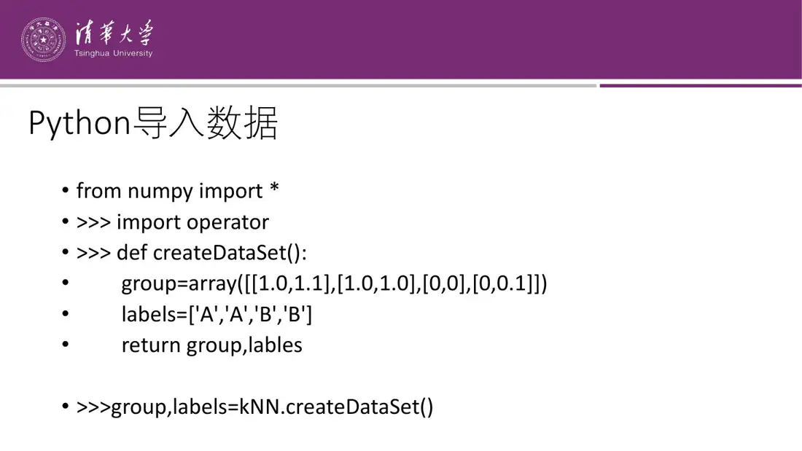

原文：

Python导入数据

• from numpy import \*

• >>> import operator

• >>> def createDataSet():

group=array([[1.0,1.1],[1.0,1.0],[0,0],[0,0.1]])

labels=['A','A','B','B']

return group,lables

• >>>group,labels=kNN.createDataSet()

清華大學 Tsinghua University

### 算法和关键函数分析

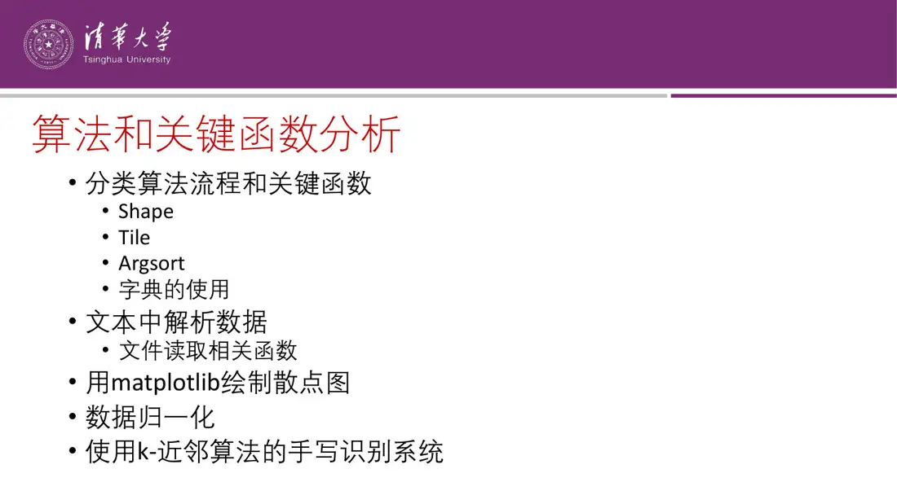

原文：

算法和关键函数分析

• 分类算法流程和关键函数

• Shape

• Tile

• Argsort

• 字典的使用

• 文本中解析数据

• 文件读取相关函数

• 用matplotlib绘制散点图

• 数据归一化

• 使用k-近邻算法的手写识别系统

清華大學 Tsinghua University

### 分类算法流程

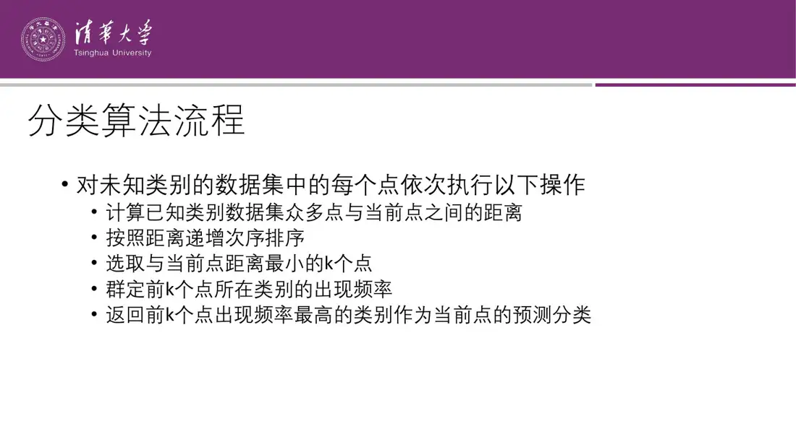

原文：

分类算法流程

• 对未知类别的数据集中的每个点依次执行以下操作

• 计算已知类别数据集众多点与当前点之间的距离

• 按照距离递增次序排序

• 选取与当前点距离最小的k个点

• 群定前k个点所在类别的出现频率

• 返回前k个点出现频率最高的类别作为当前点的预测分类

清華大學 Tsinghua University

### 分类算法

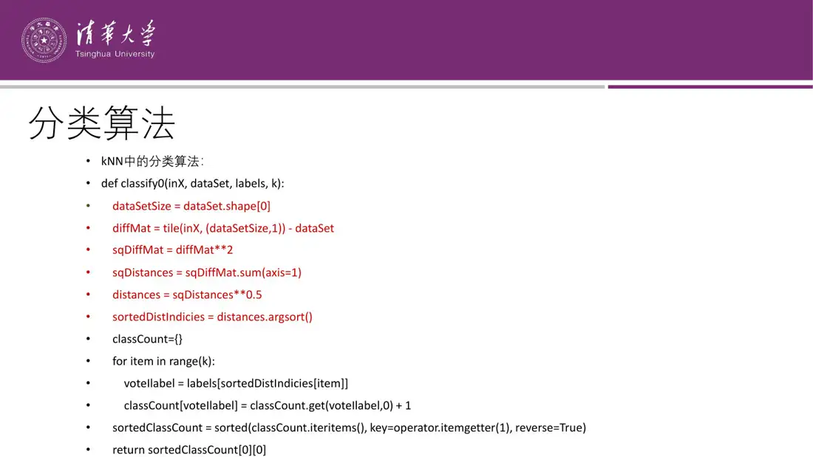

原文：

分类算法

• kNN中的分类算法：

• def classify0(inX, dataSet, labels, k):

dataSetSize = dataSet.shape[0]

diffMat = tile(inX, (dataSetSize,1)) - dataSet

sqDiffMat = diffMat\*\*2

sqDistances = sqDiffMat.sum(axis=1)

distances = sqDistances\*\*0.5

sortedDistIndicies = distances.argsort()

• classCount={}

• for item in range(k):

voteIlabel = labels[sortedDistIndicies[item]]

classCount[voteIlabel] = classCount.get(voteIlabel,0) + 1

• sortedClassCount = sorted(classCount.iteritems(), key=operator.itemgetter(1), reverse=True)

• return sortedClassCount[0][0]

清華大學 Tsinghua University

### Shape函数

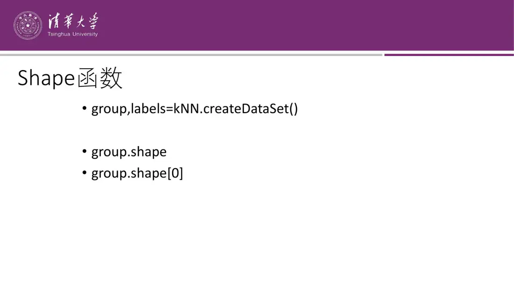

原文：

Shape函数

• group,labels=kNN.createDataSet()

• group.shape

• group.shape[0]

清華大學 Tsinghua University

### Tile函数

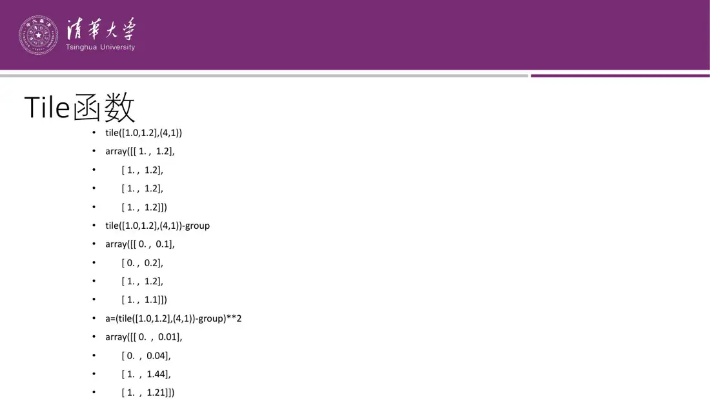

原文：

Tile函数

• tile([1.0,1.2],(4,1))

• array([[ 1. , 1.2],

[ 1. , 1.2],

[ 1. , 1.2],

[ 1. , 1.2]])

• tile([1.0,1.2],(4,1))-group

• array([[ 0. , 0.1],

[ 0. , 0.2],

[ 1. , 1.2],

[ 1. , 1.1]])

• a=(tile([1.0,1.2],(4,1))-group)\*\*2

• array([[ 0. , 0.01],

[ 0. , 0.04],

[ 1. , 1.44],

[ 1. , 1.21]])

清華大學 Tsinghua University

### Argsort（）

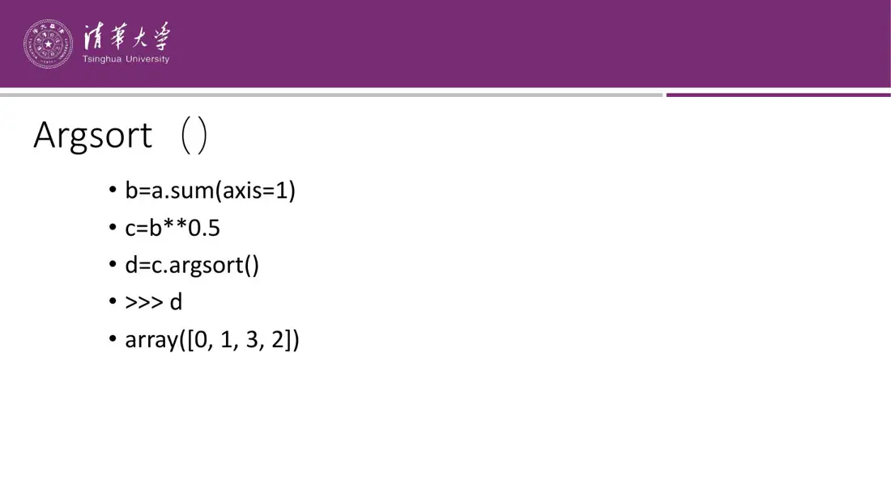

原文：

Argsort（）

${ \mathsf { b } } { = } { \mathsf { a . s u m } } ( { \mathsf { a x i s { = } } } 1 )$

${ \mathsf { c } } { = } { \mathsf { b } } ^ { * * } 0 . 5$

$\mathsf { d } { = } \mathsf { c } . \mathsf { a r g s o r t } ( )$

$> > > d$

• array([0, 1, 3, 2])

清華大學 Tsinghua University

### 字典的使用

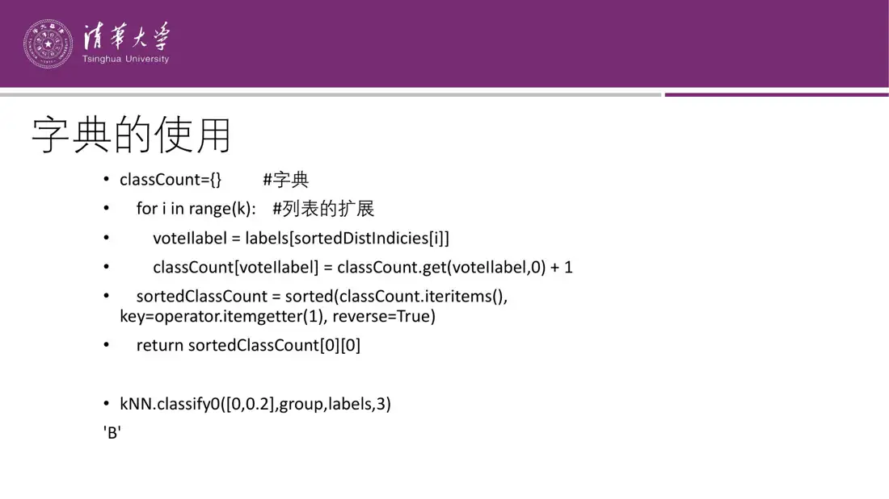

原文：

字典的使用

• classCount={} #字典

• for i in range(k): #列表的扩展

voteIlabel = labels[sortedDistIndicies[i]]

classCount[voteIlabel] = classCount.get(voteIlabel,0) + 1

• sortedClassCount = sorted(classCount.iteritems(), key=operator.itemgetter(1), reverse=True)

• return sortedClassCount[0][0]

• kNN.classify0([0,0.2],group,labels,3)

'B'

清華大學 Tsinghua University

### 从文本文件中解析数据-打开文件

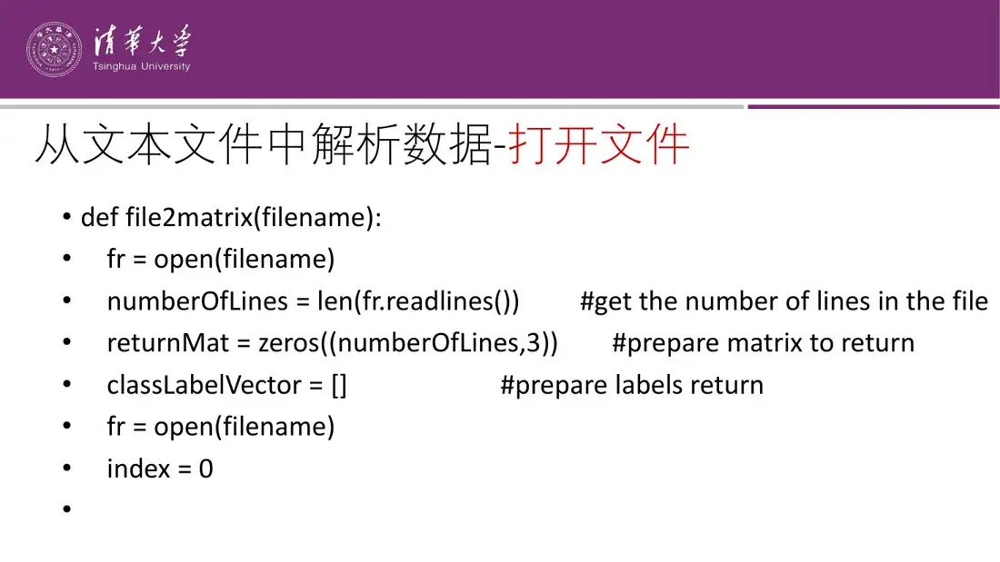

原文：

从文本文件中解析数据-打开文件

• def file2matrix(filename):

• fr = open(filename)

• numberOfLines = len(fr.readlines())

• returnMat = zeros((numberOfLines,3))

• classLabelVector = []

• fr = open(filename)

get the number of lines in the file

index = 0

prepare matrix to return

prepare labels return

清華大學 Tsinghua University

### 从文本文件中解析数据-获得数据

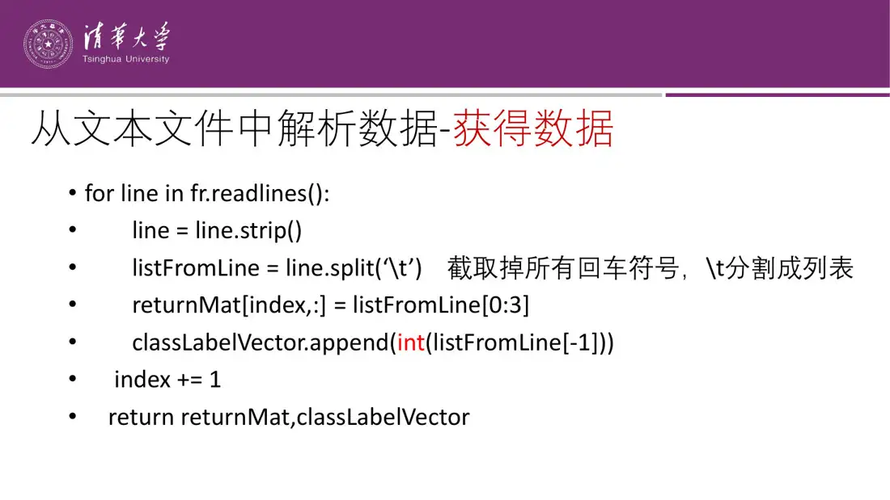

原文：

从文本文件中解析数据-获得数据

• for line in fr.readlines():

line = line.strip()

listFromLine = line.split(‘\t’) 截取掉所有回车符号，\t分割成列表

returnMat[index,:] = listFromLine[0:3]

classLabelVector.append(int(listFromLine[-1]))

index += 1

• return returnMat,classLabelVector

清華大學 Tsinghua University

### 文件读取相关函数

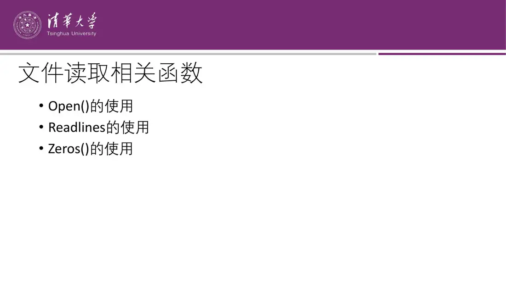

原文：

文件读取相关函数

• Open()的使用

• Readlines的使用

• Zeros()的使用

清華大學 Tsinghua University

### 文件读取相关函数

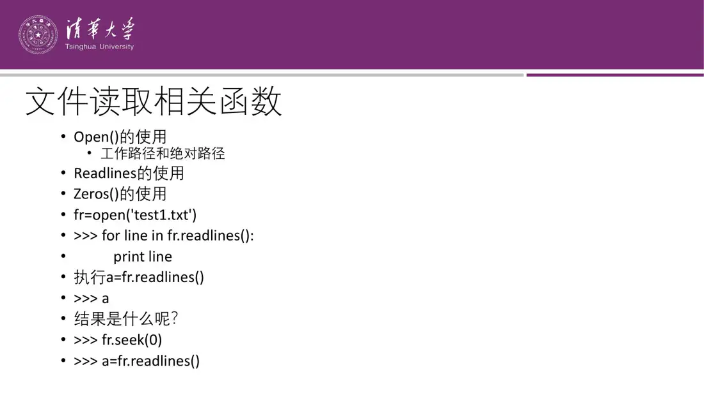

原文：

文件读取相关函数

• Open()的使用• 工作路径和绝对路径

• Readlines的使用

• Zeros()的使用

• fr=open('test1.txt')

• >>> for line in fr.readlines():

print line

• 执行a=fr.readlines()

• >>> a

• 结果是什么呢？

• >>> fr.seek(0)

• >>> a=fr.readlines()

清華大學 Tsinghua University

### 文件读取相关函数

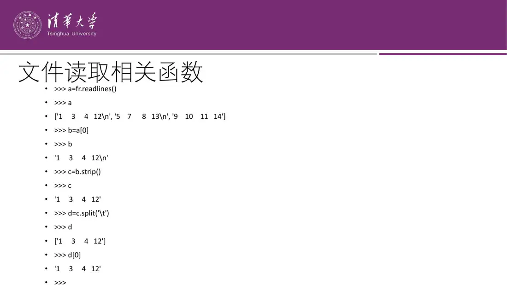

原文：

文件读取相关函数

• >>> a=fr.readlines()

• >>> a

• ['1 3 4 12\n', '5 7 8 13\n', '9 10 11 14']

• >>> b=a[0]

• >>> b

• '1 3 4 12\n'

• >>> c=b.strip()

• >>> c

• '1 3 4 12'

• >>> d=c.split('\t')

• >>> d

• ['1 3 4 12']

• >>> d[0]

• '1 3 4 12'

• >>>

清華大學 Tsinghua University

### 文件读取相关函数

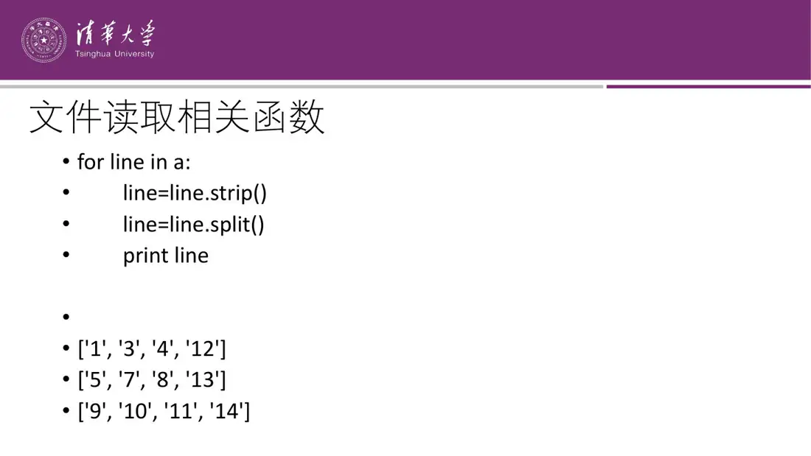

原文：

文件读取相关函数

• for line in a:

line=line.strip()

line=line.split()

print line

• ['5', '7', '8', '13']

• ['9', '10', '11', '14']

清華大學 Tsinghua University

### 文件读取相关函数

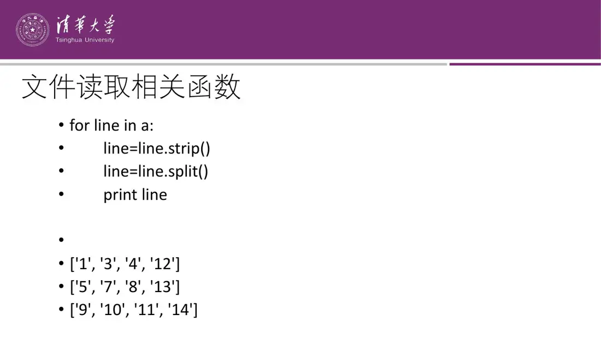

原文：

文件读取相关函数

• for line in a:

line=line.strip()

line=line.split()

print line

• ['9', '10', '11', '14']

清華大學 Tsinghua University

### 文件读取相关函数

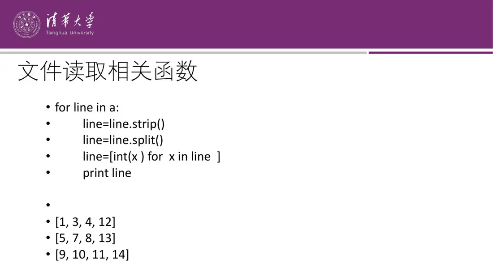

原文：

文件读取相关函数

• for line in a:

line=line.strip()

line=line.split()

line=[int(x ) for x in line ]

print line

• [1, 3, 4, 12]

• [5, 7, 8, 13]

• [9, 10, 11, 14]

清華大學 Tsinghua University

### 数组和矩阵

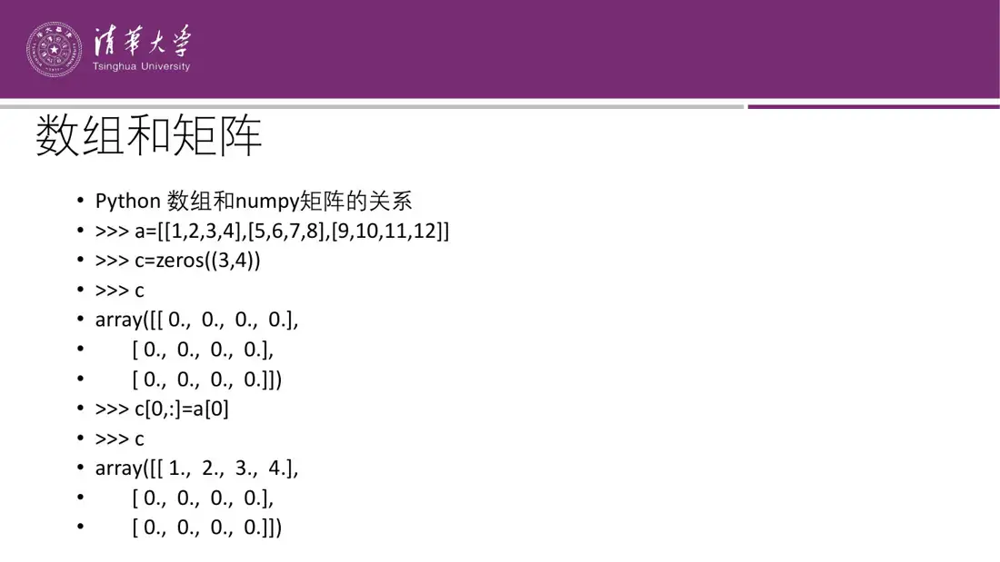

原文：

数组和矩阵

• Python 数组和numpy矩阵的关系

• >>> a=[[1,2,3,4],[5,6,7,8],[9,10,11,12]]

• >>> c=zeros((3,4))

• >>> c

• array([[ 0., 0., 0., 0.],

[ 0., 0., 0., 0.],

[ 0., 0., 0., 0.]])

• >>> c[0,:]=a[0]

• >>> c

• array([[ 1., 2., 3., 4.],

[ 0., 0., 0., 0.],

[ 0., 0., 0., 0.]])

清華大學 Tsinghua University

### 解析数据

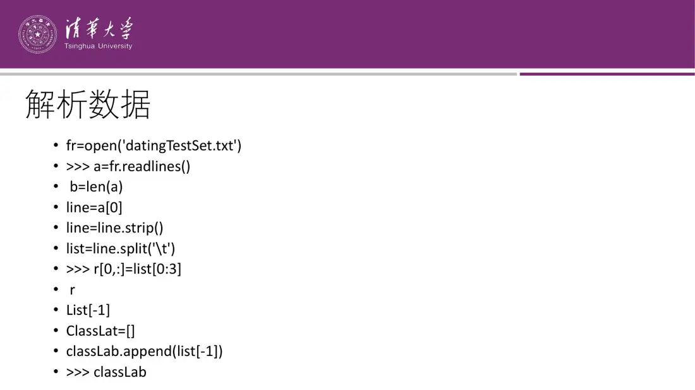

原文：

解析数据

• fr=open('datingTestSet.txt')

$> > > \mathsf { a } { = } \mathsf { f r . r e a d l i n e s } ( )$

$\mathsf { b } { = } | \mathsf { e n } ( \mathsf { a } )$

$\scriptstyle \operatorname* { l i n } \in = \mathsf { a } [ 0 ]$

• line=line.strip()

• list=line.split('\t')

• >>> r[0,:]=list[0:3]

• r

• List[-1]

• ClassLat=[]

• classLab.append(list[-1])

• >>> classLab

清華大學 Tsinghua University

### 使用Matplotlib创建散点图

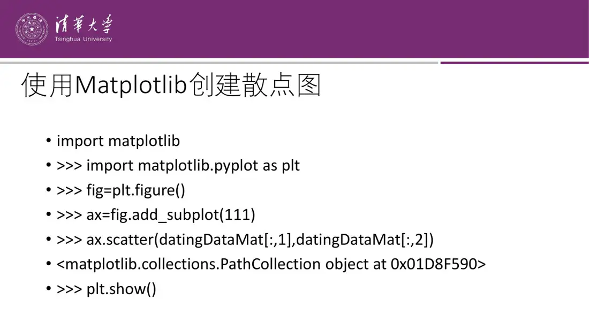

原文：

使用Matplotlib创建散点图

• import matplotlib

• >>> import matplotlib.pyplot as plt

• >>> fig=plt.figure()

• >>> ax=fig.add\_subplot(111)

• >>> ax.scatter(datingDataMat[:,1],datingDataMat[:,2])

• <matplotlib.collections.PathCollection object at 0x01D8F590>

• >>> plt.show()

清華大學 Tsinghua University

### 使用Matplotlib创建散点图

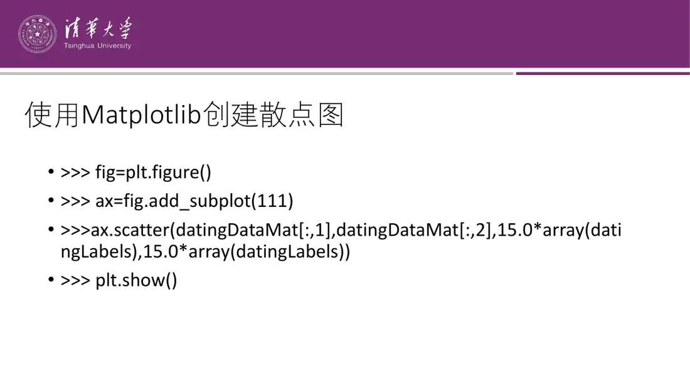

原文：

使用Matplotlib创建散点图

• >>> fig=plt.figure()

• >>> ax=fig.add\_subplot(111)

• >>>ax.scatter(datingDataMat[:,1],datingDataMat[:,2],15.0\*array(dati ngLabels),15.0\*array(datingLabels))

• >>> plt.show()

清華大學 Tsinghua University

### 数据归一化

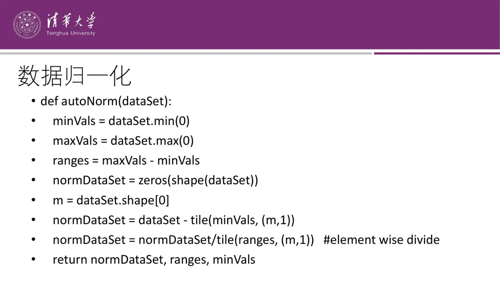

原文：

数据归一化

• def autoNorm(dataSet):

• minVals = dataSet.min(0)

• maxVals = dataSet.max(0)

• ranges = maxVals - minVals

• normDataSet = zeros(shape(dataSet))

• m = dataSet.shape[0]

• normDataSet = dataSet - tile(minVals, (m,1))

normDataSet = normDataSet/tile(ranges, (m,1)) #element wise divide

• return normDataSet, ranges, minVals

清華大學 Tsinghua University

### 数据归一化

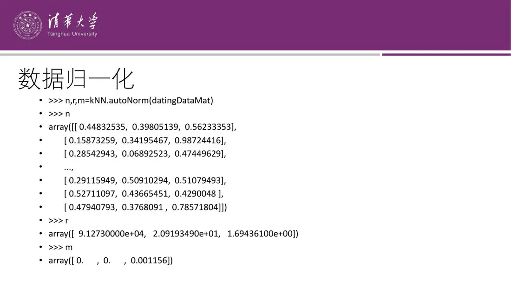

原文：

数据归一化

• >>> n,r,m=kNN.autoNorm(datingDataMat)

• >>> n

• array([[ 0.44832535, 0.39805139, 0.56233353],

[ 0.15873259, 0.34195467, 0.98724416],

[ 0.28542943, 0.06892523, 0.47449629],

...,

[ 0.29115949, 0.50910294, 0.51079493],

[ 0.52711097, 0.43665451, 0.4290048 ],

[ 0.47940793, 0.3768091 , 0.78571804]])

• >>> r

• array([ 9.12730000e+04, 2.09193490e+01, 1.69436100e+00])

• >>> m

• array([ 0. , 0. , 0.001156])

清華大學 Tsinghua University

### 测试算法：验证分类器

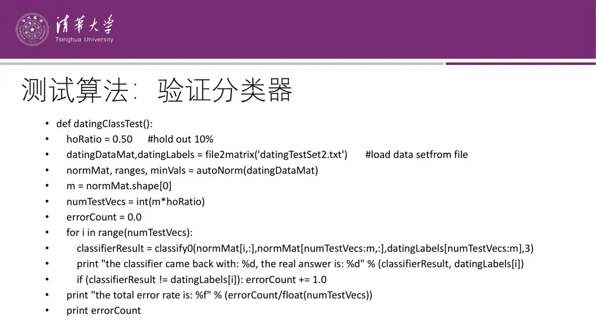

原文：

测试算法：验证分类器

• def datingClassTest():

• hoRatio = 0.50 #hold out 10%

datingDataMat,datingLabels = file2matrix('datingTestSet2.txt') #load data setfrom file

• normMat, ranges, minVals = autoNorm(datingDataMat)

• m = normMat.shape[0]

• numTestVecs = int(m\*hoRatio)

• errorCount = 0.0

• for i in range(numTestVecs):

classifierResult = classify0(normMat[i,:],normMat[numTestVecs:m,:],datingLabels[numTestVecs:m],3)

print "the classifier came back with: %d, the real answer is: %d" % (classifierResult, datingLabels[i])

if (classifierResult != datingLabels[i]): errorCount += 1.0

• print "the total error rate is: %f" % (errorCount/float(numTestVecs))

• print errorCount

清華大學 Tsinghua University

### 使用k-近邻算法的手写识别系统

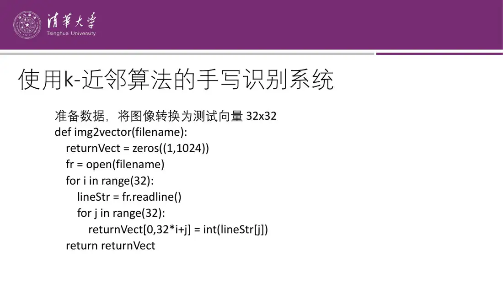

原文：

使用k-近邻算法的手写识别系统

清華大學 Tsinghua University

### 测试算法

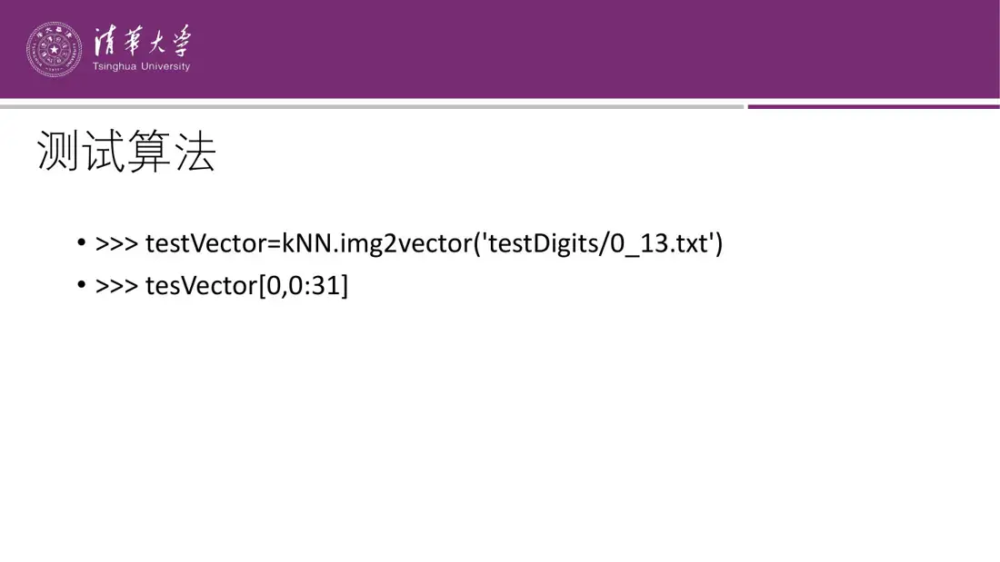

原文：

测试算法

• >>> testVector=kNN.img2vector('testDigits/0\_13.txt')

• >>> tesVector[0,0:31]

清華大學 Tsinghua University

### KNN算法改进和实验作业

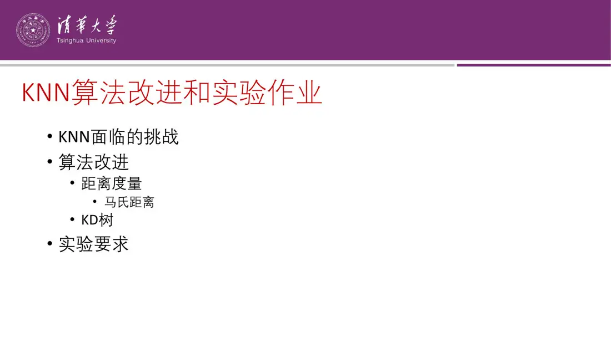

原文：

KNN算法改进和实验作业

• KNN面临的挑战

• 算法改进

• 距离度量

• 马氏距离

• KD树

• 实验要求

清華大學 Tsinghua University

### KNN面临的挑战

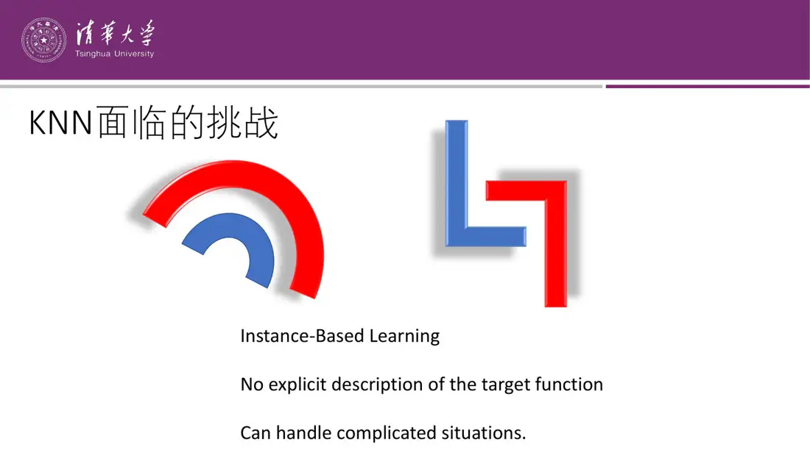

原文：

KNN面临的挑战

No explicit description of the target function

Can handle complicated situations.

清華大學 Tsinghua University

### KNN面临挑战

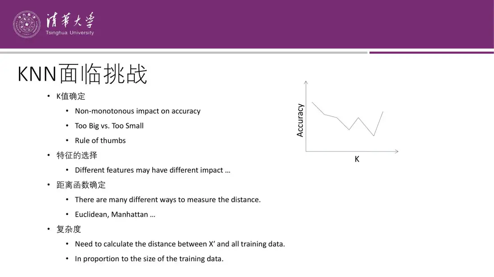

原文：

KNN面临挑战

• K值确定

• Non-monotonous impact on accuracy

• Too Big vs. Too Small

• Rule of thumbs

• 特征的选择

• Different features may have different impact …

• 距离函数确定

• There are many different ways to measure the distance.

• Euclidean, Manhattan …

• 复杂度

• Need to calculate the distance between X′ and all training data.

• In proportion to the size of the training data.

清華大學 Tsinghua University

### Distance Metrics

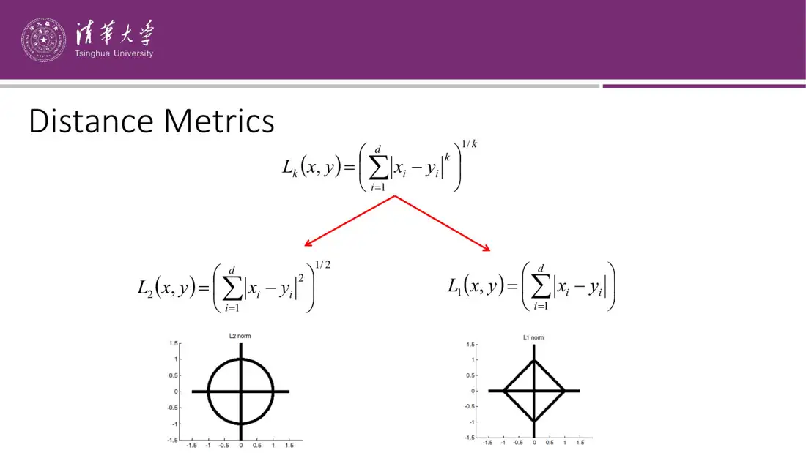

原文：

Distance Metrics

$$
L _ {k} (x, y) = \left(\sum_ {i = 1} ^ {d} \left| x _ {i} - y _ {i} \right| ^ {k}\right) ^ {1 / k}
$$

$$
L _ {2} (x, y) = \left(\sum_ {i = 1} ^ {d} \left| x _ {i} - y _ {i} \right| ^ {2}\right) ^ {1 / 2}
$$

$$
L _ {1} (x, y) = \left(\sum_ {i = 1} ^ {d} \left| x _ {i} - y _ {i} \right|\right)
$$

清華大學 Tsinghua University

### Mahalanobis Distance马氏距离

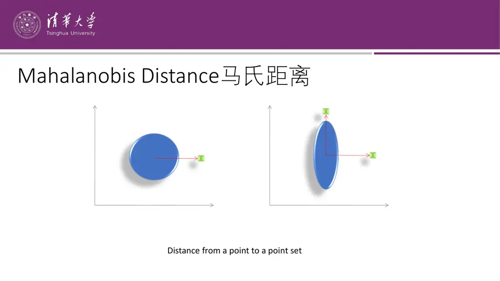

原文：

Mahalanobis Distance马氏距离

清華大學 Tsinghua University

### 马氏距离(Mahalanobis Distance)

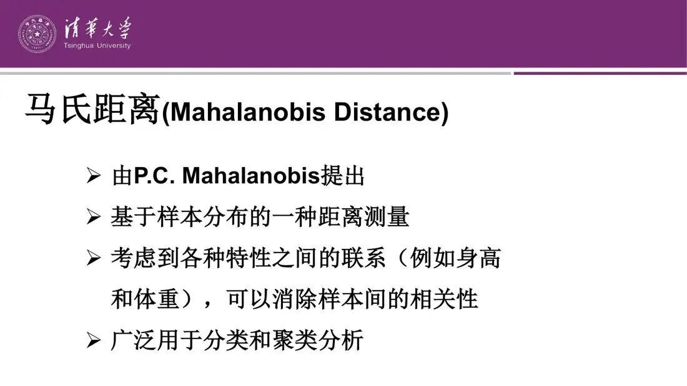

原文：

马氏距离(Mahalanobis Distance)

➢ 由P.C. Mahalanobis提出

➢ 基于样本分布的一种距离测量

➢ 考虑到各种特性之间的联系（例如身高和体重），可以消除样本间的相关性

➢ 广泛用于分类和聚类分析

清華大學 Tsinghua University

### 马氏距离(Mahalanobis Distance)

原文：

马氏距离(Mahalanobis Distance)

一维数据

均值：

$$
\overline {{X}} = \frac {\sum_ {i = 1} ^ {n} X _ {i}}{n}
$$

标准差： $\begin{array} { r } { \bar { \mathsf { S } } = \sqrt { \frac { \sum _ { \mathrm { i = 1 } } ^ { \mathrm { n } } ( \mathbf { X } _ { \mathrm { i } } - \overline { { \mathbf { X } } } ) ^ { \frac { 2 } { 2 } } } { \mathbf { n } - \mathbf { 1 } } } , } \end{array}$

方差：

$$
S ^ {2} = \frac {\sum_ {i = 1} ^ {n} (X _ {i} - \bar {X}) ^ {2}}{n - 1}
$$

例：[0, 8, 12, 20] 8.3[8, 9, 11, 12] 1.8

多维向量

$$
\operatorname{var} (X) = \frac {\sum_ {i = 1} ^ {n} (X _ {i} - \overline {{X}}) (X _ {i} - \overline {{X}})}{n - 1}
$$

$$
\operatorname{cov} (X, Y) = \frac {\sum_ {i = 1} ^ {n} (X _ {i} - \overline {{X}}) (Y _ {i} - \overline {{Y}})}{n - 1}
$$

1 $\mathbb { E } \mathbb { Q } \mathbb { Y } [ \mathbb { X } _ { i } \mathbb { X } ] = \mathbb { V } \mathbb { d } \mathbb { Y } [ \mathbb { X } ]$

2 $\operatorname { c o v } ( \operatorname { X } , \operatorname { Y } ) = \operatorname { c o v } [ \operatorname { Y } , \operatorname { X } ]$

清華大學 Tsinghua University

### 协方差矩阵

原文：

协方差矩阵

$$
C = \left( \begin{array}{c c c} \operatorname{cov} (x, x) & \operatorname{cov} (x, y) & \operatorname{cov} (x, z) \\ \operatorname{cov} (y, x) & \operatorname{cov} (y, y) & \operatorname{cov} (y, z) \\ \operatorname{cov} (z, x) & \operatorname{cov} (z, y) & \operatorname{cov} (z, z) \end{array} \right)
$$

$$
\mathsf {C} _ {\mathrm{n} \times \mathrm{n}} = (\mathsf {c} _ {\mathrm{i}, \mathrm{j}}, \qquad \mathsf {c} _ {\mathrm{i}, \mathrm{j}} = \operatorname{cov} (\operatorname{Dim} _ {\mathrm{i}}, \operatorname{Dim} _ {\mathrm{j}}))
$$

清華大學 Tsinghua University

### 协方差矩阵

原文：

协方差矩阵

清華大學 Tsinghua University

### 马氏距离 定义

原文：

马氏距离 定义

一组向量 $\left\{ { \vec { X } } _ { 1 } , { \vec { X } } _ { 2 } , { \vec { X } } _ { 3 } , \ldots , { \vec { X } } _ { n } \right\}$ ，其中，

$$
\vec {X} = \{x _ {1}, x _ {2}, x _ {3}, \dots , x _ {m} \}
$$

其均值为 $\vec { \pmb { \mu } } = \{ \pmb { \mu _ { 1 } } , \pmb { \mu _ { 2 } } , \pmb { \mu _ { 3 } } , \dots , \pmb { \mu _ { m } } \}$

协方差矩阵为Σ，其中

$$
\Sigma_ {i j} = \operatorname{cov} \left(x _ {i}, x _ {j}\right)
$$

清華大學 Tsinghua University

### 马氏距离 定义续

原文：

马氏距离 定义续

单向量的马氏距离定义为：

$$
\mathbf {M D} (\vec {X}) = \sqrt {(\vec {X} - \vec {\mu}) ^ {T} \pmb {\Sigma} ^ {- 1} (\vec {X} - \vec {\mu})}
$$

向量间的马氏距离定义为：

$$
\mathbf {M D} (\overrightarrow {X}, \overrightarrow {Y}) = \sqrt {(\overrightarrow {X} - \overrightarrow {Y}) ^ {T} \pmb {\Sigma} ^ {- 1} (\overrightarrow {X} - \overrightarrow {Y})}
$$

清華大學 Tsinghua University

### 马氏距离 计算示例

原文：

马氏距离 计算示例

一组向量：{3,4},{5,6},{2,2},{8,4}

均值： $\vec { \mu } = \{ 4 . 5 , 4 \}$

协方差矩阵：

$$
\Sigma = \left[ \begin{array}{c c} 7 & 2 \\ 2 & 2. 6 6 7 \end{array} \right], \Sigma^ {- 1} = \left[ \begin{array}{c c} 0. 1 8 & - 0. 1 3 \\ - 0. 1 3 & 0. 4 8 \end{array} \right]
$$

可以计算{3,4}和{5,6}之间的距离为：

$$
\mathbf {M D} = \sqrt {(- 2 , - 2) ^ {T} \pmb {\Sigma} ^ {- 1} (- 2 , - 2)} = \mathbf {1 . 2}
$$

清華大學 Tsinghua University

### 马氏距离 NUMPY示例

原文：

马氏距离 NUMPY示例

清華大學 Tsinghua University

### Mahalanobis Distance

原文：

Mahalanobis Distance

$$
D _ {M} (x) = \sqrt {(x - \mu) ^ {T} S ^ {- 1} (x - \mu)}
$$

For identity matrix S:

$$
D _ {M} (x) = \sqrt {(x - \mu) ^ {T} (x - \mu)}
$$

For diagonal matrix S:

$$
\begin{array}{r} D _ {M} (x) = \sqrt {\sum_ {i = 1} ^ {n} \frac {(x _ {i} - \mu_ {i}) ^ {2}}{\sigma_ {i} ^ {2}}} \\ f _ {X} (x) = \frac {1}{(2 \pi) ^ {k / 2} | \Sigma | ^ {1 / 2}} \exp \left(- \frac {1}{2} (x - \mu) ^ {\prime} \Sigma^ {- 1} (x - \mu)\right) \end{array}
$$

清華大學 Tsinghua University

### KD树

原文：

KD树

• kd树是一种对K维空间中的实例点进行存储以便对其进行快速检索的树形数据结构.

• Kd树是二叉树，表示对K维空间的一个划分（partition).构造Kd树相当于不断地用垂直于坐标轴的超平面将k维空间切分，构成一系列的k维超矩形区域.Kd树的每个结点对应于一个k维超矩形区域.

清華大學 Tsinghua University

### KD树

原文：

KD树

• 构造kd树：

• 对深度为j的节点，选择xl为切分的坐标轴 $l = j ( \mathrm { m o d } k ) + 1$

• 例： $T = \{ ( 2 , 3 ) ^ { \mathrm { T } } , ( 5 , 4 ) ^ { \mathrm { T } } , ( 9 , 6 ) ^ { \mathrm { T } } , ( 4 , 7 ) ^ { \mathrm { T } } , ( 8 , 1 ) ^ { \mathrm { T } } , ( 7 , 2 ) ^ { \mathrm { T } } \}$

清華大學 Tsinghua University

### KD 树

原文：

KD 树

• {(2,3),(5,4),(9,6),(4,7),(8,1),(7,2)}，

• 建立索引

清華大學 Tsinghua University

### KD树搜索

原文：

KD树搜索

清華大學 Tsinghua University

### 清華大學 Tsinghua University

原文：

清華大學 Tsinghua University

### 作业要求

原文：

作业要求

• 作业里包含如下文件：

• 源代码（改进部分要有注释），

• 实验报告：包含对改进算法的描述以及实验结果对比情况。

• 给分依据：

• 代码质量（包含可读性），

• 改进算法难度

• 实验报告的详细性。

• 若有疑惑，可联系助教邱鑫。

清華大學 Tsinghua University

### • Q&A？

原文：

• Q&A？

清華大學 Tsinghua University

### 阅读材料

原文：

阅读材料

• 论文：

• P. Viswanath and T. Hitendra Sarma,An Improvement to k-Nearest Neighbor Classifier 2011

• The key points of the paper

• (i)weighted k-nearest neighbor classifier(wk-NNC),

• where a weight for each training pattern is assigned and is used in the classification,

• (ii) Bootstrapping method

• generating an artificial training set by applying a bootstrapping method and to use the bootstrapped training set in the place of the original training set.

清華大學 Tsinghua University

### 阅读材料

原文：

阅读材料

• NOTATION AND DEFINITIONS

• 认识论文中的标注

• wk-NNC 方法

• 例如： $\begin{array} { r } { { \sf k } = 1 , { \sf \omega } \cup 2 , \omega 1 , \omega 2 , \omega 2 , \omega 2 , \omega 3 , \omega 3 . } \end{array}$

wi = (hk − hi)/(hk − h1)

• Bootstrapping 方法

average of these neighbors. Let X be a training pattern and let $X ^ { 1 } , \ldots , X ^ { r }$ be its r nearest neighbors in its class. Then $\begin{array} { r } { X ^ { \prime } = \sum _ { i = 1 } ^ { r } w _ { i } X ^ { i } } \end{array}$ (where $\textstyle \sum _ { i = 1 } ^ { r } w _ { i } = 1 )$ is the bootstrapped pattern generated for X. Either all patterns in the original

清華大學 Tsinghua University

### 阅读材料

原文：

阅读材料

• 算法结果

清華大學 Tsinghua University
