# 《统计学习方法》第4章 贝叶斯分类器（课件）

原件的每一页，下面附识别出的文字。

### 第四章 贝叶斯分类器

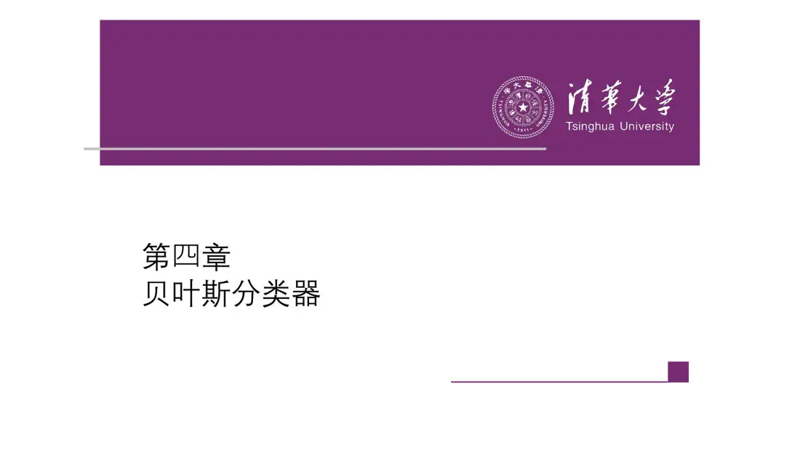

原文：

第四章 贝叶斯分类器

大華海
TSINGHUA UNIVERSITY
清華大學
Tsinghua University

### 问题的提出

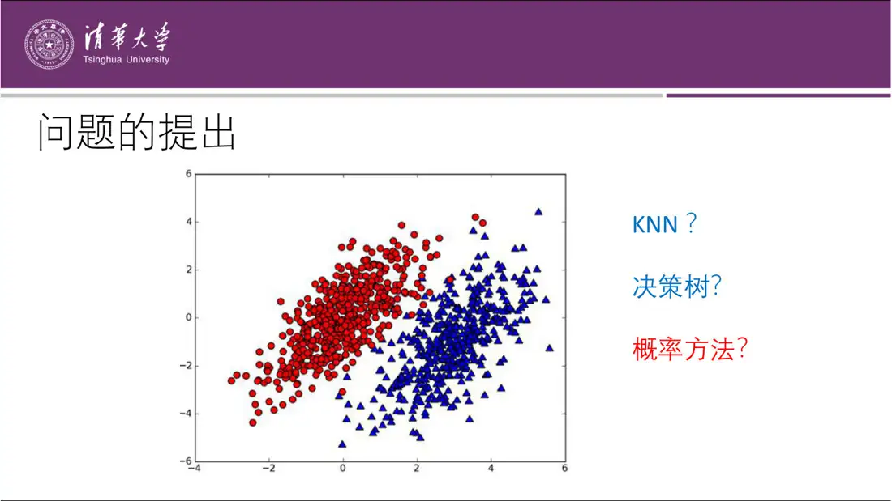

原文：

问题的提出

KNN ?

决策树?

概率方法？

Tsinghua University
清華大學

### 贝叶斯

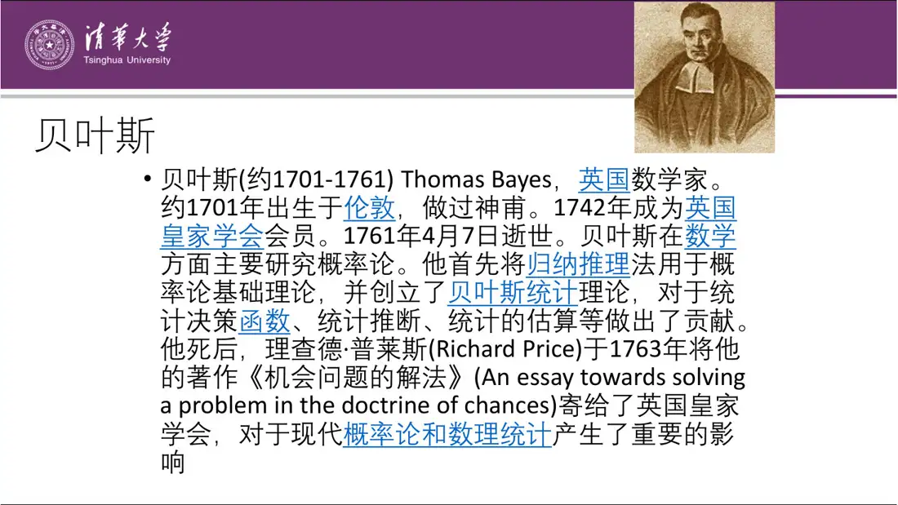

原文：

贝叶斯

\- 贝叶斯(约1701-1761) Thomas Bayes, 英国数学家。约1701年出生于伦敦，做过神甫。1742年成为英国皇家学会会员。1761年4月7日逝世。贝叶斯在数学方面主要研究概率论。他首先将归纳推理法用于概率论基础理论，并创立了贝叶斯统计理论，对于统计决策函数、统计推断、统计的估算等做出了贡献。他死后，理查德·普莱斯(Richard Price)于1763年将他的著作《机会问题的解法》(An essay towards solving a problem in the doctrine of chances)寄给了英国皇家学会，对于现代概率论和数理统计产生了重要的影响

Tsinghua University
清華大學
TSINGHUA UNIVERSITY
1911
清華大學
TSINGHUA UNIVERSITY

### 贝叶斯

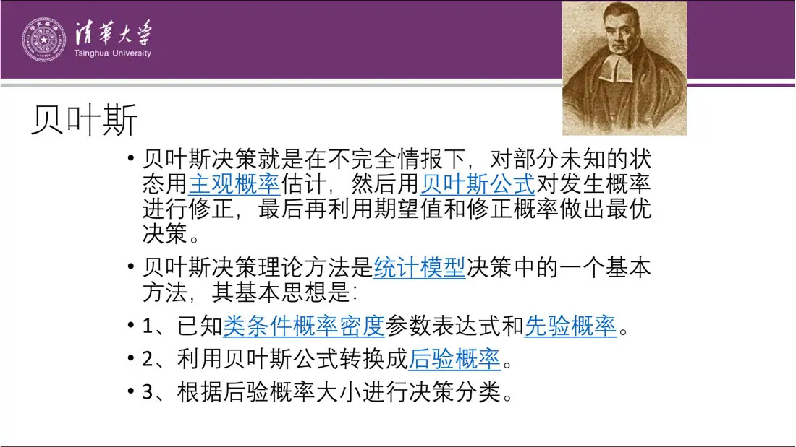

原文：

贝叶斯

\- 贝叶斯决策就是在不完全情报下，对部分未知的状态用主观概率估计，然后用贝叶斯公式对发生概率进行修正，最后再利用期望值和修正概率做出最优决策。

\- 贝叶斯决策理论方法是统计模型决策中的一个基本方法，其基本思想是：

• 1、已知类条件概率密度参数表达式和先验概率。

• 2、利用贝叶斯公式转换成后验概率。

• 3、根据后验概率大小进行决策分类。

清華大學 Tsinghua University

### 贝叶斯网络的应用

原文：

贝叶斯网络的应用

\- 最早的PathFinder系统，该系统是淋巴疾病诊断的医学系统，它可以诊断60多种疾病，涉及100多种症状；后来发展起来的Internist-I系统，也是一种医学诊断系统，但它可以诊断多达600多种常见的疾病。

\- 1995年，微软推出了第一个基于贝叶斯网的专家系统，一个用于幼儿保健的网站OnParent (www.onparenting.msn.com)，使父母们可以自行诊断。

清華大學 Tsinghua University

### 贝叶斯网络的应用

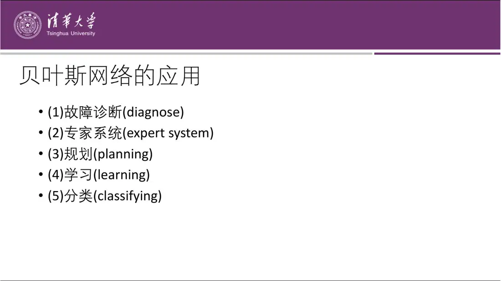

原文：

贝叶斯网络的应用

• (1)故障诊断(diagnose)

• (2)专家系统(expert system)

• (3)规划(planning)

• (4)学习(learning)

• (5)分类(classifying)

Tsinghua University
清華大學
1911-

### 概率(回顾)

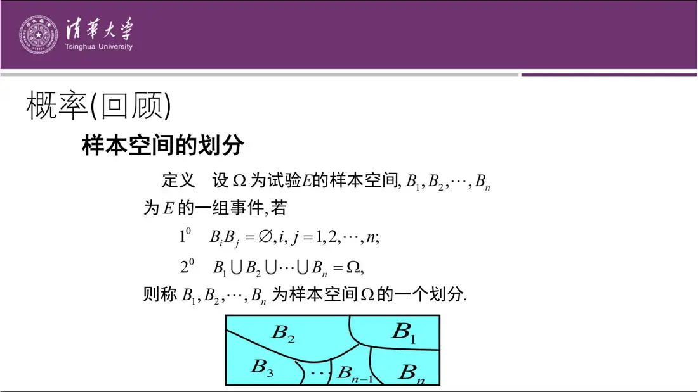

原文：

概率(回顾)

样本空间的划分

定义 设 $\Omega$ 为试验 E 的样本空间, $B_{1}, B_{2}, \cdots, B_{n}$ 为 E 的一组事件, 若

$$
1 ^ {0} \quad B _ {i} B _ {j} = \varnothing , i, j = 1, 2, \dots , n;
$$

$$
2 ^ {0} \quad B _ {1} \bigcup B _ {2} \bigcup \dots \bigcup B _ {n} = \Omega ,
$$

则称 $B_{1}, B_{2}, \cdots, B_{n}$ 为样本空间 $\Omega$ 的一个划分.

清華大學 Tsinghua University

### 概率(回顾)

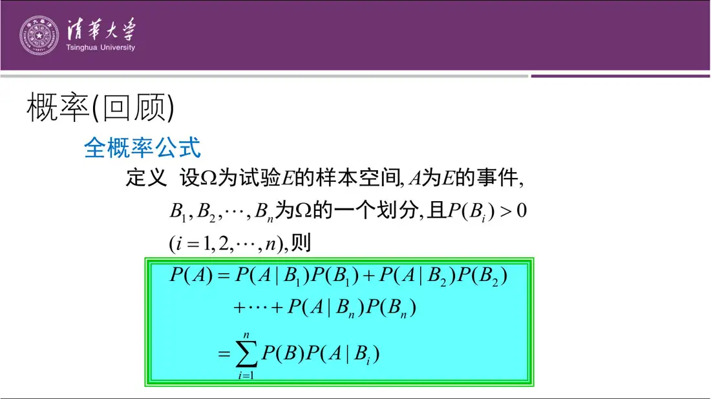

原文：

概率(回顾)

全概率公式

定义 设 $\Omega$ 为试验 $E$ 的样本空间, $A$ 为 $E$ 的事件, $B_{1}, B_{2}, \cdots, B_{n}$ 为 $\Omega$ 的一个划分, 且 $P(B_{i}) > 0 (i = 1, 2, \cdots, n)$ , 则

$$
\begin{array}{c} P (A) = P (A \mid B _ {1}) P (B _ {1}) + P (A \mid B _ {2}) P (B _ {2}) \\ + \dots + P (A \mid B _ {n}) P (B _ {n}) \\ = \sum_ {i = 1} ^ {n} P (B) P (A \mid B _ {i}) \end{array}
$$

Tsinghua University
清華大學
1911-UNIVERSITY

### 基本方法

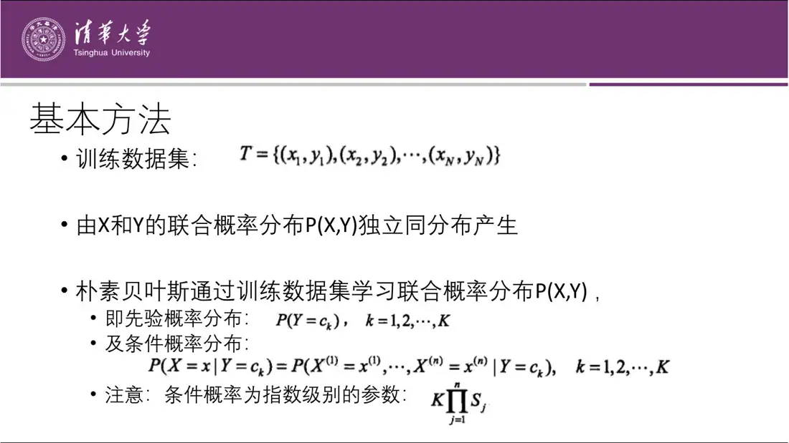

原文：

基本方法

\- 训练数据集: $T = \{(x_{1},y_{1}),(x_{2},y_{2}),\dots ,(x_{N},y_{N})\}$

\- 由X和Y的联合概率分布P(X,Y)独立同分布产生

\- 朴素贝叶斯通过训练数据集学习联合概率分布P(X,Y),

\- 即先验概率分布： $P(Y=c_{k})$ ， $k=1,2,\cdots,K$

\- 及条件概率分布:

$$
P (X = x \mid Y = c _ {k}) = P (X ^ {(1)} = x ^ {(1)}, \dots , X ^ {(n)} = x ^ {(n)} \mid Y = c _ {k}), \quad k = 1, 2, \dots , K
$$

\- 注意：条件概率为指数级别的参数： $K\prod_{j=1}^{n}S_{j}$

Tsinghua University
清華大學

### 基本方法

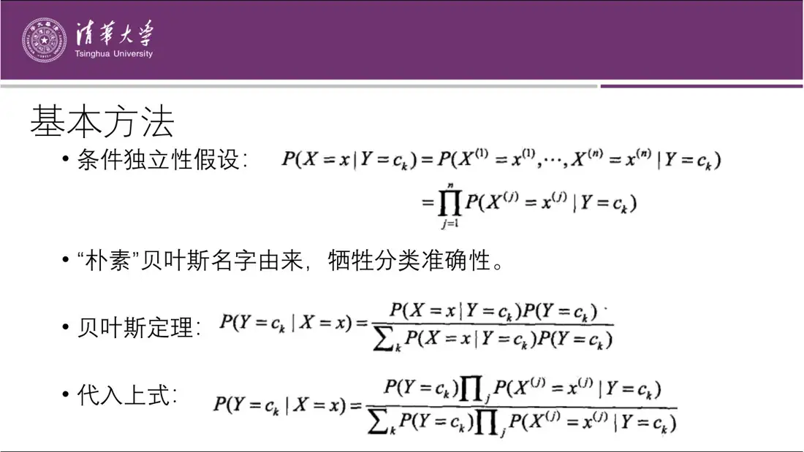

原文：

基本方法

\- 条件独立性假设： $P(X = x \mid Y = c_k) = P(X^{(1)} = x^{(1)}, \cdots, X^{(n)} = x^{(n)} \mid Y = c_k)$ $= \prod_{j=1}^{n} P(X^{(j)} = x^{(j)} \mid Y = c_k)$

\- “朴素”贝叶斯名字由来，牺牲分类准确性。

\- 贝叶斯定理： $P(Y = c_k \mid X = x) = \frac{P(X = x \mid Y = c_k)P(Y = c_k)}{\sum_k P(X = x \mid Y = c_k)P(Y = c_k)}$

\- 代入上式: $P(Y = c_k \mid X = x) = \frac{P(Y = c_k) \prod_j P(X^{(j)} = x^{(j)} \mid Y = c_k)}{\sum_k P(Y = c_k) \prod_j P(X^{(j)} = x^{(j)} \mid Y = c_k)}$

清華大學 Tsinghua University

### 基本方法

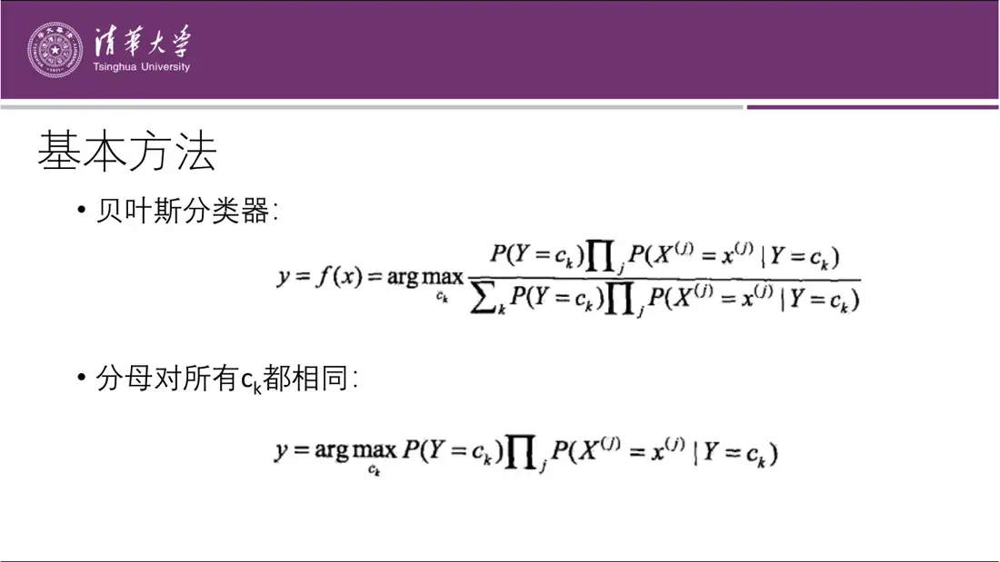

原文：

基本方法

\- 贝叶斯分类器:

$$
y = f (x) = \arg \max _ {\bar {c} _ {k}} \frac {P (Y = c _ {k}) \prod_ {j} P (X ^ {(j)} = x ^ {(j)} \mid Y = c _ {k})}{\sum_ {k} P (Y = c _ {k}) \prod_ {j} P (X ^ {(j)} = x ^ {(j)} \mid Y = c _ {k})}
$$

\- 分母对所有 $c_{k}$ 都相同：

$$
y = \arg \max _ {c _ {k}} P (Y = c _ {k}) \prod_ {j} P (X ^ {(j)} = x ^ {(j)} \mid Y = c _ {k})
$$

清華大學 Tsinghua University

### 后验概率最大化的含义:

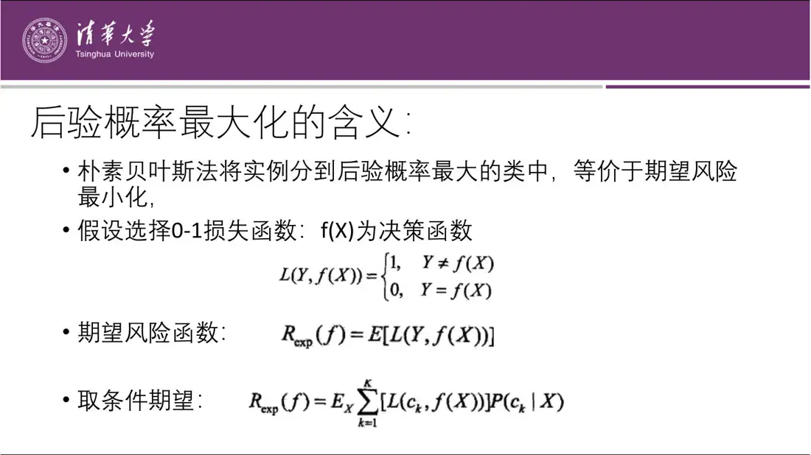

原文：

后验概率最大化的含义:

\- 朴素贝叶斯法将实例分到后验概率最大的类中，等价于期望风险最小化，

\- 假设选择0-1损失函数：f(X)为决策函数

$$
L (Y, f (X)) = \left\{ \begin{array}{l l} 1, & Y \neq f (X) \\ 0, & Y = f (X) \end{array} \right.
$$

\- 期望风险函数: $R_{\exp}(f) = E[L(Y, f(X))]$

\- 取条件期望:

$$
R _ {\exp} (f) = E _ {X} \sum_ {k = 1} ^ {K} [ L (c _ {k}, f (X)) ] P (c _ {k} \mid X)
$$

Tsinghua University
清華大學

### 后验概率最大化的含义:

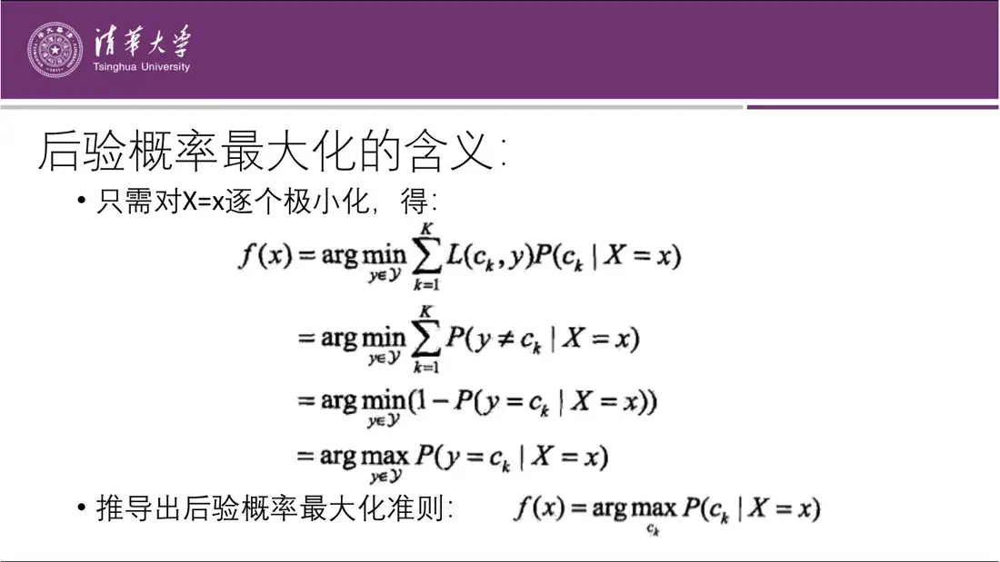

原文：

后验概率最大化的含义:

\- 只需对 $X = x$ 逐个极小化，得：

$$
\begin{array}{r l} f (x) & = \arg \min _ {y \in \mathcal {Y}} \sum_ {k = 1} ^ {K} L (c _ {k}, y) P (c _ {k} \mid X = x) \\ & = \arg \min _ {y \in \mathcal {Y}} \sum_ {k = 1} ^ {K} P (y \neq c _ {k} \mid X = x) \\ & = \arg \min _ {y \in \mathcal {Y}} (1 - P (y = c _ {k} \mid X = x)) \\ & = \arg \max _ {y \in \mathcal {Y}} P (y = c _ {k} \mid X = x) \end{array}
$$

\- 推导出后验概率最大化准则: $f(x) = \arg \max_{c_k} P(c_k \mid X = x)$

清華大學 Tsinghua University

### 朴素贝叶斯法的参数估

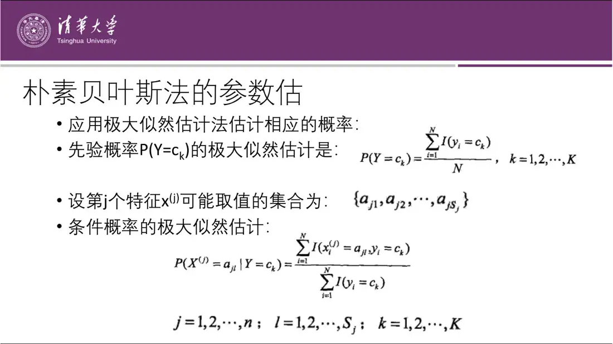

原文：

朴素贝叶斯法的参数估

\- 应用极大似然估计法估计相应的概率：

\- 先验概率 $P(Y=c_{k})$ 的极大似然估计是： $P(Y=c_{k})=\frac{\sum\limits_{i=1}I(y_{i}=c_{k})}{N},\quad k=1,2,\cdots,K$

\- 设第j个特征 $x^{(j)}$ 可能取值的集合为： $\{a_{j1}, a_{j2}, \cdots, a_{js_j}\}$

\- 条件概率的极大似然估计:

$$
P (X ^ {(j)} = a _ {j l} \mid Y = c _ {k}) = \frac {\sum_ {i = 1} ^ {N} I (x _ {i} ^ {(j)} = a _ {j l} , y _ {i} = c _ {k})}{\sum_ {i = 1} ^ {N} I (y _ {i} = c _ {k})}
$$

$$
j = 1, 2, \dots , n; l = 1, 2, \dots , S _ {j}; k = 1, 2, \dots , K
$$

Tsinghua University
清華大學

### 朴素贝叶斯法的参数估

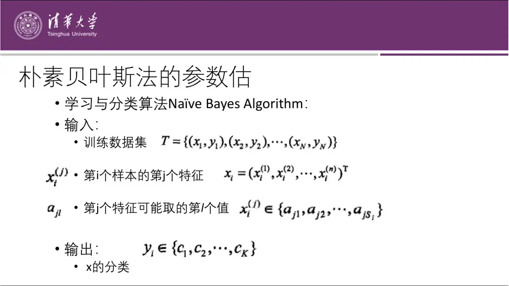

原文：

朴素贝叶斯法的参数估

\- 学习与分类算法Naïve Bayes Algorithm:

\- 输入:

\- 训练数据集 $T = \{(x_{1},y_{1}),(x_{2},y_{2}),\dots ,(x_{N},y_{N})\}$

$x_{i}^{(j)}$ · 第i个样本的第j个特征 $x_{i}=(x_{i}^{(1)},x_{i}^{(2)},\cdots,x_{i}^{(n)})^{\mathrm{T}}$

$a_{jl}$ · 第j个特征可能取的第l个值 $x_{i}^{(j)} \in \{a_{j1}, a_{j2}, \cdots, a_{js_{i}}\}$

\- 输出:

$$
y _ {i} \in \{c _ {1}, c _ {2}, \dots , c _ {K} \}
$$

\- x的分类

Tsinghua University
清華大學

### 朴素贝叶斯法的参数估

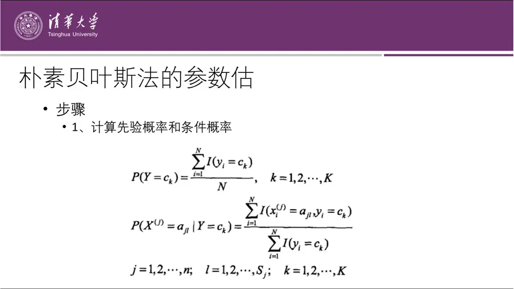

原文：

朴素贝叶斯法的参数估

\- 步骤

• 1、计算先验概率和条件概率

$$
P (Y = c _ {k}) = \frac {\sum_ {i = 1} ^ {N} I (y _ {i} = c _ {k})}{N}, \quad k = 1, 2, \dots , K
$$

$$
P (X ^ {(j)} = a _ {j l} \mid Y = c _ {k}) = \frac {\sum_ {i = 1} ^ {N} I (x _ {i} ^ {(j)} = a _ {j l} , y _ {i} = c _ {k})}{\sum_ {i = 1} ^ {N} I (y _ {i} = c _ {k})}
$$

$$
j = 1, 2, \dots , n; \quad l = 1, 2, \dots , S _ {j}; \quad k = 1, 2, \dots , K
$$

清華大學 Tsinghua University

### 朴素贝叶斯法的参数估

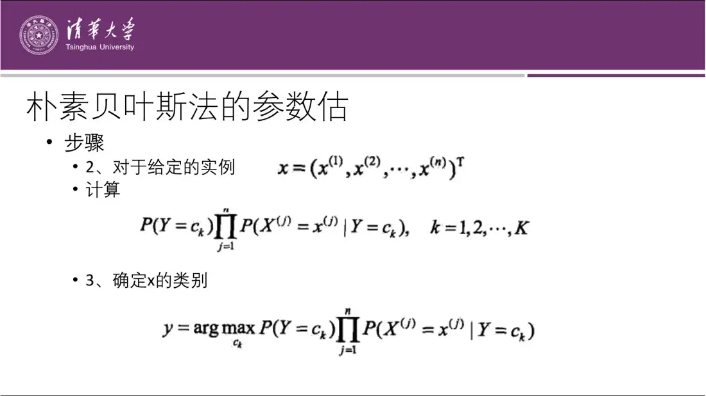

原文：

朴素贝叶斯法的参数估

\- 步骤

• 2、对于给定的实例 $x=(x^{(1)},x^{(2)},\cdots,x^{(n)})^{\mathrm{T}}$

\- 计算

$$
P (Y = c _ {k}) \prod_ {j = 1} ^ {n} P (X ^ {(j)} = x ^ {(j)} \mid Y = c _ {k}), \quad k = 1, 2, \dots , K
$$

\- 3、确定x的类别

$$
y = \arg \max _ {c _ {k}} P (Y = c _ {k}) \prod_ {j = 1} ^ {n} P (X ^ {(j)} = x ^ {(j)} \mid Y = c _ {k})
$$

Tsinghua University
清華大學

### 例子

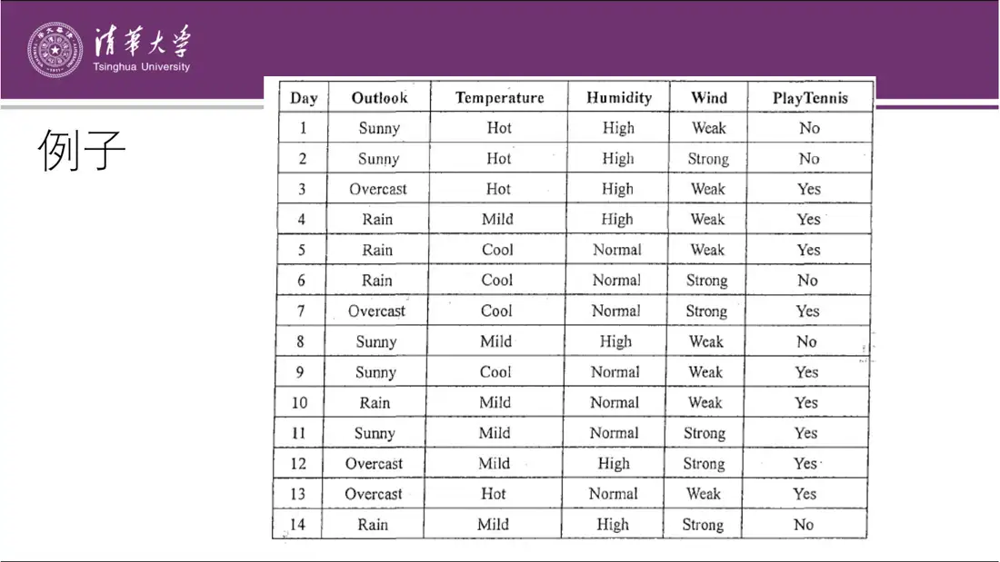

原文：

例子

<table><tr><td>Day</td><td>Outlook</td><td>Temperature</td><td>Humidity</td><td>Wind</td><td>PlayTennis</td></tr><tr><td>1</td><td>Sunny</td><td>Hot</td><td>High</td><td>Weak</td><td>No</td></tr><tr><td>2</td><td>Sunny</td><td>Hot</td><td>High</td><td>Strong</td><td>No</td></tr><tr><td>3</td><td>Overcast</td><td>Hot</td><td>High</td><td>Weak</td><td>Yes</td></tr><tr><td>4</td><td>Rain</td><td>Mild</td><td>High</td><td>Weak</td><td>Yes</td></tr><tr><td>5</td><td>Rain</td><td>Cool</td><td>Normal</td><td>Weak</td><td>Yes</td></tr><tr><td>6</td><td>Rain</td><td>Cool</td><td>Normal</td><td>Strong</td><td>No</td></tr><tr><td>7</td><td>Overcast</td><td>Cool</td><td>Normal</td><td>Strong</td><td>Yes</td></tr><tr><td>8</td><td>Sunny</td><td>Mild</td><td>High</td><td>Weak</td><td>No</td></tr><tr><td>9</td><td>Sunny</td><td>Cool</td><td>Normal</td><td>Weak</td><td>Yes</td></tr><tr><td>10</td><td>Rain</td><td>Mild</td><td>Normal</td><td>Weak</td><td>Yes</td></tr><tr><td>11</td><td>Sunny</td><td>Mild</td><td>Normal</td><td>Strong</td><td>Yes</td></tr><tr><td>12</td><td>Overcast</td><td>Mild</td><td>High</td><td>Strong</td><td>Yes</td></tr><tr><td>13</td><td>Overcast</td><td>Hot</td><td>Normal</td><td>Weak</td><td>Yes</td></tr><tr><td>14</td><td>Rain</td><td>Mild</td><td>High</td><td>Strong</td><td>No</td></tr></table>

Tsinghua University
清華大學
1911-UNIVERSITY

### 例子

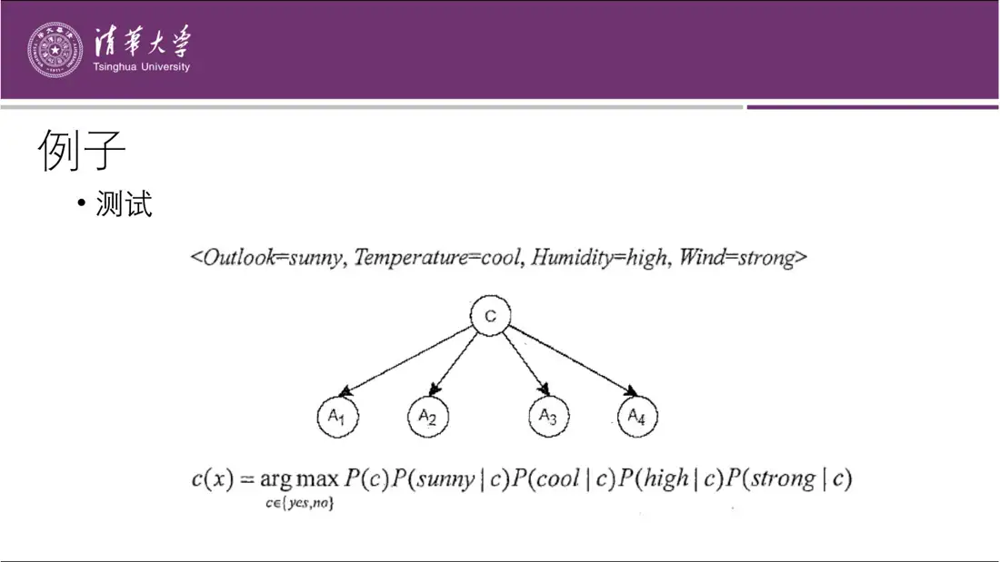

原文：

例子

\- 测试

<Outlook=sunny, Temperature=cool, Humidity=high, Wind=strong>

清華大學 Tsinghua University

### 例子

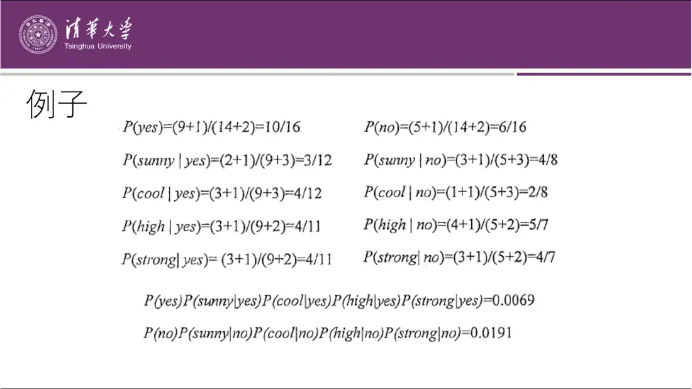

原文：

例子

$$
P (y e s) = (9 + 1) / (1 4 + 2) = 1 0 / 1 6
$$

$$
P (n o) = (5 + 1) / (1 4 + 2) = 6 / 1 6
$$

$$
P (s u n n y \mid y e s) = (2 + 1) / (9 + 3) = 3 / 1 2
$$

$$
P (s u n n y \mid n o) = (3 + 1) / (5 + 3) = 4 / 8
$$

$$
P (c o o l \mid y e s) = (3 + 1) / (9 + 3) = 4 / 1 2
$$

$$
P (c o o l \mid n o) = (1 + 1) / (5 + 3) = 2 / 8
$$

$$
P (h i g h \mid y e s) = (3 + 1) / (9 + 2) = 4 / 1 1
$$

$$
P (h i g h \mid n o) = (4 + 1) / (5 + 2) = 5 / 7
$$

$$
P (s t r o n g \mid y e s) = (3 + 1) / (9 + 2) = 4 / 1 1
$$

$$
P (s t r o n g \mid n o) = (3 + 1) / (5 + 2) = 4 / 7
$$

$$
P (y e s) P (s u n n y | y e s) P (c o o l | y e s) P (h i g h | y e s) P (s t r o n g | y e s) = 0. 0 0 6 9
$$

$$
P (n o) P (s u n n y | n o) P (c o o l | n o) P (h i g h | n o) P (s t r o n g | n o) = 0. 0 1 9 1
$$

清華大學 Tsinghua University

### 贝叶斯估计

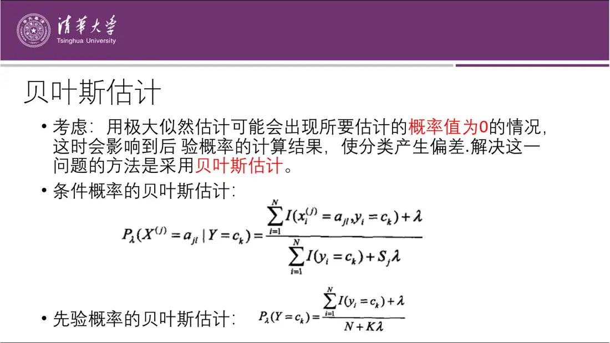

原文：

贝叶斯估计

\- 考虑: 用极大似然估计可能会出现所要估计的概率值为0的情况,这时会影响到后验概率的计算结果,使分类产生偏差.解决这一问题的方法是采用贝叶斯估计。

\- 条件概率的贝叶斯估计：

$$
P _ {\lambda} (X ^ {(j)} = a _ {j l} \mid Y = c _ {k}) = \frac {\sum_ {i = 1} ^ {N} I (x _ {i} ^ {(j)} = a _ {j l} , y _ {i} = c _ {k}) + \lambda}{\sum_ {i = 1} ^ {N} I (y _ {i} = c _ {k}) + S _ {j} \lambda}
$$

\- 先验概率的贝叶斯估计: $P_{\lambda}(Y = c_k) = \frac{\sum_{i=1}^{N} I(y_i = c_k) + \lambda}{N + K\lambda}$

清華大學 Tsinghua University

### 朴素贝叶斯网络的缺陷

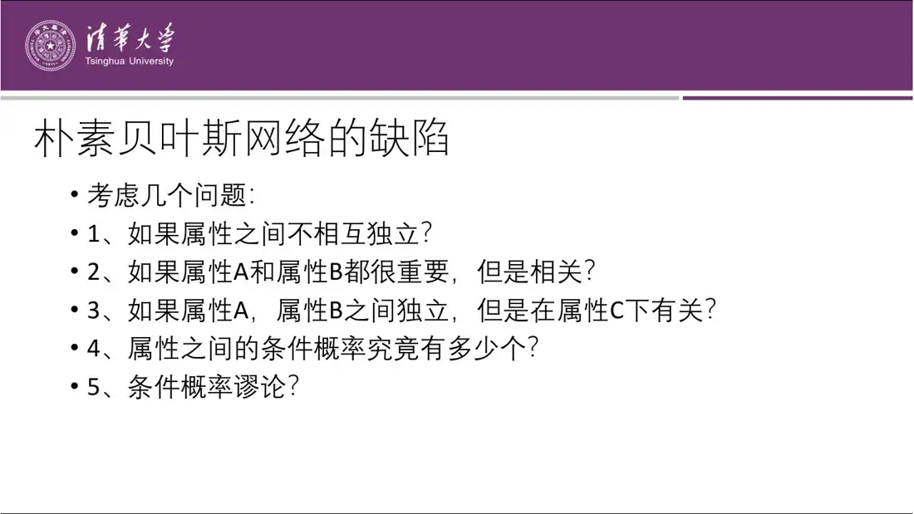

原文：

朴素贝叶斯网络的缺陷

\- 考虑几个问题:

• 1、如果属性之间不相互独立？

• 2、如果属性A和属性B都很重要，但是相关？

• 3、如果属性A，属性B之间独立，但是在属性C下有关？

• 4、属性之间的条件概率究竟有多少个？

• 5、条件概率谬论？

Tsinghua University
清華大學
1911-1911

### 贝叶斯分类器

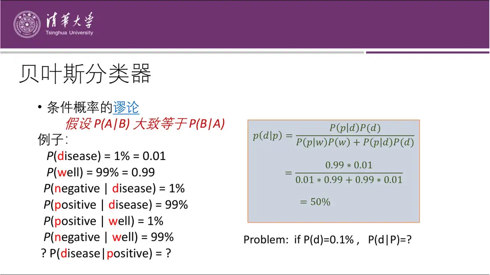

原文：

贝叶斯分类器

$$
\begin{array}{r l} p (d | p) & = \frac {P (p | d) P (d)}{P (p | w) P (w) + P (p | d) P (d)} \\ & = \frac {0 . 9 9 * 0 . 0 1}{0 . 0 1 * 0 . 9 9 + 0 . 9 9 * 0 . 0 1} \\ & = 50 \% \end{array}
$$

Problem: if $P(d)=0.1\%$ , $P(d|P)=?$

清華大學 Tsinghua University

### 信息论相关概念

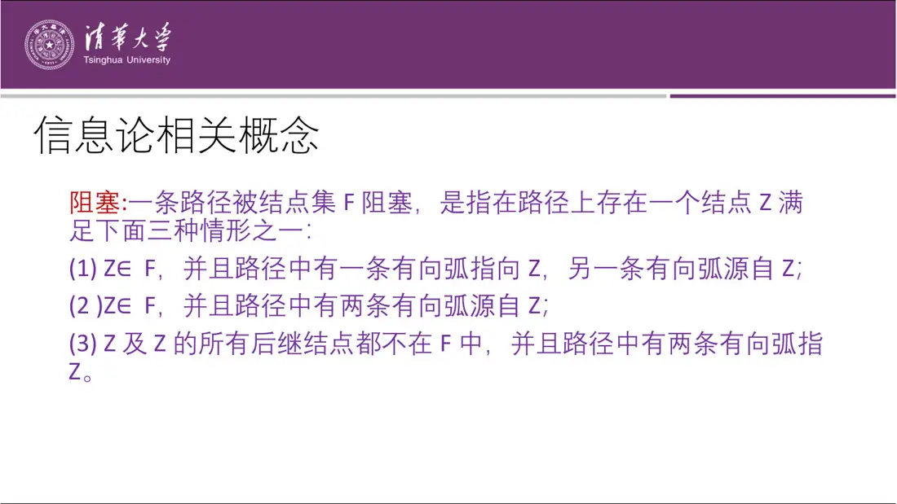

原文：

信息论相关概念

阻塞:一条路径被结点集 F 阻塞，是指在路径上存在一个结点 Z 满足下面三种情形之一：

(1) $Z \in F$ , 并且路径中有一条有向弧指向 $Z$ , 另一条有向弧源自 $Z$ ;

(2) $Z \in F$ , 并且路径中有两条有向弧源自 $Z$ ;

(3) Z 及 Z 的所有后继结点都不在 F 中，并且路径中有两条有向弧指 Z。

清華大學 Tsinghua University

### 信息论相关概念

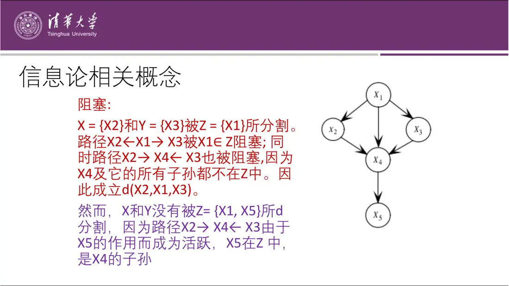

原文：

信息论相关概念

阻塞:

X = {X2}和Y = {X3}被Z = {X1}所分割。路径X2←X1→X3被X1∈Z阻塞；同时路径X2→X4←X3也被阻塞，因为X4及它的所有子孙都不在Z中。因此成立d(X2,X1,X3)。

然而，X和Y没有被Z= {X1, X5}所d分割，因为路径X2→X4←X3由于X5的作用而成为活跃，X5在Z中，是X4的子孙

清華大學 Tsinghua University

### 信息论相关概念

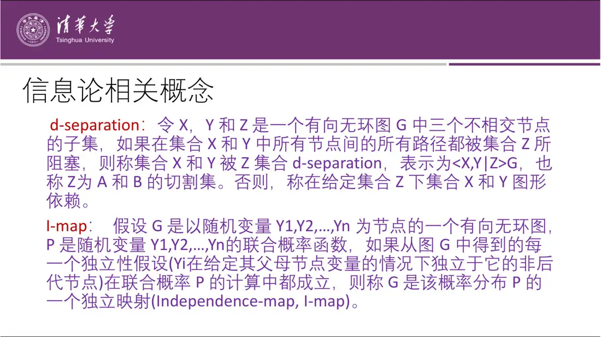

原文：

信息论相关概念

d-separation: 令 X, Y 和 Z 是一个有向无环图 G 中三个不相交节点的子集，如果在集合 X 和 Y 中所有节点间的所有路径都被集合 Z 所阻塞，则称集合 X 和 Y 被 Z 集合 d-separation，表示为 <X,Y|Z>G，也称 Z 为 A 和 B 的切割集。否则，称在给定集合 Z 下集合 X 和 Y 图形依赖。

I-map: 假设 G 是以随机变量 Y1,Y2,...,Yn 为节点的一个有向无环图, P 是随机变量 Y1,Y2,...,Yn 的联合概率函数, 如果从图 G 中得到的每一个独立性假设(Yi在给定其父母节点变量的情况下独立于它的非后代节点)在联合概率 P 的计算中都成立, 则称 G 是该概率分布 P 的一个独立映射(Independence-map, I-map)。

Tsinghua University
清華大學
TSINGHUA UNIVERSITY
1911
清華大學
TSINGHUA UNIVERSITY

### 朴素贝叶斯网络分类器

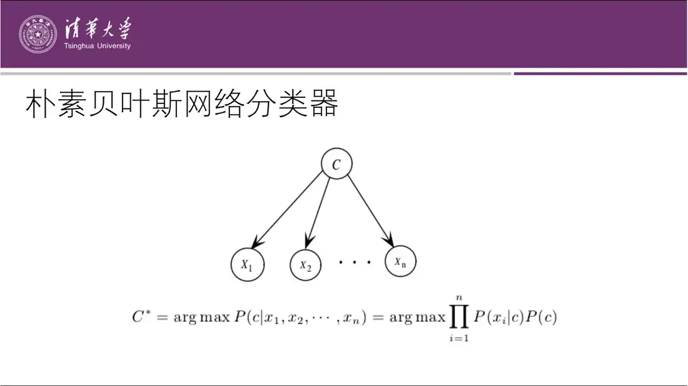

原文：

朴素贝叶斯网络分类器

$$
C ^ {*} = \arg \max P (c | x _ {1}, x _ {2}, \dots , x _ {n}) = \arg \max \prod_ {i = 1} ^ {n} P (x _ {i} | c) P (c)
$$

清華大學 Tsinghua University

### 朴素贝叶斯网络分类器的改进算法

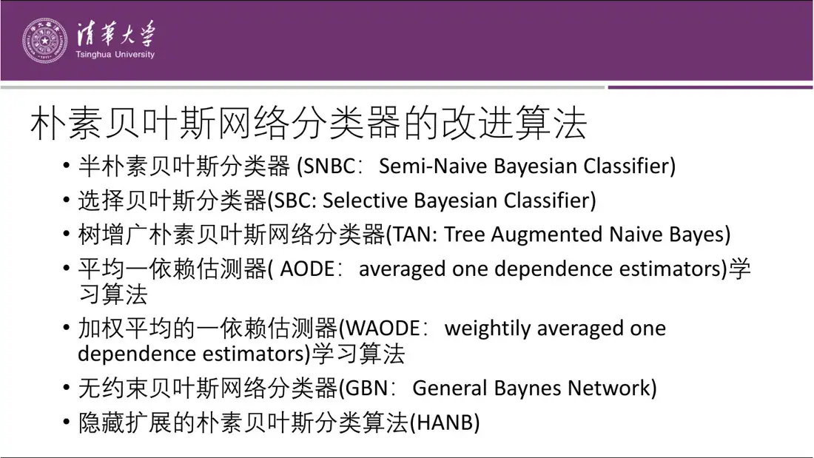

原文：

朴素贝叶斯网络分类器的改进算法

\- 半朴素贝叶斯分类器 (SNBC: Semi-Naive Bayesian Classifier)

\- 选择贝叶斯分类器(SBC: Selective Bayesian Classifier)

\- 树增广朴素贝叶斯网络分类器(TAN: Tree Augmented Naive Bayes)

\- 平均—依赖估测器(AODE: averaged one dependence estimators)学习算法

\- 加权平均的一依赖估测器(WAODE: weightily averaged one dependence estimators)学习算法

\- 无约束贝叶斯网络分类器(GBN: General Baynes Network)

\- 隐藏扩展的朴素贝叶斯分类算法(HANB)

清華大學 Tsinghua University

### 半朴素贝叶斯网络分类器

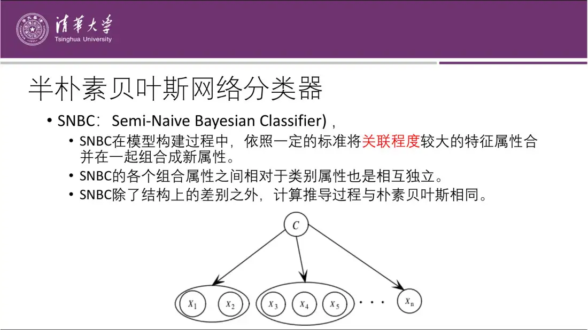

原文：

半朴素贝叶斯网络分类器

• SNBC: Semi-Naive Bayesian Classifier),

\- SNBC在模型构建过程中，依照一定的标准将关联程度较大的特征属性合并在一起组合成新属性。

\- SNBC的各个组合属性之间相对于类别属性也是相互独立。

\- SNBC除了结构上的差别之外，计算推导过程与朴素贝叶斯相同。

清華大學 Tsinghua University

### 选择贝叶斯分类器

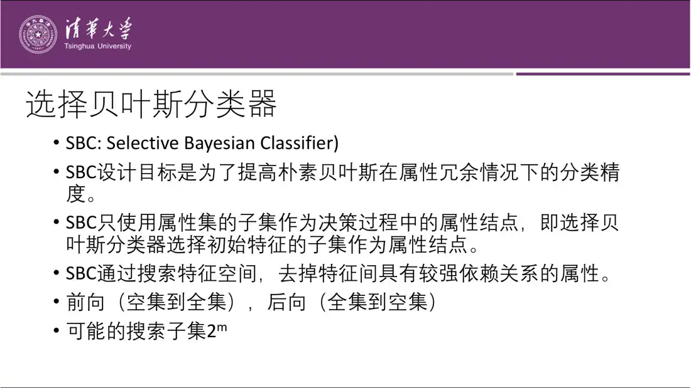

原文：

选择贝叶斯分类器

• SBC: Selective Bayesian Classifier)

\- SBC设计目标是为了提高朴素贝叶斯在属性冗余情况下的分类精度。

\- SBC只使用属性集的子集作为决策过程中的属性结点，即选择贝叶斯分类器选择初始特征的子集作为属性结点。

\- SBC通过搜索特征空间，去掉特征间具有较强依赖关系的属性。

\- 前向（空集到全集），后向（全集到空集）

\- 可能的搜索子集 $2^{\mathrm{m}}$

清華大學 Tsinghua University

### 信息论相关概念

原文：

信息论相关概念

\- 属性的相互独立性？

\- 如何测量？

Tsinghua University
清華大學
1911-

### 信息增益（回顾）

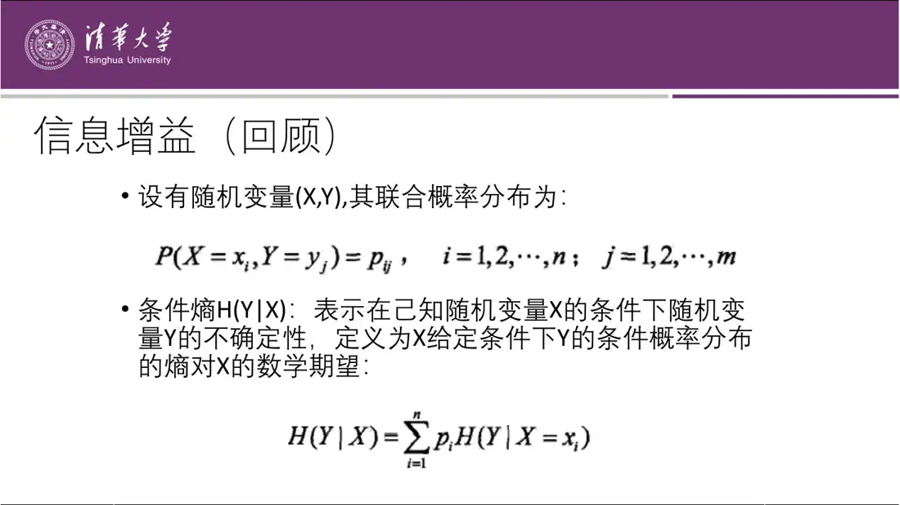

原文：

信息增益（回顾）

\- 设有随机变量(X,Y),其联合概率分布为:

$$
P (X = x _ {i}, Y = y _ {j}) = p _ {i j}, \quad i = 1, 2, \dots , n; \quad j = 1, 2, \dots , m
$$

\- 条件熵H(Y|X): 表示在己知随机变量X的条件下随机变量Y的不确定性，定义为X给定条件下Y的条件概率分布的熵对X的数学期望：

$$
H (Y \mid X) = \sum_ {i = 1} ^ {n} p _ {i} H (Y \mid X = x _ {i})
$$

Tsinghua University
清華大學

### 信息增益（回顾）

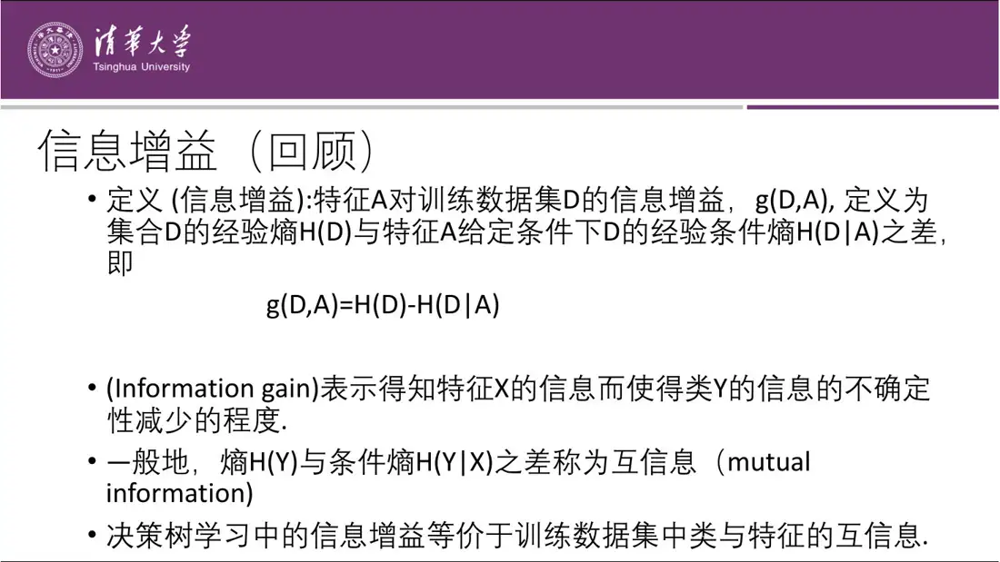

原文：

信息增益（回顾）

\- 定义 (信息增益): 特征A对训练数据集D的信息增益, g(D,A), 定义为集合D的经验熵H(D)与特征A给定条件下D的经验条件熵H(D|A)之差, 即

$$
\mathsf {g} (D, A) = H (D) - H (D \mid A)
$$

\- (Information gain)表示得知特征X的信息而使得类Y的信息的不确定性减少的程度.

\- 一般地，熵H(Y)与条件熵H(Y|X)之差称为互信息（mutual information）

\- 决策树学习中的信息增益等价于训练数据集中类与特征的互信息.

清華大學 Tsinghua University

### 信息论相关概念

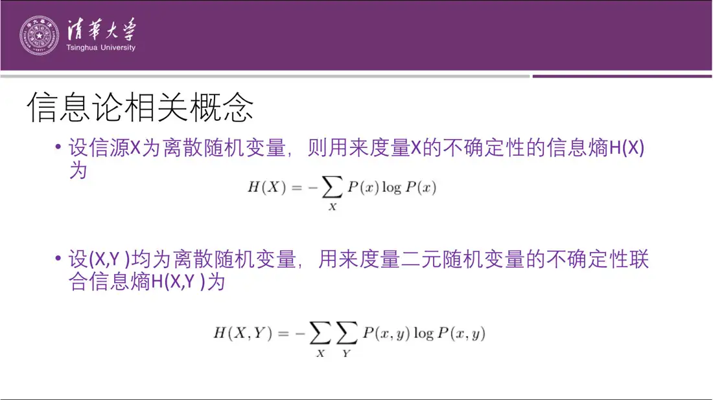

原文：

信息论相关概念

\- 设信源X为离散随机变量，则用来度量X的不确定性的信息熵H(X)为

$$
H (X) = - \sum_ {X} P (x) \log P (x)
$$

\- 设(X,Y)均为离散随机变量，用来度量二元随机变量的不确定性联合信息熵H(X,Y)为

$$
H (X, Y) = - \sum_ {X} \sum_ {Y} P (x, y) \log P (x, y)
$$

清華大學 Tsinghua University

### 信息论相关概念

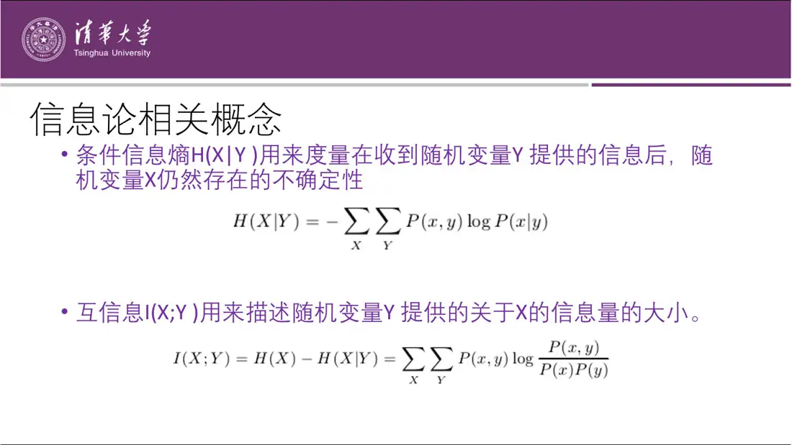

原文：

信息论相关概念

\- 条件信息熵H(X|Y)用来度量在收到随机变量Y提供的信息后，随机变量X仍然存在的不确定性

$$
H (X | Y) = - \sum_ {X} \sum_ {Y} P (x, y) \log P (x | y)
$$

\- 互信息I(X;Y)用来描述随机变量Y提供的关于X的信息量的大小。

$$
I (X; Y) = H (X) - H (X | Y) = \sum_ {X} \sum_ {Y} P (x, y) \log {\frac {P (x , y)}{P (x) P (y)}}
$$

清華大學 Tsinghua University

### 信息论相关概念

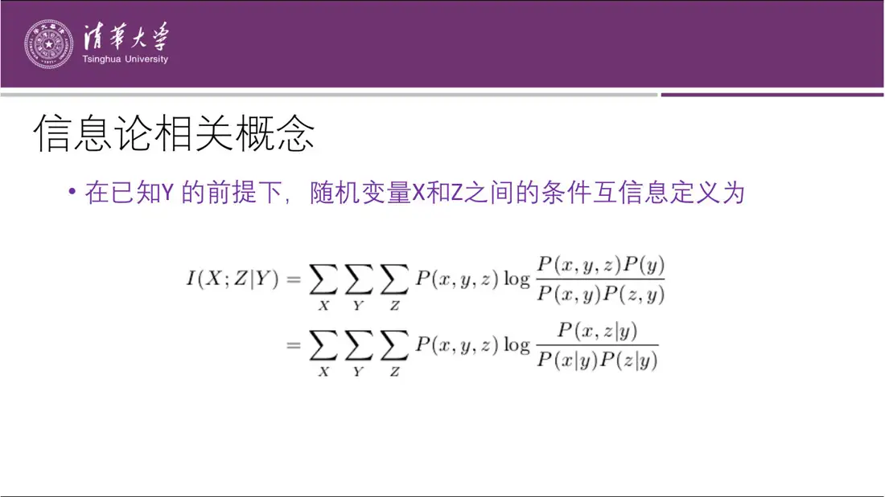

原文：

信息论相关概念

\- 在已知Y的前提下，随机变量X和Z之间的条件互信息定义为

$$
\begin{array}{r} I (X; Z | Y) = \sum_ {X} \sum_ {Y} \sum_ {Z} P (x, y, z) \log \frac {P (x , y , z) P (y)}{P (x , y) P (z , y)} \\ = \sum_ {X} \sum_ {Y} \sum_ {Z} P (x, y, z) \log \frac {P (x , z | y)}{P (x | y) P (z | y)} \end{array}
$$

Tsinghua University
清華大學
1911-1911

### 信息论相关概念

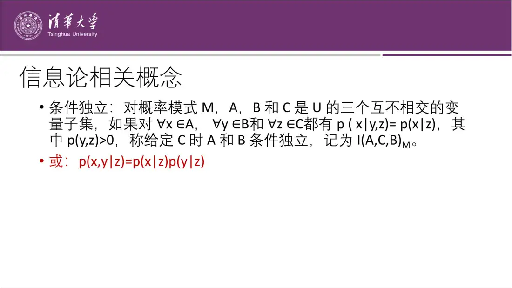

原文：

信息论相关概念

\- 条件独立：对概率模式 M，A，B 和 C 是 U 的三个互不相交的变量子集，如果对 $\forall x \in A,\quad \forall y \in B$ 和 $\forall z \in C$ 都有 $p(x|y,z)=p(x|z)$ ，其中 $p(y,z)>0$ ，称给定 C 时 A 和 B 条件独立，记为 $I(A,C,B)_{M}$ 。

• 或： $p(x,y|z)=p(x|z)p(y|z)$

Tsinghua University
清華大學

### 贝叶斯网络基本模型

原文：

贝叶斯网络基本模型

\- 贝叶斯网络是由图论和概率论结合而成的描述多元统计关系的模型，它为多个变量之间复杂依赖关系的表示提供了统一的框架，具有紧凑有效、简洁直观的特点。

\- 由于贝叶斯网络对大规模复杂系统简约而紧凑的表示能力，使得其成为人工智能、专家系统、模式识别、数据挖掘和软件测试等领域的研究热点。

Tsinghua University
清華大學

### 贝叶斯网络基本模型

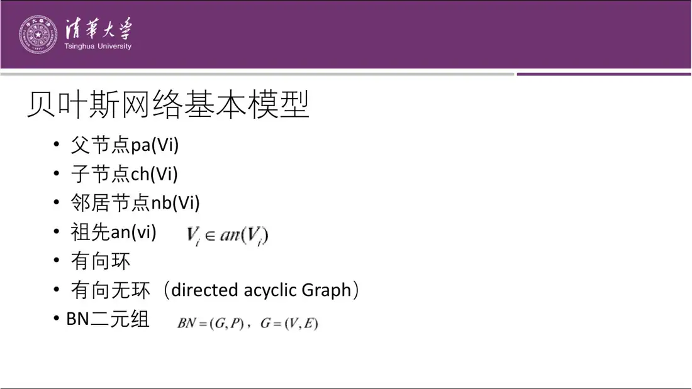

原文：

贝叶斯网络基本模型

\- 父节点pa(Vi)

\- 子节点ch(Vi)

\- 邻居节点nb(Vi)

\- 祖先an(vi) $V_{j} \in an(V_{j})$

\- 有向环

\- 有向无环（directed acyclic Graph）

\- BN二元组 $BN = (G, P)$ ， $G = (V, E)$

Tsinghua University
清華大學
1911-1911

### 贝叶斯网络基本模型

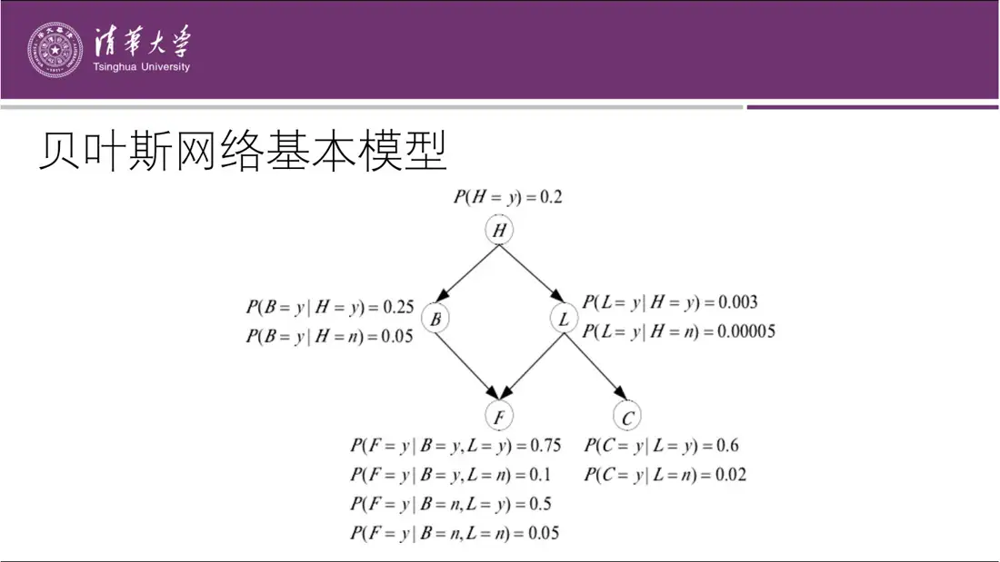

原文：

贝叶斯网络基本模型

$$
P (H = y) = 0. 2
$$

$$
P (B = y \mid H = y) = 0. 2 5
$$

$$
P (B = y \mid H = n) = 0. 0 5
$$

$$
P (L = y \mid H = y) = 0. 0 0 3
$$

$$
P (L = y \mid H = n) = 0. 0 0 0 0 5
$$

$$
P (F = y \mid B = y, L = y) = 0. 7 5
$$

$$
P (C = y \mid L = y) = 0. 6
$$

$$
P (F = y \mid B = y, L = n) = 0. 1
$$

$$
P (C = y \mid L = n) = 0. 0 2
$$

$$
P (F = y \mid B = n, L = y) = 0. 5
$$

$$
P (F = y \mid B = n, L = n) = 0. 0 5
$$

清華大學 Tsinghua University

### 贝叶斯网络基本模型

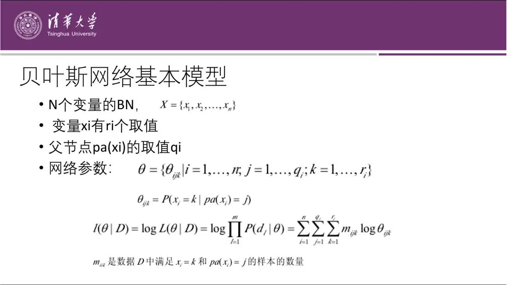

原文：

贝叶斯网络基本模型

\- N个变量的BN, $X = \{x_{1}, x_{2}, \ldots, x_{n}\}$

\- 变量xi有ri个取值

\- 父节点pa(xi)的取值qi

\- 网络参数： $\theta = \{\theta_{ijk} | i = 1, \dots, n; j = 1, \dots, q_j; k = 1, \dots, r_j\}$

$$
\theta_ {i j k} = P (x _ {i} = k \mid p a (x _ {i}) = j)
$$

$$
l (\theta \mid D) = \log L (\theta \mid D) = \log \prod_ {i = 1} ^ {m} P (d _ {i} \mid \theta) = \sum_ {i = 1} ^ {n} \sum_ {j = 1} ^ {q _ {i}} \sum_ {k = 1} ^ {r _ {i}} m _ {i j k} \log \theta_ {i j k}
$$

$m_{iik}$ 是数据 $D$ 中满足 $x_{i} = k$ 和 $pa(x_{i}) = j$ 的样本的数量

Tsinghua University
清華大學

### 贝叶斯估计

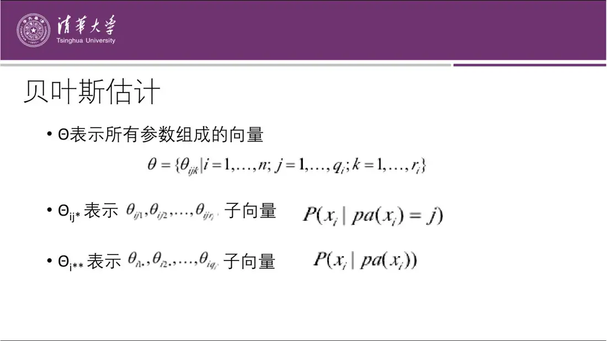

原文：

贝叶斯估计

\- Θ表示所有参数组成的向量

$$
\theta = \{\theta_ {i j k} | i = 1, \dots , n; j = 1, \dots , q _ {i}; k = 1, \dots , r _ {i} \}
$$

\- $\Theta_{ij*}$ 表示 $\theta_{ij1},\theta_{ij2},\ldots ,\theta_{ijr_1}$ 子向量 $P(x_{j}|\,pa(x_{j}) = j)$

\- $\Theta_{i**}$ 表示 $\theta_{1*},\theta_{2*},\ldots,\theta_{ij*}$ 子向量 $P(x_i|pa(x_j))$

清華大學 Tsinghua University

### 贝叶斯估计

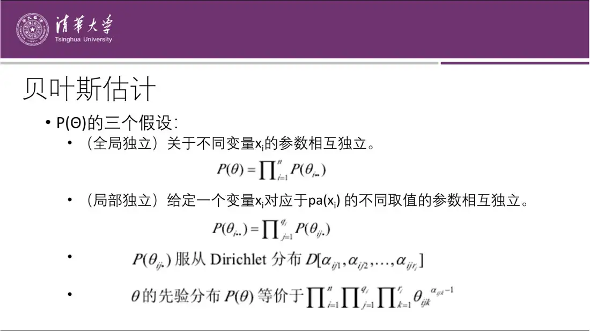

原文：

贝叶斯估计

\- P(Θ)的三个假设:

\- （全局独立）关于不同变量 $x_{i}$ 的参数相互独立。

$$
P (\theta) = \prod_ {i = 1} ^ {n} P (\theta_ {i, \dots})
$$

\- （局部独立）给定一个变量 $x_{i}$ 对应于 $pa(x_{i})$ 的不同取值的参数相互独立。

$$
P (\theta_ {i \cdot \cdot}) = \prod_ {j = 1} ^ {q _ {j}} P (\theta_ {i j \cdot})
$$

$P(\theta_{ij})$ 服从Dirichlet分布 $D[\alpha_{ij1},\alpha_{ij2},\dots,\alpha_{ijr}]$

$\theta$ 的先验分布 $P(\theta)$ 等价于 $\prod_{i=1}^{n}\prod_{j=1}^{q_i}\prod_{k=1}^{r_i}\theta_{ijk}^{\alpha_{jk}-1}$

清華大學 Tsinghua University

### 贝叶斯估计

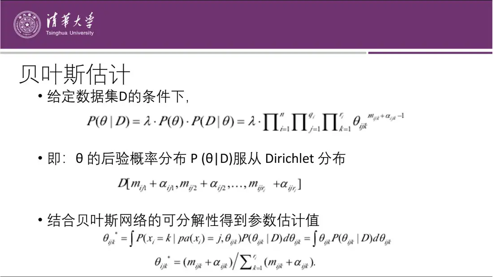

原文：

贝叶斯估计

\- 给定数据集D的条件下，

$$
P (\theta \mid D) = \lambda \cdot P (\theta) \cdot P (D \mid \theta) = \lambda \cdot \prod_ {i = 1} ^ {n} \prod_ {j = 1} ^ {q _ {i}} \prod_ {k = 1} ^ {r _ {i}} \theta_ {i j k} ^ {m _ {i j k} + \alpha_ {i j k} - 1}
$$

\- 即： $\theta$ 的后验概率分布 $P(\theta | D)$ 服从 Dirichlet 分布

$$
D \left[ m _ {i j 1} + \alpha_ {i j 1}, m _ {i j 2} + \alpha_ {i j 2}, \dots , m _ {i j r _ {i}} + \alpha_ {i j r _ {i}} \right]
$$

\- 结合贝叶斯网络的可分解性得到参数估计值

$$
\theta_ {i j k} ^ {*} = \int P (x _ {i} = k \mid p a (x _ {i}) = j, \theta_ {i j k}) P (\theta_ {i j k} \mid D) d \theta_ {i j k} = \int \theta_ {i j k} P (\theta_ {i j k} \mid D) d \theta_ {i j k}
$$

$$
\theta_ {i j k} ^ {*} = (m _ {i j k} + \alpha_ {i j k}) / \sum_ {k = 1} ^ {r _ {i}} (m _ {i j k} + \alpha_ {i j k}).
$$

清華大學 Tsinghua University

### 贝叶斯估计

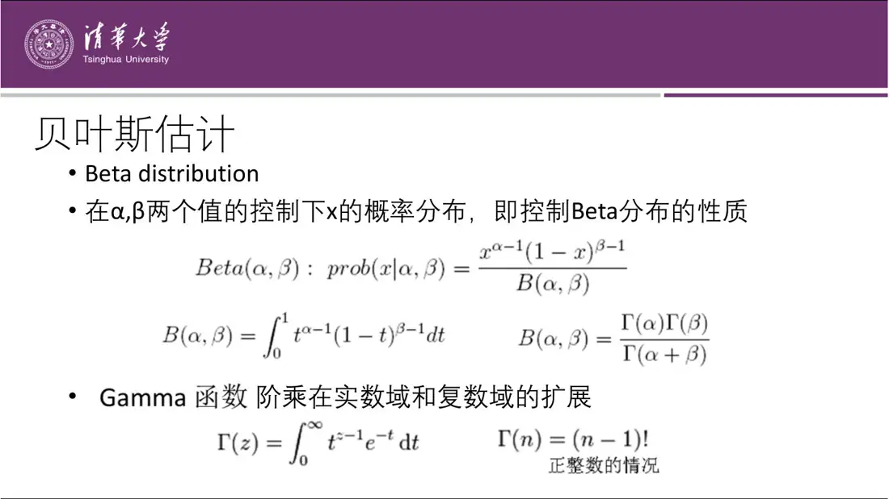

原文：

贝叶斯估计

\- Beta distribution

\- 在 $\alpha, \beta$ 两个值的控制下 $x$ 的概率分布，即控制Beta分布的性质

$$
B e t a (\alpha , \beta): p r o b (x | \alpha , \beta) = \frac {x ^ {\alpha - 1} (1 - x) ^ {\beta - 1}}{B (\alpha , \beta)}
$$

$$
B (\alpha , \beta) = \int_ {0} ^ {1} t ^ {\alpha - 1} (1 - t) ^ {\beta - 1} d t \qquad B (\alpha , \beta) = \frac {\Gamma (\alpha) \Gamma (\beta)}{\Gamma (\alpha + \beta)}
$$

\- Gamma 函数 阶乘在实数域和复数域的扩展

$$
\Gamma (z) = \int_ {0} ^ {\infty} t ^ {z - 1} e ^ {- t} \mathrm{d} t \qquad \qquad \Gamma (n) = (n - 1)! _ {\text {正整数的情况}}
$$

清華大學 Tsinghua University

### 贝叶斯网络结构学习

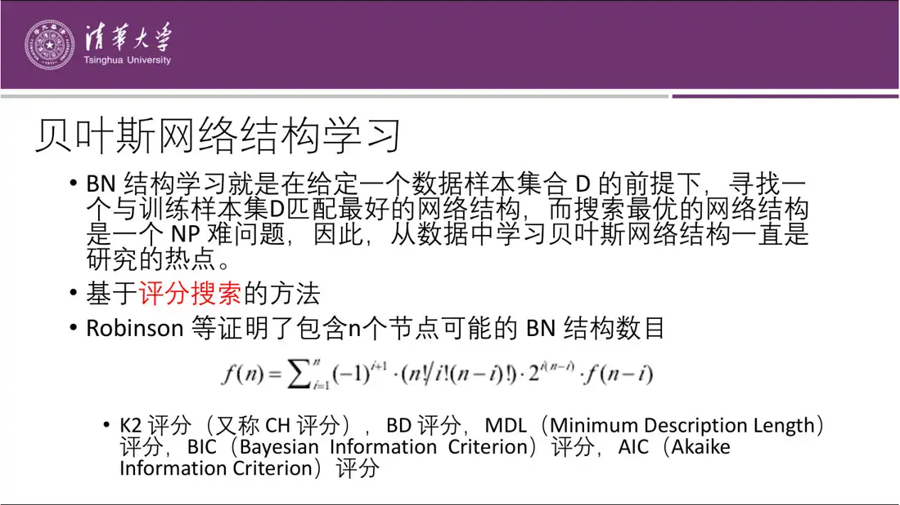

原文：

贝叶斯网络结构学习

\- BN 结构学习就是在给定一个数据样本集合 D 的前提下，寻找一个与训练样本集D匹配最好的网络结构，而搜索最优的网络结构是一个 NP 难问题，因此，从数据中学习贝叶斯网络结构一直是研究的热点。

\- 基于评分搜索的方法

\- Robinson 等证明了包含n个节点可能的 BN 结构数目

$$
f (n) = \sum_ {i = 1} ^ {n} (- 1) ^ {i + 1} \cdot (n! / i! (n - i)!) \cdot 2 ^ {i (n - i)} \cdot f (n - i)
$$

\- K2 评分（又称 CH 评分），BD 评分，MDL（Minimum Description Length）评分，BIC（Bayesian Information Criterion）评分，AIC（Akaike Information Criterion）评分

清華大學 Tsinghua University

### 基于信息理论的评分函数

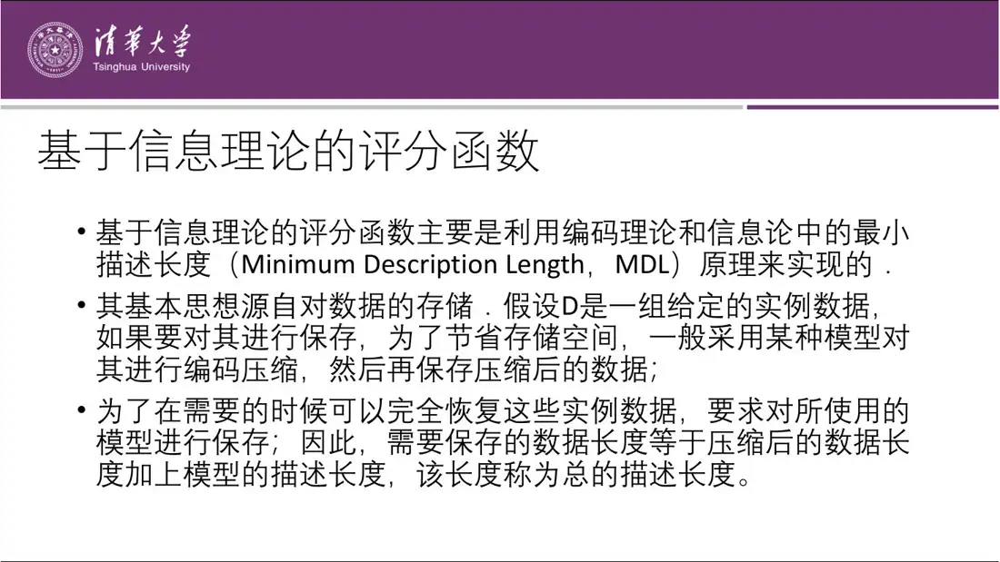

原文：

基于信息理论的评分函数

\- 基于信息理论的评分函数主要是利用编码理论和信息论中的最小描述长度（Minimum Description Length, MDL）原理来实现的。

\- 其基本思想源自对数据的存储．假设D是一组给定的实例数据，如果要对其进行保存，为了节省存储空间，一般采用某种模型对其进行编码压缩，然后再保存压缩后的数据；

\- 为了在需要的时候可以完全恢复这些实例数据，要求对所使用的模型进行保存；因此，需要保存的数据长度等于压缩后的数据长度加上模型的描述长度，该长度称为总的描述长度。

清華大學 Tsinghua University

### 基于信息理论的评分函数

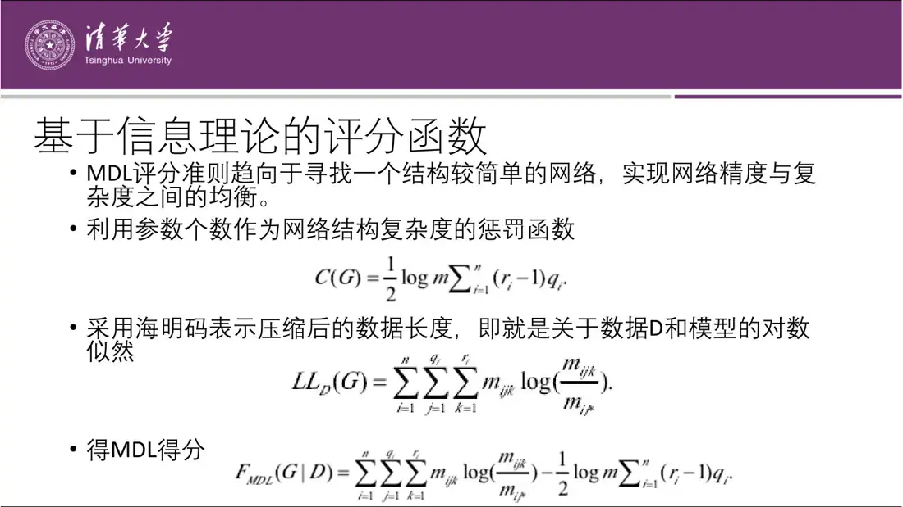

原文：

基于信息理论的评分函数

\- MDL评分准则趋向于寻找一个结构较简单的网络，实现网络精度与复杂度之间的均衡。

\- 利用参数个数作为网络结构复杂度的惩罚函数

$$
C (G) = \frac {1}{2} \log m \sum_ {i = 1} ^ {n} (r _ {i} - 1) q _ {i}.
$$

\- 采用海明码表示压缩后的数据长度，即就是关于数据D和模型的对数似然

$$
L L _ {D} (G) = \sum_ {i = 1} ^ {n} \sum_ {j = 1} ^ {q _ {i}} \sum_ {k = 1} ^ {r _ {i}} m _ {i j k} \log (\frac {m _ {i j k}}{m _ {i j *}}).
$$

\- 得MDL得分

$$
F _ {M D L} (G \mid D) = \sum_ {i = 1} ^ {n} \sum_ {j = 1} ^ {q _ {i}} \sum_ {k = 1} ^ {r _ {i}} m _ {i j k} \log (\frac {m _ {i j k}}{m _ {i j *}}) - \frac {1}{2} \log m \sum_ {i = 1} ^ {n} (r _ {i} - 1) q _ {i}.
$$

Tsinghua University
清華大學

### 基于信息理论的评分函数

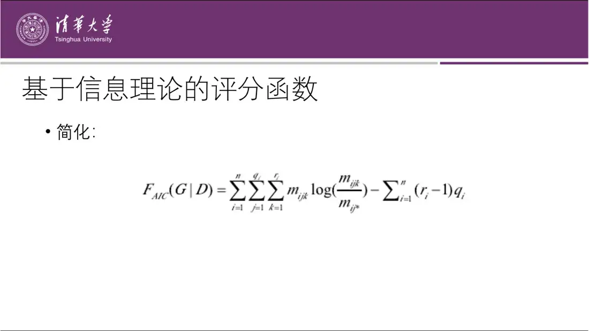

原文：

基于信息理论的评分函数

\- 简化:

$$
F _ {A I C} (G \mid D) = \sum_ {i = 1} ^ {n} \sum_ {j = 1} ^ {q _ {i}} \sum_ {k = 1} ^ {r _ {i}} m _ {i j k} \log (\frac {m _ {i j k}}{m _ {i j *}}) - \sum_ {i = 1} ^ {n} (r _ {i} - 1) q _ {i}
$$

Tsinghua University
清華大學
1911-1911

### 树增广朴素贝叶斯网络分类器

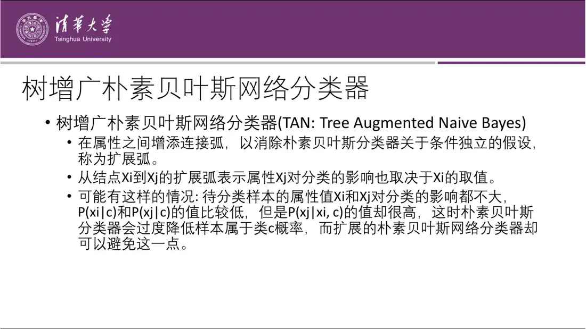

原文：

树增广朴素贝叶斯网络分类器

\- 树增广朴素贝叶斯网络分类器(TAN: Tree Augmented Naive Bayes)
- 在属性之间增添连接弧，以消除朴素贝叶斯分类器关于条件独立的假设，称为扩展弧。

\- 从结点Xi到Xj的扩展弧表示属性Xj对分类的影响也取决于Xi的取值。

\- 可能有这样的情况: 待分类样本的属性值Xi和Xj对分类的影响都不大, P(xi|c)和P(xj|c)的值比较低, 但是P(xj|xi,c)的值却很高, 这时朴素贝叶斯分类器会过度降低样本属于类c概率, 而扩展的朴素贝叶斯网络分类器却可以避免这一点。

Tsinghua University
清華大學
1911-1911

### 树增广朴素贝叶斯网络分类器

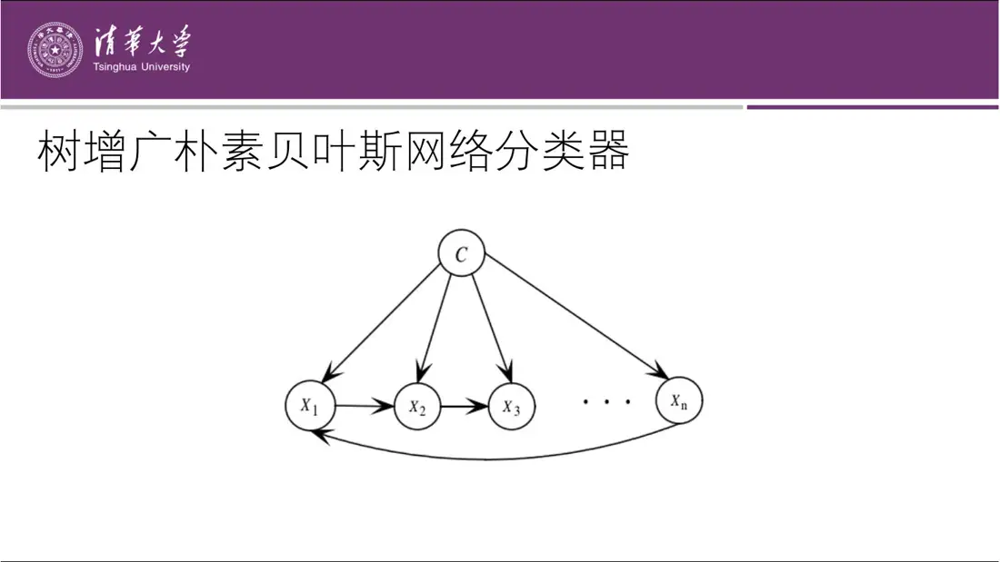

原文：

树增广朴素贝叶斯网络分类器

Tsinghua University
清華大學

### 树增广朴素贝叶斯网络分类器

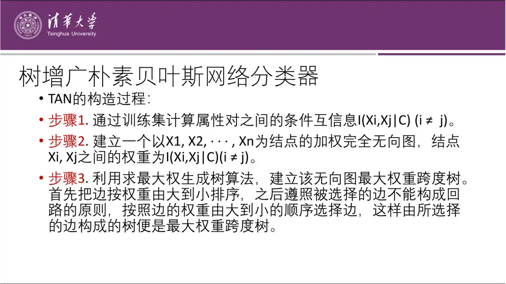

原文：

树增广朴素贝叶斯网络分类器

\- TAN的构造过程:

\- 步骤1. 通过训练集计算属性对之间的条件互信息I(Xi,Xj|C) (i ≠ j)。

\- 步骤2. 建立一个以X1, X2, $\cdots$ , Xn为结点的加权完全无向图，结点Xi, Xj之间的权重为I(Xi,Xj|C)(i≠j)。

\- 步骤3. 利用求最大权生成树算法，建立该无向图最大权重跨度树。首先把边按权重由大到小排序，之后遵照被选择的边不能构成回路的原则，按照边的权重由大到小的顺序选择边，这样由所选择的边构成的树便是最大权重跨度树。

清華大學 Tsinghua University

### 树增广朴素贝叶斯网络分类器

原文：

树增广朴素贝叶斯网络分类器

\- 步骤4. 指定一个属性结点作为根结点，将所有边的方向设置成由根结点指向外，把无向图转换成有向图。

\- 步骤5. 加入类结点C，并添加从C指向每个属性结点Xi的弧。

Tsinghua University
清華大學
1911-

### 平均—依赖估测器

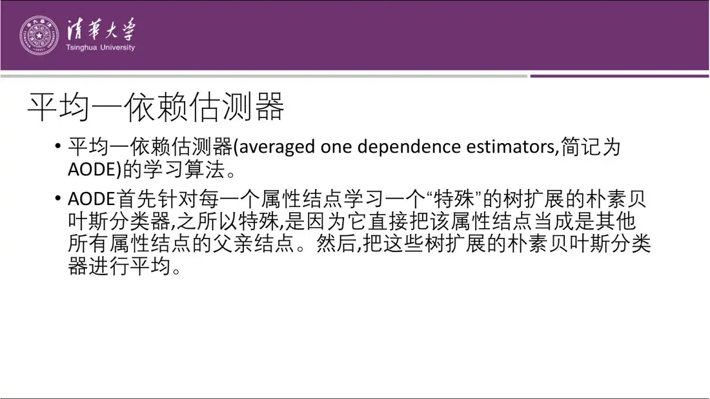

原文：

平均—依赖估测器

\- 平均一依赖估测器(averaged one dependence estimators, 简记为 AODE)的学习算法。

\- AODE首先针对每一个属性结点学习一个“特殊”的树扩展的朴素贝叶斯分类器,之所以特殊,是因为它直接把该属性结点当成是其他所有属性结点的父亲结点。然后,把这些树扩展的朴素贝叶斯分类器进行平均。

Tsinghua University
清華大學

### 平均—依赖估测器

原文：

平均—依赖估测器

清華大學 Tsinghua University

### 平均依赖估测器

原文：

平均依赖估测器

$$
c (x) = \underset {c \in C} {\arg \max} \frac {\sum_ {i = 1 \land F (a _ {i}) \geq 3 0} ^ {m} P (a _ {i} , c) \prod_ {j = 1 \land j \neq i} ^ {m} P (a _ {j} \mid a _ {i} , c)}{n u m P a r e n t}
$$

\- 在AODE模型中,所有的树扩展的朴素贝叶斯分类器对最终分类的贡献是一样的,这似乎不太合理

清華大學 Tsinghua University

### 加权平均—依赖估测器

原文：

加权平均—依赖估测器

\- 加权平均的一依赖估测器(weightily averaged one dependence estimators, 简记WAODE)

Tsinghua University
清華大學
1911-UNIVERSITY
清华大学

### 加权平均--依赖估测器

原文：

加权平均--依赖估测器

\- 加权平均的一依赖估测器(weightily averaged one dependence estimators, 简记WAODE)

$$
c (x) = \underset {c \in C} {\arg \max} \frac {\sum_ {i = 1} ^ {m} W _ {i} P \left(a _ {i} , c\right) \prod_ {j = 1 \wedge j \neq i} ^ {m} P \left(a _ {j} \mid a _ {i} , c\right)}{\sum_ {i = 1} ^ {m} W _ {i}}
$$

$$
W _ {i} = I _ {P} (A _ {i}; C) = \sum_ {a _ {i}, c} P (a _ {i}, c) \log \frac {P (a _ {i} , c)}{P (a _ {i}) P (c)}
$$

清華大學 Tsinghua University

### 贝叶斯算法处理流程：

原文：

贝叶斯算法处理流程：

清華大學 Tsinghua University

### 使用Python 进行文本分类

原文：

使用Python 进行文本分类

\- def loadDataSet():

\- postingList=[[my', 'dog', 'has', 'flea', 'problems', 'help', 'please'],

• ['maybe', 'not', 'take', 'him', 'to', 'dog', 'park', 'stupid'],

• ['my', 'dalmation', 'is', 'so', 'cute', 'I', 'love', 'him'],

• ['stop', 'posting', 'stupid', 'worthless', 'garbage'],

• ['mr', 'licks', 'ate', 'my', 'steak', 'how', 'to', 'stop', 'him'],

• ['quit', 'buying', 'worthless', 'dog', 'food', 'stupid']]

• classVec = [0,1,0,1,0,1] #1 is abusive, 0 not

• return postingList,classVec

Tsinghua University
清華大學

### 使用Python 进行文本分类

原文：

使用Python 进行文本分类

• def createVocabList(dataSet):

\- vocabSet = set([])  # create empty set

• for document in dataSet:

\- vocabSet = vocabSet | set(document) #union of the two sets

• return list(vocabSet)

Tsinghua University
清華大學

### 训练算法：从词向量计算概率

原文：

训练算法：从词向量计算概率

$$
p (c _ {i} | w) = \frac {p (w | c _ {i}) p (c _ {i})}{p (w)}
$$

$$
\mathsf {p} \left(\mathsf {w} _ {0}, \mathsf {w} _ {1}, \mathsf {w} _ {2}.. \mathsf {w} _ {\mathrm{N}} \mid \mathsf {c} _ {\mathrm{i}}\right). \quad \Longrightarrow \quad \mathsf {p} \left(\mathsf {w} _ {0} \mid \mathsf {c} _ {\mathrm{i}}\right) \mathsf {p} \left(\mathsf {w} _ {1} \mid \mathsf {c} _ {\mathrm{i}}\right) \mathsf {p} \left(\mathsf {w} _ {2} \mid \mathsf {c} _ {\mathrm{i}}\right) \dots \mathsf {p} \left(\mathsf {w} _ {\mathrm{N}} \mid \mathsf {c} _ {\mathrm{i}}\right)
$$

\- def trainNB0(trainMatrix,trainCategory):

\- numTrainDocs = len(trainMatrix)

\- numWords = len(trainMatrix[0])

• pAbusive = sum(trainCategory)/float(numTrainDocs)

• p0Num = ones(numWords); p1Num = ones(numWords) #change to ones()

• p0Denom = 2.0; p1Denom = 2.0

change to 2.0

清華大學 Tsinghua University

### 训练算法：从词向量计算概率

原文：

训练算法：从词向量计算概率

• for i in range(numTrainDocs):

• if trainCategory[i] == 1:

• p1Num += trainMatrix[i]

• p1Denom += sum(trainMatrix[i])

\- else:

• p0Num += trainMatrix[i]

• p0Denom += sum(trainMatrix[i])

• p1Vect = log(p1Num/p1Denom) #change to log()

• p0Vect = log(p0Num/p0Denom) #change to log()

• return p0Vect,p1Vect,pAbusive

清華大學 Tsinghua University

### 测试和使用算法

原文：

测试和使用算法

\- def classifyNB(vec2Classify, p0Vec, p1Vec, pClass1):

• p1 = sum(vec2Classify \* p1Vec) + log(pClass1) #element-wise mult

• p0 = sum(vec2Classify \* p0Vec) + log(1.0 - pClass1)

• if p1 > p0:

\- return 1

\- else:

\- return 0

Tsinghua University
清華大學
1911-1911

### 测试算法和修改分类器

原文：

测试算法和修改分类器

清華大學 Tsinghua University

### 测试算法和修改分类器

原文：

测试算法和修改分类器

\- def testingNB():

• listOPosts, listClasses = loadDataSet()

• myVocabList = createVocabList(listOPosts)

\- trainMat=[]

• for postinDoc in listOPosts:

• trainMat.append(setOfWords2Vec(myVocabList, postinDoc))

• p0V,p1V,pAb = trainNBO(array(trainMat),array(listClasses))

• testEntry = ['love', 'my', 'dalmation']

\- thisDoc = array(setOfWords2Vec(myVocabList, testEntry))

• print testEntry,'classified as: ',classifyNB(thisDoc,p0V,p1V,pAb)

• testEntry = ['stupid', 'garbage']

\- thisDoc = array(setOfWords2Vec(myVocabList, testEntry))

• print testEntry,'classified as: ',classifyNB(thisDoc,p0V,p1V,pAb)

Tsinghua University
清華大學

### 文档词袋模型

原文：

文档词袋模型

Tsinghua University
清華大學

### 切分文本

原文：

切分文本

Tsinghua University
清華大學
TSINGHUA UNIVERSITY
1911
清華大學
TSINGHUA UNIVERSITY

### 使用朴素贝叶斯方法进行交叉验证

原文：

使用朴素贝叶斯方法进行交叉验证

\- Def spamTest():

• docList=[]; classList = []; fullText = []

• for i in range(1,26):

• wordList = textParse(open('email/spam/%d.txt' % i).read())

• docList.append(wordList)

• fullText.extend(wordList)

• classList.append(1)

• wordList = textParse(open('email/ham/%d.txt' % i).read())

• docList.append(wordList)

• fullText.extend(wordList)

• classList.append(0)

\- vocabList = createVocabList(docList)#create vocabulary

\- trainingSet = range(50); testSet=[] #create test set

清華大學 Tsinghua University

### 使用朴素贝叶斯方法进行交叉验证

原文：

使用朴素贝叶斯方法进行交叉验证

Tsinghua University
清華大學
TSINGHUA UNIVERSITY
1911
清華大學
TSINGHUA UNIVERSITY

### RSS的使用：从RSS源收集数据

原文：

RSS的使用：从RSS源收集数据

\- Feedparser的安装 http://code.google.com/p/feedparser/

\- 下载

\- 网络学堂

\- 安装：python setup.py install

清華大學 Tsinghua University

### RSS的使用：从RSS源收集数据

原文：

RSS的使用：从RSS源收集数据

\- 高频词去除

Tsinghua University
清華大學
Tsinghua University

### RSS的使用：从RSS源收集数据

原文：

RSS的使用：从RSS源收集数据

- 两个RSS源作为参数

Tsinghua University
清華大學
Tsinghua University

### RSS的使用：从RSS源收集数据

原文：

RSS的使用：从RSS源收集数据

清華大學 Tsinghua University

### RSS的使用：从RSS源收集数据

原文：

RSS的使用：从RSS源收集数据

Tsinghua University
清華大學
Tsinghua University

### RSS的使用：从RSS源收集数据

原文：

RSS的使用：从RSS源收集数据

\- 问题:

\- 高频次设定的阈值对正确率的影响

\- 消除各种语言的高频词

http://www.ranks.nl/resources/stopwords.html

Tsinghua University
清華大學
Tsinghua University

### 分析数据：显示地域相关的用词

原文：

分析数据：显示地域相关的用词

Tsinghua University
清華大學
TSINGHUA UNIVERSITY
1911
清華大學
TSINGHUA UNIVERSITY

### 实验作业三

原文：

实验作业三

\- 见参考文献。

Tsinghua University
清華大學

### • Q&A?

原文：

• Q&A?

Tsinghua University
清華大學
