# 《统计学习方法》第5章 决策树（课件）

原件的每一页，下面附识别出的文字。

### 第五章 决策树

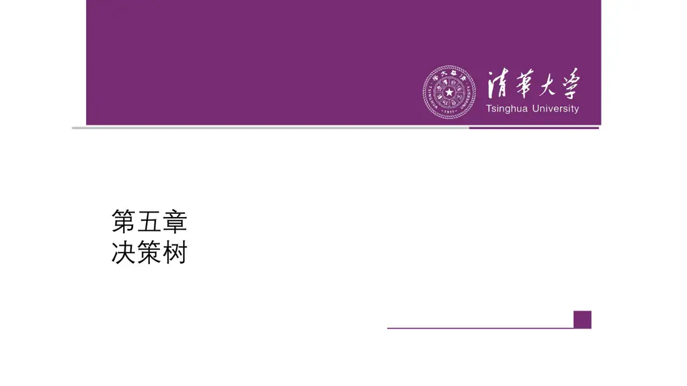

原文：

第五章 决策树

大華洋
TSINGHUA UNIVERSITY
清華大學
Tsinghua University

### 例子

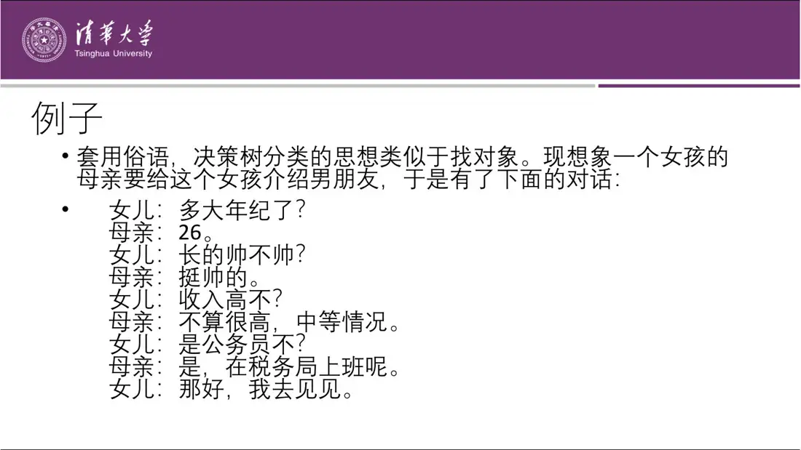

原文：

例子

\- 套用俗语，决策树分类的思想类似于找对象。现想象一个女孩的母亲要给这个女孩介绍男朋友，于是有了下面的对话：

\- 女儿：多大年纪了？

母亲：26。

女儿：长的帅不帅？

母亲：挺帅的。

女儿：收入高不？

母亲：不算很高，中等情况。

女儿：是公务员不？

母亲：是，在税务局上班呢。

女儿：那好，我去见见。

Tsinghua University
清華大學

### 例子

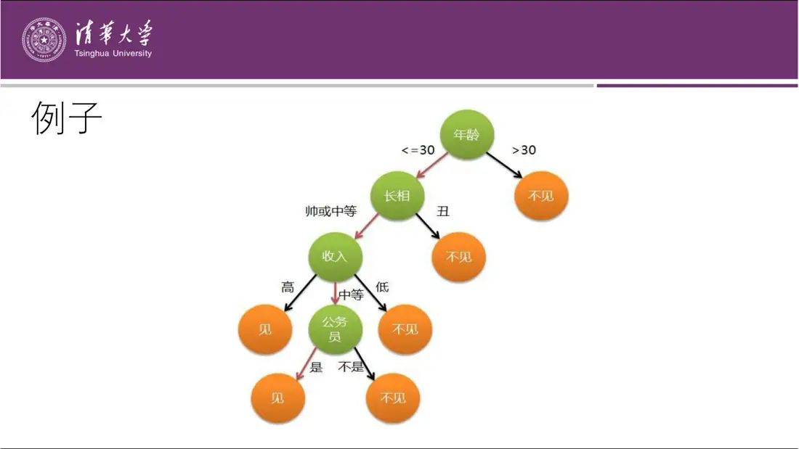

原文：

例子

清華大學 Tsinghua University

### 决策树

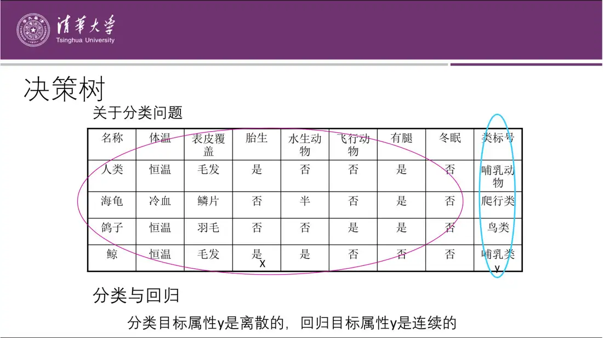

原文：

决策树

关于分类问题

<table><tr><td>名称</td><td>体温</td><td>表皮覆盖</td><td>胎生</td><td>水生动物</td><td>飞行动物</td><td>有腿</td><td>冬眠</td><td>类标号</td></tr><tr><td>人类</td><td>恒温</td><td>毛发</td><td>是</td><td>否</td><td>否</td><td>是</td><td>否</td><td>哺乳动物</td></tr><tr><td>海龟</td><td>冷血</td><td>鳞片</td><td>否</td><td>半</td><td>否</td><td>是</td><td>否</td><td>爬行类</td></tr><tr><td>鸽子</td><td>恒温</td><td>羽毛</td><td>否</td><td>否</td><td>是</td><td>是</td><td>否</td><td>鸟类</td></tr><tr><td>鲸</td><td>恒温</td><td>毛发</td><td>是X</td><td>是</td><td>否</td><td>否</td><td>否</td><td>哺乳类</td></tr></table>

分类与回归

分类目标属性y是离散的，回归目标属性y是连续的

清華大學 Tsinghua University

### 决策树-解决分类问题的一般方法

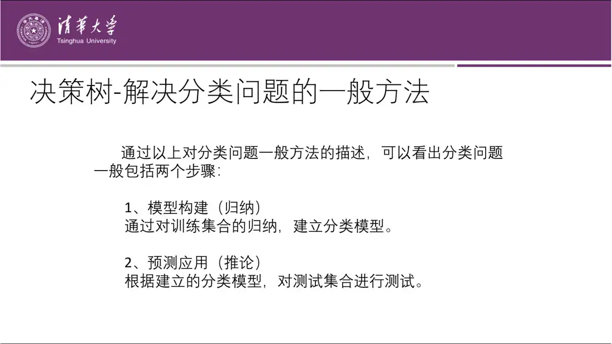

原文：

决策树-解决分类问题的一般方法

通过以上对分类问题一般方法的描述，可以看出分类问题一般包括两个步骤：

1、模型构建（归纳）

通过对训练集合的归纳，建立分类模型。

2、预测应用（推论）

根据建立的分类模型，对测试集合进行测试。

清華大學 Tsinghua University

### 决策树-解决分类问题的一般方法

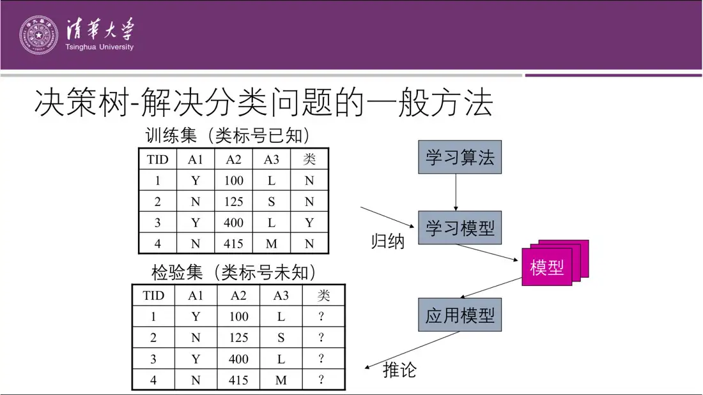

原文：

决策树-解决分类问题的一般方法

训练集（类标号已知）

<table><tr><td>TID</td><td>A1</td><td>A2</td><td>A3</td><td>类</td></tr><tr><td>1</td><td>Y</td><td>100</td><td>L</td><td>N</td></tr><tr><td>2</td><td>N</td><td>125</td><td>S</td><td>N</td></tr><tr><td>3</td><td>Y</td><td>400</td><td>L</td><td>Y</td></tr><tr><td>4</td><td>N</td><td>415</td><td>M</td><td>N</td></tr></table>

检验集（类标号未知）

<table><tr><td>TID</td><td>A1</td><td>A2</td><td>A3</td><td>类</td></tr><tr><td>1</td><td>Y</td><td>100</td><td>L</td><td>?</td></tr><tr><td>2</td><td>N</td><td>125</td><td>S</td><td>?</td></tr><tr><td>3</td><td>Y</td><td>400</td><td>L</td><td>?</td></tr><tr><td>4</td><td>N</td><td>415</td><td>M</td><td>?</td></tr></table>

清華大學 Tsinghua University

### 决策树

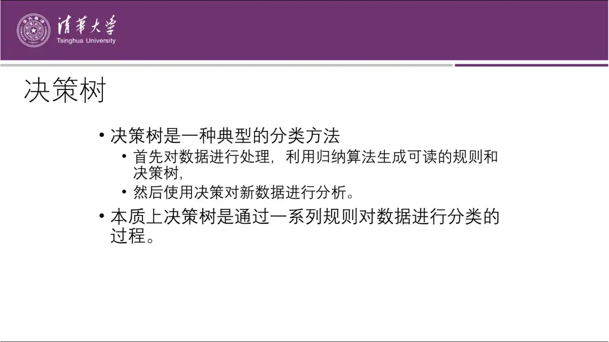

原文：

决策树

- 决策树是一种典型的分类方法

\- 首先对数据进行处理，利用归纳算法生成可读的规则和决策树，

\- 然后使用决策对新数据进行分析。

\- 本质上决策树是通过一系列规则对数据进行分类的过程。

清華大學 Tsinghua University

### 决策树

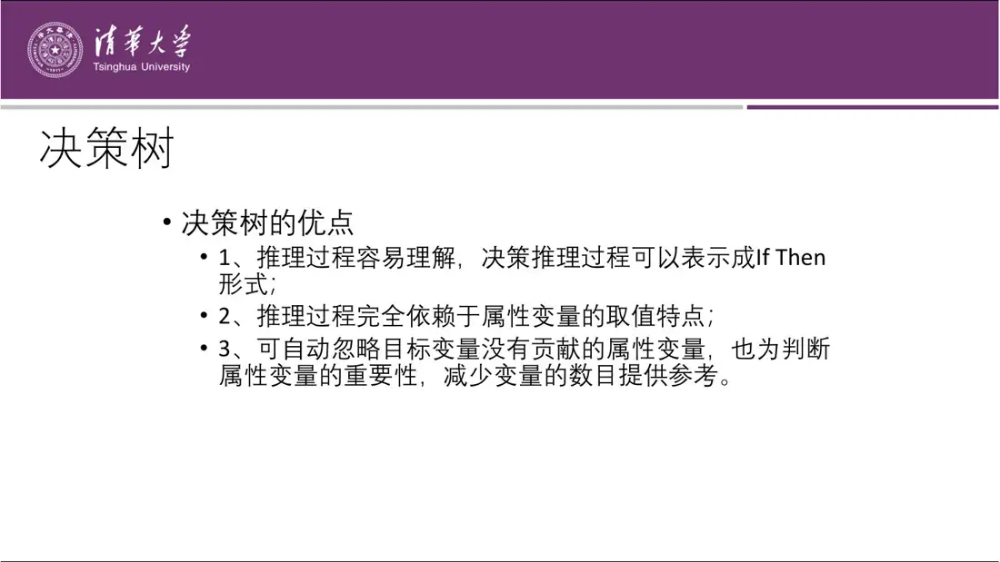

原文：

决策树

\- 决策树的优点

• 1、推理过程容易理解，决策推理过程可以表示成If Then形式；

\- 2、推理过程完全依赖于属性变量的取值特点；

• 3、可自动忽略目标变量没有贡献的属性变量，也为判断属性变量的重要性，减少变量的数目提供参考。

清華大學 Tsinghua University

### 决策树和归纳算法

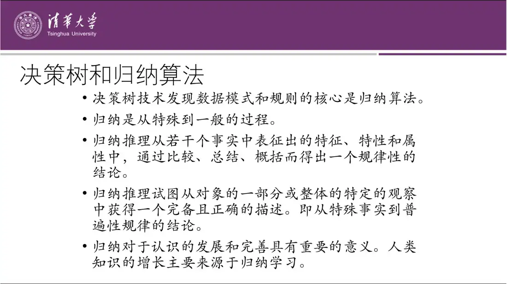

原文：

决策树和归纳算法

\- 决策树技术发现数据模式和规则的核心是归纳算法。

\- 归纳是从特殊到一般的过程。

\- 归纳推理从若干个事实中表征出的特征、特性和属性中，通过比较、总结、概括而得出一个规律性的结论。

\- 归纳推理试图从对象的一部分或整体的特定的观察中获得一个完备且正确的描述。即从特殊事实到普遍性规律的结论。

\- 归纳对于认识的发展和完善具有重要的意义。人类知识的增长主要来源于归纳学习。

清華大學 Tsinghua University

### 决策树和归纳算法

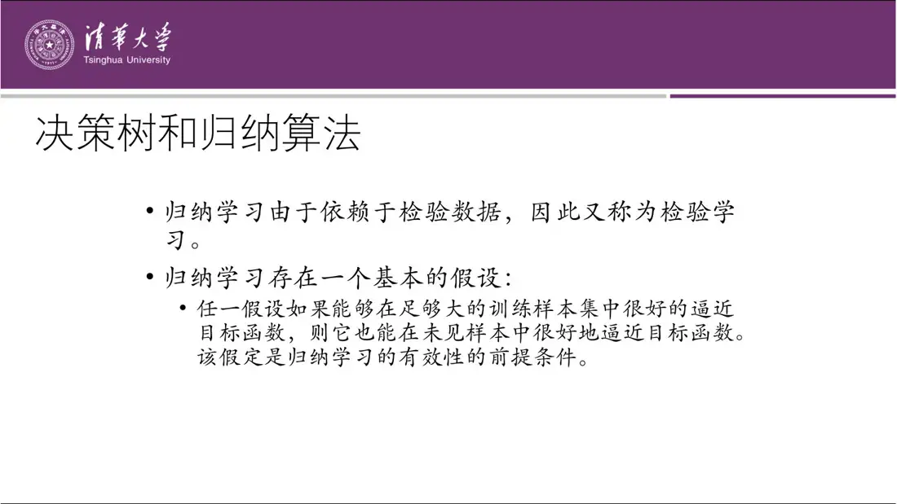

原文：

决策树和归纳算法

\- 归纳学习由于依赖于检验数据，因此又称为检验学习。

\- 归纳学习存在一个基本的假设：

\- 任一假设如果能够在足够大的训练样本集中很好的逼近目标函数，则它也能在未见样本中很好地逼近目标函数。该假定是归纳学习的有效性的前提条件。

Tsinghua University
清華大學
1911-1911

### 决策树和归纳算法

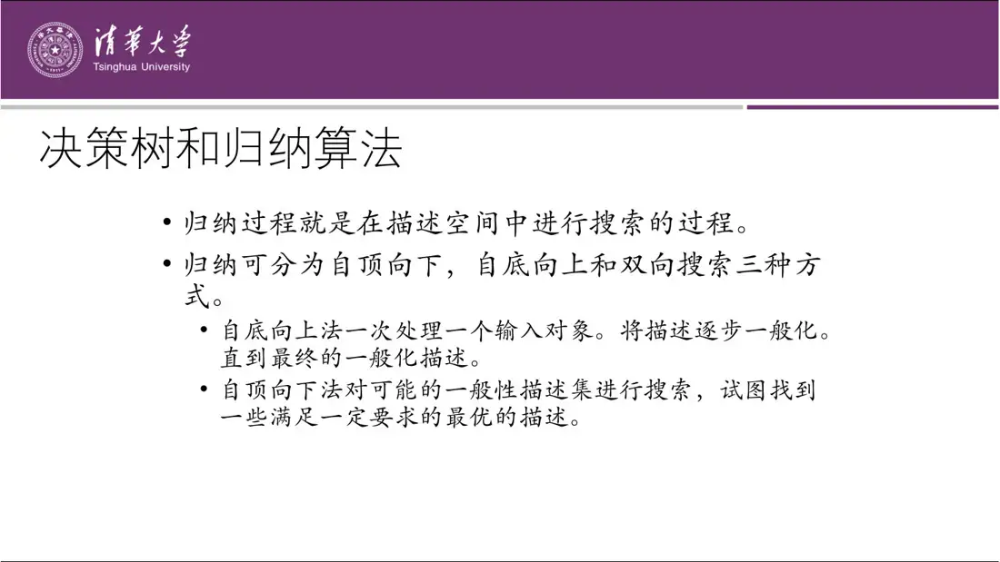

原文：

决策树和归纳算法

\- 归纳过程就是在描述空间中进行搜索的过程。

\- 归纳可分为自顶向下，自底向上和双向搜索三种方式。

\- 自底向上法一次处理一个输入对象。将描述逐步一般化。直到最终的一般化描述。

\- 自顶向下法对可能的一般性描述集进行搜索，试图找到一些满足一定要求的最优的描述。

Tsinghua University
清華大學
1911-1911

### 决策树-从机器学习看分类及归纳推理等问题

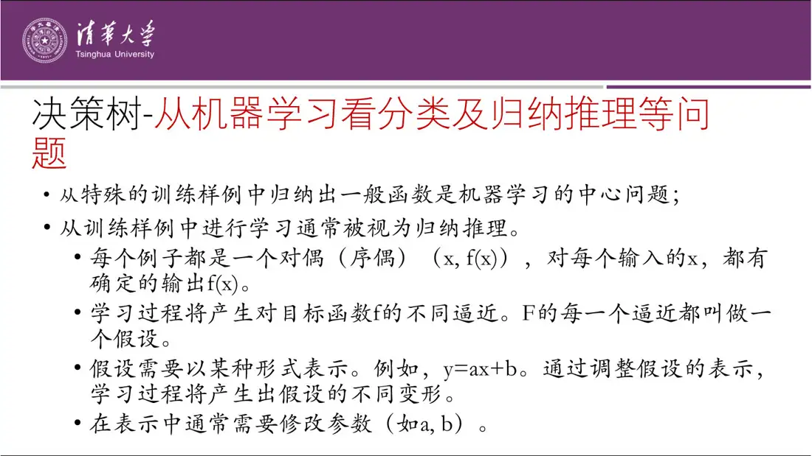

原文：

决策树-从机器学习看分类及归纳推理等问题

· 从特殊的训练样例中归纳出一般函数是机器学习的中心问题;

\- 从训练样例中进行学习通常被视为归纳推理。

\- 每个例子都是一个对偶（序偶）（x, f(x)），对每个输入的x，都有确定的输出f(x)。

\- 学习过程将产生对目标函数f的不同逼近。F的每一个逼近都叫做一个假设。

\- 假设需要以某种形式表示。例如， $y = ax + b$ 。通过调整假设的表示，学习过程将产生出假设的不同变形。

\- 在表示中通常需要修改参数（如a, b）。

清華大學 Tsinghua University

### 决策树-从机器学习看分类及归纳推理等问题

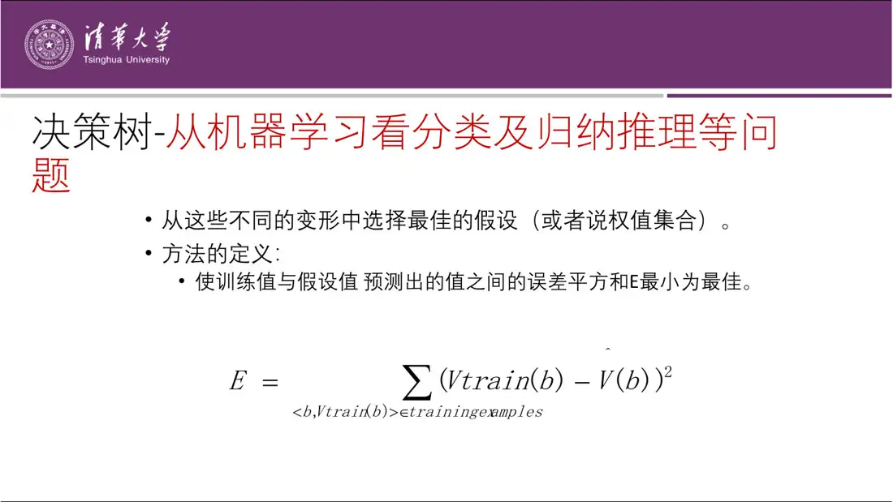

原文：

决策树-从机器学习看分类及归纳推理等问题

\- 从这些不同的变形中选择最佳的假设（或者说权值集合）。

\- 方法的定义:

\- 使训练值与假设值预测出的值之间的误差平方和E最小为最佳。

$$
E = \sum_ {<   b, V t r a i n (b) > \in t r a i n i n g e x a m p l e s} (V t r a i n (b) - V (b)) ^ {2}
$$

清華大學 Tsinghua University

### 决策树算法

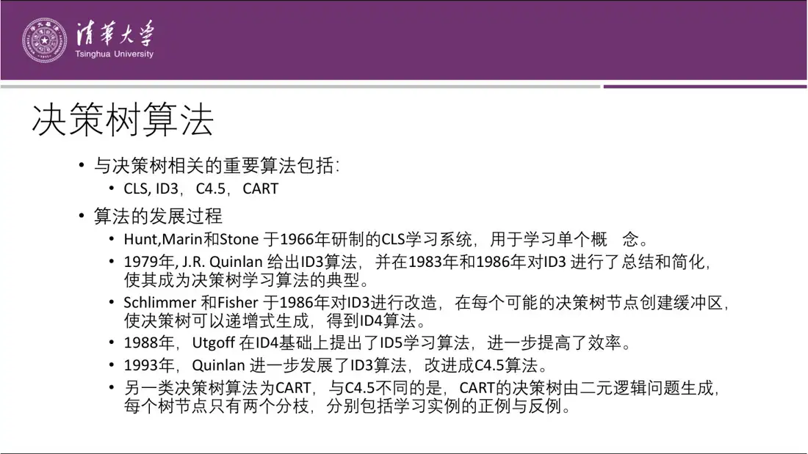

原文：

决策树算法

\- 与决策树相关的重要算法包括:
- CLS, ID3, C4.5, CART

\- 算法的发展过程

\- Hunt,Marin和Stone于1966年研制的CLS学习系统，用于学习单个概念。

\- 1979年, J.R. Quinlan 给出ID3算法，并在1983年和1986年对ID3进行了总结和简化，使其成为决策树学习算法的典型。

\- Schlimmer 和Fisher 于1986年对ID3进行改造，在每个可能的决策树节点创建缓冲区，使决策树可以递增式生成，得到ID4算法。

\- 1988年，Utgoff在ID4基础上提出了ID5学习算法，进一步提高了效率。

\- 1993年，Quinlan 进一步发展了ID3算法，改进成C4.5算法。

\- 另一类决策树算法为CART，与C4.5不同的是，CART的决策树由二元逻辑问题生成，每个树节点只有两个分枝，分别包括学习实例的正例与反例。

Tsinghua University
清華大學

### 决策树算法

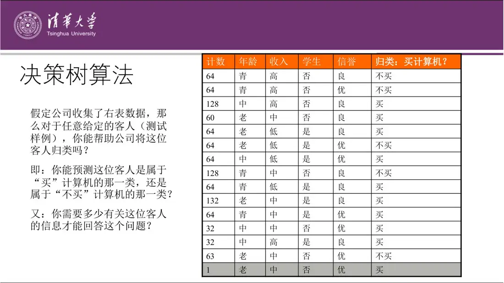

原文：

决策树算法

假定公司收集了右表数据，那么对于任意给定的客人（测试样例），你能帮助公司将这位客人归类吗？

即：你能预测这位客人是属于“买”计算机的那一类，还是属于“不买”计算机的那一类？

又：你需要多少有关这位客人的信息才能回答这个问题？

<table><tr><td>计数</td><td>年龄</td><td>收入</td><td>学生</td><td>信誉</td><td>归类:买计算机?</td></tr><tr><td>64</td><td>青</td><td>高</td><td>否</td><td>良</td><td>不买</td></tr><tr><td>64</td><td>青</td><td>高</td><td>否</td><td>优</td><td>不买</td></tr><tr><td>128</td><td>中</td><td>高</td><td>否</td><td>良</td><td>买</td></tr><tr><td>60</td><td>老</td><td>中</td><td>否</td><td>良</td><td>买</td></tr><tr><td>64</td><td>老</td><td>低</td><td>是</td><td>良</td><td>买</td></tr><tr><td>64</td><td>老</td><td>低</td><td>是</td><td>优</td><td>不买</td></tr><tr><td>64</td><td>中</td><td>低</td><td>是</td><td>优</td><td>买</td></tr><tr><td>128</td><td>青</td><td>中</td><td>否</td><td>良</td><td>不买</td></tr><tr><td>64</td><td>青</td><td>低</td><td>是</td><td>良</td><td>买</td></tr><tr><td>132</td><td>老</td><td>中</td><td>是</td><td>良</td><td>买</td></tr><tr><td>64</td><td>青</td><td>中</td><td>是</td><td>优</td><td>买</td></tr><tr><td>32</td><td>中</td><td>中</td><td>否</td><td>优</td><td>买</td></tr><tr><td>32</td><td>中</td><td>高</td><td>是</td><td>良</td><td>买</td></tr><tr><td>63</td><td>老</td><td>中</td><td>否</td><td>优</td><td>不买</td></tr><tr><td>1</td><td>老</td><td>中</td><td>否</td><td>优</td><td>买</td></tr></table>

清華大學 Tsinghua University

### 决策树算法

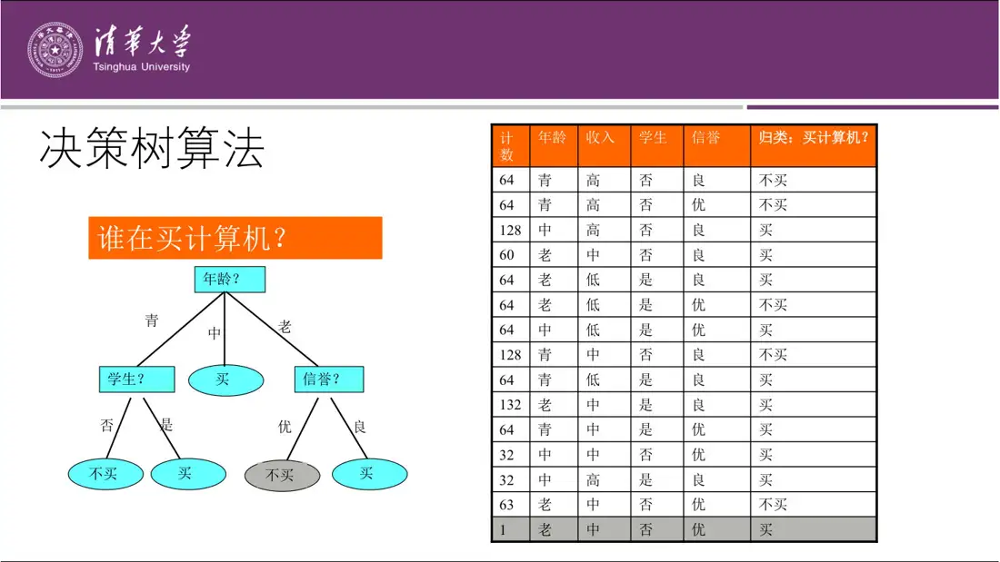

原文：

决策树算法

谁在买计算机？

<table><tr><td>计数</td><td>年龄</td><td>收入</td><td>学生</td><td>信誉</td><td>归类:买计算机?</td></tr><tr><td>64</td><td>青</td><td>高</td><td>否</td><td>良</td><td>不买</td></tr><tr><td>64</td><td>青</td><td>高</td><td>否</td><td>优</td><td>不买</td></tr><tr><td>128</td><td>中</td><td>高</td><td>否</td><td>良</td><td>买</td></tr><tr><td>60</td><td>老</td><td>中</td><td>否</td><td>良</td><td>买</td></tr><tr><td>64</td><td>老</td><td>低</td><td>是</td><td>良</td><td>买</td></tr><tr><td>64</td><td>老</td><td>低</td><td>是</td><td>优</td><td>不买</td></tr><tr><td>64</td><td>中</td><td>低</td><td>是</td><td>优</td><td>买</td></tr><tr><td>128</td><td>青</td><td>中</td><td>否</td><td>良</td><td>不买</td></tr><tr><td>64</td><td>青</td><td>低</td><td>是</td><td>良</td><td>买</td></tr><tr><td>132</td><td>老</td><td>中</td><td>是</td><td>良</td><td>买</td></tr><tr><td>64</td><td>青</td><td>中</td><td>是</td><td>优</td><td>买</td></tr><tr><td>32</td><td>中</td><td>中</td><td>否</td><td>优</td><td>买</td></tr><tr><td>32</td><td>中</td><td>高</td><td>是</td><td>良</td><td>买</td></tr><tr><td>63</td><td>老</td><td>中</td><td>否</td><td>优</td><td>不买</td></tr><tr><td>1</td><td>老</td><td>中</td><td>否</td><td>优</td><td>买</td></tr></table>

清華大學 Tsinghua University

### 决策树算法

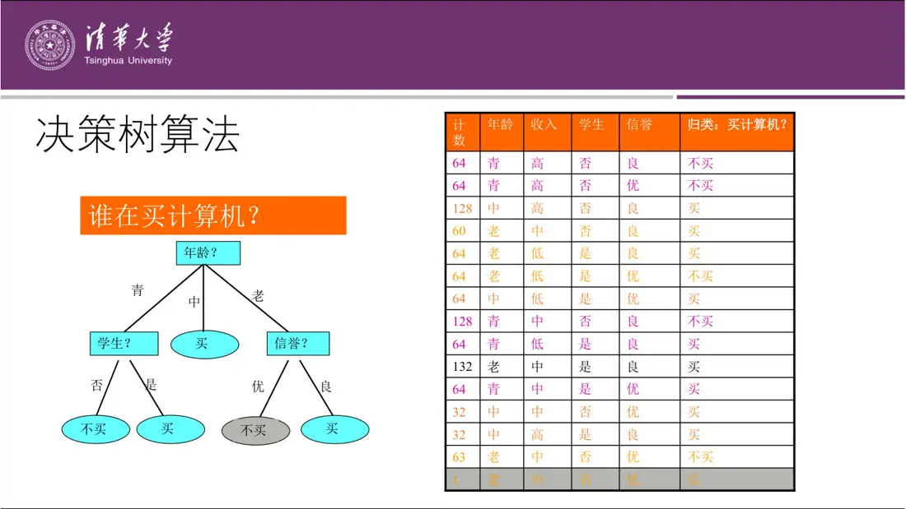

原文：

决策树算法

谁在买计算机？

<table><tr><td>计数</td><td>年龄</td><td>收入</td><td>学生</td><td>信誉</td><td>归类:买计算机?</td></tr><tr><td>64</td><td>青</td><td>高</td><td>否</td><td>良</td><td>不买</td></tr><tr><td>64</td><td>青</td><td>高</td><td>否</td><td>优</td><td>不买</td></tr><tr><td>128</td><td>中</td><td>高</td><td>否</td><td>良</td><td>买</td></tr><tr><td>60</td><td>老</td><td>中</td><td>否</td><td>良</td><td>买</td></tr><tr><td>64</td><td>老</td><td>低</td><td>是</td><td>良</td><td>买</td></tr><tr><td>64</td><td>老</td><td>低</td><td>是</td><td>优</td><td>不买</td></tr><tr><td>64</td><td>中</td><td>低</td><td>是</td><td>优</td><td>买</td></tr><tr><td>128</td><td>青</td><td>中</td><td>否</td><td>良</td><td>不买</td></tr><tr><td>64</td><td>青</td><td>低</td><td>是</td><td>良</td><td>买</td></tr><tr><td>132</td><td>老</td><td>中</td><td>是</td><td>良</td><td>买</td></tr><tr><td>64</td><td>青</td><td>中</td><td>是</td><td>优</td><td>买</td></tr><tr><td>32</td><td>中</td><td>中</td><td>否</td><td>优</td><td>买</td></tr><tr><td>32</td><td>中</td><td>高</td><td>是</td><td>良</td><td>买</td></tr><tr><td>63</td><td>老</td><td>中</td><td>否</td><td>优</td><td>不买</td></tr><tr><td>1</td><td>老</td><td>中</td><td>否</td><td>优</td><td>买</td></tr></table>

清華大學 Tsinghua University

### 决策树的表示

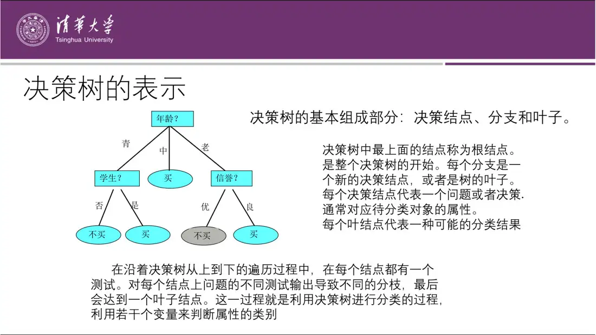

原文：

决策树的表示

决策树的基本组成部分：决策结点、分支和叶子。

决策树中最上面的结点称为根结点。是整个决策树的开始。每个分支是一个新的决策结点，或者是树的叶子。每个决策结点代表一个问题或者决策。通常对应待分类对象的属性。每个叶结点代表一种可能的分类结果

在沿着决策树从上到下的遍历过程中，在每个结点都有一个测试。对每个结点上问题的不同测试输出导致不同的分枝，最后会达到一个叶子结点。这一过程就是利用决策树进行分类的过程，利用若干个变量来判断属性的类别

清華大學 Tsinghua University

### 决策树与条件概率分布

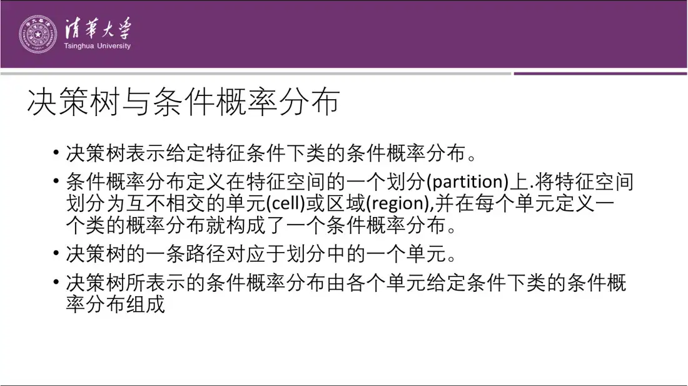

原文：

决策树与条件概率分布

\- 决策树表示给定特征条件下类的条件概率分布。

\- 条件概率分布定义在特征空间的一个划分(partition)上.将特征空间划分为互不相交的单元(cell)或区域(region),并在每个单元定义一个类的概率分布就构成了一个条件概率分布。

\- 决策树的一条路径对应于划分中的一个单元。

\- 决策树所表示的条件概率分布由各个单元给定条件下类的条件概率分布组成

Tsinghua University
清華大學

### 决策树与条件概率分布

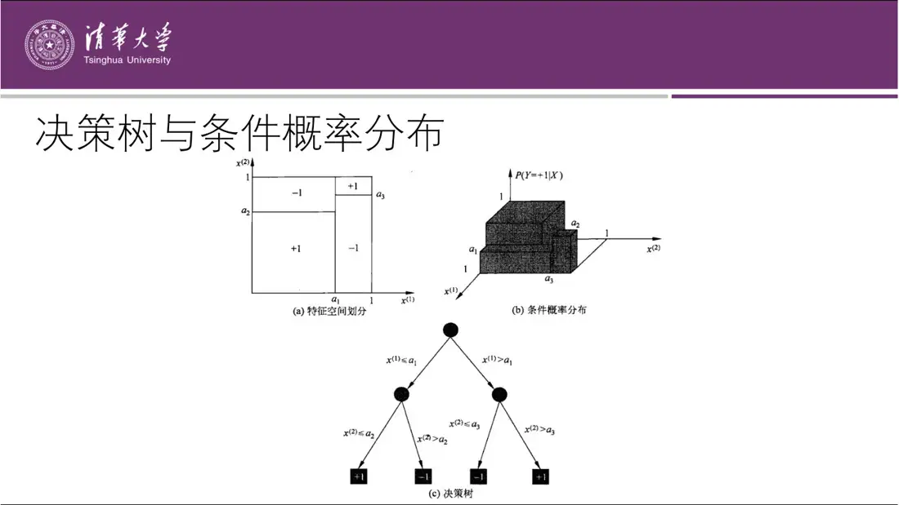

原文：

决策树与条件概率分布

Tsinghua University
清華大學
1911-UNIVERSITY

### 决策树与条件概率分布

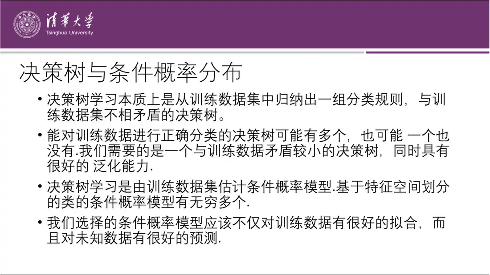

原文：

决策树与条件概率分布

\- 决策树学习本质上是从训练数据集中归纳出一组分类规则，与训练数据集不相矛盾的决策树。

\- 能对训练数据进行正确分类的决策树可能有多个，也可能一个也没有。我们需要的是一个与训练数据矛盾较小的决策树，同时具有很好的泛化能力。

\- 决策树学习是由训练数据集估计条件概率模型.基于特征空间划分的类的条件概率模型有无穷多个.

\- 我们选择的条件概率模型应该不仅对训练数据有很好的拟合，而且对未知数据有很好的预测.

Tsinghua University
清華大學
1911-1911

### 决策树CLS算法

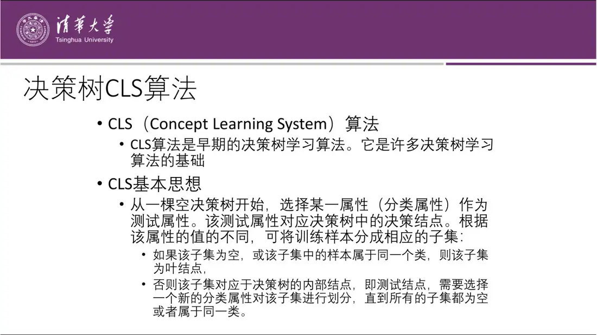

原文：

决策树CLS算法

\- CLS（Concept Learning System）算法

\- CLS算法是早期的决策树学习算法。它是许多决策树学习算法的基础

\- CLS基本思想

\- 从一棵空决策树开始，选择某一属性（分类属性）作为测试属性。该测试属性对应决策树中的决策结点。根据该属性的值的不同，可将训练样本分成相应的子集：

\- 如果该子集为空，或该子集中的样本属于同一个类，则该子集为叶结点，

\- 否则该子集对应于决策树的内部结点，即测试结点，需要选择一个新的分类属性对该子集进行划分，直到所有的子集都为空或者属于同一类。

清華大學 Tsinghua University

### 决策树CLS算法

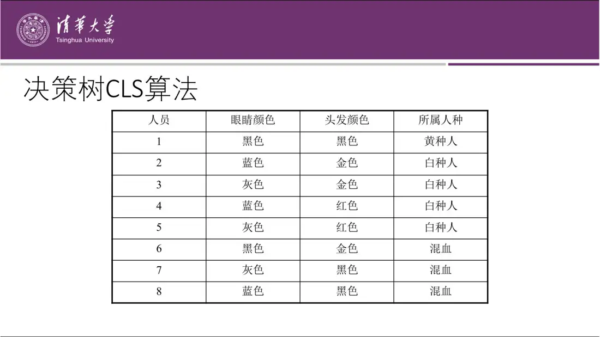

原文：

决策树CLS算法

<table><tr><td>人员</td><td>眼睛颜色</td><td>头发颜色</td><td>所属人种</td></tr><tr><td>1</td><td>黑色</td><td>黑色</td><td>黄种人</td></tr><tr><td>2</td><td>蓝色</td><td>金色</td><td>白种人</td></tr><tr><td>3</td><td>灰色</td><td>金色</td><td>白种人</td></tr><tr><td>4</td><td>蓝色</td><td>红色</td><td>白种人</td></tr><tr><td>5</td><td>灰色</td><td>红色</td><td>白种人</td></tr><tr><td>6</td><td>黑色</td><td>金色</td><td>混血</td></tr><tr><td>7</td><td>灰色</td><td>黑色</td><td>混血</td></tr><tr><td>8</td><td>蓝色</td><td>黑色</td><td>混血</td></tr></table>

Tsinghua University
清華大學
1911-UNIVERSITY

### 决策树CLS算法

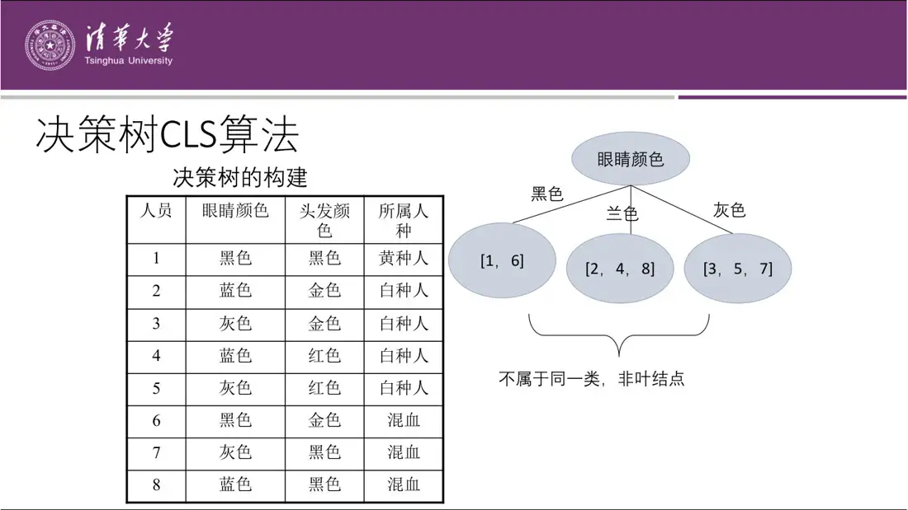

原文：

决策树CLS算法

决策树的构建

<table><tr><td>人员</td><td>眼睛颜色</td><td>头发颜色</td><td>所属人种</td></tr><tr><td>1</td><td>黑色</td><td>黑色</td><td>黄种人</td></tr><tr><td>2</td><td>蓝色</td><td>金色</td><td>白种人</td></tr><tr><td>3</td><td>灰色</td><td>金色</td><td>白种人</td></tr><tr><td>4</td><td>蓝色</td><td>红色</td><td>白种人</td></tr><tr><td>5</td><td>灰色</td><td>红色</td><td>白种人</td></tr><tr><td>6</td><td>黑色</td><td>金色</td><td>混血</td></tr><tr><td>7</td><td>灰色</td><td>黑色</td><td>混血</td></tr><tr><td>8</td><td>蓝色</td><td>黑色</td><td>混血</td></tr></table>

清華大學 Tsinghua University

### 决策树CLS算法

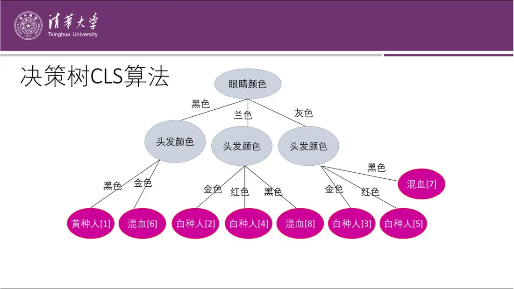

原文：

决策树CLS算法

眼睛颜色

黑色

头发颜色

清華大學 Tsinghua University

### 决策树CLS算法

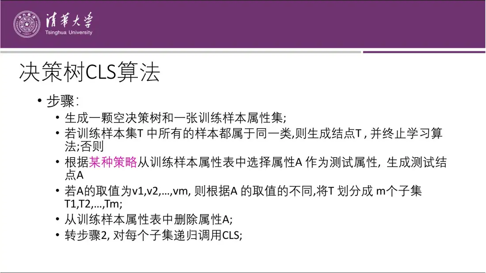

原文：

决策树CLS算法

\- 步骤:

\- 生成一颗空决策树和一张训练样本属性集;

\- 若训练样本集T中所有的样本都属于同一类,则生成结点T,并终止学习算法;否则

\- 根据某种策略从训练样本属性表中选择属性A作为测试属性，生成测试结点A

\- 若A的取值为v1,v2,...,vm, 则根据A 的取值的不同,将T 划分成 m 个子集 T1,T2,...,Tm;

\- 从训练样本属性表中删除属性A;

\- 转步骤2, 对每个子集递归调用CLS;

Tsinghua University
清華大學

### 决策树CLS算法

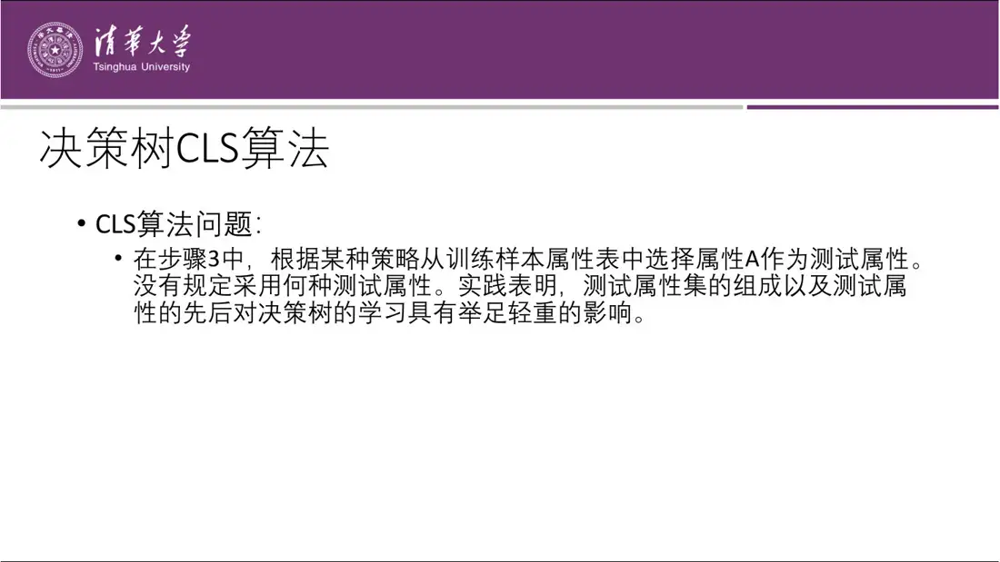

原文：

决策树CLS算法

\- CLS算法问题:

\- 在步骤3中，根据某种策略从训练样本属性表中选择属性A作为测试属性。没有规定采用何种测试属性。实践表明，测试属性集的组成以及测试属性的先后对决策树的学习具有举足轻重的影响。

Tsinghua University
清華大學
1911-1911

### 决策树CLS算法

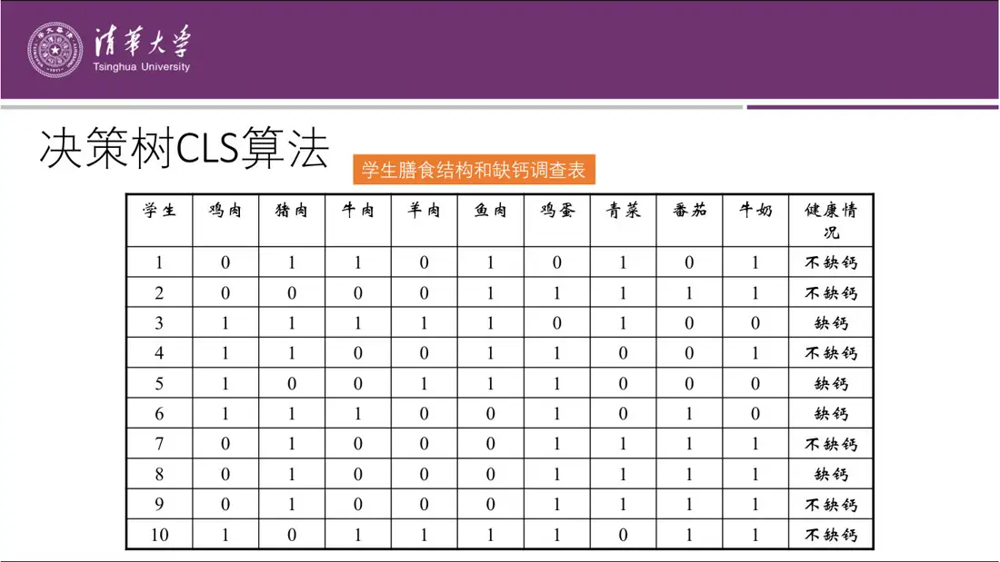

原文：

决策树CLS算法

学生膳食结构和缺钙调查表
<table><tr><td>学生</td><td>鸡肉</td><td>猪肉</td><td>牛肉</td><td>羊肉</td><td>鱼肉</td><td>鸡蛋</td><td>青菜</td><td>番茄</td><td>牛奶</td><td>健康情况</td></tr><tr><td>1</td><td>0</td><td>1</td><td>1</td><td>0</td><td>1</td><td>0</td><td>1</td><td>0</td><td>1</td><td>不缺钙</td></tr><tr><td>2</td><td>0</td><td>0</td><td>0</td><td>0</td><td>1</td><td>1</td><td>1</td><td>1</td><td>1</td><td>不缺钙</td></tr><tr><td>3</td><td>1</td><td>1</td><td>1</td><td>1</td><td>1</td><td>0</td><td>1</td><td>0</td><td>0</td><td>缺钙</td></tr><tr><td>4</td><td>1</td><td>1</td><td>0</td><td>0</td><td>1</td><td>1</td><td>0</td><td>0</td><td>1</td><td>不缺钙</td></tr><tr><td>5</td><td>1</td><td>0</td><td>0</td><td>1</td><td>1</td><td>1</td><td>0</td><td>0</td><td>0</td><td>缺钙</td></tr><tr><td>6</td><td>1</td><td>1</td><td>1</td><td>0</td><td>0</td><td>1</td><td>0</td><td>1</td><td>0</td><td>缺钙</td></tr><tr><td>7</td><td>0</td><td>1</td><td>0</td><td>0</td><td>0</td><td>1</td><td>1</td><td>1</td><td>1</td><td>不缺钙</td></tr><tr><td>8</td><td>0</td><td>1</td><td>0</td><td>0</td><td>0</td><td>1</td><td>1</td><td>1</td><td>1</td><td>缺钙</td></tr><tr><td>9</td><td>0</td><td>1</td><td>0</td><td>0</td><td>0</td><td>1</td><td>1</td><td>1</td><td>1</td><td>不缺钙</td></tr><tr><td>10</td><td>1</td><td>0</td><td>1</td><td>1</td><td>1</td><td>1</td><td>0</td><td>1</td><td>1</td><td>不缺钙</td></tr></table>

Tsinghua University
清華大學
1911-UNIVERSITY

### 决策树CLS算法

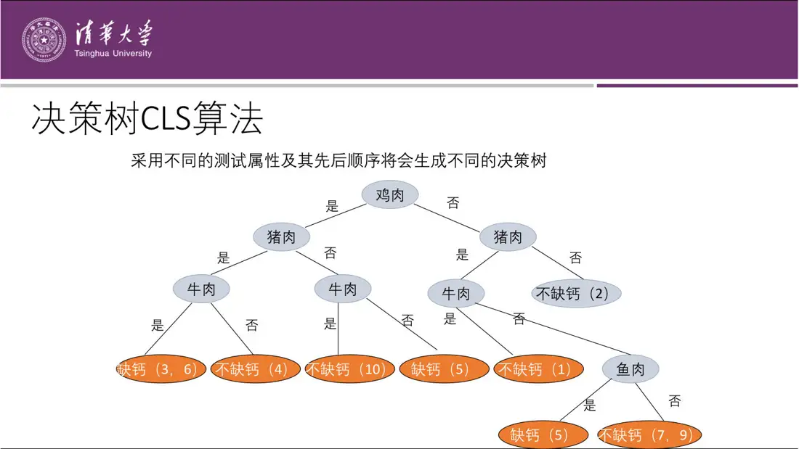

原文：

决策树CLS算法

采用不同的测试属性及其先后顺序将会生成不同的决策树

清華大學 Tsinghua University

### 决策树CLS算法

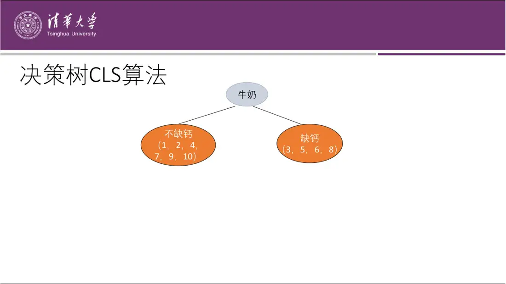

原文：

决策树CLS算法

牛奶

不缺钙
(1, 2, 4,
7, 9, 10)

缺钙
5, 6,

Tsinghua University
清華大學

### 决策树ID3算法

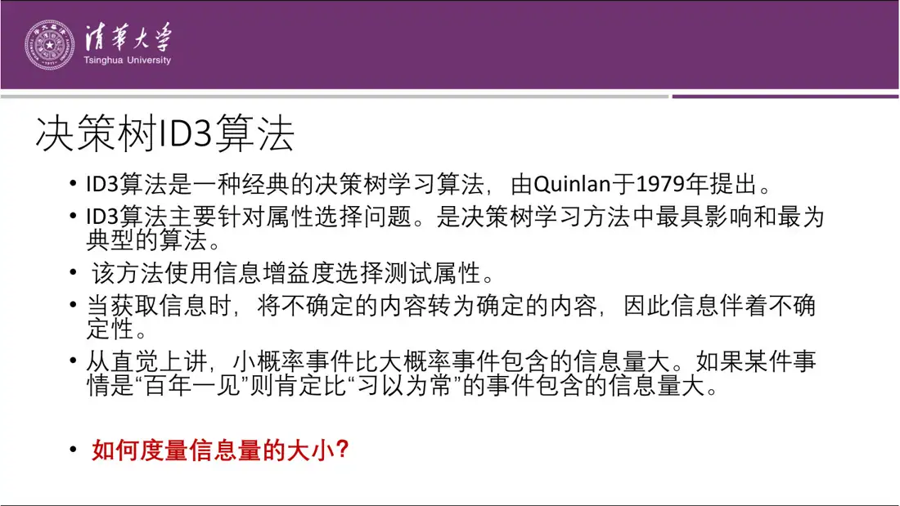

原文：

决策树ID3算法

\- ID3算法是一种经典的决策树学习算法，由Quinlan于1979年提出。

\- ID3算法主要针对属性选择问题。是决策树学习方法中最具影响和最为典型的算法。

\- 该方法使用信息增益度选择测试属性。

\- 当获取信息时，将不确定的内容转为确定的内容，因此信息伴着不确定性。

\- 从直觉上讲，小概率事件比大概率事件包含的信息量大。如果某件事情是“百年一见”则肯定比“习以为常”的事件包含的信息量大。

\- 如何度量信息量的大小？

Tsinghua University
清華大學

### 信息增益

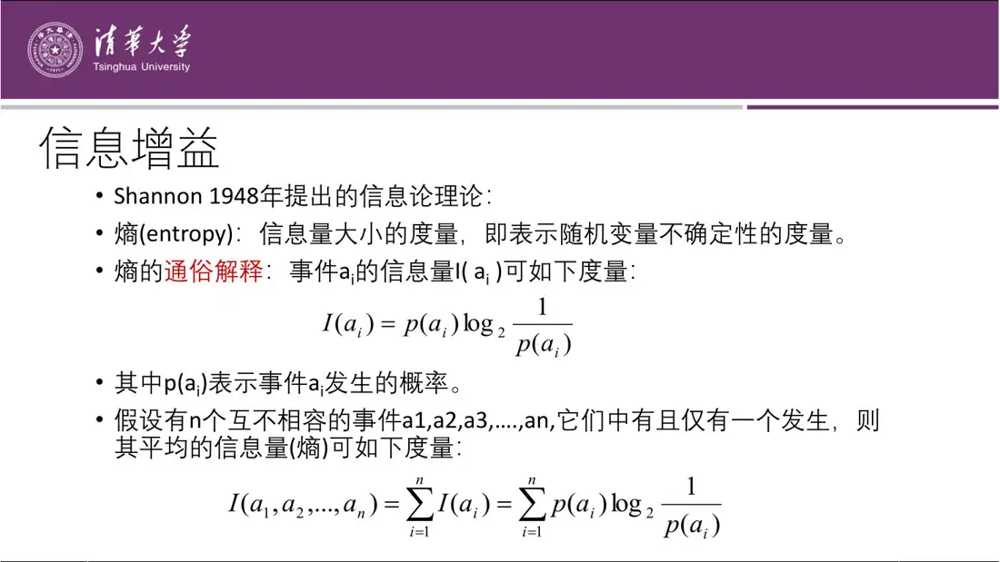

原文：

信息增益

\- Shannon 1948年提出的信息论理论：

\- 熵(entropy): 信息量大小的度量，即表示随机变量不确定性的度量。

\- 熵的通俗解释：事件 $a_{i}$ 的信息量 $\mathrm{l}(a_{i})$ 可如下度量：

$$
I (a _ {i}) = p (a _ {i}) \log_ {2} {\frac {1}{p (a _ {i})}}
$$

\- 其中 $p(a_{i})$ 表示事件 $a_{i}$ 发生的概率。

\- 假设有n个互不相容的事件a1,a2,a3,...,an,它们中有且仅有一个发生，则其平均的信息量(熵)可如下度量：

$$
I (a _ {1}, a _ {2}, \dots , a _ {n}) = \sum_ {i = 1} ^ {n} I (a _ {i}) = \sum_ {i = 1} ^ {n} p (a _ {i}) \log_ {2} \frac {1}{p (a _ {i})}
$$

Tsinghua University
清華大學

### 信息增益

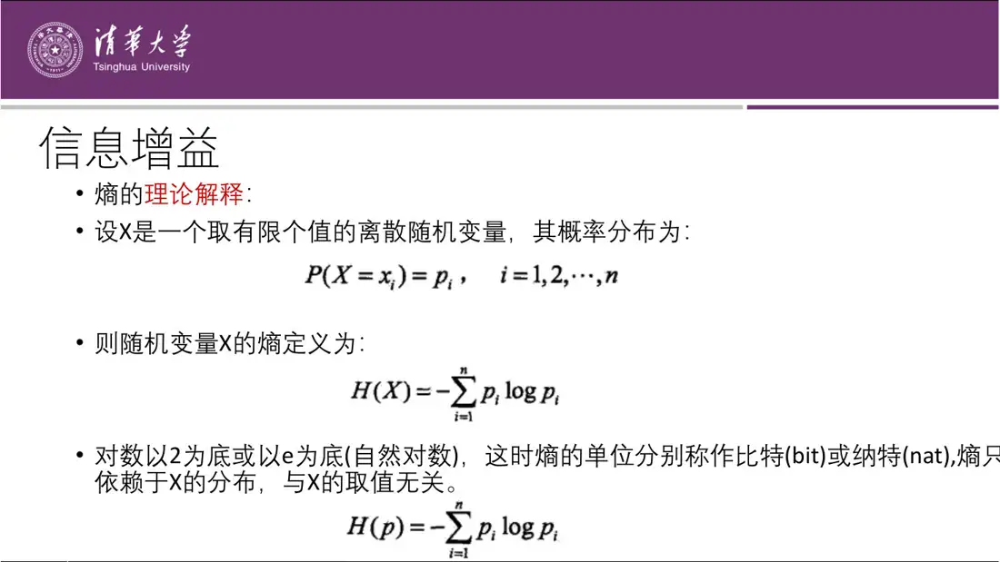

原文：

信息增益

\- 熵的理论解释:

\- 设X是一个取有限个值的离散随机变量，其概率分布为：

$$
P (X = x _ {i}) = p _ {i}, \quad i = 1, 2, \dots , n
$$

\- 则随机变量X的熵定义为:

$$
H (X) = - \sum_ {i = 1} ^ {n} p _ {i} \log p _ {i}
$$

\- 对数以2为底或以e为底(自然对数)，这时熵的单位分别称作比特(bit)或纳特(nat)，熵只依赖于X的分布，与X的取值无关。

$$
H (p) = - \sum_ {i = 1} ^ {n} p _ {i} \log p _ {i}
$$

清華大學 Tsinghua University

### 信息增益

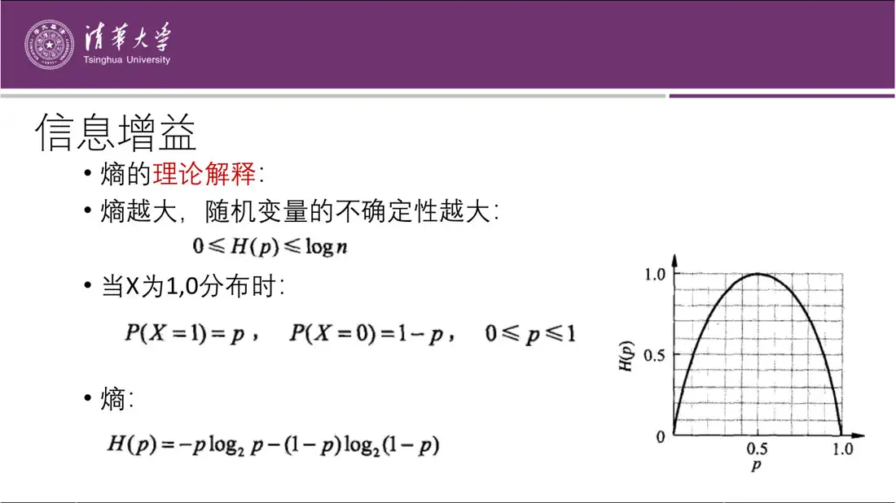

原文：

信息增益

\- 熵的理论解释:

\- 熵越大，随机变量的不确定性越大：

$$
0 \leqslant H (p) \leqslant \log n
$$

\- 当X为1,0分布时:

$$
P (X = 1) = p, \quad P (X = 0) = 1 - p, \quad 0 \leqslant p \leqslant 1
$$

\- 熵:

$$
H (p) = - p \log_ {2} p - (1 - p) \log_ {2} (1 - p)
$$

Tsinghua University
清華大學
1911-UNIVERSITY

### 信息增益

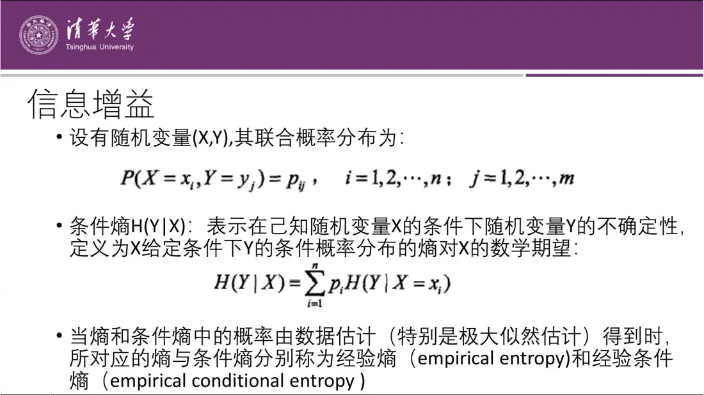

原文：

信息增益

\- 设有随机变量(X,Y),其联合概率分布为:

$$
P (X = x _ {i}, Y = y _ {j}) = p _ {i j}, \quad i = 1, 2, \dots , n; \quad j = 1, 2, \dots , m
$$

\- 条件熵H(Y|X): 表示在己知随机变量X的条件下随机变量Y的不确定性, 定义为X给定条件下Y的条件概率分布的熵对X的数学期望:

$$
H (Y \mid X) = \sum_ {i = 1} ^ {n} p _ {i} H (Y \mid X = x _ {i})
$$

\- 当熵和条件熵中的概率由数据估计（特别是极大似然估计）得到时，所对应的熵与条件熵分别称为经验熵（empirical entropy)和经验条件熵（empirical conditional entropy）

清華大學 Tsinghua University

### 信息增益

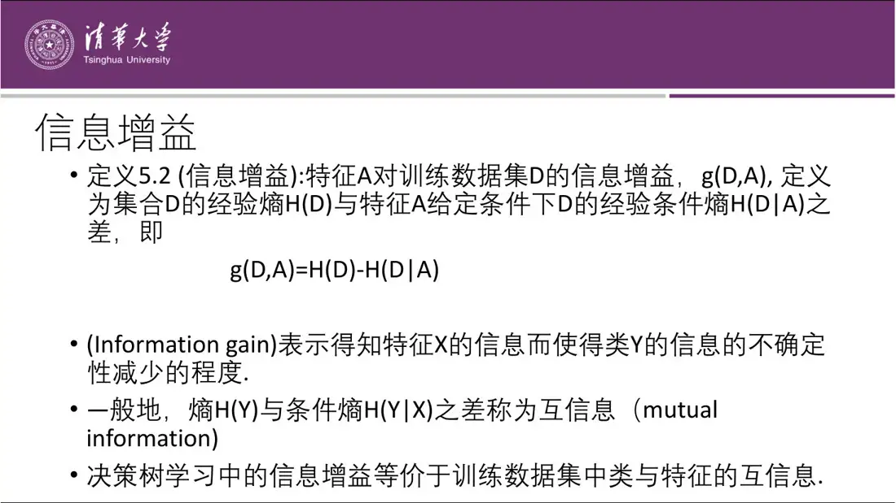

原文：

信息增益

\- 定义5.2 (信息增益): 特征A对训练数据集D的信息增益, g(D,A), 定义为集合D的经验熵H(D)与特征A给定条件下D的经验条件熵H(D|A)之差, 即

$$
g (D, A) = H (D) - H (D \mid A)
$$

\- (Information gain)表示得知特征X的信息而使得类Y的信息的不确定性减少的程度.

\- 一般地，熵H(Y)与条件熵H(Y|X)之差称为互信息（mutual information）

\- 决策树学习中的信息增益等价于训练数据集中类与特征的互信息.

清華大學 Tsinghua University

### 信息增益的算法

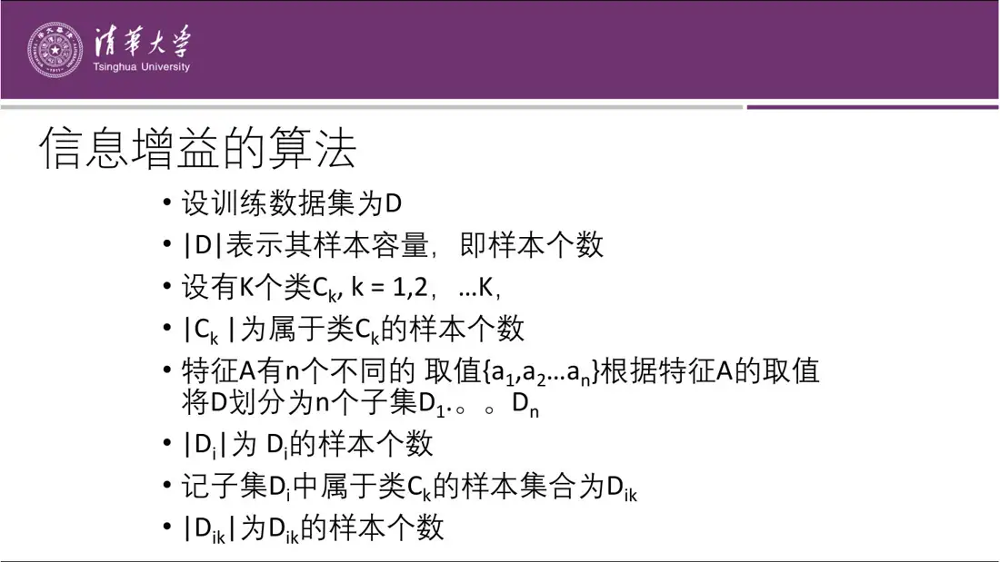

原文：

信息增益的算法

\- 设训练数据集为D

\- |D|表示其样本容量，即样本个数

\- 设有K个类 $C_{k}$ ，k=1,2，...K，

\- $|C_k|$ 为属于类 $C_k$ 的样本个数

\- 特征A有n个不同的取值 $\{a_{1},a_{2}\ldots a_{n}\}$ 根据特征A的取值将D划分为n个子集 $D_{1}.\ldots D_{n}$

\- $|\mathsf{D}_i|$ 为 $\mathsf{D}_i$ 的样本个数

\- 记子集 $D_{i}$ 中属于类 $C_{k}$ 的样本集合为 $D_{ik}$

\- $|D_{ik}|$ 为 $D_{ik}$ 的样本个数

Tsinghua University
清華大學

### 信息增益的算法

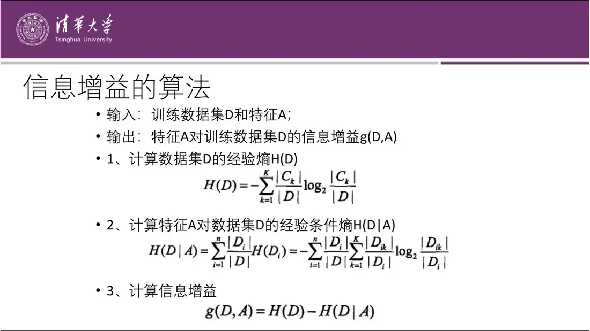

原文：

信息增益的算法

\- 输入：训练数据集D和特征A;

\- 输出：特征A对训练数据集D的信息增益g(D,A)

• 1、计算数据集D的经验熵H(D)

$$
H (D) = - \sum_ {k = 1} ^ {K} \frac {\left| C _ {k} \right|}{\left| D \right|} \log_ {2} \frac {\left| C _ {k} \right|}{\left| D \right|}
$$

• 2、计算特征A对数据集D的经验条件熵H(D|A)

$$
H (D \mid A) = \sum_ {i = 1} ^ {n} \frac {\left| D _ {i} \right|}{\left| D \right|} H \left(D _ {i}\right) = - \sum_ {i = 1} ^ {n} \frac {\left| D _ {i} \right|}{\left| D \right|} \sum_ {k = 1} ^ {K} \frac {\left| D _ {i k} \right|}{\left| D _ {i} \right|} \log_ {2} \frac {\left| D _ {i k} \right|}{\left| D _ {i} \right|}
$$

• 3、计算信息增益

$$
g (D, A) = H (D) - H (D \mid A)
$$

Tsinghua University
清華大學

### 信息增益比

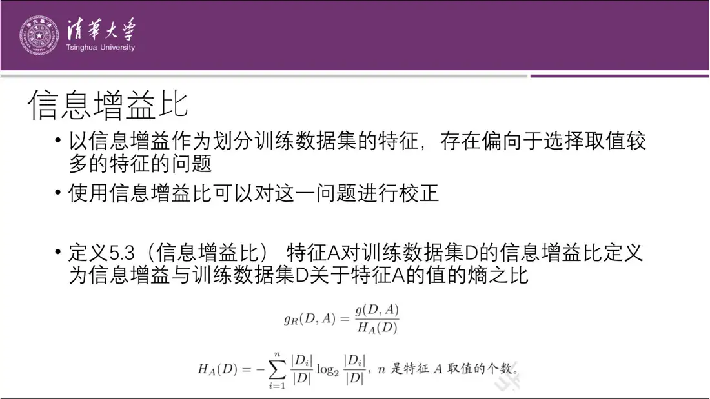

原文：

信息增益比

\- 以信息增益作为划分训练数据集的特征，存在偏向于选择取值较多的特征的问题

\- 使用信息增益比可以对这一问题进行校正

\- 定义5.3（信息增益比）特征A对训练数据集D的信息增益比定义为信息增益与训练数据集D关于特征A的值的熵之比

$$
g _ {R} (D, A) = \frac {g (D , A)}{H _ {A} (D)}
$$

$H_{A}(D)=-\sum_{i=1}^{n}\frac{|D_{i}|}{|D|}\log_{2}\frac{|D_{i}|}{|D|},\ n$ 是特征 A 取值的个数。

Tsinghua University
清華大學
1911-UNIVERSITY

### 决策树ID3算法

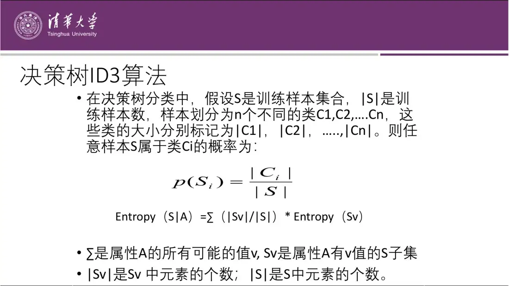

原文：

决策树ID3算法

\- 在决策树分类中，假设S是训练样本集合，|S|是训练样本数，样本划分为n个不同的类C1,C2,....,Cn，这些类的大小分别标记为|C1|，|C2|，......,|Cn|。则任意样本S属于类Ci的概率为：

$$
p (S _ {i}) = \frac {| C _ {i} |}{| S |}
$$

$$
\text {Entropy} (S | A) = \sum (| S v | / | S |) * \text {Entropy} (S v)
$$

\- $\Sigma$ 是属性A的所有可能的值v, Sv是属性A有v值的S子集

\- |Sv|是Sv中元素的个数；|S|是S中元素的个数。

清華大學 Tsinghua University

### Tsinghua University

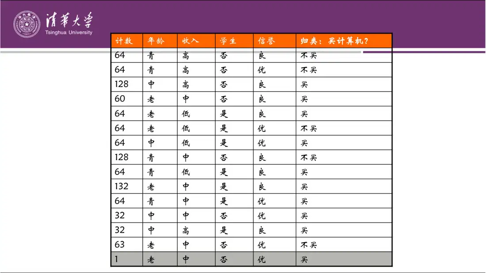

原文：

<table><tr><td>计数</td><td>年龄</td><td>收入</td><td>学生</td><td>信誉</td><td>归类:买计算机?</td></tr><tr><td>64</td><td>青</td><td>高</td><td>否</td><td>良</td><td>不买</td></tr><tr><td>64</td><td>青</td><td>高</td><td>否</td><td>优</td><td>不买</td></tr><tr><td>128</td><td>中</td><td>高</td><td>否</td><td>良</td><td>买</td></tr><tr><td>60</td><td>老</td><td>中</td><td>否</td><td>良</td><td>买</td></tr><tr><td>64</td><td>老</td><td>低</td><td>是</td><td>良</td><td>买</td></tr><tr><td>64</td><td>老</td><td>低</td><td>是</td><td>优</td><td>不买</td></tr><tr><td>64</td><td>中</td><td>低</td><td>是</td><td>优</td><td>买</td></tr><tr><td>128</td><td>青</td><td>中</td><td>否</td><td>良</td><td>不买</td></tr><tr><td>64</td><td>青</td><td>低</td><td>是</td><td>良</td><td>买</td></tr><tr><td>132</td><td>老</td><td>中</td><td>是</td><td>良</td><td>买</td></tr><tr><td>64</td><td>青</td><td>中</td><td>是</td><td>优</td><td>买</td></tr><tr><td>32</td><td>中</td><td>中</td><td>否</td><td>优</td><td>买</td></tr><tr><td>32</td><td>中</td><td>高</td><td>是</td><td>良</td><td>买</td></tr><tr><td>63</td><td>老</td><td>中</td><td>否</td><td>优</td><td>不买</td></tr><tr><td>1</td><td>老</td><td>中</td><td>否</td><td>优</td><td>买</td></tr></table>

Tsinghua University
清華大學
1911-

### 第1步计算决策属性的熵

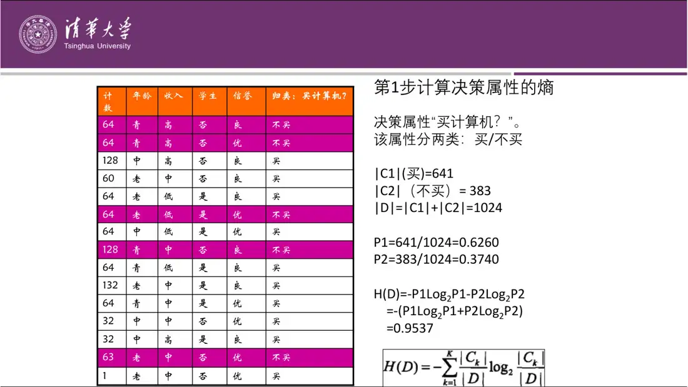

原文：

<table><tr><td>计数</td><td>年龄</td><td>收入</td><td>学生</td><td>信誉</td><td>归类:买计算机?</td></tr><tr><td>64</td><td>青</td><td>高</td><td>否</td><td>良</td><td>不买</td></tr><tr><td>64</td><td>青</td><td>高</td><td>否</td><td>优</td><td>不买</td></tr><tr><td>128</td><td>中</td><td>高</td><td>否</td><td>良</td><td>买</td></tr><tr><td>60</td><td>老</td><td>中</td><td>否</td><td>良</td><td>买</td></tr><tr><td>64</td><td>老</td><td>低</td><td>是</td><td>良</td><td>买</td></tr><tr><td>64</td><td>老</td><td>低</td><td>是</td><td>优</td><td>不买</td></tr><tr><td>64</td><td>中</td><td>低</td><td>是</td><td>优</td><td>买</td></tr><tr><td>128</td><td>青</td><td>中</td><td>否</td><td>良</td><td>不买</td></tr><tr><td>64</td><td>青</td><td>低</td><td>是</td><td>良</td><td>买</td></tr><tr><td>132</td><td>老</td><td>中</td><td>是</td><td>良</td><td>买</td></tr><tr><td>64</td><td>青</td><td>中</td><td>是</td><td>优</td><td>买</td></tr><tr><td>32</td><td>中</td><td>中</td><td>否</td><td>优</td><td>买</td></tr><tr><td>32</td><td>中</td><td>高</td><td>是</td><td>良</td><td>买</td></tr><tr><td>63</td><td>老</td><td>中</td><td>否</td><td>优</td><td>不买</td></tr><tr><td>1</td><td>老</td><td>中</td><td>否</td><td>优</td><td>买</td></tr></table>

第1步计算决策属性的熵

决策属性“买计算机？”。该属性分两类：买/不买

$$
\begin{array}{r l} & H (D) = - P 1 \mathrm{Log} _ {2} P 1 - P 2 \mathrm{Log} _ {2} P 2 \\ & = - (P 1 \mathrm{Log} _ {2} P 1 + P 2 \mathrm{Log} _ {2} P 2) \\ & = 0. 9 5 3 7 \end{array}
$$

$$
\boxed {H (D) = - \sum_ {k = 1} ^ {K} \frac {\left| C _ {k} \right|}{\left| D \right|} \log_ {2} \frac {\left| C _ {k} \right|}{\left| D \right|}}
$$

Tsinghua University
清華大學

### Tsinghua University

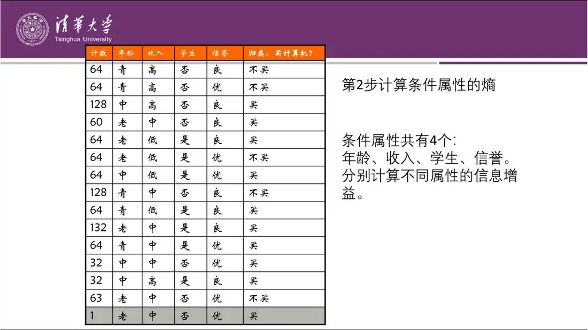

原文：

<table><tr><td>计数</td><td>年龄</td><td>收入</td><td>学生</td><td>信誉</td><td>归类:买计算机?</td></tr><tr><td>64</td><td>青</td><td>高</td><td>否</td><td>良</td><td>不买</td></tr><tr><td>64</td><td>青</td><td>高</td><td>否</td><td>优</td><td>不买</td></tr><tr><td>128</td><td>中</td><td>高</td><td>否</td><td>良</td><td>买</td></tr><tr><td>60</td><td>老</td><td>中</td><td>否</td><td>良</td><td>买</td></tr><tr><td>64</td><td>老</td><td>低</td><td>是</td><td>良</td><td>买</td></tr><tr><td>64</td><td>老</td><td>低</td><td>是</td><td>优</td><td>不买</td></tr><tr><td>64</td><td>中</td><td>低</td><td>是</td><td>优</td><td>买</td></tr><tr><td>128</td><td>青</td><td>中</td><td>否</td><td>良</td><td>不买</td></tr><tr><td>64</td><td>青</td><td>低</td><td>是</td><td>良</td><td>买</td></tr><tr><td>132</td><td>老</td><td>中</td><td>是</td><td>良</td><td>买</td></tr><tr><td>64</td><td>青</td><td>中</td><td>是</td><td>优</td><td>买</td></tr><tr><td>32</td><td>中</td><td>中</td><td>否</td><td>优</td><td>买</td></tr><tr><td>32</td><td>中</td><td>高</td><td>是</td><td>良</td><td>买</td></tr><tr><td>63</td><td>老</td><td>中</td><td>否</td><td>优</td><td>不买</td></tr><tr><td>1</td><td>老</td><td>中</td><td>否</td><td>优</td><td>买</td></tr></table>

Tsinghua University
清華大學
1911-1911

### Tsinghua University

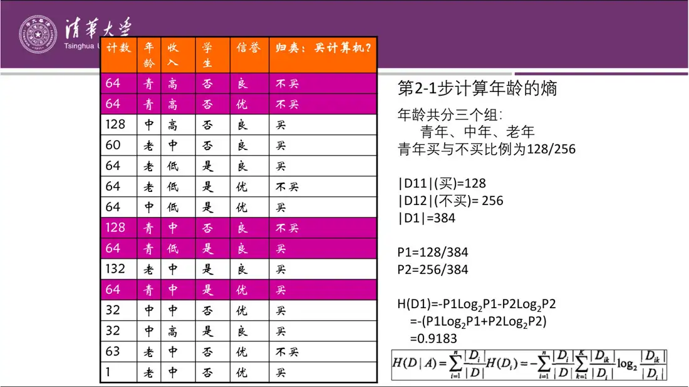

原文：

<table><tr><td>计数</td><td>年龄</td><td>收入</td><td>学生</td><td>信誉</td><td>归类:买计算机?</td></tr><tr><td>64</td><td>青</td><td>高</td><td>否</td><td>良</td><td>不买</td></tr><tr><td>64</td><td>青</td><td>高</td><td>否</td><td>优</td><td>不买</td></tr><tr><td>128</td><td>中</td><td>高</td><td>否</td><td>良</td><td>买</td></tr><tr><td>60</td><td>老</td><td>中</td><td>否</td><td>良</td><td>买</td></tr><tr><td>64</td><td>老</td><td>低</td><td>是</td><td>良</td><td>买</td></tr><tr><td>64</td><td>老</td><td>低</td><td>是</td><td>优</td><td>不买</td></tr><tr><td>64</td><td>中</td><td>低</td><td>是</td><td>优</td><td>买</td></tr><tr><td>128</td><td>青</td><td>中</td><td>否</td><td>良</td><td>不买</td></tr><tr><td>64</td><td>青</td><td>低</td><td>是</td><td>良</td><td>买</td></tr><tr><td>132</td><td>老</td><td>中</td><td>是</td><td>良</td><td>买</td></tr><tr><td>64</td><td>青</td><td>中</td><td>是</td><td>优</td><td>买</td></tr><tr><td>32</td><td>中</td><td>中</td><td>否</td><td>优</td><td>买</td></tr><tr><td>32</td><td>中</td><td>高</td><td>是</td><td>良</td><td>买</td></tr><tr><td>63</td><td>老</td><td>中</td><td>否</td><td>优</td><td>不买</td></tr><tr><td>1</td><td>老</td><td>中</td><td>否</td><td>优</td><td>买</td></tr><tr><td>64</td><td>老</td><td>低</td><td>是</td><td>良</td><td>买</td></tr><tr><td>64</td><td>老</td><td>低</td><td>是</td><td>优</td><td>不买</td></tr><tr><td>64</td><td>中</td><td>低</td><td>是</td><td>优</td><td>买</td></tr><tr><td>128</td><td>青</td><td>中</td><td>否</td><td>良</td><td>不买</td></tr><tr><td>64</td><td>青</td><td>低</td><td>是</td><td>良</td><td>买</td></tr><tr><td>132</td><td>老</td><td>中</td><td>是</td><td>良</td><td>买</td></tr><tr><td>64</td><td>青</td><td>中</td><td>是</td><td>优</td><td>买</td></tr><tr><td>32</td><td>中</td><td>中</td><td>否</td><td>优</td><td>买</td></tr><tr><td>32</td><td>中</td><td>高</td><td>是</td><td>良</td><td>买</td></tr><tr><td>63</td><td>老</td><td>中</td><td>否</td><td>优</td><td>不买</td></tr><tr><td>1</td><td>老</td><td>中</td><td>否</td><td>优</td><td>买</td></tr></table>

Tsinghua University
清華大學
 Tsinghua University
计数

### Tsinghua University

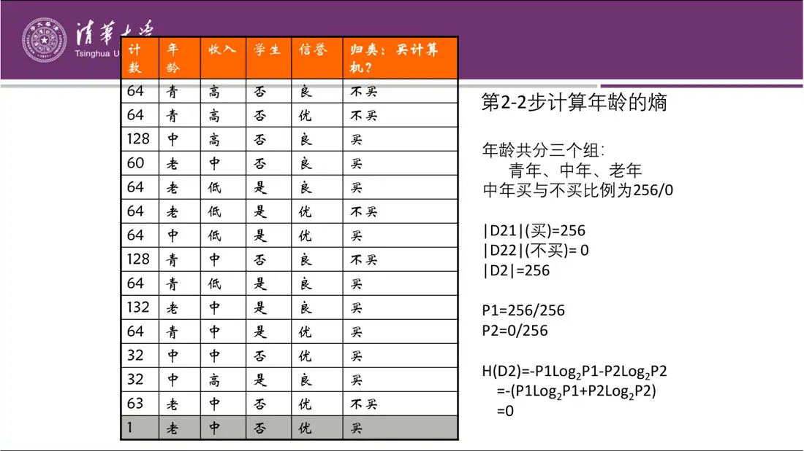

原文：

Tsinghua University
清華大學
Tsinghua U 计

### 第 46 页

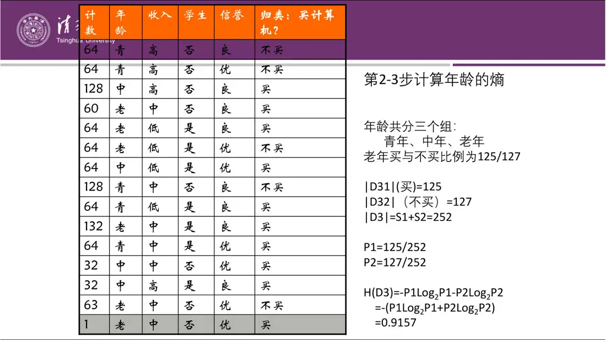

原文：

<table><tr><td>计数</td><td>年龄</td><td>收入</td><td>学生</td><td>信誉</td><td>归类:买计算机?</td><td rowspan="2"></td></tr><tr><td>64</td><td>青</td><td>高</td><td>否</td><td>良</td><td>不买</td></tr><tr><td>64</td><td>青</td><td>高</td><td>否</td><td>优</td><td>不买</td><td rowspan="3">第2-3步计算年龄的熵</td></tr><tr><td>128</td><td>中</td><td>高</td><td>否</td><td>良</td><td>买</td></tr><tr><td>60</td><td>老</td><td>中</td><td>否</td><td>良</td><td>买</td></tr><tr><td>64</td><td>老</td><td>低</td><td>是</td><td>良</td><td>买</td><td rowspan="3">年龄共分三个组:青年、中年、老年老年买与不买比例为125/127</td></tr><tr><td>64</td><td>老</td><td>低</td><td>是</td><td>优</td><td>不买</td></tr><tr><td>64</td><td>中</td><td>低</td><td>是</td><td>优</td><td>买</td></tr><tr><td>128</td><td>青</td><td>中</td><td>否</td><td>良</td><td>不买</td><td rowspan="3">|D31|(买)=125|D32|(不买)=127|D3|=S1+S2=252</td></tr><tr><td>64</td><td>青</td><td>低</td><td>是</td><td>良</td><td>买</td></tr><tr><td>132</td><td>老</td><td>中</td><td>是</td><td>良</td><td>买</td></tr><tr><td>64</td><td>青</td><td>中</td><td>是</td><td>优</td><td>买</td><td rowspan="3">P1=125/252P2=127/252</td></tr><tr><td>32</td><td>中</td><td>中</td><td>否</td><td>优</td><td>买</td></tr><tr><td>32</td><td>中</td><td>高</td><td>是</td><td>良</td><td>买</td></tr><tr><td>63</td><td>老</td><td>中</td><td>否</td><td>优</td><td>不买</td><td rowspan="2">H(D3)=-P1Log2P1-P2Log2P2=-(P1Log2P1+P2Log2P2)=0.9157</td></tr><tr><td>1</td><td>老</td><td>中</td><td>否</td><td>优</td><td>买</td></tr></table>

### 第 47 页

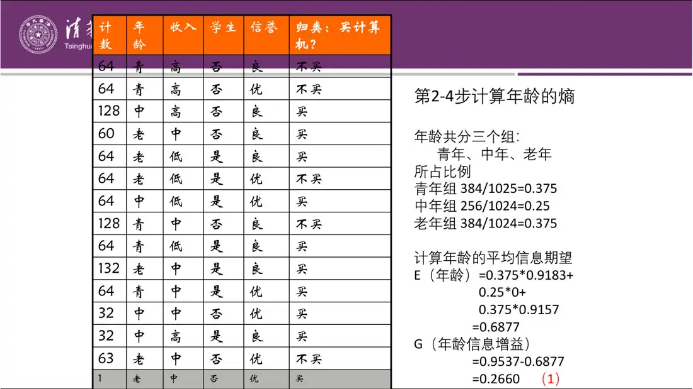

原文：

<table><tr><td>计数</td><td>年龄</td><td>收入</td><td>学生</td><td>信誉</td><td>归类:买计算机?</td><td></td></tr><tr><td>64</td><td>青</td><td>高</td><td>否</td><td>良</td><td>不买</td><td></td></tr><tr><td>64</td><td>青</td><td>高</td><td>否</td><td>优</td><td>不买</td><td rowspan="14">第2-4步计算年龄的熵年龄共分三个组:青年、中年、老年所占比例青年组384/1025=0.375中年组256/1024=0.25老年组384/1024=0.375计算年龄的平均信息期望E(年龄)=0.375*0.9183+0.25*0+0.375*0.9157=0.6877G(年龄信息增益)=0.9537-0.6877=0.2660 (1)</td></tr><tr><td>128</td><td>中</td><td>高</td><td>否</td><td>良</td><td>买</td></tr><tr><td>60</td><td>老</td><td>中</td><td>否</td><td>良</td><td>买</td></tr><tr><td>64</td><td>老</td><td>低</td><td>是</td><td>良</td><td>买</td></tr><tr><td>64</td><td>老</td><td>低</td><td>是</td><td>优</td><td>不买</td></tr><tr><td>64</td><td>中</td><td>低</td><td>是</td><td>优</td><td>买</td></tr><tr><td>128</td><td>青</td><td>中</td><td>否</td><td>良</td><td>不买</td></tr><tr><td>64</td><td>青</td><td>低</td><td>是</td><td>良</td><td>买</td></tr><tr><td>132</td><td>老</td><td>中</td><td>是</td><td>良</td><td>买</td></tr><tr><td>64</td><td>青</td><td>中</td><td>是</td><td>优</td><td>买</td></tr><tr><td>32</td><td>中</td><td>中</td><td>否</td><td>优</td><td>买</td></tr><tr><td>32</td><td>中</td><td>高</td><td>是</td><td>良</td><td>买</td></tr><tr><td>63</td><td>老</td><td>中</td><td>否</td><td>优</td><td>不买</td></tr><tr><td>1</td><td>老</td><td>中</td><td>否</td><td>优</td><td>买</td></tr></table>

### 第 48 页

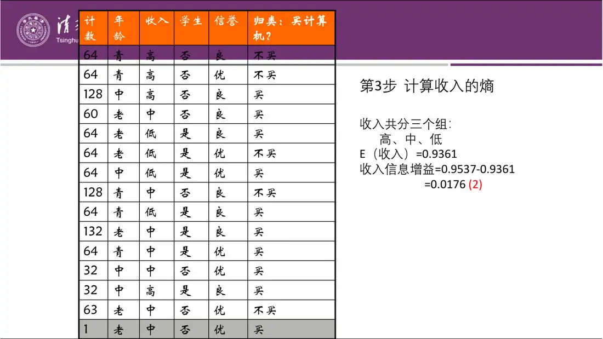

原文：

<table><tr><td>计数</td><td>年龄</td><td>收入</td><td>学生</td><td>信誉</td><td>归类:买计算机?</td></tr><tr><td>64</td><td>青</td><td>高</td><td>否</td><td>良</td><td>不买</td></tr><tr><td>64</td><td>青</td><td>高</td><td>否</td><td>优</td><td>不买</td></tr><tr><td>128</td><td>中</td><td>高</td><td>否</td><td>良</td><td>买</td></tr><tr><td>60</td><td>老</td><td>中</td><td>否</td><td>良</td><td>买</td></tr><tr><td>64</td><td>老</td><td>低</td><td>是</td><td>良</td><td>买</td></tr><tr><td>64</td><td>老</td><td>低</td><td>是</td><td>优</td><td>不买</td></tr><tr><td>64</td><td>中</td><td>低</td><td>是</td><td>优</td><td>买</td></tr><tr><td>128</td><td>青</td><td>中</td><td>否</td><td>良</td><td>不买</td></tr><tr><td>64</td><td>青</td><td>低</td><td>是</td><td>良</td><td>买</td></tr><tr><td>132</td><td>老</td><td>中</td><td>是</td><td>良</td><td>买</td></tr><tr><td>64</td><td>青</td><td>中</td><td>是</td><td>优</td><td>买</td></tr><tr><td>32</td><td>中</td><td>中</td><td>否</td><td>优</td><td>买</td></tr><tr><td>32</td><td>中</td><td>高</td><td>是</td><td>良</td><td>买</td></tr><tr><td>63</td><td>老</td><td>中</td><td>否</td><td>优</td><td>不买</td></tr><tr><td>1</td><td>老</td><td>中</td><td>否</td><td>优</td><td>买</td></tr><tr><td>64</td><td>老</td><td>低</td><td>是</td><td>良</td><td>买</td></tr><tr><td>64</td><td>老</td><td>低</td><td>是</td><td>优</td><td>不买</td></tr><tr><td>64</td><td>中</td><td>低</td><td>是</td><td>优</td><td>买</td></tr><tr><td>128</td><td>青</td><td>中</td><td>否</td><td>良</td><td>不买</td></tr><tr><td>64</td><td>青</td><td>低</td><td>是</td><td>良</td><td>买</td></tr><tr><td>132</td><td>老</td><td>中</td><td>是</td><td>良</td><td>买</td></tr><tr><td>64</td><td>青</td><td>中</td><td>是</td><td>优</td><td>买</td></tr><tr><td>32</td><td>中</td><td>中</td><td>否</td><td>优</td><td>买</td></tr><tr><td>32</td><td>中</td><td>高</td><td>是</td><td>良</td><td>买</td></tr><tr><td>63</td><td>老</td><td>中</td><td>否</td><td>优</td><td>不买</td></tr><tr><td>1</td><td>老</td><td>中</td><td>否</td><td>优</td><td>买</td></tr></table>

### 第 49 页

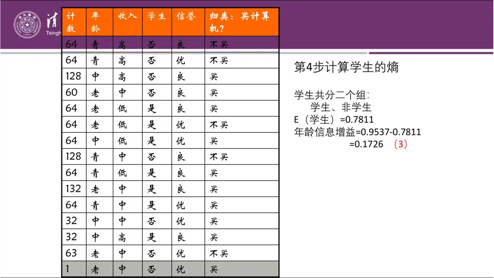

### 第5步计算信誉的熵

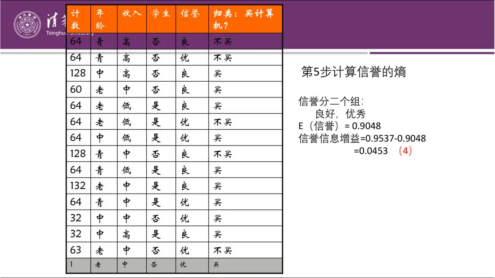

原文：

<table><tr><td>计数</td><td>年龄</td><td>收入</td><td>学生</td><td>信誉</td><td>归类:买计算机?</td></tr><tr><td>64</td><td>青</td><td>高</td><td>否</td><td>良</td><td>不买</td></tr><tr><td>64</td><td>青</td><td>高</td><td>否</td><td>优</td><td>不买</td></tr><tr><td>128</td><td>中</td><td>高</td><td>否</td><td>良</td><td>买</td></tr><tr><td>60</td><td>老</td><td>中</td><td>否</td><td>良</td><td>买</td></tr><tr><td>64</td><td>老</td><td>低</td><td>是</td><td>良</td><td>买</td></tr><tr><td>64</td><td>老</td><td>低</td><td>是</td><td>优</td><td>不买</td></tr><tr><td>64</td><td>中</td><td>低</td><td>是</td><td>优</td><td>买</td></tr><tr><td>128</td><td>青</td><td>中</td><td>否</td><td>良</td><td>不买</td></tr><tr><td>64</td><td>青</td><td>低</td><td>是</td><td>良</td><td>买</td></tr><tr><td>132</td><td>老</td><td>中</td><td>是</td><td>良</td><td>买</td></tr><tr><td>64</td><td>青</td><td>中</td><td>是</td><td>优</td><td>买</td></tr><tr><td>32</td><td>中</td><td>中</td><td>否</td><td>优</td><td>买</td></tr><tr><td>32</td><td>中</td><td>高</td><td>是</td><td>良</td><td>买</td></tr><tr><td>63</td><td>老</td><td>中</td><td>否</td><td>优</td><td>不买</td></tr><tr><td>1</td><td>老</td><td>中</td><td>否</td><td>优</td><td>买</td></tr></table>

第5步计算信誉的熵

信誉分二个组：良好，优秀

E（信誉）=0.9048

信誉信息增益=0.9537-0.9048
=0.0453 (4)

Tsinghua
Tsinghua University

### 第6步计算选择节点

原文：

<table><tr><td>计数</td><td>年龄</td><td>收入</td><td>学生</td><td>信誉</td><td>归类:买计算机?</td></tr><tr><td>64</td><td>青</td><td>高</td><td>否</td><td>良</td><td>不买</td></tr><tr><td>64</td><td>青</td><td>高</td><td>否</td><td>优</td><td>不买</td></tr><tr><td>128</td><td>中</td><td>高</td><td>否</td><td>良</td><td>买</td></tr><tr><td>60</td><td>老</td><td>中</td><td>否</td><td>良</td><td>买</td></tr><tr><td>64</td><td>老</td><td>低</td><td>是</td><td>良</td><td>买</td></tr><tr><td>64</td><td>老</td><td>低</td><td>是</td><td>优</td><td>不买</td></tr><tr><td>64</td><td>中</td><td>低</td><td>是</td><td>优</td><td>买</td></tr><tr><td>128</td><td>青</td><td>中</td><td>否</td><td>良</td><td>不买</td></tr><tr><td>64</td><td>青</td><td>低</td><td>是</td><td>良</td><td>买</td></tr><tr><td>132</td><td>老</td><td>中</td><td>是</td><td>良</td><td>买</td></tr><tr><td>64</td><td>青</td><td>中</td><td>是</td><td>优</td><td>买</td></tr><tr><td>32</td><td>中</td><td>中</td><td>否</td><td>优</td><td>买</td></tr><tr><td>32</td><td>中</td><td>高</td><td>是</td><td>良</td><td>买</td></tr><tr><td>63</td><td>老</td><td>中</td><td>否</td><td>优</td><td>不买</td></tr><tr><td>1</td><td>老</td><td>中</td><td>否</td><td>优</td><td>买</td></tr></table>

第6步计算选择节点

年龄信息增益=0.9537-0.6877
=0.2660 (1)

收入信息增益=0.9537-0.9361
=0.0176 (2)

年龄信息增益=0.9537-0.7811
=0.1726 (3)

信誉信息增益=0.9537-0.9048
=0.0453 (4)

Tsinghua University
清華大學
1911-

### Tsinghua University

原文：

<table><tr><td>计数</td><td>年龄</td><td>收入</td><td>学生</td><td>信誉</td><td>归类:买计算机?</td></tr><tr><td>64</td><td>青</td><td>高</td><td>否</td><td>良</td><td>不买</td></tr><tr><td>64</td><td>青</td><td>高</td><td>否</td><td>优</td><td>不买</td></tr><tr><td>128</td><td>青</td><td>中</td><td>否</td><td>良</td><td>不买</td></tr><tr><td>64</td><td>青</td><td>低</td><td>是</td><td>良</td><td>买</td></tr><tr><td>64</td><td>青</td><td>中</td><td>是</td><td>优</td><td>买</td></tr></table>

Tsinghua University
清華大學
1911-1911

### 青年买与不买比例为128/256

原文：

<table><tr><td>计数</td><td>年龄</td><td>收入</td><td>学生</td><td>信誉</td><td>归类:买计算机?</td></tr><tr><td>64</td><td>青</td><td>高</td><td>否</td><td>良</td><td>不买</td></tr><tr><td>64</td><td>青</td><td>高</td><td>否</td><td>优</td><td>不买</td></tr><tr><td>128</td><td>青</td><td>中</td><td>否</td><td>良</td><td>不买</td></tr><tr><td>64</td><td>青</td><td>低</td><td>是</td><td>良</td><td>买</td></tr><tr><td>64</td><td>青</td><td>中</td><td>是</td><td>优</td><td>买</td></tr></table>

青年买与不买比例为128/256

$$
\begin{array}{l} {{| C 1 | (\mathrm{买}) = 1 2 8}} \\ {{| C 2 | \mathrm{(不买)} = 2 5 6}} \\ {{| D | = 3 8 4}} \end{array}
$$

$$
\begin{array}{r l} \mathsf {H (D)} & = - \mathsf {P 1 L o g 2 P 1 - P 2 L o g 2 P 2} \\ & = - (\mathsf {P 1 L o g 2 P 1 + P 2 L o g 2 P 2}) \\ & = 0. 9 1 8 3 \end{array}
$$

Tsinghua University
清華大學
1911-UNIVERSITY

### 如果选择收入作为节点分高、中、低

原文：

<table><tr><td>计数</td><td>年龄</td><td>收入</td><td>学生</td><td>信誉</td><td>归类:买计算机?</td></tr><tr><td>64</td><td>青</td><td>高</td><td>否</td><td>良</td><td>不买</td></tr><tr><td>64</td><td>青</td><td>高</td><td>否</td><td>优</td><td>不买</td></tr><tr><td>128</td><td>青</td><td>中</td><td>否</td><td>良</td><td>不买</td></tr><tr><td>64</td><td>青</td><td>低</td><td>是</td><td>良</td><td>买</td></tr><tr><td>64</td><td>青</td><td>中</td><td>是</td><td>优</td><td>买</td></tr></table>

如果选择收入作为节点分高、中、低

H(D1)=0
比例:
128/384=0.3333

Tsinghua University
清華大學

### Tsinghua University

原文：

<table><tr><td>计数</td><td>年龄</td><td>收入</td><td>学生</td><td>信誉</td><td>归类:买计算机?</td></tr><tr><td>64</td><td>青</td><td>高</td><td>否</td><td>良</td><td>不买</td></tr><tr><td>64</td><td>青</td><td>高</td><td>否</td><td>优</td><td>不买</td></tr><tr><td>128</td><td>中</td><td>高</td><td>否</td><td>良</td><td>买</td></tr><tr><td>60</td><td>老</td><td>中</td><td>否</td><td>良</td><td>买</td></tr><tr><td>64</td><td>老</td><td>低</td><td>是</td><td>良</td><td>买</td></tr><tr><td>64</td><td>老</td><td>低</td><td>是</td><td>优</td><td>不买</td></tr><tr><td>64</td><td>中</td><td>低</td><td>是</td><td>优</td><td>买</td></tr><tr><td>128</td><td>青</td><td>中</td><td>否</td><td>良</td><td>不买</td></tr><tr><td>64</td><td>青</td><td>低</td><td>是</td><td>良</td><td>买</td></tr><tr><td>132</td><td>老</td><td>中</td><td>是</td><td>良</td><td>买</td></tr><tr><td>64</td><td>青</td><td>中</td><td>是</td><td>优</td><td>买</td></tr><tr><td>32</td><td>中</td><td>中</td><td>否</td><td>优</td><td>买</td></tr><tr><td>32</td><td>中</td><td>高</td><td>是</td><td>良</td><td>买</td></tr><tr><td>63</td><td>老</td><td>中</td><td>否</td><td>优</td><td>不买</td></tr><tr><td>1</td><td>老</td><td>中</td><td>否</td><td>优</td><td>买</td></tr></table>

Tsinghua University
清華大學
1911-

### 决策树ID3算法-流程

原文：

决策树ID3算法-流程

\- 1 决定分类属性;

\- 2 对目前的数据表，建立一个节点N

\- 3 如果数据库中的数据都属于同一个类，N就是树叶，在树叶上标出所属的类

\- 4 如果数据表中没有其他属性可以考虑，则N也是树叶，按照少数服从多数的原则在树叶上标出所属类别

\- 5 否则，根据平均信息期望值E或GAIN值选出一个最佳属性作为节点N的测试属性

\- 6 节点属性选定后，对于该属性中的每个值：

\- 从N生成一个分支，并将数据表中与该分支有关的数据收集形成分支节点的数据表，在表中删除节点属性那一栏如果分支数据表非空，则运用以上算法从该节点建立子树。

Tsinghua University
清華大學
1911-1911

### 决策树ID3算法-实际使用

原文：

决策树ID3算法-实际使用

原始表

<table><tr><td>姓名</td><td>年龄</td><td>收入</td><td>学生</td><td>信誉</td><td>电话</td><td>地址</td><td>邮编</td><td>买计算机</td></tr><tr><td>张三</td><td>23</td><td>4000</td><td>是</td><td>良</td><td>281-322-0328</td><td>2714 Ave. M</td><td>77388</td><td>买</td></tr><tr><td>李四</td><td>34</td><td>2800</td><td>否</td><td>优</td><td>713-239-7830</td><td>5606 Holly Cr</td><td>78766</td><td>买</td></tr><tr><td>王二</td><td>70</td><td>1900</td><td>否</td><td>优</td><td>281-242-3222</td><td>2000 Bell Blvd.</td><td>70244</td><td>不买</td></tr><tr><td>赵五</td><td>18</td><td>900</td><td>是</td><td>良</td><td>281-550-0544</td><td>100 Main Street</td><td>70244</td><td>买</td></tr><tr><td>刘兰</td><td>34</td><td>2500</td><td>否</td><td>优</td><td>713-239-7430</td><td>606 Holly Ct</td><td>78566</td><td>买</td></tr><tr><td>杨俊</td><td>27</td><td>8900</td><td>否</td><td>优</td><td>281-355-7990</td><td>233 Rice Blvd.</td><td>70388</td><td>不买</td></tr><tr><td>张毅</td><td>38</td><td>9500</td><td>否</td><td>优</td><td>281-556-0544</td><td>399 Sugar Rd.</td><td>78244</td><td>买</td></tr><tr><td>。。。</td><td>。。。</td><td></td><td></td><td></td><td></td><td></td><td></td><td></td></tr><tr><td>。。。</td><td></td><td></td><td></td><td></td><td></td><td></td><td></td><td></td></tr></table>

Tsinghua University
清華大學

### 决策树ID3算法-实际使用

原文：

决策树ID3算法-实际使用

决策树的数据准备 ✿ Data cleaning
删除/减少noise，
补填missing values

整理后的数据表
<table><tr><td>计数</td><td>年龄</td><td>收入</td><td>学生</td><td>信誉</td><td>归类:买计算机?</td></tr><tr><td>64</td><td>青</td><td>高</td><td>否</td><td>良</td><td>不买</td></tr><tr><td>64</td><td>青</td><td>高</td><td>否</td><td>优</td><td>不买</td></tr><tr><td>128</td><td>中</td><td>高</td><td>否</td><td>良</td><td>买</td></tr><tr><td>60</td><td>老</td><td>中</td><td>否</td><td>良</td><td>买</td></tr><tr><td>64</td><td>老</td><td>低</td><td>是</td><td>良</td><td>买</td></tr><tr><td>64</td><td>老</td><td>低</td><td>是</td><td>优</td><td>不买</td></tr><tr><td>64</td><td>中</td><td>低</td><td>是</td><td>优</td><td>买</td></tr><tr><td>128</td><td>青</td><td>中</td><td>否</td><td>良</td><td>不买</td></tr><tr><td>64</td><td>青</td><td>低</td><td>是</td><td>良</td><td>买</td></tr><tr><td>。。。</td><td></td><td></td><td></td><td></td><td></td></tr></table>

✿ Data transformation
数据标准化（data normalization）
数据归纳（generalize data to higher-level concepts using concept hierarchies）
例如：年龄归纳为老、中、青三类控制每个属性的可能值不超过七种（最好不超过五种）

✿ Relevance analysis
对于与问题无关的属性：删
对于属性的可能值大于七种
又不能归纳的属性：删

清華大學 Tsinghua University

### 决策树ID3算法-小结

原文：

决策树ID3算法-小结

\- ID3算法的基本思想是，以信息熵为度量，用于决策树节点的属性选择，每次优先选取信息量最多的属性，亦即能使熵值变为最小的属性，以构造一颗熵值下降最快的决策树，到叶子节点处的熵值为0。此时，每个叶子节点对应的实例集中的实例属于同一类。

清華大學 Tsinghua University

### 决策树面临的问题

原文：

决策树面临的问题

\- 理想的决策树有三种:

(1)叶子结点数最少;

(2)叶子结点深度最小;

(3)叶子结点数最少且叶子结点深度最小。

\- 然而，洪家荣等人已经证明了要找到这种最优的决策树是NP难题。因此，决策树优化的目的就是要找到尽可能趋向于最优的决策树。

Tsinghua University
清華大學
1911-1911

### 决策树面临的问题

原文：

决策树面临的问题

\- 过度拟合

\- 决策树算法增长树的每一个分支的深度，直到恰好能对训练样例比较完美地分类。实际应用中，当数据中有噪声或训练样例的数量太少以至于不能产生目标函数的有代表性的采样时，该策略可能会遇到困难。

\- 在以上情况发生时，这个简单的算法产生的树会过渡拟合训练样例（过渡拟合：Over Fitting）.

Tsinghua University
清華大學
1911-1911

### 决策树面临的问题

原文：

决策树面临的问题

\- 过度拟合

\- 对学习算法是否成功的真正测试是看它对于训练中未见到的数据的执行性能。训练过程应该包含训练样本和验证样本。验证样本用于测试训练后的性能。如果验证结果差，则需要考虑采用不同的结构重新进行训练，例如使用更大的样本集，或者改变从连续值到离散值得数据转换等。

\- 通常应该建立一个验证过程，在训练最终完成后用来检测训练结果的泛化能力。

清華大學 Tsinghua University

### 决策树面临的问题

原文：

决策树面临的问题

\- 一般可以将分类模型的误差分为:

• 1、训练误差（Training Error）；

• 2、泛化误差（Generalization Error）

\- 训练误差是在训练记录上误分类样本比例；

\- 泛化误差是模型在未知记录上的期望误差；

\- 一个好的模型不仅要能够很好地拟合训练数据，而且对未知样本也要能够准确地分类。

\- 一个好的分类模型必须具有低的训练误差和泛化误差。因为一个具有低训练误差的模型，其泛化误差可能比具有较高训练误差的模型高。（训练误差低，泛化误差高，称为过渡拟合）

Tsinghua University
清華大學
1911-1911

### 决策树面临的问题

原文：

决策树面临的问题

\- 决策树算法比较适合处理离散数值的属性。实际应用中属性是连续的或者离散的情况都比较常见。

\- 在应用连续属性值时，在一个树结点可以将属性Ai的值划分为几个区间。然后信息增益的计算就可以采用和离散值处理一样的方法。原则上可以将Ai的属性划分为任意数目的空间。C4.5中采用的是二元分割（Binary Split）。需要找出一个合适的分割阈值。

- 本书第九章将介绍

参考C4.5算法 Top 10 algorithms in data mining Knowledge Information System 2008 14:1–37

Tsinghua University
清華大學
1911-UNIVERSITY

### 决策树的剪枝

原文：

决策树的剪枝

\- 通过极小化决策树整体的损失函数或代价函数来实现。

\- 设树T的叶结点个数为 $|T|$ , t是树T的叶结点, 该叶结点有 $N_{t}$ 个样本点, 其中k类的样本点有 $N_{tk}$ 个, k=1,2..K,

\- $H_{t}(T)$ 为叶结点t上的经验熵， $\alpha \geq 0$ 为参数，损失函数：

$$
C _ {\alpha} (T) = \sum_ {i = 1} ^ {| T |} N _ {i} H _ {i} (T) + \alpha | T |
$$

\- 经验熵:

$$
H _ {i} (T) = - \sum_ {k} \frac {N _ {i k}}{N _ {i}} \log \frac {N _ {i k}}{N _ {i}}
$$

\- 原式第一项:

$$
C (T) = \sum_ {i = 1} ^ {| T |} N _ {i} H _ {i} (T) = - \sum_ {i = 1} ^ {| T |} \sum_ {k = 1} ^ {K} N _ {i k} \log \frac {N _ {i k}}{N _ {i}}
$$

\- 则:

$$
C _ {\alpha} (T) = C (T) + \alpha | T |
$$

Tsinghua University
清華大學

### 决策树的剪枝

原文：

决策树的剪枝

\- 树的剪枝算法:

输入：生成算法产生的整个树 $T$ ，参数 $\alpha$ ；

输出：修剪后的子树 $T_{\alpha}$

(1) 计算每个结点的经验熵.

(2) 递归地从树的叶结点向上回缩.

\- 设一组叶结点回缩到其父结点之前与之和的损失函数分别为： $C_{\alpha}(T_B)$ 与 $C_{\alpha}(T_A)$

\- 如果： $C_{\alpha}(T_A)\leqslant C_{\alpha}(T_B)$ 则进行剪枝

(3) 返回 (2)，直至不能继续为止，得到损失函数最小的子树 $T_{\alpha}$

Tsinghua University
清華大學

### CART树

原文：

CART树

\- 分类回归树CART(Classification and Regression Trees)
  - 1984 << Classification and Regression Trees >>

• L.Breiman, J.Friedman, R.Olshen和C.Stone

\- http://www.stat.berkeley.edu/\~breiman/

\- http://www-stat.stanford.edu/\~jhf/

\- http://www-stat.stanford.edu/\~olshen/

\- 目标变量是类别的 --- 分类树

\- 目标变量是连续的 --- 回归树

Tsinghua University
清華大學
1911-1911

### CART与ID3的不同

原文：

CART与ID3的不同

\- 二元划分:

\- 二叉树不易产生数据碎片，精确度往往也会高于多叉树

\- CART中选择变量的不纯性度量:

\- 分类目标：Gini指标、Towing、order Towing

\- 连续目标：最小平方残差、最小绝对残差

\- 剪枝:

\- 用预剪枝或后剪枝对训练集生长的树进行剪枝

\- 树的建立:

\- 如果目标变量是标称的，并且是具有两个以上的类别，则CART可能考虑将目标类别合并成两个超类别（双化）；

\- 如果目标变量是连续的，则CART算法找出一组基于树的回归方程来预测目标变量。

Tsinghua University
清華大學

### CART树

原文：

CART树

\- CART算法由两部分组成:

\- 决策树生成

\- 决策树剪枝

\- 回归树：平方误差最小化

\- 分类树：Gini Index

Tsinghua University
清華大學
1911-

### CART的生成

原文：

CART的生成

\- 回归树的生成

\- 设Y是连续变量，给定训练数据集： $D=\{(x_{1},y_{1}),(x_{2},y_{2}),\cdots,(x_{N},y_{N})\}$

\- 假设已将输入空间划分为M各单元R1,R2..Rm,并且每个单元Rm上有一个固定的输出Cm,回归树表示为: $f(x) = \sum_{m=1}^{M} c_m I(x \in R_m)$

\- 平方误差来表示预测误差，用平方误差最小准则求解每个单元上的最优输出值

$$
\sum_ {x _ {i} \in R _ {m}} (y _ {i} - f (x _ {i})) ^ {2}
$$

\- Rm上的Cm的最优值: $\hat{c}_{m} = \operatorname{ave}(y_i \mid x_i \in R_m)$

Tsinghua University
清華大學

### CART的生成

原文：

CART的生成

\- 问题：如何对输入空间进行划分？

\- 启发式：选择第j个变量 $x^{(j)}$ 和它取的值s，作为切分变量和切分点，定义两个区域：

$$
R _ {1} (j, s) = \{x \mid x ^ {(j)} \leqslant s \} \quad \text {和} \quad R _ {2} (j, s) = \{x \mid x ^ {(j)} > s \}
$$

\- 然后寻找最优切分变量和切分点：

$$
\min _ {j, s} \left[ \min _ {c _ {1}} \sum_ {x _ {i} \in R _ {1} (j, s)} \left(y _ {i} - c _ {1}\right) ^ {2} + \min _ {c _ {2}} \sum_ {x _ {i} \in R _ {2} (j, s)} \left(y _ {i} - c _ {2}\right) ^ {2} \right]
$$

$$
\bullet \text {且:} \quad \hat {c} _ {1} = \mathrm{ave} (y _ {i} \mid x _ {i} \in R _ {1} (j, s)) \quad \text {和} \quad \hat {c} _ {2} = \mathrm{ave} (y _ {i} \mid x _ {i} \in R _ {2} (j, s))
$$

\- 再对两个区域重复上述划分，直到满足停止条件。

Tsinghua University
清華大學

### CART的生成

原文：

CART的生成

\- 最小二乘回归树生成算法

输入：训练数据集D；

输出：回归树 $f(x)$

在训练数据集所在的输入空间中，递归地将每个区域划分为两个子区域并决定每个子区域上的输出值，构建二叉决策树：

(1) 选择最优切分变量 j 与切分点 s，求解

$$
\min _ {j, s} \left[ \min _ {c _ {1}} \sum_ {x _ {i} \in R _ {1} (j, s)} \left(y _ {i} - c _ {1}\right) ^ {2} + \min _ {c _ {2}} \sum_ {x _ {i} \in R _ {2} (j, s)} \left(y _ {i} - c _ {2}\right) ^ {2} \right]
$$

遍历变量 j，对固定的切分变量 j 扫描切分点 s，选择使式 (达到最小值的对 $(j,s)$ )

清華大學 Tsinghua University

### CART的生成

原文：

CART的生成

\- 最小二乘回归树生成算法

(2) 用选定的对 $(j,s)$ 划分区域并决定相应的输出值:

$$
R _ {1} (j, s) = \{x \mid x ^ {(j)} \leqslant s \}, R _ {2} (j, s) = \{x \mid x ^ {(j)} > s \}
$$

$$
\hat {c} _ {m} = \frac {1}{N _ {m}} \sum_ {x _ {i} \in R _ {m} (j, s)} y _ {i}, x \in R _ {m}, m = 1, 2
$$

(3) 继续对两个子区域调用步骤 (1), (2), 直至满足停止条件.

(4) 将输入空间划分为 M 个区域 $R_{1}, R_{2}, \cdots, R_{M}$ ，生成决策树：

$$
f (x) = \sum_ {m} ^ {M} \hat {c} _ {m} I (x \in R _ {m})
$$

清華大學 Tsinghua University

### CART的生成

原文：

CART的生成

\- 分类树的生成:

\- 基尼指数

\- 分类问题中，假设有k个类，样本点属于k的概率Pk，则概率分布的基尼指数： $\mathrm{Gini}(p) = \sum_{k=1}^{K} p_k (1 - p_k) = 1 - \sum_{k=1}^{K} p_k^2$

\- 二分类问题: $\operatorname{Gini}(p) = 2p(1 - p)$

\- 对给定的样本集合D，基尼指数

$$
\operatorname{Gini} (D) = 1 - \sum_ {k = 1} ^ {K} \left(\frac {\left| C _ {k} \right|}{\left| D \right|}\right) ^ {2}
$$

Tsinghua University
清華大學

### CART的生成

原文：

CART的生成

\- 如果样本集合D根据特征A是否为a被分割成D1和D2，即

$$
D _ {1} = \left\{(x, y) \in D \mid A (x) = a \right\}, \quad D _ {2} = D - D _ {1}
$$

\- 则在特征A的条件下，集合D的基尼指数：

$$
\operatorname{Gini} (D, A) = \frac {\left| D _ {1} \right|}{\left| D \right|} \operatorname{Gini} (D _ {1}) + \frac {\left| D _ {2} \right|}{\left| D \right|} \operatorname{Gini} (D _ {2})
$$

Tsinghua University
清華大學
1911-UNIVERSITY

### CART的生成

原文：

CART的生成

\- CART生成算法

\- 输入：训练数据集D，停止计算条件

\- 输出：CART决策树

\- 从根节点开始，递归对美国结点操作

• 1、设结点数据集为D，对每个特征A，对其每个值a，根据样本点对A=a的测试为是或否，将D分为D1，D2，计算A=a的基尼指数

• 2、在所有的特征A以及所有可能的切分点a中，选择基尼指数最小的特征和切分点，将数据集分配到两个子结点中。

• 3、对两个子结点递归调用1，2步骤

\- 4、生成CART树

清華大學 Tsinghua University

### CART的生成

原文：

CART的生成

\- CART剪枝

\- 两步

• 1、从生成算法产生的决策树T0底端开始不断剪枝，直到T0的根结点，形成子树序列{T0,T1..Tn},

• 2、通过交叉验证法在独立的验证数据集上对子树序列进行测试，从中选择最优子树

Tsinghua University
清華大學
1911-UNIVERSITY

### CART的生成

原文：

CART的生成

\- CART剪枝

• 1、剪枝，形成子树序列

\- 剪枝过程中，计算子树的损失函数：

$$
C _ {\alpha} (T) = C (T) + \alpha | T |
$$

\- 对固定的a一定存在损失函数最小的子树，表示为Ta,

\- 当a变大时，最优子树Ta偏小，

\- $a = 0$ 时，整体树最优， $a$ 趋近无穷大，单结点最优

\- 将a从小增大， $0 = \alpha_{0} < \alpha_{1} < \cdots < \alpha_{n} < +\infty$ 最优子树序列 $\{T_{0}, T_{1}, \cdots, T_{n}\}$

清華大學 Tsinghua University

### CART的生成

原文：

CART的生成

\- CART剪枝

• 1、剪枝，形成子树序列

\- 具体：从TO开始剪枝，以t为单结点树的损失函数：

$$
C _ {\alpha} (t) = C (t) + \alpha
$$

\- 以t为根结点的子树 $T_{t}$ 的损失函数：

$$
C _ {\alpha} \left(T _ {t}\right) = C \left(T _ {t}\right) + \alpha \left| T _ {t} \right|
$$

\- 当 $a = 0$ 及 $a$ 很小时， $C_{\alpha}(T_t) < C_{\alpha}(t)$

\- 不断增大a，当 $C_{\alpha}(T_i) = C_{\alpha}(t)$ $\alpha = \frac{C(t) - C(T_i)}{|T_i| - 1}$

\- Tt与t有相同损失函数值，但t结点更少，所以剪枝Tt。

清華大學 Tsinghua University

### CART的生成

原文：

CART的生成

\- CART剪枝

• 1、剪枝，形成子树序列

\- 对TO中每个内部结点t，计算：

$$
g (t) = \frac {C (t) - C (T _ {t})}{| T _ {t} | - 1}
$$

\- 在T0中剪去g(t)最小的Tt，将得到的子树作为T1，同时将最小的g(t)设为a1，T1为区间[a1,a2)的最优子树

\- 如此剪枝下去，直到根节点，不断增加a的值，产生新的区间。

清華大學 Tsinghua University

### CART的生成

原文：

CART的生成

\- CART剪枝

• 2、在剪枝得到的子树序列{T0,T1...Tn}中通过交叉验证选取最优子树Ta

\- 利用独立的验证数据集，测试子树序列中各子树的平方误差或基尼指数，最小的决策树就是最优决策树。

清華大學 Tsinghua University

### 决策树的Python实现

原文：

决策树的Python实现

\- 计算香农熵

• def calcShannonEnt(dataSet):

\- numEntries = len(dataSet)

\- labelCounts = {}

• for featVec in dataSet: #the the number of unique elements and their occurrence

• currentLabel = featVec[-1]

• if currentLabel not in labelCounts.keys():

• labelCounts[currentLabel] = 0

• labelCounts[currentLabel] += 1

• shannonEnt = 0.0

• for key in labelCounts:

• prob = float(labelCounts[key])/numEntries

• shannonEnt -= prob \* log(prob,2) #log base 2

• return shannonEnt

Tsinghua University
清華大學

### 决策树的Python实现

原文：

决策树的Python实现

\- 划分数据集：参数包括数据集、特征、值

\- def splitDataSet(dataSet, axis, value):

\- retDataSet = []

• for featVec in dataSet:

• if featVec[axis] == value:

• reducedFeatVec = featVec[:axis] #chop out axis used for splitting

• reducedFeatVec.extend(featVec[axis+1:])

• retDataSet.append(reducedFeatVec)

\- return retDataSet

Tsinghua University
清華大學

### 决策树的Python实现

原文：

决策树的Python实现

\- 选择最好的数据集划分方式

\- def chooseBestFeatureToSplit(dataSet):

\- numFeatures = len(dataSet[0]) - 1 #the last column is used for the labels

\- baseEntropy = calcShannonEnt(dataSet)

\- bestInfoGain = 0.0; bestFeature = -1

• for i in range(numFeatures): #iterate over all the features

\- featList = [example[i] for example in dataSet]#create a list of all the examples of this feature

\- uniqueVals = set(featList) #get a set of unique values

\- newEntropy = 0.0

• for value in uniqueVals:

Tsinghua University
清華大學

### 决策树的Python实现

原文：

决策树的Python实现

\- 选择最好的数据集划分方式

• for value in uniqueVals:

\- subDataSet = splitDataSet(dataSet, i, value)

• prob = len(subDataSet)/float(len(dataSet))

\- newEntropy += prob \* calcShannonEnt(subDataSet)

\- infoGain = baseEntropy - newEntropy #calculate the info gain; ie reduction in entropy

• if (infoGain > bestInfoGain): #compare this to the best gain so far

• bestInfoGain = infoGain #if better than current best, set to best

\- bestFeature = i

\- return bestFeature

清華大學 Tsinghua University

### 决策树的Python实现

原文：

决策树的Python实现

\- 多数表决的方法决定叶子节点的分类

\- def majorityCnt(classList):

\- classCount={}

• for vote in classList:

• if vote not in classCount.keys(): classCount[vote] = 0

• classCount[vote] += 1

\- sortedClassCount = sorted(classCount.itemitems(), key=operator.itemgetter(1), reverse=True)

• return sortedClassCount[0][0]

Tsinghua University
清華大學

### 决策树的Python实现

原文：

决策树的Python实现

\- 创建树

\- def createTree(dataSet, labels):

• classList = [example[-1] for example in dataSet]

\- if classList.count(classList[0]) == len(classList):

• return classList[0]#stop splitting when all of the classes are equal

• if len(dataSet[0]) == 1: #stop splitting when there are no more features in dataSet

• return majorityCnt(classList)

\- bestFeat = chooseBestFeatureToSplit(dataSet)

\- bestFeatLabel = labels[bestFeat]

Tsinghua University
清華大學

### 决策树的Python实现

原文：

决策树的Python实现

\- 创建树

\- bestFeatLabel = labels[bestFeat]

• myTree = {bestFeatLabel: {} }

• del(labels[bestFeat])

• featValues = [example[bestFeat] for example in dataSet]

\- uniqueVals = set(featValues)

• for value in uniqueVals:

\- subLabels = labels[:] #copy all of labels, so trees don't mess up existing labels

• myTree[bestFeatLabel][value] = createTree(splitDataSet(dataSet, bestFeat, value), subLabels)

\- return myTree

Tsinghua University
清華大學

### - 创建树

原文：

- 创建树

Yes

Yes

No

No

Yes

No

Yes

Yes

Yes

No

No

No

Yes

No

Tsinghua University
清華大學
1911-UNIVERSITY
上海大學
人民大學
TSINGHUA UNIVERSITY

Yes

Yes

Yes

### 决策树的Python实现

原文：

决策树的Python实现

\- 创建树

清華大學 Tsinghua University

### 例决策树的Python实现子

原文：

例决策树的Python实现子

\- 创建树

清華大學 Tsinghua University

### 决策树的Python实现

原文：

决策树的Python实现

\- 测试算法：使用决策树执行分类

清華大學 Tsinghua University

### 决策树的Python实现

原文：

决策树的Python实现

\- 测试算法：使用决策树执行分类

清華大學 Tsinghua University

### 决策树的Python实现

原文：

决策树的Python实现

\- 使用Pickle模块存储决策树

\- pickle是为了序列化/反序列化一个对象的，可以把一个对象持久化存储。比如你有一个对象，想下次运行程序的时候直接用，可以直接用pickle打包存到硬盘上。或者你想把一个对象传给网络上的其他程序，可以用pickle打包，然后传过去

Tsinghua University
清華大學
1911-1911

### 决策树的Python实现

原文：

决策树的Python实现

\- 使用Pickle模块存储决策树

\- def storeTree(inputTree, filename):

\- import pickle

\- fw = open(filename,'w')

\- pickle.dump(inputTree,fw)

\- fw.close()

\- def grabTree(filename):

\- import pickle

• fr = open(filename)

• return pickle.load(fr)

Tsinghua University
清華大學
1911-1911

### 决策树的Python实现

原文：

决策树的Python实现

\- 使用决策树预测隐形眼镜类型

\- >>>import os

\- >>> os.chdir('D:\MLiA\_SourceCode\machinelearninginaction')

• >>> os.chdir('D:\MLiA\_SourceCode\machinelearninginaction\Ch03')

\- >>> fr=open('lenses.txt')

\- >>> fr

\- <open file 'lenses.txt', mode 'r' at 0x0000000002B41420>

\- >>> lenses=[inst.strip().split('\t') for inst in fr.readlines()]

\- >>> lenses

Tsinghua University
清華大學
1911-1911

### 决策树的Python实现

原文：

决策树的Python实现

\- 使用决策树预测隐形眼镜类型

\- >>>lensesLabels=['a','b','c','d']

\- >>> lensesTree=trees.createTree(lenses,lensesLabels)

\- >>> lensesTree

\- >>>import treePlotter

\- >>> treePlotter.createPlot(lensesTree)

Tsinghua University
清華大學
1911-1911

### •END

原文：

•END

Tsinghua University
清華大學
