# 《统计学习方法》第6章 Logistic回归与最大熵模型（课件）

原件的每一页，下面附识别出的文字。

### 第六章 Logistic 回归与最大熵模型

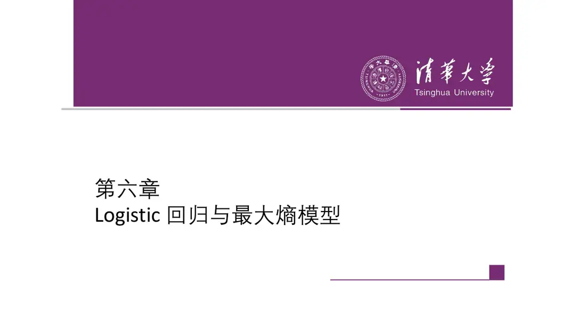

原文：

第六章 Logistic 回归与最大熵模型

大華洋
TSINGHUA UNIVERSITY
清華大學
Tsinghua University

### 回顾

原文：

回顾

• KNN

\- 决策树

\- 贝叶斯分类器

\- 是否有一种算法
  - 二分类、多类
  - 输出连续值
  - 预测
  - 优化算法
----回归

Tsinghua University
清華大學
1911-

### 回归

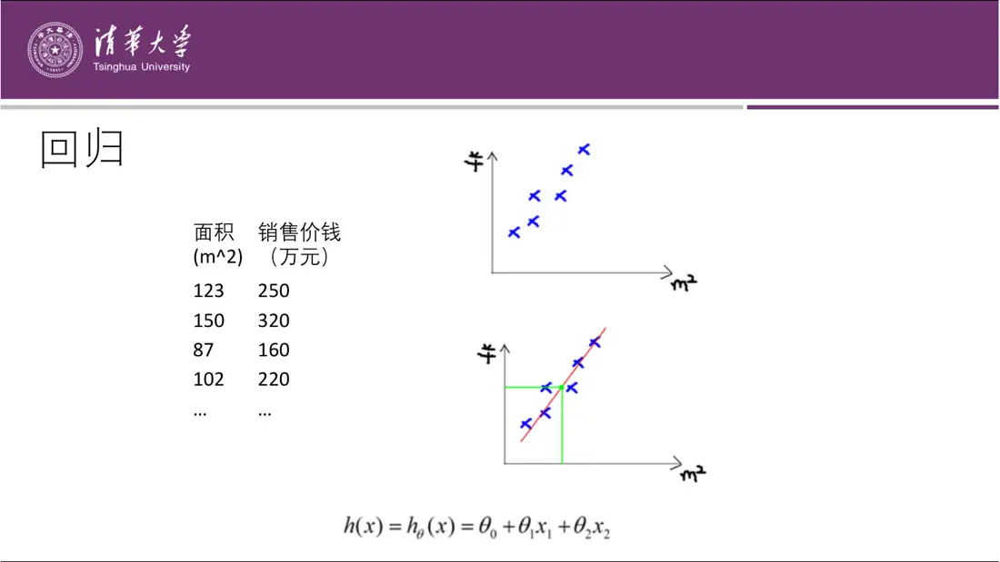

原文：

回归

<table><tr><td>面积 (m^2)</td><td>销售价钱 (万元)</td></tr><tr><td>123</td><td>250</td></tr><tr><td>150</td><td>320</td></tr><tr><td>87</td><td>160</td></tr><tr><td>102</td><td>220</td></tr><tr><td>...</td><td>...</td></tr></table>

$$
h (x) = h _ {\theta} (x) = \theta_ {0} + \theta_ {1} x _ {1} + \theta_ {2} x _ {2}
$$

Tsinghua University
清華大學
1911-UNIVERSITY
清华大学

### 回归

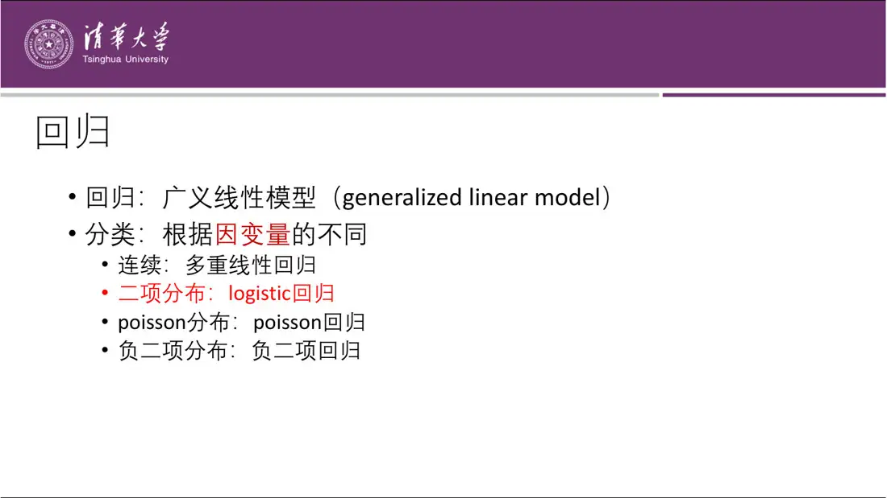

原文：

回归

\- 回归：广义线性模型（generalized linear model）

\- 分类：根据因变量的不同

\- 连续：多重线性回归

\- 二项分布：logistic回归

\- poisson分布：poisson回归

\- 负二项分布：负二项回归

Tsinghua University
清華大學
1911-

### 逻辑斯蒂分布

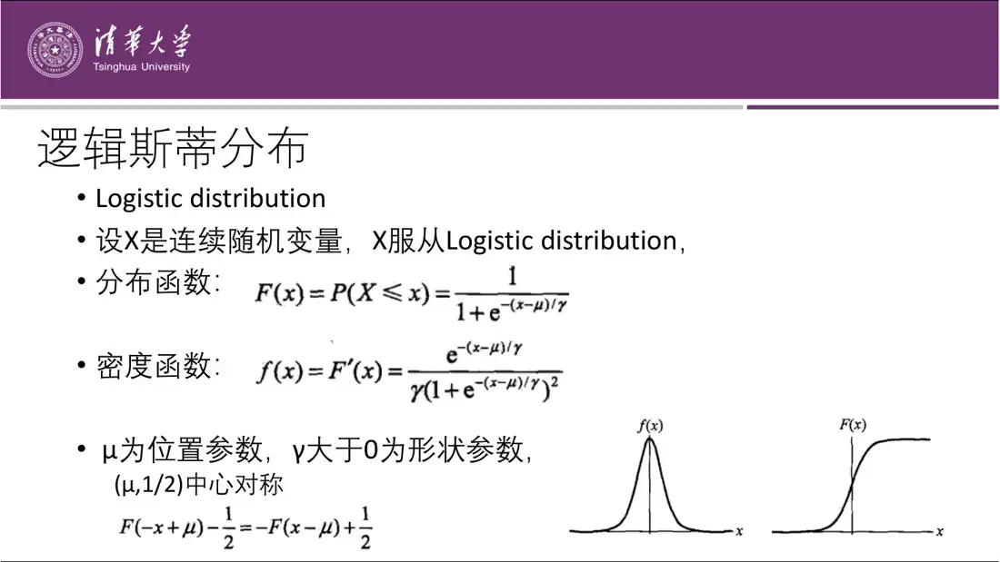

原文：

逻辑斯蒂分布

\- Logistic distribution

\- 设X是连续随机变量，X服从Logistic distribution,

\- 分布函数:

$$
F (x) = P (X \leqslant x) = \frac {1}{1 + e ^ {- (x - \mu) / \gamma}}
$$

\- 密度函数: $f(x) = F'(x) = \frac{\mathrm{e}^{-(x - \mu) / \gamma}}{\gamma(1 + \mathrm{e}^{-(x - \mu) / \gamma})^2}$

\- $\mu$ 为位置参数， $\gamma$ 大于0为形状参数， $(\mu,1/2)$ 中心对称

$$
F (- x + \mu) - \frac {1}{2} = - F (x - \mu) + \frac {1}{2}
$$

清華大學 Tsinghua University

### \- Sigmoid:

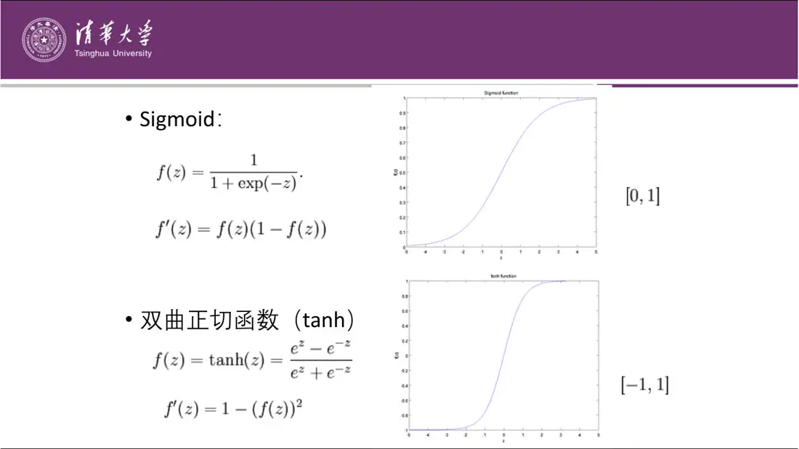

原文：

\- Sigmoid:

$$
f (z) = \frac {1}{1 + \exp (- z)}.
$$

$$
f ^ {\prime} (z) = f (z) (1 - f (z))
$$

\- 双曲正切函数（tanh）

$$
f (z) = \tanh (z) = \frac {e ^ {z} - e ^ {- z}}{e ^ {z} + e ^ {- z}}
$$

$$
f ^ {\prime} (z) = 1 - \left(f (z)\right) ^ {2}
$$

[0, 1]

清華大學 Tsinghua University

### Sigmoid function:

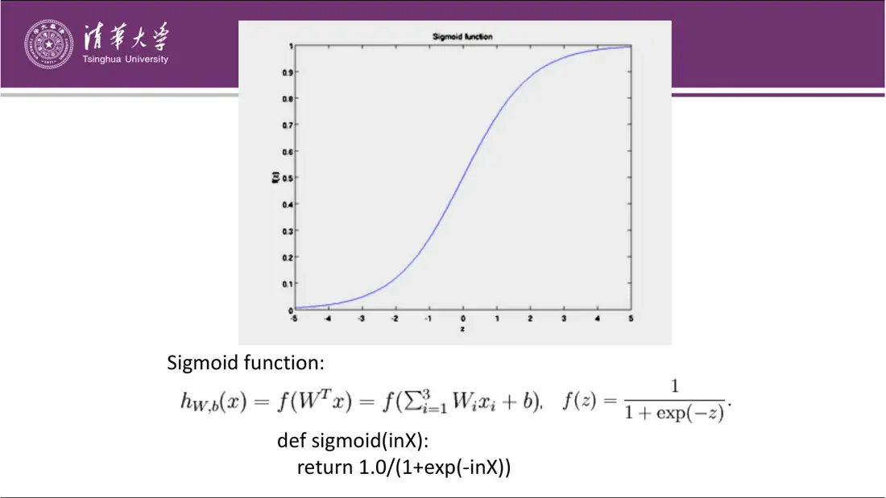

原文：

Sigmoid function:

$$
\begin{array}{r l} & h _ {W, b} (x) = f (W ^ {T} x) = f (\sum_ {i = 1} ^ {3} W _ {i} x _ {i} + b), \quad f (z) = \frac {1}{1 + \exp (- z)}. \\ & \qquad \text {def sigmoid(inX):} \\ & \qquad \text {return 1.0 / (1+exp(-inX))} \end{array}
$$

Tsinghua University
清華大學
TSINGHUA UNIVERSITY
1911
清華大學
TSINGHUA UNIVERSITY

### 二项逻辑斯蒂回归

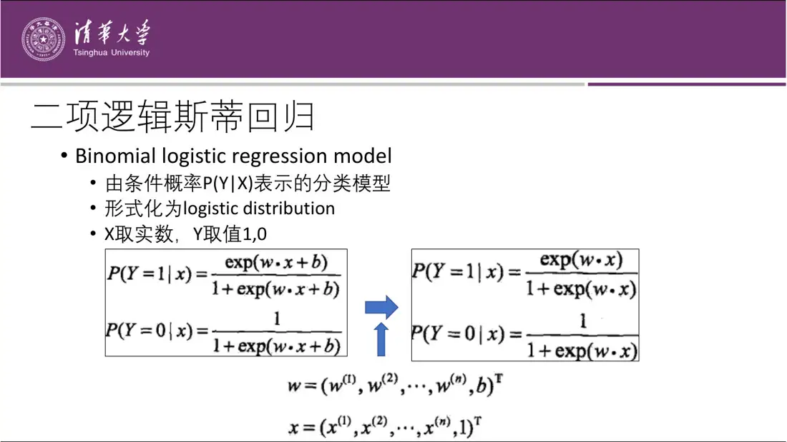

原文：

二项逻辑斯蒂回归

\- Binomial logistic regression model

\- 由条件概率P(Y|X)表示的分类模型

\- 形式化为logistic distribution

\- X取实数，Y取值1,0

$$
P (Y = 1 \mid x) = \frac {\exp (w \cdot x + b)}{1 + \exp (w \cdot x + b)}
$$

$$
P (Y = 0 \mid x) = \frac {1}{1 + \exp (w \cdot x + b)}
$$

$$
\begin{array}{l} \boxed {P (Y = 1 \mid x) = \frac {\exp (w \cdot x)}{1 + \exp (w \cdot x)}} \\ P (Y = 0 \mid x) = \frac {1}{1 + \exp (w \cdot x)} \end{array}
$$

$$
w = (w ^ {(1)}, w ^ {(2)}, \dots , w ^ {(n)}, b) ^ {\mathbf {T}}
$$

$$
x = (x ^ {(1)}, x ^ {(2)}, \dots , x ^ {(n)}, 1) ^ {T}
$$

Tsinghua University
清華大學

### 二项逻辑斯蒂回归

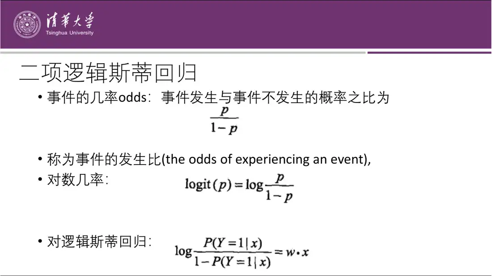

原文：

二项逻辑斯蒂回归

\- 事件的几率odds：事件发生与事件不发生的概率之比为

$$
\frac {p}{1 - p}
$$

\- 称为事件的发生比(the odds of experiencing an event),

\- 对数几率:

$$
\operatorname{logit} (p) = \log \frac {p}{1 - p}
$$

\- 对逻辑斯蒂回归：

$$
\log \frac {P (Y = 1 \mid x)}{1 - P (Y = 1 \mid x)} = w \cdot x
$$

Tsinghua University
清華大學

### 似然函数

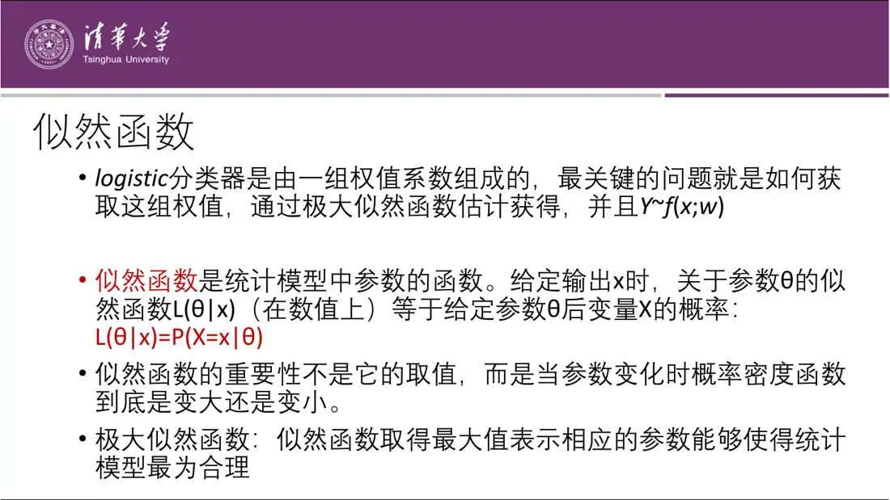

原文：

似然函数

\- logistic分类器是由一组权值系数组成的，最关键的问题就是如何获取这组权值，通过极大似然函数估计获得，并且 $Y \sim f(x; w)$

\- 似然函数是统计模型中参数的函数。给定输出x时，关于参数θ的似然函数L(θ|x)（在数值上）等于给定参数θ后变量X的概率：L(θ|x)=P(X=x|θ)

\- 似然函数的重要性不是它的取值，而是当参数变化时概率密度函数到底是变大还是变小。

\- 极大似然函数：似然函数取得最大值表示相应的参数能够使得统计模型最为合理

清華大學 Tsinghua University

### 似然函数

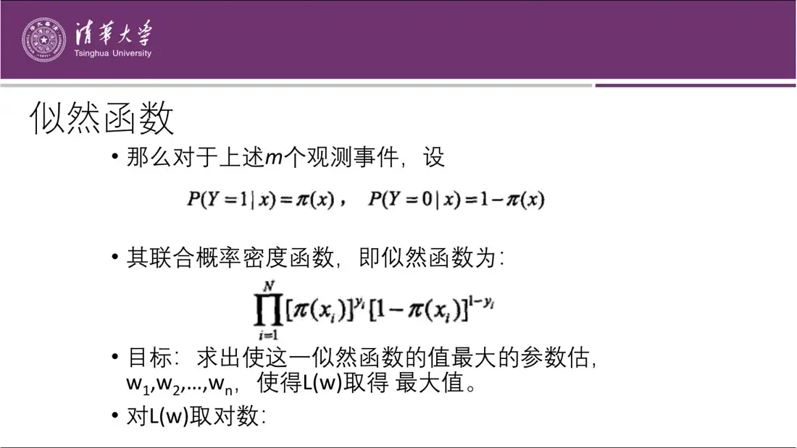

原文：

似然函数

\- 那么对于上述 $m$ 个观测事件，设

$$
P (Y = 1 \mid x) = \pi (x), \quad P (Y = 0 \mid x) = 1 - \pi (x)
$$

\- 其联合概率密度函数，即似然函数为：

$$
\prod_ {i = 1} ^ {N} \left[ \pi (x _ {i}) \right] ^ {y _ {i}} \left[ 1 - \pi (x _ {i}) \right] ^ {1 - y _ {i}}
$$

\- 目标：求出使这一似然函数的值最大的参数估， $w_{1}, w_{2}, \ldots, w_{n}$ ，使得L(w)取得最大值。

\- 对L(w)取对数:

清華大學 Tsinghua University

### 模型参数估计

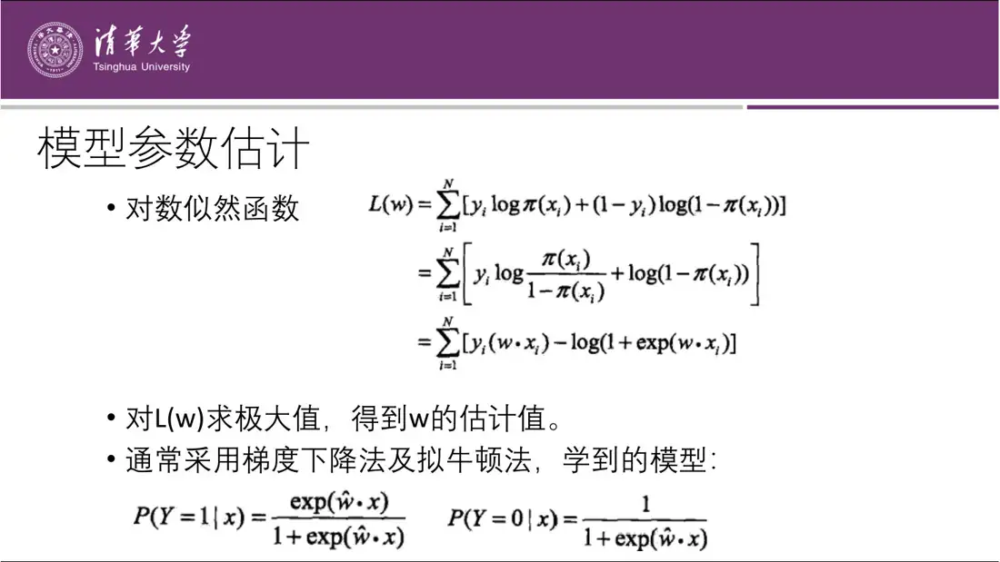

原文：

模型参数估计

\- 对数似然函数

$$
\begin{array}{r l} L (w) & = \sum_ {i = 1} ^ {N} [ y _ {i} \log \pi (x _ {i}) + (1 - y _ {i}) \log (1 - \pi (x _ {i})) ] \\ & = \sum_ {i = 1} ^ {N} \left[ y _ {i} \log \frac {\pi (x _ {i})}{1 - \pi (x _ {i})} + \log (1 - \pi (x _ {i})) \right] \\ & = \sum_ {i = 1} ^ {N} [ y _ {i} (w \cdot x _ {i}) - \log (1 + \exp (w \cdot x _ {i})) ] \end{array}
$$

\- 对L(w)求极大值，得到w的估计值。

\- 通常采用梯度下降法及拟牛顿法，学到的模型：

$$
P (Y = 1 \mid x) = \frac {\exp (\hat {w} \cdot x)}{1 + \exp (\hat {w} \cdot x)} \quad P (Y = 0 \mid x) = \frac {1}{1 + \exp (\hat {w} \cdot x)}
$$

Tsinghua University
清華大學

### 多项logistic回归

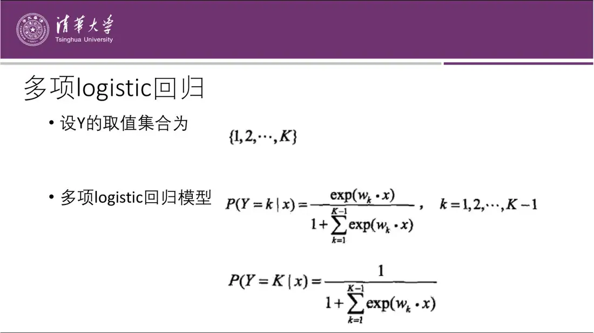

原文：

多项logistic回归

\- 设Y的取值集合为

$$
\{1, 2, \dots , K \}
$$

\- 多项logistic回归模型 $P(Y = k \mid x) = \frac{\exp(w_k \cdot x)}{1 + \sum_{k=1}^{K-1} \exp(w_k \cdot x)}, \quad k = 1, 2, \cdots, K - 1$

$$
P (Y = K \mid x) = \frac {1}{1 + \sum_ {k = 1} ^ {K - 1} \exp \left(w _ {k} \cdot x\right)}
$$

Tsinghua University
清華大學
1911-UNIVERSITY

### 最大熵模型

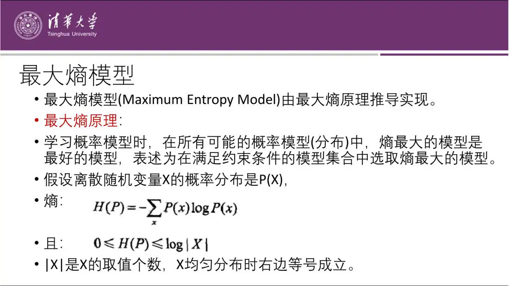

原文：

最大熵模型

\- 最大熵模型(Maximum Entropy Model)由最大熵原理推导实现。

\- 最大熵原理：

\- 学习概率模型时，在所有可能的概率模型(分布)中，熵最大的模型是最好的模型，表述为在满足约束条件的模型集合中选取熵最大的模型。

\- 假设离散随机变量X的概率分布是P(X),

\- 熵：

$$
H (P) = - \sum_ {x} P (x) \log P (x)
$$

\- 且: $0 \leqslant H(P) \leqslant \log |X|$

\- |X|是X的取值个数，X均匀分布时右边等号成立。

Tsinghua University
清華大學

### 例子：

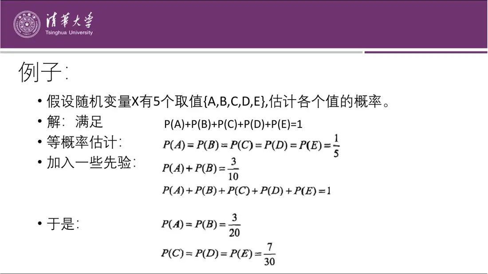

原文：

例子：

\- 假设随机变量X有5个取值{A,B,C,D,E},估计各个值的概率。

\- 解：满足

$$
P (A) + P (B) + P (C) + P (D) + P (E) = 1
$$

\- 等概率估计:

$$
P (A) = P (B) = P (C) = P (D) = P (E) = \frac {1}{5}
$$

\- 加入一些先验:

$$
P (A) + P (B) = \frac {3}{1 0}
$$

$$
P (A) + P (B) + P (C) + P (D) + P (E) = 1
$$

\- 于是:

$$
P (A) = P (B) = \frac {3}{2 0}
$$

$$
P (C) = P (D) = P (E) = \frac {7}{3 0}
$$

清華大學 Tsinghua University

### 例子:

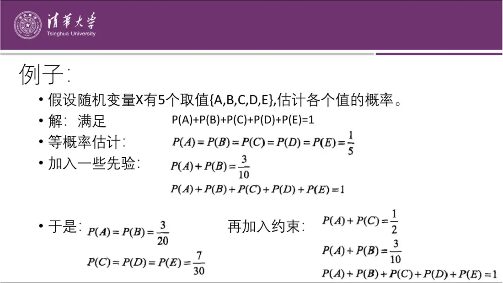

原文：

例子:

\- 假设随机变量X有5个取值{A,B,C,D,E},估计各个值的概率。

\- 解: 满足 $P(A) + P(B) + P(C) + P(D) + P(E) = 1$

\- 等概率估计: $P(A) = P(B) = P(C) = P(D) = P(E) = \frac{1}{5}$

\- 加入一些先验:

$$
P (A) + P (B) = \frac {3}{1 0}
$$

$$
P (A) + P (B) + P (C) + P (D) + P (E) = 1
$$

\- 于是： $P(A)=P(B)=\frac{3}{20}$

再加入约束： $P(A) + P(C) = \frac{1}{2}$

$$
P (C) = P (D) = P (E) = \frac {7}{3 0}
$$

$$
P (A) + P (B) = \frac {3}{1 0}
$$

$$
P (A) + P (B) + P (C) + P (D) + P (E) = 1
$$

Tsinghua University
清華大學

### 最大熵模型

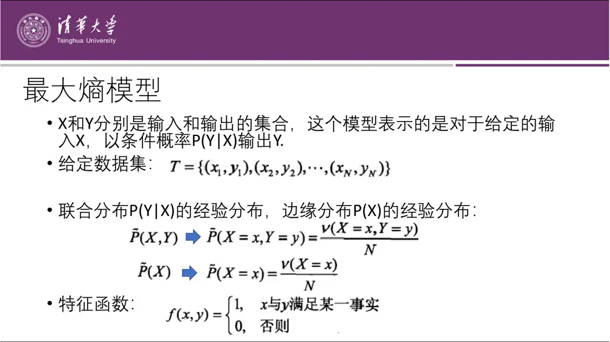

原文：

最大熵模型

• X和Y分别是输入和输出的集合，这个模型表示的是对于给定的输入X，以条件概率P(Y|X)输出Y.

\- 给定数据集： $T = \{(x_{1}, y_{1}), (x_{2}, y_{2}), \cdots, (x_{N}, y_{N})\}$

\- 联合分布P(Y|X)的经验分布，边缘分布P(X)的经验分布：

$$
\tilde {P} (X, Y) \Rightarrow \tilde {P} (X = x, Y = y) = \frac {\nu (X = x , Y = y)}{N}
$$

$$
\tilde {P} (X) \Rightarrow \tilde {P} (X = x) = \frac {\nu (X = x)}{N}
$$

\- 特征函数: $f(x, y) = \begin{cases} 1, & x \text{与} y \text{满足某一事实} \\ 0, & \text{否则} \end{cases}$

Tsinghua University
清華大學

### 最大熵模型

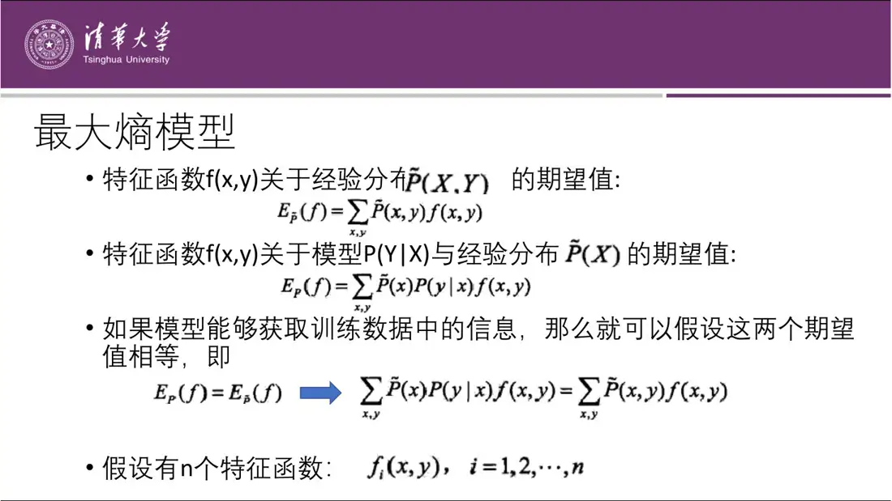

原文：

最大熵模型

\- 特征函数 $f(x,y)$ 关于经验分布 $\tilde{P}(X,Y)$ 的期望值:

$$
E _ {\tilde {P}} (f) = \sum_ {x, y} \tilde {P} (x, y) f (x, y)
$$

\- 特征函数 $f(x,y)$ 关于模型 $P(Y|X)$ 与经验分布 $\tilde{P}(X)$ 的期望值:

$$
E _ {P} (f) = \sum_ {x, y} \tilde {P} (x) P (y \mid x) f (x, y)
$$

\- 如果模型能够获取训练数据中的信息，那么就可以假设这两个期望值相等，即

$$
E _ {P} (f) = E _ {\tilde {p}} (f) \quad \Longrightarrow \quad \sum_ {x, y} \tilde {P} (x) P (y \mid x) f (x, y) = \sum_ {x, y} \tilde {P} (x, y) f (x, y)
$$

\- 假设有n个特征函数： $f_{i}(x,y)$ ， $i=1,2,\cdots,n$

清華大學 Tsinghua University

### 最大熵模型

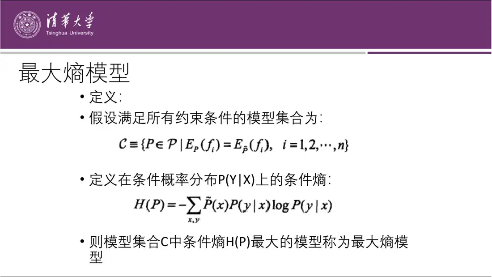

原文：

最大熵模型

\- 定义:

\- 假设满足所有约束条件的模型集合为:

$$
\mathcal {C} \equiv \{P \in \mathcal {P} \mid E _ {P} (f _ {i}) = E _ {\tilde {P}} (f _ {i}), i = 1, 2, \dots , n \}
$$

\- 定义在条件概率分布P(Y|X)上的条件熵:

$$
H (P) = - \sum_ {x, y} \tilde {P} (x) P (y \mid x) \log P (y \mid x)
$$

\- 则模型集合C中条件熵H(P)最大的模型称为最大熵模型

Tsinghua University
清華大學
1911-UNIVERSITY

### 最大熵模型的学习

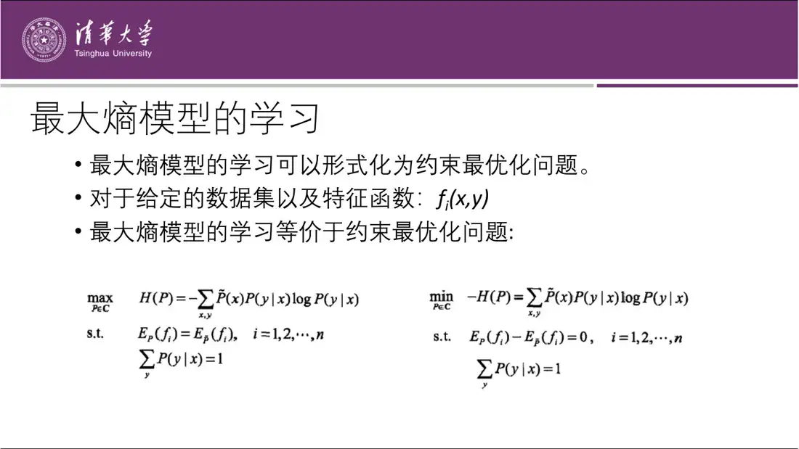

原文：

最大熵模型的学习

\- 最大熵模型的学习可以形式化为约束最优化问题。

\- 对于给定的数据集以及特征函数： $f_{i}(x,y)$

\- 最大熵模型的学习等价于约束最优化问题:

$$
\begin{array}{l l} \max _ {P \in C} & H (P) = - \sum_ {x, y} \tilde {P} (x) P (y \mid x) \log P (y \mid x) \\ \text { s.t. } & E _ {P} (f _ {i}) = E _ {\tilde {P}} (f _ {i}), \quad i = 1, 2, \dots , n \\ & \sum_ {y} P (y \mid x) = 1 \end{array}
$$

$$
\begin{array}{l l} \min _ {P \in \mathbf {C}} & - H (P) = \sum_ {x, y} \tilde {P} (x) P (y \mid x) \log P (y \mid x) \\ \text { s.t. } & E _ {P} (f _ {i}) - E _ {\tilde {P}} (f _ {i}) = 0, \quad i = 1, 2, \dots , n \\ & \sum_ {y} P (y \mid x) = 1 \end{array}
$$

Tsinghua University
清華大學

### 最大熵模型的学习

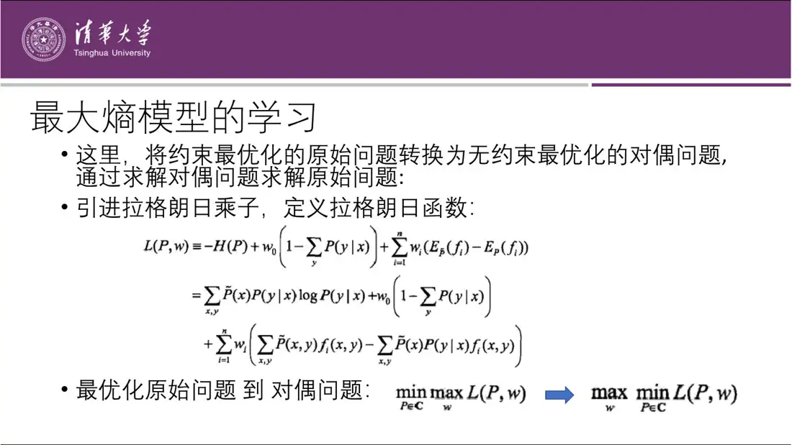

原文：

最大熵模型的学习

\- 这里，将约束最优化的原始问题转换为无约束最优化的对偶问题，通过求解对偶问题求解原始问题：

\- 引进拉格朗日乘子，定义拉格朗日函数：

$$
\begin{array}{r l} L (P, w) & \equiv - H (P) + w _ {0} \left(1 - \sum_ {y} P (y \mid x)\right) + \sum_ {i = 1} ^ {n} w _ {i} (E _ {\tilde {P}} (f _ {i}) - E _ {P} (f _ {i})) \\ & = \sum_ {x, y} \tilde {P} (x) P (y \mid x) \log P (y \mid x) + w _ {0} \left(1 - \sum_ {y} P (y \mid x)\right) \\ & + \sum_ {i = 1} ^ {n} w _ {i} \left(\sum_ {x, y} \tilde {P} (x, y) f _ {i} (x, y) - \sum_ {x, y} \tilde {P} (x) P (y \mid x) f _ {i} (x, y)\right) \end{array}
$$

\- 最优化原始问题到对偶问题: $\min_{P \in \mathbb{C}} \max_{w} L(P, w) \implies \max_{w} \min_{P \in \mathbb{C}} L(P, w)$

Tsinghua University
清華大學
1911-UNIVERSITY

### 最大熵模型的学习

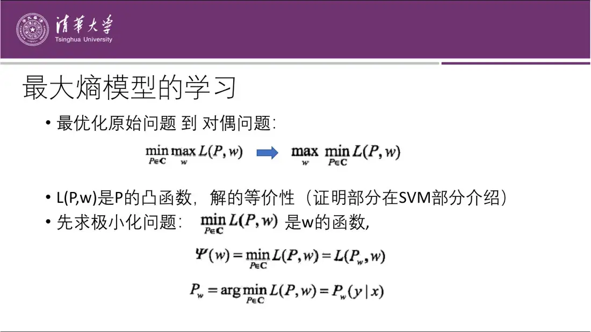

原文：

最大熵模型的学习

\- 最优化原始问题到对偶问题:

$$
\min _ {P \in \mathbf {C}} \max _ {w} L (P, w) \quad \Longrightarrow \quad \max _ {w} \min _ {P \in \mathbf {C}} L (P, w)
$$

\- L(P,w)是P的凸函数，解的等价性（证明部分在SVM部分介绍）

\- 先求极小化问题: $\min_{P \in \mathbb{C}} L(P, w)$ 是 $w$ 的函数,

$$
\Psi (w) = \min _ {P \in \mathbb {C}} L (P, w) = L (P _ {w}, w)
$$

$$
P _ {w} = \arg \min _ {P \in \mathbb {C}} L (P, w) = P _ {w} (y \mid x)
$$

清華大學 Tsinghua University

### 最大熵模型的学习

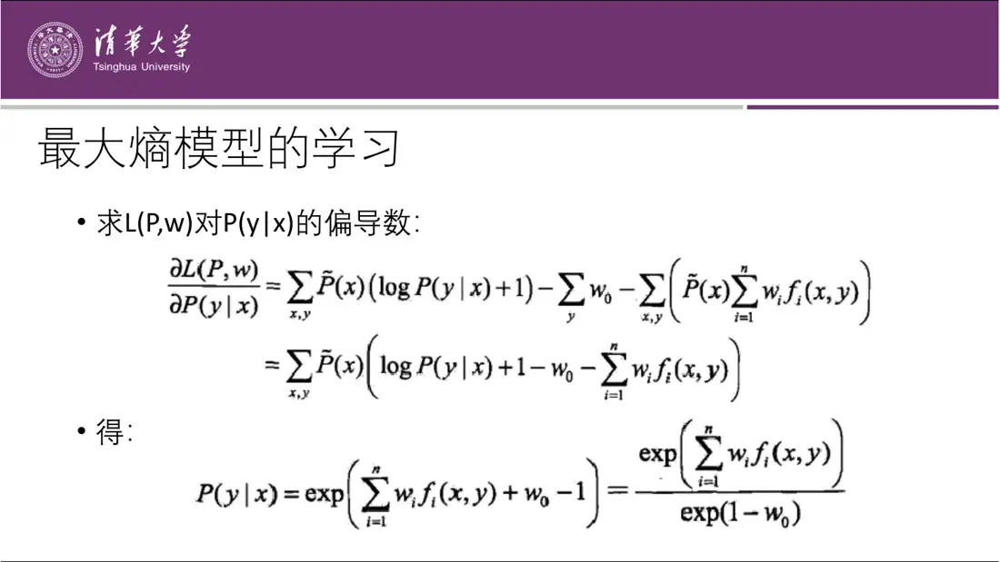

原文：

最大熵模型的学习

\- 求 $L(P, w)$ 对 $P(y|x)$ 的偏导数：

$$
\begin{array}{r l} \frac {\partial L (P , w)}{\partial P (y \mid x)} & = \sum_ {x, y} \tilde {P} (x) (\log P (y \mid x) + 1) - \sum_ {y} w _ {0} - \sum_ {x, y} \left(\tilde {P} (x) \sum_ {i = 1} ^ {n} w _ {i} f _ {i} (x, y)\right) \\ & = \sum_ {x, y} \tilde {P} (x) \left(\log P (y \mid x) + 1 - w _ {0} - \sum_ {i = 1} ^ {n} w _ {i} f _ {i} (x, y)\right) \end{array}
$$

\- 得:

$$
P (y \mid x) = \exp \left(\sum_ {i = 1} ^ {n} w _ {i} f _ {i} (x, y) + w _ {0} - 1\right) = \frac {\exp \left(\sum_ {i = 1} ^ {n} w _ {i} f _ {i} (x , y)\right)}{\exp \left(1 - w _ {0}\right)}
$$

清華大學 Tsinghua University

### 最大熵模型的学习

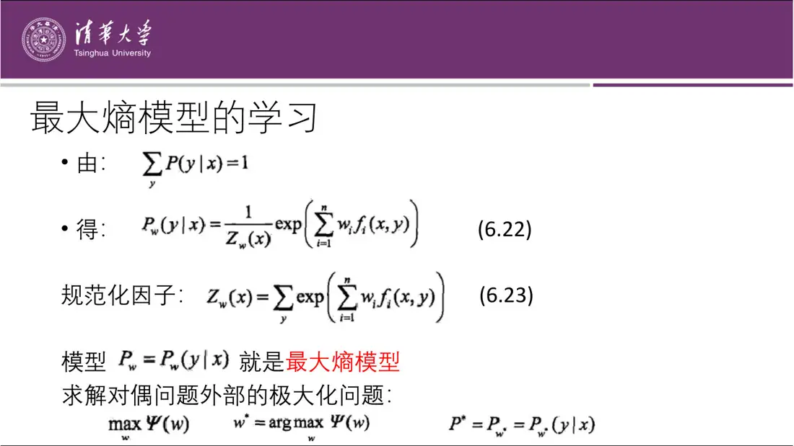

原文：

最大熵模型的学习

\- 由: $\sum_{y} P(y \mid x) = 1$

\- 得: $P_{w}(y \mid x) = \frac{1}{Z_{w}(x)} \exp \left( \sum_{i=1}^{n} w_{i} f_{i}(x, y) \right)$

(6.22)

规范化因子： $Z_{w}(x) = \sum_{y}\exp \left(\sum_{i = 1}^{n}w_{i}f_{i}(x,y)\right)$

(6.23)

模型 $P_{w} = P_{w}(y|x)$ 就是最大熵模型

求解对偶问题外部的极大化问题:

$$
\max _ {w} \Psi (w) \quad w ^ {*} = \arg \max _ {w} \Psi (w) \quad P ^ {*} = P _ {w ^ {*}} = P _ {w ^ {*}} (y | x)
$$

清華大學 Tsinghua University

### 例子:

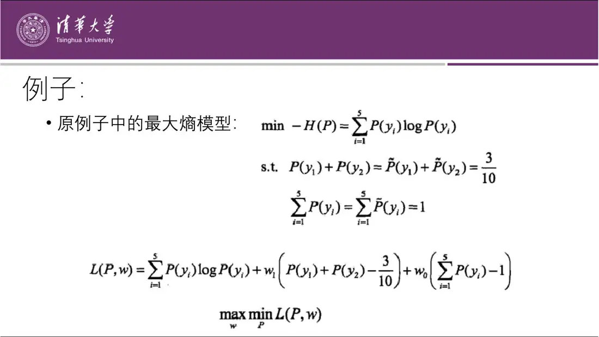

原文：

例子:

\- 原例子中的最大熵模型: $\min - H(P) = \sum_{i=1}^{5} P(y_i) \log P(y_i)$

s.t. $P(y_{1}) + P(y_{2}) = \tilde{P} (y_{1}) + \tilde{P} (y_{2}) = \frac{3}{10}$

$$
\sum_ {i = 1} ^ {5} P (y _ {i}) = \sum_ {i = 1} ^ {5} \tilde {P} (y _ {i}) = 1
$$

$$
L (P, w) = \sum_ {i = 1} ^ {5} P \left(y _ {i}\right) \log P \left(y _ {i}\right) + w _ {1} \left(P \left(y _ {1}\right) + P \left(y _ {2}\right) - \frac {3}{1 0}\right) + w _ {0} \left(\sum_ {i = 1} ^ {5} P \left(y _ {i}\right) - 1\right)
$$

$$
\max _ {w} \min _ {P} L (P, w)
$$

清華大學 Tsinghua University

### 例子:

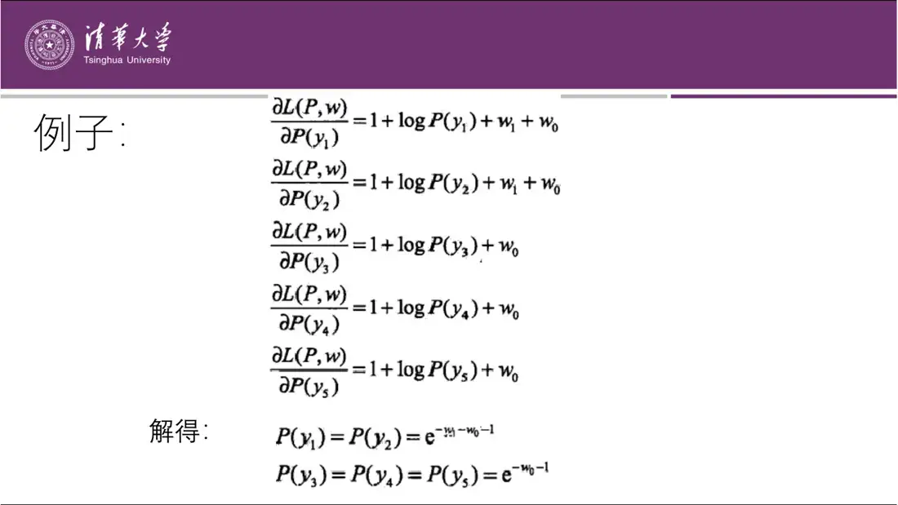

原文：

例子:

$$
\frac {\partial L (P , w)}{\partial P \left(y _ {1}\right)} = 1 + \log P \left(y _ {1}\right) + w _ {1} + w _ {0}
$$

$$
\frac {\partial L (P , w)}{\partial P \left(y _ {2}\right)} = 1 + \log P \left(y _ {2}\right) + w _ {1} + w _ {0}
$$

$$
\frac {\partial L (P , w)}{\partial P \left(y _ {3}\right)} = 1 + \log P \left(y _ {3}\right) + w _ {0}
$$

$$
\frac {\partial L (P , w)}{\partial P \left(y _ {4}\right)} = 1 + \log P \left(y _ {4}\right) + w _ {0}
$$

$$
\frac {\partial L (P , w)}{\partial P \left(y _ {s}\right)} = 1 + \log P \left(y _ {s}\right) + w _ {0}
$$

解得：

$$
P (\mathcal {Y} _ {1}) = P (\mathcal {Y} _ {2}) = \mathrm{e} ^ {- w _ {1} - w _ {0} - 1}
$$

$$
P (y _ {3}) = P (y _ {4}) = P (y _ {5}) = \mathrm{e} ^ {- w _ {0} - 1}
$$

Tsinghua University
清華大學
1911-UNIVERSITY

### 例子：

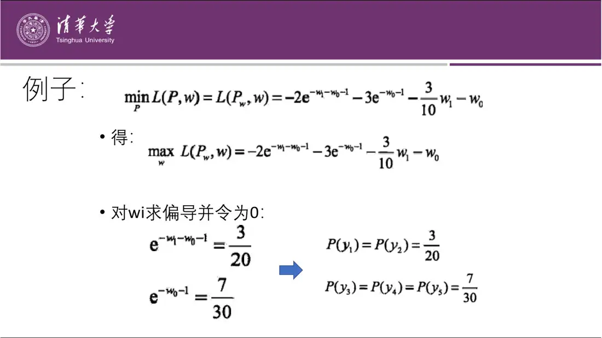

原文：

例子：

$$
\min _ {P} L (P, w) = L \left(P _ {w}, w\right) = - 2 e ^ {- w _ {1} - w _ {0} - 1} - 3 e ^ {- w _ {0} - 1} - \frac {3}{1 0} w _ {1} - w _ {0}
$$

\- 得:

$$
\max _ {w} L \left(P _ {w}, w\right) = - 2 \mathrm{e} ^ {- w _ {1} - w _ {0} - 1} - 3 \mathrm{e} ^ {- w _ {0} - 1} - \frac {3}{1 0} w _ {1} - w _ {0}
$$

\- 对wi求偏导并令为0:

$$
\begin{array}{l}\mathrm{e} ^ {- w _ {1} - w _ {0} - 1} = \frac {3}{2 0}\\\mathrm{e} ^ {- w _ {0} - 1} = \frac {7}{3 0}\end{array}\quad \rightarrow \quad\begin{array}{l}P (y _ {1}) = P (y _ {2}) = \frac {3}{2 0}\\P (y _ {3}) = P (y _ {4}) = P (y _ {5}) = \frac {7}{3 0}\end{array}
$$

清華大學 Tsinghua University

### 极大似然估计

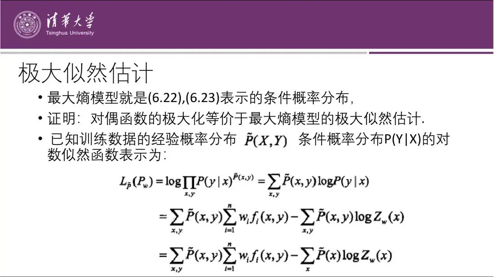

原文：

极大似然估计

\- 最大熵模型就是(6.22),(6.23)表示的条件概率分布,

\- 证明：对偶函数的极大化等价于最大熵模型的极大似然估计.

\- 已知训练数据的经验概率分布 $\tilde{P}(X,Y)$ 条件概率分布 $P(Y|X)$ 的对数似然函数表示为：

$$
\begin{array}{r l} L _ {\tilde {P}} (P _ {w}) & = \log \prod_ {x, y} P (y \mid x) ^ {\tilde {P} (x, y)} = \sum_ {x, y} \tilde {P} (x, y) \log P (y \mid x) \\ & = \sum_ {x, y} \tilde {P} (x, y) \sum_ {i = 1} ^ {n} w _ {i} f _ {i} (x, y) - \sum_ {x, y} \tilde {P} (x, y) \log Z _ {w} (x) \\ & = \sum_ {x, y} \tilde {P} (x, y) \sum_ {i = 1} ^ {n} w _ {i} f _ {i} (x, y) - \sum_ {x} \tilde {P} (x) \log Z _ {w} (x) \end{array}
$$

清華大學 Tsinghua University

### 极大似然估计

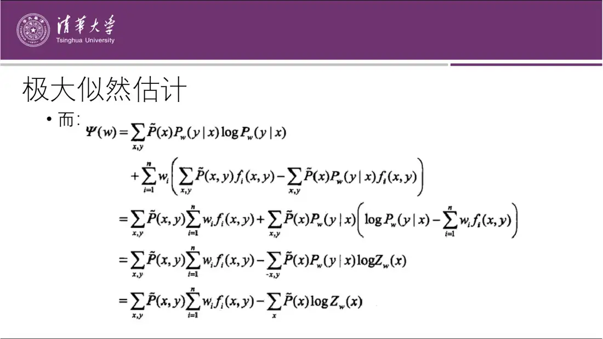

原文：

极大似然估计

\- 而:

$$
\begin{array}{r l} & {\text {而}: \Psi (w) = \sum_ {x, y} \tilde {P} (x) P _ {w} (y \mid x) \log P _ {w} (y \mid x)} \\ & {\qquad + \sum_ {i = 1} ^ {n} w _ {i} \Bigg (\sum_ {x, y} \tilde {P} (x, y) f _ {i} (x, y) - \sum_ {x, y} \tilde {P} (x) P _ {w} (y \mid x) f _ {i} (x, y) \Bigg)} \\ & {\qquad = \sum_ {x, y} \tilde {P} (x, y) \sum_ {i = 1} ^ {n} w _ {i} f _ {i} (x, y) + \sum_ {x, y} \tilde {P} (x) P _ {w} (y \mid x) \Bigg (\log P _ {w} (y \mid x) - \sum_ {i = 1} ^ {n} w _ {i} f _ {i} (x, y) \Bigg)} \\ & {\qquad = \sum_ {x, y} \tilde {P} (x, y) \sum_ {i = 1} ^ {n} w _ {i} f _ {i} (x, y) - \sum_ {- x, y} \tilde {P} (x) P _ {w} (y \mid x) \log Z _ {w} (x)} \\ & {\qquad = \sum_ {x, y} \tilde {P} (x, y) \sum_ {i = 1} ^ {n} w _ {i} f _ {i} (x, y) - \sum_ {x} \tilde {P} (x) \log Z _ {w} (x)} \end{array}
$$

清華大學 Tsinghua University

### 极大似然估计

原文：

极大似然估计

\- 最大熵模型与逻辑斯谛回归模型有类似的形式，它们又称为对数线性模型(log linear model). 模型学习就是在给定的训练数据条件下对模型进行极大似然估计或正则化的极大似然估计。

清華大學 Tsinghua University

### 模型学习的最优化算法

原文：

模型学习的最优化算法

\- 逻辑斯谛回归模型、最大熵模型学习归结为以似然函数为目标函数的最优化问题，通常通过迭代算法求解，它是光滑的凸函数，因此多种最优化的方法都适用。

\- 常用的方法有：

\- 改进的迭代尺度法

\- 梯度下降法

\- 牛顿法

\- 拟牛顿法

Tsinghua University
清華大學
1911-1911

### 最优化方法

原文：

最优化方法

Tsinghua University
清華大學
1911-

### 梯度下降法

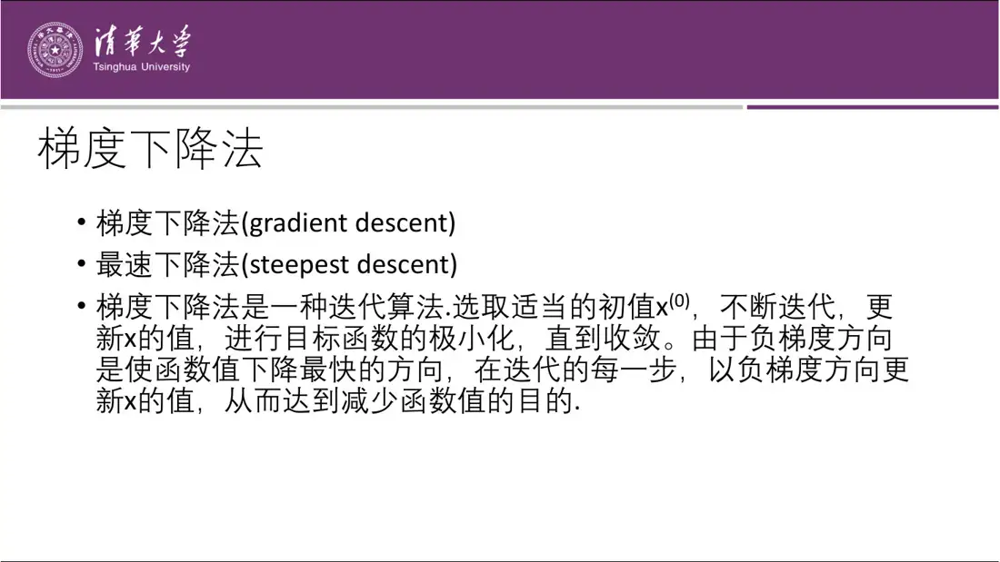

原文：

梯度下降法

\- 梯度下降法(gradient descent)

\- 最速下降法(steepest descent)

\- 梯度下降法是一种迭代算法.选取适当的初值 $x^{(0)}$ ，不断迭代，更新x的值，进行目标函数的极小化，直到收敛。由于负梯度方向是使函数值下降最快的方向，在迭代的每一步，以负梯度方向更新x的值，从而达到减少函数值的目的.

清華大學 Tsinghua University

### 梯度下降法

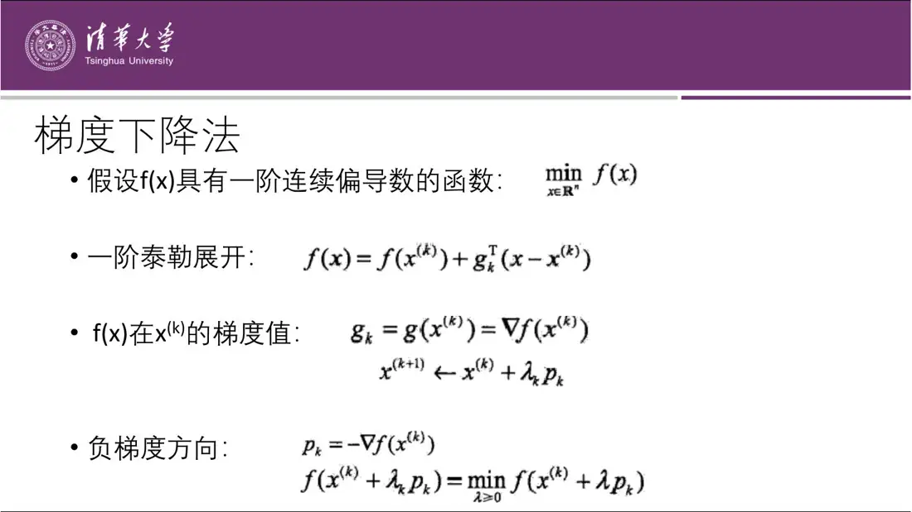

原文：

梯度下降法

\- 假设 $f(x)$ 具有一阶连续偏导数的函数： $\min_{x\in\mathbb{R}^{n}}f(x)$

\- 一阶泰勒展开: $f(x) = f(x^{(k)}) + g_k^{\mathrm{T}}(x - x^{(k)})$

\- $f(x)$ 在 $x^{(k)}$ 的梯度值: $g_k = g(x^{(k)}) = \nabla f(x^{(k)})$

$$
x ^ {(k + 1)} \leftarrow x ^ {(k)} + \lambda_ {k} p _ {k}
$$

\- 负梯度方向:

$$
p _ {k} = - \nabla f (x ^ {(k)})
$$

$$
f (x ^ {(k)} + \lambda_ {k} p _ {k}) = \min _ {\lambda \geqslant 0} f (x ^ {(k)} + \lambda p _ {k})
$$

Tsinghua University
清華大學

### 无约束最优化问题

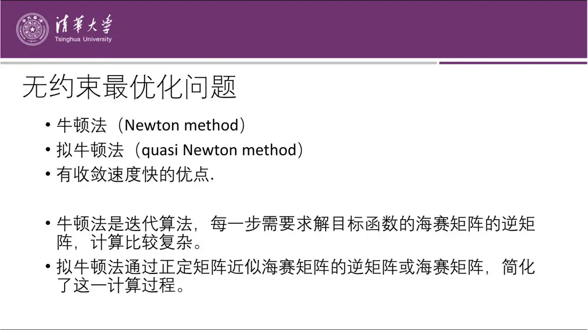

原文：

无约束最优化问题

\- 牛顿法 (Newton method)

\- 拟牛顿法（quasi Newton method）

\- 有收敛速度快的优点.

\- 牛顿法是迭代算法，每一步需要求解目标函数的海赛矩阵的逆矩阵，计算比较复杂。

\- 拟牛顿法通过正定矩阵近似海赛矩阵的逆矩阵或海赛矩阵，简化了这一计算过程。

Tsinghua University
清華大學
1911-1911

### 牛顿法

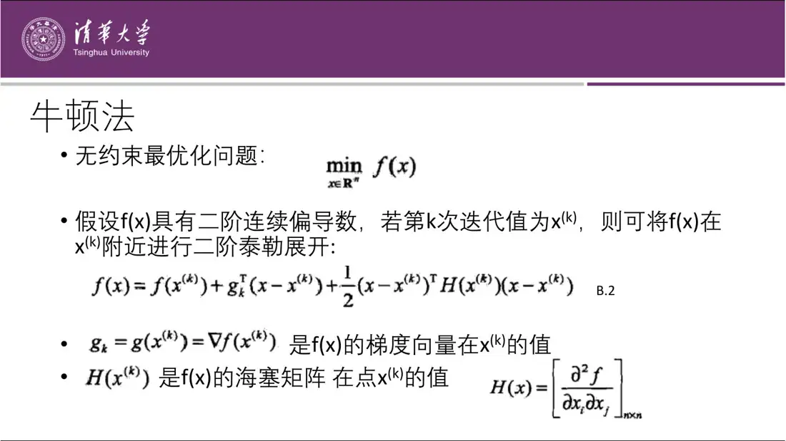

原文：

牛顿法

\- 无约束最优化问题:

$$
\min _ {x \in \mathbf {R} ^ {n}} f (x)
$$

\- 假设 $f(x)$ 具有二阶连续偏导数，若第k次迭代值为 $x^{(k)}$ ，则可将 $f(x)$ 在 $x^{(k)}$ 附近进行二阶泰勒展开：

$$
f (x) = f \left(x ^ {(k)}\right) + g _ {k} ^ {\mathrm{T}} \left(x - x ^ {(k)}\right) + \frac {1}{2} \left(x - x ^ {(k)}\right) ^ {\mathrm{T}} H \left(x ^ {(k)}\right) \left(x - x ^ {(k)}\right)\tag{B.2}
$$

\- $g_{k} = g(x^{(k)}) = \nabla f(x^{(k)})$ 是f(x)的梯度向量在x(k)的值

\- $H(x^{(k)})$ 是f(x)的海塞矩阵在点 $\mathbf{x}^{(k)}$ 的值 $H(x) = \left[\frac{\partial^2f}{\partial x_i\partial x_j}\right]_{n\times n}$

Tsinghua University
清華大學

### 牛顿法

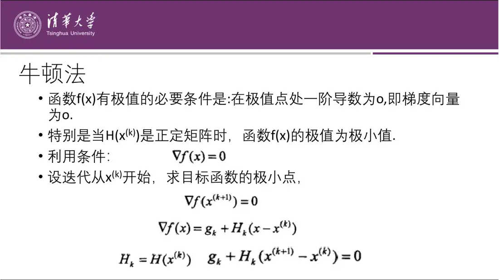

原文：

牛顿法

\- 函数 $f(x)$ 有极值的必要条件是:在极值点处一阶导数为o,即梯度向量为o.

\- 特别是当 $H(x^{(k)})$ 是正定矩阵时，函数 $f(x)$ 的极值为极小值.

\- 利用条件: $\nabla f(x) = 0$

\- 设迭代从 $x^{(k)}$ 开始，求目标函数的极小点，

$$
\nabla f (x ^ {(k + 1)}) = 0
$$

$$
\nabla f (x) = g _ {k} + H _ {k} \left(x - x ^ {(k)}\right)
$$

$$
H _ {k} = H (x ^ {(k)}) \quad g _ {k} + H _ {k} (x ^ {(k + 1)} - x ^ {(k)}) = 0
$$

Tsinghua University
清華大學

### 牛顿法

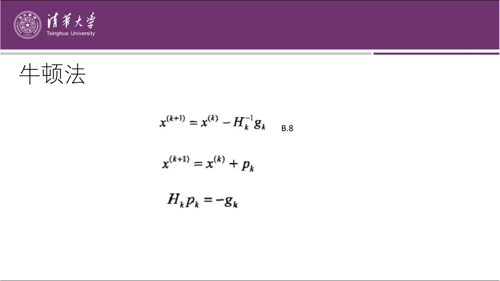

原文：

牛顿法

$$
x ^ {(k + 1)} = x ^ {(k)} - H _ {k} ^ {- 1} g _ {k} \tag {B.8}
$$

$$
x ^ {(k + 1)} = x ^ {(k)} + p _ {k}
$$

$$
H _ {k} p _ {k} = - g _ {k}
$$

清華大學 Tsinghua University

### 牛顿法

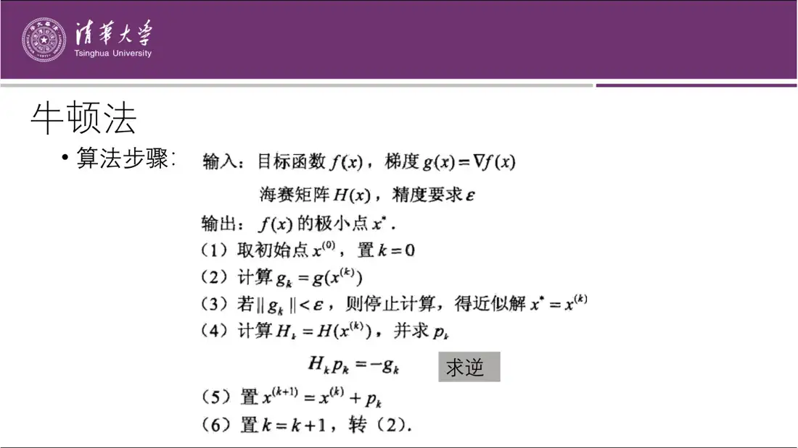

原文：

牛顿法

\- 算法步骤：输入：目标函数 $f(x)$ ，梯度 $g(x) = \nabla f(x)$

海赛矩阵 $H(x)$ ，精度要求 $\varepsilon$

输出： $f(x)$ 的极小点 $\pmb{x}^{*}$

（1）取初始点 $x^{(0)}$ ，置 $k = 0$

(2) 计算 $g_{k}=g(x^{(k)})$

(3) 若 $\|g_{k}\|<\varepsilon$ ，则停止计算，得近似解 $x^{*}=x^{(k)}$

(4) 计算 $H_{k}=H(x^{(k)})$ ，并求 $p_{k}$

$$
H _ {k} p _ {k} = - g _ {k}
$$

求逆

(5) 置 $x^{(k + 1)} = x^{(k)} + p_k$

(6) 置 $k = k + 1$ ，转 (2).

清華大學 Tsinghua University

### 拟牛顿法

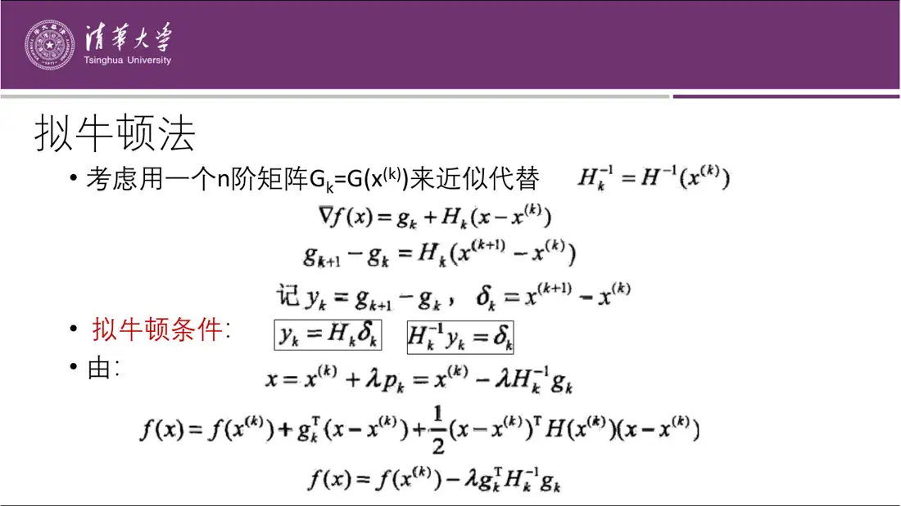

原文：

拟牛顿法

\- 考虑用一个n阶矩阵 $G_{k}=G(x^{(k)})$ 来近似代替 $H_{k}^{-1}=H^{-1}(x^{(k)})$

$$
\nabla f (x) = g _ {k} + H _ {k} \left(x - x ^ {(k)}\right)
$$

$$
g _ {k + 1} - g _ {k} = H _ {k} \left(x ^ {(k + 1)} - x ^ {(k)}\right)
$$

$$
\text {记} y _ {k} = g _ {k + 1} - g _ {k}, \quad \delta_ {k} = x ^ {(k + 1)} - x ^ {(k)}
$$

\- 拟牛顿条件:

$$
\boxed {y _ {k} = H _ {k} \delta_ {k}} \quad \boxed {H _ {k} ^ {- 1} y _ {k} = \delta_ {k}}
$$

·由：

$$
x = x ^ {(k)} + \lambda p _ {k} = x ^ {(k)} - \lambda H _ {k} ^ {- 1} g _ {k}
$$

$$
f (x) = f \left(x ^ {(k)}\right) + g _ {k} ^ {T} \left(x - x ^ {(k)}\right) + \frac {1}{2} \left(x - x ^ {(k)}\right) ^ {T} H \left(x ^ {(k)}\right) \left(x - x ^ {(k)}\right)
$$

$$
f (x) = f \left(x ^ {(k)}\right) - \lambda g _ {k} ^ {\mathrm{T}} H _ {k} ^ {- 1} g _ {k}
$$

清華大學 Tsinghua University

### 拟牛顿法

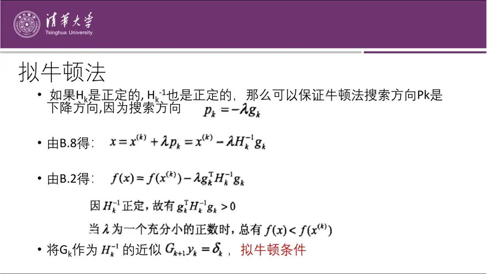

原文：

拟牛顿法

\- 如果 $H_{k}$ 是正定的, $H_{k}^{-1}$ 也是正定的, 那么可以保证牛顿法搜索方向 $\mathsf{Pk}$ 是下降方向, 因为搜索方向 $p_{k} = -\lambda g_{k}$

\- 由B.8得： $x = x^{(k)} + \lambda p_k = x^{(k)} - \lambda H_k^{-1}g_k$

\- 由B.2得： $f(x) = f(x^{(k)}) - \lambda g_{k}^{\mathrm{T}}H_{k}^{-1}g_{k}$

因 $H_{k}^{-1}$ 正定，故有 $\pmb{g}_{k}^{\mathrm{T}}\pmb{H}_{k}^{-1}\pmb{g}_{k} > 0$

当 $\lambda$ 为一个充分小的正数时，总有 $f(x) < f(x^{(k)})$

\- 将 $G_{k}$ 作为 $H_{k}^{-1}$ 的近似 $G_{k+1}y_{k} = \delta_{k}$ ，拟牛顿条件

Tsinghua University
清華大學

### 拟牛顿法

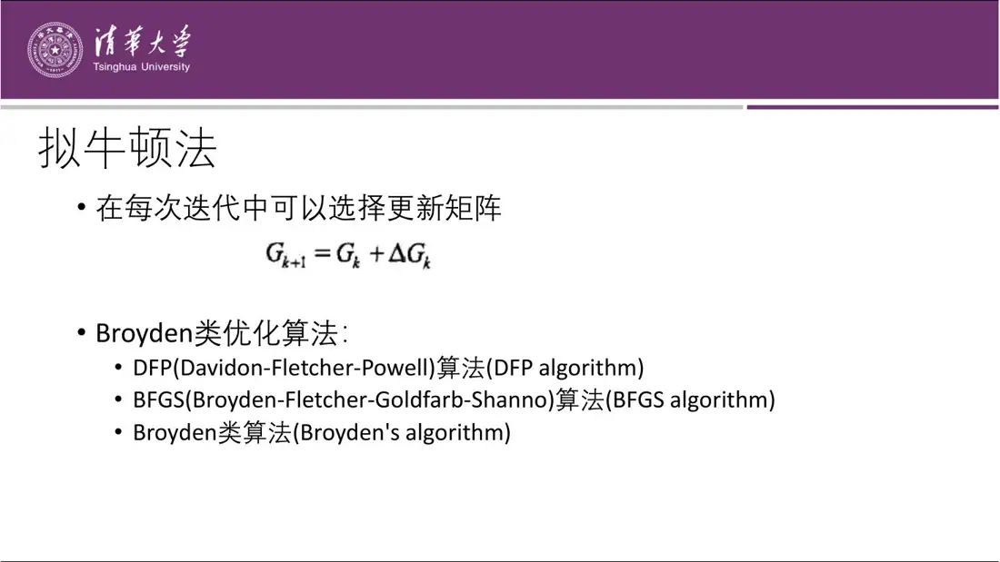

原文：

拟牛顿法

\- 在每次迭代中可以选择更新矩阵

$$
G _ {k + 1} = G _ {k} + \Delta G _ {k}
$$

\- Broyden类优化算法:

\- DFP(Davidon-Fletcher-Powell)算法(DFP algorithm)

\- BFGS(Broyden-Fletcher-Goldfarb-Shanno)算法(BFGS algorithm)

\- Broyden类算法(Broyden's algorithm)

清華大學 Tsinghua University

### DFP(Davidon-Fletcher-Powell)算法

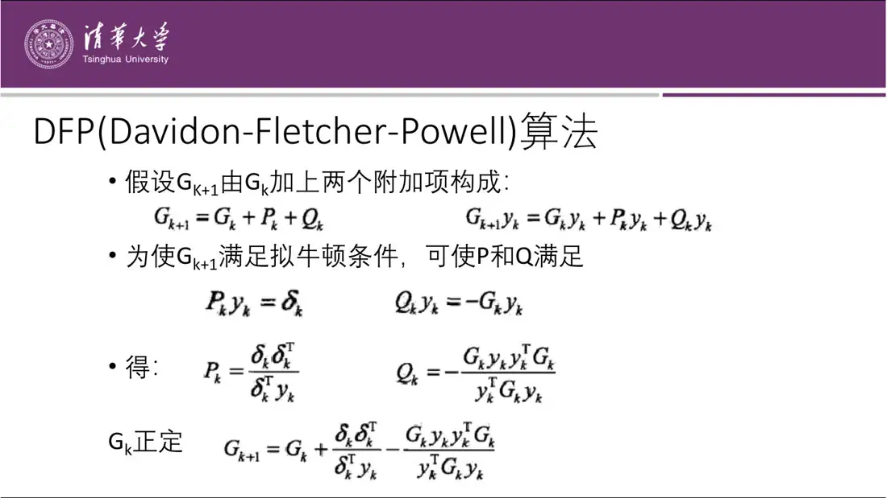

原文：

DFP(Davidon-Fletcher-Powell)算法

\- 假设 $G_{k+1}$ 由 $G_k$ 加上两个附加项构成：

$$
G _ {k + 1} = G _ {k} + P _ {k} + Q _ {k}
$$

$$
G _ {k + 1} y _ {k} = G _ {k} y _ {k} + P _ {k} y _ {k} + Q _ {k} y _ {k}
$$

\- 为使 $G_{k+1}$ 满足拟牛顿条件，可使P和Q满足

$$
P _ {k} y _ {k} = \delta_ {k} \quad Q _ {k} y _ {k} = - G _ {k} y _ {k}
$$

\- 得:

$$
P _ {k} = \frac {\delta_ {k} \delta_ {k} ^ {\mathrm{T}}}{\delta_ {k} ^ {\mathrm{T}} y _ {k}} \quad Q _ {k} = - \frac {G _ {k} y _ {k} y _ {k} ^ {\mathrm{T}} G _ {k}}{y _ {k} ^ {\mathrm{T}} G _ {k} y _ {k}}
$$

$G_{k}$ 正定

$$
G _ {k + 1} = G _ {k} + \frac {\delta_ {k} \delta_ {k} ^ {\mathrm{T}}}{\delta_ {k} ^ {\mathrm{T}} y _ {k}} - \frac {G _ {k} y _ {k} y _ {k} ^ {\mathrm{T}} G _ {k}}{y _ {k} ^ {\mathrm{T}} G _ {k} y _ {k}}
$$

清華大學 Tsinghua University

### DFP(Davidon-Fletcher-Powell)算法

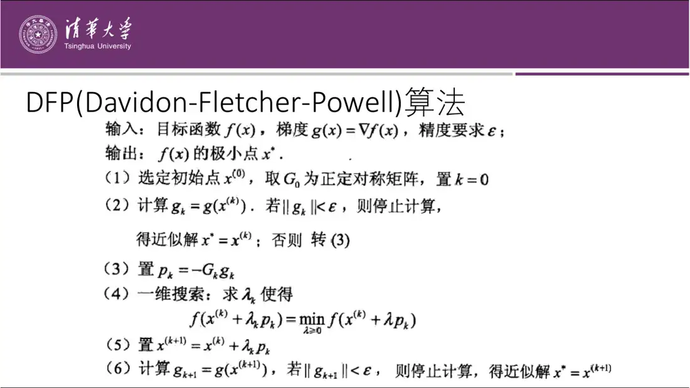

原文：

DFP(Davidon-Fletcher-Powell)算法

输入：目标函数 $f(x)$ ，梯度 $g(x)=\nabla f(x)$ ，精度要求 $\varepsilon$ ;

输出： $f(x)$ 的极小点 $x^{*}$

（1）选定初始点 $x^{(0)}$ ，取 $G_{0}$ 为正定对称矩阵，置 $k = 0$

(2) 计算 $g_{k}=g(x^{(k)})$ 。若 $\|g_{k}\|<\varepsilon$ ，则停止计算，

得近似解 $x^{*} = x^{(k)}$ ；否则转(3)

(3) 置 $p_{k} = -G_{k} g_{k}$

(4) 一维搜索：求 $\lambda_{k}$ 使得

$$
f (x ^ {(k)} + \lambda_ {k} p _ {k}) = \min _ {\lambda \geqslant 0} f (x ^ {(k)} + \lambda p _ {k})
$$

(5) 置 $x^{(k+1)} = x^{(k)} + \lambda_{k} p_{k}$

(6) 计算 $g_{k+1}=g(x^{(k+1)})$ ，若 $\|g_{k+1}\|<\varepsilon$ ，则停止计算，得近似解 $x^{*}=x^{(k+1)}$

Tsinghua University
清華大學

### BFGS(Broyden-Fletcher-Goldfarb-Shanno)算法

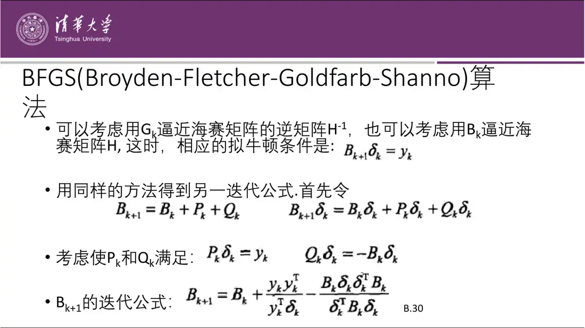

原文：

BFGS(Broyden-Fletcher-Goldfarb-Shanno)算法

\- 可以考虑用 $G_{k}$ 逼近海赛矩阵的逆矩阵 $\mathsf{H}^{-1}$ ，也可以考虑用 $B_{k}$ 逼近海赛矩阵 $\mathsf{H}$ ，这时，相应的拟牛顿条件是： $B_{k+1} \delta_{k} = y_{k}$

\- 用同样的方法得到另一迭代公式.首先令

$$
B _ {k + 1} = B _ {k} + P _ {k} + Q _ {k} \quad B _ {k + 1} \delta_ {k} = B _ {k} \delta_ {k} + P _ {k} \delta_ {k} + Q _ {k} \delta_ {k}
$$

\- 考虑使 $P_{k}$ 和 $Q_{k}$ 满足： $P_{k}\delta_{k}=y_{k}$ $Q_{k}\delta_{k}=-B_{k}\delta_{k}$

\- $B_{k+1}$ 的迭代公式: $B_{k+1} = B_k + \frac{y_k y_k^T}{y_k^T \delta_k} - \frac{B_k \delta_k \delta_k^T B_k}{\delta_k^T B_k \delta_k}$ B.30

Tsinghua University
清華大學

### Broyden类算法(Broyden's algorithm)

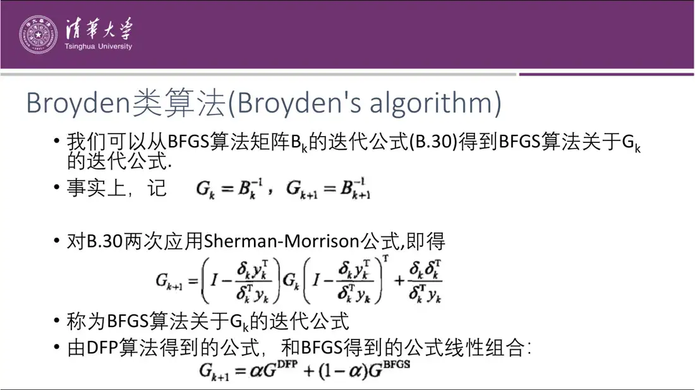

原文：

Broyden类算法(Broyden's algorithm)

\- 我们可以从BFGS算法矩阵 $B_{k}$ 的迭代公式(B.30)得到BFGS算法关于 $G_{k}$ 的迭代公式.

·事实上，记 $G_{k} = B_{k}^{-1}$ ， $G_{k + 1} = B_{k + 1}^{-1}$

\- 对B.30两次应用Sherman-Morrison公式,即得

$$
G _ {k + 1} = \left(I - \frac {\delta_ {k} y _ {k} ^ {\mathrm{T}}}{\delta_ {k} ^ {\mathrm{T}} y _ {k}}\right) G _ {k} \left(I - \frac {\delta_ {k} y _ {k} ^ {\mathrm{T}}}{\delta_ {k} ^ {\mathrm{T}} y _ {k}}\right) ^ {\mathrm{T}} + \frac {\delta_ {k} \delta_ {k} ^ {\mathrm{T}}}{\delta_ {k} ^ {\mathrm{T}} y _ {k}}
$$

\- 称为BFGS算法关于 $G_{k}$ 的迭代公式

\- 由DFP算法得到的公式，和BFGS得到的公式线性组合：

$$
G _ {k + 1} = \alpha G ^ {\mathrm{DFP}} + (1 - \alpha) G ^ {\mathrm{BFGS}}
$$

Tsinghua University
清華大學

### 最大熵模型学习方法

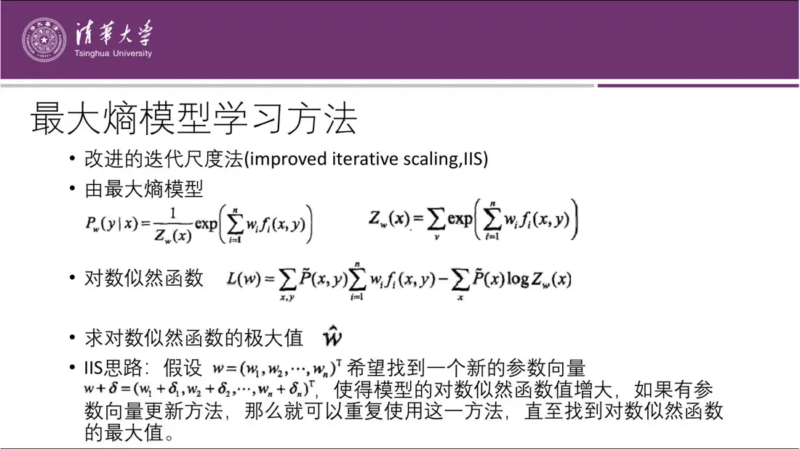

原文：

最大熵模型学习方法

\- 改进的迭代尺度法(improved iterative scaling,IIS)

\- 由最大熵模型

$$
P _ {w} (y \mid x) = \frac {1}{Z _ {w} (x)} \exp \left(\sum_ {i = 1} ^ {n} w _ {i} f _ {i} (x, y)\right)
$$

$$
Z _ {w} (x) = \sum_ {y} \exp \left(\sum_ {i = 1} ^ {n} w _ {i} f _ {i} (x, y)\right)
$$

\- 对数似然函数 $L(w) = \sum_{x,y} \tilde{P}(x,y) \sum_{i=1}^{n} w_i f_i(x,y) - \sum_x \tilde{P}(x) \log Z_w(x)$

\- 求对数似然函数的极大值 $\hat{\pmb{w}}$

\- IIS思路：假设 $w = (w_{1}, w_{2}, \dots, w_{n})^{\mathrm{T}}$ 希望找到一个新的参数向量

$w + \delta = (w_{1} + \delta_{1}, w_{2} + \delta_{2}, \cdots, w_{n} + \delta_{n})^{\mathrm{T}}$ ，使得模型的对数似然函数值增大，如果有参数向量更新方法，那么就可以重复使用这一方法，直至找到对数似然函数的最大值。

Tsinghua University
清華大學

### 改进的迭代尺度法

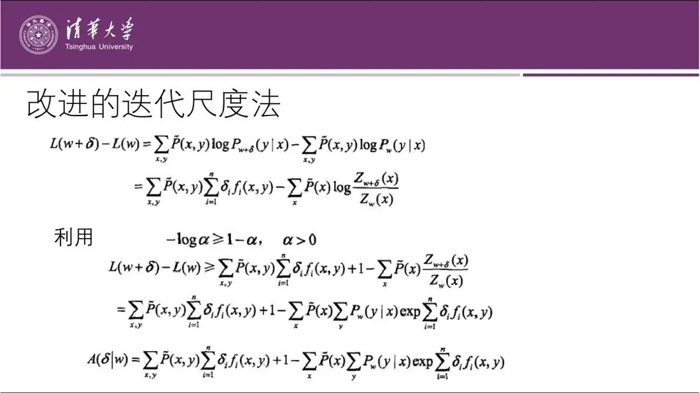

原文：

改进的迭代尺度法

$$
\begin{array}{r l} L (w + \delta) - L (w) & = \sum_ {x, y} \tilde {P} (x, y) \log P _ {w + \delta} (y | x) - \sum_ {x, y} \tilde {P} (x, y) \log P _ {w} (y | x) \\ & = \sum_ {x, y} \tilde {P} (x, y) \sum_ {i = 1} ^ {n} \delta_ {i} f _ {i} (x, y) - \sum_ {x} \tilde {P} (x) \log \frac {Z _ {w + \delta} (x)}{Z _ {w} (x)} \end{array}
$$

利用

$$
\begin{array}{r l} & {- \log \alpha \geqslant 1 - \alpha , \quad \alpha > 0} \\ & {L (w + \delta) - L (w) \geqslant \sum_ {x, y} \tilde {P} (x, y) \sum_ {i = 1} ^ {n} \delta_ {i} f _ {i} (x, y) + 1 - \sum_ {x} \tilde {P} (x) \frac {Z _ {w + \delta} (x)}{Z _ {w} (x)}} \\ & {\quad = \sum_ {x, y} \tilde {P} (x, y) \sum_ {i = 1} ^ {n} \delta_ {i} f _ {i} (x, y) + 1 - \sum_ {x} \tilde {P} (x) \sum_ {y} P _ {w} (y | x) \exp \sum_ {i = 1} ^ {n} \delta_ {i} f _ {i} (x, y)} \\ & {A (\delta | w) = \sum_ {x, y} \tilde {P} (x, y) \sum_ {i = 1} ^ {n} \delta_ {i} f _ {i} (x, y) + 1 - \sum_ {x} \tilde {P} (x) \sum_ {y} P _ {w} (y | x) \exp \sum_ {i = 1} ^ {n} {\delta_ {i}} f _ {i} (x, y)} \end{array}
$$

清華大學 Tsinghua University

### 改进的迭代尺度法

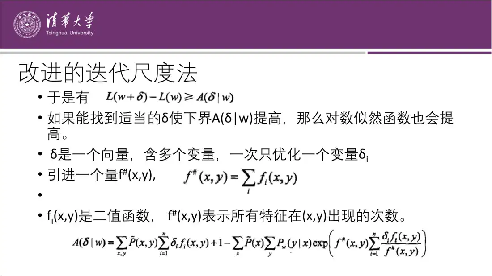

原文：

改进的迭代尺度法

\- 于是有 $L(w + \delta) - L(w) \geqslant A(\delta \mid w)$

\- 如果能找到适当的δ使下界A(δ|w)提高，那么对数似然函数也会提高。

\- $\delta$ 是一个向量，含多个变量，一次只优化一个变量 $\delta_{i}$

\- 引进一个量 $f^{\#}(x,y)$ ， $f^{\#}(x,y)=\sum_{i}f_{i}(x,y)$

\- $f_i(x,y)$ 是二值函数， $f^\# (x,y)$ 表示所有特征在 $(x,y)$ 出现的次数。

$$
A (\delta \mid w) = \sum_ {x, y} \tilde {P} (x, y) \sum_ {i = 1} ^ {n} \delta_ {i} f _ {i} (x, y) + 1 - \sum_ {x} \tilde {P} (x) \sum_ {y} P _ {w} (y \mid x) \exp \left(f ^ {\#} (x, y) \sum_ {i = 1} ^ {n} \frac {\delta_ {i} f _ {i} (x , y)}{f ^ {\#} (x , y)}\right)
$$

Tsinghua University
清華大學

### 改进的迭代尺度法

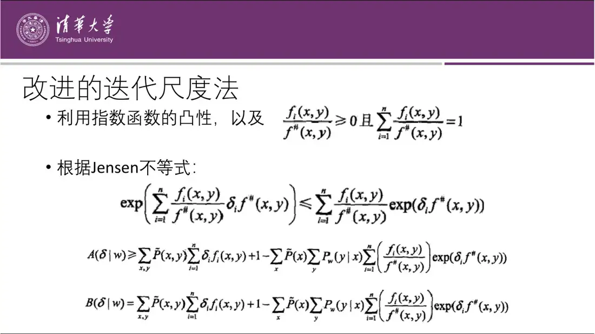

原文：

改进的迭代尺度法

\- 利用指数函数的凸性，以及 $\frac{f_i(x,y)}{f^\#(x,y)}\geqslant 0$ 且 $\sum_{i = 1}^{n}\frac{f_i(x,y)}{f^\#(x,y)} = 1$

\- 根据Jensen不等式:

$$
\begin{array}{l} \exp \left(\sum_ {i = 1} ^ {n} \frac {f _ {i} (x , y)}{f ^ {\#} (x , y)} \delta_ {i} f ^ {\#} (x, y)\right) \leqslant \sum_ {i = 1} ^ {n} \frac {f _ {i} (x , y)}{f ^ {\#} (x , y)} \exp (\delta_ {i} f ^ {\#} (x, y)) \\ A (\delta | w) \geqslant \sum_ {x, y} \tilde {P} (x, y) \sum_ {i = 1} ^ {n} \delta_ {i} f _ {i} (x, y) + 1 - \sum_ {x} \tilde {P} (x) \sum_ {y} P _ {w} (y | x) \sum_ {i = 1} ^ {n} \left(\frac {f _ {i} (x , y)}{f ^ {\#} (x , y)}\right) \exp (\delta_ {i} f ^ {\#} (x, y)) \\ B (\delta | w) = \sum_ {x, y} \tilde {P} (x, y) \sum_ {i = 1} ^ {n} \delta_ {i} f _ {i} (x, y) + 1 - \sum_ {x} \tilde {P} (x) \sum_ {y} P _ {w} (y | x) \sum_ {i = 1} ^ {n} \left(\left. \frac {f _ {i} (x , y)}{f ^ {\#} (x , y)}\right) \exp (\delta_ {i} f ^ {\#} (x, y)) \right. \end{array}
$$

Tsinghua University
清華大學
1911-UNIVERSITY

### 改进的迭代尺度法

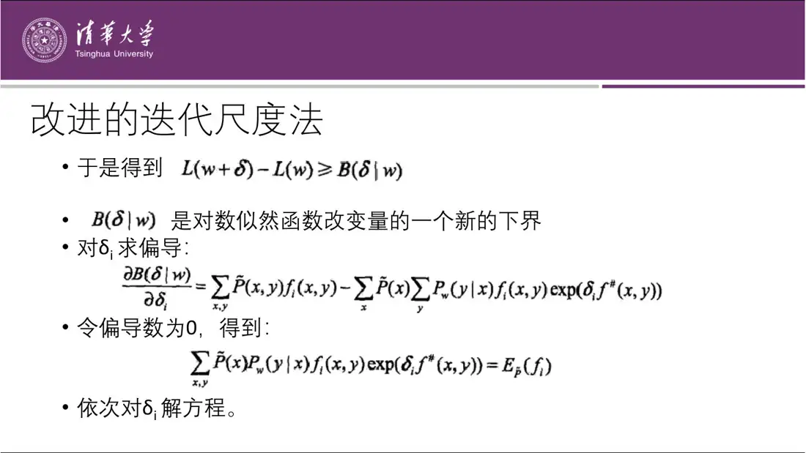

原文：

改进的迭代尺度法

\- 于是得到 $L(w + \delta) - L(w) \geqslant B(\delta | w)$

\- $B(\delta | w)$ 是对数似然函数改变量的一个新的下界

\- 对 $\delta_{i}$ 求偏导:

$$
\frac {\partial B (\delta \mid w)}{\partial \delta_ {i}} = \sum_ {x, y} \tilde {P} (x, y) f _ {i} (x, y) - \sum_ {x} \tilde {P} (x) \sum_ {y} P _ {w} (y \mid x) f _ {i} (x, y) \exp (\delta_ {i} f ^ {\#} (x, y))
$$

\- 令偏导数为0，得到：

$$
\sum_ {x, y} \tilde {P} (x) P _ {w} (y \mid x) f _ {i} (x, y) \exp (\delta_ {i} f ^ {\#} (x, y)) = E _ {\tilde {P}} (f _ {i})
$$

\- 依次对 $\delta_{i}$ 解方程。

Tsinghua University
清華大學

### 改进的迭代尺度法

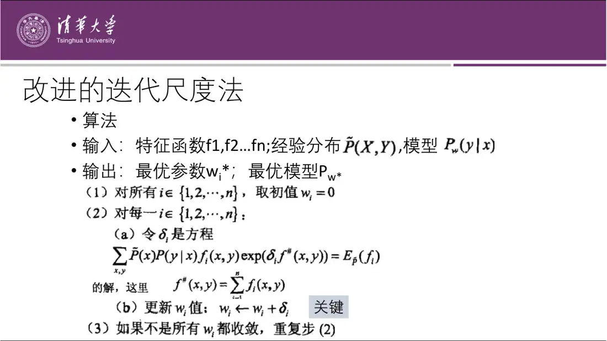

原文：

改进的迭代尺度法

\- 算法

\- 输入：特征函数f1,f2...fn;经验分布 $\tilde{P}(X,Y)$ ,模型 $P_{w}(y|x)$

\- 输出：最优参数 $w_{i}^{*}$ ；最优模型 $P_{w}^{*}$

(1) 对所有 $i \in \{1,2,\cdots,n\}$ ，取初值 $w_{i}=0$

(2) 对每一 $i \in \{1, 2, \cdots, n\}$ :

(a) 令 $\delta_{i}$ 是方程

$$
\sum_ {x, y} \tilde {P} (x) P (y \mid x) f _ {i} (x, y) \exp (\delta_ {i} f ^ {\#} (x, y)) = E _ {\tilde {P}} (f _ {i})
$$

的解，这里 $f^{\#}(x,y) = \sum_{i = 1}^{n}f_{i}(x,y)$

(b) 更新 $w_{i}$ 值: $w_{i} \leftarrow w_{i} + \delta_{i}$ 关键

(3) 如果不是所有 $w_{i}$ 都收敛，重复步 (2)

Tsinghua University
清華大學

### 改进的迭代尺度法

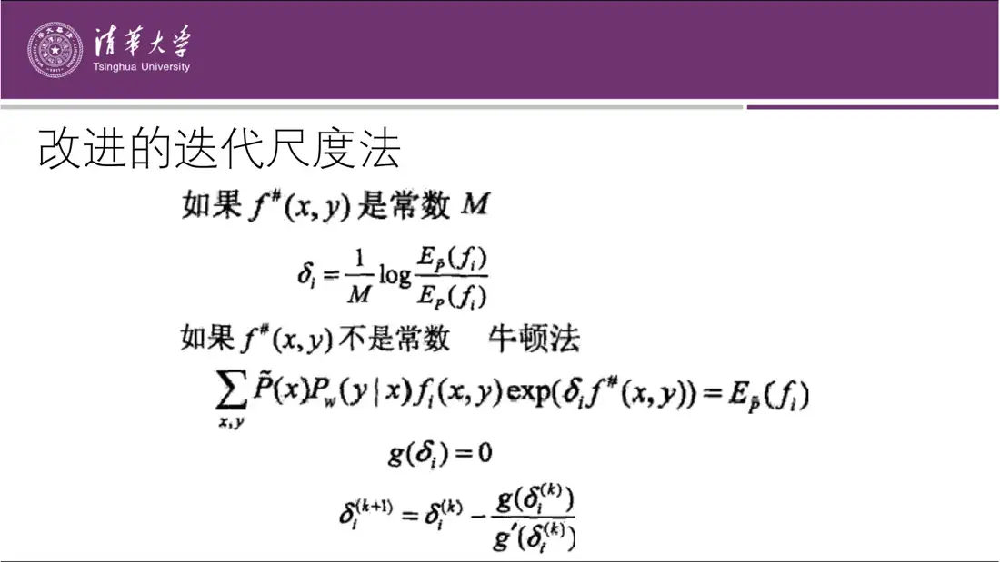

原文：

改进的迭代尺度法

如果 $f^{\#}(x,y)$ 是常数 $M$

$$
\delta_ {i} = \frac {1}{M} \log \frac {E _ {\bar {P}} (f _ {i})}{E _ {P} (f _ {i})}
$$

如果 $f^{\#}(x,y)$ 不是常数 牛顿法

$$
\begin{array}{c} \sum_ {x, y} \tilde {P} (x) P _ {w} (y \mid x) f _ {i} (x, y) \exp (\delta_ {i} f ^ {*} (x, y)) = E _ {\bar {p}} (f _ {i}) \\ g (\delta_ {i}) = 0 \\ \delta_ {i} ^ {(k + 1)} = \delta_ {i} ^ {(k)} - \frac {g (\delta_ {i} ^ {(k)})}{g ^ {\prime} (\delta_ {i} ^ {(k)})} \end{array}
$$

清華大學 Tsinghua University

### 拟牛顿法

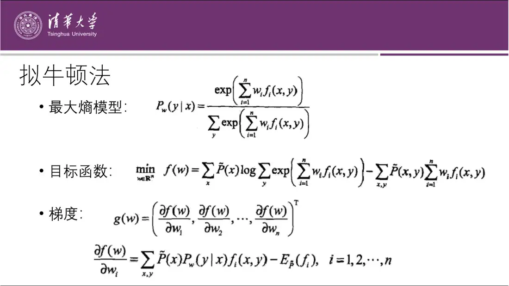

原文：

拟牛顿法

\- 最大熵模型:

$$
P _ {w} (y \mid x) = \frac {\exp \left(\sum_ {i = 1} ^ {n} w _ {i} f _ {i} (x , y)\right)}{\sum_ {y} \exp \left(\sum_ {i = 1} ^ {n} w _ {i} f _ {i} (x , y)\right)}
$$

\- 目标函数: $\min_{w\in \mathbb{R}^n}f(w) = \sum_x\tilde{P} (x)\log \sum_y\exp \left(\sum_{i = 1}^n w_if_i(x,y)\right) - \sum_{x,y}\tilde{P} (x,y)\sum_{i = 1}^n w_if_i(x,y)$

\- 梯度:

$$
g (w) = \left(\frac {\partial f (w)}{\partial w _ {1}}, \frac {\partial f (w)}{\partial w _ {2}}, \dots , \frac {\partial f (w)}{\partial w _ {n}}\right) ^ {T}
$$

$$
\frac {\partial f (w)}{\partial w _ {i}} = \sum_ {x, y} \tilde {P} (x) P _ {w} (y \mid x) f _ {i} (x, y) - E _ {\tilde {P}} (f _ {i}), \quad i = 1, 2, \dots , n
$$

Tsinghua University
清華大學
1911-UNIVERSITY

### 最大熵模型学习算法

原文：

最大熵模型学习算法

输入：特征函数 $f_{1}, f_{2}, \cdots, f_{n}$ ；经验分布 $\tilde{P}(x, y)$

目标函数 $f(w)$ ，梯度 $g(w) =$

输出：最优参数值 $w^{*}$ ；最优模型 $P_{w^{*}}(y|x)$ .

（1）选定初始点 $w^{(0)}$ ，取 $B_{0}$ 为正定对称矩阵，置 $k = 0$

(2) 计算 $g_{k}=g(w^{(k)})$ . 若 $\|g_{k}\|<\varepsilon$ , 则停止计算,

得 $w^{*} = w^{(k)}$ ；否则转 (3)

(3) 由 $B_{k}p_{k} = -g_{k}$ 求出 $p_{k}$

(4) 一维搜索：求 $\lambda_{k}$ 使得

$$
f (w ^ {(k)} + \lambda_ {k} p _ {k}) = \min _ {\lambda \geqslant 0} f (w ^ {(k)} + \lambda p _ {k})
$$

清華大學 Tsinghua University

### 最大熵模型学习算法

原文：

最大熵模型学习算法

(5) 置 $w^{(k + 1)} = w^{(k)} + \lambda_k p_k$

(6) 计算 $g_{k+1} = g(w^{(k+1)})$ ，若 $\| g_{k+1} \| < \varepsilon$ ，则停止计算得 $w^* = w^{(k+1)}$ ；否则按下式求出 $B_{k+1}$ ：

$$
B _ {k + 1} = B _ {k} + \frac {y _ {k} y _ {k} ^ {\mathrm{T}}}{y _ {k} ^ {\mathrm{T}} \delta_ {k}} - \frac {B _ {k} \delta_ {k} \delta_ {k} ^ {\mathrm{T}} B _ {k}}{\delta_ {k} ^ {\mathrm{T}} B _ {k} \delta_ {k}}
$$

$$
y _ {k} = g _ {k + 1} - g _ {k}, \quad \delta_ {k} = w ^ {(k + 1)} - w ^ {(k)}
$$

(7) 置 $k = k + 1$ ，转 (3)

清華大學 Tsinghua University

### 梯度上升法实际实现:

原文：

梯度上升法实际实现:

\- 要找到某函数的最大值，最好的方法是沿着该函数的梯度方向探

清華大學 Tsinghua University

### 梯度上升法

原文：

梯度上升法

\- 函数 $f(x,y)$ 的梯度：前提是函数 $f(x,y)$ 必须在待计算的点上有定义并且可微。

$$
\nabla f (x, y) = \left( \begin{array}{c} \frac {\partial f (x , y)}{\partial x} \\ \frac {\partial f (x , y)}{\partial y} \end{array} \right)
$$

\- 若移动的步长记作a $w := w + \alpha \nabla_w f(w)$

\- 迭代停止条件:

\- 迭代次数达到某个指定的值

\- 算法达到某个可以允许的误差范围

Tsinghua University
清華大學

### 梯度上升法

原文：

梯度上升法

\- 即求最大值: $\sum_{i=1}^{m}\left(y_i \cdot x_i - \ln(1 + e^{x_i})\right)$

\- 由： $x_{i} = w_{0} + w_{1}x_{i1} + w_{2}x_{i2} + \ldots +w_{n}x_{in}$

\- 且: $w_{k} = w_{k} + \alpha \frac{\partial \ln L(w)}{\partial w_{k}}$

\- 则: $w_{k} = w_{k} + \alpha \sum_{i=1}^{m} x_{ik} \left[ y_{i} - \pi(x_{i}) \right]$

清華大學 Tsinghua University

### 梯度上升法

原文：

梯度上升法

Tsinghua University
清華大學
TSINGHUA UNIVERSITY
1911
清華大學
TSINGHUA UNIVERSITY

### 梯度上升法

原文：

梯度上升法

清華大學 Tsinghua University

### 随机梯度上升法

原文：

随机梯度上升法

\- 梯度上升算法每天更新回归系数时都需要遍历整个数据集

\- 改进：一次仅用一个样本点更新数据----在线学习算法

Tsinghua University
清華大學
Tsinghua University

### 随机梯度上升法

原文：

随机梯度上升法

Tsinghua University
清華大學

### 随机梯度上升法

原文：

随机梯度上升法

清華大學 Tsinghua University

### 改进的随机梯度上升法

原文：

改进的随机梯度上升法

清華大學 Tsinghua University

### 改进的随机梯度上升法

原文：

改进的随机梯度上升法

• alpha = 4/(1.0+j+i)+0.0001

\- Alpha在每次迭代时都会调整，防止高频波动

\- Alpha总体逐渐减小

\- 可适当增加常数项

\- Alpha不是严格下降，在模拟退火算法等优化算法中常见

\- 随机选取样本

\- 减少周期性的波动

\- 迭代次数

• 150

Tsinghua University
清華大學
1911-

### 改进的随机梯度上升法

原文：

改进的随机梯度上升法

清華大學 Tsinghua University

### 改进的随机梯度上升法

原文：

改进的随机梯度上升法

清華大學 Tsinghua University

### 从氙气病症预测病马的死亡率

原文：

从氙气病症预测病马的死亡率

• 368 样本 21 特征，300 个作为训练用，68 个作为测试

\- 准备数据：处理数据中的缺失值

\- 使用可用特征的均值

\- 使用特殊值，如-1

\- 忽略有缺失值的样本

\- 使用相似样本的均值

\- 使用另外的机器学习算法预测缺失值

Tsinghua University
清華大學
1911-

### 从氙气病症预测病马的死亡率

原文：

从氙气病症预测病马的死亡率

\- 取0的原因

\- weights = weights + alpha \* error \* dataMatrix[randIndex]

\- sigmoid(0)=0.5，不影响分类

- 原数据

\- http://archive.ics.uci.edu/ml/datasets/Horse+Colic

Tsinghua University
清華大學
1911-

### 从氙气病症预测病马的死亡率

原文：

从氙气病症预测病马的死亡率

def classifyVector(inX, weights):

prob = sigmoid(sum(inX\*weights))

if prob > 0.5: return 1.0

else: return 0.0

Tsinghua University
清華大學

### 从氙气病症预测病马的死亡率

原文：

从氙气病症预测病马的死亡率

清華大學 Tsinghua University

### 从氙气病症预测病马的死亡率

原文：

从氙气病症预测病马的死亡率

清華大學 Tsinghua University

### 从氙气病症预测病马的死亡率

原文：

从氙气病症预测病马的死亡率

\- 调整迭代次数

\- alpha步长

清華大學 Tsinghua University

### • Q&A?

原文：

• Q&A?

Tsinghua University
清華大學
