# 《统计学习方法》第7章 支持向量机（课件）

原件的每一页，下面附识别出的文字。

### 第七章 SVM支持向量机

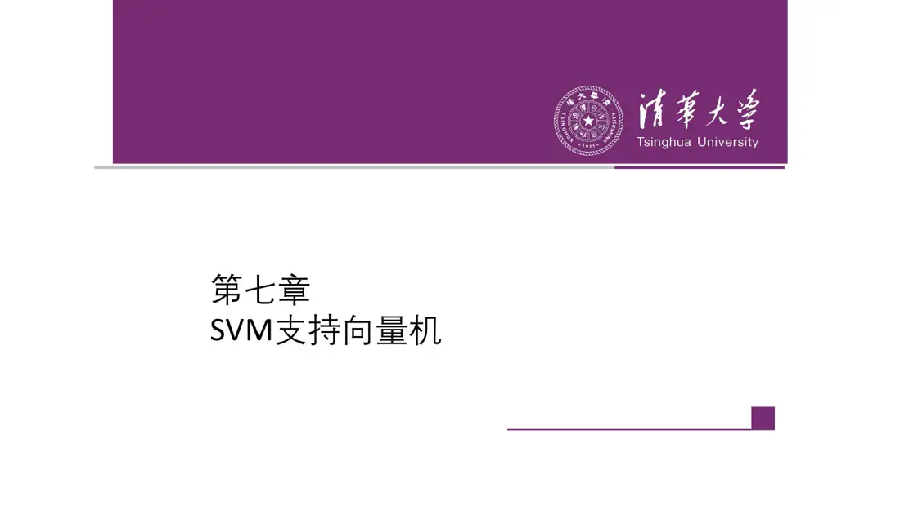

原文：

第七章 SVM支持向量机

大華津
TSINGHUA UNIVERSITY
清華大學
Tsinghua University

### SVM and Vapnik

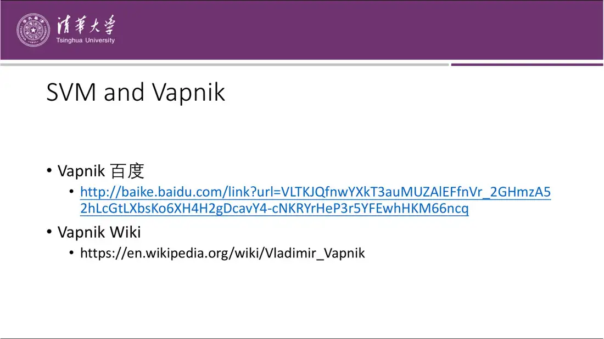

原文：

SVM and Vapnik

\- Vapnik 百度

\- http://baike.baidu.com/link?url=VLTKJQfnwYXkT3auMUZAIEFfnVr\_2GHmzA52hLcGtLXbsKo6XH4H2gDcavY4-cNKRYrHeP3r5YFEwhHKM66ncq

• Vapnik Wiki

\- https://en.wikipedia.org/wiki/Vladimir\_Vapnik

Tsinghua University
清華大學

### SVM

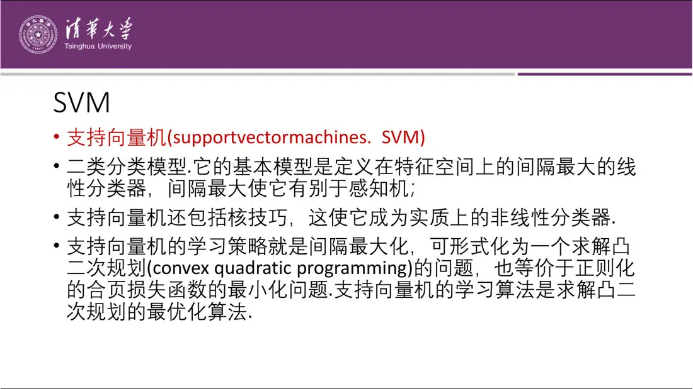

原文：

SVM

\- 支持向量机(supportvectormachines. SVM)

\- 二类分类模型.它的基本模型是定义在特征空间上的间隔最大的线性分类器，间隔最大使它有别于感知机；

\- 支持向量机还包括核技巧，这使它成为实质上的非线性分类器.

\- 支持向量机的学习策略就是间隔最大化，可形式化为一个求解凸二次规划(convex quadratic programming)的问题，也等价于正则化的合页损失函数的最小化问题.支持向量机的学习算法是求解凸二次规划的最优化算法.

Tsinghua University
清華大學
1911-1911

### SVM分类

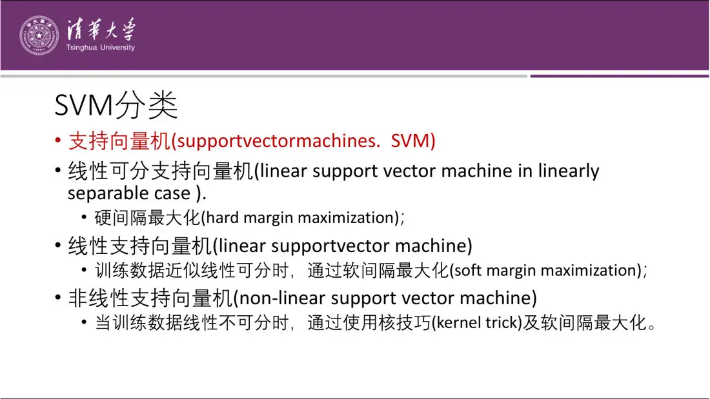

原文：

SVM分类

\- 支持向量机(supportvectormachines. SVM)

\- 线性可分支持向量机(linear support vector machine in linearly separable case).

\- 硬间隔最大化(hard margin maximization);

\- 线性支持向量机(linear supportvector machine)
- 训练数据近似线性可分时，通过软间隔最大化(soft margin maximization);

\- 非线性支持向量机(non-linear support vector machine)

\- 当训练数据线性不可分时，通过使用核技巧(kernel trick)及软间隔最大化。

Tsinghua University
清華大學
1911-1911

### SVM分类

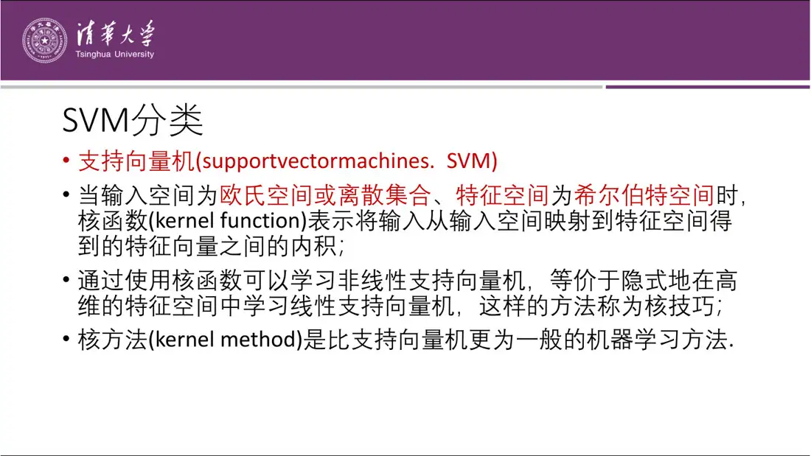

原文：

SVM分类

\- 支持向量机(supportvectormachines. SVM)

\- 当输入空间为欧氏空间或离散集合、特征空间为希尔伯特空间时，核函数(kernel function)表示将输入从输入空间映射到特征空间得到的特征向量之间的内积；

\- 通过使用核函数可以学习非线性支持向量机，等价于隐式地在高维的特征空间中学习线性支持向量机，这样的方法称为核技巧；

\- 核方法(kernel method)是比支持向量机更为一般的机器学习方法.

Tsinghua University
清華大學
TSINGHUA UNIVERSITY
Tsinghua University

### 线性可分支持向量机

原文：

线性可分支持向量机

\- 二分类问题:

\- 输入空间：欧式空间或离散集合

\- 特征空间：欧式空间或希尔伯特空间

\- 线性可分支持向量机、线性支持向量机：假设这两个空间的元素——对应，并将输入空间中的输入映射为特征空间中的特征向量；

\- 非线性支持向量机：利用一个从输入空间到特征空间的非线性映射将输入映射为特征向量；

\- 支持向量机的学习是在特征空间进行的.

Tsinghua University
清華大學
1911-

### 线性可分支持向量机

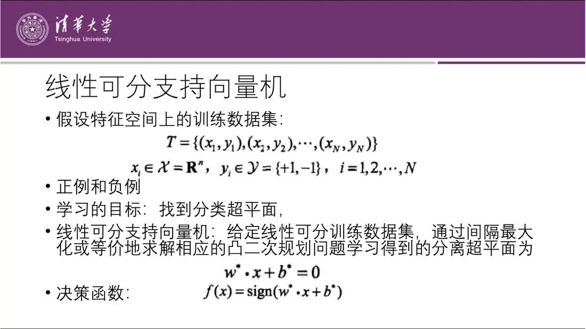

原文：

线性可分支持向量机

\- 假设特征空间上的训练数据集:

$$
T = \{(x _ {1}, y _ {1}), (x _ {2}, y _ {2}), \dots , (x _ {N}, y _ {N}) \}
$$

$$
x _ {i} \in \mathcal {X} = \mathbf {R} ^ {n}, y _ {i} \in \mathcal {Y} = \{+ 1, - 1 \}, i = 1, 2, \dots , N
$$

\- 正例和负例

\- 学习的目标：找到分类超平面，

\- 线性可分支持向量机：给定线性可分训练数据集，通过间隔最大化或等价地求解相应的凸二次规划问题学习得到的分离超平面为

$$
\begin{array}{c} w ^ {*} \cdot x + b ^ {*} = 0 \\ f (x) = \operatorname{sign} (w ^ {*} \cdot x + b ^ {*}) \end{array}
$$

\- 决策函数:

清華大學 Tsinghua University

### 线性可分支持向量机与硬间隔最大化

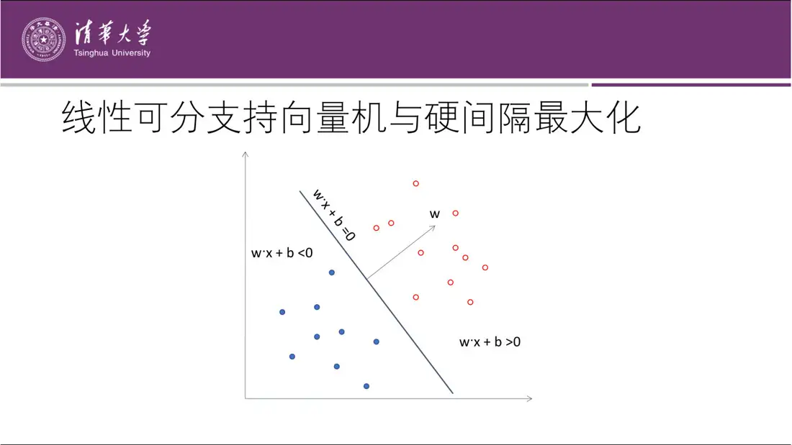

原文：

线性可分支持向量机与硬间隔最大化

清華大學 Tsinghua University

### 超平面选择

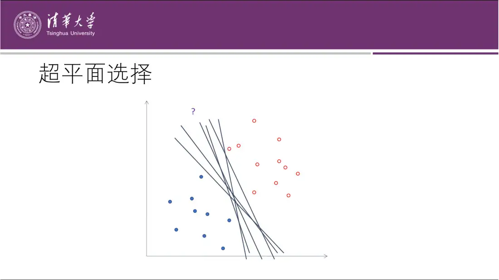

原文：

超平面选择

Tsinghua University
清華大學
1911-

### Margins

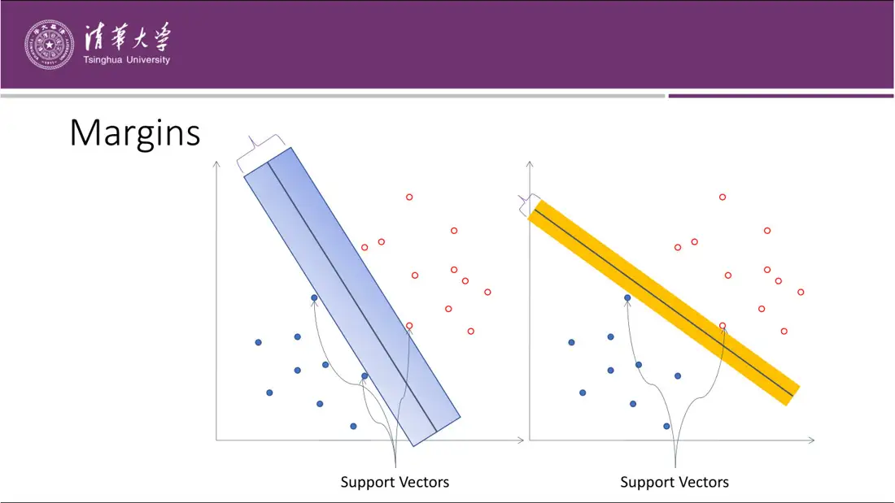

原文：

Margins

Tsinghua University
清華大學
Tsinghua University

### 点到超平面的距离

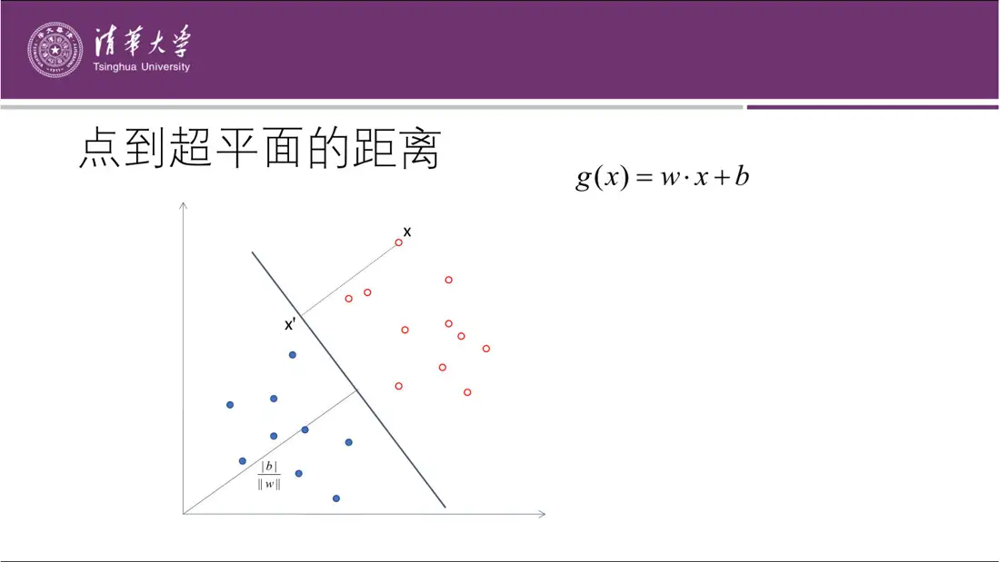

原文：

点到超平面的距离

$$
g (x) = w \cdot x + b
$$

清華大學 Tsinghua University

### 函数间隔和几何间隔

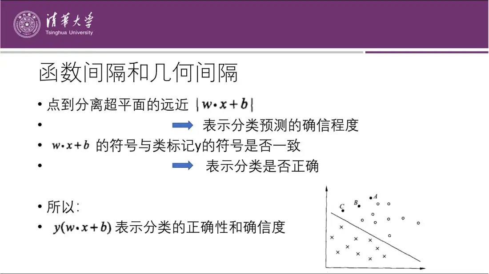

原文：

函数间隔和几何间隔

\- 点到分离超平面的远近 $|w \cdot x + b|$

→ 表示分类预测的确信程度

\- $w \cdot x + b$ 的符号与类标记y的符号是否一致

→ 表示分类是否正确

\- 所以:

\- $y(w \cdot x + b)$ 表示分类的正确性和确信度

Tsinghua University
清華大學
1911-

### 函数间隔和几何间隔

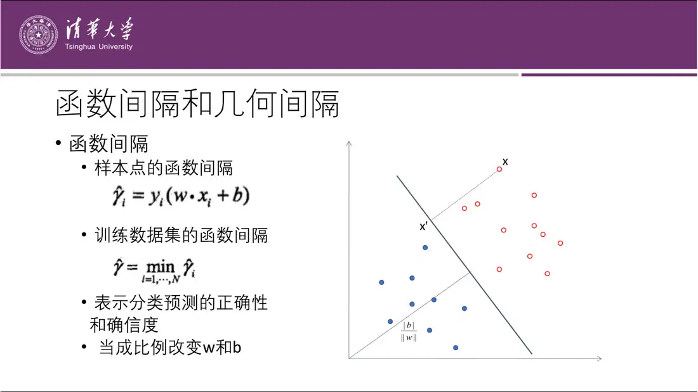

原文：

函数间隔和几何间隔

\- 函数间隔

\- 样本点的函数间隔

$$
\hat {\gamma} _ {i} = y _ {i} (w \cdot x _ {i} + b)
$$

\- 训练数据集的函数间隔

$$
\hat {\gamma} = \min _ {i = 1, \dots , N} \hat {\gamma} _ {i}
$$

\- 表示分类预测的正确性和确信度

\- 当成比例改变w和b

Tsinghua University
清華大學
1911-

### 函数间隔和几何间隔

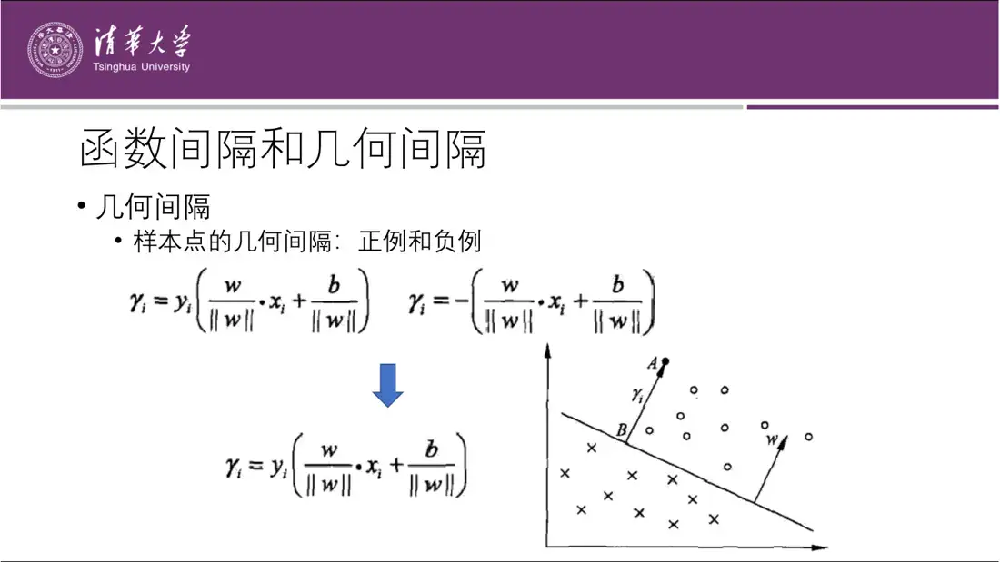

原文：

函数间隔和几何间隔

\- 几何间隔

\- 样本点的几何间隔：正例和负例

$$
\begin{array}{r l} & \gamma_ {i} = y _ {i} \left(\frac {w}{\| w \|} \cdot x _ {i} + \frac {b}{\| w \|}\right) \quad \gamma_ {i} = - \left(\frac {w}{\| w \|} \cdot x _ {i} + \frac {b}{\| w \|}\right) \\ & \quad \downarrow \\ & \gamma_ {i} = y _ {i} \left(\frac {w}{\| w \|} \cdot x _ {i} + \frac {b}{\| w \|}\right) \end{array}
$$

Tsinghua University
清華大學

### 函数间隔和几何间隔

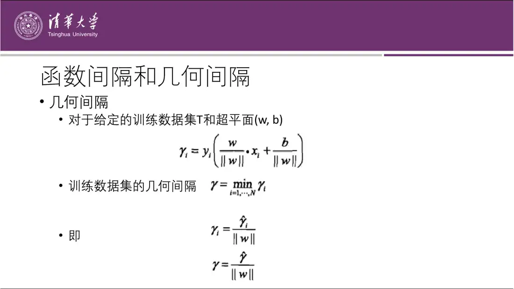

原文：

函数间隔和几何间隔

\- 几何间隔

\- 对于给定的训练数据集T和超平面(w, b)

$$
\gamma_ {i} = y _ {i} \left(\frac {w}{\| w \|} \cdot x _ {i} + \frac {b}{\| w \|}\right)
$$

\- 训练数据集的几何间隔 $\gamma = \min_{i=1,\cdots,N} \gamma_i$

• 即

$$
\gamma_ {i} = \frac {\hat {\gamma} _ {i}}{\| w \|}
$$

$$
\gamma = \frac {\hat {\gamma}}{\| w \|}
$$

Tsinghua University
清華大學
1911-1911

### 间隔最大化

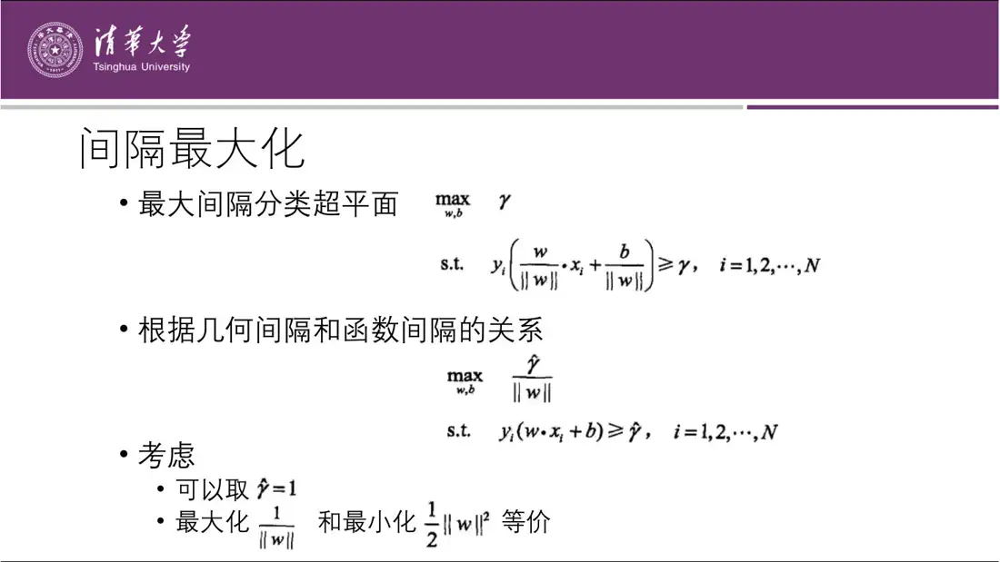

原文：

间隔最大化

\- 最大间隔分类超平面 $\max_{w,b} \gamma$

$$
\mathrm{s.t.} \quad y _ {i} \left(\frac {w}{\| w \|} \cdot x _ {i} + \frac {b}{\| w \|}\right) \geqslant \gamma , \quad i = 1, 2, \dots , N
$$

\- 根据几何间隔和函数间隔的关系

$$
\begin{array}{l l} \max _ {w, b} & \frac {\hat {\gamma}}{\| w \|} \\ \text { s.t. } & y _ {i} (w \cdot x _ {i} + b) \geqslant \hat {\gamma}, \quad i = 1, 2, \dots , N \end{array}
$$

· 考虑

\- 可以取 $\hat{\gamma} = 1$

\- 最大化 $\frac{1}{\|w\|}$ 和最小化 $\frac{1}{2} \|w\|^2$ 等价

Tsinghua University
清華大學
1911-

### 间隔最大化

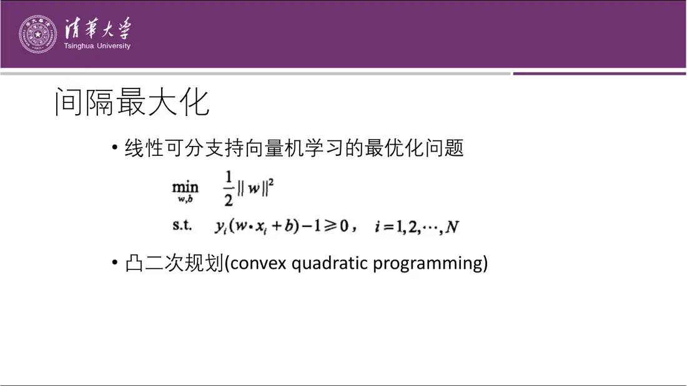

原文：

间隔最大化

\- 线性可分支持向量机学习的最优化问题

$$
\min _ {w, b} \quad \frac {1}{2} \| w \| ^ {2}
$$

$$
\mathrm{s.t.} \quad y _ {i} (w \cdot x _ {i} + b) - 1 \geqslant 0, \quad i = 1, 2, \dots , N
$$

\- 凸二次规划(convex quadratic programming)

清華大學 Tsinghua University

### 凸集

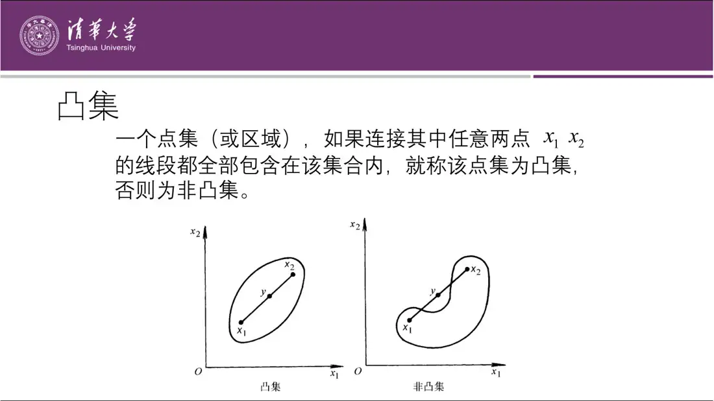

原文：

凸集

一个点集（或区域），如果连接其中任意两点 $x_{1} x_{2}$ 的线段都全部包含在该集合内，就称该点集为凸集，否则为非凸集。

清華大學 Tsinghua University

### 凸性条件

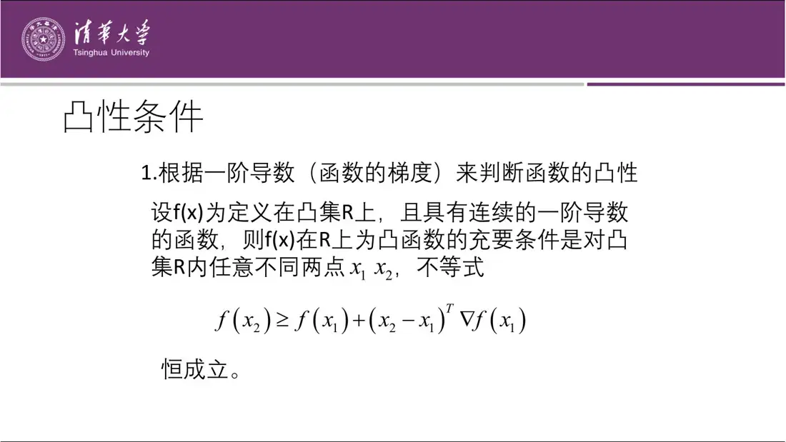

原文：

凸性条件

1. 根据一阶导数（函数的梯度）来判断函数的凸性设 $f(x)$ 为定义在凸集R上，且具有连续的一阶导数的函数，则 $f(x)$ 在R上为凸函数的充要条件是对凸集R内任意不同两点 $x_{1}x_{2}$ ，不等式

$f(x_{2})\geq f(x_{1}) + (x_{2} - x_{1})^{T}\nabla f(x_{1})$ 恒成立。

清華大學 Tsinghua University

### 凸性条件

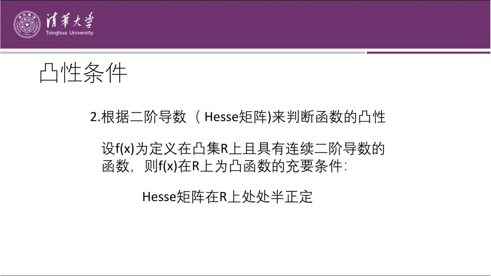

原文：

凸性条件

2. 根据二阶导数（Hesse矩阵）来判断函数的凸性

设 $f(x)$ 为定义在凸集R上且具有连续二阶导数的函数，则 $f(x)$ 在R上为凸函数的充要条件：

Hesse矩阵在R上处处半正定

清華大學 Tsinghua University

### 凸规划

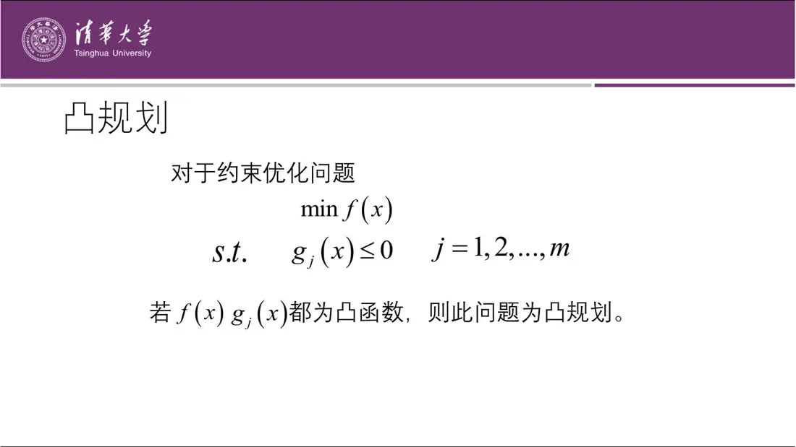

原文：

凸规划

对于约束优化问题

$$
\min f (x)
$$

s.t.

$$
g _ {j} (x) \leq 0
$$

$$
j = 1, 2, \dots , m
$$

若 $f(x)g_{j}(x)$ 都为凸函数，则此问题为凸规划。

清華大學 Tsinghua University

### 凸规划的性质

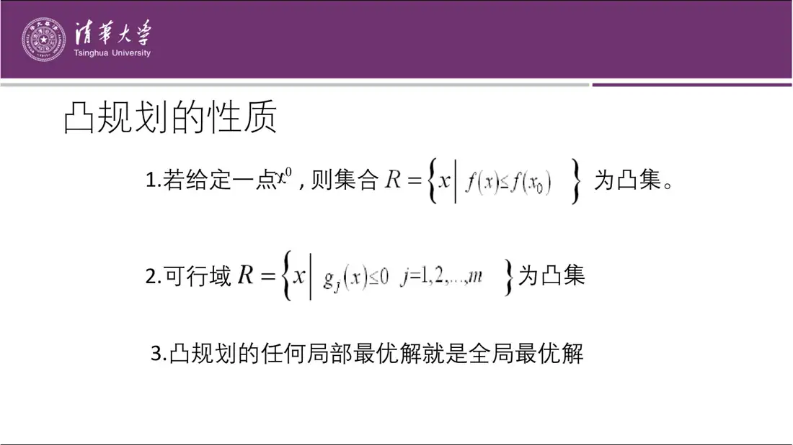

原文：

凸规划的性质

1. 若给定一点 $x^0$ ，则集合 $R = \left\{x \mid f(x) \leq f(x_0) \quad \right\}$ 为凸集。

2. 可行域 $R = \left\{ x \mid g_{j}(x) \leq 0, j = 1, 2, \ldots, m \right\}$ 为凸集

3.凸规划的任何局部最优解就是全局最优解

清華大學 Tsinghua University

### 凸优化问题

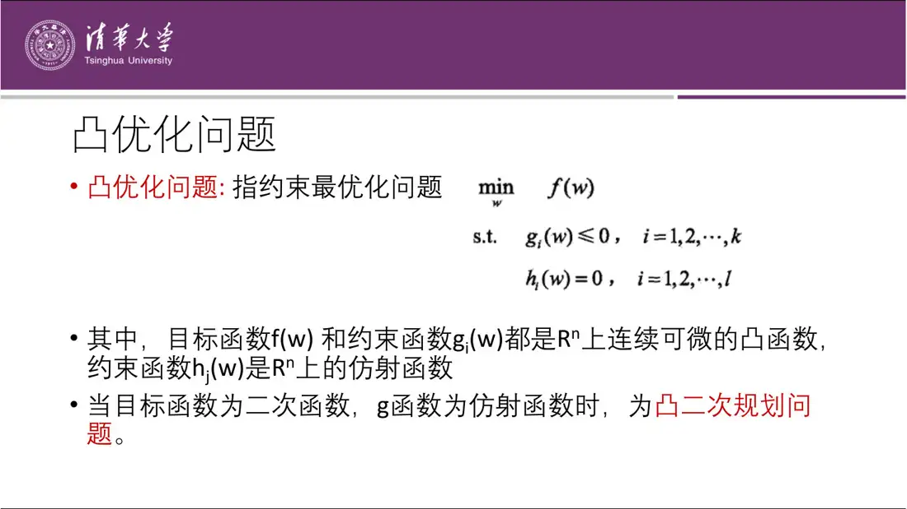

原文：

凸优化问题

\- 凸优化问题: 指约束最优化问题 $\min_{w} f(w)$

s.t. $g_{i}(w) \leqslant 0, \quad i = 1, 2, \cdots, k$

$$
h _ {i} (w) = 0, \quad i = 1, 2, \dots , l
$$

\- 其中，目标函数 $f(w)$ 和约束函数 $g_{i}(w)$ 都是 $R^{n}$ 上连续可微的凸函数，约束函数 $h_{j}(w)$ 是 $R^{n}$ 上的仿射函数

\- 当目标函数为二次函数，g函数为仿射函数时，为凸二次规划问题。

清華大學 Tsinghua University

### 线性可分支持向量机学习算法

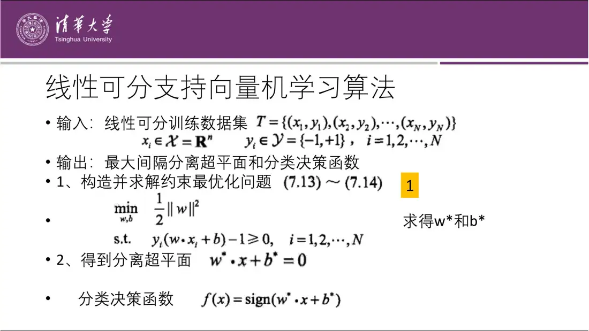

原文：

线性可分支持向量机学习算法

\- 输入：线性可分训练数据集 $T = \{(x_{1},y_{1}),(x_{2},y_{2}),\dots ,(x_{N},y_{N})\}$

$$
x _ {i} \in \mathcal {X} = \mathbf {R} ^ {n} \quad y _ {i} \in \mathcal {Y} = \{- 1, + 1 \}, i = 1, 2, \dots , N
$$

\- 输出：最大间隔分离超平面和分类决策函数

• 1、构造并求解约束最优化问题 (7.13) \~ (7.14) 1

• $\min_{w,b}\frac{1}{2}\|w\|^{2}$

求得w\*和b\*

s.t. $y_{i}(w \cdot x_{i} + b) - 1 \geqslant 0, \quad i = 1, 2, \cdots, N$

·2、得到分离超平面 $w^{*} \cdot x + b^{*} = 0$

\- 分类决策函数 $f(x) = \mathrm{sign}(w^{*}\cdot x + b^{*})$

清華大學 Tsinghua University

### 支持向量和Margins (边界)

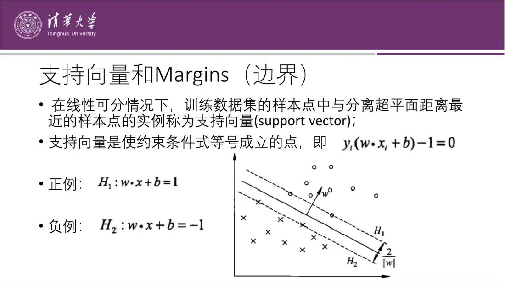

原文：

支持向量和Margins (边界)

\- 在线性可分情况下，训练数据集的样本点中与分离超平面距离最近的样本点的实例称为支持向量(support vector);

\- 支持向量是使约束条件式等号成立的点，即 $y_{i}(w \cdot x_{i} + b) - 1 = 0$

\- 正例： $H_{1}:w\cdot x + b = 1$

\- 负例: $H_{2}: w \cdot x + b = -1$

Tsinghua University
清華大學

### 例：

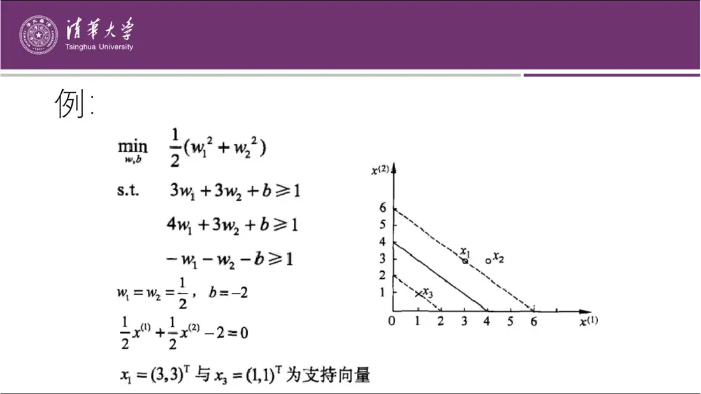

原文：

例：

$\min_{w,b}\frac{1}{2}(w_1^2 +w_2^2)$

s.t.

$$
3 w _ {1} + 3 w _ {2} + b \geqslant 1
$$

$$
4 w _ {1} + 3 w _ {2} + b \geqslant 1
$$

$$
- w _ {1} - w _ {2} - b \geqslant 1
$$

$$
w _ {1} = w _ {2} = \frac {1}{2}, b = - 2
$$

$$
\frac {1}{2} x ^ {(1)} + \frac {1}{2} x ^ {(2)} - 2 = 0
$$

$x_{1} = (3,3)^{\mathrm{T}}$ 与 $x_{3} = (1,1)^{\mathrm{T}}$ 为支持向量

清華大學 Tsinghua University

### 拉格朗日对偶

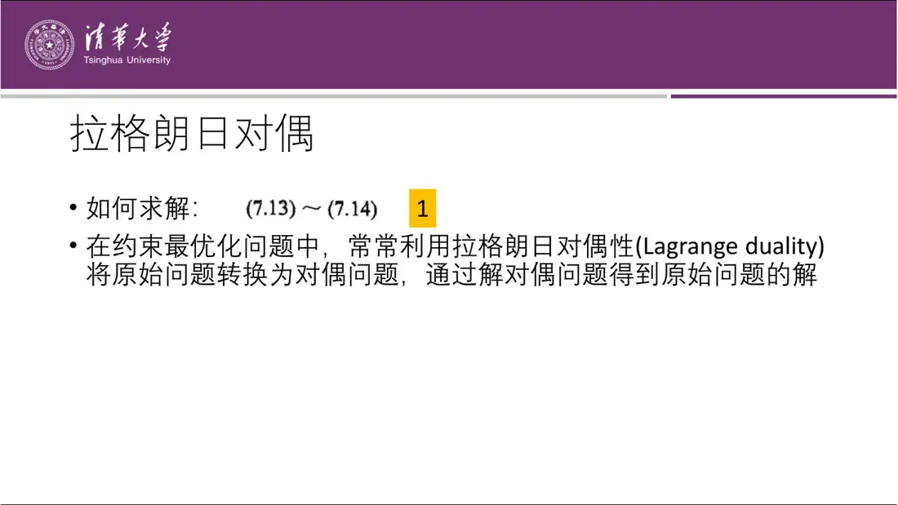

原文：

拉格朗日对偶

\- 如何求解: (7.13) \~ (7.14) 1

\- 在约束最优化问题中，常常利用拉格朗日对偶性(Lagrange duality)将原始问题转换为对偶问题，通过解对偶问题得到原始问题的解

Tsinghua University
清華大學
1911-

### 拉格朗日对偶

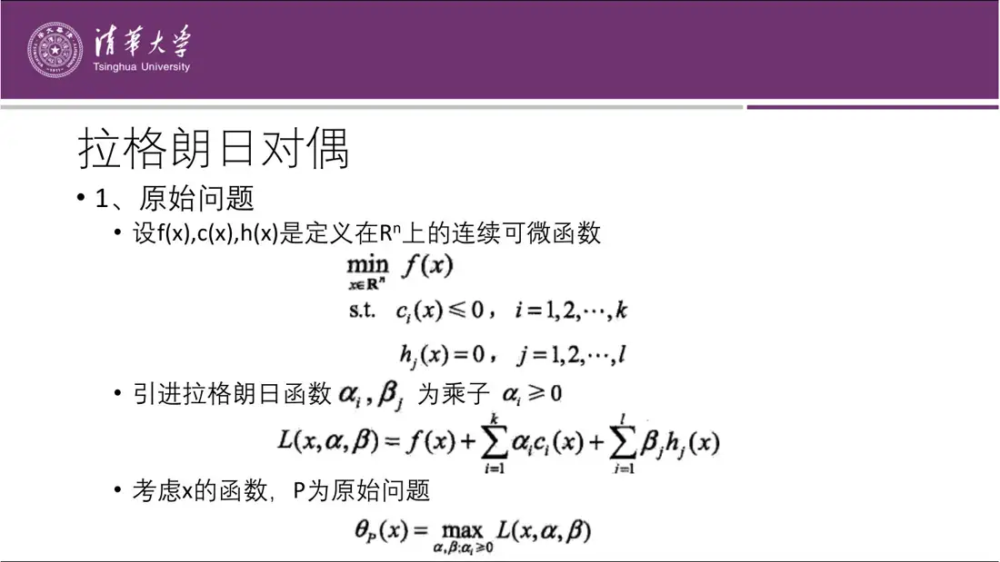

原文：

拉格朗日对偶

• 1、原始问题

\- 设 $f(x), c(x), h(x)$ 是定义在 $R^n$ 上的连续可微函数

$$
\begin{array}{r l} & {\underset {x \in \mathbb {R} ^ {n}} {\min} f (x)} \\ & {\mathrm{s.t.} c _ {i} (x) \leqslant 0, i = 1, 2, \dots , k} \\ & {\quad h _ {j} (x) = 0, j = 1, 2, \dots , l} \end{array}
$$

\- 引进拉格朗日函数 $\alpha_{i},\beta_{j}$ 为乘子 $\alpha_{i} \geqslant 0$

$$
L (x, \alpha , \beta) = f (x) + \sum_ {i = 1} ^ {k} \alpha_ {i} c _ {i} (x) + \sum_ {j = 1} ^ {l} \beta_ {j} h _ {j} (x)
$$

\- 考虑x的函数，P为原始问题

$$
\theta_ {P} (x) = \max _ {\alpha , \beta ; \alpha_ {i} \geqslant 0} L (x, \alpha , \beta)
$$

Tsinghua University
清華大學

### 拉格朗日对偶

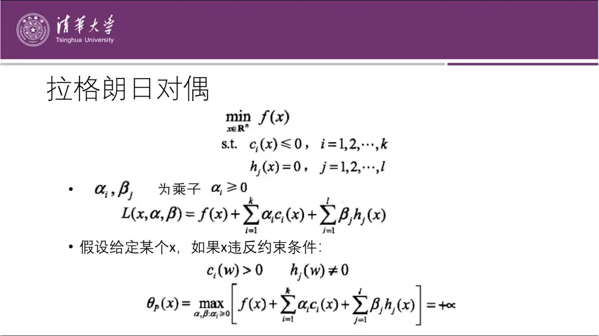

原文：

拉格朗日对偶

$$
\min _ {x \in \mathbb {R} ^ {n}} f (x)
$$

$$
\mathrm{s.t.} \quad c _ {i} (x) \leqslant 0, \quad i = 1, 2, \dots , k
$$

$$
h _ {j} (x) = 0, \quad j = 1, 2, \dots , l
$$

• $\alpha_{i},\beta_{j}$ 为乘子 $\alpha_{i}\geqslant0$

$$
L (x, \alpha , \beta) = f (x) + \sum_ {i = 1} ^ {k} \alpha_ {i} c _ {i} (x) + \sum_ {j = 1} ^ {l} \beta_ {j} h _ {j} (x)
$$

\- 假设给定某个x，如果x违反约束条件：

$$
\begin{array}{c} c _ {i} (w) > 0 \quad h _ {j} (w) \neq 0 \\ \theta_ {P} (x) = \max _ {\alpha , \beta : \alpha_ {i} \geqslant 0} \left[ f (x) + \sum_ {i = 1} ^ {k} \alpha_ {i} c _ {i} (x) + \sum_ {j = 1} ^ {l} \beta_ {j} h _ {j} (x) \right] = + \infty \end{array}
$$

清華大學 Tsinghua University

### 拉格朗日对偶

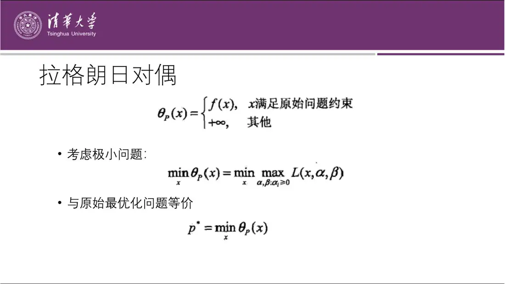

原文：

拉格朗日对偶

$$
\theta_ {P} (x) = \left\{ \begin{array}{l l} f (x), & x \text {满足原始问题约束} \\ + \infty , & \text {其他} \end{array} \right.
$$

\- 考虑极小问题:

$$
\min _ {x} \theta_ {P} (x) = \min _ {x} \max _ {\alpha , \beta : \alpha_ {i} \geqslant 0} L (x, \alpha , \beta)
$$

\- 与原始最优化问题等价

$$
p ^ {*} = \min _ {x} \theta_ {p} (x)
$$

Tsinghua University
清華大學
1911-

### 拉格朗日对偶

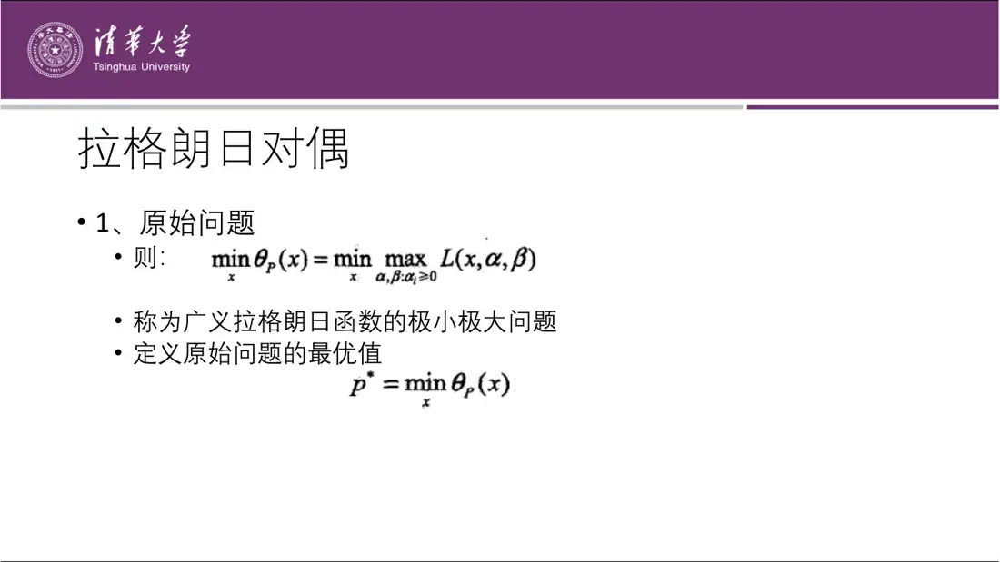

原文：

拉格朗日对偶

• 1、原始问题

\- 则: $\min_{x} \theta_{P}(x) = \min_{x} \max_{\alpha, \beta: \alpha_{t} \geqslant 0} L(x, \alpha, \beta)$

\- 称为广义拉格朗日函数的极小极大问题

\- 定义原始问题的最优值

$$
p ^ {*} = \min _ {x} \theta_ {P} (x)
$$

Tsinghua University
清華大學

### 拉格朗日对偶

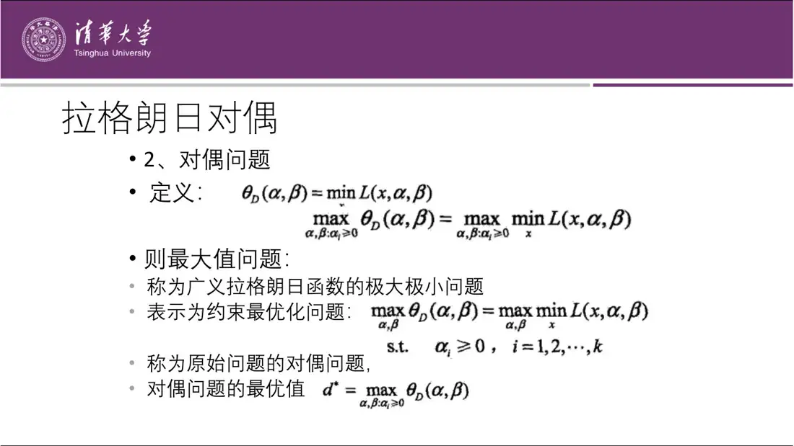

原文：

拉格朗日对偶

• 2、对偶问题

\- 定义: $\theta_{D}(\alpha, \beta) = \min L(x, \alpha, \beta)$

$$
\max _ {\alpha , \beta : \alpha_ {i} \geqslant 0} \theta_ {D} (\alpha , \beta) = \max _ {\alpha , \beta : \alpha_ {i} \geqslant 0} \min _ {x} L (x, \alpha , \beta)
$$

\- 则最大值问题:

\- 称为广义拉格朗日函数的极大极小问题

\- 表示为约束最优化问题： $\max_{\alpha, \beta} \theta_D(\alpha, \beta) = \max_{\alpha, \beta} \min_X L(x, \alpha, \beta)$

\- 称为原始问题的对偶问题，

$$
\mathrm{s.t.} \quad \alpha_ {i} \geqslant 0, \quad i = 1, 2, \dots , k
$$

\- 对偶问题的最优值 $d^{*} = \max_{\alpha, \beta: \alpha_{i} \geqslant 0} \theta_{D}(\alpha, \beta)$

Tsinghua University
清華大學

### 原始问题和对偶问题的关系

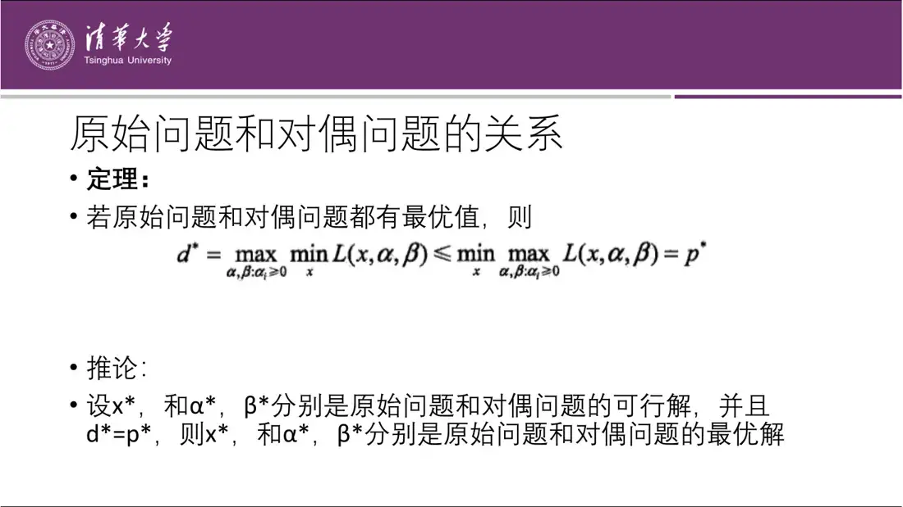

原文：

原始问题和对偶问题的关系

\- 定理:

\- 若原始问题和对偶问题都有最优值，则

$$
d ^ {*} = \max _ {\alpha , \beta : \alpha_ {i} \geqslant 0} \min _ {x} L (x, \alpha , \beta) \leqslant \min _ {x} \max _ {\alpha , \beta : \alpha_ {i} \geqslant 0} L (x, \alpha , \beta) = p ^ {*}
$$

\- 推论:

\- 设 $x^{*}$ , 和 $\alpha^{*}$ , $\beta^{*}$ 分别是原始问题和对偶问题的可行解, 并且 $d^{*} = p^{*}$ , 则 $x^{*}$ , 和 $\alpha^{*}$ , $\beta^{*}$ 分别是原始问题和对偶问题的最优解

清華大學 Tsinghua University

### KKT条件

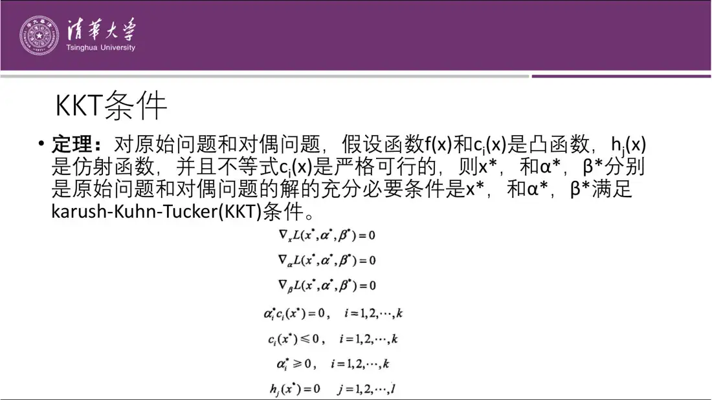

原文：

KKT条件

\- 定理：对原始问题和对偶问题，假设函数 $f(x)$ 和 $c_{i}(x)$ 是凸函数， $h_{j}(x)$ 是仿射函数，并且不等式 $c_{i}(x)$ 是严格可行的，则 $x^{*}$ ，和 $\alpha^{*}$ ， $\beta^{*}$ 分别是原始问题和对偶问题的解的充分必要条件是 $x^{*}$ ，和 $\alpha^{*}$ ， $\beta^{*}$ 满足 karush-Kuhn-Tucker(KKT) 条件。

$$
\begin{array}{r l} & {\nabla_ {x} L (x ^ {*}, \alpha^ {*}, \beta^ {*}) = 0} \\ & {\nabla_ {\alpha} L (x ^ {*}, \alpha^ {*}, \beta^ {*}) = 0} \\ & {\nabla_ {\beta} L (x ^ {*}, \alpha^ {*}, \beta^ {*}) = 0} \\ & {\alpha_ {i} ^ {*} c _ {i} (x ^ {*}) = 0, \quad i = 1, 2, \dots , k} \\ & {c _ {i} (x ^ {*}) \leqslant 0, \quad i = 1, 2, \dots , k} \\ & {\alpha_ {i} ^ {*} \geqslant 0, \quad i = 1, 2, \dots , k} \\ & {h _ {j} (x ^ {*}) = 0 \quad j = 1, 2, \dots , l} \end{array}
$$

清華大學 Tsinghua University

### 学习的对偶算法

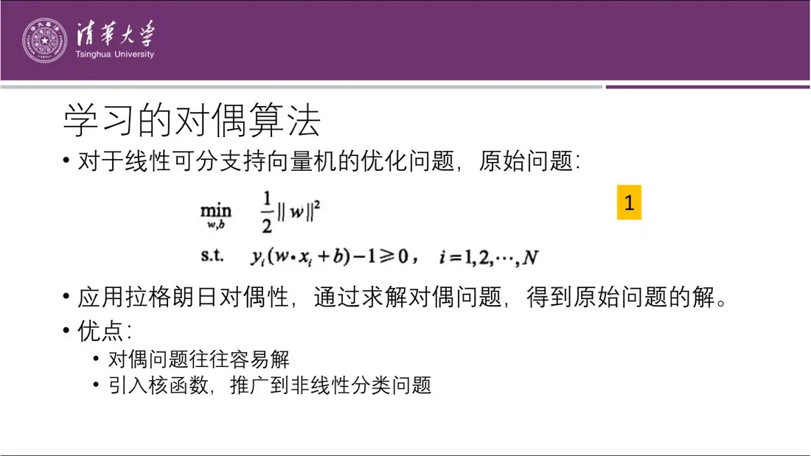

原文：

学习的对偶算法

\- 对于线性可分支持向量机的优化问题，原始问题：

$$
\begin{array}{l l} \min _ {w, b} & \frac {1}{2} \| w \| ^ {2} \\ \text {s.t.} & y _ {i} (w \cdot x _ {i} + b) - 1 \geqslant 0, \quad i = 1, 2, \dots , N \end{array}
$$

$$
1
$$

\- 应用拉格朗日对偶性，通过求解对偶问题，得到原始问题的解。

\- 优点:

\- 对偶问题往往容易解

\- 引入核函数，推广到非线性分类问题

清華大學 Tsinghua University

### 学习的对偶算法

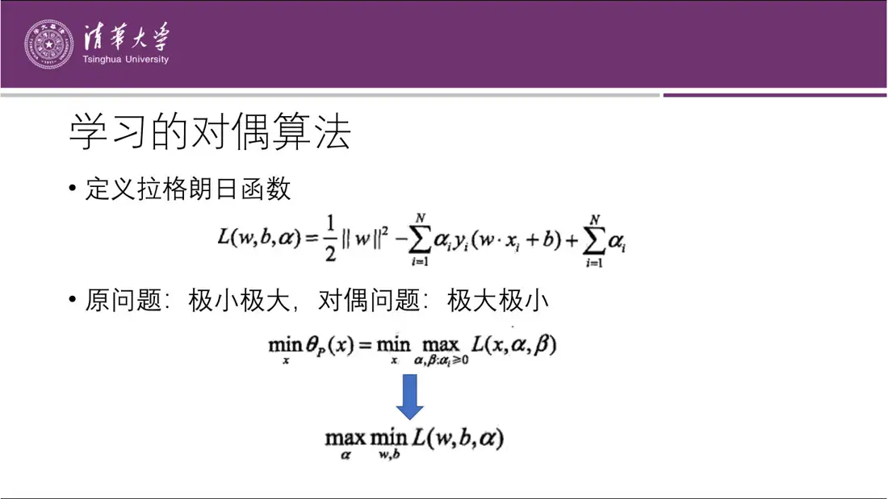

原文：

学习的对偶算法

\- 定义拉格朗日函数

$$
L (w, b, \alpha) = \frac {1}{2} \| w \| ^ {2} - \sum_ {i = 1} ^ {N} \alpha_ {i} y _ {i} (w \cdot x _ {i} + b) + \sum_ {i = 1} ^ {N} \alpha_ {i}
$$

\- 原问题：极小极大，对偶问题：极大极小

$$
\begin{array}{c} \min _ {x} \theta_ {P} (x) = \min _ {x} \max _ {\alpha , \beta : \alpha_ {i} \geqslant 0} L (x, \alpha , \beta) \\ \Biggl \downarrow \\ \max _ {\alpha} \min _ {w, b} L (w, b, \alpha) \end{array}
$$

Tsinghua University
清華大學

### 学习的对偶算法

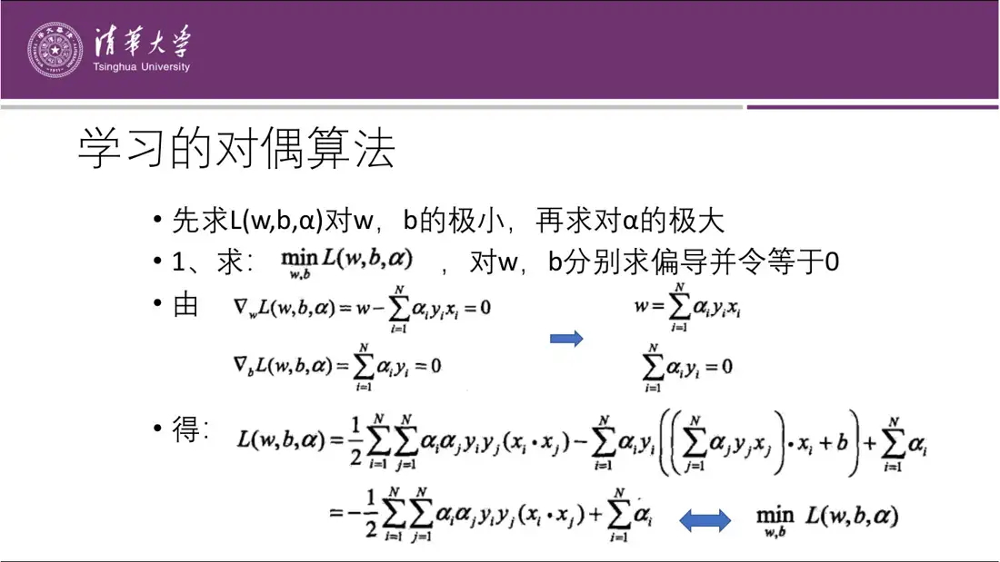

原文：

学习的对偶算法

\- 先求 $L(w,b,\alpha)$ 对w，b的极小，再求对 $\alpha$ 的极大

• 1、求： $\min_{w,b}L(w,b,\alpha)$ ，对w，b分别求偏导并令等于0

\- 由 $\nabla_{w}L(w,b,\alpha) = w - \sum_{i=1}^{N}\alpha_{i}y_{i}x_{i} = 0$

$$
\nabla_ {b} L (w, b, \alpha) = \sum_ {i = 1} ^ {N} \alpha_ {i} y _ {i} = 0
$$

$$
\begin{array}{r l r} & & {w = \sum_ {i = 1} ^ {N} \alpha_ {i} y _ {i} x _ {i}} \\ & {\longrightarrow} & {\sum_ {i = 1} ^ {N} \alpha_ {i} y _ {i} = 0} \end{array}
$$

\- 得:

$$
\begin{array}{r l} L (w, b, \alpha) & = \frac {1}{2} \sum_ {i = 1} ^ {N} \sum_ {j = 1} ^ {N} \alpha_ {i} \alpha_ {j} y _ {i} y _ {j} (x _ {i} \cdot x _ {j}) - \sum_ {i = 1} ^ {N} \alpha_ {i} y _ {i} \left(\left(\sum_ {j = 1} ^ {N} \alpha_ {j} y _ {j} x _ {j}\right) \cdot x _ {i} + b\right) + \sum_ {i = 1} ^ {N} \alpha_ {i} \\ & = - \frac {1}{2} \sum_ {i = 1} ^ {N} \sum_ {j = 1} ^ {N} \alpha_ {i} \alpha_ {j} y _ {i} y _ {j} (x _ {i} \cdot x _ {j}) + \sum_ {i = 1} ^ {N} \alpha_ {i} \quad \Longleftrightarrow \quad \min _ {w, b} L (w, b, \alpha) \end{array}
$$

清華大學 Tsinghua University

### 学习的对偶算法

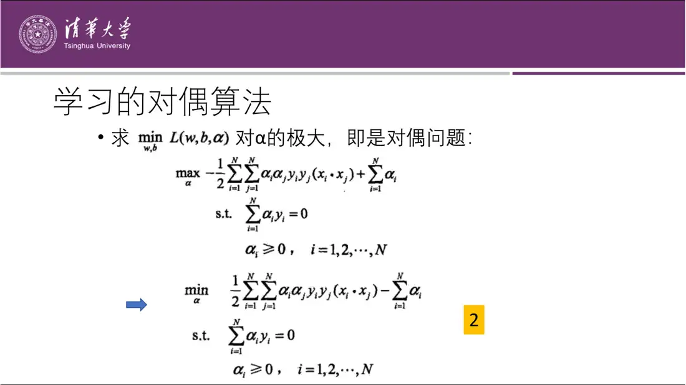

原文：

学习的对偶算法

\- 求 $\min_{w,b} L(w,b,\alpha)$ 对 $\alpha$ 的极大，即是对偶问题：

$$
\begin{array}{r l} & \max _ {\alpha} - \frac {1}{2} \sum_ {i = 1} ^ {N} \sum_ {j = 1} ^ {N} \alpha_ {i} \alpha_ {j} y _ {i} y _ {j} (x _ {i} \cdot x _ {j}) + \sum_ {i = 1} ^ {N} \alpha_ {i} \\ & \text {s.t.} \quad \sum_ {i = 1} ^ {N} \alpha_ {i} y _ {i} = 0 \\ & \alpha_ {i} \geqslant 0, \quad i = 1, 2, \dots , N \\ & \min _ {\alpha} \quad \frac {1}{2} \sum_ {i = 1} ^ {N} \sum_ {j = 1} ^ {N} \alpha_ {i} \alpha_ {j} y _ {i} y _ {j} (x _ {i} \cdot x _ {j}) - \sum_ {i = 1} ^ {N} \alpha_ {i} \\ & \text {s.t.} \quad \sum_ {i = 1} ^ {N} \alpha_ {i} y _ {i} = 0 \\ & \alpha_ {i} \geqslant 0, \quad i = 1, 2, \dots , N \end{array}
$$

清華大學 Tsinghua University

### $$

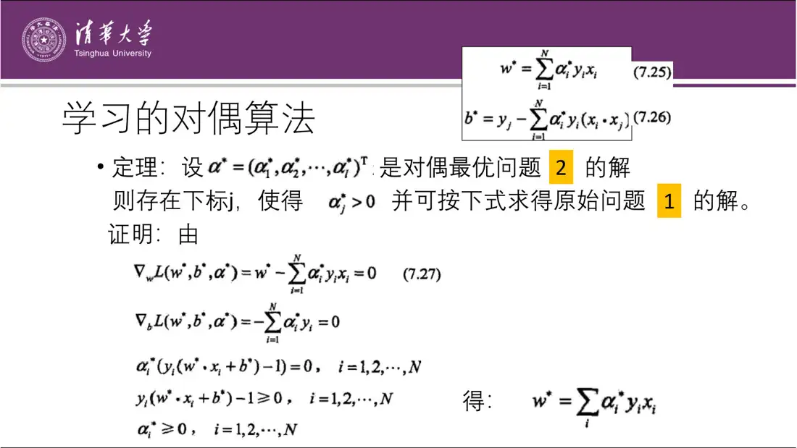

原文：

$$
w ^ {*} = \sum_ {i = 1} ^ {N} \alpha_ {i} ^ {*} y _ {i} x _ {i}
$$

(7.25)

学习的对偶算法

$$
\boxed {b ^ {*} = y _ {j} - \sum_ {i = 1} ^ {N} \alpha_ {i} ^ {*} y _ {i} (x _ {i} \cdot x _ {j})} \tag {7.26}
$$

\- 定理: 设 $\alpha^{*} = (\alpha_{1}^{*}, \alpha_{2}^{*}, \cdots, \alpha_{l}^{*})^{\mathrm{T}}$ . 是对偶最优问题 2 的解则存在下标j, 使得 $\alpha_{j}^{*} > 0$ 并可按下式求得原始问题 1 的解。证明: 由

$$
\nabla_ {w} L (w ^ {*}, b ^ {*}, \alpha^ {*}) = w ^ {*} - \sum_ {i = 1} ^ {N} \alpha_ {i} ^ {*} y _ {i} x _ {i} = 0\tag{7.27}
$$

$$
\nabla_ {b} L (w ^ {*}, b ^ {*}, \alpha^ {*}) = - \sum_ {i = 1} ^ {N} \alpha_ {i} ^ {*} y _ {i} = 0
$$

$$
\alpha_ {i} ^ {*} (y _ {i} (w ^ {*} \cdot x _ {i} + b ^ {*}) - 1) = 0, \quad i = 1, 2, \dots , N
$$

$$
y _ {i} (w ^ {*} \cdot x _ {i} + b ^ {*}) - 1 \geqslant 0, \quad i = 1, 2, \dots , N
$$

$$
\alpha_ {i} ^ {*} \geqslant 0, \quad i = 1, 2, \dots , N
$$

得：

$$
w ^ {*} = \sum_ {i} \alpha_ {i} ^ {*} y _ {i} x _ {i}
$$

清華大學 Tsinghua University

### 学习的对偶算法

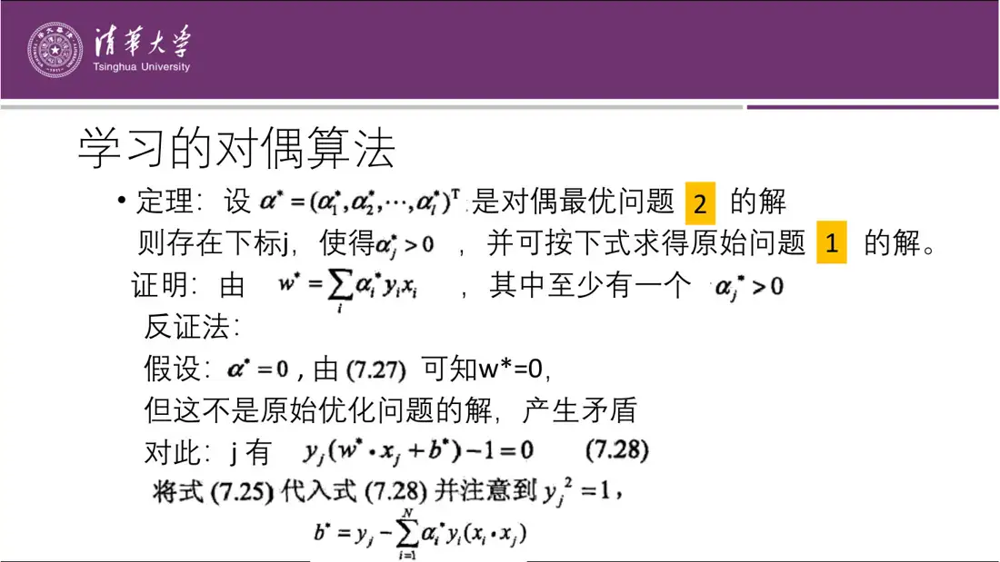

原文：

学习的对偶算法

\- 定理：设 $\alpha^{*} = (\alpha_{1}^{*},\alpha_{2}^{*},\dots ,\alpha_{l}^{*})^{\mathrm{T}}$ 是对偶最优问题 2 的解

则存在下标j，使得 $\alpha_{j}^{*}>0$ ，并可按下式求得原始问题 1 的解。

证明：由 $w^{*} = \sum_{i}\alpha_{i}^{*}y_{i}x_{i}$ ，其中至少有一个 $\alpha_{j}^{*} > 0$ 反证法：

假设： $\alpha^{*}=0$ ，由(7.27)可知 $w^{*}=0$ ，

但这不是原始优化问题的解，产生矛盾

对此：j有 $y_{j}(w^{*}\cdot x_{j} + b^{*}) - 1 = 0$ (7.28)

将式(7.25)代入式(7.28)并注意到 $y_{j}^{2}=1$ ，

$$
b ^ {*} = y _ {j} - \sum_ {i = 1} ^ {N} \alpha_ {i} ^ {*} y _ {i} (x _ {i} \cdot x _ {j})
$$

Tsinghua University
清華大學

### 学习的对偶算法

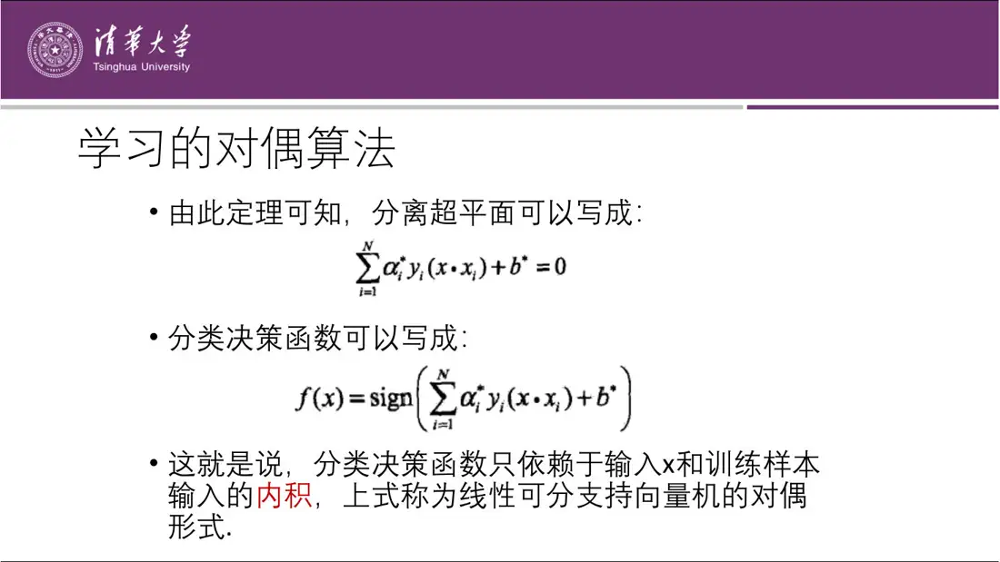

原文：

学习的对偶算法

\- 由此定理可知，分离超平面可以写成：

$$
\sum_ {i = 1} ^ {N} \alpha_ {i} ^ {*} y _ {i} (x \cdot x _ {i}) + b ^ {*} = 0
$$

\- 分类决策函数可以写成:

$$
f (x) = \operatorname{sign} \left(\sum_ {i = 1} ^ {N} \alpha_ {i} ^ {*} y _ {i} (x \cdot x _ {i}) + b ^ {*}\right)
$$

\- 这就是说，分类决策函数只依赖于输入x和训练样本输入的内积，上式称为线性可分支持向量机的对偶形式.

清華大學 Tsinghua University

### 线性可分支持向量机学习算法

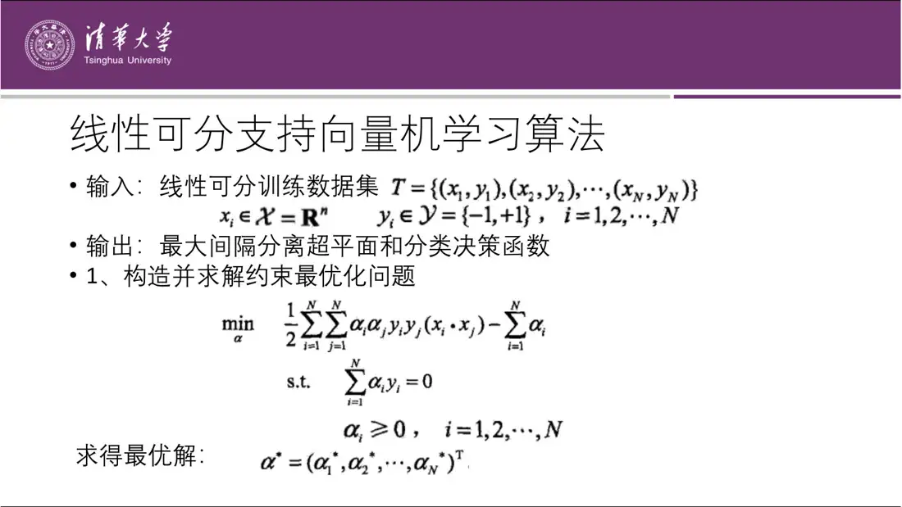

原文：

线性可分支持向量机学习算法

\- 输入：线性可分训练数据集 $T = \{(x_{1},y_{1}),(x_{2},y_{2}),\dots ,(x_{N},y_{N})\}$

$$
x _ {i} \in \mathcal {X} = \mathbf {R} ^ {n} \quad y _ {i} \in \mathcal {Y} = \{- 1, + 1 \}, i = 1, 2, \dots , N
$$

\- 输出：最大间隔分离超平面和分类决策函数

• 1、构造并求解约束最优化问题

$$
\begin{array}{l l} \min _ {\alpha} & \frac {1}{2} \sum_ {i = 1} ^ {N} \sum_ {j = 1} ^ {N} \alpha_ {i} \alpha_ {j} y _ {i} y _ {j} (x _ {i} \cdot x _ {j}) - \sum_ {i = 1} ^ {N} \alpha_ {i} \\ & \text { s.t. } \quad \sum_ {i = 1} ^ {N} \alpha_ {i} y _ {i} = 0 \end{array}
$$

$$
\alpha_ {i} \geqslant 0, \quad i = 1, 2, \dots , N
$$

求得最优解:

$$
\alpha^ {*} = \left(\alpha_ {1} ^ {*}, \alpha_ {2} ^ {*}, \dots , \alpha_ {N} ^ {*}\right) ^ {\mathrm{T}}
$$

Tsinghua University
清華大學

### 线性可分支持向量机学习算法

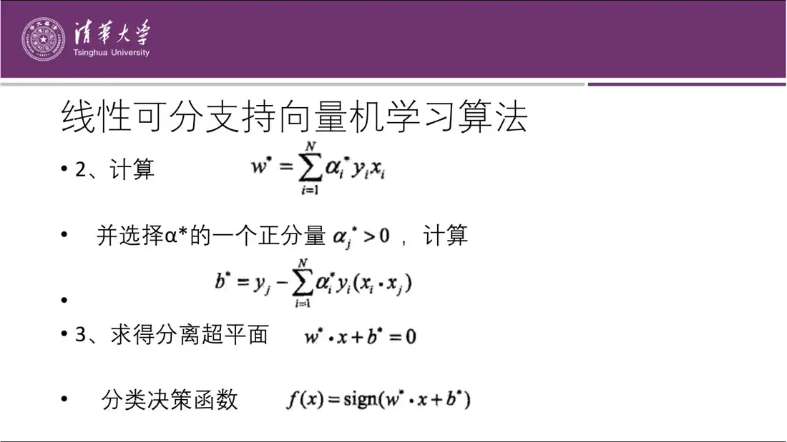

原文：

线性可分支持向量机学习算法

• 2、计算

$$
w ^ {*} = \sum_ {i = 1} ^ {N} \alpha_ {i} ^ {*} y _ {i} x _ {i}
$$

\- 并选择 $\alpha^{*}$ 的一个正分量 $\alpha_{j}^{*} > 0$ ，计算

$$
b ^ {*} = y _ {j} - \sum_ {i = 1} ^ {N} \alpha_ {i} ^ {*} y _ {i} (x _ {i} \cdot x _ {j})
$$

·3、求得分离超平面 $w^{*} \cdot x + b^{*} = 0$

\- 分类决策函数 $f(x) = \mathrm{sign}(w^{*}\cdot x + b^{*})$

清華大學 Tsinghua University

### 支持向量

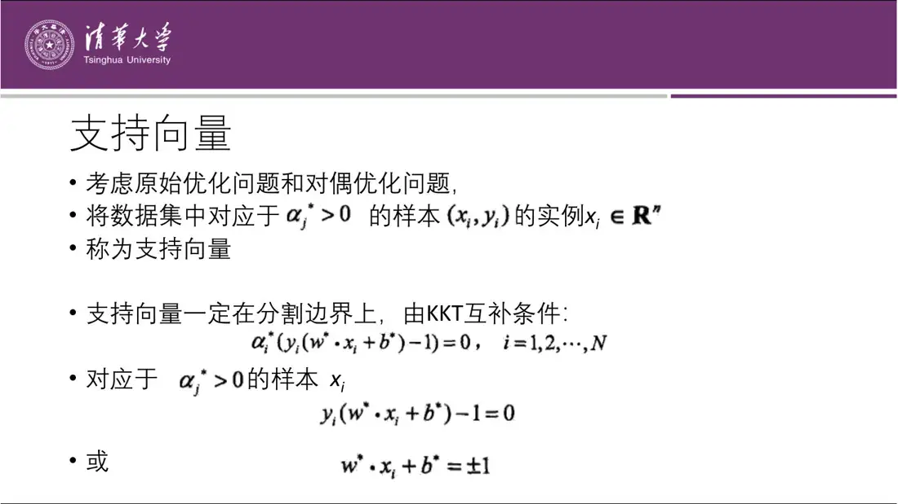

原文：

支持向量

\- 考虑原始优化问题和对偶优化问题，

\- 将数据集中对应于 $\alpha_{j}^{*} > 0$ 的样本 $(x_{i}, y_{i})$ 的实例 $x_{i} \in \mathbf{R}^{n}$

\- 称为支持向量

\- 支持向量一定在分割边界上，由KKT互补条件：

$$
\alpha_ {i} ^ {*} \left(y _ {i} \left(w ^ {*} \cdot x _ {i} + b ^ {*}\right) - 1\right) = 0, \quad i = 1, 2, \dots , N
$$

\- 对应于 $\alpha_{i}^{*} > 0$ 的样本 $x_{i}$

$$
y _ {i} (w ^ {*} \cdot x _ {i} + b ^ {*}) - 1 = 0
$$

• 或

$$
w ^ {*} \cdot x _ {i} + b ^ {*} = \pm 1
$$

Tsinghua University
清華大學

### 例子:

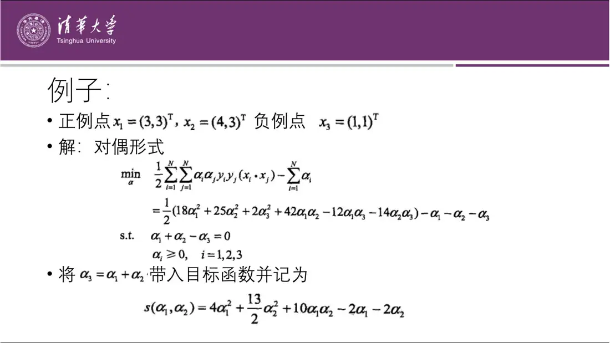

原文：

例子:

\- 正例点 $x_{1} = (3,3)^{\mathrm{T}}$ ， $x_{2} = (4,3)^{\mathrm{T}}$ 负例点 $x_{3} = (1,1)^{\mathrm{T}}$

\- 解：对偶形式

$$
\begin{array}{r l} \min _ {\alpha} & \frac {1}{2} \sum_ {i = 1} ^ {N} \sum_ {j = 1} ^ {N} \alpha_ {i} \alpha_ {j} y _ {i} y _ {j} (x _ {i} \cdot x _ {j}) - \sum_ {i = 1} ^ {N} \alpha_ {i} \\ & = \frac {1}{2} (1 8 \alpha_ {1} ^ {2} + 2 5 \alpha_ {2} ^ {2} + 2 \alpha_ {3} ^ {2} + 4 2 \alpha_ {1} \alpha_ {2} - 1 2 \alpha_ {1} \alpha_ {3} - 1 4 \alpha_ {2} \alpha_ {3}) - \alpha_ {1} - \alpha_ {2} - \alpha_ {3} \\ \text {s.t.} & \alpha_ {1} + \alpha_ {2} - \alpha_ {3} = 0 \\ & \alpha_ {i} \geqslant 0, i = 1, 2, 3 \end{array}
$$

\- 将 $\alpha_{3} = \alpha_{1} + \alpha_{2}$ 带入目标函数并记为

$$
s \left(\alpha_ {1}, \alpha_ {2}\right) = 4 \alpha_ {1} ^ {2} + \frac {1 3}{2} \alpha_ {2} ^ {2} + 1 0 \alpha_ {1} \alpha_ {2} - 2 \alpha_ {1} - 2 \alpha_ {2}
$$

Tsinghua University
清華大學

### 例子:

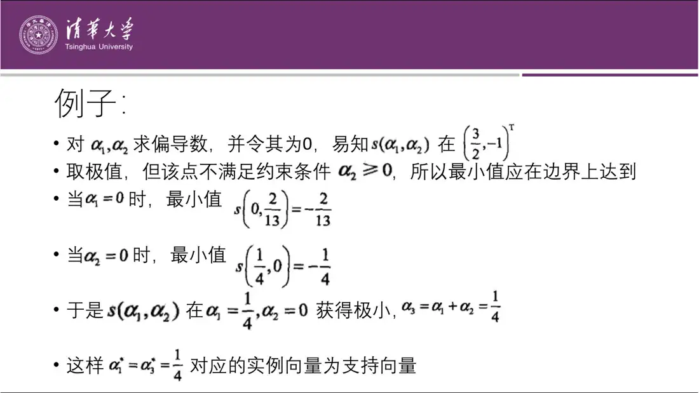

原文：

例子:

\- 对 $\alpha_{1},\alpha_{2}$ 求偏导数，并令其为0，易知 $s(\alpha_1,\alpha_2)$ 在 $\left(\frac{3}{2}, - 1\right)^{\mathrm{T}}$

\- 取极值，但该点不满足约束条件 $\alpha_{2} \geqslant 0$ ，所以最小值应在边界上达到

\- 当 $\alpha_{1} = 0$ 时，最小值 $s\left(0, \frac{2}{13}\right) = -\frac{2}{13}$

\- 当 $\alpha_{2} = 0$ 时，最小值 $s\left(\frac{1}{4},0\right) = -\frac{1}{4}$

\- 于是 $s(\alpha_{1}, \alpha_{2})$ 在 $\alpha_{1} = \frac{1}{4}, \alpha_{2} = 0$ 获得极小， $\alpha_{3} = \alpha_{1} + \alpha_{2} = \frac{1}{4}$

\- 这样 $\alpha_{1}^{*} = \alpha_{3}^{*} = \frac{1}{4}$ 对应的实例向量为支持向量

Tsinghua University
清華大學

### 例子：

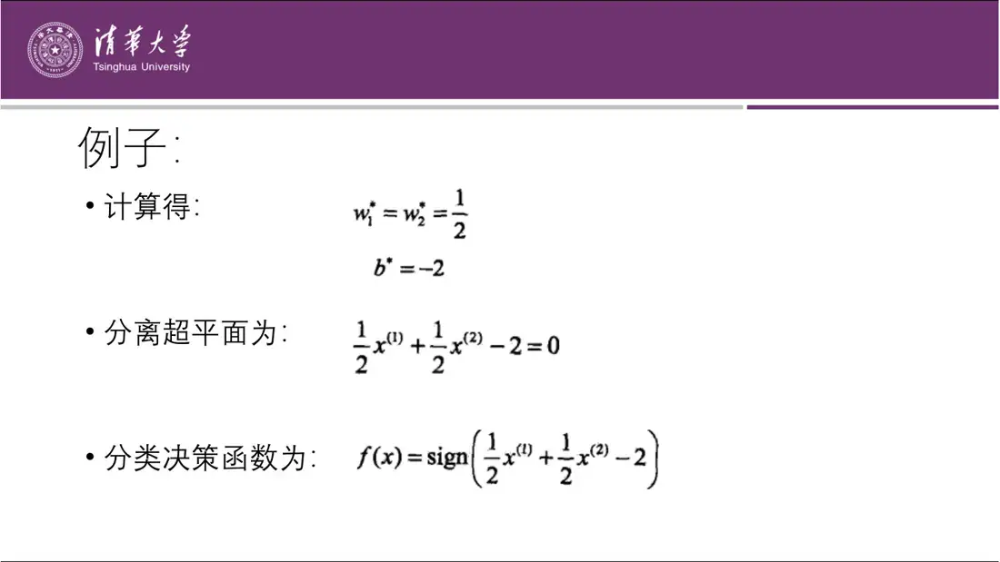

原文：

例子：

\- 计算得:

$$
w _ {1} ^ {*} = w _ {2} ^ {*} = \frac {1}{2}
$$

$$
b ^ {*} = - 2
$$

\- 分离超平面为: $\frac{1}{2} x^{(1)} + \frac{1}{2} x^{(2)} - 2 = 0$

\- 分类决策函数为： $f(x) = \text{sign}\left(\frac{1}{2} x^{(1)} + \frac{1}{2} x^{(2)} - 2\right)$

Tsinghua University
清華大學
1911-UNIVERSITY

### 线性支持向量机与软间隔最大化

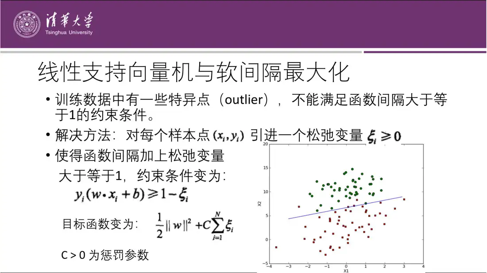

原文：

线性支持向量机与软间隔最大化

\- 训练数据中有一些特异点（outlier），不能满足函数间隔大于等于1的约束条件。

\- 解决方法：对每个样本点 $(x_{i},y_{i})$ 引进一个松弛变量 $\xi_{i}\geqslant 0$

\- 使得函数间隔加上松弛变量大于等于1，约束条件变为： $y_{i}(w \cdot x_{i} + b) \geqslant 1 - \xi_{i}$ 目标函数变为： $\frac{1}{2} ||w||^{2} + C \sum_{j=1}^{N} \xi_{i}$ C > 0 为惩罚参数

Tsinghua University
清華大學

### 线性支持向量机与软间隔最大化

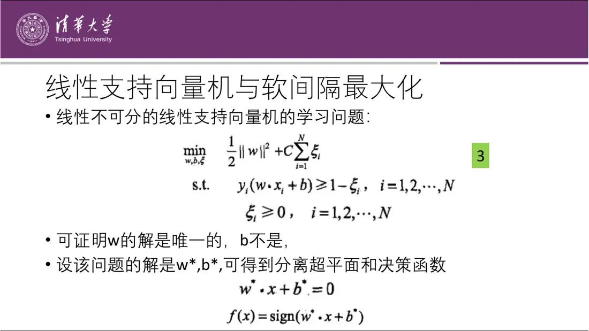

原文：

线性支持向量机与软间隔最大化

\- 线性不可分的线性支持向量机的学习问题:

$$
\min _ {w, b, \xi} \quad \frac {1}{2} \| w \| ^ {2} + C \sum_ {i = 1} ^ {N} \xi_ {i}
$$

3

$$
\mathrm{s.t.} \quad y _ {i} (w \cdot x _ {i} + b) \geqslant 1 - \xi_ {i}, \quad i = 1, 2, \dots , N
$$

$$
\xi_ {i} \geqslant 0, \quad i = 1, 2, \dots , N
$$

\- 可证明w的解是唯一的，b不是，

\- 设该问题的解是 $w^{*}, b^{*}$ ，可得到分离超平面和决策函数

$$
w ^ {*} \cdot x + b ^ {*} = 0
$$

$$
f (x) = \operatorname{sign} \left(w ^ {*} \cdot x + b ^ {*}\right)
$$

Tsinghua University
清華大學

### 线性支持向量机与软间隔最大化

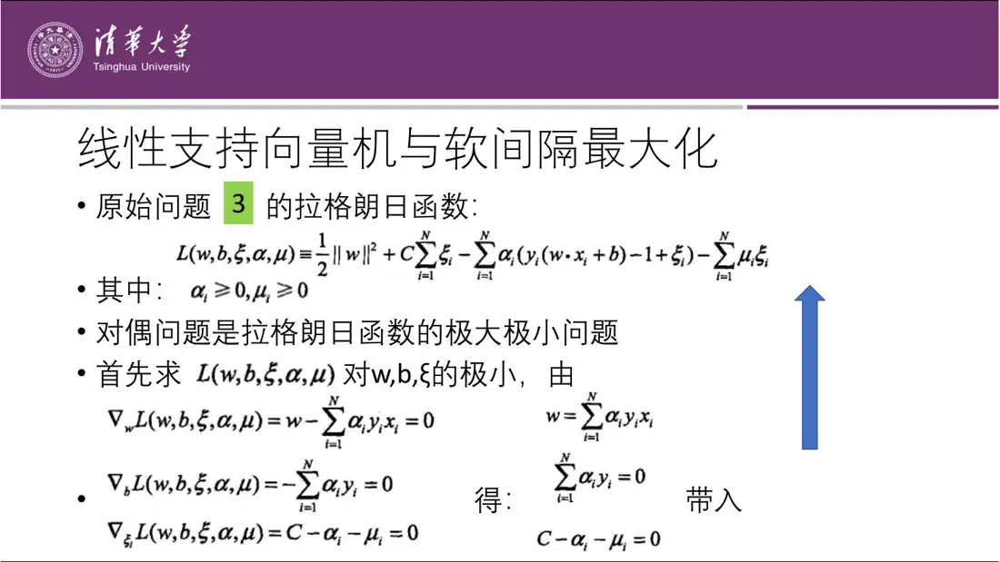

原文：

线性支持向量机与软间隔最大化

\- 原始问题 3 的拉格朗日函数:

$$
L (w, b, \xi , \alpha , \mu) \equiv \frac {1}{2} \| w \| ^ {2} + C \sum_ {i = 1} ^ {N} \xi_ {i} - \sum_ {i = 1} ^ {N} \alpha_ {i} (y _ {i} (w \cdot x _ {i} + b) - 1 + \xi_ {i}) - \sum_ {i = 1} ^ {N} \mu_ {i} \xi_ {i}
$$

\- 其中： $\alpha_{i} \geqslant 0, \mu_{i} \geqslant 0$

\- 对偶问题是拉格朗日函数的极大极小问题

\- 首先求 $L(w,b,\xi ,\alpha ,\mu)$ 对 $\mathbf{w},\mathbf{b},\xi$ 的极小，由

$$
\nabla_ {w} L (w, b, \xi , \alpha , \mu) = w - \sum_ {i = 1} ^ {N} \alpha_ {i} y _ {i} x _ {i} = 0 \quad w = \sum_ {i = 1} ^ {N} \alpha_ {i} y _ {i} x _ {i}
$$

$$
\nabla_ {b} L (w, b, \xi , \alpha , \mu) = - \sum_ {i = 1} ^ {N} \alpha_ {i} y _ {i} = 0
$$

得：

带入

$$
\nabla_ {\xi_ {i}} L (w, b, \xi , \alpha , \mu) = C - \alpha_ {i} - \mu_ {i} = 0
$$

$$
C - \alpha_ {i} - \mu_ {i} = 0
$$

Tsinghua University
清華大學

### 线性支持向量机与软间隔最大化

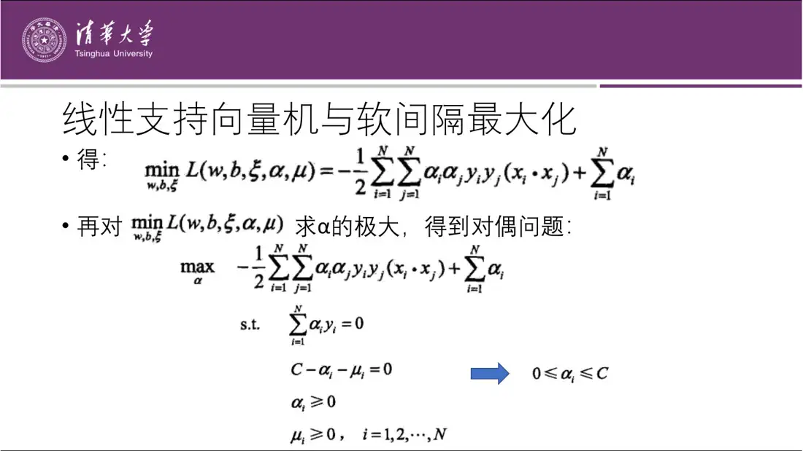

原文：

线性支持向量机与软间隔最大化

\- 得:

$$
\min _ {w, b, \xi} L (w, b, \xi , \alpha , \mu) = - \frac {1}{2} \sum_ {i = 1} ^ {N} \sum_ {j = 1} ^ {N} \alpha_ {i} \alpha_ {j} y _ {i} y _ {j} \left(x _ {i} \cdot x _ {j}\right) + \sum_ {i = 1} ^ {N} \alpha_ {i}
$$

\- 再对 $\min_{w,b,\xi} L(w,b,\xi, \alpha, \mu)$ 求 $\alpha$ 的极大，得到对偶问题：

$$
\begin{array}{r l} \max _ {\alpha} & - \frac {1}{2} \sum_ {i = 1} ^ {N} \sum_ {j = 1} ^ {N} \alpha_ {i} \alpha_ {j} y _ {i} y _ {j} (x _ {i} \cdot x _ {j}) + \sum_ {i = 1} ^ {N} \alpha_ {i} \\ & \text {s.t.} \quad \sum_ {i = 1} ^ {N} \alpha_ {i} y _ {i} = 0 \\ & C - \alpha_ {i} - \mu_ {i} = 0 \\ & \alpha_ {i} \geqslant 0 \\ & \mu_ {i} \geqslant 0, i = 1, 2, \dots , N \end{array} \quad \Longrightarrow \quad 0 \leqslant \alpha_ {i} \leqslant C
$$

清華大學 Tsinghua University

### 线性支持向量机与软间隔最大化

原文：

线性支持向量机与软间隔最大化

\- 原始问题 3 的对偶问题:

$$
\begin{array}{l l} \min _ {\alpha} & \frac {1}{2} \sum_ {i = 1} ^ {N} \sum_ {j = 1} ^ {N} \alpha_ {i} \alpha_ {j} y _ {i} y _ {j} (x _ {i} \cdot x _ {j}) - \sum_ {i = 1} ^ {N} \alpha_ {i} \\ & \text { s.t. } \quad \sum_ {i = 1} ^ {N} \alpha_ {i} y _ {i} = 0 \end{array}
$$

$$
0 \leqslant \alpha_ {i} \leqslant C, \quad i = 1, 2, \dots , N
$$

\- 定理: 设 $\alpha^{*} = (\alpha_{1}^{*}, \alpha_{2}^{*}, \cdots, \alpha_{N}^{*})^{\mathrm{T}}$ 是对偶问题 4 的一个解, 若存在 $\alpha^{*}$ 的一个分量 $\alpha_{j}^{*}, 0 < \alpha_{j}^{*} < C$ , 则原始问题的解 $w^{*}, b^{*}$

$$
w ^ {*} = \sum_ {i = 1} ^ {N} \alpha_ {i} ^ {*} y _ {i} x _ {i} \quad b ^ {*} = y _ {j} - \sum_ {i = 1} ^ {N} y _ {i} \alpha_ {i} ^ {*} (x _ {i} \cdot x _ {j})
$$

Tsinghua University
清華大學

### 线性支持向量机学习算法

原文：

线性支持向量机学习算法

\- 输入：线性不可分训练数据集 $T = \{(x_{1},y_{1}),(x_{2},y_{2}),\dots ,(x_{N},y_{N})\}$

$$
x _ {i} \in \mathcal {X} = \mathbf {R} ^ {n} \quad y _ {i} \in \mathcal {Y} = \{- 1, + 1 \}, \quad i = 1, 2, \dots , N
$$

\- 输出：分离超平面和分类决策函数

• 1、构造并求解约束最优化问题

$$
\begin{array}{r l} \min _ {\alpha} & \frac {1}{2} \sum_ {i = 1} ^ {N} \sum_ {j = 1} ^ {N} \alpha_ {i} \alpha_ {j} y _ {i} y _ {j} (x _ {i} \cdot x _ {j}) - \sum_ {i = 1} ^ {N} \alpha_ {i} \\ & \text { s.t. } \quad \sum_ {i = 1} ^ {N} \alpha_ {i} y _ {i} = 0 \\ & 0 \leqslant \alpha_ {i} \leqslant C, \quad i = 1, 2, \dots , N \end{array}
$$

求得最优解:

$$
\alpha^ {*} = \left(\alpha_ {1} ^ {*}, \alpha_ {2} ^ {*}, \dots , \alpha_ {N} ^ {*}\right) ^ {\mathrm{T}}
$$

Tsinghua University
清華大學

### 线性支持向量机学习算法

原文：

线性支持向量机学习算法

• 2、计算

$$
w ^ {*} = \sum_ {i = 1} ^ {N} \alpha_ {i} ^ {*} y _ {i} x _ {i}
$$

• 并选择 $\alpha^{*}$ ，适合条件 $0 < \alpha_{j}^{*} < C$ ，计算

$$
b ^ {*} = y _ {j} - \sum_ {i = 1} ^ {N} \alpha_ {i} ^ {*} y _ {i} (x _ {i} \cdot x _ {j})
$$

·3、求得分离超平面 $w^{*} \cdot x + b^{*} = 0$

\- 分类决策函数 $f(x) = \mathrm{sign}(w^{*}\cdot x + b^{*})$

Tsinghua University
清華大學

### 支持向量

原文：

支持向量

若 $\alpha_{i}^{*} < C$ ，则 $\xi_{i} = 0$

若 $\alpha_{i}^{*} = C$ ， $0 <   \xi_{i} <   1$

$$
\alpha_ {i} ^ {*} = C, \quad \xi_ {i} = 1
$$

若 $\alpha_{i}^{*} = C$ ， $\xi_{i} > 1$

Tsinghua University
清華大學
1911-1911

### 合页损失函数hinge loss function

原文：

合页损失函数hinge loss function

\- 线性支持向量机学习还有另外一种解释，就是最小化以下目标函数：

$$
\sum_ {i = 1} ^ {N} \left[ 1 - y _ {i} (w \cdot x _ {i} + b) \right] _ {+} + \lambda \| w \| ^ {2}
$$

\- 第一项: $L(y(w \cdot x + b)) = [1 - y(w \cdot x + b)]_{+}$

\- 称为合页损失函数

$$
[ z ] _ {+} = \left\{ \begin{array}{l l} z, & z > 0 \\ 0, & z \leqslant 0 \end{array} \right.
$$

Tsinghua University
清華大學

### 合页损失函数hinge loss function

原文：

合页损失函数hinge loss function

\- 线性支持向量机原始最优化问题:

$$
\min _ {w, b, \xi} \frac {1}{2} \| w \| ^ {2} + C \sum_ {i = 1} ^ {N} \xi_ {i}
$$

$$
\mathrm{s.t.} \quad y _ {i} (w \cdot x _ {i} + b) \geqslant 1 - \xi_ {i}, \quad i = 1, 2, \dots , N
$$

$$
\xi_ {i} \geqslant 0, \quad i = 1, 2, \dots , N
$$

\- 等价于:

$$
\min _ {w, b} \sum_ {i = 1} ^ {N} \left[ 1 - y _ {i} (w \cdot x _ {i} + b) \right] _ {+} + \lambda \parallel w \parallel^ {2}
$$

清華大學 Tsinghua University

### 合页损失函数hinge loss function

原文：

合页损失函数hinge loss function

清華大學 Tsinghua University

### 非线性支持向量机与核函数

原文：

非线性支持向量机与核函数

\- 例子$\omega_{1}:\{(0,0),(1,1)\}$ $\omega_{2}:\{(1,0),(0,1)\}$

线性识别函数不存在
把2维空间 $(x_{1},x_{2})$ 变为3维空间 $(x_{1},x_{2},x_{3})$ $x_{3}=x_{1}x_{2}$ $(x_{1},x_{2})$ $(x_{1},x_{2},x_{3})$ (0,0)    (0,0,0)

(1,1)    (1,1,1)

(1,0)    (1,0,0)

(0,1)    (0,1,0)

清華大學 Tsinghua University

### 例子

原文：

例子

作平面 $d(X)=x_{1}+x_{2}-2x_{3}-\frac{1}{3}=0$ 分开 $\omega_{1},\omega_{2}$

清華大學 Tsinghua University

### 例子

原文：

例子

清華大學 Tsinghua University

### 例子

原文：

例子

清華大學 Tsinghua University

### 泛函基础

原文：

泛函基础

\- 度量空间

\- 赋范空间

\- 向量空间

\- 希尔伯特空间

\- 内积空间

Tsinghua University
清華大學
1911-1911

### 泛函分析

原文：

泛函分析

\- 形成于20世纪30年代的数学分支；

\- 从变分问题，积分方程和理论物理的研究中发展而来；

\- 综合运用了函数论，几何学，代数学的观点；

\- 可看成是无限维向量空间的解析几何及数学分析;

\- 研究内容

\- 无限维向量空间上的函数，算子和极限理论；

\- 研究拓扑线性空间到拓扑线性空间之间，满足各种拓扑和代数条件的映射；

Tsinghua University
清華大學
1911-1911

### 泛函分析

原文：

泛函分析

\- 函数概念被赋予了更为一般的意义

\- 古典分析中的函数概念是指两个数集之间所建立的一种对应关系

\- 现代数学的发展却是要求建立两个任意集合之间的某种对应关系

\- 在数学上，把无限维空间到无限维空间的变换叫做算子

\- 研究无限维线性空间上的泛函数和算子理论，就产生了一门新的分析数学，叫做泛函分析。

Tsinghua University
清華大學
1911-1911

### 泛函分析的研究内容

原文：

泛函分析的研究内容

\- 泛函分析自身

\- 算子谱理论、巴拿赫代数、拓扑线性空间理论、广义函数论；

\- 与其他数学学科的关联

\- 微分方程、概率论、函数论、连续介质力学、计算数学、控制论、最优化理论等学科中都有重要的应用，建立群上调和分析理论的基本工具；

\- 与其他科学学科的关联

\- 连续介质力学、量子物理学，是研究无限个自由度物理系统的重要而自然的工具之一。

Tsinghua University
清華大學
1911-1911

### 度量空间

原文：

度量空间

\- 距离空间

\- Banach空间（完备的赋范线性空间）

\- Hilbert空间（完备的内积空间）

Tsinghua University
清華大學
1911-1911

### 度量(距离)空间

原文：

度量(距离)空间

\- 设X是非空集合，对于X中的任意两元素x与y，按某一法则都对应唯一的实数ρ(x, y)，并满足以下三条公理（距离公理）：

• 1. 非负性： $\rho(x, y) \geq 0$ ， $\rho(x, y) = 0$ 当且仅当x = y；

• 2. 对称性： $\rho(x, y) = \rho(y, x)$ ;

• 3.三角不等式: 对任意的x, y, z $\rho(x, y) \leq \rho(x, z) + \rho(z, y)$

\- 则称 $\rho(x, y)$ 为 $x$ 与 $y$ 间的距离（或度量），并称 $X$ 是以 $\rho$ 为距离的距离空间（或度量空间），记成 $(X, \rho)$ ，或简记为 $X$ ； $X$ 中的元素称为 $X$ 中的点。

Tsinghua University
清華大學

### 度量(距离)空间

原文：

度量(距离)空间

\- 是泛函分析最基本的研究框架，在泛函分析中遇到的空间均为度量空间；

\- 度量空间的概念起源于经典分析，人们在研究线性常微分方程、偏微分方程、变分法以及逼近论。

\- 泛函分析中，经常将符合一定要求的元素放在一起所构成的集合称之为一个“空间”，元素称之为“点”。

\- “点”：包含真正意义下的点、数列和函数。

\- 泛函分析中，很少研究一个“点”的具体性质，而是研究一个空间中点与点之间的关系，以及空间中符合一定条件的点组成的该空间子集的一些性质。

Tsinghua University
清華大學
1911-1911

### 度量(距离)空间

原文：

度量(距离)空间

\- $L^{\mathfrak{p}}[a,b]$ 表示区间 $[a,b]$ 绝对值的 $p$ 次幂 $L$ 可积函数的全体，并把几乎处处相等的函数看成是同一个函数，对于 $x, y \in L^{\mathfrak{p}}[a,b]$ ，规定

$$
\rho (x, y) = \left[ \int_ {a} ^ {b} | x (t) - y (t) | ^ {p} \mathrm{d} t \right] ^ {1 / p}, p \geq 1
$$

\- 则 $L^{\mathfrak{p}}[a,b]$ 构成一个距离空间，称之为 $p$ 次幂可积函数空间

Tsinghua University
清華大學

### 完备性概念

原文：

完备性概念

设 $(X,\rho)$ 是度量空间

\- 设 $\{x_{n}\}_{n = 1}^{\infty}$ 是 $X$ 中的点列，如果对于任一正数 $\varepsilon$

存在正数N，使得当自然数 $n,m\geqslant N$ 时

$$
\rho (x _ {n}, x _ {m}) <   \varepsilon
$$

就称 $\{x_{n}\}_{n=1}^{\infty}$ 是X中的基本点列，或者称为Cauchy点列

\- 如果度量空间 $X$ 中每个基本点列都收敛, 称 $X$ 是完备度量空间.

Tsinghua University
清華大學

### 完备性概念

原文：

完备性概念

$C[a,b]$ 和 $L^{\mathrm{p}}[a,b]$ 都是完备距离空间

Tsinghua University
清華大學

### 线性空间和赋范空间

原文：

线性空间和赋范空间

\- 线性空间（线性空间）：

\- 空间中的任意两点可以做加法或与数相乘，运算的结果仍未该空间的点，并且该空间中的每个点可以定义长度，这个长度称为该点的范数，范数可以视为欧式空间中向量长度概念的推广。

\- 由于赋范空间既有代数结构，又有拓扑结果，因此其空间结构较度量空间要丰富得多，其在实际中的应用也更加重要。

Tsinghua University
清華大學
1911-1911

### 线性空间

原文：

线性空间

\- 设 $V$ 是一个非空集合， $K$ 是实（或复）数域，并可在其上定义“加法”，“数乘”运算，而且满足以下公理

\- 加法交换律： $x+y=y+x$

\- 加法结合律： $(x + y) + z = x + (y + z)$

\- 存在零元： $x + 0 = x$

\- 存在逆元： $x + (-x) = 0$

\- 数乘: $1x = x$

\- $a(bx) = (ab)x$

• $(a+b)x=ax+bx$

\- $a(x + y) = ax + ay$

\- 则称V是数域K上的线性空间

Tsinghua University
清華大學

### 赋范空间

原文：

赋范空间

\- 设 $X$ 是实（或复）线性空间，如果对于 $X$ 中每个元素 $x$ ，按照一定的法则对应于实数 $\| x\|$ ，且满足：

\- $||x|| \geq 0, ||x|| = 0$ 当且仅当 $x$ 等于零元（ $x = 0$ ）

\- $||ax|| = |a|||x||$ ， $a$ 是实（或复）数

\- $||x + y|| \leq ||x|| + ||y||$

\- 则称 $X$ 是实（或复）赋范线性空间， $\| x\|$ 称为 $x$ 的范数

\- 赋范线性空间必然是距离空间：

• 定义 $\rho(x,y)=\left|\left|x-y\right|\right|$

\- 与度量空间不同:

\- 平移不变性： $d(x+a, y+a)=d(x, y)$ ，x,y,a 属于 X

\- 齐次性： $d(ax, ay) = |a|d(x, y), x, y$ 属于X，a属于K

Tsinghua University
清華大學

### 巴拿赫(Banach)空间

原文：

巴拿赫(Banach)空间

\- 如果赋范线性空间(X, ||.||)是完备的，则称(X, ||.||)是Banach空间。

\- 例子

\- $n$ 维Euclid空间 $\mathbf{R}^n$ 是Banach空间

\- $L^{\mathrm{p}}[a,b]$ $(p\geqslant 1)$ 是Banach空间，定义范数

$$
\left\| x \right\| = \left[ \int_ {a} ^ {b} | x (t) | ^ {p} d t \right] ^ {1 / p}, p \geq 1
$$

Tsinghua University
清華大學

### 巴拿赫(Banach)空间

原文：

巴拿赫(Banach)空间

\- 如果赋范线性空间(X, ||.||)是完备的，则称(X, ||.||)是Banach空间。

\- 例子： $C^k [a,b]$ 是Banach空间

\- $C^k [a,b]$ 表示定义在区间 $[a,b]$ 上 $k$ 阶连续可导的函数全体. 在 $C^k [a,b]$ 定义范数

$$
\left\| x \right\| = \sum_ {j = 0} ^ {k} \max \left| x ^ {(j)} (t) \right|, x ^ {(0)} (t) = x (t) \in C [ a, b ]
$$

Tsinghua University
清華大學

### 有界线性算子

原文：

有界线性算子

\- $T$ 是由赋范线性空间 $X$ 中的某个子集 $D$ 到赋范线性空间中的一个映射, 则称 $T$ 是算子, $D$ 是 $T$ 的定义域, 记为 $D(T)$ , 像集 $\{y \mid y = Tx, x \in D\}$ 是 $T$ 的值域, 记为 $T(D)$ .

\- 若 $T$ 进一步满足

\- 可加性： $T(x+y)=Tx+Ty$

\- 齐次性： $T(ax)=aT(x)$

\- 则 $T$ 是线性算子

\- 若存在正数 $M$ 使得对于一切 $x \in D(T)$ ，有 $||Tx|| \leq M||x||$ ，则 $T$ 是有界算子

Tsinghua University
清華大學

### 有界线性算子

原文：

有界线性算子

\- $T$ 是由赋范线性空间 $X$ 中的某个子集 $D$ 到赋范线性空间中的一个映射, 则称 $T$ 是算子, $D$ 是 $T$ 的定义域, 记为 $D(T)$ , 像集 $\{y \mid y = Tx, x \in D\}$ 是 $T$ 的值域, 记为 $T(D)$ .

\- 若 $T$ 进一步满足

\- 可加性： $T(x+y)=Tx+Ty$

\- 齐次性： $T(ax)=aT(x)$

\- 则 $T$ 是线性算子

\- 若存在正数 $M$ 使得对于一切 $x \in D(T)$ ，有 $||Tx|| \leq M||x||$ ，则 $T$ 是有界算子

Tsinghua University
清華大學

### 有界线性算子

原文：

有界线性算子

\- 定理: 设 $X$ 和 $X1$ 都是赋范线性空间, 在 $B(X, X1)$ 中定义加法和数乘运算:

• $(T1+T2)x=T1x+T2x(T1,T2\in B(X,X1),\quad x\in X)$

\- $(aT)x = a(Tx) (T \in B(X, X1), a$ 是数)

\- 则 $B(X, X1)$ 按照以上的线性运算是一个线性空间，并以前述算子范数的定义构成赋范线性空间

\- 若X1是Banach空间，则B(X, X1)也是Banach空间

Tsinghua University
清華大學

### 内积空间和Hilbert空间

原文：

内积空间和Hilbert空间

\- 几何化：引入正交投影的概念

\- 定义: 设 $X$ 是定义在实（或复）数域 $K$ 上的线性空间, 若对于 $X$ 任意一对有序元素 $x, y$ , 恒对应数域 $K$ 的值 $(x, y)$ , 且满足

• $(ax, y) = a(x, y)$ ;

$$
(x + y, z) = (x, z) + (x, z)
$$

• (x, y) = (y, x)

• $(x, x) \geq 0$ ，且 $(x, x) = 0$ 的充要条件是 x = 0

\- 则称 $X$ 为内积空间， $(x, y)$ 称为 $x, y$ 的内积。

Tsinghua University
清華大學

### Hilbert空间

原文：

Hilbert空间

\- 可由内积导出范数

$$
\| x \| = \sqrt {(x , x)}
$$

\- 完备的内积空间称为希尔伯特(Hilbert)空间

\- Hilbert空间必为Banach空间

Tsinghua University
清華大學
1911-

### Hilbert空间

原文：

Hilbert空间

\- $L^2 [a,b]$ 中定义 $x,y$ 的内积 $(x,y)$ 为

$$
(x, y) = \int_ {a} ^ {b} x (t) \overline {{y}} (t) \mathrm{d} t,   x (t), y (t) \in L ^ {2} [ a, b ]
$$

\- 因此， $L^2 [a,b]$ 是一个可分的Hilbert空间

\- $L^p [a,b]$ $(p\neq 2)$ 不可能诱导由范数诱导出内积空间

Tsinghua University
清華大學

### Hilbert空间

原文：

Hilbert空间

\- 赋范线性空间X成为内积空间的充要条件是它的范数满足中线公式

$$
\left\| x + y \right\| ^ {2} + \left\| x - y \right\| ^ {2} = 2 \left\| x \right\| ^ {2} + 2 \left\| y \right\| ^ {2}
$$

\- 而且内积可表示为

$$
(x, y) = \frac {1}{4} (\left\| x + y \right\| ^ {2} - \left\| x - y \right\| ^ {2} + i \left\| x + i y \right\| ^ {2} - i \left\| x - y \right\| ^ {2})
$$

Tsinghua University
清華大學
1911-UNIVERSITY
清华大学

### Hilbert空间

原文：

Hilbert空间

\- 正交

\- 正交补

\- 勾股定理

$(x,y) = 0$ ，记为 $x\bot y$

$$
A ^ {\perp} = \{x \mid x \perp A, x \in X \} \subset X
$$

$$
x \perp y \Rightarrow \| x + y \| ^ {2} = \| x \| ^ {2} + \| y \| ^ {2}
$$

\- 正交分解：设 $M$ 是内积空间 $X$ 的完备子空间，则对任意 $x \in X$ ，均有以下唯一的正交分解

$$
x = x _ {0} + z, x _ {0} \in M, z \in M ^ {\perp}
$$

Tsinghua University
清華大學
1911-UNIVERSITY

### 内积空间中的标准正交系

原文：

内积空间中的标准正交系

\- 定义：内积空间X中的元素列 $\{e_k\}$ ，如果满足

$$
(e _ {i}, e _ {j}) = 0, i \neq j
$$

\- 则称 $\{e_k\}$ 是一正交系. 进一步，如果满足

$$
(e _ {i}, e _ {j}) = \delta_ {i j} = \left\{ \begin{array}{l l} 0 & i \neq j \\ 1 & i = j \end{array} \right.
$$

\- 则称 $\{e_k\}$ 是一标准正交系

\- 有限维空间，将给定向量展开成正交单位向量的线性组合

\- 无限维空间，将给定函数展开成Fourier级数

Tsinghua University
清華大學

### 非线性支持向量机与核函数

原文：

非线性支持向量机与核函数

\- 非线性分类问题:

\- 非线性可分问题

\- 如果能用 $R^{n}$ 中的一个超曲面将正负例正确分开，则称这个问题为非线性可分问题.

Tsinghua University
清華大學

### 非线性支持向量机与核函数

原文：

非线性支持向量机与核函数

\- 非线性问题往往不好求解，所以希望能用解线性分类问题的方法解决这个问题。

\- 采取的方法是进行一个非线性变换，将非线性问题变换为线性问题，通过解变换后的线性问题的方法求解原来的非线性问题。

\- 原空间:

$$
\mathcal {X} \subset \mathbf {R} ^ {2}, x = (x ^ {(1)}, x ^ {(2)}) ^ {\mathrm{T}} \in \mathcal {X}
$$

\- 新空间： $\mathcal{Z} \subset \mathbb{R}^2, z = (z^{(1)}, z^{(2)})^\mathrm{T} \in \mathcal{Z}$ $z = \phi(x) = ((x^{(1)})^2, (x^{(2)})^2)^{\mathrm{T}}$

$$
w _ {1} (x ^ {(1)}) ^ {2} + w _ {2} (x ^ {(2)}) ^ {2} + b = 0 \quad \Longrightarrow \quad w _ {1} z ^ {(1)} + w _ {2} z ^ {(2)} + b = 0
$$

Tsinghua University
清華大學

### 非线性支持向量机与核函数

原文：

非线性支持向量机与核函数

\- 用线性分类方法求解非线性分类问题分为两步:

\- 首先使用一个变换将原空间的数据映射到新空间;

\- 然后在新空间里用线性分类学习方法从训练数据中学习分类模型。

- 核技巧就属于这样的方法

\- 核技巧应用到支持向量机，其基本想法：

\- 通过一个非线性变换将输入空间(欧氏空间R”或离散集合)对应于一个特征空间(希尔伯特空间)，使得在输入空间中的超曲面模型对应于特征空间中的超平面模型(支持向量机)。分类问题的学习任务通过在特征空间中求解线性支持向量机就可以完成.

Tsinghua University
清華大學
1911-

### 非线性支持向量机与核函数

原文：

非线性支持向量机与核函数

\- 核函数定义:

\- 设X是输入空间(欧氏空间R $^{n}$ 的子集或离散集合). 又设H为特征空间(希尔伯特空间), 如果存在一个从X到H的映射 $\phi(x): \mathcal{X} \to \mathcal{H}$

\- 使得对所有 $x, z \in \mathcal{X}$

\- 函数 $K(x,z)$ 满足条件 $K(x,z) = \phi (x)\cdot \phi (z)$

\- 则称 $K(x,z)$ 为核函数， $\phi(x)$ 为映射函数，

\- 式中 $\phi (x)\cdot \phi (z)$ 为 $\phi (x)$ 和 $\phi (z)$ 的内积

Tsinghua University
清華大學

### 非线性支持向量机与核函数

原文：

非线性支持向量机与核函数

\- 核技巧的想法是：

\- 在学习与预测中只定义核函数 $K(x,z)$ ，而不显式地定义映射函数，通常，直接计算 $K(x,z)$ 比较容易，而通过 $\phi(x)$ 和 $\phi(z)$ 计算 $K(x,z)$ 并不容易。

\- 注意： $\phi$ 是输入空间 $\mathsf{R}^{\mathsf{n}}$ 到特征空间 $\mathsf{H}$ 的映射，特征空间 $\mathsf{H}$ 一般是高维，映射可以不同。

Tsinghua University
清華大學
1911-1911

### 非线性支持向量机与核函数

原文：

非线性支持向量机与核函数

• 例:

\- 假设输入空间是 $\mathsf{R}^2$ ，核函数是 $K(x,z) = (x\cdot z)^2$ ，试找出其相关的特征空间 H 和映射 $\phi(x): \mathbf{R}^2 \to \mathcal{H}$

\- 解:

取特征空间 $\mathcal{H} = \mathbf{R}^3$ ，记 $x = (x^{(1)}, x^{(2)})^{\mathrm{T}}$ ， $z = (z^{(1)}, z^{(2)})^{\mathrm{T}}$

$$
(x \cdot z) ^ {2} = (x ^ {(1)} z ^ {(1)} + x ^ {(2)} z ^ {(2)}) ^ {2} = (x ^ {(1)} z ^ {(1)}) ^ {2} + 2 x ^ {(1)} z ^ {(1)} x ^ {(2)} z ^ {(2)} + (x ^ {(2)} z ^ {(2)}) ^ {2}
$$

\- 可以取： $\phi (x) = ((x^{(1)})^2,\sqrt{2} x^{(1)}x^{(2)},(x^{(2)})^2)^{\intercal}$

\- 容易验证： $\phi (x)\cdot \phi (z) = (x\cdot z)^2 = K(x,z)$

Tsinghua University
清華大學

### 非线性支持向量机与核函数

原文：

非线性支持向量机与核函数

• 例:

\- 假设输入空间是 $\mathsf{R}^2$ ，核函数是 $K(x,z) = (x\cdot z)^2$ ，试找出其相关的特征空间H和映射 $\phi (x):\mathbf{R}^2\to \mathcal{H}$

\- 解:

\- 同样:

$$
\begin{array}{r l} \phi (x) & = \frac {1}{\sqrt {2}} ((x ^ {(1)}) ^ {2} - (x ^ {(2)}) ^ {2}, 2 x ^ {(1)} x ^ {(2)}, (x ^ {(1)}) ^ {2} + (x ^ {(2)}) ^ {2}) ^ {T} \\ \phi (x) & = ((x ^ {(1)}) ^ {2}, x ^ {(1)} x ^ {(2)}, x ^ {(1)} x ^ {(2)}, (x ^ {(2)}) ^ {2}) ^ {T} \end{array}
$$

\- 都满足条件。

Tsinghua University
清華大學

### 核函数在支持向量机的应用

原文：

核函数在支持向量机的应用

\- 注意到:

\- 线性支持向量机对偶问题中，无论是目标函数还是决策函数都只涉及输入实例和实例之间的内积。

\- 目标函数中的内积 $x_{i} \cdot x_{j}$ 用核函数 $K(x_{i}, x_{j}) = \phi(x_{i}) \cdot \phi(x_{j})$

代替，目标函数：

$$
W (\alpha) = \frac {1}{2} \sum_ {i = 1} ^ {N} \sum_ {j = 1} ^ {N} \alpha_ {i} \alpha_ {j} y _ {i} y _ {j} K (x _ {i}, x _ {j}) - \sum_ {i = 1} ^ {N} \alpha_ {i}
$$

\- 决策函数:

$$
f (x) = \operatorname{sign} \left(\sum_ {i = 1} ^ {N _ {s}} a _ {i} ^ {*} y _ {i} \phi \left(x _ {i}\right) \cdot \phi (x) + b ^ {*}\right) = \operatorname{sign} \left(\sum_ {i = 1} ^ {N _ {s}} a _ {i} ^ {*} y _ {i} K \left(x _ {i}, x\right) + b ^ {*}\right)
$$

Tsinghua University
清華大學

### 正定核

原文：

正定核

\- 问题:

\- 己知映射函数 $\phi$ ，可以通过 $\phi(x)$ 和 $\phi(z)$ 的内积求得核函数 $K(x,z)$ .

\- 不用构造映射 $\phi$ , 能否直接判断一个给定的函数 $K(x, z)$ 是不是核函数?

\- 或者说，函数K(x,z)满足什么条件才能成为核函数？

\- 假设K(x,z)是定义在XxX上的对称函数，并且对任意的

$$
x _ {1}, x _ {2}, \dots , x _ {m} \in \mathcal {X}
$$

\- $K(x,z)$ 关于 $x_{1}, x_{2}, \cdots, x_{m}$ 的Gram矩阵是半正定的，可以依据函数 $K(x,z)$ ，构成一个希尔伯特空间(Hilbert space);

\- 其步骤是首先定义映射 $\phi$ ，并构成向量空间 $S$ ，然后在 $S$ 上定义内积构成内积空间；最后将 $S$ 完备化构成希尔伯特空间。

清華大學 Tsinghua University

### 正定核

原文：

正定核

• 1、定义映射，构成向量空间S

\- 映射: $\phi : x \to K(\cdot, x)$

\- 对任意 $x_{i} \in \mathcal{X}, \alpha_{i} \in \mathbf{R}, i = 1,2,\dots,m$

\- 定义线性组合: $f(\cdot) = \sum_{i=1}^{m} \alpha_i K(\cdot, x_i)$

\- 考虑由线性组合为元素的集合S, 由于集合S对加法和数乘运算是封闭的, S构成一个向量空间。

Tsinghua University
清華大學

### 正定核

原文：

正定核

\- 2、在S上定义内积，构成内积空间

\- 在S上定义一个运算“\*”，对任意f，g属于S

$$
f (\cdot) = \sum_ {i = 1} ^ {m} \alpha_ {i} K (\cdot , x _ {i})
$$

$$
g (\bullet) = \sum_ {i = 1} ^ {l} \beta_ {j} K (\bullet , z _ {j})
$$

\- 定义运算\*: $f*g\cdot \sum_{i=1}^{m}\sum_{j=1}^{l}\alpha_{i}\beta_{j}K(x_{i},z_{j})$

\- 证明内积空间:

(1) $(cf)*g = c(f*g)$ , $c \in \mathbb{R}$

(2) $(f + g)*h = f*h + g*h, h \in S$

(3) $f*g = g*f$

(4) $f * f \geqslant 0, f * f = 0 \Leftrightarrow f = 0$

清華大學 Tsinghua University

### 正定核

原文：

正定核

• 3、将内积空间S完备化为希尔伯特空间

\- 由： $f\cdot g = \sum_{i = 1}^{m}\sum_{j = 1}^{l}\alpha_{i}\beta_{j}K(x_{i},z_{j})$

\- 内积得到范数: $\| f \| = \sqrt{f \cdot f}$

\- 因此，S是一个赋范向量空间；根据泛函分析理论，对于不完备的赋范向量空间S，一定可以使之完备化，得到完备的赋范向量空间H；一个内积空间，当作为一个赋范向量空间是完备的时候，就是希尔伯特空间，这样，就得到了希尔伯特空间H。

\- 再生性: $K(\cdot, x) \cdot f = f(x)$ $K(\cdot, x) \cdot K(\cdot, z) = K(x, z)$

Tsinghua University
清華大學

### 正定核

原文：

正定核

\- 正定核的充要条件

\- 设K: $\mathcal{X} \times \mathcal{X} \to \mathbf{R}$ ，是对称函数，则K(x,z)为正定核函数的充要条件是对任意 $x_i \in \mathcal{X}, i=1,2,\cdots,m$ ，K(x,z)对应的Gram矩阵

$$
K = \left[ K (x _ {i}, x _ {j}) \right] _ {m \times m}
$$

\- 是半正定的。

\- 给定一个实矩阵 $A$ ，矩阵 $A^{\mathrm{T}}A$ 是 $A$ 的列向量的格拉姆矩阵，而矩阵 $AA^{\mathrm{T}}$ 是 $A$ 的行向量的格拉姆矩阵。

\- 格拉姆矩阵是半正定的，反之每个半正定矩阵是某些向量的格拉姆矩阵。这组向量一般不是惟一的：任何正交基的格拉姆矩阵是恒同矩阵。

清華大學 Tsinghua University

### 正定核

原文：

正定核

\- 正定核的等价定义

\- 设 $\mathcal{X} \subset \mathbb{R}^n$ ，是K(x,z)是定义在 $\mathcal{X} \times \mathcal{X}$ 对称函数，如果对任意的 $x_i \in \mathcal{X}, i = 1,2,\dots,m$ ，K(x,z)对应的Gram矩阵

$$
K = \left[ K (x _ {i}, x _ {j}) \right] _ {m \times m}
$$

\- 半正定的，则称K(x,z)为正定核。

\- 这一定义在构造核函数时很有用。但对于一个具体函数 $K(x,z)$ 来说，检验它是否为正定核函数并不容易，因为要求对任意有限输入集 $\{x_1, x_2, \cdots, x_m\}$ 验证K对应的Gram矩阵是否为半正定的。

\- 在实际问题中往往应用已有的核函数。

清華大學 Tsinghua University

### 常用核函数

原文：

常用核函数

• 1、多项式核函数（Polynomial kernel function）

$$
K (x, z) = (x \cdot z + 1) ^ {p}
$$

\- 对应的支持向量机为P次多项式分类器，分类决策函数：

$$
f (x) = \operatorname{sign} \left(\sum_ {i = 1} ^ {N _ {i}} a _ {i} ^ {*} y _ {i} \left(x _ {i} \cdot x + 1\right) ^ {p} + b ^ {*}\right)
$$

• 2、高斯核函数 (Gaussian Kernel Function)

$$
K (x, z) = \exp \left(- \frac {\| x - z \| ^ {2}}{2 \sigma^ {2}}\right)
$$

\- 决策函数: $f(x) = \operatorname{sign}\left(\sum_{i=1}^{N_s} a_i^* y_i \exp\left(-\frac{\|x - z\|^2}{2\sigma^2}\right) + b^*\right)$

Tsinghua University
清華大學

### 常用核函数

原文：

常用核函数

• 3、字符串核函数:

\- 考虑一个有限字符表 $\Sigma$ ，字符串s是从 $\Sigma$ 中取出的有限字符的序列，包括空字符。s长度用|s|表示，元素记作 $s(1)s(2)\cdots s(|s|)$ 。两串字符s和t的连接记作st。所有长度为n的字符串的集合记作 $\Sigma^n$ ，所有字符串记作 $\Sigma^* = \bigcup_{n=0}^{\infty} \Sigma^n$

\- 考虑s的子串u，给定一个指标序列 $i = (i_1, i_2, \cdots, i_{|u|})$ ， $1 \leqslant i_1 < i_2 < \cdots < i_{|u|} \leqslant |s|$

• u定义为 $u = s(i) = s(i_{1})s(i_{2}) \cdots s(i_{|u|})$ ，长度记作 $l(i) = i_{|u|} - i_{1} + 1$

\- 如果i是连续的，则 $l(i) = |u|$ ，否则 $l(i) > |u|$

Tsinghua University
清華大學

### 常用核函数

原文：

常用核函数

• 3、字符串核函数:

\- 假设S是长度大于或等于n的字符串的集合，s是S的元素。现在建立字符串集合S到特征空间 $\mathcal{H}_n = R^{\Sigma^n}$ 的映射 $\phi_n(s)$ 。 $R^{\Sigma^n}$ 表示定义在 $\Sigma^n$ 上的实数空间，其每一维对应一个字符串 $u \in \Sigma^n$ ，映射 $\phi_n(s)$ 将字符串s对应于空间 $R^{\Sigma^n}$ 的一个向量，其在u维上的取值为

$$
\left[ \phi_ {n} (s) \right] _ {u} = \sum_ {i: s (i) = u} \lambda^ {l (i)} \quad 0 <   \lambda \leqslant 1
$$

清華大學 Tsinghua University

### 常用核函数

原文：

常用核函数

• 3、字符串核函数:

\- 两个字符串s和t上的字符串核函数是基于映射 $\phi_{n}$ 的特征空间中的内积

$$
\begin{array}{l} k _ {n} (s, t) = \sum_ {u \in \Sigma^ {n}} [ \phi_ {n} (s) ] _ {u} [ \phi_ {n} (t) ] _ {u} \\ = \sum_ {u \in \Sigma^ {n}} \sum_ {(i, j): s (i) = t (j) = u} \lambda^ {l (i)} \lambda^ {l (j)} \end{array}
$$

\- 字符串核函数 $k_{n}(s,t)$ 给出了字符串s和t中长度等于n的所有子串组成的特征向量的余弦相似度。

\- 两串字符串相同的子串越多，就越相似，字符串核函数的值就越大。

清華大學 Tsinghua University

### 非线性支持向量机学习算法

原文：

非线性支持向量机学习算法

\- 输入：线性不可分训练数据集 $T = \{(x_{1},y_{1}),(x_{2},y_{2}),\dots ,(x_{N},y_{N})\}$

$$
x _ {i} \in \mathcal {X} = \mathbf {R} ^ {n} \quad y _ {i} \in \mathcal {Y} = \{- 1, + 1 \}, i = 1, 2, \dots , N
$$

\- 输出：分类决策函数

• 1、选取适当的核函数和参数C，构造最优化问题：

$$
\begin{array}{l l} \min _ {\alpha} & \frac {1}{2} \sum_ {i = 1} ^ {N} \sum_ {j = 1} ^ {N} \alpha_ {i} \alpha_ {j} y _ {i} y _ {j} K (x _ {i}, x _ {j}) - \sum_ {i = 1} ^ {N} \alpha_ {i} \\ & \text {s.t.} \quad \sum_ {i = 1} ^ {N} \alpha_ {i} y _ {i} = 0 \\ & 0 \leqslant \alpha_ {i} \leqslant C, \quad i = 1, 2, \dots , N \end{array}
$$

求得最优解： $\alpha^{*}=(\alpha_{1}^{*},\alpha_{2}^{*},\cdots,\alpha_{N}^{*})^{\mathrm{T}}$

Tsinghua University
清華大學

### 非线性支持向量机学习算法

原文：

非线性支持向量机学习算法

• 2、并选择 $\alpha^{*}$ ，适合条件 $0<\alpha_{j}^{*}<C$ ，计算

$$
b ^ {*} = y _ {j} - \sum_ {i = 1} ^ {N} \alpha_ {i} ^ {*} y _ {i} K (x _ {i} \cdot x _ {j})
$$

• 3、构造决策函数

$$
f (x) = \operatorname{sign} \left(\sum_ {i = 1} ^ {N} \alpha_ {i} ^ {*} y _ {i} K (x \cdot x _ {i}) + b ^ {*}\right)
$$

\- 当 $K(x,z)$ 是正定核函数时，5是凸二次规划问题，解是存在的。

Tsinghua University
清華大學

### 序列最小最优化算法

原文：

序列最小最优化算法

\- 序列最小最优化(sequential minimal optimization SMO)算法：1998年由Platt提出。

John C. Platt, “Using Analytic QP and Sparseness to Speed Training of Support Vector Machines” in Advances in Neural Information Processing Systems 11, M. S. Kearns, S. A. Solla, D. A. Cohn, eds (MIT Press, 1999), 557–63.

\- 动机:

\- 支持向量机的学习问题可以形式化为求解凸二次规划问题.这样的凸二次规划问题具有全局最优解，并且有许多最优化算法可以用于这一问题的求解；

\- 但是当训练样本容量很大时，这些算法往往变得非常低效，以致无法使用。所以，如何高效地实现支持向量机学习就成为一个重要的问题。

清華大學 Tsinghua University

### 序列最小最优化算法

原文：

序列最小最优化算法

\- SMO (Sequential minimal optimization)

\- 解如下凸二次规划的对偶问题

$$
\min _ {\alpha} \frac {1}{2} \sum_ {i = 1} ^ {N} \sum_ {j = 1} ^ {N} \alpha_ {i} \alpha_ {j} y _ {i} y _ {j} K (x _ {i}, x _ {j}) - \sum_ {i = 1} ^ {N} \alpha_ {i}
$$

$$
\text { s.t. } \quad \sum_ {i = 1} ^ {N} \alpha_ {i} y _ {i} = 0
$$

$$
0 \leqslant \alpha_ {i} \leqslant C, \quad i = 1, 2, \dots , N
$$

\- 注意：变量是拉格朗日乘子 $\alpha_{i}$ ，一个对应一个样本

清華大學 Tsinghua University

### SMO算法

原文：

SMO算法

\- 启发式算法，基本思路：

\- 如果所有变量的解都满足此最优化问题的KKT条件，那么得到解；

\- 否则，选择两个变量，固定其它变量，针对这两个变量构建一个二次规划问题，称为子问题，可通过解析方法求解，提高了计算速度。

\- 子问题的两个变量：一个是违反KKT条件最严重的那个，另一个由约束条件自动确定。

$$
\alpha_ {1} = - y _ {1} \sum_ {i = 2} ^ {N} \alpha_ {i} y _ {i}
$$

\- SMO算法包括两个部分:

\- 求解两个变量二次规划的解析方法

\- 选择变量的启发式方法

清華大學 Tsinghua University

### 两个变量二次规划的求解过程

原文：

两个变量二次规划的求解过程

\- 选择两个变量，其它固定，SMO的5的子问题：

$$
\begin{array}{l l} \min _ {\alpha_ {1}, \alpha_ {2}} & W (\alpha_ {1}, \alpha_ {2}) = \frac {1}{2} K _ {1 1} \alpha_ {1} ^ {2} + \frac {1}{2} K _ {2 2} \alpha_ {2} ^ {2} + y _ {1} y _ {2} K _ {1 2} \alpha_ {1} \alpha_ {2} \\ & - (\alpha_ {1} + \alpha_ {2}) + y _ {1} \alpha_ {1} \sum_ {i = 3} ^ {N} y _ {i} \alpha_ {i} K _ {i 1} + y _ {2} \alpha_ {2} \sum_ {i = 3} ^ {N} y _ {i} \alpha_ {i} K _ {i 2} \\ & \text {s.t.} \quad \alpha_ {1} y _ {1} + \alpha_ {2} y _ {2} = - \sum_ {i = 3} ^ {N} y _ {i} \alpha_ {i} = \varsigma \\ & 0 \leqslant \alpha_ {i} \leqslant C, \quad i = 1, 2 \end{array}
$$

清華大學 Tsinghua University

### 两个变量二次规划的求解过程

原文：

两个变量二次规划的求解过程

\- 两个变量，约束条件用二维空间中的图形表示

\- 假设问题 6 的初始可行解为 $\alpha_{1}^{\text {old}}, \alpha_{2}^{\text {old}}$ 最优解 $\alpha_{1}^{\text {new}}, \alpha_{2}^{\text {new}}$

\- 设 $\alpha_{2}$ 未经剪辑时的最优解为 $\alpha_{2}^{\mathrm{new,unc}}$

Tsinghua University
清華大學

### 两个变量二次规划的求解过程

原文：

两个变量二次规划的求解过程

\- 根据不等式条件 $\alpha_{2}^{\mathrm{new}}$ 的取值范围：

$$
L \leqslant \alpha_ {2} ^ {\text { new }} \leqslant H
$$

\- 左图： $L = \max (0, \alpha_{2}^{\mathrm{old}} - \alpha_{1}^{\mathrm{old}})$ $H = \min (C, C + \alpha_{2}^{\mathrm{old}} - \alpha_{1}^{\mathrm{old}})$

\- 右图： $L = \max (0, \alpha_{2}^{\mathrm{old}} + \alpha_{1}^{\mathrm{old}} - C)$ $H = \min (C, \alpha_{2}^{\mathrm{old}} + \alpha_{1}^{\mathrm{old}})$

Tsinghua University
清華大學

### 两个变量二次规划的求解过程

原文：

两个变量二次规划的求解过程

\- 求解过程:

\- 先求沿着约束方向未经剪辑时的 $\alpha_{2}^{\mathrm{new,unc}}$

\- 再求剪辑后的 $\alpha_{2}^{\mathrm{new}}$

\- 记: $g(x) = \sum_{i=1}^{N} \alpha_i y_i K(x_i, x) + b$

\- 令: $E_{i} = g(x_{i}) - y_{i} = \left(\sum_{j=1}^{N}\alpha_{j}y_{j}K(x_{j},x_{i}) + b\right) - y_{i}, i = 1,2$

• E 为输入x的预测值和真实输出y的差，i=1，2

Tsinghua University
清華大學

### 两个变量二次规划的求解过程

原文：

两个变量二次规划的求解过程

\- 定理:

\- 最优化问题 6 沿约束方向未经剪辑的解:

$$
\alpha_ {2} ^ {\text { new,unc }} = \alpha_ {2} ^ {\text { old }} + \frac {y _ {2} (E _ {1} - E _ {2})}{\eta}
$$

$$
\eta = K _ {1 1} + K _ {2 2} - 2 K _ {1 2} = \left\| \Phi (x _ {1}) - \Phi (x _ {2}) \right\| ^ {2}
$$

\- 剪辑后的解 $\alpha_{2}^{\mathrm{new}} = \left\{ \begin{array}{ll}H, & \alpha_{2}^{\mathrm{new,unc}} > H\\ \alpha_{2}^{\mathrm{new,unc}}, & L\leqslant \alpha_{2}^{\mathrm{new,unc}}\leqslant H\\ L, & \alpha_{2}^{\mathrm{new,unc}} <   L \end{array} \right.$

\- 得到 $\alpha_{1}$ 的解 $\alpha_{1}^{\mathrm{new}} = \alpha_{1}^{\mathrm{old}} + y_{1}y_{2}(\alpha_{2}^{\mathrm{old}} - \alpha_{2}^{\mathrm{new}})$

Tsinghua University
清華大學

### 两个变量二次规划的求解过程

原文：

两个变量二次规划的求解过程

\- 证明：引进记号

$$
v _ {i} = \sum_ {j = 3} ^ {N} \alpha_ {j} y _ {j} K (x _ {i}, x _ {j}) = g (x _ {i}) - \sum_ {j = 1} ^ {2} \alpha_ {j} y _ {j} K (x _ {i}, x _ {j}) - b, \quad i = 1, 2
$$

\- 目标函数写成:

$$
\begin{array}{r l} W (\alpha_ {1}, \alpha_ {2}) & = \frac {1}{2} K _ {1 1} \alpha_ {1} ^ {2} + \frac {1}{2} K _ {2 2} \alpha_ {2} ^ {2} + y _ {1} y _ {2} K _ {1 2} \alpha_ {1} \alpha_ {2} \\ & - (\alpha_ {1} + \alpha_ {2}) + y _ {1} v _ {1} \alpha_ {1} + y _ {2} v _ {2} \alpha_ {2} \end{array}
$$

\- 由 $\alpha_{1}y_{1} = \zeta -\alpha_{2}y_{2}$ 及 $y_{i}^{2} = 1$

$$
\alpha_ {1} = (\varsigma - y _ {2} \alpha_ {2}) y _ {1}
$$

清華大學 Tsinghua University

### 两个变量二次规划的求解过程

原文：

两个变量二次规划的求解过程

\- 得到只是 $\alpha 2$ 的函数的目标函数

$$
\begin{array}{r l} W (\alpha_ {2}) & = \frac {1}{2} K _ {1 1} (\varsigma - \alpha_ {2} y _ {2}) ^ {2} + \frac {1}{2} K _ {2 2} \alpha_ {2} ^ {2} + y _ {2} K _ {1 2} (\varsigma - \alpha_ {2} y _ {2}) \alpha_ {2} \\ & - (\varsigma - \alpha_ {2} y _ {2}) y _ {1} - \alpha_ {2} + v _ {1} (\varsigma - \alpha_ {2} y _ {2}) + y _ {2} v _ {2} \alpha_ {2} \end{array}
$$

\- 对 $\alpha 2$ 求导 $\frac{\partial W}{\partial \alpha_2} = K_{11}\alpha_2 + K_{22}\alpha_2 - 2K_{12}\alpha_2 - K_{11}\varsigma y_2 + K_{12}\varsigma y_2 + y_1y_2 - 1 - v_1y_2 + y_2v_2$

\- 令其为0:

$$
\begin{array}{l} \left(K _ {1 1} + K _ {2 2} - 2 K _ {1 2}\right) \alpha_ {2} = y _ {2} \left(y _ {2} - y _ {1} + \varsigma K _ {1 1} - \varsigma K _ {1 2} + v _ {1} - v _ {2}\right) \\ = y _ {2} \left[ y _ {2} - y _ {1} + \varsigma K _ {1 1} - \varsigma K _ {1 2} + \left(g \left(x _ {1}\right) - \sum_ {j = 1} ^ {2} y _ {j} \alpha_ {j} K _ {1 j} - b\right) - \left(g \left(x _ {2}\right) - \sum_ {j = 1} ^ {2} y _ {j} \alpha_ {j} K _ {2 j} - b\right) \right] \end{array}
$$

Tsinghua University
清華大學

### 两个变量二次规划的求解过程

原文：

两个变量二次规划的求解过程

\- 将 $\zeta = \alpha_{1}^{\mathrm{old}}y_{1} + \alpha_{2}^{\mathrm{old}}y_{2}$ 代入：

$$
\begin{array}{r l} (K _ {1 1} + K _ {2 2} - 2 K _ {1 2}) \alpha_ {2} ^ {\text {new,unc}} & = y _ {2} ((K _ {1 1} + K _ {2 2} - 2 K _ {1 2}) \alpha_ {2} ^ {\text {old}} y _ {2} + y _ {2} - y _ {1} + g (x _ {1}) - g (x _ {2})) \\ & = (K _ {1 1} + K _ {2 2} - 2 K _ {1 2}) \alpha_ {2} ^ {\text {old}} + y _ {2} (E _ {1} - E _ {2}) \end{array}
$$

\- 将 $\eta = K_{11} + K_{22} - 2K_{12}$ 代入：

$$
\alpha_ {2} ^ {\text { new,unc }} = \alpha_ {2} ^ {\text { old }} + \frac {y _ {2} (E _ {1} - E _ {2})}{\eta}
$$

Tsinghua University
清華大學

### 两个变量二次规划的求解过程

原文：

两个变量二次规划的求解过程

\- 得到定理:

\- 最优化问题 6 沿约束方向未经剪辑的解:

$$
\alpha_ {2} ^ {\text { new,unc }} = \alpha_ {2} ^ {\text { old }} + \frac {y _ {2} (E _ {1} - E _ {2})}{\eta}
$$

$$
\eta = K _ {1 1} + K _ {2 2} - 2 K _ {1 2} = \left\| \Phi (x _ {1}) - \Phi (x _ {2}) \right\| ^ {2}
$$

\- 剪辑后的解 $\alpha_{2}^{\mathrm{new}} = \left\{ \begin{array}{ll}H, & \alpha_{2}^{\mathrm{new,unc}} > H\\ \alpha_{2}^{\mathrm{new,unc}}, & L\leqslant \alpha_{2}^{\mathrm{new,unc}}\leqslant H\\ L, & \alpha_{2}^{\mathrm{new,unc}} <   L \end{array} \right.$

\- 得到 $\alpha_{1}$ 的解 $\alpha_{1}^{\mathrm{new}} = \alpha_{1}^{\mathrm{old}} + y_{1}y_{2}(\alpha_{2}^{\mathrm{old}} - \alpha_{2}^{\mathrm{new}})$

Tsinghua University
清華大學

### 变量的选择方法

原文：

变量的选择方法

\- SMO算法在每个子问题中选择两个变量优化，其中至少一个变量是违反KKT条件的

• 1、第一个变量的选择：外循环

\- 违反KKT最严重的样本点，

\- 检验样本点是否满足KKT条件:

先检查

$$
\begin{array}{l} {\alpha_ {i} = 0 \Leftrightarrow y _ {i} g (x _ {i}) \geqslant 1} \\ {0 <   \alpha_ {i} <   C \Leftrightarrow y _ {i} g (x _ {i}) = 1} \\ {\alpha_ {i} = C \Leftrightarrow y _ {i} g (x _ {i}) \leqslant 1} \\ {g (x _ {i}) = \sum_ {j = 1} ^ {N} \alpha_ {j} y _ {j} K (x _ {i}, x _ {j}) + b} \end{array}
$$

Tsinghua University
清華大學

### 变量的选择方法

原文：

变量的选择方法

• 2、第二个变量的检查：内循环，

\- 选择的标准是希望能使目标函数有足够大的变化

\- 即对应 $\left|E_{1}-E_{2}\right|$ 最大，即E1，E2的符号相反，差异最大

\- 如果内循环通过上述方法找到的点不能使目标函数有足够的下降

\- 则：遍历间隔边界上的样本点，测试目标函数下降

\- 如果下降不大，则遍历所有样本点

\- 如果依然下降不大，则丢弃外循环点，重新选择

Tsinghua University
清華大學
1911-

### 计算阈值b和Ei

原文：

计算阈值b和Ei

• 3、每次完成两个变量的优化后，重新计算b，Ei

\- 由KKT条件: $\sum_{i=1}^{N} \alpha_i y_i K_{i1} + b = y_1$

$$
b _ {1} ^ {\text { new }} = y _ {1} - \sum_ {i = 3} ^ {N} \alpha_ {i} y _ {i} K _ {i 1} - \alpha_ {1} ^ {\text { new }} y _ {1} K _ {1 1} - \alpha_ {2} ^ {\text { new }} y _ {2} K _ {2 1}
$$

$$
E _ {i} = g (x _ {i}) - y _ {i} = \left(\sum_ {j = 1} ^ {N} \alpha_ {j} y _ {j} K (x _ {j}, x _ {i}) + b\right) - y _ {i}, \quad i = 1, 2
$$

$$
E _ {1} = \sum_ {i = 3} ^ {N} \alpha_ {i} y _ {i} K _ {i 1} + \alpha_ {1} ^ {\mathrm{old}} y _ {1} K _ {1 1} + \alpha_ {2} ^ {\mathrm{old}} y _ {2} K _ {2 1} + b ^ {\mathrm{old}} - y _ {1}
$$

清華大學 Tsinghua University

### 计算阈值b和Ei

原文：

计算阈值b和Ei

• 3、每次完成两个变量的优化后，重新计算b，Ei

\- 由KKT条件: $\sum_{i=1}^{N} \alpha_i y_i K_{ii} + b = y_1$

$$
b _ {1} ^ {\text { new }} = y _ {1} - \sum_ {i = 3} ^ {N} \alpha_ {i} y _ {i} K _ {i 1} - \alpha_ {1} ^ {\text { new }} y _ {1} K _ {1 1} - \alpha_ {2} ^ {\text { new }} y _ {2} K _ {2 1}
$$

$$
E _ {1} = \sum_ {i = 3} ^ {N} \alpha_ {i} y _ {i} K _ {i 1} + \alpha_ {1} ^ {\text { old }} y _ {1} K _ {1 1} + \alpha_ {2} ^ {\text { old }} y _ {2} K _ {2 1} + b ^ {\text { old }} - y _ {1}
$$

$$
y _ {1} - \sum_ {i = 3} ^ {N} \alpha_ {i} y _ {i} K _ {i 1} = - E _ {1} + \alpha_ {1} ^ {\text { old }} y _ {1} K _ {1 1} + \alpha_ {2} ^ {\text { old }} y _ {2} K _ {2 1} + b ^ {\text { old }}
$$

$$
b _ {1} ^ {\text { new }} = - E _ {1} - y _ {1} K _ {1 1} \left(\alpha_ {1} ^ {\text { new }} - \alpha_ {1} ^ {\text { old }}\right) - y _ {2} K _ {2 1} \left(\alpha_ {2} ^ {\text { new }} - \alpha_ {2} ^ {\text { old }}\right) + b ^ {\text { old }}
$$

清華大學 Tsinghua University

### 计算阈值b和 $E_{i}$

原文：

计算阈值b和 $E_{i}$

\- 如果: $0 < \alpha_{2}^{\mathrm{new}} < C$

$$
b _ {2} ^ {\text { new }} = - E _ {2} - y _ {1} K _ {1 2} \left(\alpha_ {1} ^ {\text { new }} - \alpha_ {1} ^ {\text { old }}\right) - y _ {2} K _ {2 2} \left(\alpha_ {2} ^ {\text { new }} - \alpha_ {2} ^ {\text { old }}\right) + b ^ {\text { old }}
$$

$$
E _ {i} ^ {\text { new }} = \sum_ {s} y _ {j} \alpha_ {j} K (x _ {i}, x _ {j}) + b ^ {\text { new }} - y _ {i}
$$

$S$ 是所有支持向量 $x_{j}$ 的集合

清華大學 Tsinghua University

### SMO算法

原文：

SMO算法

\- 输入：训练数据集 $T = \{(x_{1},y_{1}),(x_{2},y_{2}),\dots ,(x_{N},y_{N})\}$

• $x_{i} \in X = R^{n}$ $y_{i} \in Y = \{-1, +1\}$ , $i = 1, 2, \cdots, N$ ，精度 $\varepsilon$

\- 输出：近似解 $\alpha$

（1）取初值 $\alpha^{(0)} = 0$ ，令 $k = 0$

(2) 选取优化变量 $\alpha_{1}^{(k)}, \alpha_{2}^{(k)}$ ，解析求解两个变量的最优化问题求得最优解 $\alpha_{1}^{(k+1)}, \alpha_{2}^{(k+1)}$ ，更新 $\alpha$ 为 $\alpha^{(k+1)}$ ；

(3) 若在精度 $\varepsilon$ 范围内满足停机条件

$$
\sum_ {i = 1} ^ {N} \alpha_ {i} y _ {i} = 0
$$

$$
y _ {i} \cdot g (x _ {i}) = \left\{ \begin{array}{l l} \geqslant 1, & \{x _ {i} \mid \alpha_ {i} = 0 \} \\ = 1, & \{x _ {i} \mid 0 <   \alpha_ {i} <   C \} \\ \leqslant 1, & \{x _ {i} \mid \alpha_ {i} = C \} \end{array} \right.
$$

$$
0 \leqslant \alpha_ {i} \leqslant C, \quad i = 1, 2, \dots , N
$$

则转(4)；否则令 $k=k+1$ ，转(2)；

$$
g (x _ {i}) = \sum_ {j = 1} ^ {N} \alpha_ {j} y _ {j} K (x _ {j}, x _ {i}) + b
$$

(4) 取 $\hat{\alpha} = \alpha^{(k+1)}$

清華大學 Tsinghua University

### SMO算法

原文：

SMO算法

\- SVM light: Joachims

\- http://svmlight.joachims.org

• LIBSVM:http://www.csie.ntu.edu.tw/\~cjlin/libsvm

Tsinghua University
清華大學
1911-

### SMO算法编程实现

原文：

SMO算法编程实现

\- SMO算法处理小规模数据集

\- SMO算法中的辅助函数

\- 简化版SMO算法

\- 利用完整Platt SMO算法加速优化

\- 完整版Platt SMO的支持函数

\- 完整版Platt SMO算法中的优化例程

\- 完整版Platt SMO的外循环代码

\- 在复杂数据上应用核函数

\- 核转换函数

\- 在测试中使用核函数

Tsinghua University
清華大學
1911-

### SMO算法处理小规模数据集

原文：

SMO算法处理小规模数据集

\- SMO算法中的辅助函数

Tsinghua University
清華大學
1911-1911

### SMO算法处理小规模数据集

原文：

SMO算法处理小规模数据集

- SMO算法中的辅助函数

Tsinghua University
清華大學

### SMO算法处理小规模数据集

原文：

SMO算法处理小规模数据集

- 简化版SMO算法

Tsinghua University
清華大學
Tsinghua University

### SMO算法处理小规模数据集

原文：

SMO算法处理小规模数据集

\- 简化版SMO算法

$$
f (x) = \operatorname{sign} \left(w ^ {*} \cdot x + b ^ {*}\right)
$$

$$
\begin{array}{c} \left(\left[ \begin{array}{l} \alpha 1 \\ \alpha 2 \end{array} \right] \cdot \left[ \begin{array}{l} y 1 \\ y 2 \end{array} \right]\right) ^ {T} * \left(\left[ \begin{array}{l l} x 1 1 & x 1 2 \\ x 2 1 & x 2 2 \end{array} \right] * \left[ \begin{array}{l} x 1 1 \\ x 1 2 \end{array} \right]\right) \\ \downarrow \\ [ \alpha 1 y 1 \alpha 2 y 2 ] * \left[ \begin{array}{l} x 1 1 x 1 1 + x 1 2 x 1 2 \\ x 2 1 x 1 1 + x 2 2 x 1 2 \end{array} \right] \\ \downarrow \\ [ \alpha 1 y 1 (x 1 1 x 1 1 + x 1 2 x 1 2) + \alpha 2 y 2 (x 2 1 x 1 1 + x 2 2 x 1 2) ] \end{array}
$$

清華大學 Tsinghua University

### SMO算法处理小规模数据集

原文：

SMO算法处理小规模数据集

清華大學 Tsinghua University

### SMO算法处理小规模数据集

原文：

SMO算法处理小规模数据集

Tsinghua University
清華大學

### SMO算法处理小规模数据集

原文：

SMO算法处理小规模数据集

Tsinghua University
清華大學
Tsinghua University

### SMO算法处理小规模数据集

原文：

SMO算法处理小规模数据集

清華大學 Tsinghua University

### SMO算法处理小规模数据集

原文：

SMO算法处理小规模数据集

Tsinghua University
清華大學
Tsinghua University

### SMO算法处理小规模数据集

原文：

SMO算法处理小规模数据集

>>> b,alphas = svmMLiA.smoSimple(dataArr, labelArr, 0.6, 0.001, 40)

清華大學 Tsinghua University

### 完整版Platt SMO的支持函数

原文：

完整版Platt SMO的支持函数

清華大學 Tsinghua University

### 完整版Platt SMO的支持函数

原文：

完整版Platt SMO的支持函数

Tsinghua University
清華大學
Tsinghua University

### 完整版Platt SMO的支持函数

原文：

完整版Platt SMO的支持函数

Tsinghua University
清華大學
TSINGHUA UNIVERSITY
1911
清華大學
TSINGHUA UNIVERSITY

### 完整版Platt SMO的支持函数

原文：

完整版Platt SMO的支持函数

Tsinghua University
清華大學
Tsinghua University

### 完整版Platt SMO的内循环优化例程

原文：

完整版Platt SMO的内循环优化例程

清華大學 Tsinghua University

### 完整版Platt SMO的内循环优化例程

原文：

完整版Platt SMO的内循环优化例程

Tsinghua University
清華大學
Tsinghua University

### 完整版Platt SMO外循环

原文：

完整版Platt SMO外循环

Tsinghua University
清華大學
Tsinghua University

### 完整版Platt SMO外循环

原文：

完整版Platt SMO外循环

Tsinghua University
清華大學
Tsinghua University

### 完整版Platt SMO外循环

原文：

完整版Platt SMO外循环

清華大學 Tsinghua University

### 计算权值向量w

原文：

计算权值向量w

Tsinghua University
清華大學
Tsinghua University

### 在复杂数据上应用核函数

原文：

在复杂数据上应用核函数

$$
k (x, y) = e x p \left(\frac {- \| x - y \| ^ {2}}{2 \sigma^ {2}}\right)
$$

清華大學 Tsinghua University

### 核转换函数

原文：

核转换函数

Tsinghua University
清華大學
Tsinghua University

### 核转换函数

原文：

核转换函数

Tsinghua University
清華大學
Tsinghua University

### 核函数加入对原函数的修改

原文：

核函数加入对原函数的修改

Tsinghua University
清華大學
Tsinghua University

### 核函数进行样本测试

原文：

核函数进行样本测试

Tsinghua University
清華大學

### 核函数进行样本测试

原文：

核函数进行样本测试

Tsinghua University
清華大學
Tsinghua University

### 核函数进行样本测试

原文：

核函数进行样本测试

清華大學 Tsinghua University

### 核函数进行样本测试

原文：

核函数进行样本测试

清華大學 Tsinghua University

### 支持向量机手写识别

原文：

支持向量机手写识别

Tsinghua University
清華大學
1911-

### 支持向量机手写识别

原文：

支持向量机手写识别

Tsinghua University
清華大學
1911-

### 支持向量机手写识别

原文：

支持向量机手写识别

Tsinghua University
清華大學
Tsinghua University

### >>> svmMLiA.testDigits(('rbf', 20))

原文：

>>> svmMLiA.testDigits(('rbf', 20))

支持向量机手写识别

<table><tr><td>Kernel, settings</td><td>Training error (%)</td><td>Test error (%)</td><td># Support vectors</td></tr><tr><td>RBF, 0.1</td><td>0</td><td>52</td><td>402</td></tr><tr><td>RBF, 5</td><td>0</td><td>3.2</td><td>402</td></tr><tr><td>RBF, 10</td><td>0</td><td>0.5</td><td>99</td></tr><tr><td>RBF, 50</td><td>0.2</td><td>2.2</td><td>41</td></tr><tr><td>RBF, 100</td><td>4.5</td><td>4.3</td><td>26</td></tr><tr><td>Linear</td><td>2.7</td><td>2.2</td><td>38</td></tr></table>

Tsinghua University
清華大學
TSINGHUA UNIVERSITY
1911
清華大學
TSINGHUA UNIVERSITY

### • END

原文：

• END

Tsinghua University
清華大學
