# 《体育理论》奥林匹克文化（教案）

原件的每一页，下面附识别出的文字。

### 理论课教案（奥林匹克文化）

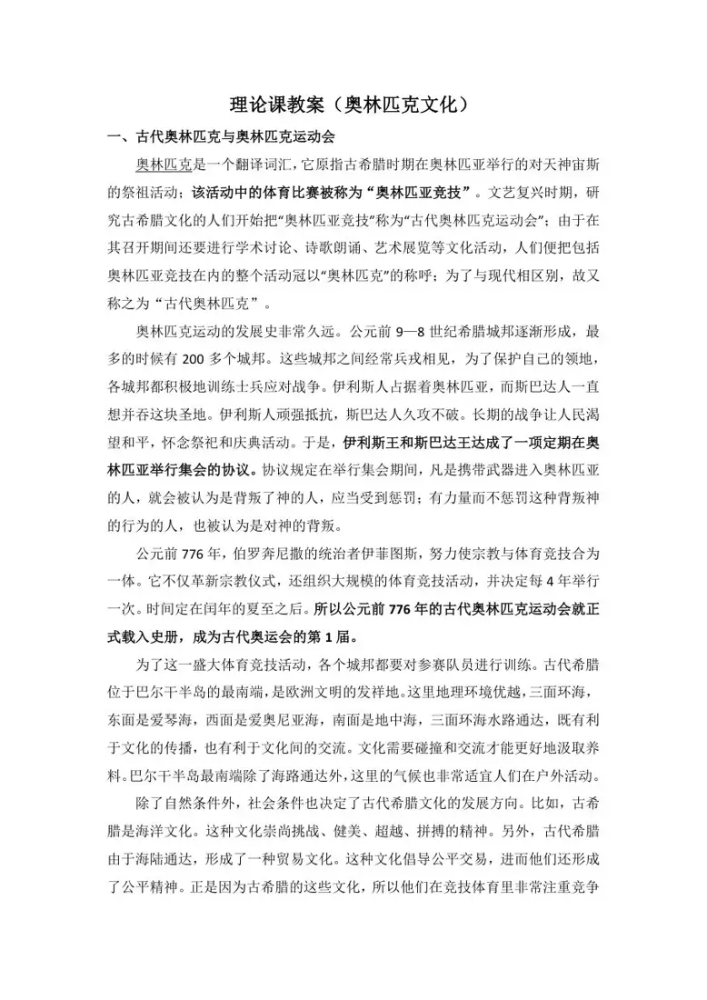

原文：

理论课教案（奥林匹克文化）

一、古代奥林匹克与奥林匹克运动会

奥林匹克是一个翻译词汇，它原指古希腊时期在奥林匹亚举行的对天神宙斯的祭祖活动；该活动中的体育比赛被称为“奥林匹亚竞技”。文艺复兴时期，研究古希腊文化的人们开始把“奥林匹亚竞技”称为“古代奥林匹克运动会”；由于在其召开期间还要进行学术讨论、诗歌朗诵、艺术展览等文化活动，人们便把包括奥林匹亚竞技在内的整个活动冠以“奥林匹克”的称呼；为了与现代相区别，故又称之为“古代奥林匹克”。

奥林匹克运动的发展史非常久远。公元前 9—8 世纪希腊城邦逐渐形成，最多的时候有 200 多个城邦。这些城邦之间经常兵戎相见，为了保护自己的领地，各城邦都积极地训练士兵应对战争。伊利斯人占据着奥林匹亚，而斯巴达人一直想并吞这块圣地。伊利斯人顽强抵抗，斯巴达人久攻不破。长期的战争让人民渴望和平，怀念祭祀和庆典活动。于是，伊利斯王和斯巴达王达成了一项定期在奥林匹亚举行集会的协议。协议规定在举行集会期间，凡是携带武器进入奥林匹亚的人，就会被认为是背叛了神的人，应当受到惩罚；有力量而不惩罚这种背叛神的行为的人，也被认为是对神的背叛。

公元前 776 年，伯罗奔尼撒的统治者伊菲图斯，努力使宗教与体育竞技合为一体。它不仅革新宗教仪式，还组织大规模的体育竞技活动，并决定每 4 年举行一次。时间定在闰年的夏至之后。所以公元前 776 年的古代奥林匹克运动会就正式载入史册，成为古代奥运会的第 1届。

为了这一盛大体育竞技活动，各个城邦都要对参赛队员进行训练。古代希腊位于巴尔干半岛的最南端，是欧洲文明的发祥地。这里地理环境优越，三面环海，东面是爱琴海，西面是爱奥尼亚海，南面是地中海，三面环海水路通达，既有利于文化的传播，也有利于文化间的交流。文化需要碰撞和交流才能更好地汲取养料。巴尔干半岛最南端除了海路通达外，这里的气候也非常适宜人们在户外活动。

除了自然条件外，社会条件也决定了古代希腊文化的发展方向。比如，古希腊是海洋文化。这种文化崇尚挑战、健美、超越、拼搏的精神。另外，古代希腊由于海陆通达，形成了一种贸易文化。这种文化倡导公平交易，进而他们还形成了公平精神。正是因为古希腊的这些文化，所以他们在竞技体育里非常注重竞争

### 和公平。

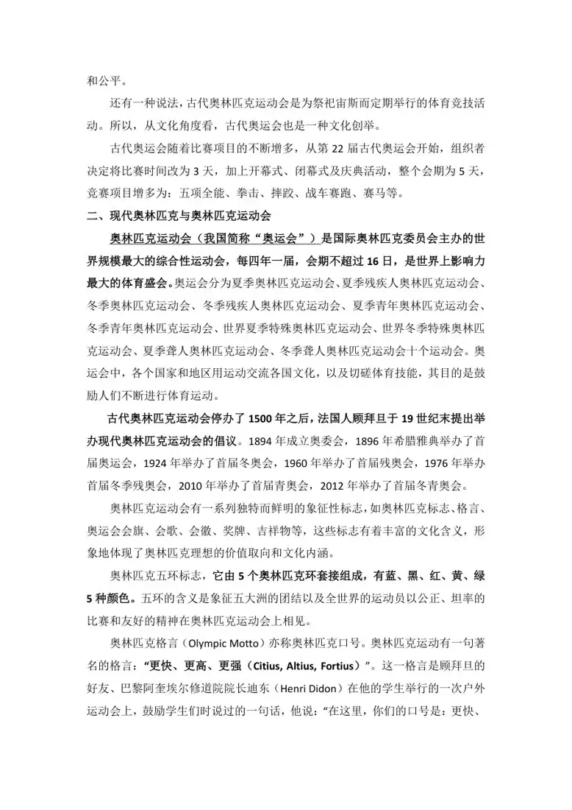

原文：

和公平。

还有一种说法，古代奥林匹克运动会是为祭祀宙斯而定期举行的体育竞技活动。所以，从文化角度看，古代奥运会也是一种文化创举。

古代奥运会随着比赛项目的不断增多，从第 22 届古代奥运会开始，组织者决定将比赛时间改为 3 天，加上开幕式、闭幕式及庆典活动，整个会期为 5 天，竞赛项目增多为：五项全能、拳击、摔跤、战车赛跑、赛马等。

二、现代奥林匹克与奥林匹克运动会

奥林匹克运动会（我国简称“奥运会”）是国际奥林匹克委员会主办的世界规模最大的综合性运动会，每四年一届，会期不超过 16 日，是世界上影响力最大的体育盛会。奥运会分为夏季奥林匹克运动会、夏季残疾人奥林匹克运动会、冬季奥林匹克运动会、冬季残疾人奥林匹克运动会、夏季青年奥林匹克运动会、冬季青年奥林匹克运动会、世界夏季特殊奥林匹克运动会、世界冬季特殊奥林匹克运动会、夏季聋人奥林匹克运动会、冬季聋人奥林匹克运动会十个运动会。奥运会中，各个国家和地区用运动交流各国文化，以及切磋体育技能，其目的是鼓励人们不断进行体育运动。

古代奥林匹克运动会停办了 1500年之后，法国人顾拜旦于 19世纪末提出举办现代奥林匹克运动会的倡议。1894 年成立奥委会，1896 年希腊雅典举办了首届奥运会，1924 年举办了首届冬奥会，1960 年举办了首届残奥会，1976 年举办首届冬季残奥会，2010 年举办了首届青奥会，2012 年举办了首届冬青奥会。

奥林匹克运动会有一系列独特而鲜明的象征性标志，如奥林匹克标志、格言、奥运会会旗、会歌、会徽、奖牌、吉祥物等，这些标志有着丰富的文化含义，形象地体现了奥林匹克理想的价值取向和文化内涵。

奥林匹克五环标志，它由 5 个奥林匹克环套接组成，有蓝、黑、红、黄、绿5 种颜色。五环的含义是象征五大洲的团结以及全世界的运动员以公正、坦率的比赛和友好的精神在奥林匹克运动会上相见。

奥林匹克格言（Olympic Motto）亦称奥林匹克口号。奥林匹克运动有一句著名的格言：“更快、更高、更强（Citius, Altius, Fortius）”。这一格言是顾拜旦的好友、巴黎阿奎埃尔修道院院长迪东（Henri Didon）在他的学生举行的一次户外运动会上，鼓励学生们时说过的一句话，他说：“在这里，你们的口号是：更快、

### 更高、更强。”

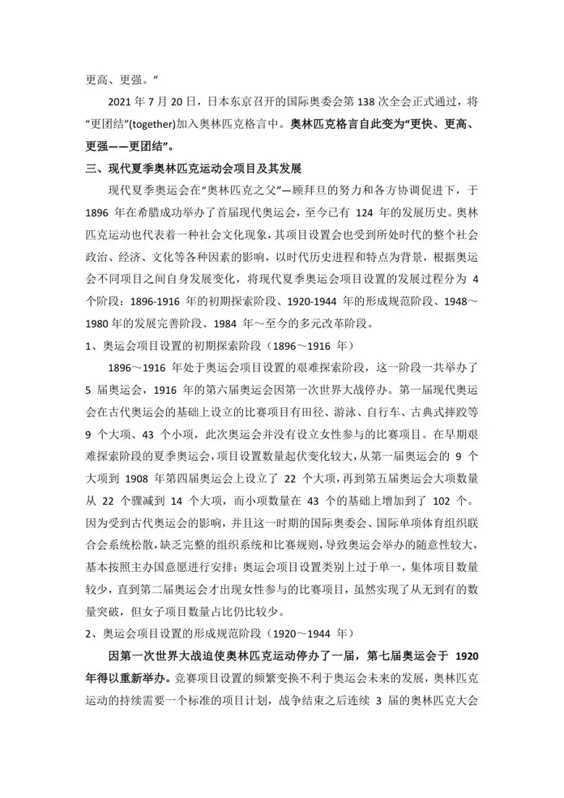

原文：

更高、更强。”

2021 年7 月20 日，日本东京召开的国际奥委会第 138 次全会正式通过，将“更团结”(together)加入奥林匹克格言中。奥林匹克格言自此变为“更快、更高、更强——更团结”。

三、现代夏季奥林匹克运动会项目及其发展

现代夏季奥运会在“奥林匹克之父”—顾拜旦的努力和各方协调促进下，于1896 年在希腊成功举办了首届现代奥运会，至今已有 124 年的发展历史。奥林匹克运动也代表着一种社会文化现象，其项目设置会也受到所处时代的整个社会政治、经济、文化等各种因素的影响，以时代历史进程和特点为背景，根据奥运会不同项目之间自身发展变化，将现代夏季奥运会项目设置的发展过程分为 4个阶段：1896-1916 年的初期探索阶段、1920-1944 年的形成规范阶段、1948～1980 年的发展完善阶段、1984 年～至今的多元改革阶段。

1、奥运会项目设置的初期探索阶段（1896～1916 年）

1896～1916 年处于奥运会项目设置的艰难探索阶段，这一阶段一共举办了5 届奥运会，1916 年的第六届奥运会因第一次世界大战停办。第一届现代奥运会在古代奥运会的基础上设立的比赛项目有田径、游泳、自行车、古典式摔跤等9 个大项、43 个小项，此次奥运会并没有设立女性参与的比赛项目。在早期艰难探索阶段的夏季奥运会，项目设置数量起伏变化较大，从第一届奥运会的 9 个大项到 1908 年第四届奥运会上设立了 22 个大项，再到第五届奥运会大项数量从 22 个骤减到 14 个大项，而小项数量在 43 个的基础上增加到了 102 个。因为受到古代奥运会的影响，并且这一时期的国际奥委会、国际单项体育组织联合会系统松散，缺乏完整的组织系统和比赛规则，导致奥运会举办的随意性较大，基本按照主办国意愿进行安排；奥运会项目设置类别上过于单一，集体项目数量较少，直到第二届奥运会才出现女性参与的比赛项目，虽然实现了从无到有的数量突破，但女子项目数量占比仍比较少。

2、奥运会项目设置的形成规范阶段（1920～1944 年）

因第一次世界大战迫使奥林匹克运动停办了一届，第七届奥运会于 1920年得以重新举办。竞赛项目设置的频繁变换不利于奥运会未来的发展，奥林匹克运动的持续需要一个标准的项目计划，战争结束之后连续 3 届的奥林匹克大会都把“奥林匹克的宪章”作为大会的中心主题。奥林匹克运动经历了探索阶段后，为奥运会以后的组织化、规模化、制度化发展奠定了基础，奥运会的基本框架、运行机制和基本特征在这个阶段逐渐形成。奥运会项目设置的逐渐规范阶段，在竞赛项目方面有了明确的规定。奥运会的比赛时间限制在 16 天，项目设置数量虽然在不断增加，但像田径、体操、游泳、自行车这些项目成为了奥运会的正式项目，并且表演项目的设立为成为奥运会正式项目提供了重要参考依据。从 1924年开始举办冬季奥林匹克运动会，至此，夏季奥运会竞赛项目中再也没有设立过冬季竞赛项目，这个决定让夏季奥运会项目设置得到了进一步规范。

### 3、奥运会项目设置的发展完善阶段（1948～1980 年）

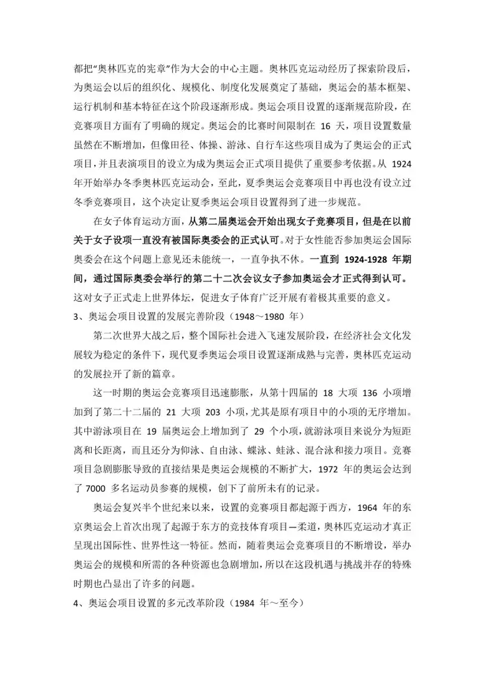

原文：

在女子体育运动方面，从第二届奥运会开始出现女子竞赛项目，但是在以前关于女子设项一直没有被国际奥委会的正式认可。对于女性能否参加奥运会国际奥委会在这个问题上意见还未能统一，一直争执不休。一直到 1924-1928 年期间，通过国际奥委会举行的第二十二次会议女子参加奥运会才正式得到认可。这对女子正式走上世界体坛，促进女子体育广泛开展有着极其重要的意义。

3、奥运会项目设置的发展完善阶段（1948～1980 年）

第二次世界大战之后，整个国际社会进入飞速发展阶段，在经济社会文化发展较为稳定的条件下，现代夏季奥运会项目设置逐渐成熟与完善，奥林匹克运动的发展拉开了新的篇章。

这一时期的奥运会竞赛项目迅速膨胀，从第十四届的 18 大项 136 小项增加到了第二十二届的 21 大项 203 小项，尤其是原有项目中的小项的无序增加。其中游泳项目在 19 届奥运会上增加到了 29 个小项，就游泳项目来说分为短距离和长距离，而且还分为仰泳、自由泳、蝶泳、蛙泳、混合泳和接力项目。竞赛项目急剧膨胀导致的直接结果是奥运会规模的不断扩大，1972 年的奥运会达到了7000 多名运动员参赛的规模，创下了前所未有的记录。

奥运会复兴半个世纪来以来，设置的竞赛项目都起源于西方，1964 年的东京奥运会上首次出现了起源于东方的竞技体育项目—柔道，奥林匹克运动才真正呈现出国际性、世界性这一特征。然而，随着奥运会竞赛项目的不断增设，举办奥运会的规模和所需的各种资源也急剧增加，所以在这段机遇与挑战并存的特殊时期也凸显出了许多的问题。

4、奥运会项目设置的多元改革阶段（1984 年～至今）

### 四、中国与奥林匹克

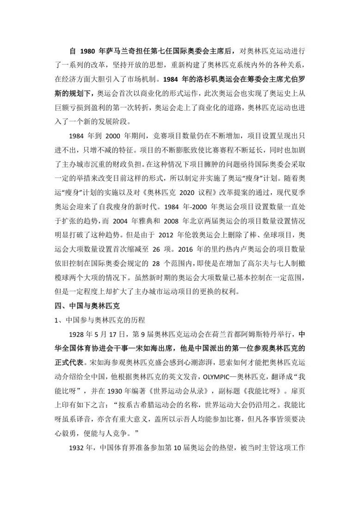

原文：

自 1980 年萨马兰奇担任第七任国际奥委会主席后，对奥林匹克运动进行了一系列的改革，坚持开放的思想，重新构建了奥林匹克系统内外的各种关系，在经济方面大胆引入了市场机制。1984 年的洛杉矶奥运会在筹委会主席尤伯罗斯的规划下，奥运会首次以商业化的形式运作，此次奥运会也实现了奥运史上从巨额亏损到盈利的第一次转折，奥运会走上了商业化的道路，奥林匹克运动也进入了一个新的发展阶段。

1984 年到 2000 年期间，竞赛项目数量仍在不断增加，项目设置呈现出只进不出，只增不减的特征。项目的不断膨胀致使比赛赛程不断延长，同时也加剧了主办城市沉重的财政负担。在这种情况下项目臃肿的问题亟待国际奥委会采取一定的举措来改变目前这样的形式，所以制定并实施了奥运“瘦身”计划。随着奥运“瘦身”计划的实施以及对《奥林匹克 2020 议程》改革提案的通过，现代夏季奥运会迎来了自我瘦身的新时代。1984 年-2000 年奥运会项目设置数量一直处于扩张的趋势，而 2004 年雅典和 2008 年北京两届奥运会的项目数量设置情况明显打破了这种趋势。但是由于 2012 年伦敦奥运会上删除了棒、垒球项目，奥运会大项数量设置首次缩减至 26 项。2016 年的里约热内卢奥运会的项目数量依旧控制在国际奥委会规定的 28 个范围内，即使是在增加了高尔夫与七人制橄榄球两个大项的情况下。虽然新时期的奥运会大项数量已基本控制在一定范围，但是一定程度上却扩大了主办城市运动项目的更换的权利。

四、中国与奥林匹克

1、中国参与奥林匹克的历程

1928 年5 月17 日，第9 届奥林匹克运动会在荷兰首都阿姆斯特丹举行，中华全国体育协进会干事—宋如海出席，他是中国派出的第一位参观奥林匹克的正式代表。宋如海参观奥林匹克盛会感到心潮澎湃，思索如何才能把奥林匹克运动介绍给全中国，他根据奥林匹克的英文发音，OLYMPIC—奥林匹克，翻译成“我能比呀”，并在 1930 年编著《世界运动会从录》，副标题《我能比呀》。扉页上印有如下之言：“按系古希腊运动会的名称，世界运动大会仍沿用之。我能比呀虽系译音，亦含有重大意义，盖所以示吾人均能参加比赛，但凡各事皆须要决心毅勇，便能与人竞争。 9

1932 年，中国体育界准备参加第 10 届奥运会的热望，被当时主管这项工作的国民党政府教育部，以国难当头、时间匆忙、准备不足为理由，断然拒绝。此时有消息称，日本帝国主义把持下的伪满傀儡政权宣布将派遣东北选手刘长春、于希渭代表伪“满洲国”参加奥运会，这一消息立即引起教育界青年学生和进步力量的极大愤怒，体育界的怒火更是到了白炽化的程度，爱国人士与刘长春取得联系，作为东北大学的爱国学生、当时全国百米记录的保持者，刘长春听到消息后义愤填膺，立即在《体育周报》上发表了 16个铮铮作响的大字：“良心尚在，热血尚留，岂能叛国，做人牛马”。在冲破了各种艰难险阻，经历了 21 天在太平洋上的颠簸，刘长春于 1932 年7 月 29日到达洛杉矶码头，数百名华侨在那里迎候多时，为他举行了热烈的欢迎仪式。尽管刘长春此次铩羽而归，至今，人们仍被这件事所激发的爱国热情所感动。

### 第 6 页

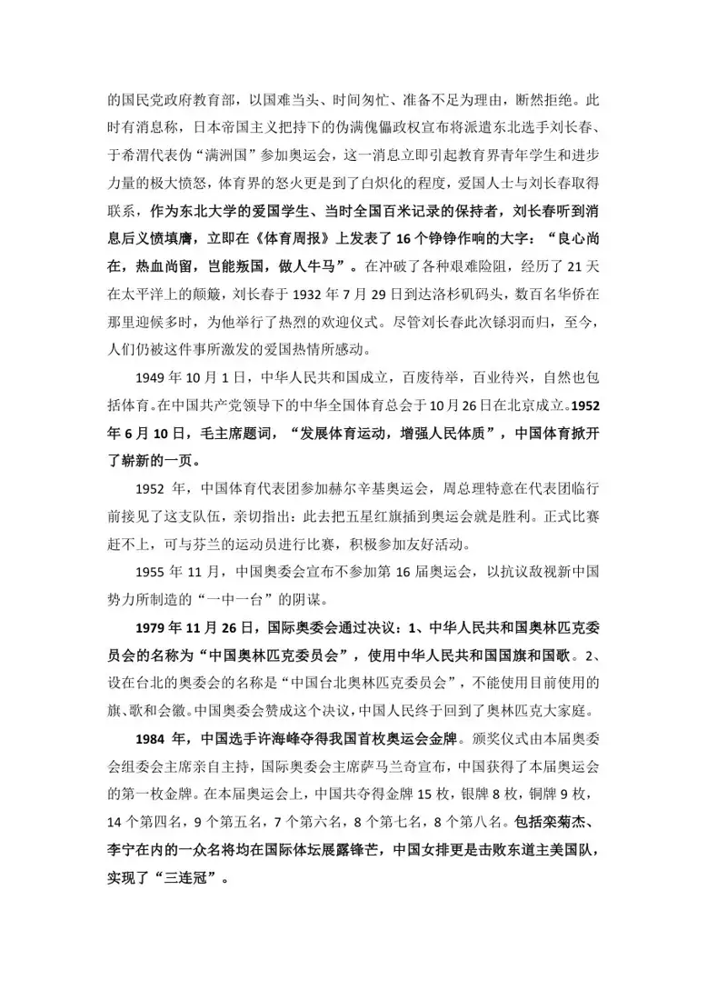

原文：

1949 年10 月 1 日，中华人民共和国成立，百废待举，百业待兴，自然也包括体育。在中国共产党领导下的中华全国体育总会于10月26日在北京成立。1952年 6 月10 日，毛主席题词，“发展体育运动，增强人民体质”，中国体育掀开了崭新的一页。

1952 年，中国体育代表团参加赫尔辛基奥运会，周总理特意在代表团临行前接见了这支队伍，亲切指出：此去把五星红旗插到奥运会就是胜利。正式比赛赶不上，可与芬兰的运动员进行比赛，积极参加友好活动。

1955 年 11 月，中国奥委会宣布不参加第 16 届奥运会，以抗议敌视新中国势力所制造的“一中一台”的阴谋。

1979年 11月 26日，国际奥委会通过决议：1、中华人民共和国奥林匹克委员会的名称为“中国奥林匹克委员会”，使用中华人民共和国国旗和国歌。2、设在台北的奥委会的名称是“中国台北奥林匹克委员会”，不能使用目前使用的旗、歌和会徽。中国奥委会赞成这个决议，中国人民终于回到了奥林匹克大家庭。

1984 年，中国选手许海峰夺得我国首枚奥运会金牌。颁奖仪式由本届奥委会组委会主席亲自主持，国际奥委会主席萨马兰奇宣布，中国获得了本届奥运会的第一枚金牌。在本届奥运会上，中国共夺得金牌 枚，银牌 枚，铜牌 枚，14 个第四名，9 个第五名，7 个第六名，8 个第七名，8 个第八名。包括栾菊杰、李宁在内的一众名将均在国际体坛展露锋芒，中国女排更是击败东道主美国队，实现了“三连冠”。

### 2、中国举办奥林匹克运动会

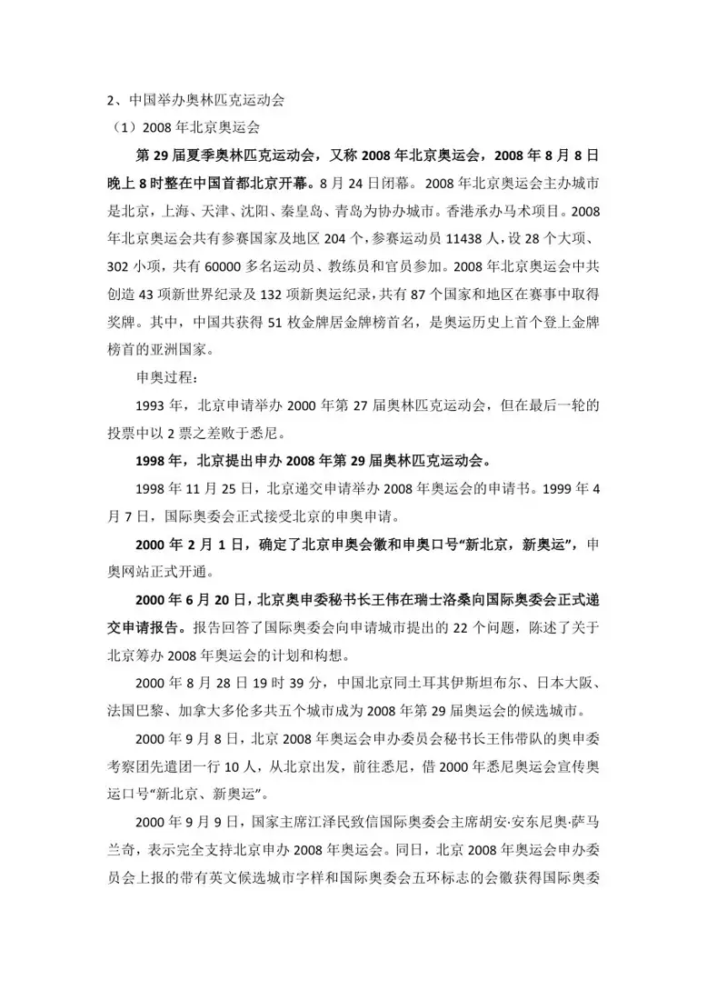

原文：

2、中国举办奥林匹克运动会

（1）2008 年北京奥运会

第 29 届夏季奥林匹克运动会，又称 2008 年北京奥运会，2008 年 8 月 8 日晚上 8时整在中国首都北京开幕。8 月24 日闭幕。2008 年北京奥运会主办城市是北京，上海、天津、沈阳、秦皇岛、青岛为协办城市。香港承办马术项目。2008年北京奥运会共有参赛国家及地区 204 个，参赛运动员 11438 人，设28 个大项、302 小项，共有 60000多名运动员、教练员和官员参加。2008 年北京奥运会中共创造43 项新世界纪录及 132 项新奥运纪录，共有 87 个国家和地区在赛事中取得奖牌。其中，中国共获得 51 枚金牌居金牌榜首名，是奥运历史上首个登上金牌榜首的亚洲国家。

申奥过程：

1993 年，北京申请举办 2000 年第 27 届奥林匹克运动会，但在最后一轮的投票中以2 票之差败于悉尼。

1998年，北京提出申办 2008 年第 29届奥林匹克运动会。

1998 年11 月 25 日，北京递交申请举办 2008年奥运会的申请书。1999 年4月7 日，国际奥委会正式接受北京的申奥申请。

2000 年 2 月 1 日，确定了北京申奥会徽和申奥口号“新北京，新奥运”，申奥网站正式开通。

2000年 6 月20 日，北京奥申委秘书长王伟在瑞士洛桑向国际奥委会正式递交申请报告。报告回答了国际奥委会向申请城市提出的 22 个问题，陈述了关于北京筹办2008 年奥运会的计划和构想。

2000 年 8 月 28 日 19 时 39 分，中国北京同土耳其伊斯坦布尔、日本大阪、法国巴黎、加拿大多伦多共五个城市成为2008 年第29 届奥运会的候选城市。

2000 年9 月8 日，北京2008 年奥运会申办委员会秘书长王伟带队的奥申委考察团先遣团一行 10人，从北京出发，前往悉尼，借 2000 年悉尼奥运会宣传奥运口号“新北京、新奥运”。

2000 年9 月9 日，国家主席江泽民致信国际奥委会主席胡安·安东尼奥·萨马兰奇，表示完全支持北京申办 2008 年奥运会。同日，北京 2008 年奥运会申办委员会上报的带有英文候选城市字样和国际奥委会五环标志的会徽获得国际奥委

### 会批准。

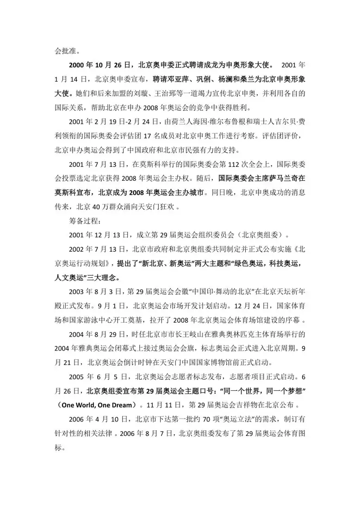

原文：

会批准。

2000 年 10 月 26 日，北京奥申委正式聘请成龙为申奥形象大使。 2001 年1 月 14 日，北京奥申委宣布，聘请邓亚萍、巩俐、杨澜和桑兰为北京申奥形象大使。她们和后来加盟的刘璇、王治郅等一道竭力宣传北京申奥，并利用各自的国际关系，帮助北京在申办 2008 年奥运会的竞争中获得胜利。

2001 年2 月19 日-2 月24 日，由荷兰人海因·维尔布鲁根和瑞士人吉尔贝·费利领衔的国际奥委会评估团 17 名成员对北京申奥工作进行考察。评估团评价，北京申办奥运会得到了中国政府和北京市民强有力的支持。

2001 年7 月13 日，在莫斯科举行的国际奥委会第 112 次全会上，国际奥委会投票选定北京获得 2008 年奥运会主办权。随后，国际奥委会主席萨马兰奇在莫斯科宣布，北京成为 2008 年奥运会主办城市。同日晚，北京申奥成功的消息传来，北京40 万群众涌向天安门狂欢。

筹备过程：

2001 年12 月 13 日，成立第29 届奥运会组织委员会（北京奥组委）。

2002 年7 月13 日，北京市政府和北京奥组委共同制定并正式公布实施《北京奥运行动规划》，提出了“新北京、新奥运”两大主题和“绿色奥运，科技奥运，人文奥运”三大理念。

2003 年8 月3 日，第29 届奥运会会徽“中国印·舞动的北京”在北京天坛祈年殿正式发布。9 月 1 日，北京奥运会市场开发计划启动。12 月 24 日，国家体育场和国家游泳中心开工奠基，拉开了 2008 年北京奥运会体育场馆建设的序幕 。

2004 年8 月29 日，时任北京市市长王岐山在雅典奥林匹克主体育场举行的2004 年雅典奥运会闭幕式上接过奥运会会旗，标志奥运会正式进入北京周期。9月21 日，北京奥运会倒计时钟在天安门中国国家博物馆前正式启动。

2005 年 6 月 5 日，北京奥运会志愿者标志发布，志愿者项目正式启动。6月26 日，北京奥组委宣布第 29届奥运会主题口号：“同一个世界，同一个梦想”（One World, One Dream）。11 月 11 日，第 29 届奥运会吉祥物在北京公布 。

2006 年 4 月 10 日，北京市下达第一批约 70 项“奥运立法”的需求，制订有针对性的相关法律。2006 年8 月7 日，北京奥组委发布了第 29 届奥运会体育图标。

### 圣火传递：

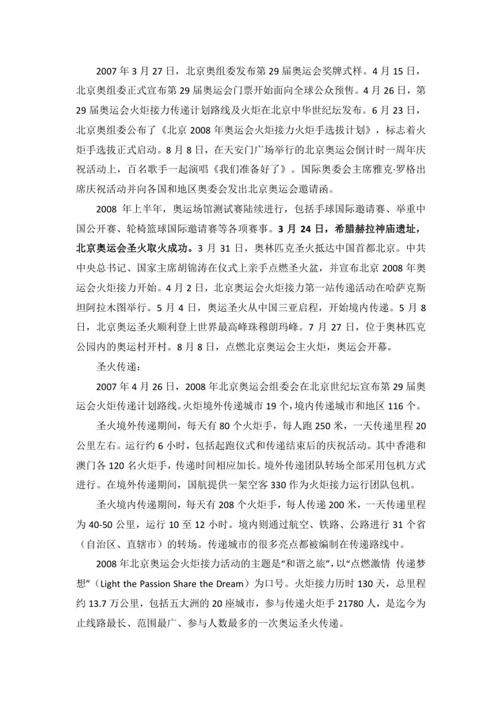

原文：

2007 年3 月27 日，北京奥组委发布第 29 届奥运会奖牌式样。4 月15 日，北京奥组委正式宣布第 29 届奥运会门票开始面向全球公众预售。4 月26 日，第29 届奥运会火炬接力传递计划路线及火炬在北京中华世纪坛发布。6 月 23 日，北京奥组委公布了《北京 2008 年奥运会火炬接力火炬手选拔计划》，标志着火炬手选拔正式启动。8 月8 日，在天安门广场举行的北京奥运会倒计时一周年庆祝活动上，百名歌手一起演唱《我们准备好了》。国际奥委会主席雅克·罗格出席庆祝活动并向各国和地区奥委会发出北京奥运会邀请函。

2008 年上半年，奥运场馆测试赛陆续进行，包括手球国际邀请赛、举重中国公开赛、轮椅篮球国际邀请赛等各项赛事。3 月 24 日，希腊赫拉神庙遗址，北京奥运会圣火取火成功。3 月 31 日，奥林匹克圣火抵达中国首都北京。中共中央总书记、国家主席胡锦涛在仪式上亲手点燃圣火盆，并宣布北京 2008 年奥运会火炬接力开始。4 月2 日，北京奥运会火炬接力第一站传递活动在哈萨克斯坦阿拉木图举行。5 月 4 日，奥运圣火从中国三亚启程，开始境内传递。5 月 8日，北京奥运圣火顺利登上世界最高峰珠穆朗玛峰。7 月 27 日，位于奥林匹克公园内的奥运村开村。8 月8 日，点燃北京奥运会主火炬，奥运会开幕。

圣火传递：

2007 年4 月26 日，2008 年北京奥运会组委会在北京世纪坛宣布第 29 届奥运会火炬传递计划路线。火炬境外传递城市 19个，境内传递城市和地区 116 个。

圣火境外传递期间，每天有 80 个火炬手，每人跑 250 米，一天传递里程 20公里左右。运行约 6 小时，包括起跑仪式和传递结束后的庆祝活动。其中香港和澳门各 120 名火炬手，传递时间相应加长。境外传递团队转场全部采用包机方式进行。在境外传递期间，国航提供一架空客 330 作为火炬接力运行团队包机。

圣火境内传递期间，每天有 208 个火炬手，每人传递 200 米，一天传递里程为 40-50 公里，运行 10 至 12 小时。境内则通过航空、铁路、公路进行 31 个省（自治区、直辖市）的转场。传递城市的很多亮点都被编制在传递路线中。

2008 年北京奥运会火炬接力活动的主题是“和谐之旅”，以“点燃激情 传递梦想”（Light the Passion Share the Dream）为口号。火炬接力历时 130 天，总里程约13.7 万公里，包括五大洲的20 座城市，参与传递火炬手 21780 人，是迄今为止线路最长、范围最广、参与人数最多的一次奥运圣火传递。

### （2）2022 年北京冬奥会

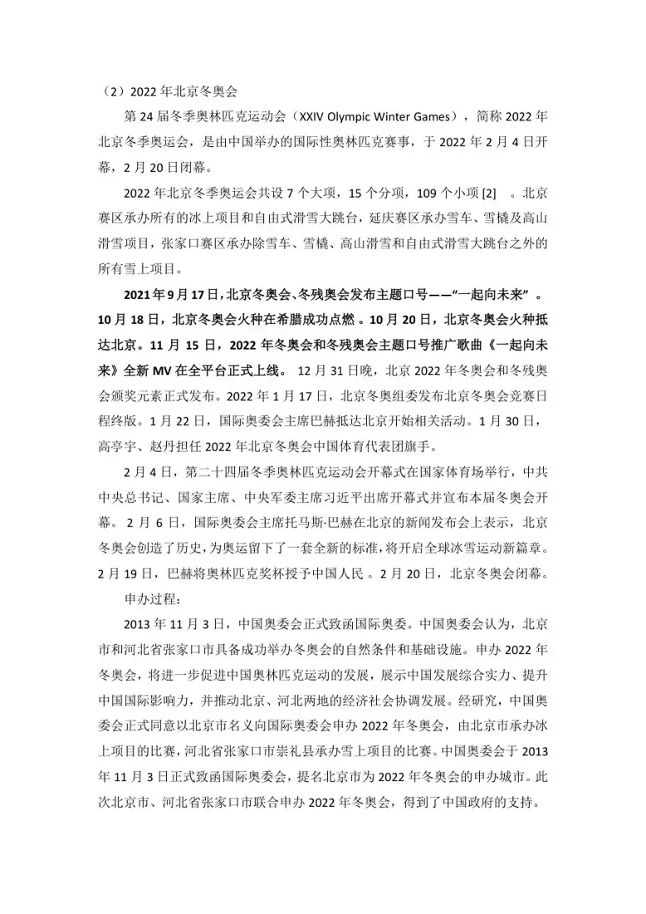

原文：

（2）2022 年北京冬奥会

第 24 届冬季奥林匹克运动会（XXIV Olympic Winter Games），简称 2022 年北京冬季奥运会，是由中国举办的国际性奥林匹克赛事，于 2022 年 2 月 4 日开幕，2 月20 日闭幕。

2022 年北京冬季奥运会共设 7 个大项，15个分项，109 个小项[2] 。北京赛区承办所有的冰上项目和自由式滑雪大跳台，延庆赛区承办雪车、雪橇及高山滑雪项目，张家口赛区承办除雪车、雪橇、高山滑雪和自由式滑雪大跳台之外的所有雪上项目。

2021年9月17日，北京冬奥会、冬残奥会发布主题口号——“一起向未来” 。10 月 18 日，北京冬奥会火种在希腊成功点燃。10月 20日，北京冬奥会火种抵达北京。11 月 15 日，2022 年冬奥会和冬残奥会主题口号推广歌曲《一起向未来》全新 MV在全平台正式上线。 12 月31 日晚，北京2022 年冬奥会和冬残奥会颁奖元素正式发布。2022 年1 月17 日，北京冬奥组委发布北京冬奥会竞赛日程终版。1 月 22 日，国际奥委会主席巴赫抵达北京开始相关活动。1 月 30 日，高亭宇、赵丹担任 2022 年北京冬奥会中国体育代表团旗手。

2 月4 日，第二十四届冬季奥林匹克运动会开幕式在国家体育场举行，中共中央总书记、国家主席、中央军委主席习近平出席开幕式并宣布本届冬奥会开幕。2 月 6 日，国际奥委会主席托马斯·巴赫在北京的新闻发布会上表示，北京冬奥会创造了历史，为奥运留下了一套全新的标准，将开启全球冰雪运动新篇章。2 月19 日，巴赫将奥林匹克奖杯授予中国人民 。2 月 20 日，北京冬奥会闭幕。

申办过程：

2013 年11 月 3 日，中国奥委会正式致函国际奥委。中国奥委会认为，北京市和河北省张家口市具备成功举办冬奥会的自然条件和基础设施。申办 2022 年冬奥会，将进一步促进中国奥林匹克运动的发展，展示中国发展综合实力、提升中国国际影响力，并推动北京、河北两地的经济社会协调发展。经研究，中国奥委会正式同意以北京市名义向国际奥委会申办 2022 年冬奥会，由北京市承办冰上项目的比赛，河北省张家口市崇礼县承办雪上项目的比赛。中国奥委会于 2013年11 月3 日正式致函国际奥委会，提名北京市为 2022 年冬奥会的申办城市。此次北京市、河北省张家口市联合申办 2022 年冬奥会，得到了中国政府的支持。

### 火炬传递：

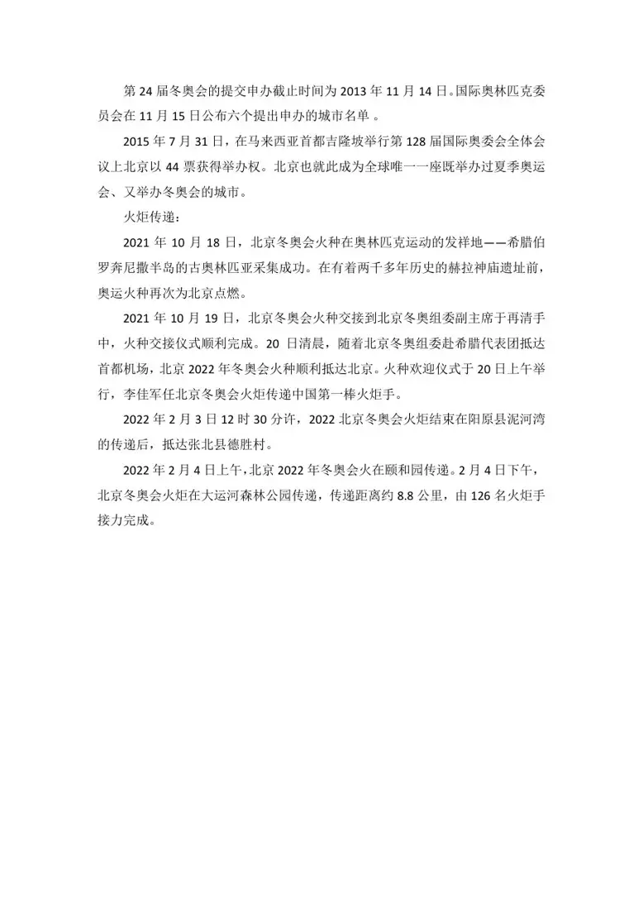

原文：

第 24 届冬奥会的提交申办截止时间为 2013年11 月14 日。国际奥林匹克委员会在 11 月15 日公布六个提出申办的城市名单。

2015 年7 月31 日，在马来西亚首都吉隆坡举行第128 届国际奥委会全体会议上北京以 44 票获得举办权。北京也就此成为全球唯一一座既举办过夏季奥运会、又举办冬奥会的城市。

火炬传递：

2021 年 10 月 18 日，北京冬奥会火种在奥林匹克运动的发祥地——希腊伯罗奔尼撒半岛的古奥林匹亚采集成功。在有着两千多年历史的赫拉神庙遗址前，奥运火种再次为北京点燃。

2021 年 10 月 19 日，北京冬奥会火种交接到北京冬奥组委副主席于再清手中，火种交接仪式顺利完成。20 日清晨，随着北京冬奥组委赴希腊代表团抵达首都机场，北京2022年冬奥会火种顺利抵达北京。火种欢迎仪式于 20 日上午举行，李佳军任北京冬奥会火炬传递中国第一棒火炬手。

2022 年2 月3 日12 时30 分许，2022 北京冬奥会火炬结束在阳原县泥河湾的传递后，抵达张北县德胜村。

2022年2月4日上午，北京2022年冬奥会火在颐和园传递。2月4日下午，北京冬奥会火炬在大运河森林公园传递，传递距离约 8.8 公里，由126 名火炬手接力完成。

### 模拟试题

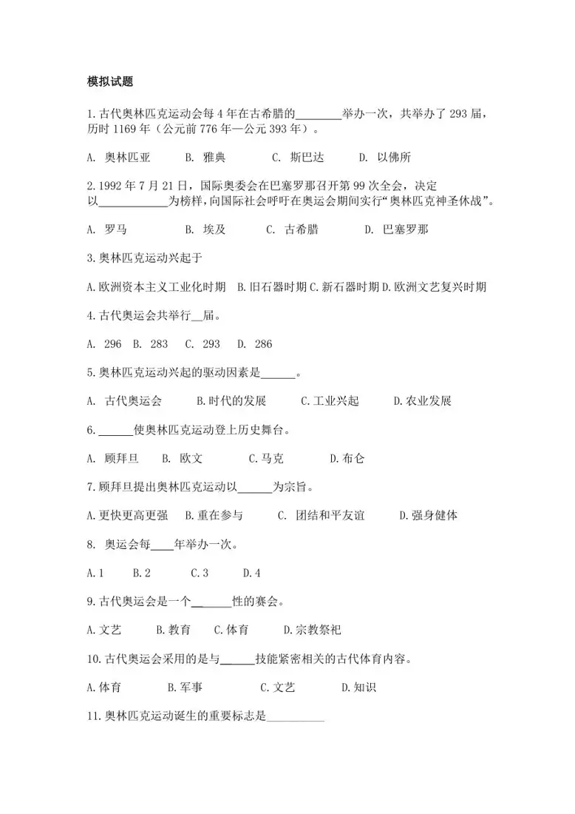

原文：

模拟试题

1.古代奥林匹克运动会每 4年在古希腊的 举办一次，共举办了 293 届，历时1169 年（公元前 776年—公元393年）。A. 奥林匹亚 B. 雅典 C. 斯巴达 D. 以佛所

2.1992年7月21日，国际奥委会在巴塞罗那召开第 99次全会，决定以 为榜样，向国际社会呼吁在奥运会期间实行“奥林匹克神圣休战”。A. 罗马 B. 埃及 C. 古希腊 D. 巴塞罗那

3.奥林匹克运动兴起于A.欧洲资本主义工业化时期 B.旧石器时期 C.新石器时期D.欧洲文艺复兴时期

4.古代奥运会共举行＿届。 A. 296 B. 283 C. 293 D. 286

5.奥林匹克运动兴起的驱动因素是A. 古代奥运会 B.时代的发展 C.工业兴起 D.农业发展

6. 使奥林匹克运动登上历史舞台。A. 顾拜旦 B. 欧文 C.马克 D.布仑

7.顾拜旦提出奥林匹克运动以 为宗旨。A.更快更高更强 B.重在参与 C. 团结和平友谊 D.强身健体

8. 奥运会每 年举办一次。A.1 B.2 C.3 D.4

9.古代奥运会是一个 性的赛会。A.文艺 B.教育 C.体育 D.宗教祭祀

10.古代奥运会采用的是与＿ 技能紧密相关的古代体育内容。A.体育 B.军事 C.文艺 D.知识

11.奥林匹克运动诞生的重要标志是

### 12.顾拜旦 的教育家。A 法国 B 英国 C 德国 D 希腊

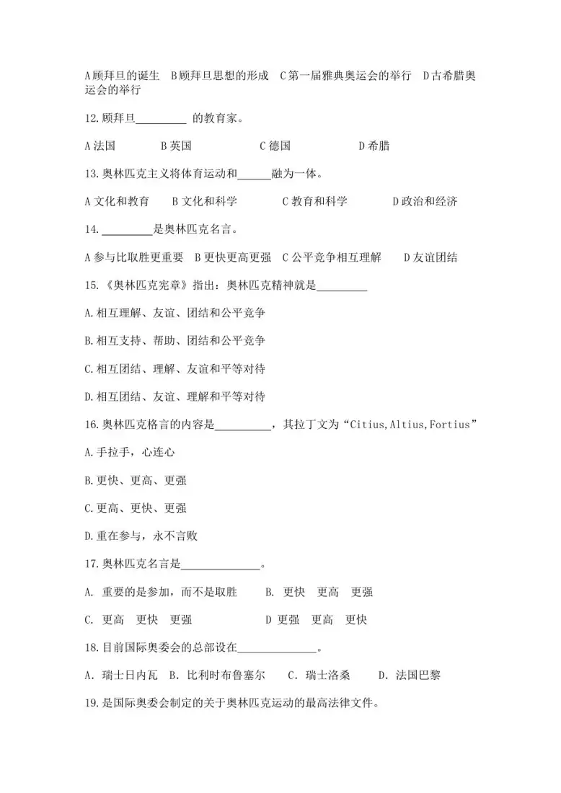

原文：

A顾拜旦的诞生 B顾拜旦思想的形成 C第一届雅典奥运会的举行 D古希腊奥运会的举行

12.顾拜旦 的教育家。A 法国 B 英国 C 德国 D 希腊

13.奥林匹克主义将体育运动和 融为一体。A文化和教育 B 文化和科学 C教育和科学 D政治和经济

14. 是奥林匹克名言。A参与比取胜更重要 B更快更高更强 C公平竞争相互理解 D 友谊团结

15.《奥林匹克宪章》指出：奥林匹克精神就是A.相互理解、友谊、团结和公平竞争B.相互支持、帮助、团结和公平竞争C.相互团结、理解、友谊和平等对待D.相互团结、友谊、理解和平等对待

16.奥林匹克格言的内容是 ，其拉丁文为“Citius,Altius,Fortius”A.手拉手，心连心B.更快、更高、更强C.更高、更快、更强D.重在参与，永不言败

17.奥林匹克名言是A. 重要的是参加，而不是取胜 B. 更快 更高 更强C. 更高 更快 更强 D 更强 更高 更快

18.目前国际奥委会的总部设在A．瑞士日内瓦 B．比利时布鲁塞尔 C．瑞士洛桑 D．法国巴黎

19.是国际奥委会制定的关于奥林匹克运动的最高法律文件。

### A.奥林匹克条例 B.奥林匹克规章 C.奥林匹克章程 D.奥林匹克宪章

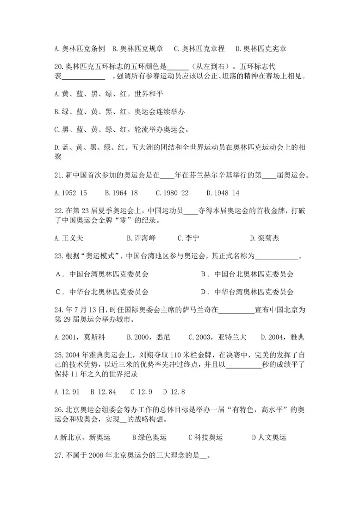

原文：

A.奥林匹克条例 B.奥林匹克规章 C.奥林匹克章程 D.奥林匹克宪章

20.奥林匹克五环标志的五环颜色是 （从左到右）。五环标志代表 ，强调所有参赛运动员应该以公正、坦荡的精神在赛场上相见。A.黄、蓝、黑、绿、红。世界和平B.绿、蓝、黄、黑、红。奥运会连续举办C.黑、蓝、黄、绿、红。轮流举办奥运会。D.蓝、黄、黑、绿、红。五大洲的团结和全世界运动员在奥林匹克运动会上的相聚

21.新中国首次参加的奥运会是在 年在芬兰赫尔辛基举行的第 届奥运会。A.1952 15 B.1964 18 C.1980 22 D.1948 14

22.在第 23届夏季奥运会上，中国运动员 夺得本届奥运会的首枚金牌，打破了中国奥运会金牌“零”的纪录。A.王义夫 B.许海峰 C.李宁 D.栾菊杰

23.根据“奥运模式”，中国台湾地区参与奥运会，其正式名称为A．中国台湾奥林匹克委员会 B．中国台北奥林匹克委员会C．中华台北奥林匹克委员会 D．中华台湾奥林匹克委员会

24.年7 月13日，时任国际奥委会主席的萨马兰奇在 宣布中国北京为第29届奥运会举办城市。A.2001，莫斯科 B.2000，悉尼 C.2003，亚特兰大 D.2004，雅典

25.2004年雅典奥运会上，刘翔夺取 110米栏金牌，在决赛中，完美的发挥了自己的技术优势，以近三米的优势率先冲过终点，并且以 秒的成绩平了保持11 年之久的世界纪录A 12.91 B 12.84 C 12.9 D 12.8

26.北京奥运会组委会筹办工作的总体目标是举办一届“有特色，高水平”的奥运会和残奥会，实现＿的战略构想。A新北京，新奥运 B绿色奥运 C科技奥运 D人文奥运

27.不属于 2008年北京奥运会的三大理念的是＿。

### A 绿色奥运 B 科技奥运 C 经济奥运 D 人文奥运

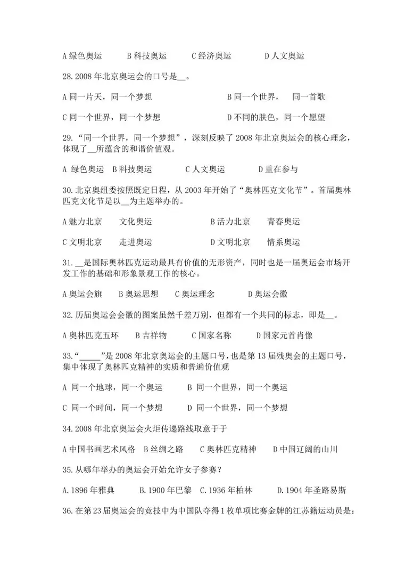

原文：

A 绿色奥运 B 科技奥运 C 经济奥运 D 人文奥运

28.2008年北京奥运会的口号是＿。A 同一片天，同一个梦想 B同一个世界， 同一首歌C同一个世界，同一个梦想 D不同的肤色，同一个愿望

29.“同一个世界，同一个梦想”，深刻反映了 2008年北京奥运会的核心理念，体现了＿所蕴含的和谐价值观。A 绿色奥运 B科技奥运 C人文奥运 D重在参与

30.北京奥组委按照既定日程，从 2003年开始了“奥林匹克文化节”。首届奥林匹克文化节是以＿为主题举办的。A魅力北京 文化奥运 B 活力北京 青春奥运C文明北京 走进奥运 D 文明北京 情系奥运

31.＿是国际奥林匹克运动最具有价值的无形资产，同时也是一届奥运会市场开发工作的基础和形象景观工作的核心。A奥运会旗 B奥运思想 C奥运理念 D奥运会徽

32.历届奥运会会徽的图案虽然千差万别，但都有一个共同的标志，即是＿。A奥林匹克五环 B吉祥物 C国家名称 D国家元首肖像

33.“ ”是2008 年北京奥运会的主题口号，也是第 13届残奥会的主题口号，集中体现了奥林匹克精神的实质和普遍价值观A 同一个地球，同一个奥运 B 同一个世界，同一个奥运C 同一个时间，同一个梦想 D 同一个世界，同一个梦想

34.2008年北京奥运会火炬传递路线取意于于A中国书画艺术风格 B丝绸之路 C奥林匹克精神 D中国辽阔的山川

35.从哪年举办的奥运会开始允许女子参赛？A.1896 年雅典 B.1900 年巴黎 C.1936 年柏林 D.1904 年圣路易斯

36.在第23届奥运会的竞技中为中国队夺得1枚单项比赛金牌的江苏籍运动员是：

### A. 林莉 B.栾菊杰 C．王小红 D. 孙晋芳

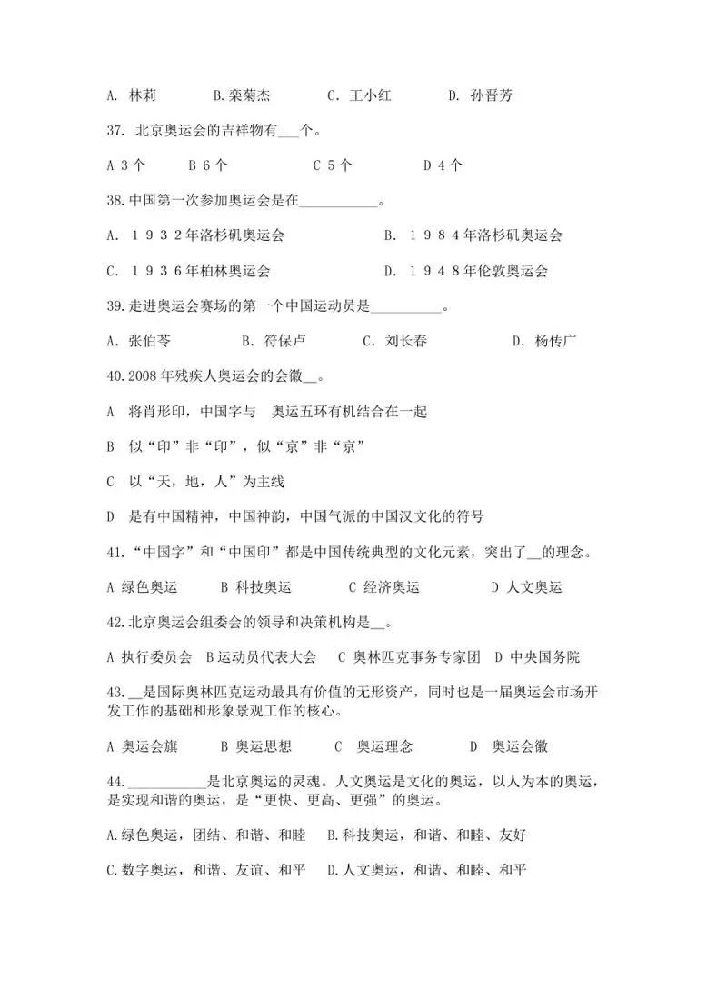

原文：

A. 林莉 B.栾菊杰 C．王小红 D. 孙晋芳

37. 北京奥运会的吉祥物有\_\_\_个。A 3 个 B 6 个 C 5 个 D 4 个

38.中国第一次参加奥运会是在A．1932年洛杉矶奥运会 B．1984年洛杉矶奥运会C．1936年柏林奥运会 D．1948年伦敦奥运会

39.走进奥运会赛场的第一个中国运动员是A．张伯苓 B．符保卢 C．刘长春 D．杨传广

40.2008 年残疾人奥运会的会徽＿。A 将肖形印，中国字与 奥运五环有机结合在一起B 似“印”非“印”，似“京”非“京”C 以“天，地，人”为主线D 是有中国精神，中国神韵，中国气派的中国汉文化的符号

41.“中国字”和“中国印”都是中国传统典型的文化元素，突出了＿的理念。A 绿色奥运 B 科技奥运 C 经济奥运 D 人文奥运

42.北京奥运会组委会的领导和决策机构是＿。A 执行委员会 B运动员代表大会 C 奥林匹克事务专家团 D 中央国务院

43.＿是国际奥林匹克运动最具有价值的无形资产，同时也是一届奥运会市场开发工作的基础和形象景观工作的核心。A 奥运会旗 B 奥运思想 C 奥运理念 D 奥运会徽

44. 是北京奥运的灵魂。人文奥运是文化的奥运，以人为本的奥运，是实现和谐的奥运，是“更快、更高、更强”的奥运。A.绿色奥运，团结、和谐、和睦 B.科技奥运，和谐、和睦、友好C.数字奥运，和谐、友谊、和平 D.人文奥运，和谐、和睦、和平

### 第 17 页

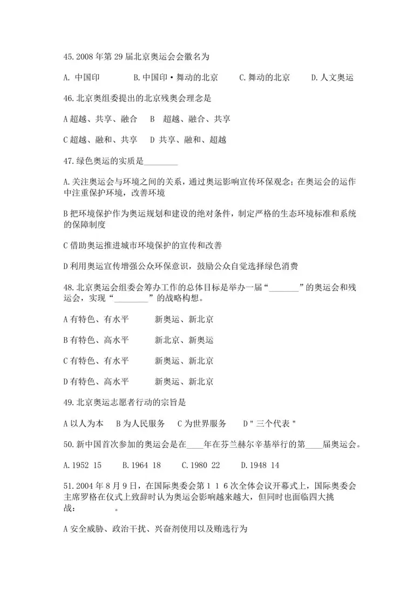

原文：

45.2008 年第29届北京奥运会会徽名为A. 中国印 B.中国印·舞动的北京 C.舞动的北京 D.人文奥运

46.北京奥组委提出的北京残奥会理念是A超越、共享、融合 B 超越、融合、共享C超越、融和、共享 D 共享、融和、超越

47.绿色奥运的实质是A.关注奥运会与环境之间的关系，通过奥运影响宣传环保观念；在奥运会的运作中注重保护环境，改善环境B把环境保护作为奥运规划和建设的绝对条件，制定严格的生态环境标准和系统的保障制度C借助奥运推进城市环境保护的宣传和改善D利用奥运宣传增强公众环保意识，鼓励公众自觉选择绿色消费

48.北京奥运会组委会筹办工作的总体目标是举办一届“ ”的奥运会和残运会，实现“ ”的战略构想。A有特色、有水平 新奥运、新北京B有特色、高水平 新北京、新奥运C有特色、有水平 新奥运、新北京D有特色、高水平 新奥运、新北京

49.北京奥运志愿者行动的宗旨是A以人为本 B为人民服务 C为世界服务 D＂三个代表＂

50.新中国首次参加的奥运会是在\_\_\_\_年在芬兰赫尔辛基举行的第\_\_\_\_届奥运会。A.1952 15 B.1964 18 C.1980 22 D.1948 14

51.2004 年8月9日，在国际奥委会第116次全体会议开幕式上，国际奥委会主席罗格在仪式上致辞时认为奥运会影响越来越大，但同时也面临四大挑战： A安全威胁、政治干扰、兴奋剂使用以及贿选行为

### B恐怖袭击、政治干扰、商业化以及腐败行为

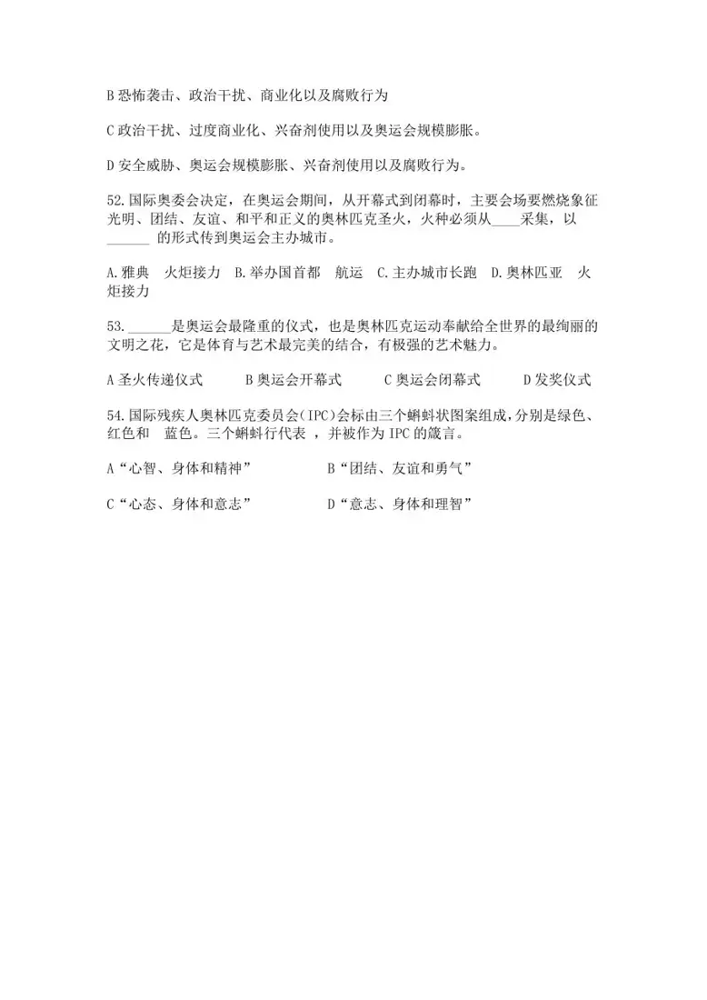

原文：

B恐怖袭击、政治干扰、商业化以及腐败行为

C政治干扰、过度商业化、兴奋剂使用以及奥运会规模膨胀。

D安全威胁、奥运会规模膨胀、兴奋剂使用以及腐败行为。

52.国际奥委会决定，在奥运会期间，从开幕式到闭幕时，主要会场要燃烧象征光明、团结、友谊、和平和正义的奥林匹克圣火，火种必须从\_\_\_\_采集，以的形式传到奥运会主办城市。A.雅典 火炬接力 B.举办国首都 航运 C.主办城市长跑 D.奥林匹亚 火炬接力

53. 是奥运会最隆重的仪式，也是奥林匹克运动奉献给全世界的最绚丽的文明之花，它是体育与艺术最完美的结合，有极强的艺术魅力。A圣火传递仪式 B奥运会开幕式 C奥运会闭幕式 D发奖仪式

54.国际残疾人奥林匹克委员会（IPC）会标由三个蝌蚪状图案组成，分别是绿色、红色和 蓝色。三个蝌蚪行代表 ，并被作为 IPC的箴言。A“心智、身体和精神” B“团结、友谊和勇气”C“心态、身体和意志” D“意志、身体和理智”
