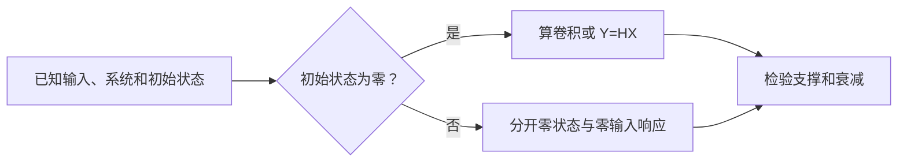

# 信号与系统 C 历史复习导读：先认信号，再选分析域

现有转写显示，这是一份指向 2019 年 1 月考试的《信号与系统 C》复习提要，而非原卷。以下按连续时间主线重组知识，并另设算例；不引用历史教材页码与题号，也不把这份旧提要当成现行班型或考核范围。未核对 PPTX 原件。

## 是输入刚变了，还是系统本来就在变？

先把考查对象分开。判断一个信号是否周期，问的是「有没有同一个正平移量，让每个时刻的值都不变」；判断系统是否时不变，问的是「先推迟输入再过系统，能否与先过系统再推迟输出互换」。公式里出现时间不一定是时变；关键是==输出是否额外依赖绝对时刻==。参见[线性、时不变、因果与稳定](../../../topics/信号与系统/系统性质与LTI.md)和[时间变换、阶跃与冲激](../../../topics/信号与系统/时间变换阶跃与冲激.md)。

**补充算例。** $v(t)=\cos(3t)+\cos(5t)$ 的两支频率分别为 $3$、$5$ rad/s，必须同时满足 $3T$ 和 $5T$ 都是 $2\pi$ 的整数倍；两整数系数互素，所以最小正周期为 $2\pi$。若第二支换作 $\cos(\sqrt2\,t)$，找不到共同正周期。再令 $p(t)=u(t)-u(t-2)$。对于 $p(1-2t)$，先用 $0\le 1-2t<2$ 求支撑，得到 $-1/2<t\le1/2$；不等式翻向来自负的尺度。画图时把原信号的两个边沿逐点映射，比靠平移口诀稳妥。阶跃在跳变点的取值按题设约定，端点不影响下面的积分。

## 输入关掉以后，储存的状态还在

**补充算例。** 一个初始静止、因果的连续线性时不变系统满足 $y'(t)+2y(t)=x(t)$。令 $x(t)=u(t)-u(t-1)$，为什么不能让输出也在 $t=1$ 直接变成零？

**参考解答。** 对零状态系统取单边拉普拉斯变换，有 $H(s)=1/(s+2)$，由此得 $h(t)=e^{-2t}u(t)$。阶跃与它卷积得到 $r(t)=\tfrac12(1-e^{-2t})u(t)$，继而 $y(t)=r(t)-r(t-1)$。在 $0<t<1$ 时响应为 $(1-e^{-2t})/2$，在 $t>1$ 时为 $(1-e^{-2})e^{-2(t-1)}/2$。关掉输入只切断驱动，状态从当时的值继续自然衰减。代换回微分方程，两段分别得到 1 和 0；在 $t=1$ 两边的值相同，恰好没有给状态额外塞进一个跳变。再以冲激作[卷积](../../../topics/信号与系统/冲激响应与卷积.md)检查：$h(t)*\delta(t-a)=h(t-a)$，冲激挑出的是一份移位响应，不是把函数在某点采样。

用单个积分器实现时，把 $-2y$ 加回输入，积分器的输出就是状态 $y$。对于串联的两个已知零状态系统，总 $h$ 是两冲激响应的卷积；并联相加时，总 $h$ 才相加。不为零的初始状态须另算零输入响应。这里 $s=-2$ 是系统唯一的极点，因果冲激响应绝对可积；仅从一个约掉公因子的传递函数，不能断言任意实现的内部状态都稳定。参见[系统函数与隐含模态](../../../topics/信号与系统/传递函数与隐含模态.md)与[状态方程](../../../topics/信号与系统/状态变量与状态方程.md)。

## 频谱的画法服务于问题，而不是换一套坐标重算

对实周期信号的[傅里叶级数](../../../topics/信号与系统/复指数与傅里叶分析.md)，正负频率的系数共轭。若峰值为 2 的余弦没有初相，双边各画幅值 1 的系数；画单边幅度通常合并成正频率幅度 2。若画的是功率，该余弦的时均平方为 2，合并的是两条各为 1 的功率谱线；直流项不成对。典型非周期脉冲则用连续频率上的谱，不能把傅里叶级数系数和傅里叶变换的数值标度混用。

**补充算例。** 设一个基带信号只在 $|\omega|\le2$ 有谱。乘 $\cos(8t)$ 后，两份半幅谱分别移动到 $[6,10]$ 和 $[-10,-6]$ rad/s。理想低通若只保留 $|\omega|\le3$，输出为零，不是把原基带留下。假如要求不利用带通信号结构、按最高频率做普通低通重建，则奈奎斯特采样角频率是 $20$ rad/s，对应 $10/\pi$ Hz，工程选取留出带间隔。解释见[取样定理与混叠](../../../topics/信号与系统/取样定理与混叠.md)和[无失真传输与理想滤波器](../../../topics/信号与系统/无失真传输与理想滤波器.md)。无失真要求在**输入实际占用的频带**内保持同一增益并只引入同一延迟，不是只要求幅度不变。

> [!TIP]
> **看到单边拉氏变换时，先检查零时刻与收敛。** 它只分析所选起点之后的信号，微分性质显式带入初始值；若题目改成双边反演，只给有理式而不说明收敛域，可能把右边信号和左边信号混在一起。取终值也要先检查相关极点，不能把不存在的长期极限算成一个有限数。见[拉普拉斯与 Z 变换的收敛域](../../../topics/信号与系统/拉普拉斯与Z变换的收敛域.md)。
