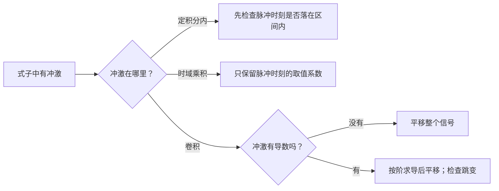

# 作业02选题解读：冲激的三种运算

OCR 中部分题干乱码、部分波形图缺失。这里只解读第 3 页可辨认的两个式子，不是整份作业的还原。新增练习另标“补充”。

[阶跃与冲激](../../../topics/信号与系统/时间变换阶跃与冲激.md)区分了阶跃的跳变与冲激的面积。[冲激响应与卷积](../../../topics/信号与系统/冲激响应与卷积.md)解释了为什么同一个冲激，和信号相乘时像探针，相卷积时却像时间搬运器：卷积把冲激用在==积分中的相对坐标==，求得的是整条移动后的曲线。

## 区间内没有探针：第 3 页第 5 项

**参考解答。** $\int_0^2 t^2\delta(t-10)\,dt=0$。虽然 $t^2$ 在 $t=10$ 处取值 $100$，但积分范围从未扫到冲激的支撑点 $10$。最简单的核对是把冲激想成集中在 $10$ 附近的单位面积脉冲：只要脉冲够窄，它就与整个积分区间不相交。

> [!TIP]
> 看到==有限积分区间==，先标出支撑点，再代入被抽样的函数。若支撑点恰在区间端点，不能直接照搬内点结论，应先核对端点积分约定。

## 对斜坡求两次导数：第 3 页第 11 项

**参考解答。** 记单位阶跃为 $u(t)$。由 $x*\delta''=x''$，有
$$
\delta''(t)*[t u(t)]
 = \frac{d}{dt}\bigl[u(t)+t\delta(t)\bigr]
 = \frac{d}{dt}u(t) = \delta(t).
$$
这里 $t\delta(t)=0$。也可不展开乘积：斜坡在 $0$ 两侧连续，因此第一次求导没有冲激；第一次求导所得斜率由 $0$ 跳到 $1$，第二次求导便产生面积为 $1$ 的冲激。若误把“每个开区间上二阶导数为零”当成整体结论，就会丢掉这一单位面积。

## 改变脉冲位置会怎样

**补充（自编）。** 同取 $x(t)=t u(t)$，令脉冲位于 $t=2$。作乘法得 $x(t)\delta(t-2)=2\delta(t-2)$，只剩这个时刻的值。改作卷积则得 $x(t)*\delta(t-2)=(t-2)u(t-2)$，整条斜坡向右平移。分别代入 $t=3$：前者此时离开冲激支撑，输出为零；后者的普通函数值为 $1$。
