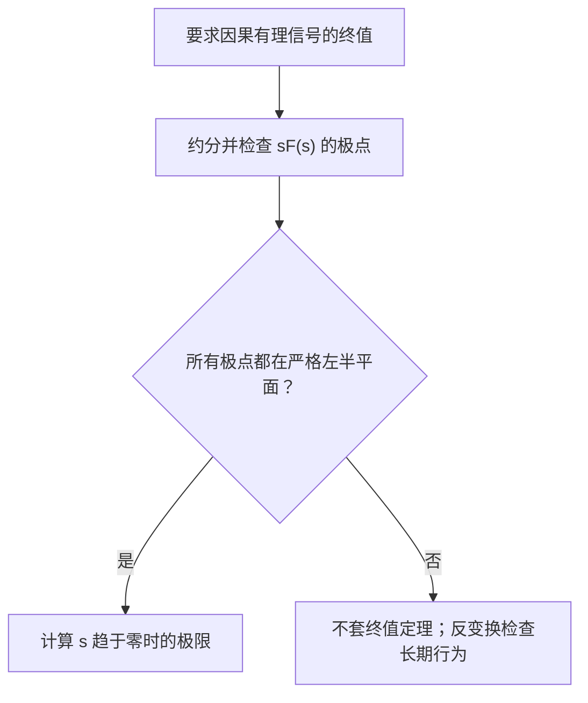
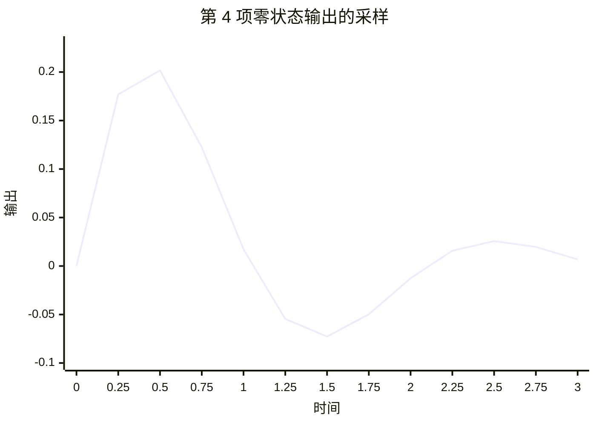

# 作业04选题解读：终值与冲激项

原资料有乱码和缺图。以下选解第 3 页第 12 项和第 5 页三组能辨认的系统与输入，并用自编算例澄清初值和终值各自的边界，不补写其他题干或图。

## 最终会留下多少：第 3 页第 12 项

**参考解答。** 对题中
$$
F(s)=\frac{s+2}{s^3+4s^2+3s},
$$
按因果单边拉普拉斯变换解释。先因式分解分母 $s(s+1)(s+3)$，再看 $sF(s)$ 的极点：$-1$、$-3$ 全在严格左半平面，故
$$
f(\infty)=\lim_{s\to0}sF(s)=\frac{2}{3}.
$$
为什么看的是 $sF(s)$，而不是见到 $F(s)$ 有原点极点就判发散？时域常数的变换含 $1/s$；乘 $s$ 恰好提取这一项。展开验算：
$$
F(s)=\frac{2}{3s}-\frac{1}{2(s+1)}-\frac{1}{6(s+3)}.
$$
后两项对应衰减指数，长期只剩 $2/3$；三个系数相加为零，也与严格真分式此处的右初值 $0$ 一致。

> [!WARNING]
> ==代入得到有限数==，不等于时间极限存在。例如 $F(s)=s/(s^2+1)$ 对应因果余弦；$sF(s)$ 在 $s=0$ 取值为零，但 $sF(s)$ 仍有虚轴极点，余弦不会收敛。

## 初值陷阱：先分离发生在零点的冲激

**补充（自编）。** 取 $G(s)=(3s+2)/(s+2)=3-4/(s+2)$。常数项 $3$ 对应 $3\delta(t)$，不是普通函数的右极限。剥去它后，常规部分为 $-4e^{-2t}u(t)$，右极限为 $-4$，长期极限为 $0$。用严格真分式复算初值：$\lim_{s\to+\infty}s[-4/(s+2)]=-4$。若直接对原式算 $sG(s)$ 的高频极限，冲激项会令该极限发散，这并不表示 $t>0$ 的常规部分没有有限的右极限。

| 题面信号 | 先检查 | 理由 |
| --- | --- | --- |
| ==终值== | $sF(s)$ 有无未抵消的非衰减极点 | 振荡或增长项会破坏极限 |
| ==初值==且分子、分母同阶 | 先做多项式除法、分离直通冲激项 | 冲激不是普通函数值 |

若题目给的是双边变换，只写有理式不总能确定时域信号。先回到[拉普拉斯与 Z 变换的收敛域](../../../topics/信号与系统/拉普拉斯与Z变换的收敛域.md)判断时域支撑，再决定能否按因果形式求初值或终值。

## 输入指数消失，哪个系统模态留下：第 5 页三组零状态计算

**参考解答（按因果、零初态解读）。** 要找的是同一个输入通过这个系统产生的输出，不能只做 $H(s)$ 的反变换，那给的是**冲激响应**。对零状态响应，先用微分方程求 $H(s)$，再把实际输入的 $X(s)$ 乘进去。这几组输入的指数在零时刻接通，单边变换从 $0^-$ 计入接通时的冲激；不应自行补入非零初态。

| 第 5 页项号 | 系统的 $H(s)$ 与输入的 $X(s)$ | $t>0$ 的零状态输出 |
| --- | --- | --- |
| 1 | $\dfrac{s+1}{(s+2)^2}\cdot\dfrac{1}{s+1}$ | $te^{-2t}$ |
| 2 | $\dfrac{s+5}{(s+1)(s+2)}\cdot\dfrac{1}{s+3}$ | $2e^{-t}-3e^{-2t}+e^{-3t}$ |
| 4 | $\dfrac{s+2}{(s+1)^2+9}\cdot\dfrac{1}{s+2}$ | $\dfrac{1}{3}e^{-t}\sin(3t)$ |

第 1 和第 4 项的**输入变换有一个极点，刚好碰上系统的零点**。第 1 项约去 $s+1$ 后还剩二重极点 $-2$，所以出现 $te^{-2t}$ 而不只是 $e^{-2t}$。第 4 项约去 $s+2$ 后还剩 $-1\pm3i$，把分母配成平方就能看出它是衰减振荡。第 2 项没有这种抵消；展开为
$$
Y_{\mathrm{zs}}(s)=\frac{2}{s+1}-\frac{3}{s+2}+\frac{1}{s+3},
$$
三个常数系数相加为零，给出 $y_{\mathrm{zs}}(0^+)=0$；求导后在零点得到 $-2+6-3=1$。另两组输出同样从零出发，右导数也都是 $1$。这个检查和频域中 $\lim_{s\to+\infty}s^2Y_{\mathrm{zs}}(s)=1$ 一致，并不意味着三个长期过程相同。

下图是第 4 项的零状态输出，每隔 $0.25$ 个时间单位取一点；相邻点之间的连线只用于读趋势。第一次正到负的过零发生在 $t=\pi/3$，所以虽然 $t=1$ 的点还在轴上方，$t=1.25$ 的点已经在轴下方。

> [!TIP]
> ==先乘实际输入，再约分和识别剩下的极点==。这张图的过零是所给输入下的输出特征，不是说系统对任何输入都在这些时刻过零。给非零初态还要另算零输入项，不能把这个结果当总响应。

可对照[传递函数与隐含模态](../../../topics/信号与系统/传递函数与隐含模态.md)和[状态转移与零输入、零状态响应](../../../topics/信号与系统/状态转移与零输入零状态响应.md)。
