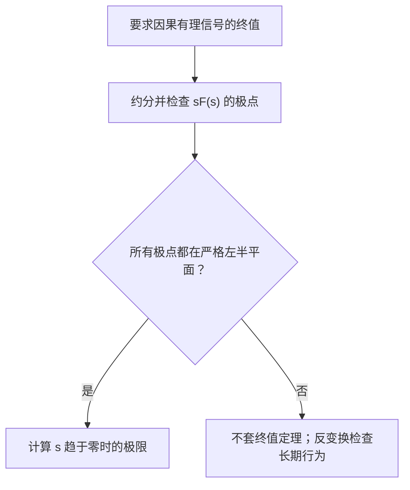

# 作业04选题解读：终值与冲激项

原资料有乱码和缺图。以下只处理第 3 页第 12 项能辨认的式子，并用自编算例澄清初值和终值各自的边界，不据此补写其他题干或图。

## 最终会留下多少：第 3 页第 12 项

**参考解答。** 对题中
$$
F(s)=\frac{s+2}{s^3+4s^2+3s},
$$
按因果单边拉普拉斯变换解释。先因式分解分母 $s(s+1)(s+3)$，再看 $sF(s)$ 的极点：$-1$、$-3$ 全在严格左半平面，故
$$
f(\infty)=\lim_{s\to0}sF(s)=\frac{2}{3}.
$$
为什么看的是 $sF(s)$，而不是见到 $F(s)$ 有原点极点就判发散？时域常数的变换含 $1/s$；乘 $s$ 恰好提取这一项。展开验算：
$$
F(s)=\frac{2}{3s}-\frac{1}{2(s+1)}-\frac{1}{6(s+3)}.
$$
后两项对应衰减指数，长期只剩 $2/3$；三个系数相加为零，也与严格真分式此处的右初值 $0$ 一致。

> [!WARNING]
> ==代入得到有限数==，不等于时间极限存在。例如 $F(s)=s/(s^2+1)$ 对应因果余弦；$sF(s)$ 在 $s=0$ 取值为零，但 $sF(s)$ 仍有虚轴极点，余弦不会收敛。

## 初值陷阱：先分离发生在零点的冲激

**补充（自编）。** 取 $G(s)=(3s+2)/(s+2)=3-4/(s+2)$。常数项 $3$ 对应 $3\delta(t)$，不是普通函数的右极限。剥去它后，常规部分为 $-4e^{-2t}u(t)$，右极限为 $-4$，长期极限为 $0$。用严格真分式复算初值：$\lim_{s\to+\infty}s[-4/(s+2)]=-4$。若直接对原式算 $sG(s)$ 的高频极限，冲激项会令该极限发散，这并不表示 $t>0$ 的常规部分没有有限的右极限。

| 题面信号 | 先检查 | 理由 |
| --- | --- | --- |
| ==终值== | $sF(s)$ 有无未抵消的非衰减极点 | 振荡或增长项会破坏极限 |
| ==初值==且分子、分母同阶 | 先做多项式除法、分离直通冲激项 | 冲激不是普通函数值 |

若题目给的是双边变换，只写有理式不总能确定时域信号。先回到[拉普拉斯与 Z 变换的收敛域](../../../topics/信号与系统/拉普拉斯与Z变换的收敛域.md)判断时域支撑，再决定能否按因果形式求初值或终值。
