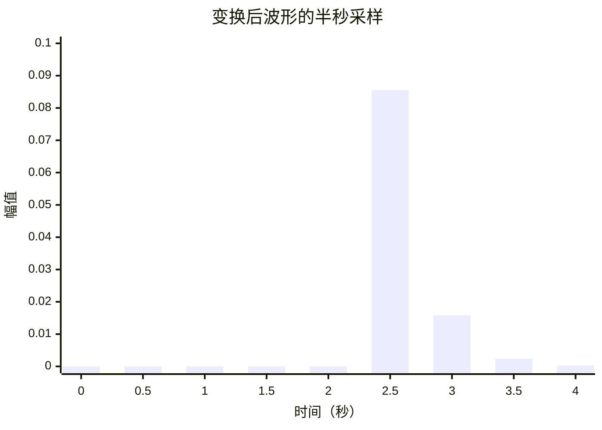

# 复频域作业选题解读：先找启动时刻

这份原课件讨论连续时间信号的复频域分析。这里选第 2、4 页两处可独立复核的时移题重推；缺图内容、其余题目及答案不在本文范围内。

## 指数乘了常数，波形就推迟了吗？

**参考解答。** 第 2 页出现 $e^{-2(t-1)}u(t)$。==决定何时启动的是阶跃的坐标==：阶跃仍在 $t=0$ 打开。把指数展开即得 $e^2e^{-2t}u(t)$，因此变换为 $e^2/(s+2)$，收敛域为 $\Re s>-2$。这与把指数和阶跃一起推迟的 $e^{-2(t-1)}u(t-1)$ 不同，后者的变换才是 $e^{-s}/(s+2)$。

| 变的是什么 | $0<t<1$ 内 | 变换中的因子 |
| --- | --- | --- |
| 只改变指数的时间原点 | 不为零，信号早已启动 | 常数 $e^2$ |
| 整条波形推迟一秒 | 恒为零，尚未启动 | $e^{-s}$ |

> [!TIP]
> 看到 $t-1$，先问“它替换的是整个函数的时间坐标，还是只出现在某个因子中？”把 $t=1/2$ 代进两条时域表达式，不查变换表也能分清两者。

## 仿射时间坐标：“减四”并不是“延迟四秒”

**参考解答。** 第 4 页给出 $F(s)=1/(s^2+5s+6)$，求 $f(2t-4)$ 的变换。按右边信号解释时，原始事件 $f$ 的启动点是内部坐标 $0$；对应到新时间，应解 $2t-4=0$，因此实际要等到 $t=2$。直接代换 $v=2t-4$：
$$
\int_2^\infty f(2t-4)e^{-st}\,dt
=\frac{e^{-2s}}{2}\int_0^\infty f(v)e^{-(s/2)v}\,dv
=\frac{2e^{-2s}}{(s+4)(s+6)}.
$$
这里 $e^{-2s}$ 管等待时间，$s/2$ 管波形压缩，外面的 $1/2$ 则来自积分测度。部分分式给出 $f(v)=(e^{-2v}-e^{-3v})u(v)$；代回原式并逐项积分，仍得到同一个变换，且新收敛域为 $\Re s>-4$。

**补充。** 下图把这条右边波形每隔 $0.5$ 秒采一个样点。它在 $t=2$ 的值恰好为零，但 $t>2$ 后立即变为正；不能用“第一个非零采样点”代替连续波形的启动时刻。

> [!WARNING]
> ==先定位时间事件，再换域==。若只给双边变换的分式，必须先检查[收敛域与时域支撑](../../../topics/信号与系统/拉普拉斯与Z变换的收敛域.md)，不能直接把其中的 $f$ 判为右边信号。仿射变换的时间坐标可用[时间变换、阶跃与冲激](../../../topics/信号与系统/时间变换阶跃与冲激.md)中的定位方法复核。
