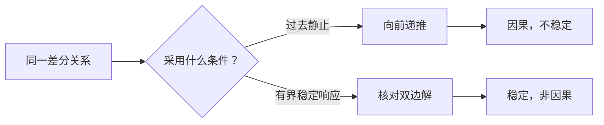

# 第一章选题解读：周期、能量与因果性

这份历史答案课件的可见部分涉及信号周期、能量与功率、差分系统因果性。第 5 页内容未见，第 4 页的文字识别中同一题的指数和极限符号不一致，未获原件核对。这里按可确认的主题补三组自编练习，不复写题面、不把局部覆盖算成原课件已经完整还原，也不推定当前班型的考试范围。

## 周期必须复现整条信号

**补充（自编）**：分别判断 $\cos(3t)+2\cos(5t)$、$\cos(3t)u(t)$ 和序列 $\cos^2(\pi k/8)$ 是否周期，若是，求其基本周期。

**参考解答**：第一个信号的两个非零频率分量要同时回到原相位。设 $3T=2\pi m$、$5T=2\pi n$，要求 $5m=3n$。最小正整数解是 $(m,n)=(3,5)$，因此基本周期是 $2\pi$。第二个信号在 $t<0$ 的整个半轴为零，却在某些 $t>0$ 非零；若有正周期，向左平移足够多次便会把非零点移到负半轴，矛盾。第三个信号先用平方恒等式化为 $(1+\cos(\pi k/4))/2$，最小正整数移位为 $8$，而不是平方前的 $16$。

> [!TIP]
> 看到==乘阶跃==先检查支撑是否被截断；看到==平方或乘积==先化简频率成分。连续时间找共同的实数移位，离散时间还要求移位是整数。

[阶跃、冲激与时间变换](../../../topics/信号与系统/时间变换阶跃与冲激.md)解释支撑如何被截取，[复指数与傅里叶分析](../../../topics/信号与系统/复指数与傅里叶分析.md)解释为何不同频率要分别回到同一相位。

## 一边衰减，另一边可能增长

**补充（自编）**：比较 $x_1(t)=3e^{-2t}$ 与 $x_2(t)=3e^{-2|t|}$ 的能量和平均功率，均在整个实数时间轴定义。

**参考解答**：先检查负半轴。第一条信号的强度平方为 $9e^{-4t}$，所以对称窗口的能量为
$$
E_1(T)=\frac{9}{4}\left(e^{4T}-e^{-4T}\right).
$$
它随 $T\to\infty$ 发散，除以窗口长度 $2T$ 仍发散，因此 $x_1$ 既不是能量信号也不是功率信号。第二条信号两边都衰减，$E_2=2\int_0^\infty 9e^{-4t}\,dt=9/2$，且 $0\le E_2(T)/(2T)\le 9/(4T)$，平均功率为零，故为能量信号。

> [!WARNING]
> 不要只看指数中有没有负号；先看定义域两端。如果题给的是 $e^{-at}u(t)$（$a>0$），阶跃会删掉负半轴，不能沿用双边指数的结果。

## 差分式还不是边界条件

**补充（自编）**：同一线性时不变关系 $y[k]-2y[k-1]=x[k-1]$，把它看作一个因果、初始静止的系统时，冲激响应是什么？若改要求稳定，能否仍选同一个冲激响应？

**参考解答**：令输入为单位冲激。从过去静止出发，$h[0]=0$、$h[1]=1$，其后每步乘 2，得到 $h_+[k]=2^{k-1}u[k-1]$。它只在正时刻非零，所以因果，但绝对和发散，系统不稳定。反过来取 $h_-[k]=-2^{k-1}u[-k]$，在 $k=1$ 有 $h_-[1]-2h_-[0]=1$，别的时刻差分为零。其绝对和为 $1$，对应稳定但非因果的系统。例如以 $x[k]=\delta[k-1]$ 为输入，输出在 $k=0$ 已等于 $h_-[-1]=-1/4$，早于冲激到达。

关键是==输出是在什么条件下由输入唯一确定==，而不是式子里看起来有没有“超前下标”。该区别可同时用[系统性质与 LTI](../../../topics/信号与系统/系统性质与LTI.md)、[冲激响应与卷积](../../../topics/信号与系统/冲激响应与卷积.md)和[拉普拉斯与 Z 变换的收敛域](../../../topics/信号与系统/拉普拉斯与Z变换的收敛域.md)检查：两个响应对应同一个代数式，但收敛域分别为 $|z|>2$ 和 $|z|<2$。
