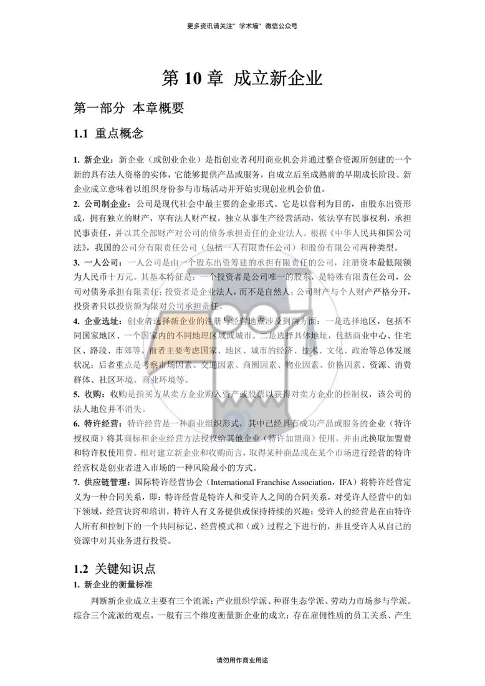
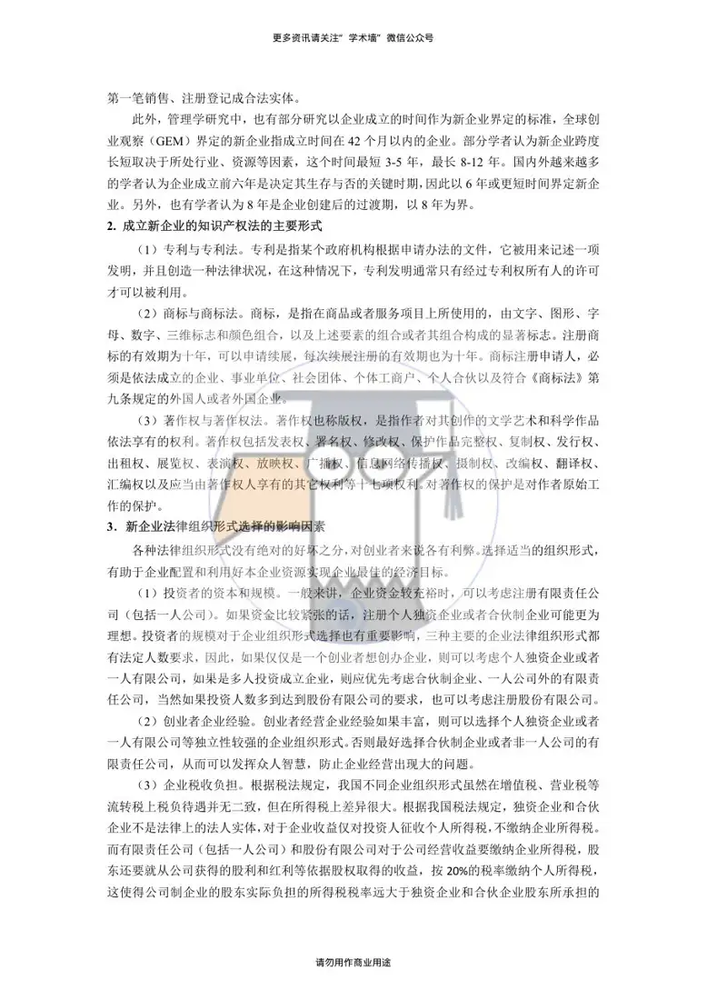
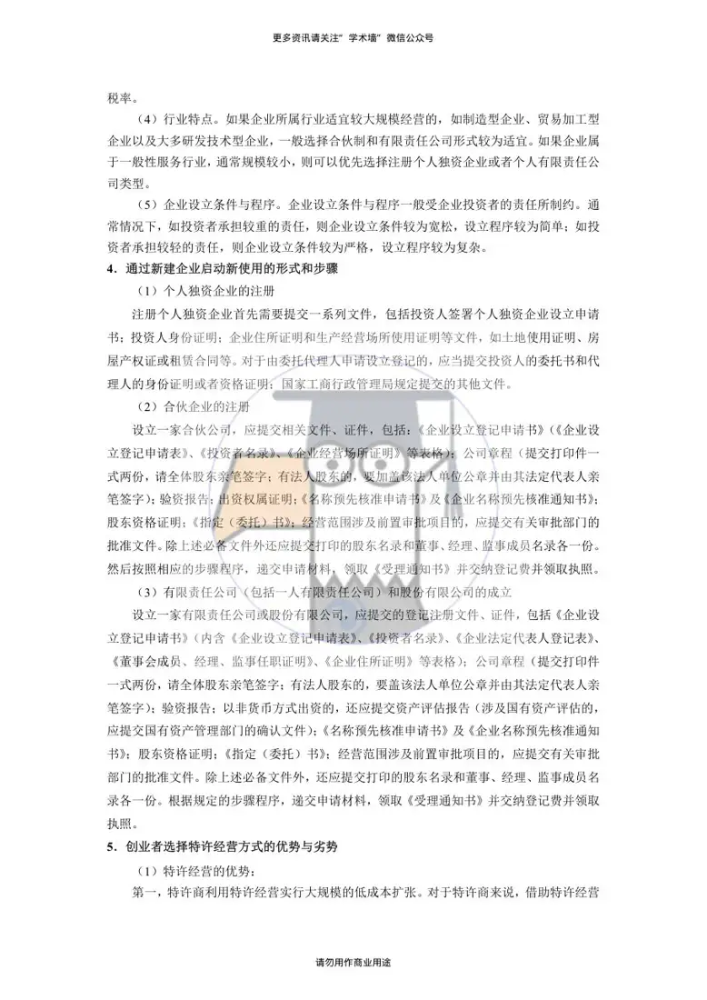
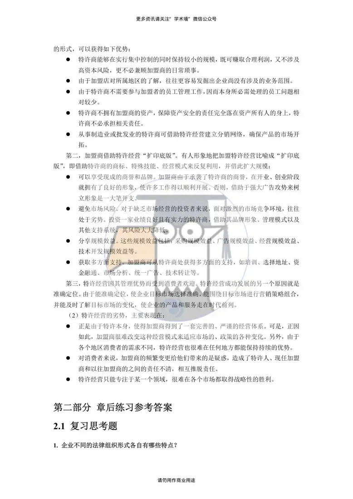
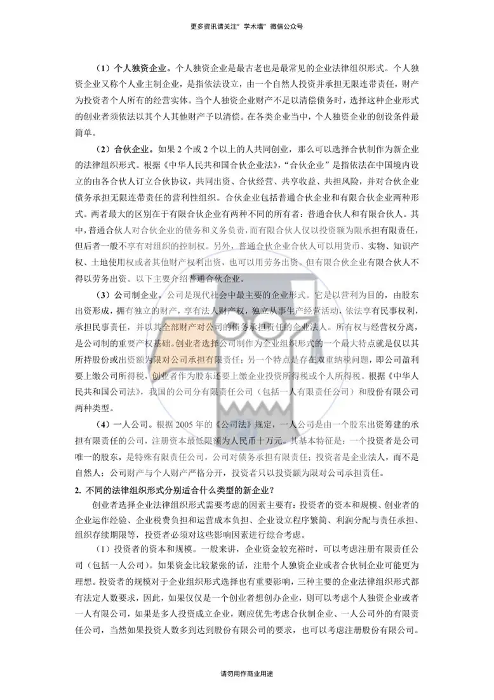
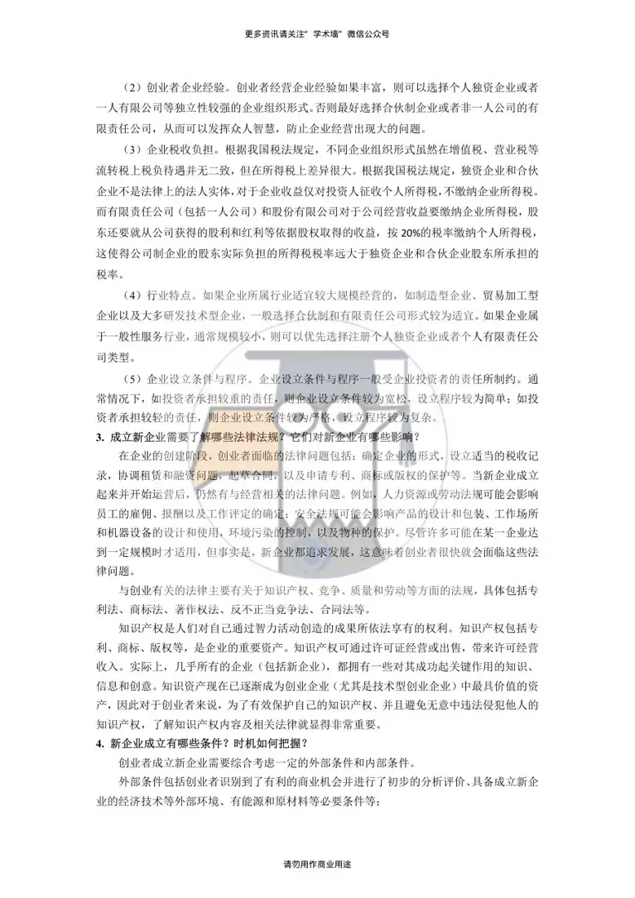
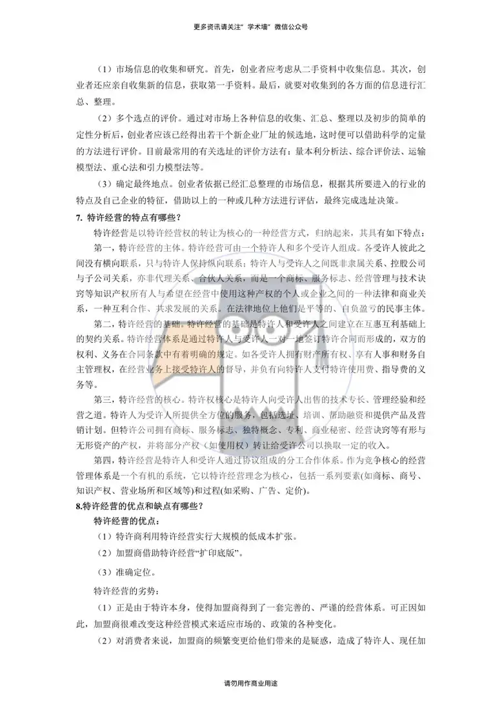
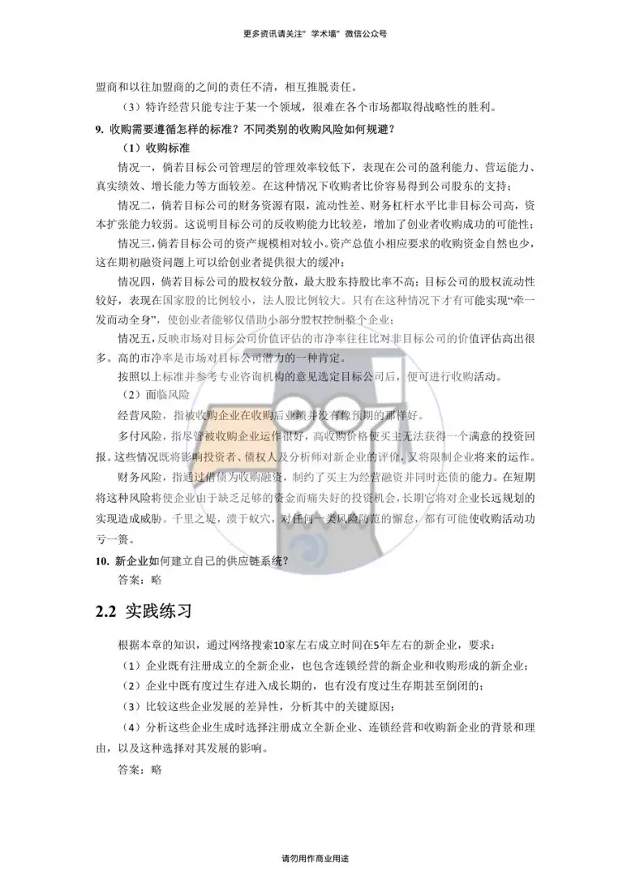

# 《创新与创业管理》第10章 成立新企业（课件）

原件的每一页，下面附识别出的文字。

### 第 10章 成立新企业

原文：

第 10章 成立新企业

第一部分 本章概要

1.1 重点概念

1. 新企业：新企业（或创业企业）是指创业者利用商业机会并通过整合资源所创建的一个新的具有法人资格的实体，它能够提供产品或服务，自成立后至成熟前的早期成长阶段。新企业成立意味着以组织身份参与市场活动并开始实现创业机会价值。

2. 公司制企业：公司是现代社会中最主要的企业形式。它是以营利为目的，由股东出资形成，拥有独立的财产，享有法人财产权，独立从事生产经营活动，依法享有民事权利，承担民事责任，并以其全部财产对公司的债务承担责任的企业法人。根据《中华人民共和国公司法》，我国的公司分有限责任公司（包括一人有限责任公司）和股份有限公司两种类型。

3. 一人公司：一人公司是由一个股东出资筹建的承担有限责任的公司，注册资本最低限额为人民币十万元。其基本特征是：一个投资者是公司唯一的股东，是特殊有限责任公司，公司对债务承担有限责任；投资者是企业法人，而不是自然人；公司财产与个人财产严格分开，投资者只以投资额为限对公司承担责任。

4. 企业选址：创业者选择新企业的注册与经营地点涉及到两方面：一是选择地区，包括不同国家地区、一个国家内的不同地理区域或城市。二是选择具体地址，包括商业中心、住宅区、路段、市郊等。前者主要考虑国家、地区、城市的经济、技术、文化、政治等总体发展状况；后者重点是考察市场因素、交通因素、商圈因素、物业因素、价格因素、资源、消费群体、社区环境、商业环境等。

5. 收购：收购是指买方从卖方企业购入资产或股票以获得对卖方企业的控制权，该公司的法人地位并不消失。

6. 特许经营：特许经营是一种商业组织形式，其中已经具有成功产品或服务的企业（特许授权商）将其商标和企业经营方法授权给其他企业（特许加盟商）使用，并由此换取加盟费和特许权使用费。相对建立新企业和收购而言，取得某种商品或在某个市场进行经营的特许经营权是创业者进入市场的一种风险最小的方式。

7. 供应链管理：国际特许经营协会（International Franchise Association，IFA）将特许经营定义为一种合同关系，即：特许经营是特许人和受许人之间的合同关系，对受许人经营中的如下领域，经营诀窍和培训，特许人有义务提供或保持持续的兴趣；受许人的经营是在由特许人所有和控制下的一个共同标记、经营模式和（或）过程之下进行的，并且受许人从自己的资源中对其业务进行投资。

1.2 关键知识点

1. 新企业的衡量标准

判断新企业成立主要有三个流派：产业组织学派、种群生态学派、劳动力市场参与学派。综合三个流派的观点，一般有三个维度衡量新企业的成立：存在雇佣性质的员工关系、产生

更多资讯请关注“学术墙”微信公众号

请勿用作商业用途

### 第一笔销售、注册登记成合法实体。

原文：

第一笔销售、注册登记成合法实体。

此外，管理学研究中，也有部分研究以企业成立的时间作为新企业界定的标准，全球创业观察（GEM）界定的新企业指成立时间在 42 个月以内的企业。部分学者认为新企业跨度长短取决于所处行业、资源等因素，这个时间最短 3-5 年，最长 8-12 年。国内外越来越多的学者认为企业成立前六年是决定其生存与否的关键时期，因此以 6 年或更短时间界定新企业。另外，也有学者认为 8 年是企业创建后的过渡期，以 8 年为界。

2. 成立新企业的知识产权法的主要形式

（1）专利与专利法。专利是指某个政府机构根据申请办法的文件，它被用来记述一项发明，并且创造一种法律状况，在这种情况下，专利发明通常只有经过专利权所有人的许可才可以被利用。

（2）商标与商标法。商标，是指在商品或者服务项目上所使用的，由文字、图形、字母、数字、三维标志和颜色组合，以及上述要素的组合或者其组合构成的显著标志。注册商标的有效期为十年，可以申请续展，每次续展注册的有效期也为十年。商标注册申请人，必须是依法成立的企业、事业单位、社会团体、个体工商户、个人合伙以及符合《商标法》第九条规定的外国人或者外国企业。

（3）著作权与著作权法。著作权也称版权，是指作者对其创作的文学艺术和科学作品依法享有的权利。著作权包括发表权、署名权、修改权、保护作品完整权、复制权、发行权、出租权、展览权、表演权、放映权、广播权、信息网络传播权、摄制权、改编权、翻译权、汇编权以及应当由著作权人享有的其它权利等十七项权利。对著作权的保护是对作者原始工作的保护。

3．新企业法律组织形式选择的影响因素

各种法律组织形式没有绝对的好坏之分，对创业者来说各有利弊。选择适当的组织形式，有助于企业配置和利用好本企业资源实现企业最佳的经济目标。

（1）投资者的资本和规模。一般来讲，企业资金较充裕时，可以考虑注册有限责任公司（包括一人公司）。如果资金比较紧张的话，注册个人独资企业或者合伙制企业可能更为理想。投资者的规模对于企业组织形式选择也有重要影响，三种主要的企业法律组织形式都有法定人数要求，因此，如果仅仅是一个创业者想创办企业，则可以考虑个人独资企业或者一人有限公司，如果是多人投资成立企业，则应优先考虑合伙制企业、一人公司外的有限责任公司，当然如果投资人数多到达到股份有限公司的要求，也可以考虑注册股份有限公司。

（2）创业者企业经验。创业者经营企业经验如果丰富，则可以选择个人独资企业或者一人有限公司等独立性较强的企业组织形式。否则最好选择合伙制企业或者非一人公司的有限责任公司，从而可以发挥众人智慧，防止企业经营出现大的问题。

（3）企业税收负担。根据税法规定，我国不同企业组织形式虽然在增值税、营业税等流转税上税负待遇并无二致，但在所得税上差异很大。根据我国税法规定，独资企业和合伙企业不是法律上的法人实体，对于企业收益仅对投资人征收个人所得税，不缴纳企业所得税。而有限责任公司（包括一人公司）和股份有限公司对于公司经营收益要缴纳企业所得税，股东还要就从公司获得的股利和红利等依据股权取得的收益，按 20%的税率缴纳个人所得税，这使得公司制企业的股东实际负担的所得税税率远大于独资企业和合伙企业股东所承担的

更多资讯请关注“学术墙”微信公众号

请勿用作商业用途

### 税率。

原文：

税率。

（4）行业特点。如果企业所属行业适宜较大规模经营的，如制造型企业、贸易加工型企业以及大多研发技术型企业，一般选择合伙制和有限责任公司形式较为适宜。如果企业属于一般性服务行业，通常规模较小，则可以优先选择注册个人独资企业或者个人有限责任公司类型。

（5）企业设立条件与程序。企业设立条件与程序一般受企业投资者的责任所制约。通常情况下，如投资者承担较重的责任，则企业设立条件较为宽松，设立程序较为简单；如投资者承担较轻的责任，则企业设立条件较为严格，设立程序较为复杂。

4．通过新建企业启动新使用的形式和步骤

（1）个人独资企业的注册

注册个人独资企业首先需要提交一系列文件，包括投资人签署个人独资企业设立申请书；投资人身份证明；企业住所证明和生产经营场所使用证明等文件，如土地使用证明、房屋产权证或租赁合同等。对于由委托代理人申请设立登记的，应当提交投资人的委托书和代理人的身份证明或者资格证明；国家工商行政管理局规定提交的其他文件。

（2）合伙企业的注册

设立一家合伙公司，应提交相关文件、证件，包括：《企业设立登记申请书》（《企业设立登记申请表》、《投资者名录》、《企业经营场所证明》等表格）；公司章程（提交打印件一式两份，请全体股东亲笔签字；有法人股东的，要加盖该法人单位公章并由其法定代表人亲笔签字）；验资报告；出资权属证明；《名称预先核准申请书》及《企业名称预先核准通知书》；股东资格证明；《指定（委托）书》；经营范围涉及前置审批项目的，应提交有关审批部门的批准文件。除上述必备文件外还应提交打印的股东名录和董事、经理、监事成员名录各一份。然后按照相应的步骤程序，递交申请材料，领取《受理通知书》并交纳登记费并领取执照。

（3）有限责任公司（包括一人有限责任公司）和股份有限公司的成立

设立一家有限责任公司或股份有限公司，应提交的登记注册文件、证件，包括《企业设立登记申请书》（内含《企业设立登记申请表》、《投资者名录》、《企业法定代表人登记表》、《董事会成员、经理、监事任职证明》、《企业住所证明》等表格）；公司章程（提交打印件一式两份，请全体股东亲笔签字；有法人股东的，要盖该法人单位公章并由其法定代表人亲笔签字）；验资报告；以非货币方式出资的，还应提交资产评估报告（涉及国有资产评估的，应提交国有资产管理部门的确认文件）；《名称预先核准申请书》及《企业名称预先核准通知书》；股东资格证明；《指定（委托）书》；经营范围涉及前置审批项目的，应提交有关审批部门的批准文件。除上述必备文件外，还应提交打印的股东名录和董事、经理、监事成员名录各一份。根据规定的步骤程序，递交申请材料，领取《受理通知书》并交纳登记费并领取执照。

5．创业者选择特许经营方式的优势与劣势

（1）特许经营的优势：

第一，特许商利用特许经营实行大规模的低成本扩张。对于特许商来说，借助特许经营

更多资讯请关注“学术墙”微信公众号

请勿用作商业用途

### 的形式，可以获得如下优势：

原文：

的形式，可以获得如下优势：

 特许商能够在实行集中控制的同时保持较小的规模，既可赚取合理利润，又不涉及高资本风险，更不必兼顾加盟商的日常琐事。

● 由于加盟店对所属地区的了解，往往更容易发掘出企业尚没有涉及的业务范围。

 由于特许商不需要参与加盟者的员工管理工作，因而本身所必需处理的员工问题相对较少。

 特许商不拥有加盟商的资产，保障资产安全的责任完全落在资产所有人的身上，特许商不必承担相关责任。

 从事制造业或批发业的特许商可借助特许经营建立分销网络，确保产品的市场开拓。

第二，加盟商借助特许经营“扩印底版”。有人形象地把加盟特许经营比喻成“扩印底版”，即借助特许商的商标、特殊技能、经营模式来反复利用，并借此扩大规模：

可以享受现成的商誉和品牌。加盟商由于承袭了特许商的商誉，在开业、创业阶段就拥有了良好的形象，使许多工作得以顺利开展。否则，借助于强大广告攻势来树立形象是一大笔开支。

避免市场风险。对于缺乏市场经营的投资者来说，面对激烈的市场竞争环境，往往处于劣势。投资一家业绩良好且有实力的特许商，借助其品牌形象、管理模式以及其他支持系统，其风险大大降低。

 分享规模效益。这些规模效益包括：采购规模效益、广告规模效益、经营规模效益、技术开发规模效益等。

 获取多方面支持。加盟商可从特许商处获得多方面的支持，如培训、选择地址、资金融通、市场分析、统一广告、技术转让等。

第三，特许经营因其管理优势而受到消费者欢迎。特许经营成功发展的另一个原因就是准确定位。由于能准确定位，使企业目标市场选择准确，能围绕目标市场进行营销策略组合，并能及时了解目标市场的变化，使企业的产品和服务走在时代前列。

（2）特许经营的劣势，主要表现在：

 正是由于特许本身，使得加盟商得到了一套完善的、严谨的经营体系。可是，正因如此，加盟商很难改变这种经营模式来适应市场的、政策的各种变化。另外，由于各个地区消费者的需求不同，特许经营也很难在任何地方都能保持持续的优势。

 对消费者来说，加盟商的频繁变更给他们带来的是疑惑，造成了特许人、现任加盟商和以往加盟商的之间的责任不清，相互推脱责任。

 特许经营只能专注于某一个领域，很难在各个市场都取得战略性的胜利。

第二部分 章后练习参考答案

2.1 复习思考题

1. 企业不同的法律组织形式各自有哪些特点？

更多资讯请关注“学术墙”微信公众号

请勿用作商业用途

### 2. 不同的法律组织形式分别适合什么类型的新企业？

原文：

（1）个人独资企业。个人独资企业是最古老也是最常见的企业法律组织形式。个人独资企业又称个人业主制企业，是指依法设立，由一个自然人投资并承担无限连带责任，财产为投资者个人所有的经营实体。当个人独资企业财产不足以清偿债务时，选择这种企业形式的创业者须依法以其个人其他财产予以清偿。在各类企业当中，个人独资企业的创设条件最简单。

（2）合伙企业。如果 2 个或 2 个以上的人共同创业，那么可以选择合伙制作为新企业的法律组织形式。根据《中华人民共和国合伙企业法》，“合伙企业”是指依法在中国境内设立的由各合伙人订立合伙协议，共同出资、合伙经营、共享收益、共担风险，并对合伙企业债务承担无限连带责任的营利性组织。合伙企业包括普通合伙企业和有限合伙企业两种形式。两者最大的区别在于有限合伙企业有两种不同的所有者：普通合伙人和有限合伙人。其中，普通合伙人对合伙企业的债务和义务负责，而有限合伙人仅以投资额为限承担有限责任，但后者一般不享有对组织的控制权。另外，普通合伙企业合伙人可以用货币、实物、知识产权、土地使用权或者其他财产权利出资，也可以用劳务出资。但有限合伙企业有限合伙人不得以劳务出资。以下主要介绍普通合伙企业。

（3）公司制企业。公司是现代社会中最主要的企业形式。它是以营利为目的，由股东出资形成，拥有独立的财产，享有法人财产权，独立从事生产经营活动，依法享有民事权利，承担民事责任，并以其全部财产对公司的债务承担责任的企业法人。所有权与经营权分离，是公司制的重要产权基础。创业者选择公司制作为企业组织形式的一个最大特点就是仅以其所持股份或出资额为限对公司承担有限责任；另一个特点是存在双重纳税问题，即公司盈利要上缴公司所得税，创业者作为股东还要上缴企业投资所得税或个人所得税。根据《中华人民共和国公司法》，我国的公司分有限责任公司（包括一人有限责任公司）和股份有限公司两种类型。

（4）一人公司。根据2005 年的《公司法》规定，一人公司是由一个股东出资筹建的承担有限责任的公司，注册资本最低限额为人民币十万元。其基本特征是：一个投资者是公司唯一的股东，是特殊有限责任公司，公司对债务承担有限责任；投资者是企业法人，而不是自然人；公司财产与个人财产严格分开，投资者只以投资额为限对公司承担责任。

2. 不同的法律组织形式分别适合什么类型的新企业？

创业者选择企业法律组织形式需要考虑的因素主要有：投资者的资本和规模、创业者的企业运作经验、企业税费负担和运营成本负担、企业设立程序繁简、利润分配与责任承担、组织存续期限等，投资者必须对这些影响因素进行综合考虑。

（1）投资者的资本和规模。一般来讲，企业资金较充裕时，可以考虑注册有限责任公司（包括一人公司）。如果资金比较紧张的话，注册个人独资企业或者合伙制企业可能更为理想。投资者的规模对于企业组织形式选择也有重要影响，三种主要的企业法律组织形式都有法定人数要求，因此，如果仅仅是一个创业者想创办企业，则可以考虑个人独资企业或者一人有限公司，如果是多人投资成立企业，则应优先考虑合伙制企业、一人公司外的有限责任公司，当然如果投资人数多到达到股份有限公司的要求，也可以考虑注册股份有限公司。

更多资讯请关注“学术墙”微信公众号

请勿用作商业用途

### 3. 成立新企业需要了解哪些法律法规？它们对新企业有哪些影响？

原文：

（2）创业者企业经验。创业者经营企业经验如果丰富，则可以选择个人独资企业或者一人有限公司等独立性较强的企业组织形式。否则最好选择合伙制企业或者非一人公司的有限责任公司，从而可以发挥众人智慧，防止企业经营出现大的问题。

（3）企业税收负担。根据我国税法规定，不同企业组织形式虽然在增值税、营业税等流转税上税负待遇并无二致，但在所得税上差异很大。根据我国税法规定，独资企业和合伙企业不是法律上的法人实体，对于企业收益仅对投资人征收个人所得税，不缴纳企业所得税。而有限责任公司（包括一人公司）和股份有限公司对于公司经营收益要缴纳企业所得税，股东还要就从公司获得的股利和红利等依据股权取得的收益，按 20%的税率缴纳个人所得税，这使得公司制企业的股东实际负担的所得税税率远大于独资企业和合伙企业股东所承担的税率。

（4）行业特点。如果企业所属行业适宜较大规模经营的，如制造型企业、贸易加工型企业以及大多研发技术型企业，一般选择合伙制和有限责任公司形式较为适宜。如果企业属于一般性服务行业，通常规模较小，则可以优先选择注册个人独资企业或者个人有限责任公司类型。

（5）企业设立条件与程序。企业设立条件与程序一般受企业投资者的责任所制约。通常情况下，如投资者承担较重的责任，则企业设立条件较为宽松，设立程序较为简单；如投资者承担较轻的责任，则企业设立条件较为严格，设立程序较为复杂。

3. 成立新企业需要了解哪些法律法规？它们对新企业有哪些影响？

在企业的创建阶段，创业者面临的法律问题包括：确定企业的形式，设立适当的税收记录，协调租赁和融资问题，起草合同，以及申请专利、商标或版权的保护等。当新企业成立起来并开始运营后，仍然有与经营相关的法律问题。例如，人力资源或劳动法规可能会影响员工的雇佣、报酬以及工作评定的确定；安全法规可能会影响产品的设计和包装、工作场所和机器设备的设计和使用，环境污染的控制，以及物种的保护。尽管许多可能在某一企业达到一定规模时才适用，但事实是，新企业都追求发展，这意味着创业者很快就会面临这些法律问题。

与创业有关的法律主要有关于知识产权、竞争、质量和劳动等方面的法规，具体包括专利法、商标法、著作权法、反不正当竞争法、合同法等。

知识产权是人们对自己通过智力活动创造的成果所依法享有的权利。知识产权包括专利、商标、版权等，是企业的重要资产。知识产权可通过许可证经营或出售，带来许可经营收入。实际上，几乎所有的企业（包括新企业），都拥有一些对其成功起关键作用的知识、信息和创意。知识资产现在已逐渐成为创业企业（尤其是技术型创业企业）中最具价值的资产，因此对于创业者来说，为了有效保护自己的知识产权、并且避免无意中违法侵犯他人的知识产权，了解知识产权内容及相关法律就显得非常重要。

4. 新企业成立有哪些条件？时机如何把握？

创业者成立新企业需要综合考虑一定的外部条件和内部条件。

外部条件包括创业者识别到了有利的商业机会并进行了初步的分析评价、具备成立新企业的经济技术等外部环境、有能源和原材料等必要条件等；

更多资讯请关注“学术墙”微信公众号

请勿用作商业用途

### 6. 新企业注册选址应该考虑哪些因素？具体有哪些步骤？

原文：

内部条件包括：创业者具有一定的创业能力和素质、具有成为创业者的动机、具有较小的创业机会成本、已经获得了某种特许权或者已经开发出了能够创造市场的产品、或者成立新企业能够形成某种特有的竞争优势等。

5. 企业的组织结构有哪些种类？各有什么特点以及对于不同类型创业企业的适用性如何？

传统的组织结构类型主要包括直线制、职能制、部门制、矩阵制等不同类型。20 世纪九十年代，一些创造性的组织方法和结构不断出现，其中一些对于新企业来说，适用性也很强。

（1）学习型组织结构。在学习型组织内，雇员参加问题的识别，这意味着要懂得顾客的需要。雇员还要解决问题，这意味着要以一种独特的方式将一切综合起来考虑以满足顾客的需要。组织因此通过确定新的需要并满足这些需要来提高其价值。学习型组织结构废弃了使管理者和工人之间产生距离的纵向结构，同样也废弃了使个人与个人、部门与部门相互争斗的支付和预算制度。团队是横向组织的基本结构。伴随着生产的全过程，人们一起工作为顾客创造产品。

（2）团队型组织结构。团队型组织结构中，企业原来的部门被工作小组和团队代替。这种组织结构的一些特征对于创业企业非常有价值：淡化团队的控制职能，而是更多的授权，从而使得从高层到基层的管理职权链淡化或者消失，员工的工作时间、工作方式都是非常自由。这种组织结构可以大大提高经营效率，提高服务质量，对于服务型创业企业比较适用。

（3）项目型组织结构。项目型组织结构与团队型结构最大的不同在于一个项目团队只存在于完成一个项目的阶段内，所以它的存在取决于项目需要完成的时间。在项目型组织中，每个项目就象一个微型公司那样运行。完成每个项目目标所需的所有资源完全分配给这个项目，专门为这个项目服务。专职的项目经理对项目团队拥有完全的项目权力和行政权力。由于每个项目团队严格致力于一个项目，所以，项目型组织的设置完全是为了迅速、有效地对项目目标和客户需要做出反应。对于创业企业而言，该组织结构既能提高运行效率，又能因团队的存在而增强灵活性。

（4）虚拟企业组织。虚拟企业组织结构形式是当市场出现新机遇时，具有不同资源与优势的企业为了共同开拓市场，共同对付其他的竞争者而组织的、建立在信息网络基础上的共享技术与信息，分担费用，联合开发的、互利的企业联盟体。虚拟企业的出现常常是参与联盟的企业追求一种完全靠自身能力达不到的超常目标，因此企业自发的要求突破自身的组织界限，必须与其他对此目标有共识的企业实现全方位的战略联盟，共建虚拟企业，才有可能实现这一目标。随着我国 B2C 等网络平台的不断发展，在淘宝网、京东商城等平台上已经涌现了大量的虚拟企业。

6. 新企业注册选址应该考虑哪些因素？具体有哪些步骤？

创业者选择新企业的注册与经营地点涉及到两方面：

（1）选择地区，包括不同国家地区、一个国家内的不同地理区域或城市。主要考虑国家、地区、城市的经济、技术、文化、政治等总体发展状况；

（2）选择具体地址，包括商业中心、住宅区、路段、市郊等。重点是考察市场因素、交通因素、商圈因素、物业因素、价格因素、资源、消费群体、社区环境、商业环境等。

具体步骤：

更多资讯请关注“学术墙”微信公众号

请勿用作商业用途

### 7. 特许经营的特点有哪些？

原文：

（1）市场信息的收集和研究。首先，创业者应考虑从二手资料中收集信息。其次，创业者还应亲自收集新的信息，获取第一手资料。最后，就要对收集到的各方面的信息进行汇总、整理。

（2）多个选点的评价。通过对市场上各种信息的收集、汇总、整理以及初步的简单的定性分析后，创业者应该已经得出若干个新企业厂址的候选地，这时便可以借助科学的定量的方法进行评价。目前最常用的有关选址的评价方法有：量本利分析法、综合评价法、运输模型法、重心法和引力模型法等。

（3）确定最终地点。创业者依据已经汇总整理的市场信息，根据其所要进入的行业的特点及自己企业的特征，借助以上的一种或几种方法进行评估，最终完成选址决策。

7. 特许经营的特点有哪些？

特许经营是以特许经营权的转让为核心的一种经营方式，归纳起来，其具有如下特点：

第一，特许经营的主体。特许经营可由一个特许人和多个受许人组成。各受许人彼此之间没有横向联系，只与特许人保持纵向联系；特许人与受许人之间既非隶属关系、控股公司与子公司关系，亦非代理关系、合伙人关系，而是一个商标、服务标志、经营管理与技术诀窍等知识产权所有人与希望在经营中使用这种产权的个人或企业之间的一种法律和商业关系，一种互利合作、共求发展的关系。在法律地位上他们是平等的、自负盈亏的民事主体。

第二，特许经营的基础。特许经营的基础是特许人和受许人之间建立在互惠互利基础上的契约关系。特许经营体系是通过特许人与受许人一对一地签订特许合同而形成的，双方的权利、义务在合同条款中有着明确的规定。如各受许人拥有财产所有权、享有人事和财务自主管理权，在经营业务上接受特许人的督导，并负有向特许人支付特许使用费、指导费的义务等。

第三，特许经营的核心。特许权核心是特许人向受许人出售的技术专长、管理经验和经营之道。特许人为受许人所提供全方位的服务，包括选址、培训、帮助融资和提供产品及营销计划。但特许公司拥有商标、服务标志、独特概念、专利、商业秘密、经营诀窍等有形与无形资产的产权，并将部分产权（如使用权）转让给受许公司以换取一定的收入。

第四，特许经营是特许人和受许人通过协议组成的分工合作体系。作为竞争核心的经营管理体系是一个有机的系统，它以特许经营理念为核心，包括一系列要素(如商标、商号、知识产权、营业场所和区域等)和过程(如采购、广告、定价)。

8.特许经营的优点和缺点有哪些？

特许经营的优点：

（1）特许商利用特许经营实行大规模的低成本扩张。

（2）加盟商借助特许经营“扩印底版”。

（3）准确定位。

特许经营的劣势：

（1）正是由于特许本身，使得加盟商得到了一套完善的、严谨的经营体系。可正因如此，加盟商很难改变这种经营模式来适应市场的、政策的各种变化。

（2）对消费者来说，加盟商的频繁变更给他们带来的是疑惑，造成了特许人、现任加

更多资讯请关注“学术墙”微信公众号

请勿用作商业用途

### 盟商和以往加盟商的之间的责任不清，相互推脱责任。

原文：

盟商和以往加盟商的之间的责任不清，相互推脱责任。

（3）特许经营只能专注于某一个领域，很难在各个市场都取得战略性的胜利。

9. 收购需要遵循怎样的标准？不同类别的收购风险如何规避？

（1）收购标准

情况一，倘若目标公司管理层的管理效率较低下，表现在公司的盈利能力、营运能力、真实绩效、增长能力等方面较差。在这种情况下收购者比价容易得到公司股东的支持；

情况二，倘若目标公司的财务资源有限，流动性差、财务杠杆水平比非目标公司高，资本扩张能力较弱。这说明目标公司的反收购能力比较差，增加了创业者收购成功的可能性；

情况三，倘若目标公司的资产规模相对较小。资产总值小相应要求的收购资金自然也少，这在期初融资问题上可以给创业者提供很大的缓冲；

情况四，倘若目标公司的股权较分散，最大股东持股比率不高；目标公司的股权流动性较好，表现在国家股的比例较小，法人股比例较大。只有在这种情况下才有可能实现“牵一发而动全身”，使创业者能够仅借助小部分股权控制整个企业；

情况五，反映市场对目标公司价值评估的市净率往往比对非目标公司的价值评估高出很多。高的市净率是市场对目标公司潜力的一种肯定。

按照以上标准并参考专业咨询机构的意见选定目标公司后，便可进行收购活动。

（2）面临风险

经营风险，指被收购企业在收购后业绩并没有像预期的那样好。

多付风险，指尽管被收购企业运作很好，高收购价格使买主无法获得一个满意的投资回报。这些情况既将影响投资者、债权人及分析师对新企业的评价，又将限制企业将来的运作。

财务风险，指通过借债为收购融资，制约了买主为经营融资并同时还债的能力。在短期将这种风险将使企业由于缺乏足够的资金而痛失好的投资机会，长期它将对企业长远规划的实现造成威胁。千里之堤，溃于蚁穴，对任何一类风险防范的懈怠，都有可能使收购活动功亏一篑。

10. 新企业如何建立自己的供应链系统？

答案：略

2.2 实践练习

根据本章的知识，通过网络搜索10家左右成立时间在5年左右的新企业，要求：

（1）企业既有注册成立的全新企业，也包含连锁经营的新企业和收购形成的新企业；

（2）企业中既有度过生存进入成长期的，也有没有度过生存期甚至倒闭的；

（3）比较这些企业发展的差异性，分析其中的关键原因；

（4）分析这些企业生成时选择注册成立全新企业、连锁经营和收购新企业的背景和理由，以及这种选择对其发展的影响。

答案：略

更多资讯请关注“学术墙”微信公众号

请勿用作商业用途
