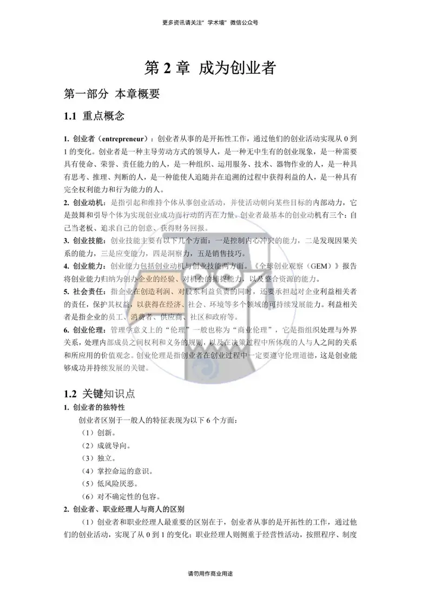
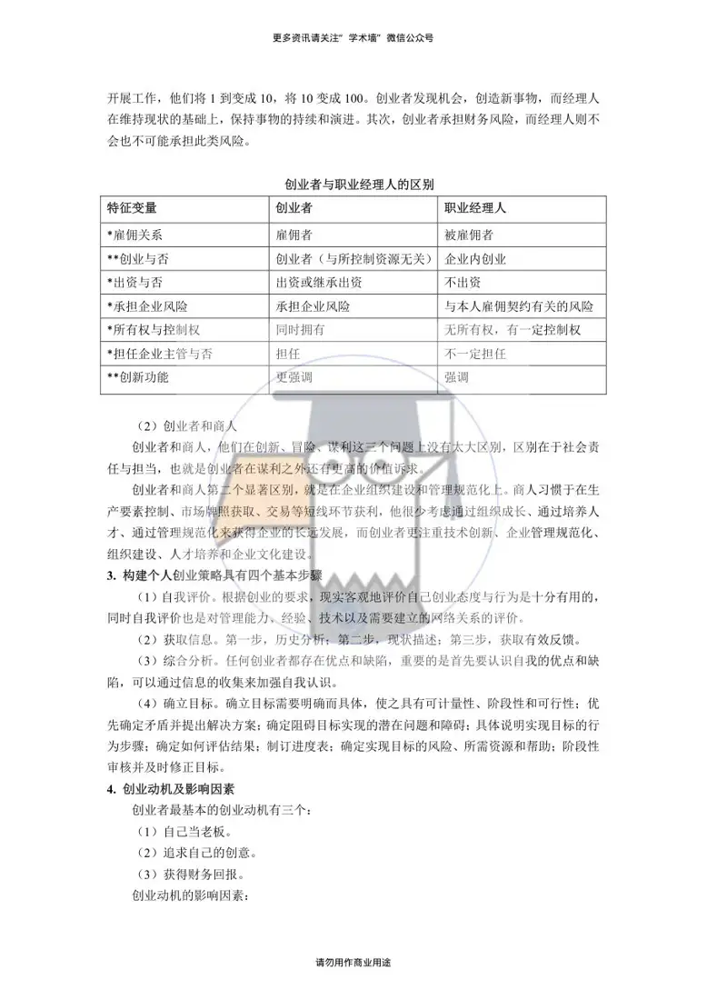
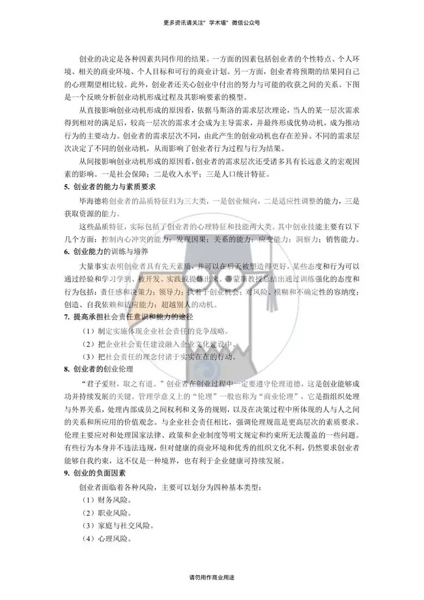
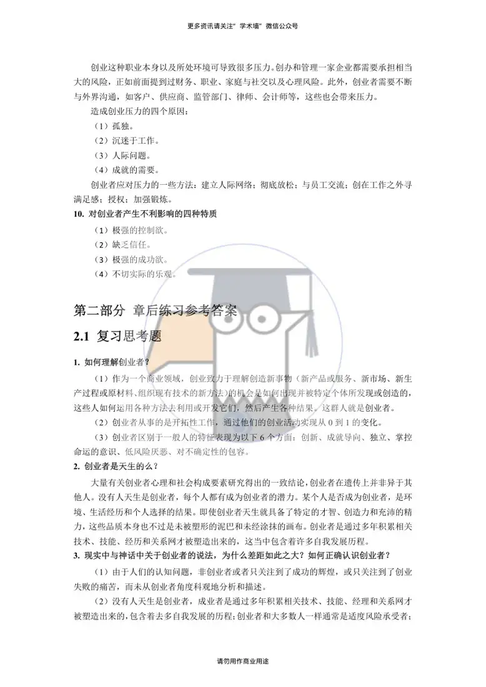
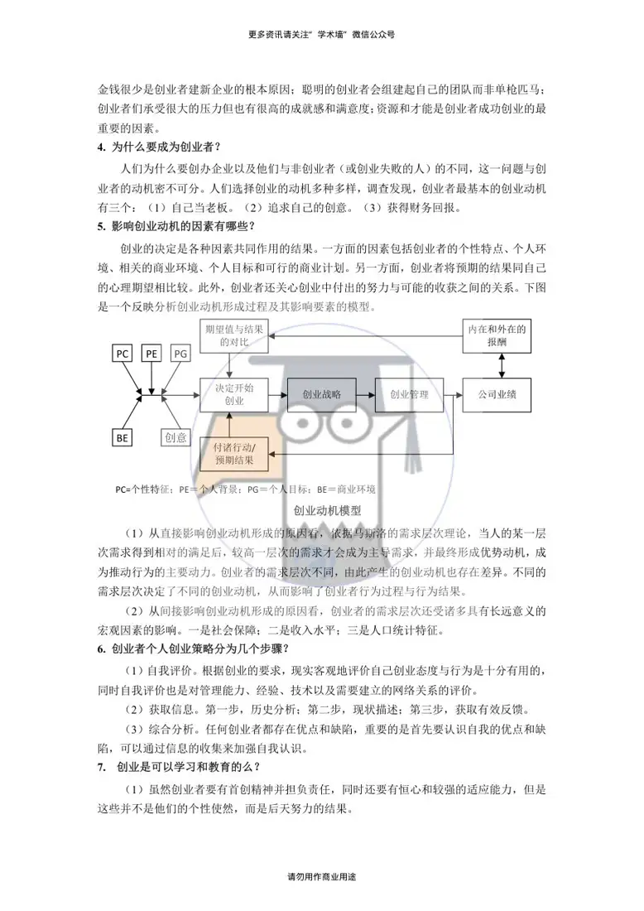
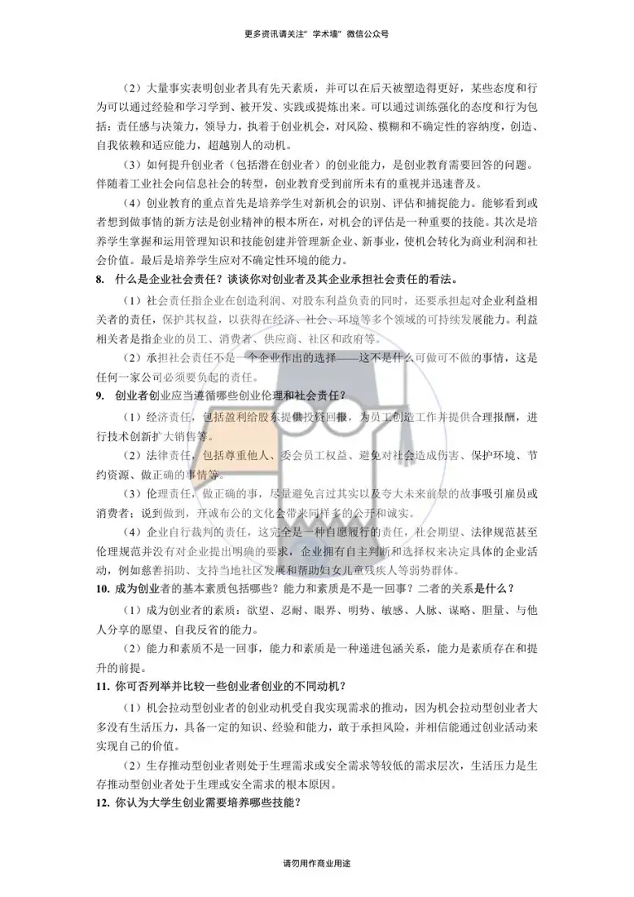
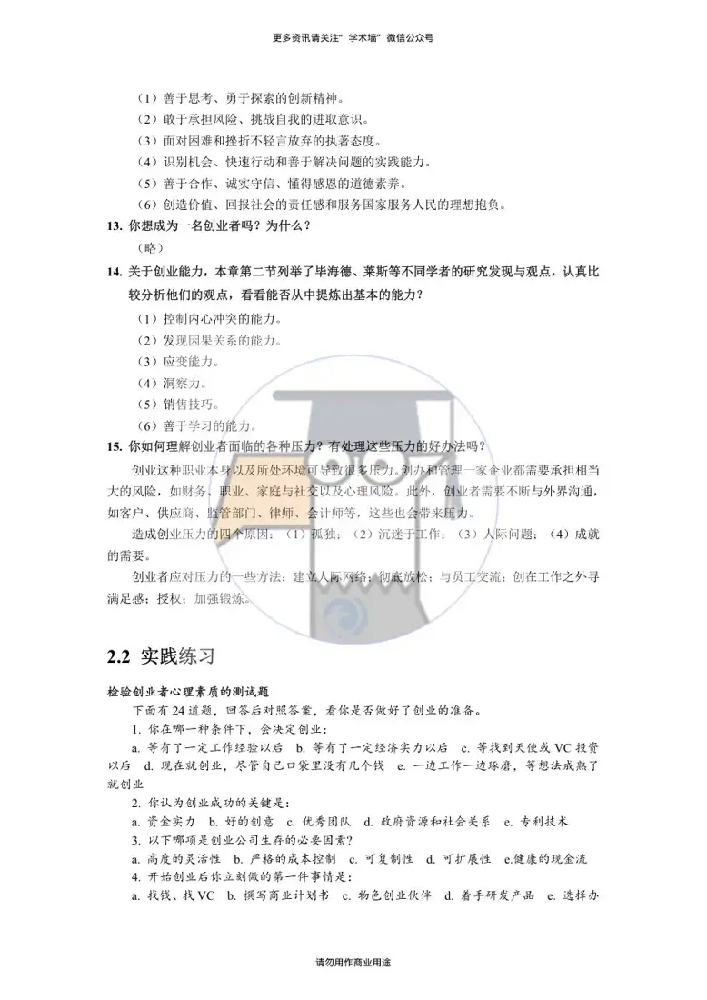
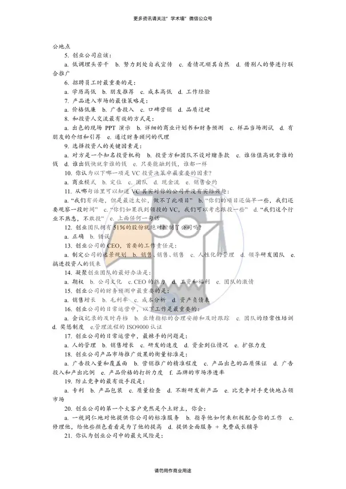
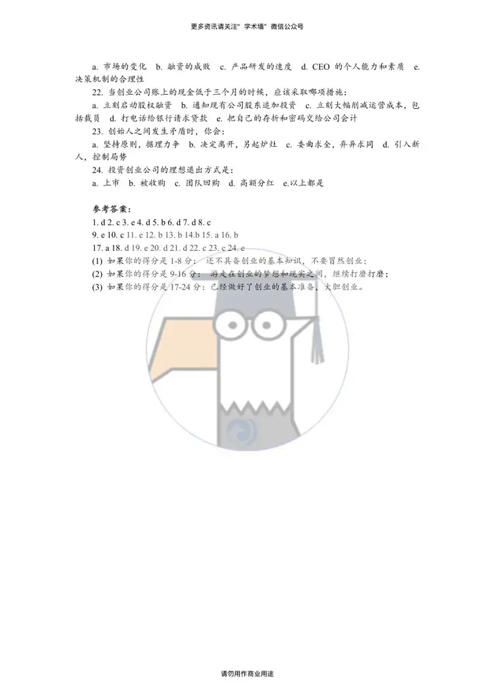

# 《创新与创业管理》第2章 成为创业者（课件）

原件的每一页，下面附识别出的文字。

### 第 2章 成为创业者

原文：

第 2章 成为创业者

第一部分 本章概要

1.1 重点概念

1. 创业者（entrepreneur）：创业者从事的是开拓性工作，通过他们的创业活动实现从 0 到1 的变化。创业者是一种主导劳动方式的领导人，是一种无中生有的创业现象，是一种需要具有使命、荣誉、责任能力的人，是一种组织、运用服务、技术、器物作业的人，是一种具有思考、推理、判断的人，是一种能使人追随并在追溯的过程中获得利益的人，是一种具有完全权利能力和行为能力的人。

2. 创业动机：是指引起和维持个体从事创业活动，并使活动朝向某些目标的内部动力，它是鼓舞和引导个体为实现创业成功而行动的内在力量。创业者最基本的创业动机有三个：自己当老板、追求自己的创意、获得财务回报。

3. 创业技能：创业技能主要有以下几个方面：一是控制内心冲突的能力，二是发现因果关系的能力，三是应变能力，四是洞察力，五是销售技巧。

4. 创业能力：创业能力包括创业动机与创业技能两方面。《全球创业观察（GEM）》报告将创业能力归纳为创办企业的经验、对机会的捕捉能力，以及整合资源的能力。

5. 社会责任：指企业在创造利润、对股东利益负责的同时，还要承担起对企业利益相关者的责任，保护其权益，以获得在经济、社会、环境等多个领域的可持续发展能力。利益相关者是指企业的员工、消费者、供应商、社区和政府等。

6. 创业伦理：管理学意义上的“伦理”一般也称为“商业伦理”，它是指组织处理与外界关系，处理内部成员之间权利和义务的规则，以及在决策过程中所体现的人与人之间的关系和所应用的价值观念。创业伦理是指创业者在创业过程中一定要遵守伦理道德，这是创业能够成功并持续发展的关键。

1.2 关键知识点

1. 创业者的独特性

创业者区别于一般人的特征表现为以下 6 个方面：

（1）创新。

（2）成就导向。

（3）独立。

（4）掌控命运的意识。

（5）低风险厌恶。

（6）对不确定性的包容。

2. 创业者、职业经理人与商人的区别

（1）创业者和职业经理人最重要的区别在于，创业者从事的是开拓性的工作，通过他们的创业活动，实现了从 0 到1 的变化；职业经理人则侧重于经营性活动，按照程序、制度开展工作，他们将 1 到变成 10，将 10 变成 100。创业者发现机会，创造新事物，而经理人在维持现状的基础上，保持事物的持续和演进。其次，创业者承担财务风险，而经理人则不会也不可能承担此类风险。

更多资讯请关注“学术墙”微信公众号

请勿用作商业用途

### 创业者与职业经理人的区别

原文：

创业者与职业经理人的区别
<table><tr><td>特征变量</td><td>创业者</td><td>职业经理人</td></tr><tr><td>*雇佣关系</td><td>雇佣者</td><td>被雇佣者</td></tr><tr><td>**创业与否</td><td>创业者(与所控制资源无关)</td><td>企业内创业</td></tr><tr><td>*出资与否</td><td>出资或继承出资</td><td>不出资</td></tr><tr><td>*承担企业风险</td><td>承担企业风险</td><td>与本人雇佣契约有关的风险</td></tr><tr><td>*所有权与控制权</td><td>同时拥有</td><td>无所有权,有一定控制权</td></tr><tr><td>*担任企业主管与否</td><td>担任</td><td>不一定担任</td></tr><tr><td>**创新功能</td><td>更强调</td><td>强调</td></tr></table>

（2）创业者和商人

创业者和商人，他们在创新、冒险、谋利这三个问题上没有太大区别，区别在于社会责任与担当，也就是创业者在谋利之外还有更高的价值诉求。

创业者和商人第二个显著区别，就是在企业组织建设和管理规范化上。商人习惯于在生产要素控制、市场牌照获取、交易等短线环节获利，他很少考虑通过组织成长、通过培养人才、通过管理规范化来获得企业的长远发展，而创业者更注重技术创新、企业管理规范化、组织建设、人才培养和企业文化建设。

3. 构建个人创业策略具有四个基本步骤

（1）自我评价。根据创业的要求，现实客观地评价自己创业态度与行为是十分有用的，同时自我评价也是对管理能力、经验、技术以及需要建立的网络关系的评价。

（2）获取信息。第一步，历史分析；第二步，现状描述；第三步，获取有效反馈。

（3）综合分析。任何创业者都存在优点和缺陷，重要的是首先要认识自我的优点和缺陷，可以通过信息的收集来加强自我认识。

（4）确立目标。确立目标需要明确而具体，使之具有可计量性、阶段性和可行性；优先确定矛盾并提出解决方案；确定阻碍目标实现的潜在问题和障碍；具体说明实现目标的行为步骤；确定如何评估结果；制订进度表；确定实现目标的风险、所需资源和帮助；阶段性审核并及时修正目标。

4. 创业动机及影响因素

创业者最基本的创业动机有三个：

（1）自己当老板。

（2）追求自己的创意。

（3）获得财务回报。

创业动机的影响因素：

更多资讯请关注“学术墙”微信公众号

请勿用作商业用途

### 5. 创业者的能力与素质要求

原文：

创业的决定是各种因素共同作用的结果。一方面的因素包括创业者的个性特点、个人环境、相关的商业环境、个人目标和可行的商业计划。另一方面，创业者将预期的结果同自己的心理期望相比较。此外，创业者还关心创业中付出的努力与可能的收获之间的关系。下图是一个反映分析创业动机形成过程及其影响要素的模型。

从直接影响创业动机形成的原因看，依据马斯洛的需求层次理论，当人的某一层次需求得到相对的满足后，较高一层次的需求才会成为主导需求，并最终形成优势动机，成为推动行为的主要动力。创业者的需求层次不同，由此产生的创业动机也存在差异。不同的需求层次决定了不同的创业动机，从而影响了创业者行为过程与行为结果。

从间接影响创业动机形成的原因看，创业者的需求层次还受诸多具有长远意义的宏观因素的影响。一是社会保障；二是收入水平；三是人口统计特征。

5. 创业者的能力与素质要求

毕海德将创业者的品质特征归为三大类，一是创业倾向，二是适应性调整的能力，三是获取资源的能力。

这些品质特征，实际包括了创业者的心理特征和技能两大类。其中创业技能主要有以下几个方面：控制内心冲突的能力；发现因果；关系的能力；应变能力；洞察力；销售能力。

6. 创业能力的训练与培养

大量事实表明创业者具有先天素质，并可以在后天被塑造得更好，某些态度和行为可以通过经验和学习学到、被开发、实践或提炼出来。蒂蒙斯教授总结出通过训练强化的态度和行为包括：责任感和决策力；领导力；执着于创业机会；对风险、模糊和不确定性的容纳度；创造、自我依赖和适应能力；超越别人的动机。

7. 提高承担社会责任意识和能力的途径

（1）制定实施体现企业社会责任的竞争战略。

（2）把企业社会责任建设融入企业文化建设中。

（3）把社会责任的理念付诸于实实在在的行动。

8. 创业者的创业伦理

“君子爱财，取之有道。”创业者在创业过程中一定要遵守伦理道德，这是创业能够成功并持续发展的关键。管理学意义上的“伦理”一般也称为“商业伦理”，它是指组织处理与外界关系，处理内部成员之间权利和义务的规则，以及在决策过程中所体现的人与人之间的关系和所应用的价值观念。与企业社会责任相比，强调伦理规范是更高层次的素质要求。伦理主要应对和处理国家法律、政策和企业制度等明文规定和约束所无法覆盖的一些问题。有些行为本身并不违法违规，但对健康的商业环境和优秀的组织文化不利，仍然要求创业者能够自我约束，这不仅是一种境界，也有利于企业健康可持续发展。

9. 创业的负面因素

创业者面临着各种风险，主要可以划分为四种基本类型：

（1）财务风险。

（2）职业风险。

（3）家庭与社交风险。

（4）心理风险。

更多资讯请关注“学术墙”微信公众号

请勿用作商业用途

### 造成创业压力的四个原因：

原文：

创业这种职业本身以及所处环境可导致很多压力。创办和管理一家企业都需要承担相当大的风险，正如前面提到过财务、职业、家庭与社交以及心理风险。此外，创业者需要不断与外界沟通，如客户、供应商、监管部门、律师、会计师等，这些也会带来压力。

造成创业压力的四个原因：

（1）孤独。

（2）沉迷于工作。

（3）人际问题。

（4）成就的需要。

创业者应对压力的一些方法：建立人际网络；彻底放松；与员工交流；创在工作之外寻满足感；授权；加强锻炼。

10. 对创业者产生不利影响的四种特质

（1）极强的控制欲。

（2）缺乏信任。

（3）极强的成功欲。

（4）不切实际的乐观。

第二部分 章后练习参考答案

2.1 复习思考题

1. 如何理解创业者？

（1）作为一个商业领域，创业致力于理解创造新事物（新产品或服务、新市场、新生产过程或原材料、组织现有技术的新方法）的机会是如何出现并被特定个体所发现或创造的，这些人如何运用各种方法去利用或开发它们，然后产生各种结果。这群人就是创业者。

（2）创业者从事的是开拓性工作，通过他们的创业活动实现从 0 到1的变化。

（3）创业者区别于一般人的特征表现为以下 6 个方面：创新、成就导向、独立、掌控命运的意识、低风险厌恶、对不确定性的包容。

2. 创业者是天生的么？

大量有关创业者心理和社会构成要素研究得出的一致结论，创业者在遗传上并非异于其他人。没有人天生是创业者，每个人都有成为创业者的潜力。某个人是否成为创业者，是环境、生活经历和个人选择的结果。即使创业者天生就具备了特定的才智、创造力和充沛的精力，这些品质本身也不过是未被塑形的泥巴和未经涂抹的画布。创业者是通过多年积累相关技术、技能、经历和关系网才被塑造出来的，这当中包含着许多自我发展历程。

3. 现实中与神话中关于创业者的说法，为什么差距如此之大？如何正确认识创业者？

（1）由于人们的认知问题，非创业者或者只关注到了成功的辉煌，或只关注到了创业失败的痛苦，而未从创业者角度科观地分析和描述。

（2）没有人天生是创业者，成业者是通过多年积累相关技术、技能、经理和关系网才被塑造出来的，包含着去多自我发展的历程；创业者和大多数人一样通常是适度风险承受者；

更多资讯请关注“学术墙”微信公众号

请勿用作商业用途

### 4. 为什么要成为创业者？

原文：

金钱很少是创业者建新企业的根本原因；聪明的创业者会组建起自己的团队而非单枪匹马；创业者们承受很大的压力但也有很高的成就感和满意度；资源和才能是创业者成功创业的最重要的因素。

4. 为什么要成为创业者？

人们为什么要创办企业以及他们与非创业者（或创业失败的人）的不同，这一问题与创业者的动机密不可分。人们选择创业的动机多种多样，调查发现，创业者最基本的创业动机有三个：（1）自己当老板。（2）追求自己的创意。（3）获得财务回报。

5. 影响创业动机的因素有哪些？

创业的决定是各种因素共同作用的结果。一方面的因素包括创业者的个性特点、个人环境、相关的商业环境、个人目标和可行的商业计划。另一方面，创业者将预期的结果同自己的心理期望相比较。此外，创业者还关心创业中付出的努力与可能的收获之间的关系。下图是一个反映分析创业动机形成过程及其影响要素的模型。

（1）从直接影响创业动机形成的原因看，依据马斯洛的需求层次理论，当人的某一层次需求得到相对的满足后，较高一层次的需求才会成为主导需求，并最终形成优势动机，成为推动行为的主要动力。创业者的需求层次不同，由此产生的创业动机也存在差异。不同的需求层次决定了不同的创业动机，从而影响了创业者行为过程与行为结果。

（2）从间接影响创业动机形成的原因看，创业者的需求层次还受诸多具有长远意义的宏观因素的影响。一是社会保障；二是收入水平；三是人口统计特征。

6. 创业者个人创业策略分为几个步骤？

（1）自我评价。根据创业的要求，现实客观地评价自己创业态度与行为是十分有用的，同时自我评价也是对管理能力、经验、技术以及需要建立的网络关系的评价。

（2）获取信息。第一步，历史分析；第二步，现状描述；第三步，获取有效反馈。

（3）综合分析。任何创业者都存在优点和缺陷，重要的是首先要认识自我的优点和缺陷，可以通过信息的收集来加强自我认识。

7. 创业是可以学习和教育的么？

（1）虽然创业者要有首创精神并担负责任，同时还要有恒心和较强的适应能力，但是这些并不是他们的个性使然，而是后天努力的结果。

更多资讯请关注“学术墙”微信公众号

请勿用作商业用途

### 8. 什么是企业社会责任？谈谈你对创业者及其企业承担社会责任的看法。

原文：

（2）大量事实表明创业者具有先天素质，并可以在后天被塑造得更好，某些态度和行为可以通过经验和学习学到、被开发、实践或提炼出来。可以通过训练强化的态度和行为包括：责任感与决策力，领导力，执着于创业机会，对风险、模糊和不确定性的容纳度，创造、自我依赖和适应能力，超越别人的动机。

（3）如何提升创业者（包括潜在创业者）的创业能力，是创业教育需要回答的问题。伴随着工业社会向信息社会的转型，创业教育受到前所未有的重视并迅速普及。

（4）创业教育的重点首先是培养学生对新机会的识别、评估和捕捉能力。能够看到或者想到做事情的新方法是创业精神的根本所在，对机会的评估是一种重要的技能。其次是培养学生掌握和运用管理知识和技能创建并管理新企业、新事业，使机会转化为商业利润和社会价值。最后是培养学生应对不确定性环境的能力。

8. 什么是企业社会责任？谈谈你对创业者及其企业承担社会责任的看法。

（1）社会责任指企业在创造利润、对股东利益负责的同时，还要承担起对企业利益相关者的责任，保护其权益，以获得在经济、社会、环境等多个领域的可持续发展能力。利益相关者是指企业的员工、消费者、供应商、社区和政府等。

（2）承担社会责任不是一个企业作出的选择——这不是什么可做可不做的事情，这是任何一家公司必须要负起的责任。

9. 创业者创业应当遵循哪些创业伦理和社会责任？

（1）经济责任，包括盈利给股东提供投资回报，为员工创造工作并提供合理报酬，进行技术创新扩大销售等。

（2）法律责任，包括尊重他人、委会员工权益、避免对社会造成伤害、保护环境、节约资源、做正确的事情等。

（3）伦理责任，做正确的事，尽量避免言过其实以及夸大未来前景的故事吸引雇员或消费者；说到做到，开诚布公的文化会带来同样多的公开和诚实。

（4）企业自行裁判的责任，这完全是一种自愿履行的责任，社会期望、法律规范甚至伦理规范并没有对企业提出明确的要求，企业拥有自主判断和选择权来决定具体的企业活动，例如慈善捐助、支持当地社区发展和帮助妇女儿童残疾人等弱势群体。

10. 成为创业者的基本素质包括哪些？能力和素质是不是一回事？二者的关系是什么？

（1）成为创业者的素质：欲望、忍耐、眼界、明势、敏感、人脉、谋略、胆量、与他人分享的愿望、自我反省的能力。

（2）能力和素质不是一回事，能力和素质是一种递进包涵关系，能力是素质存在和提升的前提。

11. 你可否列举并比较一些创业者创业的不同动机？

（1）机会拉动型创业者的创业动机受自我实现需求的推动，因为机会拉动型创业者大多没有生活压力，具备一定的知识、经验和能力，敢于承担风险，并相信能通过创业活动来实现自己的价值。

（2）生存推动型创业者则处于生理需求或安全需求等较低的需求层次，生活压力是生存推动型创业者处于生理或安全需求的根本原因。

12. 你认为大学生创业需要培养哪些技能？

更多资讯请关注“学术墙”微信公众号

请勿用作商业用途

### （1）善于思考、勇于探索的创新精神。

原文：

（1）善于思考、勇于探索的创新精神。

（2）敢于承担风险、挑战自我的进取意识。

（3）面对困难和挫折不轻言放弃的执著态度。

（4）识别机会、快速行动和善于解决问题的实践能力。

（5）善于合作、诚实守信、懂得感恩的道德素养。

（6）创造价值、回报社会的责任感和服务国家服务人民的理想抱负。

13. 你想成为一名创业者吗？为什么？

（略）

14. 关于创业能力，本章第二节列举了毕海德、莱斯等不同学者的研究发现与观点，认真比较分析他们的观点，看看能否从中提炼出基本的能力？

（1）控制内心冲突的能力。

（2）发现因果关系的能力。

（3）应变能力。

（4）洞察力。

（5）销售技巧。

（6）善于学习的能力。

15. 你如何理解创业者面临的各种压力？有处理这些压力的好办法吗？

创业这种职业本身以及所处环境可导致很多压力。创办和管理一家企业都需要承担相当大的风险，如财务、职业、家庭与社交以及心理风险。此外，创业者需要不断与外界沟通，如客户、供应商、监管部门、律师、会计师等，这些也会带来压力。

造成创业压力的四个原因：（1）孤独；（2）沉迷于工作；（3）人际问题；（4）成就的需要。

创业者应对压力的一些方法：建立人际网络；彻底放松；与员工交流；创在工作之外寻满足感；授权；加强锻炼。

2.2 实践练习

检验创业者心理素质的测试题

下面有 24道题，回答后对照答案，看你是否做好了创业的准备。

1. 你在哪一种条件下，会决定创业：

a. 等有了一定工作经验以后 b. 等有了一定经济实力以后 c. 等找到天使或 VC 投资以后 d. 现在就创业，尽管自己口袋里没有几个钱 e. 一边工作一边琢磨，等想法成熟了就创业

2. 你认为创业成功的关键是：

a. 资金实力 b. 好的创意 c. 优秀团队 d. 政府资源和社会关系 e. 专利技术

3. 以下哪项是创业公司生存的必要因素?

a. 高度的灵活性 b. 严格的成本控制 c. 可复制性 d. 可扩展性 e.健康的现金流

4. 开始创业后你立刻做的第一件事情是：

a. 找钱、找VC b. 撰写商业计划书 c. 物色创业伙伴 d. 着手研发产品 e. 选择办

更多资讯请关注“学术墙”微信公众号

请勿用作商业用途

### 公地点

原文：

公地点

5. 创业公司应该：

a. 低调埋头苦干 b. 努力到处自我宣传 c. 看情况顺其自然 d. 借别人的势进行联合推广

6. 招聘员工时最重要的是：a. 学历高低 b. 朋友推荐 c. 成本高低 d. 工作经验

7. 产品进入市场的最佳策略是：a. 价格低廉 b. 广告投入 c. 口碑营销 d. 品质过硬8. 和投资人交流最有效的方式是：

a. 出色的现场 PPT 演示 b. 详细的商业计划书和财务预测 c. 样品当场测试 d. 有朋友的介绍和引荐 e. 通过财务顾问的代理

a. 对方是一个知名投资机构 b. 投资方和团队不设对赌条款 c. 谁估值高就拿谁的钱 d. 谁出钱快就拿谁的钱 e. 只要能融到钱，谁都一样

10. 你认为以下哪一项是 VC 投资决策中最重要的因素?a. 商业模式 b. 定位 c. 团队 d. 现金流 e. 销售合约

11. 从哪句话里可以知道 VC 其实对你的公司并没有实际兴趣：

a. “我们有兴趣，但是最近太忙，做不了此项目” b. “你们的项目还偏早一些，我们还要观察一段时间” c. “你们如果找到领投的 VC，我们可以考虑跟投一些” d. “我们这个行业不熟悉，不敢投” e. 上面任何一句话

12. 创业团队拥有 51％的股份就绝对控制了公司吗?a. 正确 b. 错误13. 创业公司的 CEO，首要的工作责任是：

a. 制定公司的远景规划 b. 销售、销售、销售 c. 人性化的管理 d. 领导研发团队 e.搞进投资人的钱来

a. 期权 b. 公司文化 c. CEO 的魅力 d. 工资和福利 e. 团队的激情

15. 创业公司的财务预测中最重要的是：a. 销售增长 b. 毛利率 c. 成本分析 d. 资产负债表16. 创业公司的日常运营中，以下工作是最重要的：

a. 会议记录的及时存档 b. 业绩指标的合理安排和及时跟踪 c. 团队的经常性培训d. 奖惩制度 e.管理流程的 ISO9000 认证

17. 创业公司的日常运营中，最棘手的问题是：a. 人的管理 b. 销售增长 c. 研发的速度 d. 资金到位情况 e. 扩张力度

18. 创业公司产品市场推广效果的衡量标准是：

a. 广告投入量和覆盖面 b. 营销推广的精准程度 c. 产品出色的品质保证 d. 广告投入和产出比例 e. 产品价格的打折力度 f. 品牌的市场渗透率

19. 防止竞争的最有效手段是：

a. 专利 b. 产品包装 c. 质量检查 d. 不断研发新产品 e. 比竞争对手更快地占领市场

20. 创业公司的第一个大客户竟然是个土财主，你会：

a. 一视同仁地对他提供你公司的标准服务 b. 指导他如何来积极配合你的工作 c.修理他，给他些颜色看看是为了他的提高 d. 提供全面服务 + 免费成长辅导

21. 你认为创业公司中的最大风险是：

更多资讯请关注“学术墙”微信公众号

请勿用作商业用途

### 22. 当创业公司账上的现金低于三个月的时候，应该采取哪项措施：

原文：

a. 市场的变化 b. 融资的成败 c. 产品研发的速度 d. CEO 的个人能力和素质 e.决策机制的合理性

22. 当创业公司账上的现金低于三个月的时候，应该采取哪项措施：

a. 立刻启动股权融资 b. 通知现有公司股东追加投资 c. 立刻大幅削减运营成本，包括裁员 d. 打电话给银行请求贷款 e. 把自己的存折和密码交给公司会计

23. 创始人之间发生矛盾时，你会：

a. 坚持原则，据理力争 b. 决定离开，另起炉灶 c. 委曲求全，弃异求同 d. 引入新人，控制局势

24. 投资创业公司的理想退出方式是：

a. 上市 b. 被收购 c. 团队回购 d. 高额分红 e.以上都是

参考答案：

1. d 2. c 3. e 4. d 5. b 6. d 7. d 8. c

9. e 10. c 11. e 12. b 13. b 14.b 15. a 16. b

17. a 18. d 19. e 20. d 21. d 22. c 23. c 24. e

(1) 如果你的得分是 1-8分： 还不具备创业的基本知识，不要冒然创业；

(2) 如果你的得分是 9-16分： 游走在创业的梦想和现实之间，继续打磨打磨；

(3) 如果你的得分是 17-24分：已经做好了创业的基本准备，大胆创业。

更多资讯请关注“学术墙”微信公众号

请勿用作商业用途
