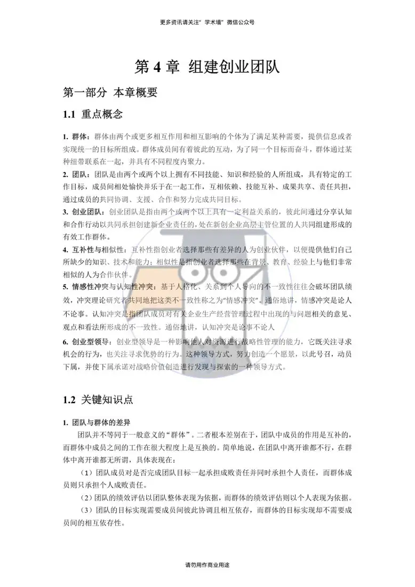
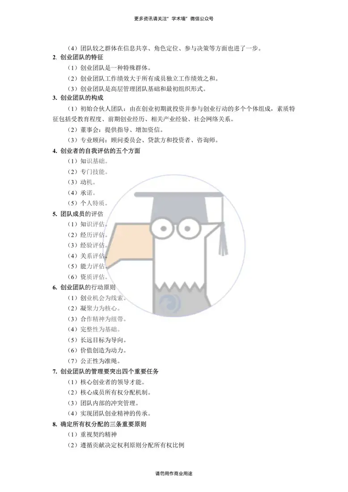
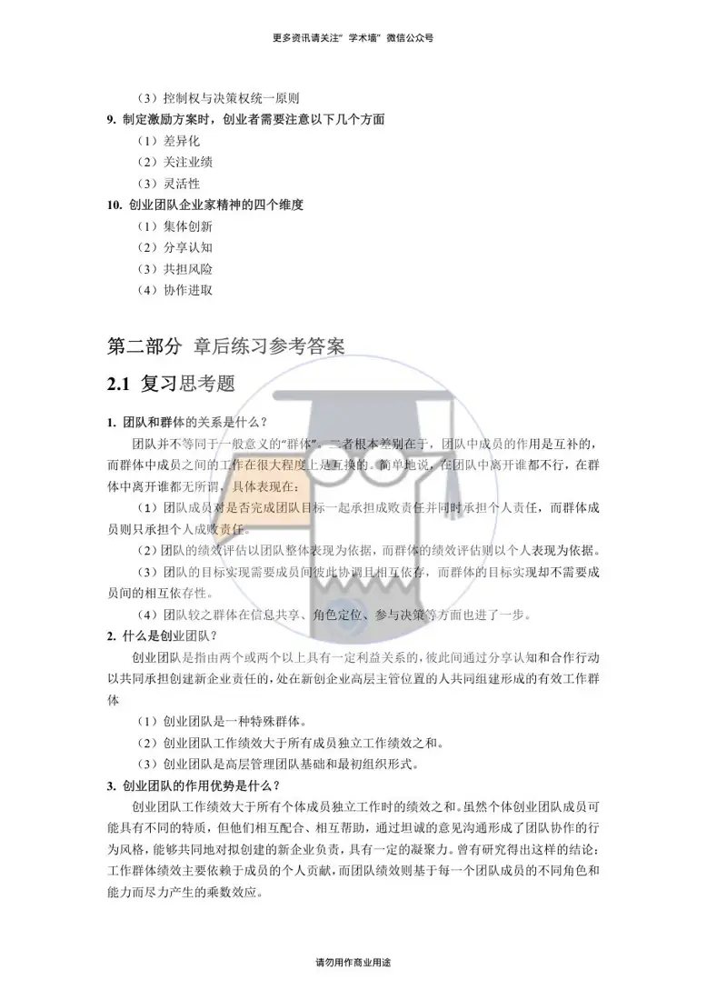
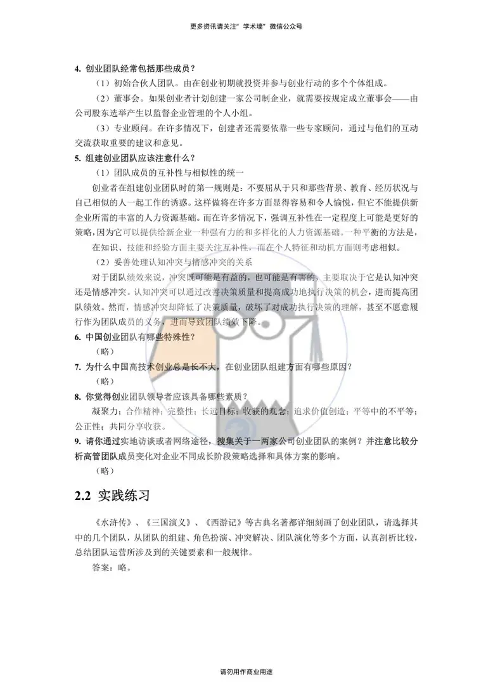

# 《创新与创业管理》第4章 组建创业团队（课件）

原件的每一页，下面附识别出的文字。

### 第 4章 组建创业团队

原文：

第 4章 组建创业团队

第一部分 本章概要

1.1 重点概念

1. 群体：群体由两个或更多相互作用和相互影响的个体为了满足某种需要，提供信息或者实现统一的目标所组成。群体成员间有着彼此的互动，为了同一个目标而奋斗，群体通过某种纽带联系在一起，并具有不同程度内聚力。

2. 团队：团队是由两个或两个以上拥有不同技能、知识和经验的人所组成，具有特定的工作目标，成员间相处愉快并乐于在一起工作，互相依赖、技能互补、成果共享、责任共担，通过成员的共同协调、支援、合作和努力完成共同目标。

3. 创业团队：创业团队是指由两个或两个以上具有一定利益关系的，彼此间通过分享认知和合作行动以共同承担创建新企业责任的，处在新创企业高层主管位置的人共同组建形成的有效工作群体。

4. 互补性与相似性：互补性指创业者选择那些有差异的人为创业伙伴，以便提供他们自己所缺少的知识、技术和能力；相似性是指创业者选择那些在背景、教育、经验上与他们非常相似的人为合作伙伴。

5. 情感性冲突与认知性冲突：基于人格化、关系到个人导向的不一致性往往会破坏团队绩效，冲突理论研究者共同地把这类不一致性称之为“情感冲突”。通俗地讲，情感冲突是论人不论事。认知冲突是指团队成员对有关企业生产经营管理过程中出现的与问题相关的意见、观点和看法所形成的不一致性。通俗地讲，认知冲突是论事不论人

6. 创业型领导：创业型领导是一种影响他人对资源进行战略性管理的能力，它既关注寻求机会的行为，也关注寻求优势的行为。这种领导方式，努力创造一个愿景，以此号召，动员下属，并使下属承诺对战略价值创造进行发现与探索的一种领导方式。

1.2 关键知识点

1. 团队与群体的差异

团队并不等同于一般意义的“群体”。二者根本差别在于，团队中成员的作用是互补的，而群体中成员之间的工作在很大程度上是互换的。简单地说，在团队中离开谁都不行，在群体中离开谁都无所谓，具体表现在：

（1）团队成员对是否完成团队目标一起承担成败责任并同时承担个人责任，而群体成员则只承担个人成败责任。

（2）团队的绩效评估以团队整体表现为依据，而群体的绩效评估则以个人表现为依据。

（3）团队的目标实现需要成员间彼此协调且相互依存，而群体的目标实现却不需要成员间的相互依存性。

更多资讯请关注“学术墙”微信公众号

请勿用作商业用途

### （4）团队较之群体在信息共享、角色定位、参与决策等方面也进了一步。

原文：

（4）团队较之群体在信息共享、角色定位、参与决策等方面也进了一步。

2. 创业团队的特征

（1）创业团队是一种特殊群体。

（2）创业团队工作绩效大于所有成员独立工作绩效之和。

（3）创业团队是高层管理团队基础和最初组织形式。

3. 创业团队的构成

（1）初始合伙人团队：由在创业初期就投资并参与创业行动的多个个体组成，素质特征包括受教育程度、前期创业经历、相关产业经验、社会网络关系。

（2）董事会：提供指导、增加资信。

（3）专业顾问：顾问委员会、贷款方和投资者、咨询师。

4. 创业者的自我评估的五个方面

（1）知识基础。

（2）专门技能。

（3）动机。

（4）承诺。

（5）个人特质。

5. 团队成员的评估

（1）知识评估。

（2）经历评估。

（3）经验评估。

（4）关系评估。

（5）能力评估。

（6）资质评估。

6. 创业团队的行动原则

（1）创业机会为线索。

（2）凝聚力为核心。

（3）合作精神为纽带。

（4）完整性为基础。

（5）长远目标为导向。

（6）价值创造为动力。

（7）公正性为准绳。

7. 创业团队的管理要突出四个重要任务

（1）核心创业者的领导才能。

（2）核心成员所有权分配机制。

（3）团队内部的冲突管理。

（4）实现团队创业精神的传承。

8. 确定所有权分配的三条重要原则

（1）重视契约精神

（2）遵循贡献决定权利原则分配所有权比例

更多资讯请关注“学术墙”微信公众号

请勿用作商业用途

### （3）控制权与决策权统一原则

原文：

（3）控制权与决策权统一原则

9. 制定激励方案时，创业者需要注意以下几个方面

（1）差异化

（2）关注业绩

（3）灵活性

10. 创业团队企业家精神的四个维度

（1）集体创新

（2）分享认知

（3）共担风险

（4）协作进取

第二部分 章后练习参考答案

2.1 复习思考题

1. 团队和群体的关系是什么？

团队并不等同于一般意义的“群体”。二者根本差别在于，团队中成员的作用是互补的，而群体中成员之间的工作在很大程度上是互换的。简单地说，在团队中离开谁都不行，在群体中离开谁都无所谓，具体表现在：

（1）团队成员对是否完成团队目标一起承担成败责任并同时承担个人责任，而群体成员则只承担个人成败责任。

（2）团队的绩效评估以团队整体表现为依据，而群体的绩效评估则以个人表现为依据。

（3）团队的目标实现需要成员间彼此协调且相互依存，而群体的目标实现却不需要成员间的相互依存性。

（4）团队较之群体在信息共享、角色定位、参与决策等方面也进了一步。

2. 什么是创业团队？

创业团队是指由两个或两个以上具有一定利益关系的，彼此间通过分享认知和合作行动以共同承担创建新企业责任的，处在新创企业高层主管位置的人共同组建形成的有效工作群体

（1）创业团队是一种特殊群体。

（2）创业团队工作绩效大于所有成员独立工作绩效之和。

（3）创业团队是高层管理团队基础和最初组织形式。

3. 创业团队的作用优势是什么？

创业团队工作绩效大于所有个体成员独立工作时的绩效之和。虽然个体创业团队成员可能具有不同的特质，但他们相互配合、相互帮助，通过坦诚的意见沟通形成了团队协作的行为风格，能够共同地对拟创建的新企业负责，具有一定的凝聚力。曾有研究得出这样的结论：工作群体绩效主要依赖于成员的个人贡献，而团队绩效则基于每一个团队成员的不同角色和能力而尽力产生的乘数效应。

更多资讯请关注“学术墙”微信公众号

请勿用作商业用途

### 4. 创业团队经常包括那些成员？

原文：

4. 创业团队经常包括那些成员？

（1）初始合伙人团队。由在创业初期就投资并参与创业行动的多个个体组成。

（2）董事会。如果创业者计划创建一家公司制企业，就需要按规定成立董事会——由公司股东选举产生以监督企业管理的个人小组。

（3）专业顾问。在许多情况下，创建者还需要依靠一些专家顾问，通过与他们的互动交流获取重要的建议和意见。

5. 组建创业团队应该注意什么？

（1）团队成员的互补性与相似性的统一

创业者在组建创业团队时的第一规则是：不要屈从于只和那些背景、教育、经历状况与自己相似的人一起工作的诱惑。这样做将在许多方面显得容易和令人愉悦，但它不能提供新企业所需的丰富的人力资源基础。而在许多情况下，强调互补性在一定程度上可能是更好的策略，因为它可以提供给新企业一种强有力的和多样化的人力资源基础。一种平衡的方法是，

在知识、技能和经验方面主要关注互补性，而在个人特征和动机方面则考虑相似。

（2）妥善处理认知冲突与情感冲突的关系

对于团队绩效来说，冲突既可能是有益的，也可能是有害的，主要取决于它是认知冲突还是情感冲突。认知冲突可以通过改善决策质量和提高成功地执行决策的机会，进而提高团队绩效。然而，情感冲突却降低了决策质量，破坏了对成功执行决策的理解，甚至不愿意履行作为团队成员的义务，进而导致团队绩效下降。

6. 中国创业团队有哪些特殊性？

（略）

7. 为什么中国高技术创业总是长不大， 在创业团队组建方面有哪些原因？（略）

8. 你觉得创业团队领导者应该具备哪些素质？

凝聚力；合作精神；完整性；长远目标；收获的观念；追求价值创造；平等中的不平等；公正性；共同分享收获。

9. 请你通过实地访谈或者网络途径，搜集关于一两家公司创业团队的案例？并注意比较分析高管团队成员变化对企业不同成长阶段策略选择和具体方案的影响。

（略）

2.2 实践练习

《水浒传》、《三国演义》、《西游记》等古典名著都详细刻画了创业团队，请选择其中的几个团队，从团队的组建、角色扮演、冲突解决、团队演化等多个方面，认真剖析比较，总结团队运营所涉及到的关键要素和一般规律。

答案：略。

更多资讯请关注“学术墙”微信公众号

请勿用作商业用途
