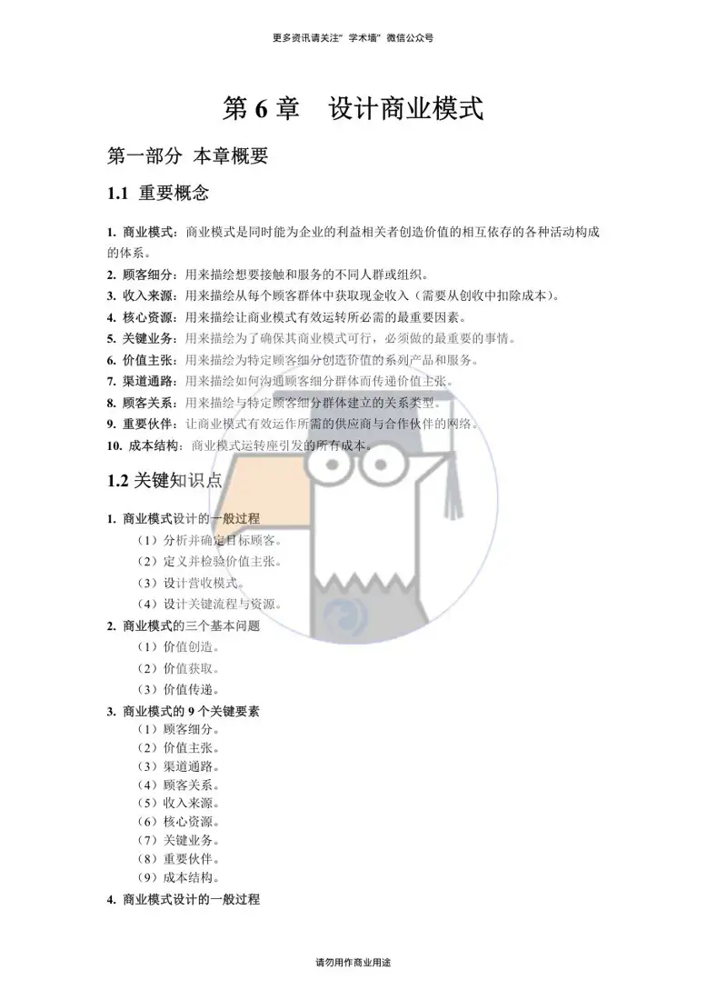
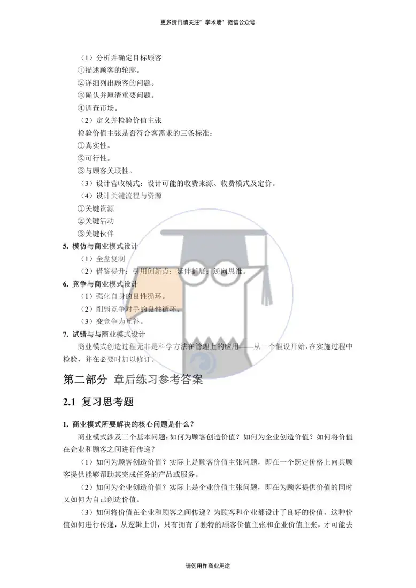
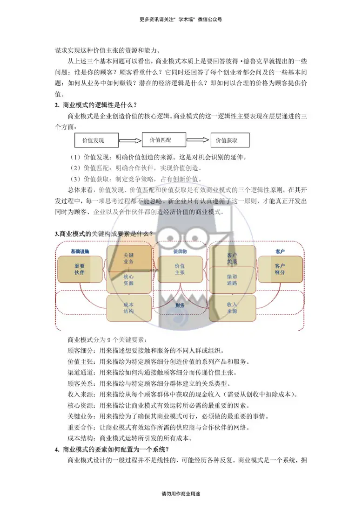
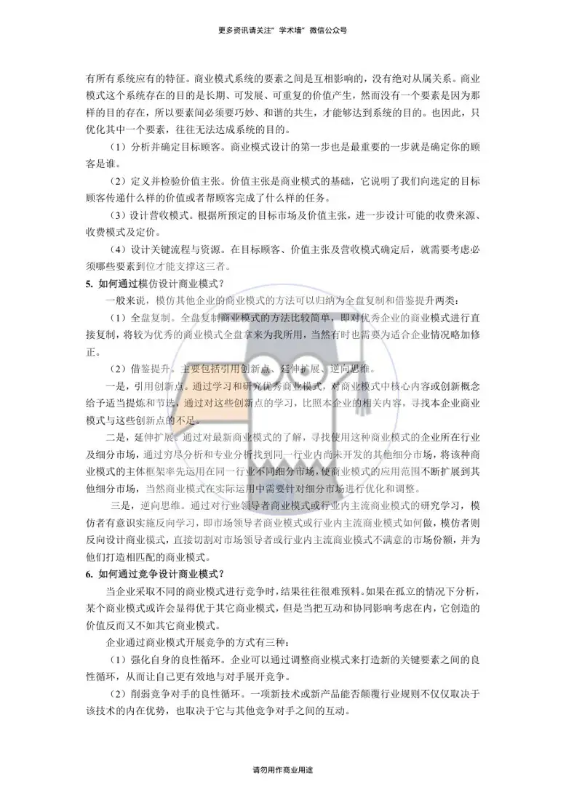
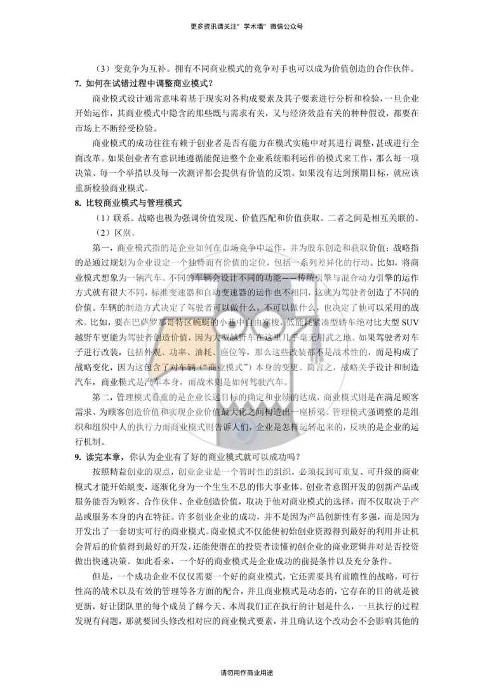
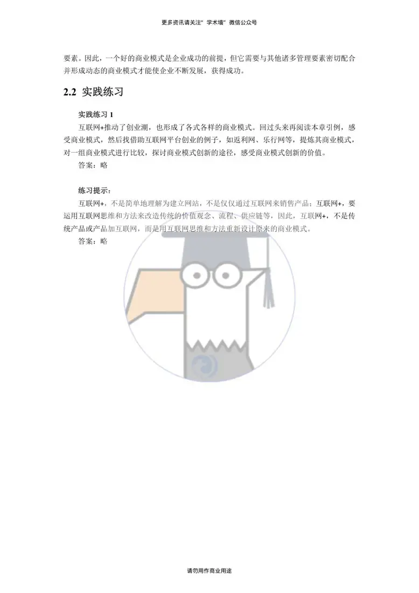

# 《创新与创业管理》第6章 设计商业模式（课件）

原件的每一页，下面附识别出的文字。

### 第 6章    设计商业模式

原文：

第 6章    设计商业模式

第一部分 本章概要

1.1 重要概念

1. 商业模式：商业模式是同时能为企业的利益相关者创造价值的相互依存的各种活动构成的体系。

2. 顾客细分：用来描绘想要接触和服务的不同人群或组织。

3. 收入来源：用来描绘从每个顾客群体中获取现金收入（需要从创收中扣除成本）。

4. 核心资源：用来描绘让商业模式有效运转所必需的最重要因素。

5. 关键业务：用来描绘为了确保其商业模式可行，必须做的最重要的事情。

6. 价值主张：用来描绘为特定顾客细分创造价值的系列产品和服务。

7. 渠道通路：用来描绘如何沟通顾客细分群体而传递价值主张。

8. 顾客关系：用来描绘与特定顾客细分群体建立的关系类型。

9. 重要伙伴：让商业模式有效运作所需的供应商与合作伙伴的网络。

10. 成本结构：商业模式运转座引发的所有成本。

1.2 关键知识点

1. 商业模式设计的一般过程

（1）分析并确定目标顾客。

（2）定义并检验价值主张。

（3）设计营收模式。

（4）设计关键流程与资源。

2. 商业模式的三个基本问题

（1）价值创造。

（2）价值获取。

（3）价值传递。

3. 商业模式的 9 个关键要素

（1）顾客细分。

（2）价值主张。

（3）渠道通路。

（4）顾客关系。

（5）收入来源。

（6）核心资源。

（7）关键业务。

（8）重要伙伴。

（9）成本结构。

4. 商业模式设计的一般过程

更多资讯请关注“学术墙”微信公众号

请勿用作商业用途

### （1）分析并确定目标顾客

原文：

（1）分析并确定目标顾客

①描述顾客的轮廓。

②详细列出顾客的问题。

③确认并厘清重要问题。

④调查市场。

（2）定义并检验价值主张

检验价值主张是否符合客需求的三条标准：

①真实性。

②可行性。

③与顾客关联性。

（3）设计营收模式：设计可能的收费来源、收费模式及定价。

（4）设计关键流程与资源

①关键资源

②关键活动

③关键伙伴

5. 模仿与商业模式设计

（1）全盘复制

（2）借鉴提升：引用创新点；延伸扩展；逆向思维。

6. 竞争与商业模式设计

（1）强化自身的良性循环。

（2）削弱竞争对手的良性循环。

（3）变竞争为互补。

7. 试错与与商业模式设计

商业模式创造过程无非是科学方法在管理上的应用—检验，并在必要时加以修订。

—从一个假设开始，在实施过程中

第二部分 章后练习参考答案

2.1 复习思考题

1. 商业模式所要解决的核心问题是什么？

商业模式涉及三个基本问题：如何为顾客创造价值？如何为企业创造价值？如何将价值在企业和顾客之间进行传递？

（1）如何为顾客创造价值？实际上是顾客价值主张问题，即在一个既定价格上向其顾客提供能够帮助其完成任务的产品或服务。

（2）如何为企业创造价值？实际上是企业价值主张问题，即在为顾客提供价值的同时又如何为自己创造价值。

（3）如何将价值在企业和顾客之间传递？为顾客和企业都设计了良好的价值，这种价值如何进行传递，从逻辑上讲，只有拥有了独特的顾客价值主张和企业价值主张，才可能去

更多资讯请关注“学术墙”微信公众号

请勿用作商业用途

### 谋求实现这种价值主张的资源和能力。

原文：

谋求实现这种价值主张的资源和能力。

从上述三个基本问题可以看出，商业模式本质上是要回答彼得·德鲁克早就提出的一些问题：谁是你的顾客？顾客看重什么？它同时还回答了每个创业者都会问及的一些基本问题：如何从业务中如何赚钱？潜在的经济逻辑是什么？即如何以合理的价格为顾客提供价值。

2. 商业模式的逻辑性是什么？

商业模式是企业创造价值的核心逻辑。商业模式的这一逻辑性主要表现在层层递进的三个方面：

（1）价值发现：明确价值创造的来源。这是对机会识别的延伸。

（2）价值匹配：明确合作伙伴，实现价值创造。

（3）价值获取：制定竞争策略，占有创新价值。

总体来看，价值发现、价值匹配和价值获取是有效商业模式的三个逻辑性原则，在其开发过程中，每一项思考过程都不能忽略。新企业只有认真遵循了这一原则，才能真正开发出同时为顾客、企业以及合作伙伴都创造经济价值的商业模式。

3.商业模式的关键构成要素是什么？

商业模式分为 9 个关键要素：

顾客细分：用来描述想要接触和服务的不同人群或组织。

价值主张：用来描绘为特定顾客细分创造价值的系列产品和服务。

渠道通道：用来描绘如何沟通接触顾客细分而传递价值主张。

顾客关系：用来描绘与特定顾客细分群体建立的关系类型。

收入来源：用来描绘从每个顾客群体中获取的现金收入（需要从创收中扣除成本）。

核心资源：用来描绘让商业模式有效运转所必需的最重要的因素。

关键业务：用来描绘为了确保其商业模式可行，必须做的最重要的事情。

重要合作：让商业模式有效运作所需的供应商与合作伙伴的网络。

成本结构：商业模式运转所引发的所有成本。

4. 商业模式的要素如何配置为一个系统？

商业模式设计的一般过程并不是线性的，可能经历各种反复。商业模式是一个系统，拥有所有系统应有的特征。商业模式系统的要素之间是互相影响的，没有绝对从属关系。商业模式这个系统存在的目的是长期、可发展、可重复的价值产生，然而没有一个要素是因为那样的目的存在，所以要素间必须要巧妙、和谐的共生，才能够达到系统的目的。也因此，只优化其中一个要素，往往无法达成系统的目的。

更多资讯请关注“学术墙”微信公众号

请勿用作商业用途

### 5. 如何通过模仿设计商业模式？

原文：

（1）分析并确定目标顾客。商业模式设计的第一步也是最重要的一步就是确定你的顾客是谁。

（2）定义并检验价值主张。价值主张是商业模式的基础，它说明了我们向选定的目标顾客传递什么样的价值或者帮顾客完成了什么样的任务。

（3）设计营收模式。根据所预定的目标市场及价值主张，进一步设计可能的收费来源、收费模式及定价。

（4）设计关键流程与资源。在目标顾客、价值主张及营收模式确定后，就需要考虑必须哪些要素到位才能支撑这三者。

5. 如何通过模仿设计商业模式？

一般来说，模仿其他企业的商业模式的方法可以归纳为全盘复制和借鉴提升两类：

（1）全盘复制。全盘复制商业模式的方法比较简单，即对优秀企业的商业模式进行直接复制，将较为优秀的商业模式全盘拿来为我所用，当然有时也需要为适合企业情况略加修正。

（2）借鉴提升。主要包括引用创新点、延伸扩展、逆向思维。

一是，引用创新点。通过学习和研究优秀商业模式，对商业模式中核心内容或创新概念给予适当提炼和节选，通过对这些创新点的学习，比照本企业的相关内容，寻找本企业商业模式与这些创新点的不足。

二是，延伸扩展。通过对最新商业模式的了解，寻找使用这种商业模式的企业所在行业及细分市场，通过穷尽分析和专业分析找到同一行业内尚未开发的其他细分市场，将该种商业模式的主体框架率先运用在同一行业不同细分市场，使商业模式的应用范围不断扩展到其他细分市场，当然商业模式在实际运用中需要针对细分市场进行优化和调整。

三是，逆向思维。通过对行业领导者商业模式或行业内主流商业模式的研究学习，模仿者有意识实施反向学习，即市场领导者商业模式或行业内主流商业模式如何做，模仿者则反向设计商业模式，直接切割对市场领导者或行业内主流商业模式不满意的市场份额，并为他们打造相匹配的商业模式。

6. 如何通过竞争设计商业模式？

当企业采取不同的商业模式进行竞争时，结果往往很难预料。如果在孤立的情况下分析，某个商业模式或许会显得优于其它商业模式，但是当把互动和协同影响考虑在内，它创造的价值反而又不如其它商业模式。

企业通过商业模式开展竞争的方式有三种：

（1）强化自身的良性循环。企业可以通过调整商业模式来打造新的关键要素之间的良性循环，从而让自己更有效地与对手展开竞争。

（2）削弱竞争对手的良性循环。一项新技术或新产品能否颠覆行业规则不仅仅取决于该技术的内在优势，也取决于它与其他竞争对手之间的互动。

更多资讯请关注“学术墙”微信公众号

请勿用作商业用途

### （3）变竞争为互补。拥有不同商业模式的竞争对手也可以成为价值创造的合作伙伴。

原文：

（3）变竞争为互补。拥有不同商业模式的竞争对手也可以成为价值创造的合作伙伴。

7. 如何在试错过程中调整商业模式？

商业模式设计通常意味着基于现实对各构成要素及其子要素进行分析和检验，一旦企业开始运作，其商业模式中隐含的那些既与需求有关，又与经济效益有关的种种假设，都要在市场上不断经受检验。

商业模式的成功往往有赖于创业者是否有能力在模式实施中对其进行调整，甚或进行全面改革。如果创业者有意识地遵循能促进整个企业系统顺利运作的模式来工作，那么每一项决策、每一个举措以及每一次测评都会提供有价值的反馈。如果没有达到预期目标，就应该重新检验商业模式。

8. 比较商业模式与管理模式

（1）联系。战略也极为强调价值发现、价值匹配和价值获取。二者之间是相互关联的。

（2）区别。

第一，商业模式指的是企业如何在市场竞争中运作，并为股东创造和获取价值；战略指的是通过规划为企业设定一个独特而有价值的定位，包括一系列差异化的行动。比如，将商业模式想象为一辆汽车。不同的车辆会设计不同的功能——传统引擎与混合动力引擎的运作方式就有很大不同，标准变速器和自动变速器的运作也不相同，这就为驾驶者创造了不同的价值。车辆的制造方式决定了驾驶者可以做什么，不可以做什么，也决定了他可以采用的战术。比如，要在巴萨罗那哥特区蜿蜒的小巷中自由穿梭，低能耗紧凑型轿车绝对比大型 SUV越野车更能为驾驶者创造价值，因为大型越野车在这里几乎毫无用武之地。如果驾驶者对车子进行改装，包括外观、功率、油耗、座位等，那么这些改装都不是战术性的，而是构成了战略变化，因为这包含了对车辆（“商业模式”）本身的变更。简言之，战略关乎设计和制造汽车，商业模式是汽车本身，而战术则是如何驾驶汽车。

第二，管理模式看重的是企业长远目标的确定和业绩的达成，商业模式则是在满足顾客需求、为顾客创造价值和实现企业价值最大化之间构造出一座桥梁。管理模式强调整的是组织和组织中人的执行力而商业模式则告诉人们，企业是怎样运转起来的，反映的是企业的运行机制。

9. 读完本章，你认为企业有了好的商业模式就可以成功吗？

按照精益创业的观点，创业企业是一个暂时性的组织，必须找到可重复、可升级的商业模式才能开始蜕变，逐渐化身为一个生生不息的伟大事业体。创业者意图开发的创新产品或服务能否为顾客、合作伙伴、企业创造价值，取决于他对商业模式的选择，而不仅取决于产品或服务本身的内在特征。许多创业企业的成功，并不是因为产品创新性有多强，而是因为开发出了一套切实可行的商业模式。商业模式不仅能使初始创业资源得到最好的利用并让机会背后的价值得到最好的开发，还能使潜在的投资者读懂初创企业的商业逻辑并对是否投资做出快速决策。如此看来，一个好的商业模式是企业成功的前提条件以及充分条件。

但是，一个成功企业不仅仅需要一个好的商业模式，它还需要具有前瞻性的战略，可行性高的战术以及有效的管理等各方面的配合，并且商业模式是动态的，它存在的目的就是被更新，好让团队里的每个成员了解今天、本周我们正在执行的计划是什么，一旦执行的过程发现有问题，那就要回头修改相对应的商业模式要素，并且确认这个改动会不会影响其他的要素。因此，一个好的商业模式是企业成功的前提，但它需要与其他诸多管理要素密切配合并形成动态的商业模式才能使企业不断发展，获得成功。

更多资讯请关注“学术墙”微信公众号

请勿用作商业用途

### 2.2 实践练习

原文：

2.2 实践练习

实践练习 1

互联网+推动了创业潮，也形成了各式各样的商业模式。回过头来再阅读本章引例，感受商业模式，然后找借助互联网平台创业的例子，如返利网、乐行网等，提炼其商业模式，对一组商业模式进行比较，探讨商业模式创新的途径，感受商业模式创新的价值。

答案：略

练习提示：

互联网+，不是简单地理解为建立网站，不是仅仅通过互联网来销售产品；互联网+，要运用互联网思维和方法来改造传统的价值观念、流程、供应链等，因此，互联网+，不是传统产品或产品加互联网，而是用互联网思维和方法重新设计原来的商业模式。

答案：略

更多资讯请关注“学术墙”微信公众号

请勿用作商业用途
