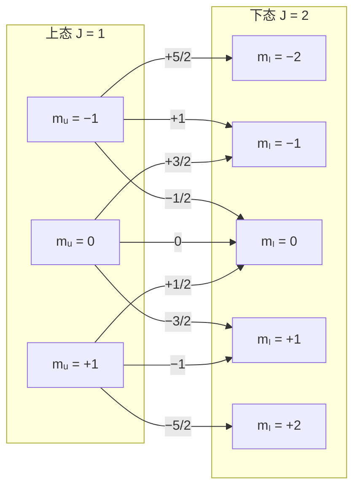

# 原子物理旧题选解：塞曼分裂与电子偶素

**补充。** 这里只讨论旧卷中的弱场分裂与电子偶素阈值，不转录原卷，也不把来源中的任意卷面信息当作南邮现行班级或考试范围的证据。原资料中的其他题目不在本文覆盖范围内。

## 三重态发射的弱场分裂

**参考解答。** 取题设的 $^3D_1\to{}^3P_2$ 发射。==上下两个能级都移动==，因此不能只数上能级分成几份，也不能用磁量子数差直接当作波数差。采用 LS 耦合、线性弱场近似，忽略原子核自旋引起的超精细分裂。讨论题设的电偶极发射线时，还假定其实际组态允许电偶极跃迁；项符号本身不提供完整宇称信息。见[电偶极跃迁选择定则](../../../topics/原子物理学/电偶极跃迁选择定则.md)与[弱场塞曼分裂](../../../topics/原子物理学/弱场塞曼分裂.md)。

### 上下能级为何不能共用一个移动量

两态均有 $S=1$，但 $D$ 态的 $L=2$、$P$ 态的 $L=1$。在电子自旋的磁矩因子取 2 时，磁矩向总角动量投影给出

$$
g_J=1+\frac{J(J+1)+S(S+1)-L(L+1)}{2J(J+1)}.
$$

因此上态 $g_u=1/2$，下态 $g_l=3/2$。以 $U_B=\mu_B B/(hc)$ 为波数单位，发射波数相对零场的位置是

$$
\frac{\delta\tilde\nu}{U_B}
=g_um_u-g_lm_l
=-m_u+\frac32q,
\qquad q=m_u-m_l\in\{-1,0,1\}.
$$

这里 $q$ 特意定义为上态减下态。若用末态减初态描述原子的磁量子数变化，相应符号是 $-q$，但光子能量始终按上态减下态求。两个 $g$ 因子不等时，同一个 $q$ 也可以对应不止一个频率。

### 先枚举允许配对，再读取偏移

图中每条箭头从发射上态伸向下态，边标签为 $\delta\tilde\nu/U_B$。节点高度不是能量刻度；例如上态 $m_u=1$ 到下态 $m_l=2$，对应 $q=-1$，故偏移 $1/2-3=-5/2$。

| 偏振分量 | $q$ | 波数偏移 $\delta\tilde\nu/U_B$（由低到高） |
|---|---:|---|
| $\pi$ | $0$ | $-1,0,1$ |
| $\sigma$ | $+1$ | $1/2,3/2,5/2$ |
| $\sigma$ | $-1$ | $-5/2,-3/2,-1/2$ |

由此得到九个互不重合的波数位置。可以用一条不依赖计算细节的检查：同时把 $m_u,m_l$ 反号，允许性不变，偏移必反号；因此非零位置必须成对出现。作为数量级核对，若 $B=0.10~\mathrm T$ 且仍处在弱场区，$\mu_BB/h$ 约为 $1.400~\mathrm{GHz}$，故最外侧的两个频率位置距零场频率各约 $3.50~\mathrm{GHz}$。

> [!WARNING]
> 九个波数位置不等于任一观察方向都能见到九条线。沿磁场轴观察时，沿轴振荡的 $\pi$ 分量不向轴向辐射，最多只见到六个 $\sigma$ 位置；谱线过宽时，位置不同的分量还可能分不开。

## 正负电子都动，阈值是多少？

**参考解答。** 对旧题的电子偶素设定，两个粒子等重，质心系内它们始终分居相对坐标中点两侧。若它们的间距变化了 $\mathrm dr$，各自只移动一半；动能相加后，相对运动的惯性质量是 $m_e/2$，不是 $m_e$ 或 $2m_e$。由[双体库仑束缚与约化质量](../../../topics/原子物理学/双体库仑束缚与约化质量.md)，取 $Z=1$ 且 $n=1$，得电离阈值

$$
E_{\mathrm{ion}}=0-E_1
=\frac{hcR_\infty}{2}\approx 6.80~\mathrm{eV}.
$$

这里比较的是同一个零点下的内部能量，不是光子的湮灭能量。可用轨道尺度交叉核对：相同电荷下，特征间距变为固定核氢模型的两倍，库仑势能的典型大小减半，和得到的束缚能比例一致。这个比例严格比较的是无限重正核近似；真实氢原子的质子有限重，能量比并非精确的一半。
