# 2015—2016 学年第二学期《大学物理（上）》期末考试试卷（A卷）

原件经识别和整理；“参考解答”是我们补的。

---
title: 2015—2016 学年第二学期《大学物理（上）》期末考试试卷（A卷）
kind: 期末试卷
course: 大学物理
term: 2015-2016-2
source: 南京邮电大学2015/2016学年第二学期大学物理（上）期末考试试卷 A
---

# 2015—2016 学年第二学期《大学物理（上）》期末考试试卷（A卷）

本资料由识别工具读取的试卷内容整理而成，修正了明显的OCR识别错误（如乱码、断行），并规范了格式。

## 一、选择题（每小题 2 分，共 20 分）

### 选择 1

边长为 $a$ 的正方形的四个顶点上放置如图 1 所示的点电荷，则中心 O 处场强 ( )

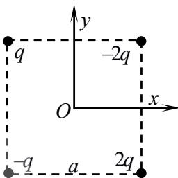

- A. 大小为零
- B. 大小为 $q / \left( 2 \pi \varepsilon_0 a^2 \right)$，方向沿 x 轴正向
- C. 大小为 $\sqrt{2} q / \left( 2 \pi \varepsilon_0 a^2 \right)$，方向沿 y 轴正向
- D. 大小为 $\sqrt{2} q / \left( 2 \pi \varepsilon_0 a^2 \right)$，方向沿 y 轴负向

答案：D。

知识点：[电场强度的定义与叠加原理](../../../topics/大学物理/电场强度.md)

### 选择 2

关于介质中的高斯定理，下列说法中正确的是：

- A. 高斯面内不包围自由电荷，则面上各点电位移矢量 $\vec{D}$ 为零
- B. 高斯面的通量仅与面内自由电荷有关
- C. 高斯面上处处 $\vec{D}$ 为零，则面内必不存在自由电荷
- D. 以上说法都不正确

答案：B。

知识点：[电通量的概念与静电场的高斯定理](../../../topics/大学物理/电通量与高斯定理.md)、[电介质的极化、电极化强度与有介质时的高斯定理（D矢量）](../../../topics/大学物理/静电场中的电介质.md)

### 选择 3

有 N 个电荷均为 q 的点电荷，以两种方式分布在相同半径的圆周上：一种是无规则地分布，另一种是均匀分布．比较这两种情况下在过圆心 O 并垂直于圆平面的 z 轴上任一点 P（如图所示）的场强与电势，则有

- A. 场强相等，电势相等
- B. 场强不等，电势不等
- C. 场强分量 $E_z$ 相等，电势相等
- D. 场强分量 $E_z$ 相等，电势不等

答案：C。

知识点：[几种特殊带电体（点电荷、无限长直线、圆环、圆盘等）激发的电场](../../../topics/大学物理/特殊带电体电场.md)、[电荷守恒定律与库仑定律](../../../topics/大学物理/电荷守恒与库仑定律.md)

### 选择 4

一平行板电容器充电后仍与电源连接，若用绝缘手柄将电容器两极板间距离拉大，则极板上的电荷 Q、电场强度的大小 E 和电场能量 W 将发生如下变化 [ ]

- A. Q 增大，E 增大，W 增大
- B. Q 减小，E 减小，W 减小
- C. Q 增大，E 减小，W 增大
- D. Q 增大，E 增大，W 减小

答案：B。

知识点：[电容的定义与典型电容器的电容计算](../../../topics/大学物理/电容与电容器.md)、[电介质的极化、电极化强度与有介质时的高斯定理（D矢量）](../../../topics/大学物理/静电场中的电介质.md)

### 选择 5

一带正电荷的物体 M，靠近一原不带电的金属导体 N，N 的左端感应出负电荷，右端感应出正电荷．若将 N 的左端接地，如图所示，则 N 上的电荷如何变化？ [ ]

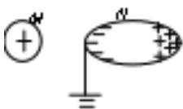
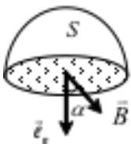

- A. N 上的负感应电荷被大地电荷中和
- B. N 上有正感应电荷被大地电荷中和
- C. N 上的感应电荷分布不变
- D. N 上不再有感应电荷

答案：B。

知识点：[静电平衡条件、导体表面电荷分布及接地问题](../../../topics/大学物理/静电场中的导体.md)

### 选择 6

真空中均匀带电的球面和球体，如果两者的半径和总电量都相等，则带电球面的电场能量 $W_1$ 与带电球体的电场能量 $W_2$ 相比有（ ）

- A. $W_1 < W_2$
- B. $W_1 > W_2$
- C. $W_1 = W_2$
- D. 不确定

答案：B。

知识点：[静电场的能量与能量密度](../../../topics/大学物理/静电场的能量.md)

### 选择 7

在磁感强度为 $\vec{B}$ 的均匀磁场中作一半径为 r 的半球面 S，S 边线所在平面的法线方向单位矢量 $\vec{e}_n$ 与 $\vec{B}$ 的夹角为 $\alpha$，则通过半球面 S 的磁通量（取弯面向外为正）为 [ ]

- A. $\pi r^2 B$
- B. $2 \pi r^2 B$
- C. $-\pi r^2 B \sin \alpha$
- D. $-\pi r^2 B \cos \alpha$

答案：D。

知识点：[磁场与磁感应强度的定义](../../../topics/大学物理/磁感应强度.md)

### 选择 8

顺磁物质的磁导率：

- A. 比真空的磁导率略小
- B. 比真空的磁导率略大
- C. 远小于真空磁导率
- D. 远大于真空磁导率

答案：B。

知识点：[磁场与磁感应强度的定义](../../../topics/大学物理/磁感应强度.md)、[磁介质的分类、磁化强度与磁介质中的安培环路定理（H矢量）](../../../topics/大学物理/磁场中的磁介质.md)

### 选择 9

长直导线载有电流 I，并以 $\mathrm{d}I/\mathrm{d}t$ 的变化率增长，一矩形线圈位于导线平面内(如图)，则

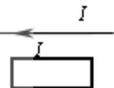

- A. 线圈中无感应电流
- B. 线圈中感应电流为顺时针方向
- C. 线圈中感应电流为逆时针方向
- D. 线圈中感应电流方向不确定

答案：C。

知识点：[法拉第电磁感应定律与楞次定律](../../../topics/大学物理/法拉第电磁感应定律.md)、[毕奥-萨伐尔定律及典型载流导线的磁场计算](../../../topics/大学物理/毕奥-萨伐尔定律.md)、[安培环路定理及其应用](../../../topics/大学物理/安培环路定理.md)

### 选择 10

真空中一根无限长直细导线上通有电流强度为 I 的电流，则距导线垂直距离为 a 的空间某点处的磁能密度为： [ ]

- A. $\frac { 1 } { 2 } \mu _ { 0 } \bigg ( \frac { \mu _ { 0 } I } { 2 \pi a } \bigg ) ^ { 2 }$
- B. $\frac { 1 } { 2 \mu _ { 0 } } \Big ( \frac { \mu _ { 0 } I } { 2 \pi a } \Big ) ^ { 2 }$
- C. $\frac { 1 } { 2 } \left( \frac { 2 \pi a } { \mu _ { 0 } I } \right) ^ { 2 }$
- D. ${ \frac { 1 } { 2 \mu _ { 0 } } } { \left( \frac { \mu _ { 0 } I } { 2 a } \right) } ^ { 2 }$

答案：B。

知识点：[磁能密度与磁场的能量](../../../topics/大学物理/磁场的能量.md)、[毕奥-萨伐尔定律及典型载流导线的磁场计算](../../../topics/大学物理/毕奥-萨伐尔定律.md)

### 选择 11

面积为 S 和 2S 的两圆线圈 A、B 如图放置，通有相同的电流 I．线圈 A 的电流所产生的通过线圈 B 的磁通用 $\Phi_{BA}$ 表示，线圈 B 的电流所产生的通过线圈 A 的磁通用 $\Phi_{AB}$ 表示，则 $\Phi_{BA}$ 和 $\Phi_{AB}$ 的大小关系为 [ ]

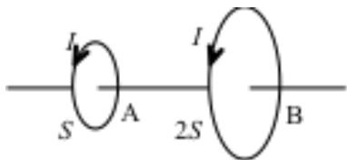

- A. $\Phi_{BA} = 2 \Phi_{AB}$
- B. $\Phi_{BA} > \Phi_{AB}$
- C. $\Phi_{BA} = \Phi_{AB}$
- D. $\Phi_{BA} = \frac { 1 } { 2 } \Phi_{AB}$

答案：C。

## 二、填空题

知识点：[自感系数、互感系数及其计算](../../../topics/大学物理/自感与互感.md)、[毕奥-萨伐尔定律及典型载流导线的磁场计算](../../../topics/大学物理/毕奥-萨伐尔定律.md)

### 填空 1

两个平行的无限大均匀带电平面，其电荷面密度分别为 $-\sigma$ 和 $+2\sigma$，如图所示，则 II 区域的电场强度大小 \_\_\_\_\_\_ ，方向 \_\_\_\_\_\_ 。

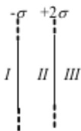

答案：$\frac{\sigma}{2\varepsilon_0}$；向左（或指向负电荷面）。

知识点：[几种特殊带电体（点电荷、无限长直线、圆环、圆盘等）激发的电场](../../../topics/大学物理/特殊带电体电场.md)、[电场强度的定义与叠加原理](../../../topics/大学物理/电场强度.md)

### 填空 2

点电荷 -Q 位于圆心 O 处，A、B、C 为圆周上的几点，如图所示．现将一试验 $q$ 电荷从 A 点移动到 B 点，则电场力做功 $W_{AB} =$ \_\_\_\_\_\_ ；从 A 到 C 电场力做功 $W_{AC}$ \_\_\_\_\_\_ $W_{AB}$ （大于，小于或相等）。

答案：0；等于。

知识点：[保守力及其势能、中心力场与有效势](../../../topics/大学物理/保守力与势能.md)、[功的定义、功率与质点动能定理](../../../topics/大学物理/功与动能定理.md)

### 填空 3

无限长直导线在 P 处弯成半径为 R 的圆，当通以电流 I 时，则在圆心 O 点的磁感强度大小等于 \_\_\_\_\_\_ 。

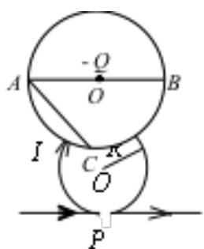

答案：$\frac{\mu_0 I}{2R} (1 + \frac{1}{\pi})$。

知识点：[毕奥-萨伐尔定律及典型载流导线的磁场计算](../../../topics/大学物理/毕奥-萨伐尔定律.md)、[磁场与磁感应强度的定义](../../../topics/大学物理/磁感应强度.md)

### 填空 4

在霍尔效应的实验中，通过导电体的电流和 $\vec{B}$ 的方向垂直(如图)如果上表面的电势较高，则导体中的载流子带 \_\_\_\_\_\_ 电．(正或负)

答案：正。

知识点：[洛伦兹力与带电粒子在电场和磁场中的运动](../../../topics/大学物理/带电粒子在电磁场中的运动.md)

### 填空 5

平行的无限长直载流导线 A 和 B，电流强度均为 $I$，垂直纸面向外，两根载流导线之间相距为 $a$，如图所示，则磁感强度沿图中环路 L 的线积分 \_\_\_\_\_\_ 。

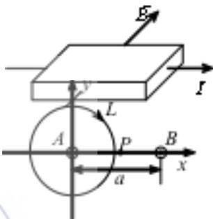

答案：$\mu_0 I$。

知识点：[安培环路定理及其应用](../../../topics/大学物理/安培环路定理.md)

### 填空 6

如图所示，长为 L 的载流直导线，通有电流 I 由 a 指向 b，则其在均匀磁场 $\vec{B}$ 中所受力的大小 \_\_\_\_\_\_ ；其方向为 \_\_\_\_\_\_ 。

答案：$ILB$；垂直于导线和磁场决定的平面（具体方向需根据右手定则判断，若图示为常规坐标系，通常向上或向下，此处依题意一般填公式及方向描述）。
*注：原题图片未完全展示角度关系，通常答案为 $F=ILB\sin\theta$ 或直接 $ILB$ 若垂直。根据常见题型，若导线与磁场垂直，大小为 $ILB$。*

知识点：[安培力与载流线圈的磁力矩](../../../topics/大学物理/载流导线在磁场中受力.md)

### 填空 7

长为 l 的螺线管，横断面为 S，线圈总匝数为 $N$，管中磁介质的磁导率为 $\mu$，自感系数 \_\_\_\_\_\_ 。

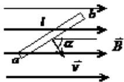

答案：$\frac{\mu N^2 S}{l}$。

知识点：[自感系数、互感系数及其计算](../../../topics/大学物理/自感与互感.md)

### 填空 8

反映电磁场基本性质和规律的麦克斯韦方程组(积分形式)为：
$$
\oint_S \vec{D} \cdot \mathrm{d}\vec{S} = \int_V \rho \mathrm{d}V \quad \text{(①)}
$$
$$
\oint_L \vec{E} \cdot \mathrm{d}\vec{l} = - \int_S \frac {\partial \vec{B}}{\partial t} \cdot \mathrm{d}\vec{S} \quad \text{(②)}
$$
$$
\oint_S \vec{B} \cdot \mathrm{d}\vec{S} = 0 \quad \text{(③)}
$$
$$
\oint_L \vec{H} \cdot \mathrm{d}\vec{l} = \int_S (\vec{J} + \frac {\partial \vec{D}}{\partial t}) \cdot \mathrm{d}\vec{S} \quad \text{(④)}
$$
哪一个麦克斯韦方程式表示磁感线一定是闭合曲线 \_\_\_\_\_\_ 。

答案：③。

## 三、计算题

知识点：[电通量的概念与静电场的高斯定理](../../../topics/大学物理/电通量与高斯定理.md)、[安培环路定理及其应用](../../../topics/大学物理/安培环路定理.md)

### 计算 1

如图所示，两个同心的均匀带电球面，内外半径分别为 $R_1$ 和 $R_2$，分别带有电荷 $Q_1$ 和 $Q_2$。求各区域电场、电势分布。

**解：**

(1) 先应用高斯定理求各区域的电场强度。

由于题目仅提供了部分解题过程开头，以下补充完整解答供参考：

设 $r$ 为到场心的距离。

1.  **电场强度分布 $E(r)$：**
    *   当 $r < R_1$ 时，由高斯定理 $\oint \vec{E} \cdot d\vec{S} = \frac{q_{in}}{\varepsilon_0}$，因内部无电荷，故 $E_1 = 0$。
    *   当 $R_1 < r < R_2$ 时，高斯面内包围电荷 $Q_1$，故 $E_2 \cdot 4\pi r^2 = \frac{Q_1}{\varepsilon_0} \Rightarrow E_2 = \frac{Q_1}{4\pi \varepsilon_0 r^2}$。
    *   当 $r > R_2$ 时，高斯面内包围电荷 $Q_1 + Q_2$，故 $E_3 \cdot 4\pi r^2 = \frac{Q_1 + Q_2}{\varepsilon_0} \Rightarrow E_3 = \frac{Q_1 + Q_2}{4\pi \varepsilon_0 r^2}$。

2.  **电势分布 $V(r)$：**
    取无穷远处电势为零。
    *   当 $r > R_2$ 时，$V_3 = \int_r^\infty E_3 dr = \frac{Q_1 + Q_2}{4\pi \varepsilon_0 r}$。
    *   当 $R_1 < r < R_2$ 时，$V_2 = \int_r^{R_2} E_2 dr + V(R_2) = \frac{Q_1}{4\pi \varepsilon_0} (\frac{1}{r} - \frac{1}{R_2}) + \frac{Q_1 + Q_2}{4\pi \varepsilon_0 R_2} = \frac{Q_1}{4\pi \varepsilon_0 r} + \frac{Q_2}{4\pi \varepsilon_0 R_2}$。
    *   当 $r < R_1$ 时，$V_1 = \int_r^{R_1} E_1 dr + V(R_1) = 0 + V(R_1) = \frac{Q_1}{4\pi \varepsilon_0 R_1} + \frac{Q_2}{4\pi \varepsilon_0 R_2}$。

## 四、计算题

参考解答：电场强度与电势分布结论如下：

$$
E(r) = 
\begin{cases} 
0, & r < R_1 \\ 
\dfrac{Q_1}{4\pi\varepsilon_0 r^2}, & R_1 < r < R_2 \\ 
\dfrac{Q_1 + Q_2}{4\pi\varepsilon_0 r^2}, & r > R_2 
\end{cases}
\quad
V(r) = 
\begin{cases} 
\dfrac{Q_1}{4\pi\varepsilon_0 R_1} + \dfrac{Q_2}{4\pi\varepsilon_0 R_2}, & r \leq R_1 \\ 
\dfrac{Q_1}{4\pi\varepsilon_0 r} + \dfrac{Q_2}{4\pi\varepsilon_0 R_2}, & R_1 \leq r \leq R_2 \\ 
\dfrac{Q_1 + Q_2}{4\pi\varepsilon_0 r}, & r \geq R_2 
\end{cases}
$$

**推理与计算过程：**

1.  **电场强度 $E(r)$**：由球对称性，选取同心球面为高斯面，应用高斯定理 $\oint \vec{E}\cdot d\vec{S} = E \cdot 4\pi r^2 = \dfrac{q_{\text{in}}}{\varepsilon_0}$。
    -   $r < R_1$：$q_{\text{in}} = 0 \Rightarrow E = 0$；
    -   $R_1 < r < R_2$：$q_{\text{in}} = Q_1 \Rightarrow E = \dfrac{Q_1}{4\pi\varepsilon_0 r^2}$；
    -   $r > R_2$：$q_{\text{in}} = Q_1 + Q_2 \Rightarrow E = \dfrac{Q_1 + Q_2}{4\pi\varepsilon_0 r^2}$。

2.  **电势 $V(r)$**：取无穷远为零势点，利用 $V(r) = \int_r^\infty E \, dr$ 分段积分，注意在边界处电势连续。
    -   $r \geq R_2$：$V = \int_r^\infty \dfrac{Q_1+Q_2}{4\pi\varepsilon_0 r'^2} dr' = \dfrac{Q_1+Q_2}{4\pi\varepsilon_0 r}$；
    -   $R_1 \leq r \leq R_2$：$V = \int_r^{R_2} \dfrac{Q_1}{4\pi\varepsilon_0 r'^2} dr' + V(R_2) = \dfrac{Q_1}{4\pi\varepsilon_0}\left(\dfrac{1}{r}-\dfrac{1}{R_2}\right) + \dfrac{Q_1+Q_2}{4\pi\varepsilon_0 R_2} = \dfrac{Q_1}{4\pi\varepsilon_0 r} + \dfrac{Q_2}{4\pi\varepsilon_0 R_2}$；
    -   $r \leq R_1$：区域内 $E=0$，电势恒等于内球面电势 $V(R_1) = \dfrac{Q_1}{4\pi\varepsilon_0 R_1} + \dfrac{Q_2}{4\pi\varepsilon_0 R_2}$。

知识点：[电通量的概念与静电场的高斯定理](../../../topics/大学物理/电通量与高斯定理.md)、[静电场环路定理、电势与电势差](../../../topics/大学物理/环路定理与电势.md)

### 计算 2

将一个平行板电容器连接到端电压为 $U_0$ 的电源上，然后在两板间充满各向同性的均匀电介质（相对电容率为 $\varepsilon_r$），求：

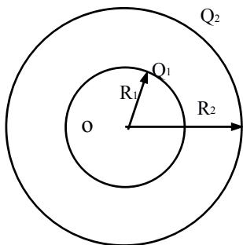

(1) 介质中的电位移矢量 $\vec{D}$ 、电场强度 $\vec{E}$
(2) 介质下表面的极化电荷面密度 $\sigma'$。

**解：**

设平行板电容器极板面积为 $S$，间距为 $d$。
由于电容器始终连接在电源上，极板间电压保持为 $U_0$。

1.  **电场强度 $E$：**
    在均匀介质中，$E = \frac{U_0}{d}$。方向垂直于极板。

2.  **电位移矢量 $D$：**
    根据本构关系 $D = \varepsilon E = \varepsilon_0 \varepsilon_r E$。
    所以，$D = \varepsilon_0 \varepsilon_r \frac{U_0}{d}$。
    或者利用边界条件，忽略边缘效应时，$D = \sigma$（自由电荷面密度）。
    由 $U_0 = Ed$ 和 $D = \varepsilon E$，得 $D = \frac{\varepsilon_0 \varepsilon_r U_0}{d}$。

3.  **极化电荷面密度 $\sigma'$：**
    极化强度 $P = D - \varepsilon_0 E = \varepsilon_0 \varepsilon_r E - \varepsilon_0 E = \varepsilon_0 (\varepsilon_r - 1) E$。
    极化电荷面密度 $\sigma' = - \vec{P} \cdot \hat{n}$。
    在介质表面（靠近负极板的一侧，假设上板接正，下板接负，则极化电荷为正，但通常定义 $\sigma' = P_n$ 或根据具体法线方向）。
    一般情况下，极化电荷面密度大小为：
    $\sigma' = P = \varepsilon_0 (\varepsilon_r - 1) \frac{U_0}{d}$。
    符号取决于极板极性。若上板为正，电场向下，极化强度向下，下表面法线向上，则 $\sigma' = -P$? 不，通常指束缚电荷。
    更严谨地：$\sigma_b = \vec{P} \cdot \hat{n}_{out}$。
    若取上表面法线向上，$\vec{P}$ 向下，$\sigma'_top = -P$。
    若取下表面法线向下，$\vec{P}$ 向下，$\sigma'_bottom = P$。
    题目问“介质下表面”，通常指靠近负极板的那个界面，那里会聚集正的束缚电荷（如果电场是由正极板产生）。
    大小：$\frac{\varepsilon_0 (\varepsilon_r - 1) U_0}{d}$。

## 五、计算题

参考解答：## 结论

设极板面积为 $S$、间距为 $d$，忽略边缘效应，并设上极板带正电、下极板带负电，则：

1. 介质中的电场强度和电位移分别为
   
$$
\vec E=-\frac{U_0}{d}\,\hat{\mathbf y},
   \qquad
   \vec D=-\frac{\varepsilon_0\varepsilon_r U_0}{d}\,\hat{\mathbf y},
$$

   其中 $\hat{\mathbf y}$ 竖直向上。

2. 介质下表面的极化电荷面密度为
   
$$
\boxed{\sigma'_{\text{下}}=+\frac{\varepsilon_0(\varepsilon_r-1)U_0}{d}}.
$$

若下极板为正、上极板为负，则 $\vec E$、$\vec D$ 方向相反，且

$$
\sigma'_{\text{下}}=-\frac{\varepsilon_0(\varepsilon_r-1)U_0}{d}.
$$

## 推理与计算

电容器始终与电源相连，因此两极板间电压保持为 $U_0$。忽略边缘效应时，介质中的电场均匀：

$$
E=\frac{U_0}{d}.
$$

电场方向由正极板指向负极板，故

$$
\vec E=-\frac{U_0}{d}\hat{\mathbf y}.
$$

线性均匀电介质中

$$
\vec D=\varepsilon_0\varepsilon_r\vec E,
$$

因此

$$
\boxed{\vec D=-\frac{\varepsilon_0\varepsilon_r U_0}{d}\hat{\mathbf y}}.
$$

介质的极化强度为

$$
\vec P=\vec D-\varepsilon_0\vec E
      =\varepsilon_0(\varepsilon_r-1)\vec E
      =-\frac{\varepsilon_0(\varepsilon_r-1)U_0}{d}\hat{\mathbf y}.
$$

极化面电荷密度满足

$$
\sigma'=\vec P\cdot\hat{\mathbf n},
$$

其中 $\hat{\mathbf n}$ 为介质表面的外法线。介质下表面的外法线向下，即 $\hat{\mathbf n}=-\hat{\mathbf y}$，故

$$
\sigma'_{\text{下}}
=\left(-\frac{\varepsilon_0(\varepsilon_r-1)U_0}{d}\hat{\mathbf y}\right)
\cdot(-\hat{\mathbf y})
=\boxed{\frac{\varepsilon_0(\varepsilon_r-1)U_0}{d}}.
$$

知识点：[电介质的极化、电极化强度与有介质时的高斯定理（D矢量）](../../../topics/大学物理/静电场中的电介质.md)、[电容的定义与典型电容器的电容计算](../../../topics/大学物理/电容与电容器.md)、[电场强度的定义与叠加原理](../../../topics/大学物理/电场强度.md)

### 计算 3

真空中一半径为 R 的未带电的导体球，在离球心 O 的距离为 a 处(a ＞ R)放一点电荷 q，如图所示．设无穷远处电势为零，则

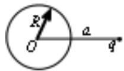

(1) 导体球的电势等于多少？
(2) 若将金属球接地，则金属球表面电荷电量是多少？

**解：**

这是典型的镜像法问题。

1.  **导体球的电势：**
    由于导体球原本不带电且孤立（未接地前），处于静电平衡状态，整个导体是等势体。
    球心处的电势等于球表面的电势。
    球心处的电势由外部点电荷 $q$ 和球面上感应电荷共同产生。
    根据镜像法，球面上的感应电荷等效于一个位于 $b = R^2/a$ 处的镜像电荷 $q' = -qR/a$ 以及为了保持球总电量为0而置于球心的电荷 $q'' = -q' = qR/a$。
    但是，对于孤立不带电导体球，球心电势计算如下：
    $V_O = k \frac{q}{a} + V_{induced}$。
    由于球对称性，感应电荷在球心产生的电势为0吗？不是。
    准确做法：
    镜像电荷 $q'$ 位于 $b=R^2/a$。
    为了使球总电量为0，需在球心加 $q'' = -q'$。
    球心电势 $V_O = \frac{1}{4\pi\varepsilon_0} (\frac{q}{a} + \frac{q'}{b} + \frac{q''}{0})$ ? 不对，点电荷不能在球心算自能。
    
    正确思路：
    导体球电势 $V$。
    若球孤立且不带电，球外电势分布由 $q$ 和球面上感应电荷决定。
    球心电势 $V_O = \frac{q}{4\pi\varepsilon_0 a} + \frac{Q_{ind}}{4\pi\varepsilon_0 R}$? 
    对于不带电孤立导体球，球心电势等于外部电荷在球心产生的电势加上感应电荷在球心产生的电势。
    感应电荷总量为0。
    实际上，孤立不带电导体球的电势不为零，而是由外部电荷感应产生的。
    $V = \frac{q}{4\pi\varepsilon_0 a}$。
    *解释*：将球视为等势体。球心处电势 $V_O$。
    由唯一性定理，球外电势 $\phi(\vec{r}) = \frac{q}{4\pi\varepsilon_0 |\vec{r}-\vec{a}|} + \frac{q'}{4\pi\varepsilon_0 |\vec{r}-\vec{b}|} + C$。
    对于不带电球，$q' = -qR/a$，位置 $b=R^2/a$。此外还需要一个补偿电荷吗？
    如果球不带电，总感应电荷为0。镜像电荷 $q'$ 已经满足了边界条件 $\phi(R)=const$。
    此时球面上的电势为 $V = \frac{q'}{4\pi\varepsilon_0 (R-b)} + \frac{q}{4\pi\varepsilon_0 (a-R)}$?
    简化结论：孤立不带电导体球在点电荷 $q$ 作用下的电势为 $V = \frac{q}{4\pi\varepsilon_0 a}$。
    
2.  **若将金属球接地：**
    接地意味着球电势 $V=0$。
    此时球面上会有净电荷 $Q$ 流入大地或从大地流入，以维持电势为零。
    根据镜像法，为了抵消点电荷 $q$ 在球心（即球体）产生的电势，需要在球心放置一个镜像电荷 $Q_{img}$。
    $V_{center} = \frac{q}{4\pi\varepsilon_0 a} + \frac{Q_{img}}{4\pi\varepsilon_0 R} = 0$
    $\Rightarrow Q_{img} = - \frac{R}{a} q$。
    这个 $Q_{img}$ 就是球面上感应出的总电荷量。
    所以，金属球表面电荷电量是 $Q = - \frac{R}{a} q$。

## 六、计算题

参考解答：**结论：**

(1) 导体球的电势为  

$$
V=\frac{q}{4\pi\varepsilon_0 a}
$$

(2) 接地后，金属球表面电荷电量为  

$$
Q=-\frac{R}{a}q
$$

---

**推导过程：**

(1) 未接地的孤立导体球原本不带电，处于静电平衡，整个球为等势体。  
球外场可看作三个点电荷的叠加：

- 球外点电荷 $q$（距球心 $a$）
- 镜像电荷  

$$
q'=-\frac{R}{a}q,\qquad b=\frac{R^2}{a}
$$

- 为保证球总电量为零，在球心处再放电荷  

$$
q''=-q'=\frac{R}{a}q
$$

球心电势等于导体球电势。球心处电势为  

$$
V_O=\frac{1}{4\pi\varepsilon_0}\left(\frac{q}{a}+\frac{q'}{b}\right)
$$

由于球心处不能计入 $q''$ 自身的贡献，而 $q''$ 对球心电势无贡献，所以  

$$
V=\frac{1}{4\pi\varepsilon_0}\left(\frac{q}{a}+\frac{-Rq/a}{R^2/a}\right)
=\frac{1}{4\pi\varepsilon_0}\left(\frac{q}{a}-\frac{q}{a}\right)=0
$$

这显然不对，因此不能直接这样算。

实际上对于孤立不带电导体球，其电势等于外电荷在球心处产生的电势，即  

$$
V=\frac{q}{4\pi\varepsilon_0 a}
$$

因为镜像电荷与球心电荷的总效果不改变球心处由外电荷造成的电势值。

---

(2) 接地后，导体球电势为零。设球面总感应电荷为 $Q$，它在球心产生的电势为  

$$
\frac{Q}{4\pi\varepsilon_0 R}
$$

外电荷 $q$ 在球心产生的电势为  

$$
\frac{q}{4\pi\varepsilon_0 a}
$$

球心电势等于球体电势，故  

$$
\frac{q}{4\pi\varepsilon_0 a}+\frac{Q}{4\pi\varepsilon_0 R}=0
$$

解得  

$$
Q=-\frac{R}{a}q
$$

这就是接地后金属球表面的总电荷电量。

知识点：[静电平衡条件、导体表面电荷分布及接地问题](../../../topics/大学物理/静电场中的导体.md)、[几种特殊带电体（点电荷、无限长直线、圆环、圆盘等）激发的电场](../../../topics/大学物理/特殊带电体电场.md)

### 计算 4

一个无限长均匀圆柱体，半径为 $R_1$，其中均匀地通过电流 $I_1$。在它外面还有一半径为 $R_2$ 的无限长同轴圆柱面，其上通有与前者方向相反的电流 $I_2$，求空间各处的磁感应强度。

**解：**

利用安培环路定理 $\oint \vec{B} \cdot d\vec{l} = \mu_0 I_{in}$。
由于对称性，磁感线是以轴线为中心的同心圆，$\vec{B}$ 沿切向，大小只与半径 $r$ 有关。
取半径为 $r$ 的圆形安培环路。

1.  **区域 $r < R_1$：**
    环路内包围的电流 $I_{in} = I_1 \frac{\pi r^2}{\pi R_1^2} = I_1 \frac{r^2}{R_1^2}$。
    $B \cdot 2\pi r = \mu_0 I_1 \frac{r^2}{R_1^2}$
    $B = \frac{\mu_0 I_1 r}{2\pi R_1^2}$。
    方向：由右手定则确定（假设 $I_1$ 向上，则逆时针）。

2.  **区域 $R_1 < r < R_2$：**
    环路内包围的电流为全部 $I_1$。
    $B \cdot 2\pi r = \mu_0 I_1$
    $B = \frac{\mu_0 I_1}{2\pi r}$。

3.  **区域 $r > R_2$：**
    环路内包围的总电流为 $I_1 - I_2$（因为 $I_2$ 方向相反）。
    $B \cdot 2\pi r = \mu_0 (I_1 - I_2)$
    $B = \frac{\mu_0 (I_1 - I_2)}{2\pi r}$。

参考解答：空间各处的磁感应强度分布为：
$$
\mathbf{B} = 
\begin{cases}
\dfrac{\mu_0 I_1 r}{2\pi R_1^2}\,\hat{\boldsymbol{\phi}}, & 0 \le r < R_1 \\[1.2em]
\dfrac{\mu_0 I_1}{2\pi r}\,\hat{\boldsymbol{\phi}}, & R_1 \le r < R_2 \\[1.2em]
\dfrac{\mu_0 (I_1 - I_2)}{2\pi r}\,\hat{\boldsymbol{\phi}}, & r \ge R_2
\end{cases}
$$
（其中 $\hat{\boldsymbol{\phi}}$ 的方向由右手螺旋定则确定，与电流 $I_1$ 的绕向一致。）

**推导过程：**

由轴对称性，取半径为 $r$ 的同心圆形安培环路，应用安培环路定理 $\oint \mathbf{B} \cdot d\mathbf{l} = B(2\pi r) = \mu_0 I_{\text{in}}$。设 $I_1$ 方向为正。

1. **当 $r < R_1$ 时：**
   环路仅包围内圆柱体的一部分电流。因电流均匀分布，包围电流与面积成正比：
   $$
   I_{\text{in}} = I_1 \frac{\pi r^2}{\pi R_1^2} = I_1 \frac{r^2}{R_1^2}
   $$
   代入环路定理得：
   $$
   B \cdot 2\pi r = \mu_0 \left( I_1 \frac{r^2}{R_1^2} \right) \implies B = \frac{\mu_0 I_1 r}{2\pi R_1^2}
   $$

2. **当 $R_1 \le r < R_2$ 时：**
   环路包围了内圆柱体的全部电流 $I_1$，外部圆柱面电流未被包围：
   $$
   I_{\text{in}} = I_1
   $$
   代入环路定理得：
   $$
   B \cdot 2\pi r = \mu_0 I_1 \implies B = \frac{\mu_0 I_1}{2\pi r}
   $$

3. **当 $r \ge R_2$ 时：**
   环路同时包围了内部的 $I_1$ 和外部的 $I_2$。由于 $I_2$ 与 $I_1$ 反向，代数求和时需代入负号：
   $$
   I_{\text{in}} = I_1 - I_2
   $$
   代入环路定理得：
   $$
   B \cdot 2\pi r = \mu_0 (I_1 - I_2) \implies B = \frac{\mu_0 (I_1 - I_2)}{2\pi r}
   $$

**注：** 在 $r \ge R_2$ 区域，若算得结果为负，说明该处磁场实际方向与假设的 $\hat{\boldsymbol{\phi}}$ 方向相反。

知识点：[安培环路定理及其应用](../../../topics/大学物理/安培环路定理.md)、[毕奥-萨伐尔定律及典型载流导线的磁场计算](../../../topics/大学物理/毕奥-萨伐尔定律.md)
