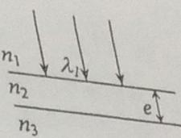
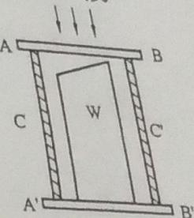
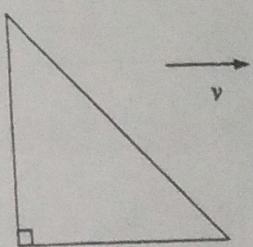

# 2016—2017 学年第一学期《大学物理（下）》期末试卷（A卷）

原件经识别和整理；“参考解答”是我们补的。

本资料整理自南京邮电大学 2016/2017 学年第一学期期末考试试卷 A 卷第 1 页内容。

## 一、选择题（每题3分，共计36分）

### 选择 1

把弹簧振子和单摆从地球表面移到月球表面，则

- A. 弹簧振子和单摆的周期都变小;
- B. 弹簧振子和单摆的周期都变大;
- C. 弹簧振子的周期不变而单摆周期变大;
- D. 弹簧振子的周期变大而单摆周期不变。

答案：C。

知识点：[简谐振动的动力学特征与回复力](../../../topics/大学物理/简谐振动的动力学.md)、[简谐振动的运动学方程（振幅、角频率、相位）](../../../topics/大学物理/简谐振动运动学.md)

### 选择 2

一物体作简谐振动，振动方程为 $x=A\cos(\omega t+\pi/4)$ ，在 $t=T/4$ ($T$ 为周期)时刻，物体的加速度为

- A. $-\sqrt{2}A\omega^{2}/2$ .
- B. $\sqrt{2}A\omega^{2}/2$ .
- C. $-\sqrt{3}A\omega^{2}/2$ .
- D. $\sqrt{3}A\omega^{2}/2$ .

答案：B。

知识点：[简谐振动的运动学方程（振幅、角频率、相位）](../../../topics/大学物理/简谐振动运动学.md)、[速度、加速度的定义与微分关系](../../../topics/大学物理/速度与加速度定义.md)

### 选择 3

一简谐平面波在无吸收的弹性介质中传播，以 $E_{k}$ 、 $E_{P}$ 分别表示介质中某质元的动能和势能。则

- A. $E_{\mathrm{k}} + E_{\mathrm{P}} =$ 恒量，且 $E_{\mathrm{k}}$ 增长时， $E_{\mathrm{P}}$ 减小；
- B. $E_{\mathrm{k}} + E_{\mathrm{P}}$ 是时间 $t$ 的函数，且在任何时候都有 $E_{\mathrm{k}} = E_{\mathrm{P}}$ ；
- C. $E_{\mathrm{k}} + E_{\mathrm{P}}$ 是时间 $t$ 的函数，而且 $E_{\mathrm{k}} \neq E_{\mathrm{P}}$ ；
- D. 上述说法都不对。

答案：B。

知识点：[简谐振动的动能、势能与总机械能](../../../topics/大学物理/简谐振动的能量.md)、[波动过程中的能量传播与能流密度](../../../topics/大学物理/波的能量.md)、[平面简谐波的波函数 y=Acos(ω(t±x/u)+φ)](../../../topics/大学物理/平面简谐波方程.md)

### 选择 4

设入射波的表达式为 $u_{1} = A \cos 2 \pi \left( \frac{t}{T} + \frac{x}{\lambda} \right)$ ，在 $x = 0$ 处发生反射。反射处有半波损失，且反射后振幅不变，则入射波与反射波合成为驻波，波节的位置为

- A. $x = (2k - 1) \frac{\lambda}{4}$
- B. $x = (2k - 1) \frac{\lambda}{2}$
- C. $x = k \frac{\lambda}{2}$
- D. $x = k \frac{\lambda}{4}$

上列各式的 $k = 0,1,2,\ldots$

答案：C。

知识点：[平面简谐波的波函数 y=Acos(ω(t±x/u)+φ)](../../../topics/大学物理/平面简谐波方程.md)、[驻波的形成、波节与波腹](../../../topics/大学物理/驻波.md)、[光程、光程差与反射时的半波损失](../../../topics/大学物理/光程与半波损失.md)

### 选择 5

如图所示，平行单色光垂直照射到薄膜上，经上下两表面反射的两束光发生干涉，若薄膜的厚度为 e，并且 $n_{1}<n_{2}>n_{3}$ ， $\lambda_{1}$ 为入射光在折射率为 $n_{1}$ 的媒质中的波长，则两束反射光在相遇点的位相差为

- A. $2\pi n_{2}e/(n_{1}\lambda_{1})$ .
- B. $4\pi n_{1}e/(n_{2}\lambda_{1})+\pi$
- C. $4\pi n_{2}e/(n_{1}\lambda_{1})+\pi.$
- D. $4\pi n_{2}e/(n_{1}\lambda_{1})$

答案：C。

知识点：[等倾干涉与等厚干涉（劈尖、牛顿环）](../../../topics/大学物理/薄膜干涉.md)、[光程、光程差与反射时的半波损失](../../../topics/大学物理/光程与半波损失.md)

### 选择 6

图示为一干涉膨胀仪示意图，上下两平行玻璃板用一对热膨胀系数极小的石英柱支撑着，被测样品 W 在两玻璃板之间，样品上表面与玻璃板下表面间形成一空气劈尖，在以波长为 $\lambda$ 的单色光照射下，可以看到平行的等厚干涉条纹。

当W受热膨胀时，条纹将：

- A. 条纹变密，向右靠拢；
- B. 条纹变疏，向上展开；
- C. 条纹疏密不变，向右平移；
- D. 条纹疏密不变，向左平移。

答案：D。

知识点：[等倾干涉与等厚干涉（劈尖、牛顿环）](../../../topics/大学物理/薄膜干涉.md)

### 选择 7

单色光 $\lambda$ 垂直入射到单狭缝上,对应于某一衍射角 $\theta$ ，此单狭缝两边缘衍射光通过透镜到屏上会聚点A的光程差为 $\delta=2\lambda$ ，则

- A. 透过此单狭缝的波阵面所分成的半波带数目为二个, 屏上 A 点为明点.
- B. 透过此单狭缝的波阵面所分成的半波带数目为二个, 屏上 A 点为暗点.
- C. 透过此单狭缝的波阵面所分成的半波带数目为四个, 屏上 A 点为明点.
- D. 透过此单狭缝的波阵面所分成的半波带数目为四个, 屏上 A 点为暗点.

答案：D。

知识点：[单缝衍射的暗纹条件与中央明纹宽度](../../../topics/大学物理/单缝夫琅禾费衍射.md)、[光程、光程差与反射时的半波损失](../../../topics/大学物理/光程与半波损失.md)

### 选择 8

三个偏振片 $P_{1}$ ， $P_{2}$ 与 $P_{3}$ 堆叠在一起， $P_{1}$ 与 $P_{3}$ 的偏振化方向相互垂直， $P_{2}$ 与 $P_{1}$ 的偏振化方向间的夹角为 $30^{\circ}$ 。强度为 $I_{0}$ 的自然光垂直入射于偏振片 $P_{1}$ ，并依次透过偏振片 $P_{1}$ 、 $P_{2}$ 与 $P_{3}$ ，则通过三个偏振片后的光强为

- A. $I_{0}/4;$
- B. $3I_{0}/8;$
- C. $3I_{0}/32;$
- D. $I_{0}/16.$

答案：B。

知识点：[自然光与偏振光、马吕斯定律与布儒斯特定律](../../../topics/大学物理/光的偏振.md)

### 选择 9

光子能量为 0.5MeV 的 X 射线，入射到某种物质上而发生康普顿散射。若反冲电子的动能为 0.1MeV，则散射光波长的改变量 $\Delta\lambda$ 与入射光波长 $\lambda_{0}$ 之比值为

- A. 0.20.
- B. 0.25.
- C. 0.30.
- D. 0.35.

答案：A。

### 选择 10

用频率为 v 的单色光照射某种金属时,逸出光电子的最大动能为 $E_{k}$ , 若改用频率为 2v 的单色光照射此种金属, 则逸出光电子的最大动能为

- A. $h\nu+E_{k}$ .
- B. $2h\nu-E_{k}$ .
- C. $h\nu-E_{k}$ .
- D. $2E_{k}$ .

答案：D。

知识点：[光电效应的实验规律与爱因斯坦光子理论](../../../topics/大学物理/光电效应.md)、[相对论动能、静能与质能关系（E=mc²）](../../../topics/大学物理/相对论能量.md)

### 选择 11

静止于某惯性系 S 中的一个等腰直角三角板，如图所示，沿一直角边方向以常量 v 作高速运动时，恰好成为 S 系中的一个锐角为 $30^{\circ}$ 的直角三角板，则 v 应为

答案：B。

知识点：[洛伦兹坐标变换与速度变换](../../../topics/大学物理/洛伦兹变换.md)、[同时的相对性、时间膨胀与长度收缩](../../../topics/大学物理/狭义相对论时空观.md)
