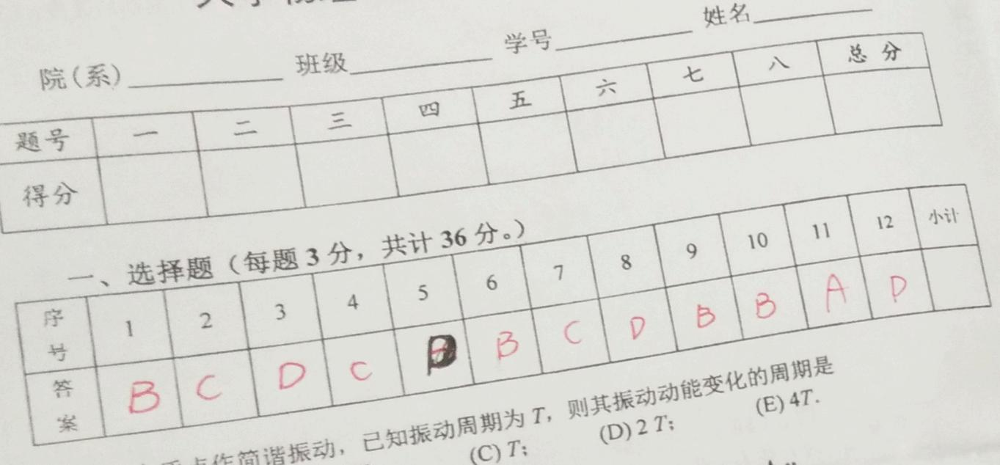
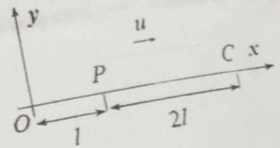
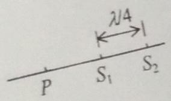

# 南京邮电大学 2015/2016 学年第一学期《大学物理（下）》期末考试试卷 A

原件经识别和整理；“参考解答”是我们补的。

## 一、选择题

### 选择 1

一质点作简谐振动，周期为 $T$，当它由平衡位置向 $x$ 轴正方向运动时，从二分之一最大位移处到最大位移处这段路程所需要的时间为

- (A) $T/4$
- (B) $T/12$
- (C) $T/6$
- (D) $T/8$

参考解答：**答案：C（$T/6$）**

设简谐振动为

$$
x=A\cos(\omega t),\qquad \omega=\frac{2\pi}{T}.
$$

质点从平衡位置向 $x$ 轴正方向运动时，可取 $t=0$ 为经过平衡位置的时刻，则

$$
x=A\cos\omega t.
$$

在 $t=0$ 到 $t=T/4$ 内，质点从 $x=A/2$ 运动到 $x=A$。令达到最大位移的时刻为 $t_1$，则

$$
\cos(\omega t_1)=1
\quad\Rightarrow\quad
\omega t_1=\frac{\pi}{2}.
$$

在最大位移处有

$$
x=A\cos\omega t_1=\frac A2
\quad\Rightarrow\quad
\cos\omega t_1=\frac12,
$$

所以

$$
\omega t_1=\frac{\pi}{3}.
$$

因此所需时间为

$$
\Delta t=\frac{\pi/3}{\omega}
=\frac{\pi/3}{2\pi/T}
=\boxed{\frac{T}{6}}.
$$

其他选项对应的时刻或运动阶段不符合“从 $A/2$ 向最大位移运动”这一条件。

知识点：[简谐振动的运动学方程（振幅、角频率、相位）](../../../topics/大学物理/简谐振动运动学.md)、[用旋转矢量法确定初相与运动状态](../../../topics/大学物理/旋转矢量法.md)

### 选择 2

如图所示，一平面简谐波沿 $x$ 轴正方向传播，已知 $O$ 点的振动方程为 $y = A\cos\omega t$，则

- (A) $O$ 点的振动方程为 $y = A\cos\omega(t - l/u)$
- (B) 波函数为 $y = A\cos\omega[t - (l/u) - (x/u)]$
- (C) 波函数为 $y = A\cos\omega[t + (l/u) - (x/u)]$
- (D) $C$ 点的振动方程为 $y = A\cos\omega(t - 3l/u)$

参考解答：结论：选 **C**。

**推理过程：**

题图中波沿 $x$ 轴正方向传播，$O$ 点振动方程为  

$$
y_O = A\cos\omega t
$$

$C$ 点在 $O$ 点右侧，距离为 $l$，因此振动相位比 $O$ 点落后 $\frac{\omega l}{u}$，所以 $C$ 点振动方程为  

$$
y_C = A\cos\omega\Big(t-\frac{l}{u}\Big)
$$

波沿正 $x$ 方向传播，波函数一般形式为  

$$
y(x,t)=A\cos\omega\Big(t-\frac{x-x_0}{u}\Big)
$$

若以 $O$ 点为坐标原点，则 $x_0=0$，但题目中坐标原点可能不在 $O$ 点。由图可知 $O$ 点坐标为 $x=l$，因此任意 $x$ 处的相位比 $O$ 点落后  

$$
\frac{\omega(x-l)}{u}
$$

所以波函数为  

$$
y(x,t)=A\cos\omega\Big[t-\frac{x-l}{u}\Big]
=A\cos\omega\Big[t+\frac{l}{u}-\frac{x}{u}\Big]
$$

因此选 **C**。

**其他选项简析：**

- **A 错**：题目已给出 $O$ 点振动方程为 $y=A\cos\omega t$，不是带 $l/u$ 的形式。  
- **B 错**：波函数中多减了 $l/u$，相当于把 $O$ 点相位搞错。  
- **D 错**：$C$ 点距 $O$ 点仅 $l$，应为 $t-l/u$，不是 $t-3l/u$。

知识点：[平面简谐波的波函数 y=Acos(ω(t±x/u)+φ)](../../../topics/大学物理/平面简谐波方程.md)、[波动过程中的能量传播与能流密度](../../../topics/大学物理/波的能量.md)

### 选择 3

当一平面简谐波在弹性媒质中传播时，下述各结论哪个是正确的？

- (A) 媒质质元的振动动能增大时，其弹性势能减小，总机械能守恒
- (B) 媒质质元的振动动能和弹性势能都作周期性变化，但二者的相位不相同
- (C) 媒质质元的振动动能和弹性势能的变化同相位，但二者的数值不相等
- (D) 媒质质元在其平衡位置处振动动能和弹性势能均最大

参考解答：**结论：选 (D)。**

**推理与关键公式：**

对于平面简谐纵波（在固体棒中传播为例），设媒质质元的振动方程为

$$
y = A \cos(\omega t - kx)
$$

其振动速度为

$$
v = \frac{\partial y}{\partial t} = -A\omega \sin(\omega t - kx)
$$

质元的**振动动能**密度为

$$
w_k = \frac{1}{2}\rho v^2 = \frac{1}{2}\rho A^2\omega^2 \sin^2(\omega t - kx)
$$

质元的**弹性势能**密度与相对形变 $\frac{\partial y}{\partial x}$ 的平方成正比：

$$
w_p = \frac{1}{2}Y \left( \frac{\partial y}{\partial x} \right)^2 = \frac{1}{2}Y (Ak)^2 \sin^2(\omega t - kx)
$$

又因波速 $u = \sqrt{\frac{Y}{\rho}}$ 且 $\omega = uk$，可得

$$
\frac{1}{2}Y A^2 k^2 = \frac{1}{2}\rho A^2 \omega^2
$$

因此

$$
w_k = w_p = \frac{1}{2}\rho A^2\omega^2 \sin^2(\omega t - kx)
$$

**关键结论：**
1. **同相位**：动能和弹性势能均正比于 $\sin^2(\omega t - kx)$，**相位完全相同**，**数值时刻相等**。
2. **不守恒**：质元与相邻质元有能量交换，总机械能 $w = w_k + w_p \propto \sin^2(\omega t - kx)$ 不守恒。
3. **特殊位置**：在平衡位置处 $y=0$，此时形变和速度均最大，动能与弹性势能均达到最大。

**选项分析：**
- **(A)** 错误：动能和势能应**同增同减**，且总机械能**不守恒**。
- **(B)** 错误：两者**相位相同**。
- **(C)** 错误：两者不仅同相位，**数值也相等**。
- **(D)** 正确：在平衡位置处，形变最大且振动速度最大，所以弹性势能和振动动能均最大。

知识点：[波动过程中的能量传播与能流密度](../../../topics/大学物理/波的能量.md)、[平面简谐波的波函数 y=Acos(ω(t±x/u)+φ)](../../../topics/大学物理/平面简谐波方程.md)

### 选择 4

一平面简谐波在弹性媒质中传播，在某一瞬时，媒质中某质元正处于平衡位置，此时它的能量是

- (A) 动能为零，势能最大
- (B) 动能为零，势能为零
- (C) 动能最大，势能最大
- (D) 动能最大，势能为零

参考解答：**结论**  
选 **C**。

**推理**  
在平面简谐波中，任意质元的动能和势能总是**同相**变化的，两者同时达到最大，也同时为零。  
处于平衡位置时，质元的速度最大，故动能最大；同时其相对形变（应变）也最大，故势能也最大。

**其他选项说明**  
- A：错，动能不为零，且势能与动能同相，不会出现动零势大的情况。  
- B：错，平衡位置处速度最大、形变最大，不可能动能和势能同时为零。  
- D：错，势能不为零，平衡位置处的形变量最大导致势能也最大。

知识点：[机械波的形成、横波与纵波](../../../topics/大学物理/机械波的产生与传播.md)、[波动过程中的能量传播与能流密度](../../../topics/大学物理/波的能量.md)

### 选择 5

沿着相反方向传播的两列相干波，其表达式为 $y_1 = A\cos 2\pi(\nu t - x/\lambda)$ 和 $y_2 = A\cos 2\pi(\nu t + x/\lambda)$，叠加后形成的驻波中，波节的位置坐标为（其中 $k = 0, 1, 2, 3, \cdots$）

- (A) $x = \pm k\lambda$
- (B) $x = \pm \frac{1}{2}k\lambda$
- (C) $x = \pm (2k+1)\frac{\lambda}{4}$
- (D) $x = \pm (2k+1)\frac{\lambda}{2}$

参考解答：**结论：** 选项 (C) 正确。

**推理与计算：**

两列波叠加形成的驻波表达式为：
$$ y = y_1 + y_2 = A \cos 2\pi(\nu t - \frac{x}{\lambda}) + A \cos 2\pi(\nu t + \frac{x}{\lambda}) $$
利用和差化积公式 $\cos\alpha + \cos\beta = 2\cos\frac{\alpha+\beta}{2}\cos\frac{\alpha-\beta}{2}$，得：
$$ y = 2A \cos(2\pi\nu t) \cos(2\pi\frac{x}{\lambda}) $$
波节处振幅始终为零，即 $|\cos(2\pi\frac{x}{\lambda})| = 0$，因此：
$$ 2\pi\frac{x}{\lambda} = (2k+1)\frac{\pi}{2} $$
解得：
$$ x = (2k+1)\frac{\lambda}{4} $$
考虑到波节分布在原点两侧，位置坐标为 $x = \pm (2k+1)\frac{\lambda}{4}$。

**选项辨析：**
- (A) $x = \pm k\lambda$ 对应的是波腹位置。
- (B) $x = \pm \frac{1}{2}k\lambda$ 既非波节也非波腹的一般位置。
- (C) 正确。
- (D) $x = \pm (2k+1)\frac{\lambda}{2}$ 是将波节位置公式中的分子误作 $\lambda/2$。

知识点：[驻波的形成、波节与波腹](../../../topics/大学物理/驻波.md)、[平面简谐波的波函数 y=Acos(ω(t±x/u)+φ)](../../../topics/大学物理/平面简谐波方程.md)

### 选择 6

在驻波中，两个相邻波节间各质点的振动

- (A) 振幅相同，相位相同
- (B) 振幅不同，相位相同
- (C) 振幅相同，相位不同
- (D) 振幅不同，相位不同

参考解答：**结论**：(B)

**推理过程**：
1.  **振幅分析**：驻波的波函数通常表示为 $y(x,t) = 2A \cos(kx) \cos(\omega t)$（以两端固定为例，具体形式取决于边界条件，但空间依赖性一致）。质点的振幅由空间项决定，即 $A(x) = |2A \cos(kx)|$。在两个相邻波节之间，位置坐标 $x$ 不同，因此 $\cos(kx)$ 的值不同，导致各质点的**振幅不同**（波腹处最大，波节处为零）。
2.  **相位分析**：在两个相邻波节之间，空间因子 $\cos(kx)$ 的符号保持不变（恒为正或恒为负）。这意味着该区域内所有质点同时达到最大位移，同时经过平衡位置，且运动方向始终一致。因此，它们的振动**相位相同**。
3.  **对比其他区域**：只有跨越波节时，$\cos(kx)$ 的符号才会改变，导致相位突变 $\pi$（即反相）。

**选项辨析**：
-   (A) 错在“振幅相同”，驻波中除波腹外各点振幅随位置变化。
-   (C) 错在“振幅相同”且“相位不同”，同一段内相位是相同的。
-   (D) 错在“相位不同”，相邻波节间质点同步振动，相位相同。

知识点：[驻波的形成、波节与波腹](../../../topics/大学物理/驻波.md)、[简谐振动的运动学方程（振幅、角频率、相位）](../../../topics/大学物理/简谐振动运动学.md)

### 选择 7

一机车汽笛频率为 $750\ \text{Hz}$，机车以 $90\ \text{km/h}$ 的速度远离静止的观察者，设空气中声速为 $340\ \text{m/s}$，则观察者听到的声音频率为

- (A) $699\ \text{Hz}$
- (B) $750\ \text{Hz}$
- (C) $805\ \text{Hz}$
- (D) $820\ \text{Hz}$

参考解答：**答案：(A) $699\ \text{Hz}$**

**解析：**

这是多普勒效应问题。波源（机车）远离静止观察者，接收频率公式为

$$f' = f \frac{v}{v + v_s}$$

其中 $f = 750\ \text{Hz}$，$v = 340\ \text{m/s}$，$v_s = 90\ \text{km/h} = 25\ \text{m/s}$。

代入计算：

$$f' = 750 \times \frac{340}{340 + 25} = 750 \times \frac{340}{365} \approx 699\ \text{Hz}$$

**其他选项分析：**
- (B) 750 Hz：未考虑多普勒效应，错误；
- (C) 805 Hz：误用靠近公式 $f' = f\frac{v}{v-v_s}$，与题意"远离"不符；
- (D) 820 Hz：数值偏差过大，无对应物理情形。

知识点：[机械波的形成、横波与纵波](../../../topics/大学物理/机械波的产生与传播.md)、[平面简谐波的波函数 y=Acos(ω(t±x/u)+φ)](../../../topics/大学物理/平面简谐波方程.md)

### 选择 8

(1) 所有惯性系对物理基本规律都是等价的；(2) 在真空中，光的速度与光的频率、光源的运动状态无关；(3) 在任何惯性系中，光在真空中沿任何方向的传播速率都相同。上述几种说法表述正确的是

- (A) (1)、(2) 正确
- (B) (1)、(3) 正确
- (C) (2)、(3) 正确
- (D) 三种说法都正确

参考解答：**答案：(D)**

三条说法均正确：

- **(1)** 正确——狭义相对论的相对性原理：一切物理规律在所有惯性系中具有相同形式。
- **(2)** 正确——光速不变原理（第一方面）：真空中光速 $c$ 与光的频率、光源运动状态无关。
- **(3)** 正确——光速不变原理（第二方面）：真空中光速 $c$ 在任何惯性系中沿任何方向都相同。

三条分别对应相对性原理与光速不变原理的完整表述，故选 (D)。  
(A)、(B)、(C) 都只列出了部分正确说法，遗漏了一条。

知识点：[爱因斯坦的两个基本假设](../../../topics/大学物理/狭义相对论基本原理.md)

### 选择 9

某核电站年发电量为 $100$ 亿度，它等于 $36\times10^{15}\ \text{J}$ 的能量，如果这是由核材料的全部静止能量转化产生的，则需要消耗的核材料的质量为

- (A) $0.4\ \text{kg}$
- (B) $0.8\ \text{kg}$
- (C) $12\times10^{7}\ \text{kg}$
- (D) $\frac{1}{12}\times10^{7}\ \text{kg}$

参考解答：**答案：(A) $0.4\ \text{kg}$**

由质能方程 $E = mc^2$ 得：

$$
m = \frac{E}{c^2} = \frac{36\times 10^{15}}{(3\times 10^8)^2} = \frac{36\times 10^{15}}{9\times 10^{16}} = 0.4\ \text{kg}
$$

**选项分析：**
- **(A)** 正确，与计算结果一致。
- **(B)** 错误，数值为正确值的两倍，可能是误将 $c^2$ 按 $2c^2$ 或计算系数出错所致。
- **(C)** 错误，误用 $E = mc$（未平方光速）进行计算。
- **(D)** 错误，误用 $E = \frac{1}{2}mc^2$（套用了经典动能公式系数）。

知识点：[相对论动能、静能与质能关系（E=mc²）](../../../topics/大学物理/相对论能量.md)

### 选择 10

已知某单色光照射到一金属表面产生了光电效应，若此金属的逸出电势为 $U_0$（使电子从金属逸出需作功 $eU_0$），则此单色光的波长 $\lambda$ 必须满足

- (A) $\lambda \le hc/(eU_0)$
- (B) $\lambda \ge hc/(eU_0)$
- (C) $\lambda \le eU_0/(hc)$
- (D) $\lambda \ge eU_0/(hc)$

参考解答：**选 (A)**

产生光电效应的条件是入射光子能量不小于逸出功：

$$
\frac{hc}{\lambda} \ge eU_0
$$

解得：

$$
\lambda \le \frac{hc}{eU_0}
$$

- **(B)(D)** 错在不等号方向反了，波长越大光子能量越小，无法产生光电效应。
- **(C)** 错在量纲不对，$eU_0/(hc)$ 的量纲是长度的倒数而非长度。

知识点：[光电效应的实验规律与爱因斯坦光子理论](../../../topics/大学物理/光电效应.md)

### 选择 11

在康普顿效应实验中，波长为 $\lambda_0$ 的 $X$ 射线与自由电子发生碰撞，散射角为 $90^\circ$，则散射光波长的改变量为

- (A) $h/(m_ec)$
- (B) $h/(2m_ec)$
- (C) $2h/(m_ec)$
- (D) $0$

参考解答：**结论：A**

由康普顿散射公式：

$$
\Delta \lambda = \lambda - \lambda_0 = \frac{h}{m_e c}(1-\cos\theta)
$$

当散射角 $\theta = 90^\circ$ 时，$\cos 90^\circ=0$，所以

$$
\Delta \lambda = \frac{h}{m_e c}
$$

其他选项不正确的原因：B 是 $\theta=60^\circ$ 时的结果；C 对应 $\theta=180^\circ$；D 忽略了康普顿效应中波长必然改变。

知识点：[康普顿散射实验与光子动量](../../../topics/大学物理/康普顿散射.md)

### 选择 12

将波长为 $\lambda_0$ 的光子与一静止的自由电子碰撞，碰后光子的波长变为 $\lambda$，则电子获得的动能为

- (A) $hc/\lambda_0$
- (B) $hc/\lambda$
- (C) $hc(1/\lambda_0 - 1/\lambda)$
- (D) $hc(1/\lambda_0 + 1/\lambda)$

参考解答：**结论：选 (C)**

**推理过程：**

由能量守恒，入射光子能量等于散射光子能量与电子获得的动能之和：

$$\frac{hc}{\lambda_0} = \frac{hc}{\lambda} + E_k$$

解得：

$$E_k = hc\left(\frac{1}{\lambda_0} - \frac{1}{\lambda}\right)$$

**各选项分析：**

- **(A)** $hc/\lambda_0$ 是入射光子的总能量，忽略了散射光子带走的能量。
- **(B)** $hc/\lambda$ 是散射光子的能量，并非电子获得的动能。
- **(C)** 正确，即入射光子与散射光子的能量差。
- **(D)** 符号取错，将两能量相加而非相减。

知识点：[康普顿散射实验与光子动量](../../../topics/大学物理/康普顿散射.md)、[光电效应的实验规律与爱因斯坦光子理论](../../../topics/大学物理/光电效应.md)、[相对论动能、静能与质能关系（E=mc²）](../../../topics/大学物理/相对论能量.md)

### 选择 13

如果电子被限制在边界 $x=0$ 和 $x=\Delta x$ 之间，$\Delta x = 0.5\ \text{Å}$，则电子动量的不确定量的最小值约为（$h = 6.63\times10^{-34}\ \text{J}\cdot\text{s}$）

- (A) $1.06\times10^{-24}\ \text{kg}\cdot\text{m/s}$
- (B) $1.06\times10^{-25}\ \text{kg}\cdot\text{m/s}$
- (C) $2.12\times10^{-24}\ \text{kg}\cdot\text{m/s}$
- (D) $2.12\times10^{-25}\ \text{kg}\cdot\text{m/s}$

参考解答：**答案：(A)** $\Delta p_{\min}\approx 1.06\times10^{-24}\ \text{kg}\cdot\text{m/s}$。

由不确定关系

$$
\Delta x\,\Delta p_x\ge \frac{\hbar}{2}=\frac{h}{4\pi},
$$

取等号得最小动量不确定量

$$
\Delta p_{\min}=\frac{h}{4\pi\Delta x}.
$$

代入 $\Delta x=0.5\ \text{Å}=0.5\times10^{-10}\ \text{m}$：

$$
\Delta p_{\min}
=\frac{6.63\times10^{-34}}
{4\pi\times0.5\times10^{-10}}
\approx1.06\times10^{-24}\ \text{kg}\cdot\text{m/s}.
$$

- **(B)**：数量级小 $10$ 倍，不符计算结果。
- **(C)**：数值约为正确值的 $2$ 倍。
- **(D)**：数值和数量级均不符。

知识点：[海森堡位置与动量的不确定关系](../../../topics/大学物理/不确定关系.md)、[德布罗意物质波假设](../../../topics/大学物理/实物粒子的波动性.md)、[玻尔的氢原子理论与能级跃迁](../../../topics/大学物理/玻尔氢原子模型.md)

### 选择 14

氢原子中电子从 $n=3$ 的激发态跃迁到 $n=2$ 的激发态时，发出的光子能量为

- (A) $1.51\ \text{eV}$
- (B) $1.89\ \text{eV}$
- (C) $3.40\ \text{eV}$
- (D) $10.2\ \text{eV}$

参考解答：(B) $1.89\ \text{eV}$

氢原子能级公式为 $E_n = -\dfrac{13.6\ \text{eV}}{n^2}$。从 $n=3$ 跃迁到 $n=2$ 时，辐射光子能量为两能级之差：
$$
\Delta E = E_3 - E_2 = \left(-\frac{13.6}{3^2}\right) - \left(-\frac{13.6}{2^2}\right) = -1.51 + 3.40 = 1.89\ \text{eV}
$$
选项 (A) 是 $|E_3|$，(C) 是 $|E_2|$，(D) 对应 $n=2 \to n=1$ 的跃迁能量，均不符合题意。

知识点：[玻尔的氢原子理论与能级跃迁](../../../topics/大学物理/玻尔氢原子模型.md)
