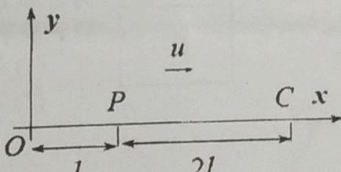
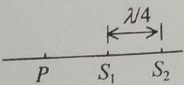

# 南京邮电大学2015—2016学年第一学期《大学物理（下）》期末考试试卷（A卷）

原件经识别和整理；“参考解答”是我们补的。

# 南京邮电大学 2015—2016 学年第一学期《大学物理（下）》期末考试试卷（A卷）

## 一、选择题（每题 3 分，共计 36 分）

### 选择 1

题干：一质点作简谐振动，已知振动周期为 $T$，则其振动动能变化的周期是
- A. $T/4$
- B. $T/2$
- C. $T$
- D. $2T$
- E. $4T$

答案：B。

知识点：[简谐振动的动能、势能与总机械能](../../../topics/大学物理/简谐振动的能量.md)

### 选择 2

题干：如图，一平面简谐波以波速 $u$ 沿 $x$ 轴正方向传播，$O$ 为坐标原点。已知 $P$ 点的振动方程为 $y = A \cos \omega t$ ，则
- A. $O$ 点的振动方程为 $y = A \cos \omega(t - l / u)$
- B. 波函数为 $y = A \cos \omega [t - (l / u) - (l / u)]$
- C. 波函数为 $y = A \cos \omega [t + (l / u) - (x / u)]$
- D. $C$ 点的振动方程为 $y = A \cos \omega (t - 3l / u)$

 图中展示了波源 $O$、点 $P$（距离 $l$）和点 $C$（距离 $3l$）的位置关系。

答案：C。

知识点：[平面简谐波的波函数 y=Acos(ω(t±x/u)+φ)](../../../topics/大学物理/平面简谐波方程.md)、[机械波的形成、横波与纵波](../../../topics/大学物理/机械波的产生与传播.md)

### 选择 3

题干：当一平面简谐波在弹性媒质中传播时，下述各结论哪个是正确的？
- A. 媒质质元的振动动能增大时，其弹性势能减小，总机械能守恒
- B. 媒质质元的振动动能和弹性势能都作周期性变化，但二者的相位不相同
- C. 媒质质元的振动动能和弹性势能的变化同相位，但二者的数值不相等
- D. 媒质质元在其平衡位置处振动动能和弹性势能均最大

答案：D。

知识点：[机械波的形成、横波与纵波](../../../topics/大学物理/机械波的产生与传播.md)、[平面简谐波的波函数 y=Acos(ω(t±x/u)+φ)](../../../topics/大学物理/平面简谐波方程.md)

### 选择 4

题干：两相干波源 $S_{1}$ 和 $S_{2}$ 相距 $\lambda / 4$ （$\lambda$ 为波长），$S_{1}$ 的相位比 $S_{2}$ 的相位超前 $\frac{1}{2} \pi$ ，在 $S_{1}, S_{2}$ 的连线上，$S_{1}$ 外侧各点（例如 $P$ 点）两波引起的两谐振动的相位差是：
- A. $0$
- B. $\frac{1}{2} \pi$
- C. $\pi$
- D. $\frac{3}{2} \pi$

 图中展示了两个波源 $S_1, S_2$ 及观察点 $P$ 的几何位置。

答案：D。

知识点：[波的叠加原理与干涉条件](../../../topics/大学物理/波的干涉.md)、[平面简谐波的波函数 y=Acos(ω(t±x/u)+φ)](../../../topics/大学物理/平面简谐波方程.md)

### 选择 5

题干：沿着相反方向传播的两列相干波，其表达式为 $y_{1}=A\cos2\pi(\nu t-x/\lambda)$ 和 $y_{2}=A\cos2\pi(\nu t+x/\lambda)$（注：原题识别有误，根据驻波形成条件修正变量符号），叠加后形成的驻波中，波节的位置坐标为（其中的 $k = 0,1,2,3,\dots$ ）
- A. $x = \pm k\lambda$
- B. $x = \pm \frac{1}{2} k\lambda$
- C. $x = \pm (2k + 1)\frac{\lambda}{2}$
- D. $x = \pm (2k + 1)\frac{\lambda}{4}$

订正：原题识别出的表达式 $y_{1}=A\cos2\pi(\nu-t-\lambda)$ 存在严重乱码，根据驻波题目常规形式修正为 $y_{1}=A\cos2\pi(\nu t-x/\lambda)$ 和 $y_{2}=A\cos2\pi(\nu t+x/\lambda)$。

答案：D。

知识点：[驻波的形成、波节与波腹](../../../topics/大学物理/驻波.md)

### 选择 6

题干：设声波在媒质中的传播速度为 $u$，声源的频率为 $\nu_{S}$ 。若声源 $S$ 不动，而接收器 $R$ 相对于媒质以速度 $\nu_{R}$ 沿着 $S、R$ 连线向着声源 $S$ 运动，则接收器 $R$ 接收到的振动频率为
- A. $\nu_{S}$
- B. $\frac{u+\nu_{R}}{u}\nu_{S}$
- C. $\frac{u}{u+\nu_{R}}\nu_{S}$
- D. $\frac{u}{u-\nu_{R}}\nu_{S}$

答案：B。

知识点：[机械波的形成、横波与纵波](../../../topics/大学物理/机械波的产生与传播.md)、[波的叠加原理与干涉条件](../../../topics/大学物理/波的干涉.md)

### 选择 7

题干：若把牛顿环装置 (都是用折射率为 1.52 的玻璃制成的) 由空气搬入折射率为 1.33 的水中，则干涉条纹
- A. 中心暗斑变成亮斑
- B. 变疏
- C. 变密
- D. 间距不变

答案：C。

知识点：[等倾干涉与等厚干涉（劈尖、牛顿环）](../../../topics/大学物理/薄膜干涉.md)

### 选择 8

题干：(1) 所有惯性系对物理基本规律都是等价的；(2) 在真空中，光的速度与光的频率、光源的运动状态无关；(3) 在任何惯性系中，光在真空中沿任何方向的传播速率都相同。上述几种说法表述正确的是
- A. (1)、(2)正确
- B. (1)、(3)正确
- C. (2)、(3)正确
- D. 三种说法都正确

答案：D。

知识点：[爱因斯坦的两个基本假设](../../../topics/大学物理/狭义相对论基本原理.md)

### 选择 9

题干：在某地发生两件事，静止位于该地的甲测得时间间隔为 $4 \mathrm{~s}$，若相对于甲作匀速直线运动的乙测得时间间隔为 $5 \mathrm{~s}$，则乙相对于甲的运动速度是 ($c$ 表示真空中光速)
- A. $(4/5) c$
- B. $(3/5) c$
- C. $(2/5) c$
- D. $(1/5) c$

答案：B。

知识点：[同时的相对性、时间膨胀与长度收缩](../../../topics/大学物理/狭义相对论时空观.md)

### 选择 10

题干：把一个静止质量为 $m_0$ 的粒子，由静止加速到 $\nu = 0.6c$ ($c$ 为真空中光速) 需作的功等于
- A. $0.18m_0c^2$
- B. $0.25m_0c^2$
- C. $0.36m_0c^2$
- D. $1.25m_0c^2$

答案：B。

知识点：[相对论动能、静能与质能关系（E=mc²）](../../../topics/大学物理/相对论能量.md)、[功的定义、功率与质点动能定理](../../../topics/大学物理/功与动能定理.md)

### 选择 11

题干：若 $\alpha$ 粒子 (电荷为 $2e$) 在磁感应强度为 $B$ 均匀磁场中沿半径为 $R$ 的圆形轨道运动，则 $\alpha$ 粒子的德布罗意波长是
- A. $h / (2eRB)$
- B. $h / (eRB)$
- C. $1 / (2eRBh)$
- D. $1 / (eRBh)$

答案：B。

知识点：[洛伦兹力与带电粒子在电场和磁场中的运动](../../../topics/大学物理/带电粒子在电磁场中的运动.md)、[德布罗意物质波假设](../../../topics/大学物理/实物粒子的波动性.md)

### 选择 12

题干：将波函数在空间各点的振幅同时增大 $D$ 倍，则粒子在空间的分布概率将
- A. 增大 $D^{2}$ 倍
- B. 增大 $2 D$ 倍
- C. 增大 $D$ 倍
- D. 不变

答案：D。

知识点：[德布罗意物质波假设](../../../topics/大学物理/实物粒子的波动性.md)
