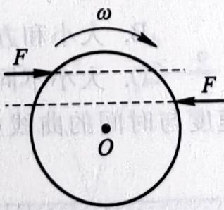
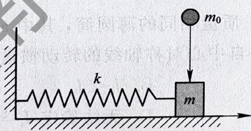
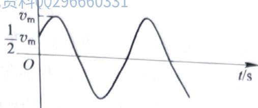
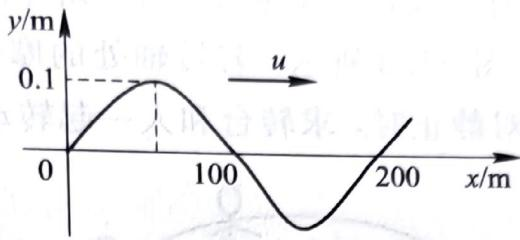
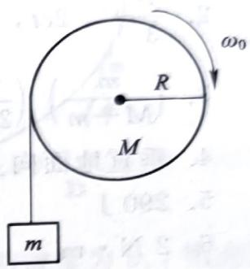
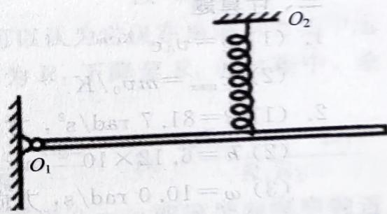

# 南京邮电大学《大学物理Ⅰ》期中模拟试题一

原件经识别和整理；“参考解答”是我们补的。

## 一、选择题（每小题 3 分，共 30 分）

### 选择 1

质点作半径为 $R$ 的变速圆周运动时的加速度大小为（　）（$v$ 表示任一时刻质点的速率）。

- A. $\frac{dv}{dt}$
- B. $\frac{v^{2}}{R}$
- C. $\frac{dv}{dt} + \frac{v^{2}}{R}$
- D. $\left[\left(\frac{dv}{dt}\right)^{2} + \left(\frac{v^{2}}{R^{2}}\right)\right]^{1/2}$

知识点：[自然参数下的切向加速度与法向加速度](../../../topics/大学物理/自然坐标系下的运动.md)、[速度、加速度的定义与微分关系](../../../topics/大学物理/速度与加速度定义.md)、[圆周运动的角量描述（角速度、角加速度）](../../../topics/大学物理/圆周运动描述.md)

### 选择 2

一个作直线运动的物体，其速度 $v$ 与时间 $t$ 的关系曲线如图 F1.1 所示。设时刻 $t_1$ 至 $t_2$ 之间外力做功为 $W_1$，时刻 $t_2$ 至 $t_3$ 之间外力做功为 $W_2$，时刻 $t_3$ 至 $t_4$ 之间外力做功为 $W_3$，则（　）。

- A. $W_1 > 0, W_2 < 0, W_3 < 0$
- B. $W_1 > 0, W_2 < 0, W_3 > 0$
- C. $W_1 = 0, W_2 < 0, W_3 > 0$
- D. $W_1 = 0, W_2 < 0, W_3 < 0$

知识点：[速度、加速度的定义与微分关系](../../../topics/大学物理/速度与加速度定义.md)、[功的定义、功率与质点动能定理](../../../topics/大学物理/功与动能定理.md)、[位矢及其坐标表示（直角坐标与自然坐标）](../../../topics/大学物理/位矢与坐标表示.md)

### 选择 3

有 a 和 b 两个半径相同、质量相同的薄圆筒，其中 a 的质量均匀分布，而 b 的质量分布不均匀，两薄圆筒相对于各自中心对称轴线的转动惯量分别为 $J_{a}$ 和 $J_{b}$，则（　）。

- A. $J_{a} > J_{b}$
- B. $J_{a} < J_{b}$
- C. $J_{a} = J_{b}$
- D. 无法确定 $J_{a}$ 与 $J_{b}$ 的相对大小

知识点：[转动惯量的计算与平行轴定理](../../../topics/大学物理/转动惯量.md)、[刚体定轴转动的角量描述](../../../topics/大学物理/刚体定轴转动运动学.md)

### 选择 4

一圆盘绕着通过盘心且与盘面垂直的光滑固定轴 O 以角速度 $\omega$ 按图 F1.2 所示方向转动。如图所示将两个大小相等、方向相反但不在同一条直线的力 F 沿盘面同时作用到圆盘上，则圆盘的角速度 $\omega$（　）。

- A. 必然减小
- B. 必然增大
- C. 不会改变
- D. 如何变化，不能确定

知识点：[刚体定轴转动定律（M=Jα）](../../../topics/大学物理/刚体转动定律.md)、[角动量定理与角动量守恒定律](../../../topics/大学物理/角动量与角动量守恒.md)

### 选择 5

圆锥摆如图 F1.3 所示，摆球在水平面上作匀速圆周运动。关于摆球的动能、动量和角动量是否守恒有以下说法：（1）动能不变；（2）动量守恒；（3）对 O 点的角动量守恒；（4）对 $OO'$ 轴的角动量守恒。以上说法中正确的是（　）。

- A. (1) (4)
- B. (3) (4)
- C. (2) (3)
- D. (1) (2)

知识点：[动量定理与动量守恒定律](../../../topics/大学物理/动量定理与动量守恒.md)、[角动量定理与角动量守恒定律](../../../topics/大学物理/角动量与角动量守恒.md)

### 选择 6

花样滑冰运动员以自身为竖直轴转动（假设冰面为理想光滑平面），开始时两臂伸开，转动惯量为 $J_{0}$，角速度为 $\omega_{0}$，然后她将两臂收回，使转动惯量减少为 $\frac{1}{3} J_{0}$，这时她转动的角速度变为（　）。

- A. $\frac{1}{3} \omega_{0}$
- B. $\frac{1}{\sqrt{3}} \omega_{0}$
- C. $\sqrt{3} \omega_{0}$
- D. $3 \omega_{0}$

知识点：[角动量定理与角动量守恒定律](../../../topics/大学物理/角动量与角动量守恒.md)、[刚体定轴转动的角量描述](../../../topics/大学物理/刚体定轴转动运动学.md)、[转动惯量的计算与平行轴定理](../../../topics/大学物理/转动惯量.md)

### 选择 7

如图 F1.4 所示，弹簧振子振动到最大位移处时，恰有一质量为 $m_{0}$ 的泥块从正上方落到质量为 $m$ 的物体上，并与物体黏在一起运动，则下述结论正确的是（　）。

- A. 振幅变小，周期变小
- B. 振幅变小，周期不变
- C. 振幅不变，周期变大
- D. 振幅不变，周期变小

知识点：[简谐振动的运动学方程（振幅、角频率、相位）](../../../topics/大学物理/简谐振动运动学.md)、[简谐振动的动力学特征与回复力](../../../topics/大学物理/简谐振动的动力学.md)、[简谐振动的动能、势能与总机械能](../../../topics/大学物理/简谐振动的能量.md)

### 选择 8

在简谐波传播过程中，沿传播方向相距为 $\frac{1}{2}\lambda$（$\lambda$ 为波长）的两点的振动速度必定（　）。

- A. 大小相同，而方向相反
- B. 大小和方向均相同
- C. 大小不同，方向相同
- D. 大小不同，而方向相反

知识点：[平面简谐波的波函数 y=Acos(ω(t±x/u)+φ)](../../../topics/大学物理/平面简谐波方程.md)、[简谐振动的运动学方程（振幅、角频率、相位）](../../../topics/大学物理/简谐振动运动学.md)

### 选择 9

一质点作简谐振动，其运动速度与时间的曲线如图 F1.5 所示。若质点的振动规律用余弦函数描述，则其初相应为（　）。

- A. $\frac{\pi}{6}$
- B. $\frac{5}{6}\pi$
- C. $-\frac{5}{6}\pi$
- D. $-\frac{\pi}{6}$

知识点：[简谐振动的运动学方程（振幅、角频率、相位）](../../../topics/大学物理/简谐振动运动学.md)、[用旋转矢量法确定初相与运动状态](../../../topics/大学物理/旋转矢量法.md)

### 选择 10

图 F1.6 所示为一简谐波在 $t=0$ 时刻的波形图，若波速 $u=200\ \mathrm{m/s}$，则图中 O 点的振动加速度的表达式为（　）。

- A. $a = 0.4\pi^2\cos \left(\pi t - \frac{1}{2}\pi\right)\ \mathrm{m/s^2}$
- B. $a = 0.4\pi^2\cos \left(\pi t - \frac{3}{2}\pi\right)\ \mathrm{m/s^2}$
- C. $a = -0.4\pi^2\cos \left(2\pi t - \pi\right)\ \mathrm{m/s^2}$
- D. $a = -0.4\pi^2\cos \left(2\pi t + \frac{1}{2}\pi\right)\ \mathrm{m/s^2}$

## 二、填空题（每小题 3 分，共 30 分）

知识点：[简谐振动的运动学方程（振幅、角频率、相位）](../../../topics/大学物理/简谐振动运动学.md)、[平面简谐波的波函数 y=Acos(ω(t±x/u)+φ)](../../../topics/大学物理/平面简谐波方程.md)、[速度、加速度的定义与微分关系](../../../topics/大学物理/速度与加速度定义.md)

### 填空 1

已知质点的运动学方程为 $r = \left(5 + 2t - \frac{1}{2}t^{2}\right)i + \left(4t + \frac{1}{3}t^{3}\right)j$（SI）。当 $t = 2\ \mathrm{s}$ 时，加速度的大小为 ____；加速度 $a$ 与 $x$ 轴正方向的夹角 $\alpha =$ ____。

知识点：[速度、加速度的定义与微分关系](../../../topics/大学物理/速度与加速度定义.md)

### 填空 2

在半径为 $R$ 的圆周上运动的质点，其速率与时间关系为 $v = c t^{2}$（式中 $c$ 为常量），则从 $t = 0$ 到 $t$ 时刻质点走过的路程 $S(t) =$ ____；$t$ 时刻质点的切向加速度 $a_{\tau} =$ ____；$t$ 时刻质点的法向加速度 $a_{n} =$ ____。

知识点：[自然参数下的切向加速度与法向加速度](../../../topics/大学物理/自然坐标系下的运动.md)、[圆周运动的角量描述（角速度、角加速度）](../../../topics/大学物理/圆周运动描述.md)、[速度、加速度的定义与微分关系](../../../topics/大学物理/速度与加速度定义.md)

### 填空 3

一质量为 $m$ 的子弹，以水平速度 $v$ 击中一质量为 $M$、起初停在水平面上的木块，并嵌在里面。若木块与水平面间的摩擦系数为 $\mu$，则此后木块在停止前移动的距离为 ____。

知识点：[动量定理与动量守恒定律](../../../topics/大学物理/动量定理与动量守恒.md)、[功的定义、功率与质点动能定理](../../../topics/大学物理/功与动能定理.md)、[常见力（重力、弹力、摩擦力）的受力分析](../../../topics/大学物理/常见力分析.md)

### 填空 4

一质量为 $m$ 的小球 A，在距离地面某一高度处以速度 $v$ 水平抛出，触地后反跳。在抛出 $t$ 秒后小球 A 跳回原高度，速度仍沿水平方向，速度大小也与抛出时相同，如图 F1.7 所示，则小球 A 与地面碰撞过程中，地面给它的冲量的方向为 ____，冲量的大小为 ____。

知识点：[动量定理与动量守恒定律](../../../topics/大学物理/动量定理与动量守恒.md)、[弹性碰撞与非弹性碰撞](../../../topics/大学物理/碰撞问题.md)

### 填空 5

某质点在力 $\mathbf{F}=(4+5x)\mathbf{i}$（SI）的作用下沿 $x$ 轴作直线运动，在从 $x=0$ 移动到 $x=10\ \mathrm{m}$ 的过程中，力 F 所做的功为 ____。

知识点：[功的定义、功率与质点动能定理](../../../topics/大学物理/功与动能定理.md)、[速度、加速度的定义与微分关系](../../../topics/大学物理/速度与加速度定义.md)、[牛顿定律在变力问题中的应用（如 ma_t = -mg sinθ）](../../../topics/大学物理/牛顿定律应用.md)

### 填空 6

已知一质点在平面上运动，作用在质点上的力为 $F = ti + t^{2}j$（SI），第 2 s 末质点的位矢为 $r = 2i + 3j$，则该时刻力 F 对坐标原点的力矩大小等于 ____。

知识点：[力矩的功与刚体定轴转动的动能定理](../../../topics/大学物理/力矩做功.md)

### 填空 7

一作定轴转动的物体，对转轴的转动惯量 $J = 3.0\ \mathrm{kg\cdot m^2}$，角速度 $\omega_0 = 6.0\ \mathrm{rad/s}$。现对物体加一恒定的制动力矩 $M = -12\ \mathrm{N\cdot m}$（负号表示力矩的方向和 $\omega_0$ 方向相反），当物体的角速度减慢到 $\omega = 2.0\ \mathrm{rad/s}$ 时，物体已转过的角度 $\Delta\theta =$ ____。

知识点：[刚体定轴转动定律（M=Jα）](../../../topics/大学物理/刚体转动定律.md)、[刚体定轴转动的角量描述](../../../topics/大学物理/刚体定轴转动运动学.md)

### 填空 8

有一半径为 $R$ 的均质圆形水平转台，可绕通过盘心 $O$ 且垂直于盘面的竖直固定轴 $OO$ 转动，转动惯量为 $J$。台上有一人，质量为 $m$。当他站在离转轴 $r$ 处时（$r < R$），转台和人一起以 $\omega_{1}$ 的角速度转动，如图 F1.8 所示。若转轴处的摩擦可以忽略，当人沿半径向外走到转台边缘并和转台保持相对静止时，求转台和人一起转动的角速度 $\omega_{2} =$ ____。

知识点：[角动量定理与角动量守恒定律](../../../topics/大学物理/角动量与角动量守恒.md)、[转动惯量的计算与平行轴定理](../../../topics/大学物理/转动惯量.md)

### 填空 9

一弹簧振子作简谐振动，振幅为 $A$，周期为 $T$，其运动方程用余弦函数表示。$t = 0$ 时：

(1) 振子在负的最大位移处，则初相为 ____；

(2) 振子在平衡位置向正方向运动，则初相为 ____；

(3) 振子在位移为 $A/2$ 处，且向负方向运动，则初相为 ____。

知识点：[简谐振动的运动学方程（振幅、角频率、相位）](../../../topics/大学物理/简谐振动运动学.md)、[用旋转矢量法确定初相与运动状态](../../../topics/大学物理/旋转矢量法.md)

### 填空 10

两个同方向的简谐振动，周期相同，振幅分别为 $A_{1} = 0.05\ \mathrm{m}$ 和 $A_{2} = 0.07\ \mathrm{m}$，若它们合成为一个振幅为 $A = 0.09\ \mathrm{m}$ 的简谐振动，则这两个分振动的相位差为 ____。

## 三、计算题（每小题 10 分，共 40 分）

知识点：[同方向同频率简谐振动的合成](../../../topics/大学物理/简谐振动的合成.md)

### 计算 1

质量为 $m$ 的子弹以速度 $v_{0}$ 水平射入沙土中，设子弹所受阻力方向与速度相反，大小与速度成正比，比例系数为 $K$，忽略子弹的重力，求：

(1) 子弹射入沙土后，速度随时间变化的函数式；

(2) 子弹进入沙土的最大深度。

知识点：[牛顿定律在变力问题中的应用（如 ma_t = -mg sinθ）](../../../topics/大学物理/牛顿定律应用.md)、[速度、加速度的定义与微分关系](../../../topics/大学物理/速度与加速度定义.md)

### 计算 2

一轴承光滑的定滑轮，质量为 $M = 2.00\ \mathrm{kg}$，半径为 $R = 0.100\ \mathrm{m}$，一根不能伸长的轻绳，一端固定在定滑轮上，另一端系有一质量为 $m = 5.00\ \mathrm{kg}$ 的物体，如图 F1.9 所示。已知定滑轮的转动惯量为 $J = MR^2 / 2$，初始时刻其角速度 $\omega_0 = 10.0\ \mathrm{rad/s}$，方向垂直纸面向里，重力加速度取 $g = 9.8\ \mathrm{m/s^2}$，求：

(1) 初始时刻定滑轮的角加速度的大小和方向；

(2) 定滑轮的角速度变化到 $\omega=0$ 时，物体上升的高度；

(3) 当物体回到原来位置时，定滑轮角速度的大小和方向。

知识点：[刚体定轴转动定律（M=Jα）](../../../topics/大学物理/刚体转动定律.md)、[角动量定理与角动量守恒定律](../../../topics/大学物理/角动量与角动量守恒.md)、[力矩的功与刚体定轴转动的动能定理](../../../topics/大学物理/力矩做功.md)

### 计算 3

质量为 $m$、长为 $l$ 的均匀细杆，可绕通过其一端的固定轴 $O_{1}$ 自由转动，在离轴 $l/\sqrt{3}$ 处有一劲度系数为 $k$ 的轻弹簧与杆连接，弹簧的另一端固定于 $O_{2}$，如图 F1.10 所示。开始时杆刚好处于水平位置且静止。现将杆沿顺时针方向绕 $O_{1}$ 转过一个小角度 $\theta_{0}$，然后放手。证明杆将作简谐运动，并求其周期，写出其振动表达式。

知识点：[刚体定轴转动的角量描述](../../../topics/大学物理/刚体定轴转动运动学.md)、[简谐振动的动力学特征与回复力](../../../topics/大学物理/简谐振动的动力学.md)、[功能原理与机械能守恒定律](../../../topics/大学物理/功能原理与机械能守恒.md)

### 计算 4

一平面简谐波沿 $x$ 轴正向传播，波的振幅 $A = 10\ \mathrm{cm}$，波的角频率 $\omega = 7\ \mathrm{rad/s}$。当时间 $t = 1.0\ \mathrm{s}$ 时，$x = 10\ \mathrm{cm}$ 处的 a 质点正通过其平衡位置向 $y$ 轴负方向运动，而 $x = 20\ \mathrm{cm}$ 处的 b 质点正通过 $y = 5.0\ \mathrm{cm}$ 的位置向 $y$ 轴正方向运动。设该波波长 $\lambda > 10\ \mathrm{cm}$，求该平面波的表达式。

知识点：[机械波的形成、横波与纵波](../../../topics/大学物理/机械波的产生与传播.md)、[平面简谐波的波函数 y=Acos(ω(t±x/u)+φ)](../../../topics/大学物理/平面简谐波方程.md)
